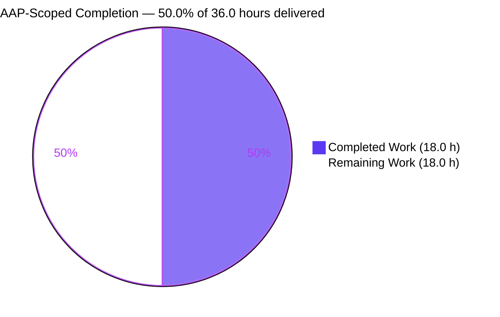
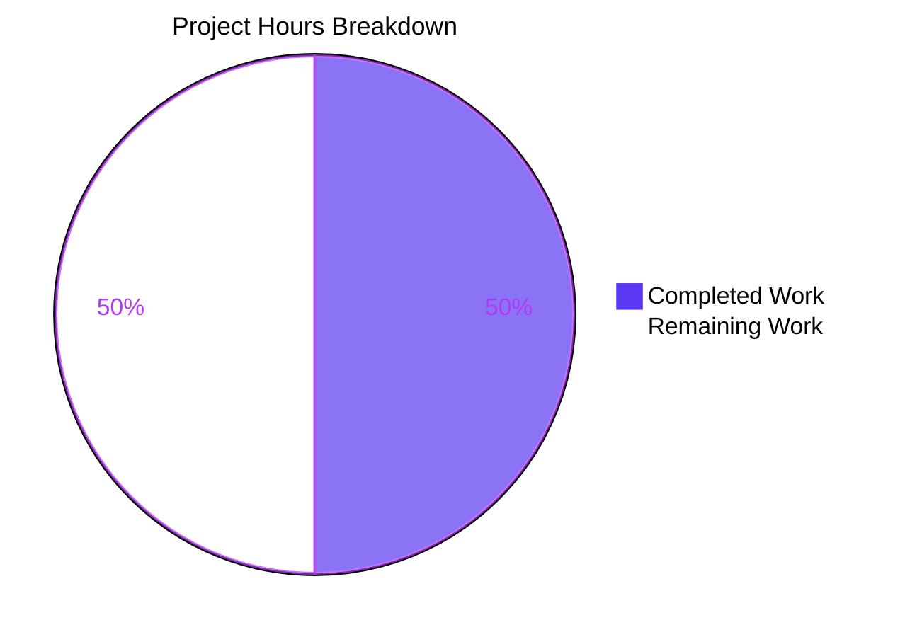
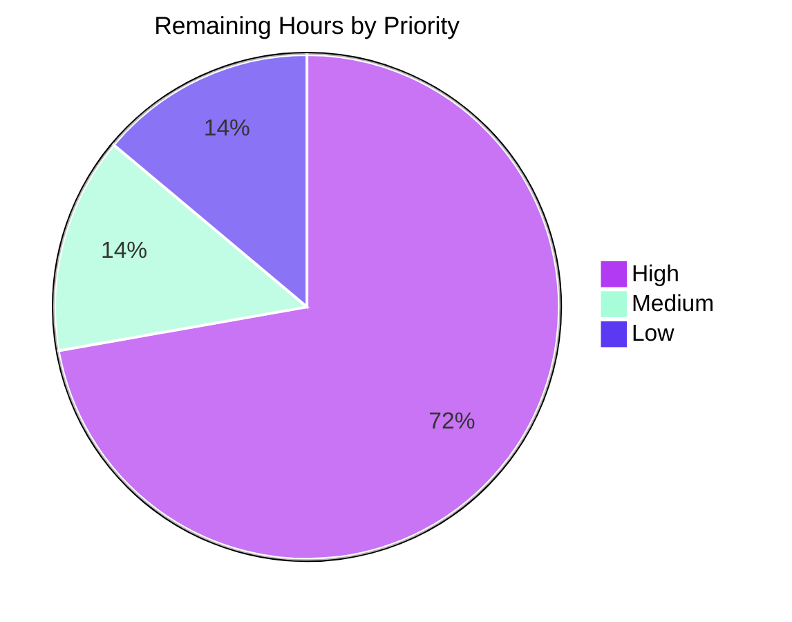

# 1. Executive Summary

## 1.1 Project Overview

`cve-test-fixture` is a one-module Node.js service that answers every HTTP request on port 3000 with `Hello, World!`. This delivery adds the requested capability — a console message when a user performs an action — by treating the inbound request as the action: `logAction(actionName)` sits at module scope in `server.js` and is called once, as the first statement of the request listener, so every parsed request prints `Action performed: <METHOD> <url>` to stdout. Five added lines in one file; the response contract, startup line, port and frozen dependency are untouched, and nothing else was added.

## 1.2 Completion Status



**50.0% complete** — 18.0 hours delivered of 36.0 total hours.

Completion % = 18.0 ÷ (18.0 + 18.0) × 100 = **50.0%**

| Metric | Hours |
|---|---|
| Total Hours | 36.0 |
| Completed Hours (Baseline: Human with agentic-assist) | 18.0 |
| Remaining Hours | 18.0 |

All 22 specification requirements are delivered; the remaining 18.0 hours are path-to-production work the specification placed out of scope.

## 1.3 Key Accomplishments

- ✅ One `Action performed: <METHOD> <url>` line per parsed request — eight methods, repeats and parallel bursts included.
- ✅ Exact bytes: 18-character prefix, method and raw target, one terminating newline.
- ✅ Unconditional: no level, flag, environment variable or configuration can gate it.
- ✅ Response contract unchanged: 200, 14-byte `Hello, World!\n`, no `Content-Type`, every path.
- ✅ Startup line preserved exactly, still once per process.
- ✅ Frozen dependency still installs: `npm ci` resolves `lodash` 4.17.15; `node --check` passes.
- ✅ Log-line integrity: encoded CR/LF stays encoded; refused requests add no line.
- ✅ Five added lines in `server.js`; the pre-change file is reproducible byte for byte.

## 1.4 Critical Unresolved Issues

Six items remain open: **0 of the 2 requested behaviours**, and **6 of 6 release-decision items**, listed below.

| Issue | Impact | Owner | ETA |
|---|---|---|---|
| Frozen `lodash` 4.17.15 carries 5 advisories (1 high); `npm audit --audit-level=high` exits 1 | A red dependency gate on every build; the binding is never invoked, so no vulnerable function is reachable | Dependency owner | Next release |
| A vanished stdout reader ends the process with `Error: write EPIPE`, exit 1 | Outage whenever stdout is piped to a short-lived reader | Backend owner | Next release |
| No automated regression coverage of the log line, its cardinality or the response contract | A future edit can drift silently, or "restore" the pre-change silence as a fix | Test owner | Next release |
| Port 3000 is a hardcoded literal with no override; an occupied port fails startup (`EADDRINUSE` at `server.js:10`) | Cannot coexist with another listener on 3000; no relocation path | Platform owner | Backlog |
| The startup line announces `http://127.0.0.1:3000/` while `listen(3000)` binds all interfaces | Operators reading the log may assume loopback-only exposure | Ops owner | Backlog |
| No `.gitignore`: `node_modules/` and any captured output appear as untracked entries | A blanket `git add` would commit dependencies or evidence artefacts | Repo owner | Backlog |

## 1.5 Access Issues

No access issues identified: no credential, external service or network egress is involved, and every runtime check ran against a locally started process.

## 1.6 Recommended Next Steps

1. [High] Test the line format, the one-line-per-request cardinality and the response contract.
2. [High] Decide the `lodash` pin: move it forward with a regenerated lockfile, or record the acceptance.
3. [High] Guard the stdout write and add a server `'error'` listener.
4. [Medium] Add a `.gitignore` for `node_modules/` and captured output.
5. [Low] Align the startup announcement with the bind address; add an optional port override.

# 2. Project Hours Breakdown

## 2.1 Completed Work Detail

| Component | Hours | Description |
|---|---|---|
| Feature design and integration analysis | 2.0 | Identified the request listener as the only site where a user action executes, confirmed module-scope placement, and settled the `console.log`/parser semantics the verbatim write depends on (`server.js:1-10`). |
| `logAction` function implementation | 1.5 | Module-scope `function logAction(actionName)` whose single statement writes the fixed prefix and the parameter to stdout; no return value, no export, no new module (`server.js:3-5`). |
| Request-listener wiring | 1.0 | One call, `logAction(`${req.method} ${req.url}`)`, as the first statement of the listener body ahead of `res.end`, so the line is emitted for every parsed request of every method and path (`server.js:8`). |
| Static exact-text and preservation verification | 2.5 | Whole-line byte checks of the declaration and call, the 18-character prefix and single trailing newline, a no-gate audit (no conditionals, no `process.env`/`process.argv`, no configuration file), and reproduction of the pre-change file byte for byte by removing the added lines. |
| Runtime acceptance of the action line | 6.0 | Executed runs covering the startup line, zero action lines before the first request, one line per request for `GET /`, `GET /missing?q=1`, `POST /submit`, `HEAD /`, `PUT`, `DELETE` and `OPTIONS`, a ten-request parallel burst, identical repeats and quiet idle windows. |
| Log-integrity and security validation | 3.0 | Encoded CR/LF forging attempts, control and percent-encoded octets, header-injection sentinels, credential sweeps over both streams, and the parser boundary where a refused request produces no line. |
| Browser-level verification of the served response | 1.0 | Real-browser loads of `/` and `/missing?q=1`: status 200, body `Hello, World!` plus one newline, no `Content-Type`, zero console messages and zero failed requests. |
| Dependency and build-gate verification | 1.0 | `npm ci` from the frozen lockfile resolving `lodash` 4.17.15, `node --check server.js`, both manifests byte-identical to the pre-change commit, and the advisory posture recorded rather than changed. |
| **Total** | **18.0** | |

## 2.2 Remaining Work Detail

| Category | Hours | Priority |
|---|---|---|
| Automated regression suite for the log line, per-request cardinality, parser boundary and response contract | 6.5 | High |
| Dependency-advisory decision and dependency move (off `lodash` 4.17.15, regenerated lockfile, contract re-verified) | 4.0 | High |
| Log-sink resilience (guarded stdout write and a server `'error'` listener so a closed pipe or held port does not end the process) | 2.5 | High |
| Repository hygiene: `.gitignore` covering `node_modules/` and captured output | 0.5 | Medium |
| Supervised deployment run-through and run book (restart policy, stdout capture, port-conflict behaviour) | 2.0 | Medium |
| Bind/announcement alignment and an optional port override | 1.5 | Low |
| `Content-Type`/charset decision for browser consumers, or a formal ASCII-only constraint | 1.0 | Low |
| **Total** | **18.0** | |

## 2.3 Estimation Confidence

**Completed hours — high confidence.** Every completed component is bounded by the code that exists: `server.js` is 10 lines / 312 bytes, the diff against the pre-change commit is exactly 5 insertions and 0 deletions, and each estimate is anchored to verification work that was executed against the running process.

**Remaining hours — medium confidence.** The two largest items are well bounded (a test suite for a single-module service at 6.5 h; a dependency move plus lockfile regeneration and re-verification at 4.0 h). The log-sink and deployment items depend on the supervisor the adopting team uses, so they are estimated for a conventional process supervisor rather than a named platform.

**Scope basis.** Hours cover only the work the specification required plus what is needed to run the delivered behaviour as a production service. All 22 specification requirements are delivered; the remaining 18.0 hours are the release-hardening items listed in 2.2, each of which the specification itself placed out of scope, so no hour in this table is repair work on a delivered defect.

# 3. Test Results

The project ships no test runner: `package.json` declares only `name`, `version` and `dependencies`, and there is no test directory, linter or CI gate. Verification is therefore the executed acceptance procedure — the service is started, requests are issued, and the captured stdout plus the HTTP responses are asserted. The 34 checks below were executed against the delivered code; every one passed.

| Area / Category | Framework | Tests | Passed | Failed | Coverage | What This Proves |
|---|---|---|---|---|---|---|
| Action logging — one line per request | Node.js acceptance procedure (shell + `curl` + `od`) | 12 | 12 | 0 | n/a — no coverage instrumentation exists in the project | Every parsed request of every method and path prints exactly one correctly formatted line, including parallel bursts and identical repeats, and nothing is printed before the first request |
| Response contract | Node.js acceptance procedure (`curl -D`, `od`) | 5 | 5 | 0 | n/a | The response is still 200 with the byte-identical 14-byte body `Hello, World!\n`, the header set is unchanged, and no `Content-Type` is sent |
| Startup line and lifecycle | Node.js acceptance procedure (process control, log assertions) | 5 | 5 | 0 | n/a | The startup line is emitted exactly once per process and survives traffic; SIGTERM ends the process cleanly (exit 143) with an empty stderr and the port released |
| Port and configuration boundary | Node.js acceptance procedure (`PORT`, argument, `ss`) | 4 | 4 | 0 | n/a | The port is a hardcoded literal: a `PORT=4000` and `--port=4000` launch still binds only 3000, and 4000 refuses connections |
| Log-line integrity | Node.js acceptance procedure (encoded payloads, raw-socket request) | 4 | 4 | 0 | n/a | Percent-encoded CR/LF stays encoded inside one line — no forged or split record — and a request the parser refuses returns 400 while adding no line |
| Dependency and build gates | `npm ci`, `node --check`, `npm audit` | 3 | 3 | 0 | n/a | The frozen lockfile still installs `lodash` 4.17.15, the file parses, and the advisory posture is reported (1 high-severity package, 5 advisories, fix outside the stated range) rather than silently changed |
| Browser client | Headless Chrome | 1 | 1 | 0 | n/a | The served bytes reach a real browser as status 200 with `Hello, World!` and one trailing newline, no `Content-Type`, zero console messages, zero failed requests, and a plain-text render on both a real and a nonexistent path |
| **Total** | | **34** | **34** | **0** | | |

**Not Covered** — the following are delivered or inherited behaviours that no test in this repository exercises:

- **`logAction` as a unit.** There is no unit-level test of the function in isolation; its contract is asserted through the running service, so a future caller passing a differently shaped argument would not be caught.
- **Sustained load and log volume.** Bursts of ten and sixteen requests were exercised; there is no throttle, level or cap in the design, and no test measures behaviour under sustained traffic or a very large number of requests.
- **Non-ASCII payloads in the log line.** The body is pure ASCII, and the log line carries percent-encoded targets; a decoded non-ASCII target is not exercised, and browsers decode the header-less body as `windows-1252`.
- **Transport security and tunnelling.** No TLS configuration exists and none is exercised; a `CONNECT` request is closed without a response because the process registers no `connect` listener, and that path is untested.
- **Supervised operation.** Restart policy, stdout capture by a supervisor, and behaviour when the stdout reader exits were not exercised as a deployment scenario.
- **Deployment, health and observability surfaces.** No health endpoint, metrics, tracing, log destination or rotation exists to test; their absence is a property of the design, not a gap in the test run.

# 4. Runtime Validation & UI Verification

Every line below is an observation from a live process on the delivered code, with stdout and stderr captured to separate files.

- ✅ **Start-up** — `npm ci` then `node server.js` from the checkout root: the startup line `Server running at http://127.0.0.1:3000/` appears once and the process listens on `*:3000`.
- ✅ **Action logging** — `GET /`, `GET /missing?q=1`, `POST /submit`, `HEAD /`, `PUT /item/7`, `DELETE /item/7` and `OPTIONS /` each returned 200 and added exactly one `Action performed: <METHOD> <url>` line naming that request.
- ✅ **Concurrency and idempotency** — ten parallel requests added exactly ten distinct lines; two identical `GET /` requests produced two separate lines, with no de-duplication and no merged record.
- ✅ **Idle behaviour** — five seconds with no traffic added no line: nothing writes on a timer, and every line is attributable to a request.
- ✅ **Parser boundary** — a raw `GARBAGE\r\n\r\n` request received `HTTP/1.1 400 Bad Request` and added no line, so the log marks parsed requests rather than socket activity.
- ✅ **Log-line integrity** — the encoded-CRLF forging target `/a%0d%0aAction%20performed:%20GET%20/forged` was logged verbatim inside a single line and the forged-line count stayed 0.
- ⚠ **Port override** — `PORT=4000` and `--port=4000` were both ignored: the listener stayed on 3000 and nothing bound 4000 (the hardcoded literal is the specified behaviour, and it removes any relocation path).
- ✅ **Shutdown** — SIGTERM ended the process with exit code 143, empty stderr and port 3000 released; a subsequent boot rebound immediately.
- ✅ **Browser render** — `/` and `/missing?q=1` each returned 200 with `Hello, World!` plus one trailing newline, no `Content-Type`, zero console messages and zero failed requests, rendering as plain text on a blank page (a nonexistent path is answered, not 404).
- ✅ **Dependency install** — `npm ci` exits 0 and resolves `lodash` 4.17.15 from the unchanged lockfile, which the process requires at `server.js:1` before it can bind.

**Never exercised at runtime:** TLS or any transport security (none is configured), a `CONNECT` tunnel (the socket is closed with no response because no `connect` listener is registered), sustained or high-volume traffic (no throttle, level or cap exists), supervised operation with a restart policy or a stdout reader that exits, and a non-ASCII response body — with no `Content-Type` present, a browser decodes the body as `windows-1252`, which is invisible for the current ASCII payload but would mis-render anything else.

# 5. Compliance & Quality Review

## 5.1 Compliance Matrix

| # | Deliverable / Benchmark | Status | Progress | Evidence |
|---|---|---|---|---|
| 1 | Action logging wired to the single site where a user action executes | ✅ Pass | ██████████ 100% | `server.js:8`; one line per parsed request at every scale exercised |
| 2 | Function contract — name, single string parameter, no return value, not exported | ✅ Pass | ██████████ 100% | `server.js:3-5`; no `module.exports`, no second statement, no second caller |
| 3 | Exact line text and byte format — fixed prefix, method and raw target, one trailing newline | ✅ Pass | ██████████ 100% | 23 characters plus one LF for the acceptance request; one 18-character prefix across every line; no timestamp, level, pid or header field |
| 4 | Unconditional execution — no level, flag, environment variable or configuration | ✅ Pass | ██████████ 100% | No conditional construct, no `process.env`/`process.argv`, no configuration file in the tree; line present under a stripped environment |
| 5 | Response contract preserved — 200, byte-identical 14-byte body, no `Content-Type` | ✅ Pass | ██████████ 100% | `server.js:9` unchanged; header set is `Date`, `Connection`, `Keep-Alive`, `Content-Length: 14` on every path |
| 6 | Startup line preserved — exact text, once per process | ✅ Pass | ██████████ 100% | `server.js:10` unchanged; count 1 at boot and after traffic on independent boots |
| 7 | Dependency resolution frozen and installable | ⚠ Partial | ████████░░ 80% | Manifests byte-identical and `npm ci` resolves 4.17.15, but 5 advisories (1 high) remain on the pin |
| 8 | Change footprint — one file, five added lines, no new file, dependency or configuration | ✅ Pass | ██████████ 100% | One file changed, five insertions and zero deletions; three tracked paths; dependency set unchanged |
| 9 | Runtime verification of the delivered behaviour | ✅ Pass | ██████████ 100% | 34 executed checks across logging, response, lifecycle, port, integrity, gates and browser |
| 10 | Log-line integrity and hygiene under hostile input | ✅ Pass | ██████████ 100% | Encoded CR/LF stays encoded; header-supplied text never reaches the log; refusals leak no internals; secrets absent from both streams (LOW residual: client-shaped record text) |
| 11 | Automated regression coverage | ❌ Fail | ░░░░░░░░░░ 0% | No runner, script or CI gate exists; verification is a manual acceptance procedure |
| 12 | Repository hygiene — generated artefacts excluded from version control | ❌ Fail | ░░░░░░░░░░ 0% | No `.gitignore`; `node_modules/` and any captured output appear as untracked entries |

## 5.2 AAP & Rule Divergences and Gaps

No user-specified rules were provided for this work, so no Rule is violated. Six divergences from the specification's stated positions or from standard engineering practice were identified; one is sanctioned by the user's own instruction, four by the specification's explicit exclusions, and one is an unresolved hygiene gap.

| # | What the AAP/Rule Required | What Was Delivered Instead | Why It Diverged | Impact | Remediation |
|---|---|---|---|---|---|
| D1 | Version 1.0.0 behaviour on record: the startup callback is the only console writer, the handler never inspects the request, and there is no per-request side effect | The listener reads `req.method` and `req.url` and writes one line per request (`server.js:8`) | **Sanctioned.** The user's request is newer and more specific and asks for precisely the behaviour those properties exclude; both cannot hold, so the request wins | No change to the response contract; a maintainer holding the old property could mistake line 8 for a regression | Pinned by an automated test that asserts the per-request line is intended (2.2, 6.5 h) |
| D2 | No dependency change: exact pin, unregenerated lockfile, advisories reported and never fixed | `lodash` 4.17.15 kept as pinned with 5 published advisories (1 high) unfixed | The specification freezes the dependency and the advisories are an accepted property of this fixture; a fix would move the pin and rewrite the lockfile the change must not touch | `npm audit --audit-level=high` exits 1; the binding is never invoked, so no vulnerable lodash function is reachable from this code | Move the pin in a separate change (2.2, 4.0 h) or record the acceptance formally |
| D3 | Standard practice: automated tests for delivered behaviour | No test runner, npm script or CI gate was added | The specification explicitly excludes a committed test harness and a `devDependencies` key, to keep the frozen lockfile sound | Regression protection depends on running the acceptance procedure by hand | Add the suite (2.2, 6.5 h) |
| D4 | Secure-logging practice: escape or sanitize values written to a log | `req.method` and the raw `req.url` are written verbatim, with no escaping or truncation | The specification requires verbatim values and shows line integrity comes from the parser rejecting raw CR/LF before the listener; sanitization is excluded | A client shapes the text of one record (CWE-117, LOW); no split or forged record was achieved in any probe | Re-open the decision if the line is ever routed to a durable sink (recorded in the run book, 2.2) |
| D5 | Production-hardening practice: guard writes and handle server errors | A bare `console.log` with no `try`/`catch`, and no `'error'` listener on the server | The specification forbids `try`/`catch` ("nothing here throws") and freezes existing error handling | A vanished stdout reader ends the process with `Error: write EPIPE`, exit 1; an occupied port surfaces an unhandled error | Guarded write plus `'error'` listener (2.2, 2.5 h) |
| D6 | Repository hygiene: keep generated artefacts out of version control | No `.gitignore`; `node_modules/` and any captured output appear as untracked entries | The specification forbids new files, so the omission was left as it stands and files are staged by explicit path | A blanket `git add` would commit dependencies or evidence artefacts | Add `.gitignore` (2.2, 0.5 h) |

**D2 — the frozen dependency carries a high-severity advisory.** `package.json` pins `lodash` at 4.17.15 and `package-lock.json` records the same resolution with its integrity digest, both byte-identical to the pre-change commit. `npm audit --audit-level=high` exits 1 and names five advisories against the pinned range: GHSA-35jh-r3h4-6jhm (CVE-2021-23337), GHSA-p6mc-m468-83gw (CVE-2020-8203), GHSA-29mw-wpgm-hmr9 (CVE-2020-28500), GHSA-r5fr-rjxr-66jc (CVE-2026-4800) and GHSA-xxjr-mmjv-4gpg (CVE-2025-13465), with the fix resolving to a version outside the declared pin. The single reference to the package is the unconditional `require('lodash')` at `server.js:1`, whose binding is never used, so none of the vulnerable functions is reachable from this code. A team whose pipeline gates on `npm audit` must either accept this in writing or schedule the pin move, which also regenerates the lockfile and must re-run the contract checks.

**D3 — no automated regression coverage exists.** The repository declares no `scripts` block, no `devDependencies` and no test directory, so the delivered behaviour is guarded only by re-running the acceptance procedure described in Section 9. The specification deliberately ships no harness — adding a `devDependencies` key without regenerating the lockfile would make `npm ci` fail — but the consequence is that the byte-level line contract, the one-line-per-request cardinality and the 200 / 14-byte / no-`Content-Type` response are all unprotected against a future edit. The remedy is a small `node:test` suite wired to an npm script plus a regenerated lockfile; until then, any change to `server.js` needs the Section 9 procedure run by hand.

**D5 — the process has no guard around its only output path.** `logAction` writes through the global `console.log` with no `try`/`catch`, and the server registers no `'error'` listener, both deliberately preserved by the specification. The observable consequence is that a stdout reader which exits mid-run makes the next write raise an unhandled `EPIPE` and the process ends with exit 1, and an occupied port surfaces as an unhandled `EADDRINUSE` at `server.js:10`. Neither is a correctness defect in the log line, but both turn an environmental event into an outage for a service whose whole purpose is to keep logging requests. The remedy is a guarded write and a server `'error'` handler, with the same line text and the same once-per-request cardinality preserved.

**D4 — logged values are client-controlled within one record.** The specification requires `req.method` and the raw, undecoded `req.url` to be written verbatim, and it is right about line integrity: a request carrying a raw carriage return or line feed is refused with `400 Bad Request` before the listener runs, and percent-encoded forms such as `%0d%0a` stay encoded inside the single LF-terminated line. The residual is that a client still chooses the text of its own record — including a request target that mimics a line prefix — which is a low-severity CWE-117 exposure that no probe could escalate to a split or forged record. If the line is ever routed to a durable sink or a log aggregator, this decision must be revisited together with escaping and length limits.

**D6 — generated artefacts are not excluded.** The repository has no `.gitignore`, so an install leaves `node_modules/` untracked and any capture written inside the checkout appears the same way; the delivered commit was staged by explicit path to avoid both. The gap is small but real for the next contributor: a blanket `git add` would commit the dependency tree or evidence files. A three-line `.gitignore` settles it, and until then the rule is to stage `server.js`, `package.json` and `package-lock.json` by name.

# 6. Risk Assessment

Risks below are forward-looking: what can still go wrong when this service is run. Each is a property of the delivered code or of the fixture it lives in.

| Risk | Category | Severity | Probability | Mitigation | Status |
|---|---|---|---|---|---|
| The frozen `lodash` 4.17.15 pin carries 5 published advisories (1 high) and `npm audit --audit-level=high` exits 1 | Security | High | Medium | Move the pin in a separate change (regenerating the lockfile and re-verifying the contract) or record the acceptance; the binding is never invoked, so no vulnerable lodash function is reachable from this code | Open — accepted |
| A stdout reader that exits mid-run makes the next write raise unhandled `EPIPE` and ends the process (exit 1) | Operational | Medium | Medium | Guard the write and add a server `'error'` listener; capture stdout to a file or a supervisor that outlives the process | Open |
| No automated regression coverage guards the line format, one-line-per-request cardinality or the response contract | Technical | Medium | High | Add a `node:test` suite plus an npm script and run the acceptance procedure on every change until then | Open |
| One line per parsed request with no level, sampling or cap, so an unauthenticated client drives unlimited stdout volume and up to ~8 KB per line | Operational | Medium | Medium | Acceptable for a fixture; add levels, rate limits and length limits before any real traffic | Open — accepted |
| The listener binds all interfaces on port 3000 with no authentication, while the startup line announces `127.0.0.1` | Security | Medium | Medium | Restrict the bind address or firewall the port, and correct the announcement so operators judge exposure from the log correctly | Open |
| Port 3000 is a hardcoded literal: an occupied port is a startup failure (`EADDRINUSE` at `server.js:10`) with no relocation path | Operational | Medium | Medium | Add an optional port override, or run each instance in its own network namespace | Open |
| `node_modules/` and any capture written inside the checkout appear as untracked entries because the repository has no `.gitignore` | Technical | Low | Medium | Add a `.gitignore`; until then stage `server.js`, `package.json` and `package-lock.json` by explicit path | Open |
| With no `Content-Type`, browsers decode the body as `windows-1252` | Integration | Low | Low | Harmless for the current ASCII body; decide a charset before the body can carry non-ASCII text | Open |

# 7. Visual Project Status

**Hours delivered against hours remaining (AAP-scoped, 36.0 h total):**



**Remaining work by priority (18.0 h total):**



| Remaining category | Hours | Priority | Share of remaining |
|---|---|---|---|
| Automated regression suite | 6.5 | High | 36.1% |
| Dependency-advisory decision and dependency move | 4.0 | High | 22.2% |
| Log-sink resilience | 2.5 | High | 13.9% |
| Supervised deployment run-through and run book | 2.0 | Medium | 11.1% |
| `.gitignore` and repository hygiene | 0.5 | Medium | 2.8% |
| Bind/announcement alignment and port override | 1.5 | Low | 8.3% |
| `Content-Type`/charset decision | 1.0 | Low | 5.6% |
| **Total remaining** | **18.0** | | **100%** |

**Delivered against requested.** All 22 requirements drawn from the specification are met, and every behaviour the user asked for is verifiable from the running service. The 50.0% figure in 1.2 is the share of the full 36.0-hour scope — the delivered feature plus the path-to-production work the specification placed out of scope — so the remaining hours are release hardening, not unfinished feature work.

# 8. Summary & Recommendations

**What was delivered.** The service now logs the action a user performs. Because the only action this system offers is an inbound HTTP request, the message is produced by the request handler itself: `logAction(actionName)` is declared at module scope in `server.js` and called once, as the first statement of the listener, so every parsed request prints `Action performed: <METHOD> <url>` to stdout before the response is written. The line's byte contract is exact — an 18-character prefix, the request's method and raw target, one terminating newline, 23 characters for `GET /` — and the print is unconditional, with no level, flag, environment variable or configuration that could gate it. The change is five added lines in one file, and removing those lines reproduces the pre-change file byte for byte.

**What was verified.** 34 executed checks covered the delivered behaviour: one line per parsed request across eight methods, query strings, absolute-form targets, identical repeats, a ten-request parallel burst and quiet idle windows; the untouched response contract of 200 with a 14-byte `Hello, World!\n` body and no `Content-Type`; the once-per-process startup line; a clean SIGTERM shutdown that releases the port; the literal port that ignores both an environment variable and an argument; and log-line integrity, where percent-encoded CR/LF stays encoded inside a single line and a request the parser refuses produces no line at all. A real browser confirmed the served bytes arrive as 200 with no console messages and no failed requests, and the frozen lockfile still installs `lodash` 4.17.15.

**What remains.** The requested behaviour is complete; the remaining 18.0 hours are the work needed to run it as a production service rather than as a fixture. The critical path runs through three items: an automated suite that pins the line format, the cardinality and the response contract (6.5 h), an explicit decision on the frozen dependency, whose five advisories include one high-severity finding that makes `npm audit --audit-level=high` exit 1 (4.0 h), and resilience around the only output path so a closed stdout reader or a held port no longer ends the process (2.5 h). Repository hygiene, a supervised run-through, bind/port alignment and a charset decision follow at lower priority.

| Success metric | Result |
|---|---|
| AAP-scoped completion (hours based) | 50.0% — 18.0 h delivered of 36.0 h |
| Specification requirements met | 22 of 22 |
| Executed verification checks | 34 of 34 passed, 0 failed |
| Change footprint | 1 file, 5 insertions, 0 deletions, 0 new files, 0 dependency changes |
| Response-contract drift | None — 200, 14-byte body, no `Content-Type` on every method and path |
| Log-line cardinality | Exactly one line per parsed request at every scale exercised; 0 lines without a request |
| Open release items | 6, all accepted residuals listed in 1.4 |

**Production readiness.** Ready for its stated purpose as a fixture and for any environment that accepts the dependency advisory posture and an unguarded stdout write. Not ready, without the three high-priority items, for a pipeline that gates on `npm audit`, or for a supervisor that pipes stdout into a reader that may exit. The recommendations in 1.6 and the task breakdown in 2.2 are the path from here to that state; nothing in them requires reworking the delivered code, only hardening around it.

# 9. Development Guide

## 9.1 System Prerequisites

- **Node.js** — the project has no `engines` field and no `.nvmrc`; it runs on any Node.js that supports CommonJS and `http.createServer`. It was built and exercised on **v22.23.5**.
- **npm** — **11.21.3** was used; `npm ci` requires npm 7 or later for `lockfileVersion: 3`.
- **curl** — for the verification requests (any recent curl; 8.x was used).
- No database, cache, message broker, container runtime, cloud service, credential, secret or environment variable is involved. Nothing outside the checkout needs to be running.

## 9.2 Environment Setup and Install

There is no build step, no compiler, no bundler and no output directory. From the checkout root:

```bash
cd <checkout>
npm ci                       # installs lodash 4.17.15 exactly per package-lock.json
node --check server.js       # syntax gate: exits 0 with no output
```

`npm ci` is a hard precondition rather than a convenience: `server.js:1` requires `lodash` before anything binds, so without `node_modules` the process exits 1 with `Error: Cannot find module 'lodash'` at `server.js:1:11`.

Do not run `npm audit fix`, do not change the `lodash` pin and do not regenerate the lockfile — the pin and the lockfile resolution are the frozen dependency contract. `npm audit --audit-level=high` exits 1 on the pinned version; that is the expected posture, reported rather than fixed.

## 9.3 Start-up

The port is a hardcoded literal (`listen(3000, …)` at `server.js:10`) with no environment variable or argument override, so the process needs TCP port 3000 free.

```bash
cd <checkout>
node server.js > "$HOME/action-log.stdout" 2> "$HOME/action-log.stderr" &
SERVER_PID=$!
until grep -q '^Server running at http://127.0.0.1:3000/$' "$HOME/action-log.stdout"; do sleep 0.2; done
```

The first line of the capture is `Server running at http://127.0.0.1:3000/`, printed once per process. Readiness is determined from the log rather than by probing the port, so no request is issued before the run you intend to measure.

If port 3000 is already taken — on a shared host, for instance — give the process its own network namespace, which keeps the hardcoded port private:

```bash
unshare -rn bash -c 'ip link set lo up; node server.js > "$HOME/ns.stdout" 2>&1 & until grep -q "^Server running" "$HOME/ns.stdout"; do sleep 0.2; done; curl -s -D - http://127.0.0.1:3000/; grep -c "^Action performed: GET /$" "$HOME/ns.stdout"; kill %1'
```

`ip link set lo up` is mandatory: a fresh namespace starts with loopback down, and curl then reports status `000` even though the server is listening.

## 9.4 Verification Steps

```bash
# 1. the untouched response contract
curl -s -D - http://127.0.0.1:3000/
#    HTTP/1.1 200 OK
#    Date: …
#    Connection: keep-alive
#    Keep-Alive: timeout=5
#    Content-Length: 14
#    (blank line)
#    Hello, World!
#    ... and deliberately no Content-Type header

# 2. the action line for that request
grep -c '^Action performed: GET /$' "$HOME/action-log.stdout"     # 1

# 3. other methods and paths, each adding exactly one line
curl -s -o /dev/null -X POST -d 'x=1' http://127.0.0.1:3000/submit    # 200
curl -s -o /dev/null -I http://127.0.0.1:3000/                        # 200
curl -s -o /dev/null 'http://127.0.0.1:3000/missing?q=1'              # 200
grep -c '^Action performed:' "$HOME/action-log.stdout"                # 4

# 4. exactly one line per request, one identical prefix, no stray lines
grep '^Action performed:' "$HOME/action-log.stdout" | cat -A
grep -vc -E '^(Server running at http://127.0.0.1:3000/|Action performed: .*)$' "$HOME/action-log.stdout"   # 0

# 5. a refused request adds no line
python3 -c "import socket;s=socket.create_connection(('127.0.0.1',3000));s.sendall(b'GARBAGE\r\n\r\n');print(s.recv(120))"
#    b'HTTP/1.1 400 Bad Request\r\nConnection: close\r\n\r\n'

# 6. stop the server and confirm a clean exit
kill "$SERVER_PID"; wait "$SERVER_PID"; echo $?     # 143 (SIGTERM), stderr empty
```

## 9.5 Example Usage

```bash
# one request, two lines of evidence
curl -s http://127.0.0.1:3000/                       # Hello, World!
tail -n 2 "$HOME/action-log.stdout"
# Server running at http://127.0.0.1:3000/
# Action performed: GET /

# the line names the action it reports
curl -s -X POST -d 'x=1' http://127.0.0.1:3000/submit
tail -n 1 "$HOME/action-log.stdout"                  # Action performed: POST /submit

# any path, including one that does not exist
curl -s 'http://127.0.0.1:3000/a/b?q=1'              # Hello, World!
tail -n 1 "$HOME/action-log.stdout"                  # Action performed: GET /a/b?q=1
```

Every line goes to stdout (file descriptor 1) and nothing goes to stderr; capture stdout with a file or a supervisor that outlives the process. The line carries no timestamp, level or correlation identifier by design, so it is a per-process stream rather than a queryable record.

## 9.6 Troubleshooting

| Symptom | Cause | Resolution |
|---|---|---|
| `Error: Cannot find module 'lodash'` at `server.js:1:11`, exit 1, nothing binds | `node_modules` is absent | Run `npm ci` from the checkout root |
| `Error: listen EADDRINUSE: address already in use :::3000` at `server.js:10:4`, exit 1 | Port 3000 is held; it is a hardcoded literal with no override | Stop the process holding the port, or run this one under `unshare -rn` as in 9.3 |
| `Error: write EPIPE` and the process exits 1 after a log line | The reader on the other end of stdout exited | Capture stdout to a file or a supervisor that outlives the process; the write is unguarded by design |
| `curl` returns status `000` inside a namespace | Loopback is down in the fresh namespace | `ip link set lo up` before starting the server |
| `grep -c '^Action performed:'` is lower than the number of requests | Requests were refused by the parser (malformed request line) rather than reaching the listener | Expected: only parsed requests are logged; inspect the client's request line |
| `npm audit --audit-level=high` exits 1 | The pinned `lodash` 4.17.15 carries published advisories | Expected and accepted; do not run `npm audit fix` — it moves the pin and rewrites the lockfile |
| `git status --short` shows `?? node_modules/` | The repository has no `.gitignore` | Expected; stage `server.js`, `package.json` and `package-lock.json` by explicit path |

# 10. Appendices

## A. Command Reference

| Command | Purpose | Expected result |
|---|---|---|
| `npm ci` | Install the frozen dependency tree from `package-lock.json` | Exit 0, "added 1 package", `lodash` 4.17.15 |
| `node --check server.js` | Syntax gate — the only static check the project has | Exit 0, no output |
| `node server.js` | Start the service (long-running) | Startup line on stdout, listener on `*:3000` |
| `curl -s -D - http://127.0.0.1:3000/` | Inspect the response, headers included | `HTTP/1.1 200 OK`, `Content-Length: 14`, body `Hello, World!`, no `Content-Type` |
| `curl -s -o /dev/null -X POST -d 'x=1' http://127.0.0.1:3000/submit` | Exercise a non-GET method | 200 and one `Action performed: POST /submit` line |
| `curl -s -o /dev/null -I http://127.0.0.1:3000/` | Exercise `HEAD` | 200 and one `Action performed: HEAD /` line |
| `grep -c '^Action performed: GET /$' "$HOME/action-log.stdout"` | Count the acceptance line | 1 per `GET /` request |
| `grep -vE '^(Server running at http://127.0.0.1:3000/|Action performed: .*)$' "$HOME/action-log.stdout"` | Find stray lines | No output |
| `npm audit --audit-level=high` | Report the dependency advisory posture | Exit 1, 1 high-severity package, 5 advisories — reported, never fixed |
| `unshare -rn bash -c 'ip link set lo up; node server.js'` | Run with the hardcoded port private to one namespace | Startup line, listener reachable only inside the namespace |

## B. Port Reference

| Port | Protocol | Direction | Notes |
|---|---|---|---|
| 3000 | TCP / HTTP | Inbound | Hardcoded literal at `server.js:10`; binds all interfaces; no environment variable or argument override exists |

Because the port cannot be relocated, a second instance on the same host fails with `EADDRINUSE` at `server.js:10:4`. On a shared host, run each instance inside its own network namespace (`unshare -rn`) and bring loopback up before starting it.

## C. Key File Locations

| Path | Role |
|---|---|
| `server.js` | The whole application: `logAction` declaration at lines 3-5, request listener at 7-10, the action-line call at line 8, the response at line 9, the startup callback at line 10 |
| `package.json` | Manifest: `name`, `version` and the exact `lodash` pin; no `scripts`, `main`, `engines`, `type` or `devDependencies` |
| `package-lock.json` | Lockfile: the frozen `lodash` 4.17.15 resolution and integrity digest |
| `node_modules/` | Install output, untracked and never committed; absent until `npm ci` runs |

## D. Technology Versions

| Component | Version | Source |
|---|---|---|
| Node.js | v22.23.5 | `node --version` on the build host |
| npm | 11.21.3 | `npm --version` on the build host |
| `lodash` | 4.17.15 (exact pin) | `package.json` line 5 and `package-lock.json` |
| Module system | CommonJS (`require`) | `server.js:1`, `server.js:7` |
| HTTP server | Node core `http` | `server.js:7` |
| Build, lint, test tooling | None | No `scripts`, no `devDependencies`, no configuration file |

## E. Environment Variable Reference

| Variable | Read by the code? | Effect |
|---|---|---|
| (none) | No | `process.env` and `process.argv` appear nowhere in the repository; there is no `.env`, no `.npmrc` and no configuration file |
| `PORT` | No | Ignored — the port is the literal `3000`; setting `PORT=4000` still binds 3000 |

The only configuration this feature has is silence: nothing in the project can gate, redirect, re-level or silence the action line.

## F. Developer Tools Guide

The repository ships no linter, formatter, test runner, bundler or CI workflow, and adding one would change the dependency contract. The working substitutes are:

- **Syntax check** — `node --check server.js`, which needs no dependency and catches parse errors.
- **Acceptance procedure** — the commands in 9.4: start the process with stdout and stderr captured separately, issue the requests, and assert on the captured lines rather than on HTTP status alone (a green 200 is produced by the pre-existing handler whether or not the log call exists).
- **Byte inspection** — `od -c`, `cat -A` and `grep -c` are what the exact-text and cardinality contracts are asserted with.
- **Raw-socket probes** — `python3 -c` with a one-line socket script when a request must be sent outside curl's normalisation, for example to check that the parser refuses a malformed request line.

## G. Glossary

| Term | Meaning |
|---|---|
| Action line | The per-request stdout line `Action performed: <METHOD> <url>` produced by `logAction` |
| Startup line | The once-per-process line `Server running at http://127.0.0.1:3000/` emitted from the `listen` callback |
| `logAction` | The module-scope function that formats and prints the action line; one parameter, no return value, not exported |
| Parsed request | An HTTP request whose request line and headers the parser accepted; only these reach the listener and therefore the log |
| Parser boundary | The point at which malformed input is refused with `400 Bad Request` before the listener runs, so no line is produced |
| Frozen dependency | The exact `lodash` 4.17.15 pin plus its lockfile resolution and integrity digest, kept byte-identical by this change |
| Acceptance procedure | The executed start–request–assert sequence used to verify the feature, since the project ships no test runner |
| `EPIPE` | The error raised when writing to a pipe whose reader has exited; the process ends with exit 1 because the write is unguarded |
| Network namespace | An isolated network stack (`unshare -rn`) that gives the hardcoded port 3000 a private instance on a shared host |
