# Technical Specification

# 1. Introduction

## 1.1 Executive Summary

`cve-test-fixture` version 1.0.0 is a deliberately minimal, self-contained Node.js package whose function is to act as a reproducible target for software-composition-analysis (SCA) and dependency-vulnerability workflows. The complete package is three files totalling 33 lines and 826 bytes: `server.js` (a five-line CommonJS HTTP server), `package.json` (the npm manifest), and `package-lock.json` (the resolution lockfile). No other source, folder, configuration, test, or pipeline file exists in the repository.

The system's identity rests on two properties, both established by its files rather than by documentation:

| Aspect | Value |
|---|---|
| Package identity | `cve-test-fixture` 1.0.0, flat structure, no sub-folders |
| Runtime entry point | `node server.js` — no `main` field and no npm script is declared |
| Network surface | One HTTP listener on TCP port 3000 at the IPv6 wildcard `:::3000` (all interfaces) |
| Response behavior | HTTP `200` with a fixed 14-byte body `Hello, World!\n` and no `Content-Type` header, for every path, method, header, and body |
| Dependency graph | Exactly one external package, `lodash`, pinned exactly to `4.17.15` |
| Scanner signal | `npm audit` reports 1 high-severity direct vulnerability covering 6 advisories, with fix available at `lodash` 4.18.1 |
| Configuration and operations | No environment variables, no config files, no logging, no shutdown handling, no tests, no license |

#### The Business Problem Addressed

The core problem this system solves is **determinism in dependency-vulnerability detection and remediation testing**. A scanner, dependency-upgrade bot, SBOM generator, or CI security gate needs a target whose answer is already known: an artifact that resolves to one exactly identified vulnerable version, in known manifest and lockfile formats, with no unrelated code that could produce confounding findings. This fixture supplies precisely that, and three independent artifacts establish the intent:

- The package name `cve-test-fixture` in `package.json` and `package-lock.json` declares the artifact as a vulnerability test fixture rather than a product.
- The repository's original README, deleted in commit `f3600a8` and surviving only in git history, read exactly `# hello_world_repo_withMinorCVE` — naming both the trivial "hello world" runtime and the "minor CVE" it is designed to carry.
- The dependency is pinned exactly (`"lodash": "4.17.15"`, no caret, tilde, or range), so every install resolves to the same vulnerable release rather than floating to a patched one, and the lockfile records the precise tarball URL and SHA-512 integrity hash for that release.

Because the runtime ignores its input entirely — the request listener discards `req` and always ends the response with the same constant string — scan results cannot be attributed to application logic. The only measurable behavior in the fixture is the dependency finding itself.

#### Key Stakeholders and Users

No users, customers, or operating teams are named anywhere in the repository; there is no `author`, `repository`, `license`, or `description` field in the manifest. Stakeholders are therefore inferred from the artifact's design and are all technical consumers of its scan output.

| Stakeholder | Interest in the fixture | How they use it |
|---|---|---|
| Security / AppSec engineers | Validating that advisories are detected and surfaced correctly | Run SCA tooling such as `npm audit` against the checkout and assert on the finding set |
| DevSecOps and CI/CD engineers | Proving the security gate fails when a vulnerable dependency is present | Wire the install plus scan into a pipeline stage and verify the non-zero exit and blocking behavior |
| Dependency-management and remediation tooling owners | Verifying automated upgrade proposals | Confirm a bot detects the pin and proposes the fixed version (observed as `lodash` 4.18.1) |
| Developers of the scanning product itself | Regression-testing scanner behavior and report accuracy | Use the fixture as a stable, small, predictable integration input |
| Maintainers of this repository | Keeping the fixture reproducible and intentionally vulnerable | Control the pin and lockfile so the intended finding does not drift |

#### Expected Business Impact and Value Proposition

The value proposition is engineering confidence obtained cheaply: three files and one dependency provide an unambiguous, fast-to-install regression target for security tooling, with no service dependencies, no credentials, no data, and no deployment. Concretely, the fixture delivers:

- **A known and stable answer.** Exactly one vulnerable package, exactly one severity bucket in the aggregate report (1 high, 0 critical, 0 moderate, 0 low), so a scanner either reproduces that finding or is demonstrably wrong.
- **Fast, hermetic provisioning.** `npm install` resolves a single package; the lockfile's `lockfileVersion` 3 schema pinning the registry tarball and integrity digest makes installs comparable across machines and points in time.
- **A safe test target.** The runtime exposes only a constant-string HTTP response, carries no data, no authentication, and no persistence, so exercising vulnerable-dependency workflows against it poses negligible operational risk. Notably, the vulnerable `lodash` binding on line 1 is never referenced, so the advisories are detectable by composition analysis while being unreachable from application logic.
- **A dependency-upgrade baseline.** With `fixAvailable` reported as `lodash` 4.18.1 and `isSemVerMajor` false, the fixture also exercises the non-breaking remediation path.

The fixture is not a service, product, or platform: it produces no business revenue, has no user base, and carries no declared performance, availability, or support commitments. Its measurable contribution is the correctness and repeatability of the security tooling validated against it.


## 1.2 System Overview

### 1.2.1 Project Context

**Business Context and Market Positioning.** `cve-test-fixture` is not a commercial product; it is an internal engineering asset positioned in the security-tooling supply chain as a *known-answer test target* for dependency vulnerability analysis. Its placement is deliberate and narrow: it is the smallest possible npm package that still produces a real, verifiable vulnerability finding. The name in `package.json` and `package-lock.json` states the role directly, and the repository's only historical statement of purpose — the README deleted in commit `f3600a8`, which read `# hello_world_repo_withMinorCVE` — ties the "hello world" runtime to the "minor CVE" it is built to carry.

The context in which it operates is the ordinary security-review life cycle of a JavaScript dependency graph: manifest and lockfile are read, the dependency tree is resolved, advisories are matched against resolved versions, and a decision to block or upgrade follows. The fixture occupies the single point in that flow where a tool must produce a *correct known result*. Its market position is therefore best described as a conformance and regression artifact, comparable to a reference implementation or a golden fixture.

**Current System Limitations.** No prior system is being replaced or upgraded. The repository is greenfield: all five commits are dated 2026-09-22 and were authored in a single 14:11–14:16 session, and every reference (local `main`, working branch `0210_01`, `origin/main`, `origin/2209_01`, `origin/0210_01`) resolves to the identical tree `f0dd6ae85e3d68490fe77c66dbc509fef21ba6bf`. There is no legacy code path, no migration, and no deprecation surface.

The limitations that matter are inherent to the fixture's design, and each bounds what the artifact can validate:

| Limitation | Evidence | Consequence for use |
|---|---|---|
| No declared entry point or scripts | `package.json` has no `main`, `scripts`, `engines`, or `private` field; git tree is exactly `server.js`, `package.json`, `package-lock.json` | No `npm start`, no `npm test`, no build step — consumers must invoke `node server.js` directly |
| No automated tests | No test files anywhere in the tree or in any branch | The fixture cannot self-verify; assertions must be written by the consuming pipeline |
| Only one dependency and one finding | Sole dependency `lodash` exact-pinned to `4.17.15`; `npm audit` total is 1 | Cannot exercise transitive-dependency depth, multi-package findings, or severity mixing (0 critical, 0 moderate, 0 low) |
| Vulnerable code is unreachable | Line 1 of `server.js` binds `require('lodash')` to `_`, which no later statement references | Detects composition-analysis findings only; cannot validate reachability or runtime-exploit detection |
| No `Content-Type` header | Runtime probe returned `HTTP/1.1 200 OK`, `Content-Length: 14`, and no `Content-Type` | Not a usable web endpoint where content negotiation is expected |
| No error handling or shutdown path | A second instance crashed at `server.js:5:4` with unhandled `EADDRINUSE`; no `error` listener, no signal handling | Unsuitable as a resilient service; port conflicts abort the process |
| No configuration, logging, or observability | No config files, no environment-variable reads, no logging beyond one startup `console.log` | Cannot be tuned, monitored, or adapted per environment |

**Integration with the Existing Enterprise Landscape.** The repository contains no connectors — no credentials, no databases, no APIs, no message brokers, no identity integration, and no network calls other than serving HTTP. Its entire enterprise integration surface is three file-based contracts, all consumed externally by whatever tooling an organization already runs.

| Integration point | Artifact consumed | Consumer type |
|---|---|---|
| Dependency and advisory scanning | `package.json`, `package-lock.json` | SCA scanners, `npm audit`, SBOM and vulnerability-report generators |
| CI/CD security gating | Non-zero exit and finding count produced during install and scan | Pipeline stages that block a merge or release on a high-severity finding |
| Automated remediation | Exact pin and resolved version metadata in both manifest and lockfile | Dependency-update bots proposing the upgrade to `lodash` 4.18.1 |
| Runtime smoke testing (optional) | `server.js` process listening on port 3000 | Probes verifying that a provisioned artifact starts and responds |

The lockfile reinforces this integration by pinning the exact registry tarball `https://registry.npmjs.org/lodash/-/lodash-4.17.15.tgz` and its SHA-512 integrity digest, so a scan run in a pipeline resolves the same vulnerable bytes as a scan run on a developer machine. Beyond these file contracts, the fixture neither depends on nor communicates with any other enterprise system.

### 1.2.2 High-Level Description

**Primary System Capabilities.** The fixture has exactly two capabilities, and both are minimal by design.

1. **Declare one exactly pinned vulnerable dependency.** `package.json` names the package `cve-test-fixture` at version `1.0.0` and declares `"lodash": "4.17.15"` as its only dependency. The pin carries no range operator, so no install can drift to a patched release, and the absence of dev, peer, and optional dependency blocks keeps the resolved graph at a single package.
2. **Lock that resolution reproducibly.** `package-lock.json` records `lockfileVersion` 3 (the npm v7+ schema) with `requires: true`, a project-root entry under `packages[""]` restating the same pin, and one resolved entry `packages["node_modules/lodash"]` giving version `4.17.15`, the registry tarball URL, the SHA-512 integrity digest, and the `MIT` license.

Serving HTTP is a supporting behavior, not a capability of the security artifact: the server exists to make the repository a runnable "hello world" package and to give the fixture a live process, and its response is a constant that reveals nothing about the dependency finding.

**Major System Components.** The system comprises three files and one external package, with no internal module boundaries, no sub-folders, and no shared libraries.

| Component | Kind | Responsibility |
|---|---|---|
| `server.js` | Runtime source (CommonJS, 5 lines) | Loads `lodash`, creates the HTTP listener, serves the constant response |
| `package.json` | Manifest (7 lines) | Declares identity `cve-test-fixture` 1.0.0 and the exact `lodash` 4.17.15 pin |
| `package-lock.json` | Lockfile (21 lines) | Freezes the resolved dependency version, tarball URL, and integrity digest |
| `lodash` 4.17.15 | External runtime dependency | The vulnerable package under test; loaded but never invoked |
| Node.js core `http` | Platform module | Provides `createServer` and the socket listener; not a declared dependency |

**Core Technical Approach.** A single CommonJS module is executed directly by the Node.js runtime. On load it resolves `lodash` from `node_modules` and binds it to the module-scope identifier `_`, then constructs an HTTP server inline from the core `http` module and calls `listen(3000)`, with the startup notification emitted from the socket's `listening` event. Every inbound request is answered by the same two-step function: ignore the request object, end the response with the constant `Hello, World!\n`. Dependency risk is expressed declaratively — entirely in the manifest and lockfile — rather than through any code path, which is what makes the finding reproducible and independent of runtime input.

```js
const _ = require('lodash');                                  // line 1: pinned vulnerable dependency
require('http').createServer((req, res) => {                  // line 3: inline core-module server
  res.end('Hello, World!\n');                                 // line 4: constant 14-byte body
}).listen(3000, () => console.log('Server running at http://127.0.0.1:3000/'));
```

The following diagram traces the components and their data flow, from the registry through the lockfile to the runtime and the scan consumer.

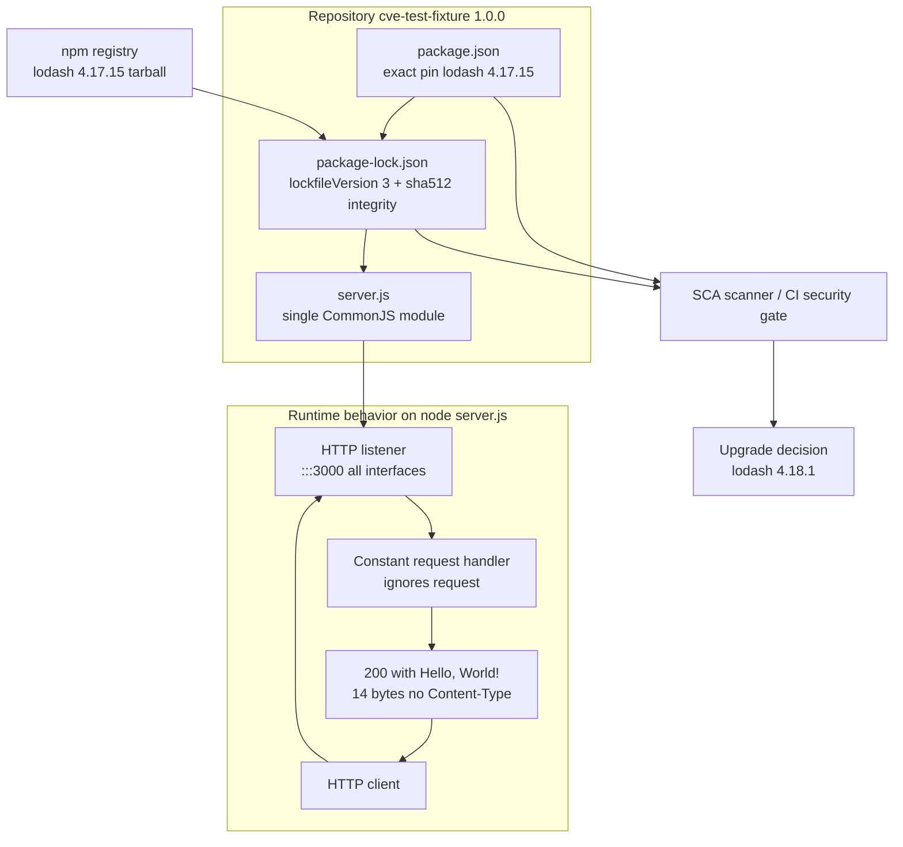

**Observed runtime behavior.** Probes against the running fixture confirm what the code implies: every path (including a nonexistent one with a query string), every method (GET, POST with a body, HEAD), and every request header receive the same `HTTP/1.1 200 OK` with `Content-Length: 14` and body `Hello, World!`, and no `Content-Type` is emitted. The listener is reachable both on loopback `127.0.0.1:3000` and on the host address, and a port conflict aborts the process with an unhandled `EADDRINUSE` error at `server.js:5:4`.

### 1.2.3 Success Criteria

The repository declares no service-level objective, performance target, or test suite, so the criteria below are the ones the fixture's artifacts are constructed to satisfy and that a consumer can measure directly. Each is stated with the measurement that demonstrates it.

**Measurable Objectives.**

| Objective | Measurement | Expected result |
|---|---|---|
| Install resolves the intended vulnerable release | `npm install`, then read the installed package version | `lodash` 4.17.15, matching the exact pin in `package.json` and the resolved entry in `package-lock.json` |
| The vulnerable dependency is detected | `npm audit` (or equivalent SCA scan) finding count | Exactly 1 high-severity direct vulnerability with a non-zero exit status |
| The finding set is stable and complete | Enumerate advisories mapped to the resolved version | 6 advisories: 3 high, 3 moderate, with aggregate range `<=4.17.23` |
| An upgrade path exists and is verified non-breaking | Read the reported fix and its semver relationship | Fix available `lodash` 4.18.1, `isSemVerMajor` false |
| Install is reproducible across machines and time | Compare `package-lock.json` resolution fields | Registry tarball URL plus SHA-512 integrity digest pin the same bytes |
| The artifact runs as a live process | `node server.js`, then probe port 3000 | Process starts, logs the startup line, and answers `200` with the constant body |
| Scan output is unconfounded by application logic | Vary path, method, headers, and body | All requests return the identical response |

**Critical Success Factors.**

- **The pin must not float.** Success depends entirely on `lodash` remaining exactly `4.17.15`. Introducing a caret, tilde, or range — or regenerating the lockfile against a newer release — removes the finding the fixture exists to produce.
- **The dependency must stay loaded.** Line 1 of `server.js` must keep requiring `lodash`, because that require is what makes the package a direct runtime dependency of the fixture rather than a declaration with no code path. Removing it would also remove the fixture's only runtime dependency edge.
- **The scan must be the only signal.** Because the runtime ignores all input, any variation in output would indicate a change to the fixture rather than a change in the tool under test.
- **Scope must stay minimal.** Additional dependencies, files, or scripts would enlarge the dependency graph and make findings harder to attribute.
- **Consumers must supply their own assertions.** With no `scripts` and no tests, the pipeline — not the repository — must define pass and fail.

**Key Performance Indicators.** No KPI is defined in the repository; the following are the indicators a consumer of this fixture would derive from its artifacts and from observed behavior. They describe the fixture and the tooling validated against it, not a service with users.

| Indicator | How it is obtained | Reference value |
|---|---|---|
| Vulnerability detection rate against known truth | Detected advisories divided by the 6 advisories mapped to the resolved version | Expected 1.00 (6 of 6) |
| Scan reproducibility | Compare findings across repeated installs and machines | Identical finding set each run |
| Install cost | Wall-clock time of `npm install` and number of packages added | 1 package added |
| False-positive count | Findings that do not correspond to a real advisory for the resolved version | Expected 0 |
| Remediation accuracy | Whether the proposed upgrade actually clears the findings | `lodash` 4.18.1 clears the set, non-breaking |
| Artifact footprint | Tracked file count and line count | 3 files, 33 lines, 826 bytes |
| Runtime availability, if exercised | Successful probes of port 3000 after start | `200` with the constant body for every request probe |


## 1.3 Scope

### 1.3.1 In-Scope

The scope of `cve-test-fixture` 1.0.0 is coextensive with its three tracked files. Everything the repository does is enumerated below; anything not listed is absent from the codebase and therefore out of scope.

#### Core Features and Functionalities

**Must-Have Capabilities.** The fixture must satisfy the following, each derived from a specific artifact.

| Capability | Implemented by | Verified behavior |
|---|---|---|
| Declare one exactly pinned vulnerable dependency | `package.json` line 5, `"lodash": "4.17.15"` | `npm install` resolves a single package at version 4.17.15, matching the pin exactly |
| Freeze that resolution reproducibly | `package-lock.json`, `lockfileVersion` 3 entry `packages["node_modules/lodash"]` | Same version, registry tarball, and SHA-512 integrity digest on every install |
| Load the dependency at runtime | `server.js` line 1, `const _ = require('lodash')` | Resolves from `node_modules` at process start; makes the dependency a live direct edge rather than a declaration only |
| Produce one stable, detectable vulnerability finding | The pin combined with the advisories affecting that version | `npm audit`: 1 high-severity direct vulnerability, 6 mapped advisories, non-zero exit |
| Expose a runnable process | `server.js` lines 3–5, inline `http.createServer(...).listen(3000)` | Process starts, logs the startup line, answers HTTP on port 3000 |
| Keep scan results unconfounded by application logic | The request handler ignores `req` and ends with a constant | Identical response for every path, method, header, and body |

**Primary User Workflows.** The fixture has no end-user interface, so its workflows are those of the tooling that consumes it.

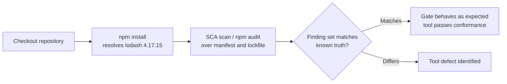

| Workflow | Steps | Actor |
|---|---|---|
| Dependency scan conformance | Checkout, `npm install`, run the scanner, compare the finding set against the known truth | AppSec engineer, CI job |
| Security gate validation | Install the fixture in a pipeline branch and confirm the stage exits non-zero and blocks the merge with the expected high-severity finding | DevSecOps engineer |
| Remediation verification | Let the update tool read the pin and the reported `fixAvailable` value, then confirm the proposed upgrade to `lodash` 4.18.1 is offered as non-breaking | Dependency-management tooling owner |
| Runtime smoke check | `node server.js`, then probe port 3000 and confirm the constant `200` response | Pipeline or developer |
| Fixture drift regression | Re-run the scan over time and confirm the finding set has not changed | Repository maintainer |

**Essential Integrations.** All integration is file-based; nothing is reached over a network by the fixture itself.

| Integration | Contract | Direction |
|---|---|---|
| npm registry / package resolution | `package.json` exact pin and `package-lock.json` resolved tarball plus integrity digest | Inbound (install time) |
| SCA scanners and audit tooling | Manifest and lockfile read directly from the checkout | Outbound (file read) |
| CI/CD gates | Process exit status and finding count | Outbound |
| HTTP clients (optional) | TCP port 3000, constant response | Inbound (runtime) |

**Key Technical Requirements.**

- **Runtime:** Node.js with the core `http` module; observed working toolchain is Node v22.23.3 with npm 11.18.0. No `engines` constraint is declared, so no version is enforced by the manifest.
- **Module system:** CommonJS (`require`), as used on lines 1 and 3 of `server.js`.
- **Dependency resolution:** npm capable of reading `lockfileVersion` 3 (npm v7 or later schema).
- **Network:** TCP port 3000 must be free; the listener binds all interfaces, so the port must not be bound elsewhere. No outbound connectivity is required at runtime, only at install time.
- **Storage and state:** None. The process holds no state, writes no files, and persists nothing.
- **Package resolution:** An install step is required before `server.js` can run, since `lodash` is resolved from `node_modules` and that directory is not tracked.

#### Implementation Boundaries

| Boundary | Definition | Evidence |
|---|---|---|
| System boundary | Three tracked files — one runtime module, one manifest, one lockfile; no sub-folders | Repository tree is exactly `server.js`, `package.json`, `package-lock.json`; all refs share tree `f0dd6ae85e3d68490fe77c66dbc509fef21ba6bf` |
| Component boundary | A single CommonJS module with no exports, no internal modules, and no shared libraries | `server.js` defines no exports, functions, or classes |
| Runtime boundary | One HTTP listener on TCP port 3000 at the IPv6 wildcard `:::3000` | `listen(3000)` with no host argument; reachable via loopback and host address; `EADDRINUSE` on `:::3000` |
| Dependency boundary | Exactly one external package, `lodash` 4.17.15, plus Node core modules | Sole entry in the manifest's `dependencies`; two keys in the lockfile `packages` map |
| User groups covered | Technical consumers of scan output only — AppSec, DevSecOps, remediation tooling owners, scanner developers, maintainers | No user-facing interface exists; no `author`, `description`, or `repository` field names any audience |
| Geographic / market coverage | None. The fixture is location-independent and serves no market or region | No locale, region, or tenancy configuration exists |
| Data domains included | The dependency-domain data of the manifest, lockfile, and resolved package metadata: name, version, tarball URL, integrity digest, license | `package.json`, `package-lock.json` |
| Configuration boundary | None. No environment variables, config files, or command-line arguments are read | No configuration mechanism appears in any file |
| Concurrency boundary | Multi-connection HTTP handled by Node's default event loop; no application-level concurrency control, queue, or rate limit | No concurrency construct in the source |

### 1.3.2 Out-of-Scope

The following are explicitly outside the scope of this version. Each exclusion is a positive fact about the repository — the absence is documented here so that no reader expects the capability.

**Excluded Features and Capabilities.**

| Excluded capability | Basis for exclusion |
|---|---|
| Application routing, path handling, and query parsing | The handler never inspects `req`; `/does/not/exist?q=1` returned the same `200` body as `/` |
| Request-body, header, and method processing | POST with a body and a request with a custom header both returned the identical constant response |
| Content negotiation and response metadata | No `Content-Type` header is set; the only headers observed are `Date`, `Connection`, `Keep-Alive`, and `Content-Length: 14` |
| Business or domain logic of any kind | The only application statement is a constant string; no data model, computation, or persistence exists |
| Error handling and resilience | A port conflict crashed the process with an unhandled `EADDRINUSE` at `server.js:5:4`; there is no `error` listener, retry, or fallback |
| Graceful shutdown and signal handling | No `SIGINT`/`SIGTERM` handler; startup is fire-and-forget |
| Configuration and environment parameterization | No config files, environment-variable reads, or CLI parsing; the port `3000` is a literal |
| Logging and observability | One `console.log` on the `listening` event; no structured logging, metrics, tracing, or health endpoint |
| Automated tests | No test file, no test runner, and no `scripts` entry exists in the tree or in any branch |
| Build, bundling, and transpilation | No build script or toolchain; `server.js` is executed as authored |
| Packaging and release automation | No `main`, `files`, `private`, or release CI; no git tags exist |
| Authentication, authorization, and TLS | No credential handling, session, token, or HTTPS; the listener is plaintext HTTP |
| Persistence, caching, and external service calls | No database, cache, file write, or outbound request appears in the source |
| Multi-dependency, transitive-depth, or multi-severity scanning coverage | The graph is a single direct dependency producing one finding: 1 high, 0 critical, 0 moderate, 0 low |
| Reachability, exploitability, and runtime-exploit validation | The `_` binding from `require('lodash')` is never referenced, so the vulnerable surface is unreachable from application logic |
| License and legal metadata for the fixture itself | No `license` or `repository` field exists in `package.json` and no license file is tracked (the `MIT` value in the lockfile describes `lodash`, not this package) |

**Future Phase Considerations.** No roadmap, milestone, or issue tracker content exists in the repository, so no future phase is committed. Should the fixture be extended, the natural candidates arising from its current limitations are: adding a second dependency or a transitive chain to exercise depth; introducing a dependency with a different severity mix to test bucketing beyond high; adding a reachable vulnerable call path to validate exploitability analysis; declaring `scripts` and a test harness so the fixture can assert on its own scan output; and adding `engines` to pin the Node.js version the fixture expects. None of these is present in version 1.0.0, and all are recorded here as observations about the artifact's shape rather than as planned work.

**Integration Points Not Covered.** The fixture connects to nothing. Specifically, it does not integrate with package registries beyond install-time resolution of the single pinned tarball; with databases, message queues, or caches; with identity providers, SSO, or secrets managers; with monitoring, alerting, or log aggregation platforms; with notification, ticketing, or workflow systems; or with any internal enterprise API. It also does not produce an SBOM export, a signed artifact, or a container image, so consumer pipelines expecting those outputs must generate them externally.

**Unsupported Use Cases.** The following uses are outside what this artifact can serve:

- **Production or customer-facing deployment.** The handler returns a constant string over plaintext HTTP on a fixed port with no authentication, TLS, error handling, or shutdown path.
- **Performance and load validation.** No throughput, latency, or capacity target is declared or implemented; the constant handler measures nothing meaningful.
- **Proving detection of anything beyond one direct, unreachable vulnerable dependency.** Transitive depth, multiple packages, and reachable exploits are not represented.
- **Validating severity bucketing below high or above high.** No critical, moderate, or low aggregate finding exists to test those paths.
- **Validating remediation of a breaking upgrade.** The observed fix, `lodash` 4.18.1, is reported as `isSemVerMajor: false`, so the major-version upgrade path is not exercised.
- **Demonstrating that the vulnerable library is actually exercised at runtime.** The advisories are detectable by composition analysis while the library's members are never called, so runtime-exploit tooling will find no trigger.
- **Acting as a reference application, framework sample, or template.** At five runtime lines with no exports, it demonstrates no architectural pattern.
- **Serving as a general HTTP service or API endpoint.** Paths, methods, headers, and bodies are all ignored, and no `Content-Type` is returned.


## 1.4 References

- `server.js` - the complete runtime: line 1 binds `require('lodash')` to the never-referenced identifier `_`; lines 3-5 build an HTTP server inline from Node core `http` and call `listen(3000)`. Established the constant response, the absence of routing, body/method/header handling, response headers, error handling, exports, configuration, logging, and shutdown logic, and the throw site `server.js:5:4` for the unhandled `EADDRINUSE` error.
- `package.json` - package identity `cve-test-fixture` 1.0.0 and the exact, range-free pin `"lodash": "4.17.15"`. Established the absence of `description`, `main`, `scripts`, `license`, `repository`, `author`, `engines`, and `private`, and therefore the absence of any npm run command.
- `package-lock.json` - `lockfileVersion` 3 with `requires: true`, the project-root entry under `packages[""]` restating the pin, and the single resolved entry `packages["node_modules/lodash"]` with version 4.17.15, the registry tarball URL, the SHA-512 integrity digest, and the `MIT` license. Established install reproducibility and that the lockfile's `MIT` value describes `lodash`, not this package.
- Repository root folder `""` - the complete inventory: exactly three first-order children, all files (`server.js`, `package.json`, `package-lock.json`) and no sub-folders, so no deeper artifacts exist.
- `README.md` (deleted in commit `f3600a8`; content recovered from commit `8436a5d`) - the single line `# hello_world_repo_withMinorCVE`, the repository's only historical statement of purpose and the basis for identifying the fixture's intent.
- `node_modules/lodash/package.json` (present only after `npm install`, not tracked in git) - confirmed the installed dependency resolves to version exactly 4.17.15 as pinned.
- Git refs and tree objects - five commits dated 2026-09-22 (`8436a5d` Initial commit, `b64a92c` Create server.js, `d15cacb` Create package.json, `f3600a8` Delete README.md, `afe4df7` Create package-lock.json); `HEAD`, `main`, `origin/main`, `origin/2209_01`, and `origin/0210_01` all resolve to tree `f0dd6ae85e3d68490fe77c66dbc509fef21ba6bf`, and no tags exist. Established greenfield status and that no branch carries additional code.
- [web] `https://registry.npmjs.org/lodash/-/lodash-4.17.15.tgz` - the resolved tarball recorded in `package-lock.json`; the artifact an install fetches.
- [web] https://github.com/advisories/GHSA-35jh-r3h4-6jhm - Command Injection in lodash, high, affects `<4.17.21`, CVSS 7.2, CWE-77/CWE-94.
- [web] https://github.com/advisories/GHSA-p6mc-m468-83gw - Prototype Pollution in lodash, high, affects `>=3.7.0 <4.17.19`, CVSS 7.4, CWE-770/CWE-1321.
- [web] https://github.com/advisories/GHSA-29mw-wpgm-hmr9 - Regular Expression Denial of Service in lodash, moderate, affects `>=4.0.0 <4.17.21`, CVSS 5.3, CWE-400/CWE-1333.
- [web] https://github.com/advisories/GHSA-r5fr-rjxr-66jc - Code Injection via `_.template` imports key names, high, affects `>=4.0.0 <=4.17.23`, CVSS 8.1.
- [web] https://github.com/advisories/GHSA-f23m-r3pf-42rh - Prototype Pollution via array path bypass in `_.unset` and `_.omit`, moderate, affects `<=4.17.23`, CVSS 6.5.
- [web] https://github.com/advisories/GHSA-xxjr-mmjv-4gpg - Prototype Pollution in `_.unset` and `_.omit`, moderate, affects `>=4.0.0 <=4.17.22`, CVSS 6.5.
- [web] `npm audit --json` (auditReportVersion 2, run against this checkout with npm 11.18.0) - reported 1 high-severity direct vulnerability for `lodash` (aggregate range `<=4.17.23`, 6 advisories) and `fixAvailable` `lodash` 4.18.1 with `isSemVerMajor: false`.


# 2. Product Requirements

## 2.1 Feature Catalog

This catalog enumerates the discrete, testable features of `cve-test-fixture` 1.0.0 as they exist in the three tracked artifacts at tree `afe4df7` (`server.js`, `package.json`, `package-lock.json`). No feature is listed that is not evidenced by those files. Features are the product's capabilities, not its modules: the fixture has one runtime module, but its product capability set spans the manifest, the lockfile, the runtime, and the two security signals those artifacts produce for a consuming scanner.

All seven features carry **Status: Completed**, because every behavior asserted below was observed on the checked-out artifacts: the pin was read from `package.json`, the resolution was reproduced with `npm ci`, the process was started with `node server.js`, the response was probed across paths, methods, headers, and bodies, and `npm audit --json` was run against the checkout.

| Feature ID | Feature Name | Feature Category | Priority Level |
|---|---|---|---|
| F-001 | Exact Dependency Pin | Dependency Declaration | Critical |
| F-002 | Reproducible Install Resolution | Dependency Resolution | High |
| F-003 | Runtime Load of the Pinned Dependency | Runtime Integration | Critical |
| F-004 | Runnable HTTP Fixture Process | Runtime Service | Medium |
| F-005 | Deterministic Input-Independent Response | Response Determinism | Medium |
| F-006 | Known-Vulnerability Detection Signal | Security Validation | Critical |
| F-007 | Non-Breaking Remediation Signal | Remediation Validation | High |

The component and data-flow layout these features sit within is drawn in the Section 1.2.2 flowchart; the consumer workflow that exercises F-006 and F-007 is drawn in the Section 1.3.1 primary-workflow flowchart.

### 2.1.1 F-001 — Exact Dependency Pin

**Feature Metadata**

| Field | Value |
|---|---|
| Feature ID | F-001 |
| Feature Name | Exact Dependency Pin |
| Feature Category | Dependency Declaration |
| Priority Level | Critical |
| Status | Completed |

**Description**

*Overview.* `package.json` declares three properties and nothing else: the identity `cve-test-fixture` at version `1.0.0`, and a single `dependencies` block containing `"lodash": "4.17.15"`. The version is a bare exact version with no caret, tilde, inequality, or range, so the npm resolution algorithm has exactly one admissible release. The manifest carries no `devDependencies`, `peerDependencies`, `optionalDependencies`, `overrides`, `resolutions`, or `workspaces` key, so the declared graph is one direct runtime dependency.

*Business Value.* This feature is what makes the fixture a known-answer target rather than an ordinary package. Because the pin cannot float, the vulnerability finding a scanner produces against this package is fixed by the repository rather than by install timing — a tool either reproduces the known finding or is demonstrably wrong. The exact pin also gives automated remediation tooling an unambiguous declaration to act on.

*User Benefits.* AppSec engineers and CI jobs receive an install whose resolved version is known before the scan runs. Dependency-update bots see a literal version to upgrade instead of a range that might already admit a patched release, so a proposed change is a real version transition. Maintainers can reason about the fixture's security signal by reading one line of the manifest.

*Technical Context.* The manifest is a 7-line, 104-byte JSON object; the pin occupies line 5. The pin is load-bearing in both directions: it fixes the version that the lockfile resolves (F-002) and it is the declaration a scanner reads as the direct-dependency edge that makes the reported vulnerability `isDirect: true` (F-006). The exact-pin style is the mechanism by which the fixture's "minor CVE" intent — the repository's historical README read `# hello_world_repo_withMinorCVE` — is enforced by the artifact rather than by convention.

**Dependencies**

| Dependency Type | Value |
|---|---|
| Prerequisite Features | None — this feature is the root of the fixture's dependency graph |
| System Dependencies | npm able to interpret an exact version specifier (observed: npm 11.18.0); Node.js runtime for the module load it enables (observed: Node v22.23.3) |
| External Dependencies | The npm registry (`registry.npmjs.org`) as the source of the pinned release at install time |
| Integration Requirements | Consumed as a file read from the checkout by installers and SCA scanners; no runtime or network interface of its own |

Related specifications: Section 1.1 (business problem and value), Section 1.2.2 (manifest component responsibility), Section 1.3.1 (must-have capability "declare one exactly pinned vulnerable dependency").

### 2.1.2 F-002 — Reproducible Install Resolution

**Feature Metadata**

| Field | Value |
|---|---|
| Feature ID | F-002 |
| Feature Name | Reproducible Install Resolution |
| Feature Category | Dependency Resolution |
| Priority Level | High |
| Status | Completed |

**Description**

*Overview.* `package-lock.json` freezes the resolution of the F-001 pin. It records `lockfileVersion` 3 with `requires: true`, a project-root entry under `packages[""]` that restates the name, version, and the same exact `lodash` pin, and one resolved entry `packages["node_modules/lodash"]` giving version `4.17.15`, the registry tarball URL `https://registry.npmjs.org/lodash/-/lodash-4.17.15.tgz`, the SHA-512 integrity digest `sha512-8xOcRHvCjnocdS5cpwXQXVzmmh5e5+saE2QGoeQmbKmRS6J3VQppPOIt0MnmE+4xlZoumy0GPG0D0MVIQbNA1A==`, and the `MIT` license of that dependency.

*Business Value.* The lockfile makes the fixture's vulnerable bytes a fixed, verifiable artifact: registry URL plus content digest pin the exact tarball, so a scan in a pipeline and a scan on a developer machine examine the same input. This is the property that lets a scan result be compared across machines and across time instead of being reported as a one-off.

*User Benefits.* CI engineers get an install step whose input is immutable and whose cost is one package. Security reviewers can audit the resolved digest without trusting a floating range. Comparing two tool runs is meaningful because the inputs are identical by construction.

*Technical Context.* The 21-line lockfile holds exactly two keys in the flat v3 `packages` map — the empty-string project root and `node_modules/lodash` — which is the direct consequence of a graph with a single direct dependency and no transitive chain. `lockfileVersion` 3 requires npm v7 or later to be interpreted. Installing from this file with `npm ci` in an isolated copy reproduced `lodash` 4.17.15 and exited 0.

**Dependencies**

| Dependency Type | Value |
|---|---|
| Prerequisite Features | F-001 — the lockfile restates and resolves the manifest's exact pin; without the pin there is nothing to freeze |
| System Dependencies | npm v7 or later for the v3 lockfile schema (observed with npm 11.18.0); local filesystem write access to `node_modules` at install time |
| External Dependencies | npm registry over the network at install time, for the tarball named in the `resolved` field |
| Integration Requirements | Read by installers (`npm ci`/`npm install`) and by SCA scanners; no runtime interface |

Related specifications: Section 1.2.1 (limitations — one dependency, one finding), Section 1.2.2 (lockfile component responsibility), Section 1.3.1 (must-have capability "freeze that resolution reproducibly").

### 2.1.3 F-003 — Runtime Load of the Pinned Dependency

**Feature Metadata**

| Field | Value |
|---|---|
| Feature ID | F-003 |
| Feature Name | Runtime Load of the Pinned Dependency |
| Feature Category | Runtime Integration |
| Priority Level | Critical |
| Status | Completed |

**Description**

*Overview.* Line 1 of `server.js` is `const _ = require('lodash');`. It executes before any other statement, so the pinned package is resolved from `node_modules` at process load and bound to the module-scope identifier `_`. No later statement in the file references `_`; the identifier occurs exactly once in the file, in this require. The dependency is therefore a live direct runtime edge — resolved by the module loader on every start — while none of its members is ever invoked.

*Business Value.* This single line is what distinguishes a real dependency from a declaration with no code path. It keeps the fixture's dependency graph honest: the resolved package must exist on disk for the artifact to run at all, so any tool that inspects the runtime module and the manifest together sees the same dependency. At the same time, the unreferenced binding is what makes the fixture's vulnerability finding purely a composition-analysis result, which is precisely the class of finding a scanner is expected to reproduce here.

*User Benefits.* Scanner developers get a dependency edge that is unambiguous and reachable in the module graph without being reachable in program flow, isolating composition detection from reachability analysis. Pipeline operators learn immediately whether provisioning succeeded, because an unprovisioned checkout fails on this exact line.

*Technical Context.* The require is CommonJS, matching the module system the whole file uses. With `node_modules` absent, `node server.js` terminates with exit code 1 and `Error: Cannot find module 'lodash'` traced to `server.js:1:11` — an observed demonstration that resolution happens at load on this line, not lazily. The statement has no error handling, so a missing or unresolvable package aborts the process before the listener is created.

**Dependencies**

| Dependency Type | Value |
|---|---|
| Prerequisite Features | F-002 — the lockfile's resolved entry is what places `lodash` 4.17.15 in `node_modules` for this require to find |
| System Dependencies | Node.js CommonJS loader (observed: Node v22.23.3); an install step performed before first start |
| External Dependencies | The `lodash` 4.17.15 package contents as delivered by the resolved tarball |
| Integration Requirements | None at runtime beyond local module resolution; no network, credential, or service dependency |

Related specifications: Section 1.1 (the binding is never referenced, so advisories are unreachable from application logic), Section 1.3.1 (must-have capability "load the dependency at runtime"), Section 1.3.2 (reachability validation excluded).

### 2.1.4 F-004 — Runnable HTTP Fixture Process

**Feature Metadata**

| Field | Value |
|---|---|
| Feature ID | F-004 |
| Feature Name | Runnable HTTP Fixture Process |
| Feature Category | Runtime Service |
| Priority Level | Medium |
| Status | Completed |

**Description**

*Overview.* Lines 3–5 of `server.js` build an HTTP server inline from Node's core `http` module — the module is required in the same expression that calls `createServer` and is never stored — and call `listen(3000)` with no host argument. The process therefore binds TCP port 3000 on all interfaces and is reachable both on loopback (`127.0.0.1:3000`) and on the host address. The socket's `listening` event emits exactly one startup line to stdout: `Server running at http://127.0.0.1:3000/`.

*Business Value.* The live process is what makes the repository a runnable package rather than a set of data files, and it gives a provisioning pipeline an optional end-to-end signal that the installed artifact executes. It also supplies an independent, non-scan behavior that consumes no input, so its output cannot be confused with a dependency finding.

*User Benefits.* A pipeline or developer can confirm in one probe that install and start succeeded. A second instance fails fast and loudly at the bind, so a port conflict in a test environment is immediately visible rather than silently serving under a wrong assumption.

*Technical Context.* Startup is fire-and-forget: there is no `error` listener on the server, no retry, no backoff, and no signal handling, so a port that is already bound terminates the process with an unhandled error event — observed as exit code 1 with `Error: listen EADDRINUSE: address already in use :::3000`, thrown at `server.js:5:4`, with `address: '::'` and `port: 3000` in the error detail. After the process has served any number of requests, stdout still contains only the single startup line; there is no per-request logging. There is no `scripts` block in the manifest, though npm's built-in default resolves `npm start` to `node server.js` (observed) while `npm test` fails with `Missing script: "test"`.

**Dependencies**

| Dependency Type | Value |
|---|---|
| Prerequisite Features | F-003 — the `lodash` require on line 1 runs first, so a missing package prevents the listener from ever being created |
| System Dependencies | Node.js core `http` and `net` modules; a free TCP port 3000 on the host; Node.js process supervision supplied by the operator |
| External Dependencies | None — no outbound connectivity is needed once the dependency is installed |
| Integration Requirements | An HTTP client or probe reaching port 3000 to observe startup; optional and outside the vulnerability-validation path |

Related specifications: Section 1.2.1 (no error handling or shutdown path; port conflicts abort the process), Section 1.2.2 (observed runtime behavior), Section 1.3.1 (must-have capability "expose a runnable process").

### 2.1.5 F-005 — Deterministic Input-Independent Response

**Feature Metadata**

| Field | Value |
|---|---|
| Feature ID | F-005 |
| Feature Name | Deterministic Input-Independent Response |
| Feature Category | Response Determinism |
| Priority Level | Medium |
| Status | Completed |

**Description**

*Overview.* The request listener on line 4 is `res.end('Hello, World!\n')`. It never reads `req`. Every inbound request — any path, any query string, any method including `PUT`, `OPTIONS`, `DELETE`, and `HEAD`, any header, any body — receives `HTTP/1.1 200 OK` with `Content-Length: 14` and the body `Hello, World!`. No `Content-Type` is set. Observed response headers are limited to `Date`, `Connection`, `Keep-Alive`, and `Content-Length`; an HTTP/1.0 request is answered with `Connection: close` and the same 200 and body.

*Business Value.* Determinism is the feature that keeps scan output attributable. Because the fixture's runtime behavior is a constant, any variation in a consumer's results must come from the tool under test or from the dependency finding, never from application logic. This is the property that lets the fixture be used as a regression baseline rather than as an example application.

*User Benefits.* AppSec engineers can treat response differences as signal. Test authors can assert equality on every request variation instead of writing per-route expectations. Load and probe tooling gets a response with a known byte length to verify against.

*Technical Context.* The handler is an anonymous arrow expression that ends the response immediately; nothing is buffered, parsed, or logged. The 14-byte body is the constant string plus a newline. A `HEAD` request returns the same status and headers with no body, which is Node's default handling rather than code in this file. The process holds no state, writes no files, and emits no per-request output, so repeated requests are indistinguishable from one another in every observable respect.

**Dependencies**

| Dependency Type | Value |
|---|---|
| Prerequisite Features | F-004 — the response can only be observed once the listener is bound and accepting connections |
| System Dependencies | Node.js core `http` response semantics (default `200` status, automatic `Content-Length` for a constant string) |
| External Dependencies | None |
| Integration Requirements | An HTTP client to issue requests; the feature itself requires no input contract, so clients need supply no headers, parameters, or body |

Related specifications: Section 1.2.2 (observed runtime behavior across paths, methods, and headers), Section 1.3.1 (must-have capability "keep scan results unconfounded by application logic"), Section 1.3.2 (routing, body handling, and content negotiation excluded).

### 2.1.6 F-006 — Known-Vulnerability Detection Signal

**Feature Metadata**

| Field | Value |
|---|---|
| Feature ID | F-006 |
| Feature Name | Known-Vulnerability Detection Signal |
| Feature Category | Security Validation |
| Priority Level | Critical |
| Status | Completed |

**Description**

*Overview.* The fixture's primary product output is a stable, detectable dependency vulnerability. An SCA scan over `package.json` and `package-lock.json` reports one vulnerability keyed `lodash`, `severity: high`, `isDirect: true`, aggregate range `<=4.17.23`, attached to the node `node_modules/lodash`, with an empty `effects` list, and the command exits non-zero. Six advisories are mapped to the resolved version: three high (`GHSA-35jh-r3h4-6jhm` Command Injection, CVSS 7.2, range `<4.17.21`; `GHSA-p6mc-m468-83gw` Prototype Pollution, CVSS 7.4, range `>=3.7.0 <4.17.19`; `GHSA-r5fr-rjxr-66jc` Code Injection via `_.template`, CVSS 8.1, range `>=4.0.0 <=4.17.23`) and three moderate (`GHSA-29mw-wpgm-hmr9` ReDoS, CVSS 5.3, range `>=4.0.0 <4.17.21`; `GHSA-f23m-r3pf-42rh` Prototype Pollution via array path bypass, CVSS 6.5, range `<=4.17.23`; `GHSA-xxjr-mmjv-4gpg` Prototype Pollution in `_.unset`/`_.omit`, CVSS 6.5, range `>=4.0.0 <=4.17.22`). Aggregate metadata reports exactly one bucket: 1 high, 0 critical, 0 moderate, 0 low.

*Business Value.* This is the fixture's reason to exist: it converts an abstract claim — "our scanner detects vulnerable dependencies" — into a pass/fail observation against a known truth. Because the finding set is fixed by the pin and the lockfile, a tool's result can be scored for both detection of real advisories and absence of false positives.

*User Benefits.* Security teams can gate a pipeline on a finding they know should appear, proving the gate blocks rather than trusting that it would. Scanner owners get a small, fast integration input for regression tests. Remediation tooling owners get a target whose answer is already known, so a proposal can be checked rather than reviewed.

*Technical Context.* The signal is declarative: it exists in the manifest and lockfile, not in a code path. Because the `_` binding is never referenced, all six advisories are detectable by composition analysis while being unreachable from application logic — the fixture validates composition detection, not exploitability. The aggregate `range` and `isDirect` values are properties of the resolved version and the declaration, so the signal is reproducible whenever the pin and lockfile are unchanged. The specific advisory list, its CVSS scores, and the aggregate bucket derive from registry advisory data at scan time, observed with npm 11.18.0 and `auditReportVersion` 2; the fixture controls which version is scanned, not the advisory database's contents.

**Dependencies**

| Dependency Type | Value |
|---|---|
| Prerequisite Features | F-001 and F-002 — the pin fixes the vulnerable version and the lockfile fixes the resolved bytes the scanner examines |
| System Dependencies | A scanner able to read the manifest and a `lockfileVersion` 3 lockfile (observed: `npm audit`, `auditReportVersion` 2, npm 11.18.0) |
| External Dependencies | The advisory database the scanner queries, which supplies the six advisories and their severities |
| Integration Requirements | A CI/CD or review stage that consumes the finding set and the process exit status as its gate signal |

Related specifications: Section 1.1 (known and stable answer; scanner signal), Section 1.2.3 (measurable objectives and expected finding set), Section 1.3.1 (must-have capability "produce one stable, detectable vulnerability finding").

### 2.1.7 F-007 — Non-Breaking Remediation Signal

**Feature Metadata**

| Field | Value |
|---|---|
| Feature ID | F-007 |
| Feature Name | Non-Breaking Remediation Signal |
| Feature Category | Remediation Validation |
| Priority Level | High |
| Status | Completed |

**Description**

*Overview.* Scanning the fixture also yields an actionable upgrade path: the reported fix is `lodash` at version `4.18.1` with `isSemVerMajor: false`. The fixture therefore exercises the non-breaking remediation branch of a dependency-upgrade workflow rather than the breaking-major branch. Applying the fix was verified in an isolated copy of the three files: installing `lodash@4.18.1` as an exact pin and re-running the audit exited 0 with a total of 0 vulnerabilities and no vulnerability entries.

*Business Value.* Automated remediation is only trustworthy if the upgrade it proposes actually clears the finding, and only safe to automate if it is not a breaking change. This feature makes the fixture a target for that whole loop — detect, propose, apply, re-scan, confirm clean — on a non-breaking path where the expected end state is unambiguously zero findings.

*User Benefits.* Dependency-management tooling owners can validate proposal logic, including the semver-major flag, without risking a breaking upgrade. DevSecOps engineers can demonstrate the remediated end state of a pipeline. Maintainers have a documented, verified exit from the fixture's vulnerable state.

*Technical Context.* The `fixAvailable` object and its `isSemVerMajor` flag are supplied by the scanner from its advisory source, not by the fixture, and `lodash@4.18.1` was confirmed present in the registry. The verification ran on a copy, not on the tracked files: the fixture's own finding depends on the pin remaining `4.17.15` (F-001), so applying the fix in place would remove the finding F-006 exists to produce. An install from the lockfile additionally reports that issues exist and suggests `npm audit fix --force`, which is the scanner's remediation hint rather than an action the fixture performs.

**Dependencies**

| Dependency Type | Value |
|---|---|
| Prerequisite Features | F-006 — the remediation signal is meaningful only relative to the vulnerability finding it clears |
| System Dependencies | npm able to install an exact version and re-scan (observed: npm 11.18.0, Node v22.23.3) |
| External Dependencies | npm registry availability for the fixed release, and the scanner's advisory data supplying `fixAvailable` and `isSemVerMajor` |
| Integration Requirements | A remediation workflow or bot that reads the pin, proposes the upgrade, and re-scans to confirm the finding set is empty |

Related specifications: Section 1.1 (dependency-upgrade baseline), Section 1.3.1 (remediation-verification workflow), Section 1.3.2 (breaking-upgrade remediation excluded from scope).


## 2.2 Functional Requirements Table

Each requirement below is stated so that a consumer can test it against the checkout without inspecting implementation intent: the acceptance criteria name an artifact and an observed value. Requirement IDs follow `F-XXX-RQ-YYY`, where the feature segment matches Section 2.1. All requirements carry status **Implemented and verified** for version 1.0.0, since every acceptance criterion was exercised against the artifacts.

### 2.2.1 F-001 — Exact Dependency Pin

**Requirement Details**

| Requirement ID | Description | Acceptance Criteria | Priority / Complexity |
|---|---|---|---|
| F-001-RQ-001 | The manifest shall declare `lodash` as its only runtime dependency at the exact version `4.17.15`. | `package.json` line 5 reads `"lodash": "4.17.15"`; the version string contains no `^`, `~`, `>`, `<`, `*`, or range operator; `npm ls --depth=0` prints `lodash@4.17.15`. | Must-Have / Low |
| F-001-RQ-002 | The manifest shall declare package identity `cve-test-fixture` at version `1.0.0`, consistent with the lockfile root. | `package.json` reads `"name": "cve-test-fixture"` and `"version": "1.0.0"`; `package-lock.json` repeats both under the top level and under `packages[""]`. | Must-Have / Low |
| F-001-RQ-003 | The manifest shall declare no additional dependency blocks. | No `devDependencies`, `peerDependencies`, `optionalDependencies`, `overrides`, `resolutions`, or `workspaces` key is present; the resolved graph contains one external package. | Should-Have / Low |

**Technical Specifications**

| Aspect | Specification |
|---|---|
| Input Parameters | None at runtime — the file is read statically by installers and scanners |
| Output / Response | A dependency declaration of exactly one entry: `lodash` at `4.17.15` |
| Performance Criteria | None declared; resolution is a single registry lookup for one exact version |
| Data Requirements | A 7-line, 104-byte JSON object containing exactly `name`, `version`, and `dependencies` |

**Validation Rules**

| Rule Type | Rule |
|---|---|
| Business Rule | The pin must remain exact and unchanged; introducing a range or a newer version removes the finding the fixture exists to produce (F-006) |
| Data Validation | The file must parse as JSON and the `lodash` value must be a plain version string |
| Security Requirement | The declared version is intentionally one with known advisories; the declaration itself must not gain a resolution override that would substitute another version |
| Compliance Requirement | None declared — the manifest carries no `license`, `repository`, or `author` field, so no licensing or provenance obligation is asserted by this file |

### 2.2.2 F-002 — Reproducible Install Resolution

**Requirement Details**

| Requirement ID | Description | Acceptance Criteria | Priority / Complexity |
|---|---|---|---|
| F-002-RQ-001 | The lockfile shall record one resolved entry for `lodash` with version, registry tarball URL, and a SHA-512 integrity digest. | `packages["node_modules/lodash"]` gives `version` `4.17.15`, `resolved` `https://registry.npmjs.org/lodash/-/lodash-4.17.15.tgz`, and `integrity` beginning `sha512-`; the digest value is `sha512-8xOcRHvCjnocdS5cpwXQXVzmmh5e5+saE2QGoeQmbKmRS6J3VQppPOIt0MnmE+4xlZoumy0GPG0D0MVIQbNA1A==`. | Must-Have / Low |
| F-002-RQ-002 | The lockfile shall use the v3 schema and reproduce the manifest pin on a clean install. | `lockfileVersion` is `3` and `requires` is `true`; `packages[""]` restates name, version, and `"lodash": "4.17.15"`; `npm ci` on a copy without `node_modules` exits 0 and installs `lodash` 4.17.15. | Must-Have / Low |
| F-002-RQ-003 | The lockfile shall contain exactly the root entry and the single dependency entry. | The `packages` map has exactly two keys: `""` and `node_modules/lodash`; the resolved-graph metadata reports 1 total dependency. | Should-Have / Low |

**Technical Specifications**

| Aspect | Specification |
|---|---|
| Input Parameters | `package.json` and the registry, at install time |
| Output / Response | A `node_modules` tree containing `lodash` 4.17.15 whose content hash matches the recorded digest |
| Performance Criteria | None declared; observed install resolves one package. `npm ci` was used to verify reproducibility |
| Data Requirements | A 21-line, 537-byte lockfile with `lockfileVersion`, `requires`, and a flat `packages` map |

**Validation Rules**

| Rule Type | Rule |
|---|---|
| Business Rule | The resolved version must equal the manifest pin; a resolution to any other version invalidates the fixture's known answer |
| Data Validation | The lockfile must parse as JSON and the `integrity` value must be a valid `sha512-` digest for the named tarball |
| Security Requirement | Install must be verifiable against the recorded digest so the scanned bytes are provably the pinned release |
| Compliance Requirement | The lockfile records the dependency's `MIT` license; this describes `lodash`, not the fixture, which declares no license of its own |

### 2.2.3 F-003 — Runtime Load of the Pinned Dependency

**Requirement Details**

| Requirement ID | Description | Acceptance Criteria | Priority / Complexity |
|---|---|---|---|
| F-003-RQ-001 | The runtime module shall resolve the pinned dependency at process load. | `server.js` line 1 is `const _ = require('lodash');` and executes before the server is created; with `node_modules` absent, `node server.js` exits 1 with `Error: Cannot find module 'lodash'` at `server.js:1:11`. | Must-Have / Low |
| F-003-RQ-002 | The dependency binding shall be loaded without invoking any of its members, keeping the vulnerable surface unreachable from application logic. | The identifier `_` occurs exactly once in `server.js` — in the line 1 declaration — and no `_`-member call or property access appears anywhere in the file. | Should-Have / Low |

**Technical Specifications**

| Aspect | Specification |
|---|---|
| Input Parameters | Local module resolution against `node_modules`, performed by the CommonJS loader at load time |
| Output / Response | A module-scope binding of the `lodash` namespace to `_`; no value is returned, exported, or used |
| Performance Criteria | None declared; the load is a single synchronous module read |
| Data Requirements | The installed `lodash` 4.17.15 package with its `main` entry (`lodash.js`) present on disk |

**Validation Rules**

| Rule Type | Rule |
|---|---|
| Business Rule | The require must remain in the runtime module; removing it removes the fixture's only runtime dependency edge |
| Data Validation | Module resolution must succeed from the checkout root; failure aborts the process before the listener exists |
| Security Requirement | No `lodash` member may be invoked from this file, so the fixture validates composition analysis rather than reachability or exploitation |
| Compliance Requirement | None — the module performs no data handling, so no data-protection obligation arises from this load |

### 2.2.4 F-004 — Runnable HTTP Fixture Process

**Requirement Details**

| Requirement ID | Description | Acceptance Criteria | Priority / Complexity |
|---|---|---|---|
| F-004-RQ-001 | The process shall bind TCP port 3000 on all interfaces when started. | `node server.js` starts and logs `Server running at http://127.0.0.1:3000/`; requests succeed on loopback `127.0.0.1:3000` and on the host address; the bind target is the IPv6 wildcard `::` with port 3000. | Must-Have / Low |
| F-004-RQ-002 | Startup shall emit exactly one informational line and no per-request output. | After serving any number of requests, stdout contains only `Server running at http://127.0.0.1:3000/`. | Could-Have / Low |
| F-004-RQ-003 | A bind failure shall terminate the process fatally rather than proceed silently. | A second instance exits 1 with an unhandled `error` event, `Error: listen EADDRINUSE: address already in use :::3000`, originating at `server.js:5:4`. | Should-Have / Low |

**Technical Specifications**

| Aspect | Specification |
|---|---|
| Input Parameters | None — no environment variables, configuration files, or CLI arguments are read; the port `3000` is a literal |
| Output / Response | One stdout startup line, and an accepting socket on port 3000 |
| Performance Criteria | None declared; timing was observed only as a by-product (200 sequential client invocations completed in 771 ms; 20 concurrent invocations in 9 ms on the test host) and establishes no target |
| Data Requirements | None — no state, files, or persistence |

**Validation Rules**

| Rule Type | Rule |
|---|---|
| Business Rule | Port 3000 must be free; the process neither probes nor negotiates for an alternative port |
| Data Validation | None — no inbound data is read or validated |
| Security Requirement | The listener is plaintext HTTP with no authentication, authorization, or TLS, and binds all interfaces; exposure must be limited to a trusted test network |
| Compliance Requirement | None declared; no logging, retention, or personal-data handling exists |

### 2.2.5 F-005 — Deterministic Input-Independent Response

**Requirement Details**

| Requirement ID | Description | Acceptance Criteria | Priority / Complexity |
|---|---|---|---|
| F-005-RQ-001 | Every request shall receive an identical HTTP response regardless of path, method, headers, or body. | `GET /`, `GET /does/not/exist?q=1`, `POST /api/thing` with a JSON body and a custom header, `PUT`, `OPTIONS`, and `DELETE` each return `HTTP/1.1 200 OK` with `Content-Length: 14` and body `Hello, World!`; `HEAD` returns the same status and headers with no body. | Must-Have / Low |
| F-005-RQ-002 | The handler shall not inspect the request, and shall return no content-negotiation metadata. | `res.end('Hello, World!\n')` is the only application statement in the listener; no `Content-Type` header appears in any response, so the client-observed content type is empty. | Must-Have / Low |
| F-005-RQ-003 | The handler shall hold no state and produce no per-request side effects. | Repeated and concurrent requests return identical bytes; no file is written and stdout gains no request line. | Should-Have / Low |

**Technical Specifications**

| Aspect | Specification |
|---|---|
| Input Parameters | None are consumed; path, query string, method, headers, and body are all ignored |
| Output / Response | Status 200; headers `Date`, `Connection`, `Keep-Alive`, `Content-Length: 14`; body the 14-byte constant `Hello, World!` plus newline. Under HTTP/1.0, `Connection: close` replaces keep-alive with the same status and body |
| Performance Criteria | None declared; because the response is a constant and no input is parsed, no latency or throughput target is meaningful for this fixture |
| Data Requirements | A single constant string literal; no model, storage, or state |

**Validation Rules**

| Rule Type | Rule |
|---|---|
| Business Rule | Response uniformity is the fixture's guarantee; any variation indicates a change to the artifact rather than a change in a tool under test |
| Data Validation | Inbound data is neither read nor validated, so malformed input cannot be rejected — it is answered normally |
| Security Requirement | The response discloses nothing about the dependency finding; the vulnerability is visible only through composition analysis of the manifest and lockfile |
| Compliance Requirement | None declared; no `Content-Type`, charset, or content-negotiation behavior exists to conform to |

### 2.2.6 F-006 — Known-Vulnerability Detection Signal

**Requirement Details**

| Requirement ID | Description | Acceptance Criteria | Priority / Complexity |
|---|---|---|---|
| F-006-RQ-001 | A scan over the manifest and lockfile shall report exactly one direct high-severity vulnerability and exit non-zero. | `npm audit --json` exits 1 and reports one key `lodash` with `"severity": "high"`, `"isDirect": true`, `nodes: ["node_modules/lodash"]`, `effects: []`, and aggregate `range` `<=4.17.23`. | Must-Have / Low |
| F-006-RQ-002 | The finding shall enumerate the advisories affecting the resolved version. | The `via` array contains six advisories with their identifiers, titles, CVSS scores, and per-advisory ranges (3 high, 3 moderate) as listed in Section 2.1.6. | Should-Have / Low |
| F-006-RQ-003 | The aggregate severity distribution shall contain no critical, moderate, or low entries. | `metadata.vulnerabilities` is `{info: 0, low: 0, moderate: 0, high: 1, critical: 0, total: 1}`; `metadata.dependencies` reports `prod: 2`, `total: 1`. | Should-Have / Low |

**Technical Specifications**

| Aspect | Specification |
|---|---|
| Input Parameters | `package.json` and `package-lock.json` read from the checkout, plus the scanner's advisory database |
| Output / Response | A finding set, a severity summary, and a process exit status suitable for a CI gate |
| Performance Criteria | None declared; the scan covers one dependency and no transitive chain |
| Data Requirements | The resolved version and its advisory mappings: 6 advisories, aggregate range `<=4.17.23` |

**Validation Rules**

| Rule Type | Rule |
|---|---|
| Business Rule | The finding set must match this known truth; a different count, severity, or direct/transitive classification is the signal that a tool under test is wrong |
| Data Validation | Advisory membership is determined by the resolved version against each advisory's `range` — the resolved `4.17.15` falls inside all six ranges |
| Security Requirement | The fixture must not be remediated in place, or the finding disappears; validation of remediation belongs on a copy (F-007) |
| Compliance Requirement | The aggregate exit status is intended to drive a security gate; a pipeline that ignores a non-zero audit exit does not enforce this requirement |

### 2.2.7 F-007 — Non-Breaking Remediation Signal

**Requirement Details**

| Requirement ID | Description | Acceptance Criteria | Priority / Complexity |
|---|---|---|---|
| F-007-RQ-001 | The scan shall report an available fix at version `4.18.1` flagged as not a semver-major change. | The finding's `fixAvailable` object is `{name: "lodash", version: "4.18.1", isSemVerMajor: false}`; `npm view lodash@4.18.1 version` prints `4.18.1`, confirming the release exists in the registry. | Must-Have / Low |
| F-007-RQ-002 | Applying the proposed fix shall clear the finding set on a copy of the checklist. | On an isolated copy of the three files, installing `lodash@4.18.1` as an exact pin and re-running the scan exits 0 with `total: 0` and no vulnerability entries. | Should-Have / Low |

**Technical Specifications**

| Aspect | Specification |
|---|---|
| Input Parameters | The pin from `package.json`, the resolved entry from `package-lock.json`, and the scanner's advisory data |
| Output / Response | A `fixAvailable` recommendation plus the observable remediated state: audit exit 0, zero findings |
| Performance Criteria | None declared; remediation is a single-package version change |
| Data Requirements | The fixed version identifier `4.18.1` and its semver relationship to `4.17.15` (same major) |

**Validation Rules**

| Rule Type | Rule |
|---|---|
| Business Rule | The remediation must be applied outside the fixture's tracked files; changing the pin in place removes F-006's signal |
| Data Validation | The candidate version must exist in the registry and must fall outside every advisory range affecting `4.17.15`; the observed remediated scan reports zero findings |
| Security Requirement | Remediation must be re-verified by re-scanning rather than assumed from the `fixAvailable` value alone, which is supplied by the scanner |
| Compliance Requirement | The upgrade is reported as non-breaking; a workflow that treats it as a major-version change is not conforming to the observed signal |

### 2.2.8 Requirement Traceability Matrix

The matrix maps each requirement to the artifact that evidences it and the observable proof of satisfaction.

| Requirement ID | Evidencing Artifact or Signal | Verified By |
|---|---|---|
| F-001-RQ-001 | `package.json` line 5 | `npm ls --depth=0` reports `lodash@4.17.15` |
| F-001-RQ-002 | `package.json` lines 2-3; `package-lock.json` lines 2-3, 8-9 | Identity matches across manifest and lockfile |
| F-001-RQ-003 | `package.json` (absence of other dependency blocks) | Resolved graph metadata reports 1 dependency |
| F-002-RQ-001 | `package-lock.json` lines 14-19 | Version, tarball URL, and `sha512-` digest present |
| F-002-RQ-002 | `package-lock.json` lines 4-5, 7-13 | `npm ci` on a copy exits 0 and installs 4.17.15 |
| F-002-RQ-003 | `package-lock.json` `packages` map | Exactly two keys: `""` and `node_modules/lodash` |
| F-003-RQ-001 | `server.js` line 1 | Start without `node_modules` fails at `server.js:1:11` |
| F-003-RQ-002 | `server.js` (single occurrence of `_`) | No member access on the binding anywhere in the file |
| F-004-RQ-001 | `server.js` lines 3-5 | Startup log line; probes succeed on loopback and host address |
| F-004-RQ-002 | `server.js` line 5 callback | stdout holds one line after all requests |
| F-004-RQ-003 | `server.js` line 5 bind | Second instance exits 1 with `EADDRINUSE` at `server.js:5:4` |
| F-005-RQ-001 | `server.js` line 4 | Identical 200 and 14-byte body for all probed request variations |
| F-005-RQ-002 | `server.js` line 4 | No request access; no `Content-Type` emitted |
| F-005-RQ-003 | `server.js` (no state, no writes) | Repeated and concurrent requests return identical bytes |
| F-006-RQ-001 | Manifest plus lockfile | `npm audit --json` exits 1 with 1 high direct vulnerability |
| F-006-RQ-002 | Resolved version 4.17.15 | Six advisories in the `via` array |
| F-006-RQ-003 | Scanner aggregate metadata | 1 high, 0 critical, 0 moderate, 0 low |
| F-007-RQ-001 | Scanner `fixAvailable`; registry | Reported fix `4.18.1`, `isSemVerMajor` false; registry release confirmed |
| F-007-RQ-002 | Isolated copy of the three files | Upgrade then re-scan exits 0 with zero findings |

Related specifications: Section 1.2.3 (measurable objectives whose expected results these criteria restate), Section 1.3.1 (must-have capabilities and workflows), Section 2.3 (relationships and integration points between these features).


## 2.3 Feature Relationships

The relationships below are limited to edges the artifacts actually establish: file-level dependencies visible in the three tracked files, and the consumer interactions the fixture's outputs make possible. The fixture has no internal module graph — `server.js` defines no exports, functions, or classes — so no component-level coupling exists to document beyond the file boundaries described here.

### 2.3.1 Feature Dependencies Map

The catalog splits into one runtime chain and one security chain that reconverges at the scan.

| Upstream Feature | Downstream Feature | Nature of the Dependency |
|---|---|---|
| F-001 Exact Dependency Pin | F-002 Reproducible Install Resolution | The lockfile root entry restates the manifest pin; the pin is the input the resolution freezes |
| F-001 Exact Dependency Pin | F-006 Known-Vulnerability Detection Signal | The exact version is what makes the finding direct, singular, and stable |
| F-001 Exact Dependency Pin | F-007 Non-Breaking Remediation Signal | The pin's major version determines whether the fix is a semver-major change |
| F-002 Reproducible Install Resolution | F-003 Runtime Load of the Pinned Dependency | The resolved entry places the exact package in `node_modules` for the line 1 require to find |
| F-002 Reproducible Install Resolution | F-006 Known-Vulnerability Detection Signal | The lockfile supplies the resolved version and digest the scanner examines |
| F-003 Runtime Load of the Pinned Dependency | F-004 Runnable HTTP Fixture Process | The require executes before the listener is created; an unresolved package aborts before binding |
| F-004 Runnable HTTP Fixture Process | F-005 Deterministic Input-Independent Response | The response can only be observed through the bound listener; HTTP/1.0 handling is Node's, not the fixture's |
| F-006 Known-Vulnerability Detection Signal | F-007 Non-Breaking Remediation Signal | Remediation is defined relative to the finding it clears |

F-001 has no prerequisite feature: it is the root of both chains. F-005 depends on F-004 and, transitively, on the whole runtime chain, but has no relationship to the security chain other than sharing the same repository — a deliberate separation, since the constant response must not disclose or depend on the finding.

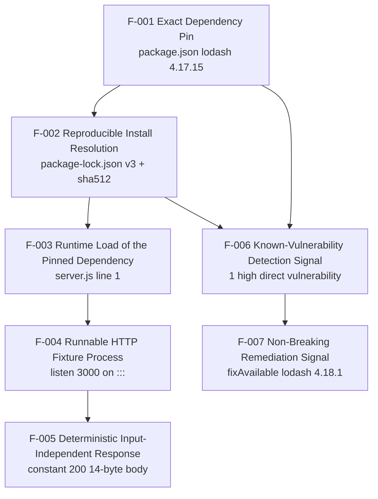

The runtime chain (F-001, F-002, F-003, F-004, F-005) and the security chain (F-001, F-002, F-006, F-007) diverge after F-002: no statement in `server.js` reads, reports, or reacts to anything the scan produces, and no scan reads `server.js`. The dependency from F-001 and F-002 into F-006 is therefore a shared-input relationship rather than an execution path.

### 2.3.2 Integration Points

The fixture exposes no API and calls no external system. All integration is a file contract or an HTTP socket, both consumed or contacted by external tooling.

| Integration Point | Interface | Direction | Boundary Owner |
|---|---|---|---|
| Package resolution and install | `package.json` pin plus `package-lock.json` resolved entry against the npm registry | Inbound at install time | Consumer's npm client |
| Dependency scan and SBOM generation | Direct read of `package.json` and `package-lock.json` from the checkout | Outbound, file read | Consumer's SCA tool |
| CI/CD security gate | Non-zero process exit plus the finding count from the scan | Outbound | Consumer's pipeline |
| Automated remediation | The exact pin and the reported `fixAvailable` with `isSemVerMajor` | Bidirectional over time: read the pin, propose, re-scan | Consumer's update bot |
| Runtime smoke probe (optional) | TCP port 3000 over plaintext HTTP | Inbound at runtime | Consumer's probe or developer |

The only network connection the fixture initiates is the install-time fetch of the tarball named in the lockfile; at runtime the process makes no outbound call. This is what allows the fixture to be provisioned in a sealed CI environment once the single package is cached.

### 2.3.3 Shared Components

Sharing is file-level and minimal. `package.json` and `package-lock.json` are each read by more than one feature, while the runtime module participates in one chain only.

| Shared Component | Shared By | Nature of the Sharing |
|---|---|---|
| `package.json` | F-001, F-002, F-006, F-007 | The same exact pin serves as the declaration, the lockfile root's source, the scanned direct dependency, and the value a remediation tool rewrites |
| `package-lock.json` | F-002, F-006, F-007 | The same resolved entry supplies the reproducible install, the scanned resolved version, and the version the fix supersedes |
| `server.js` | F-003, F-004, F-005 | A single 5-line module whose first statement provides the dependency edge and whose remaining statements provide the listener and the constant handler |
| `lodash` 4.17.15 | F-003, F-006, F-007 | The one external package: loaded at runtime, reported by the scanner, and replaced by the remediation |

There are no shared libraries, no shared modules, no utility or helper collection, and no duplicate implementations across the repository. The manifest-and-lockfile pair is the only artifact set read by multiple features, which is a direct consequence of the fixture expressing its entire security posture declaratively.

### 2.3.4 Common Services

The repository provides and consumes no common services. Each row below records a service that a system of this shape would typically expose, and states the artifact-level fact that it is absent — so that no reader assumes a shared facility exists.

| Service Type | Present in This Repository | Evidence |
|---|---|---|
| Configuration service | No | No config file, environment-variable read, or CLI parsing; port `3000` is a literal in `server.js` |
| Logging or telemetry service | No | One `console.log` on the `listening` event and no per-request output; no structured logging, metrics, or tracing |
| Error-reporting service | No | No `error` listener, no catch, no handler; a bind conflict throws an unhandled event and exits 1 |
| Authentication or identity service | No | No credential, token, session, or authorization construct appears in any file |
| Persistence or data service | No | No database, cache, file write, or in-memory store; the process holds no state |
| Shared HTTP middleware layer | No | The listener is a single inline arrow function with no middleware chain |
| Test harness or fixture service | No | No test file, no runner, and no `scripts` entry; `npm test` exits 1 with `Missing script: "test"` |
| Build or bundling service | No | `server.js` executes as authored; no transpilation, bundler config, or build step exists |

The only platform facility the fixture relies on is Node's core `http` module, required inline on line 3 of `server.js` and never stored in a variable; it is a runtime built-in, not a declared dependency, and it appears in no dependency block.

Related specifications: Section 2.1 (feature definitions), Section 2.2 (requirements and traceability), Section 1.2.2 (component inventory and data-flow diagram), Section 1.3.1 (integration table and key technical requirements).


## 2.4 Implementation Considerations

The considerations below are grouped by feature and limited to constraints the three artifacts impose and requirements a consumer must accommodate. The fixture declares no service-level objective, availability target, or throughput commitment in any file; where a figure appears, it is an observation from exercising the artifact on a single host, not a requirement.

### 2.4.1 Cross-Cutting Implementation Constraints

| Constraint | Statement | Origin |
|---|---|---|
| No declared runtime version | No `engines` field exists, so no Node.js version is enforced; the observed working toolchain is Node v22.23.3 with npm 11.18.0 | `package.json` (absence of `engines`) |
| CommonJS module system | The runtime uses `require` for both the dependency and the core `http` module; ESM syntax does not appear | `server.js` lines 1, 3 |
| Lockfile schema version | The lockfile is `lockfileVersion` 3, requiring npm v7 or later; older clients cannot interpret the resolved entries as written | `package-lock.json` line 4 |
| Install before start | `node_modules` is untracked (`git status` shows it as untracked, `git ls-files` lists only the three files), so an install step must precede the first start | `server.js` line 1; repository tree |
| Fixed network port | Port `3000` is a literal with no configuration mechanism, so the port must be free and the fixture cannot be relocated without editing source | `server.js` line 5 |
| No package entry point | No `main` field is declared; `npm start` succeeds only through npm's built-in default of `node server.js`, while `npm test` exits 1 with `Missing script: "test"` | `package.json` (absence of `main`, `scripts`) |
| Artifact footprint is the contract | Three files, 33 total lines, 826 bytes; additions enlarge the dependency graph or the scanned surface and weaken attributability | Repository tree and file sizes |

### 2.4.2 F-001 Exact Dependency Pin — Considerations

| Consideration | Detail |
|---|---|
| Technical constraint | npm must accept an exact version specifier; the pin admits one release, so registry availability of `lodash@4.17.15` is a hard requirement of any install |
| Performance requirement | None — resolution is one exact lookup rather than a range resolution |
| Scalability | Not applicable in the usual sense; the relevant scaling is the size of the scanned surface, which stays at one direct dependency |
| Security implication | The pin is deliberately vulnerable. Any change to the dependency version, or the addition of an `overrides`/`resolutions` block that substitutes another version, silently removes the fixture's security signal |
| Maintenance requirement | Treat the pin as fixed configuration: review any change to `package.json` as a change to the fixture's expected output, and re-run the scan after every manifest edit |

### 2.4.3 F-002 Reproducible Install Resolution — Considerations

| Consideration | Detail |
|---|---|
| Technical constraint | The v3 lockfile schema requires npm v7 or later; the lockfile must be regenerated only against the same exact pin, or the resolved version drifts |
| Performance requirement | Install cost is one package; a warm npm cache makes the install independent of network latency |
| Scalability | Reproducibility is the scaling property here: the same digest makes results comparable across many machines and runs without per-machine calibration |
| Security implication | The `sha512-` integrity digest is the fixture's defense against a substituted tarball; installs must not disable integrity verification |
| Maintenance requirement | Regenerating the lockfile is the single most disruptive maintenance act: it can change the resolved version, the digest, and the `resolved` URL, and must be followed by a full re-scan to confirm the finding set is unchanged |

### 2.4.4 F-003 Runtime Load of the Pinned Dependency — Considerations

| Consideration | Detail |
|---|---|
| Technical constraint | The require is unconditional and unguarded, so a missing or unresolvable package is a hard startup failure rather than a degraded mode |
| Performance requirement | None declared; the load is one synchronous module read at process start |
| Scalability | Not applicable — the load is constant per process and adds no per-request cost, since no member is called |
| Security implication | The vulnerable code is loaded into the process address space but never invoked. Tools that test runtime exploitability will find no trigger here, and this is by design, not a defect |
| Maintenance requirement | Line 1 must not be removed or made conditional, and no `lodash` member should be introduced into the file, or the fixture changes from a composition-only target into one with an application-level code path |

### 2.4.5 F-004 Runnable HTTP Fixture Process — Considerations

| Consideration | Detail |
|---|---|
| Technical constraint | The process reads no configuration, so the port cannot be changed through environment variables or arguments; only an edit to `server.js` relocates it. The bind has no `error` listener and no retry, so `EADDRINUSE` aborts the process at `server.js:5:4` |
| Performance requirement | None declared. Observed on the test host: 200 sequential client invocations completed in 771 ms and 20 concurrent invocations in 9 ms; these are environment-specific observations and establish no target |
| Scalability | Multi-connection handling is Node's default event loop behavior with no application-level concurrency control, queue, or rate limit; requests are answered immediately because no input is parsed |
| Security implication | Plaintext HTTP on all interfaces with no authentication means the listener should be reachable only on a trusted test network; it must not be exposed publicly |
| Maintenance requirement | Startup is fire-and-forget with no `SIGINT`/`SIGTERM` handling, so operators must terminate the process externally; a lingering instance holds port 3000 and makes subsequent starts fail loudly |

### 2.4.6 F-005 Deterministic Input-Independent Response — Considerations

| Consideration | Detail |
|---|---|
| Technical constraint | The handler ignores `req` entirely, so no request feature can alter the response; there is no route, parameter, or content type to configure |
| Performance requirement | None declared. The response is a constant 14-byte body, so latency and throughput measurements would describe the host rather than the fixture |
| Scalability | Bounded only by the host's socket and event-loop capacity; the handler performs no allocation proportional to input and holds no state |
| Security implication | Uniformity is intentional and is also a limitation: without a `Content-Type` header and without input handling, the endpoint cannot serve as a real web resource, and no response reveals the vulnerability under test |
| Maintenance requirement | Keep responses identical across request variations; if a consumer needs distinct responses, that belongs in the consumer's own fixture, not this one |

### 2.4.7 F-006 Known-Vulnerability Detection Signal — Considerations

| Consideration | Detail |
|---|---|
| Technical constraint | The signal depends on the scanner's advisory database as well as on the resolved version; the fixture fixes the version, not the advisory content. The observed scan used `npm audit`, `auditReportVersion` 2, with npm 11.18.0 |
| Performance requirement | None declared; the scan covers one package and resolves no transitive chain |
| Scalability | The scanned surface is constant — 1 direct dependency, 6 mapped advisories, 1 aggregate finding — so scan time and result shape do not grow with repository size |
| Security implication | The vulnerable surface is unreachable from application logic, so the fixture validates composition analysis, not exploitability. It also carries no credential, data, or persistence, so exercising vulnerable-dependency workflows against it poses no operational risk |
| Maintenance requirement | Re-run the scan after any change to the manifest or lockfile to confirm the finding set still matches; treat `range`, `isDirect`, and the severity bucket as the observable contract to assert on |

### 2.4.8 F-007 Non-Breaking Remediation Signal — Considerations

| Consideration | Detail |
|---|---|
| Technical constraint | The `fixAvailable` recommendation is supplied by the scanner, not the fixture; the fixture contributes the pin and the resolved version that the recommendation is computed from |
| Performance requirement | None declared; remediation is a single-package version change followed by a re-scan |
| Scalability | Not applicable — the remediation path involves one dependency and no transitive resolution |
| Security implication | Because the flagged upgrade is not a semver-major change, a workflow verified against this fixture does not exercise the breaking-upgrade path; treat that path as untested here |
| Maintenance requirement | Verify remediation on a copy, never in place. Changing the tracked pin to `4.18.1` was observed to clear all findings entirely (scan exit 0, `total: 0`), which would remove the signal F-006 depends on. Track requirement versions alongside the pin, since a change to the fixed version reported by the scanner alters what this feature asserts |

### 2.4.9 Assumptions and Constraints

| Item | Statement | Basis |
|---|---|---|
| Assumption A-1 | Consumers supply their own assertions and pass/fail criteria. | The repository defines no `scripts`, no tests, and no CI; `npm test` exits 1 |
| Assumption A-2 | The npm registry and its advisory data are available at install and scan time. | The lockfile names a registry tarball and the findings come from advisory data; neither is vendored in the repository |
| Assumption A-3 | The fixture is used in an isolated or trusted environment. | The listener is plaintext HTTP on all interfaces with no authentication or TLS |
| Assumption A-4 | The consumer's scanner understands the v3 lockfile schema. | `package-lock.json` declares `lockfileVersion` 3 |
| Assumption A-5 | The intended finding is the one mapped to the resolved version at scan time. | Advisory ranges and `fixAvailable` are supplied by the scanner's advisory source and are outside the fixture's control |
| Constraint C-1 | The pin, the lockfile resolution, and line 1 require must all remain unchanged for the fixture to keep producing its known answer. | F-001, F-002, F-003 are the load-bearing artifacts of F-006 |
| Constraint C-2 | Remediation must be applied on a copy, not in the tracked files. | Applying it in place was observed to clear all findings |
| Constraint C-3 | Only one vulnerability class is represented: one direct, high-severity, unreachable dependency finding. | Aggregate metadata reports 1 high, 0 critical, 0 moderate, 0 low, with no transitive chain |
| Constraint C-4 | No performance, availability, or support commitment exists. | No SLA, KPI, or target appears in any artifact; the fixture is not a service |
| Constraint C-5 | The fixture carries no license or provenance metadata of its own. | `package.json` has no `license`, `repository`, or `author` field; the lockfile's `MIT` value describes `lodash` |

Related specifications: Section 1.2.3 (success criteria and critical success factors), Section 1.3.1 (implementation boundaries and key technical requirements), Section 2.2 (requirement acceptance criteria these considerations qualify).


## 2.5 References

- `server.js` - the whole runtime, and the evidence for F-003, F-004, and F-005: line 1 `const _ = require('lodash');` establishes the load-time dependency edge and the single, never-referenced `_` binding; lines 3-5 establish the inline core-`http` server, the constant 14-byte response `Hello, World!\n` with no `Content-Type`, the `listen(3000)` bind on all interfaces, the single startup log line, the absence of request handling, configuration, logging, and shutdown logic, and the throw site `server.js:5:4` for the unhandled `EADDRINUSE` error.
- `package.json` - the manifest, and the evidence for F-001: identity `cve-test-fixture` 1.0.0 and the exact, range-free pin `"lodash": "4.17.15"`; also established the absence of `description`, `main`, `scripts`, `license`, `repository`, `author`, `engines`, and `private`, and therefore the absence of any declared npm script while `npm start` still resolves through npm's built-in default.
- `package-lock.json` - the lockfile, and the evidence for F-002: `lockfileVersion` 3 with `requires: true`, the project-root entry `packages[""]` restating the pin, and the single resolved entry `packages["node_modules/lodash"]` with version 4.17.15, tarball `https://registry.npmjs.org/lodash/-/lodash-4.17.15.tgz`, integrity `sha512-8xOcRHvCjnocdS5cpwXQXVzmmh5e5+saE2QGoeQmbKmRS6J3VQppPOIt0MnmE+4xlZoumy0GPG0DVIQbNA1A==`, and the `MIT` license of the dependency.
- Repository root folder `""` - the complete tracked inventory: exactly three first-order children, all files, and no sub-folders, which bounds the feature catalog to these three artifacts and supports the footprint constraint in Section 2.4.1.
- `node_modules/lodash/package.json` (present only after install, untracked) - confirmed the installed dependency resolves to version exactly 4.17.15 as pinned, satisfying F-001-RQ-001 and F-002-RQ-002; `npm ci` from the lockfile in an isolated copy reproduced that version and exited 0.
- Deleted `README.md` (added in `8436a5d`, deleted in `f3600a8`) - content `# hello_world_repo_withMinorCVE`, the repository's only historical statement of purpose and the basis for identifying the fixture's intent, cited in F-001's technical context.
- Git history and refs - five commits `8436a5d` Initial commit, `b64a92c` Create server.js, `d15cacb` Create package.json, `f3600a8` Delete README.md, `afe4df7` Create package-lock.json, with `refs/heads/main`, `refs/heads/0210_01`, and all `origin/*` refs at `afe4df7` and a tracked tree of exactly three blobs; established that no branch carries additional code and that the artifacts documented here are the complete set.
- [web] `https://registry.npmjs.org/lodash/-/lodash-4.17.15.tgz` - the resolved tarball recorded in `package-lock.json`, and the artifact an install fetches.
- [web] https://github.com/advisories/GHSA-35jh-r3h4-6jhm - Command Injection in lodash, high, CVSS 7.2, range `<4.17.21`, CWE-77/CWE-94.
- [web] https://github.com/advisories/GHSA-p6mc-m468-83gw - Prototype Pollution in lodash, high, CVSS 7.4, range `>=3.7.0 <4.17.19`, CWE-770/CWE-1321.
- [web] https://github.com/advisories/GHSA-29mw-wpgm-hmr9 - Regular Expression Denial of Service in lodash, moderate, CVSS 5.3, range `>=4.0.0 <4.17.21`, CWE-400/CWE-1333.
- [web] https://github.com/advisories/GHSA-r5fr-rjxr-66jc - Code Injection via `_.template` imports key names, high, CVSS 8.1, range `>=4.0.0 <=4.17.23`, CWE-94.
- [web] https://github.com/advisories/GHSA-f23m-r3pf-42rh - Prototype Pollution via array path bypass in `_.unset` and `_.omit`, moderate, CVSS 6.5, range `<=4.17.23`, CWE-1321.
- [web] https://github.com/advisories/GHSA-xxjr-mmjv-4gpg - Prototype Pollution in `_.unset` and `_.omit`, moderate, CVSS 6.5, range `>=4.0.0 <=4.17.22`, CWE-1321.
- [web] `npm audit --json` (auditReportVersion 2, npm 11.18.0, Node v22.23.3, run against this checkout) - exit 1 with one high-severity direct vulnerability keyed `lodash` (`range` `<=4.17.23`, `nodes: ["node_modules/lodash"]`, 6 advisories in `via`), `metadata.vulnerabilities` 1 high and 0 of every other bucket, and `fixAvailable` `{name: "lodash", version: "4.18.1", isSemVerMajor: false}`; the evidence for F-006 and F-007.
- [web] `npm view lodash@4.18.1 version` - confirmed the release `4.18.1` named by `fixAvailable` exists in the registry.
- [web] Runtime probes with `curl` against `node server.js` on port 3000 - `GET /`, `GET /does/not/exist?q=1`, `POST` with a JSON body and custom header, `PUT`, `OPTIONS`, `DELETE`, `HEAD`, and an HTTP/1.0 request all returned `HTTP/1.1 200 OK` with `Content-Length: 14` and body `Hello, World!` (or no body for `HEAD`) and no `Content-Type`; reachable on loopback `127.0.0.1` and host address; a second instance exited 1 with `EADDRINUSE` at `server.js:5:4`; and starting without `node_modules` exited 1 with `Cannot find module 'lodash'` at `server.js:1:11`; the evidence for F-003, F-004, and F-005.


# 3. Technology Stack

## 3.1 Programming Languages

The repository contains exactly one executable language — JavaScript, executed by the Node.js runtime in CommonJS mode — and one declarative data format — JSON. Verified by inspection of the tracked tree and by an extension sweep of the working copy, the only file extensions present are `.js` and `.json`; there is no compiled-language source, no transpiled-language source, and no second platform. The three tracked files (`server.js`, `package.json`, `package-lock.json`) are the complete authored surface.

### 3.1.1 Languages by Platform and Component

| Platform / component | Artifact | Language and dialect | How it is consumed |
|---|---|---|---|
| Node.js runtime platform | — | Node.js (observed **v22.23.3**), invoked as `node server.js` | Host process for the fixture; supplies the core `http` module used at `server.js:3` |
| Runtime service (the only executable component) | `server.js` (5 lines, 185 bytes) | JavaScript, ECMAScript 2015 or later, CommonJS module scope | Interpreted by Node.js on process start; no compile or transpile step precedes execution |
| npm manifest | `package.json` (7 lines, 104 bytes) | JSON | Parsed declaratively by npm at install and scan time; never executed as code |
| Dependency-resolution lockfile | `package-lock.json` (21 lines) | JSON (npm `lockfileVersion` 3 schema) | Parsed declaratively by npm v7+; never executed as code |
| Runtime dependency (external) | `node_modules/lodash/lodash.js` (540,512 bytes) | JavaScript, CommonJS entry point declared by lodash's own `main` field | Loaded into the same Node.js process by `require('lodash')` at `server.js:1` |
| Platform module | Node.js core `http` | Supplied by Node.js, not authored in this repository | Required inline in the same expression that calls `createServer`; no module handle is stored |

The ECMAScript 2015-or-later determination is evidenced by syntax in use rather than by a declaration: `server.js` uses `const` (lines 1, 3) and arrow functions (lines 3 and 5), both of which require a runtime at or above ES2015. No `type` field exists in `package.json`, so the CommonJS reading of `server.js` follows npm's default for a `.js` file.

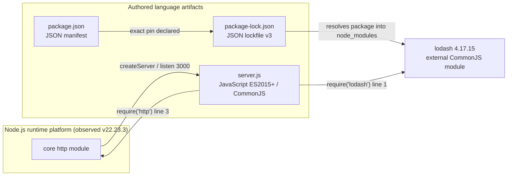

### 3.1.2 Selection Criteria and Justification

| Criterion | How the repository satisfies it |
|---|---|
| The language must be the one the target ecosystem resolves | The fixture's product output is an npm dependency finding (feature F-006 in Section 2.1). An npm/`node_modules` finding is produced only for packages declared and resolved through npm, so JavaScript on Node.js is determined by the artifact class the fixture is meant to test, not chosen by preference. |
| The language must run the artifact as authored | `server.js` is executed directly by `node server.js`; there is no build, bundling, or transpilation stage, so what is committed is exactly what runs. |
| One language, no interop surface | The runtime module, the dependency, and the platform module are all JavaScript; no foreign-function interface, bridge, or serialization layer exists between components. |
| No second language is warranted | There is no frontend, no mobile client, no native application, no data-processing script, and no service tier beyond the single HTTP listener, so no second language has a component to serve. |
| Minimal syntax surface | The runtime uses two statements plus one chained expression; the language's advanced features (generators, classes, modules, `eval`, dynamic `require`) do not appear. |

**Justification for rejecting the template stack's languages.** A default stack of Python with Flask, TypeScript with React and React-Native, Swift, Kotlin, Objective-C, and ElectronJS does not apply to this repository, and adopting any of it would contradict the fixture's design. A workspace-wide grep of the three tracked files for `python`, `flask`, `react`, `typescript`, `swift`, `kotlin`, `objective-c`, and `electron` returned zero matches, and no `.py`, `.ts`, `.swift`, `.kt`, or `.m` file exists in the tree. Introducing a second language would enlarge both the tracked surface and the scanned dependency graph, which Section 2.4 records as constraints C-1 and C-3 and which would break the property that scan results are unconfounded by application logic (F-005).

### 3.1.3 Constraints and Dependencies

| Constraint | Detail | Evidence |
|---|---|---|
| No declared runtime version | `package.json` has no `engines` field, so no Node.js version is enforced by the manifest; the observed working toolchain is Node **v22.23.3** with npm **11.18.0**. Consumers must pin or verify the runtime themselves. | `package.json` (absence of `engines`); runtime probe |
| CommonJS module system is mandatory as written | `server.js` uses `require` for both the dependency and the core `http` module. There is no `"type": "module"` field and no `.mjs` file, so the CommonJS interpretation of the file is the only one that holds. | `server.js` lines 1, 3 |
| ES2015-or-later runtime is the syntax floor | `const` and arrow functions are required by the source; a runtime predating ES2015 could not execute the file, and because no transpiler exists, downgrading compatibility would require editing the source. | `server.js` lines 1, 3, 5 |
| Install-before-start dependency | The JavaScript module loader resolves `lodash` from `node_modules`, which is untracked (`git ls-files` lists only the three files). The require is unconditional and unguarded, so a missing package is a hard startup failure traced to `server.js:1`. | `server.js` line 1; `git ls-files` |
| npm version floor implied by the data format | The lockfile declares `lockfileVersion` 3, the npm v7-or-later schema, so an older npm cannot interpret the resolved entry as written. | `package-lock.json` line 4 |
| Dynamic-by-default typing carries no compile-time checking | JavaScript as used here performs no type checking and has no build step at which a checker could run, so nothing about the dependency edge is validated before `npm audit` or another scanner reads the manifest. | Absence of any type-check or build tooling in the tree |
| External code path is limited to one module load | The only reachable external code in the runtime is the `require('lodash')` module load; the binding it creates (`_`) is never referenced, so the library's members are never invoked. No `eval`, `new Function`, or dynamic `require` of a computed path appears. | `server.js` line 1; grep for `_.` / `lodash.` in `server.js` returns no match |
| Language surface is intentionally unhardened | No TLS, no authentication, no input parsing, and no error handling appear in the source; the plaintext listener on port 3000 is a language-level non-capability of this artifact rather than a configuration choice. | `server.js` lines 3–5 |

Related specifications: Section 1.1 (package identity and runtime entry point), Section 1.3.1 (key technical requirements: runtime, module system, dependency resolution), Section 2.4.1 (cross-cutting implementation constraints), Section 2.4.4 (F-003 runtime-load constraints).

## 3.2 Frameworks &amp; Libraries

The fixture uses **no application framework**. Its HTTP layer is built directly on Node.js's core `http` module, and its single library is the pinned dependency itself. The absence of a framework is not an oversight but a load-bearing property: any framework added to this repository would bring its own dependency tree into the scanned surface and dilute the one known finding the fixture exists to produce (F-005, F-006 in Section 2.1).

### 3.2.1 Frameworks

| Framework slot | Framework used | Evidence |
|---|---|---|
| Web / HTTP framework | **None** — Node core `http` is used directly | `server.js:3` calls `require('http').createServer(...)` inline, with no intervening framework module |
| Application / routing framework | **None** — no routing layer exists | The request listener on `server.js:4` ignores `req` entirely; a probe of `GET /nonexistent` returned `200` |
| Test framework | **None** | No test file exists in the tree or in any branch; `npm test` exits `1` with `npm error Missing script: "test"` |
| Build / bundler framework | **None** | No bundler config, no `scripts` block, no `node_modules` entry other than `lodash` |
| ORM / data framework | **None** — no data layer exists | No persistence, model, schema, or connection code appears in any file |

**Justification.** Node's core `http` module already provides everything the fixture's runtime capability requires: `createServer` accepts a request listener and returns a server whose `listen` method binds the socket, so the entire runtime is one chained expression. Adding Express, Fastify, Koa, or NestJS would introduce a framework package and its transitive dependencies, enlarging the dependency graph beyond the single direct edge that makes the reported vulnerability unambiguous (`isDirect: true`, empty `effects` list). A grep of the three tracked files for `express`, `fastify`, `koa`, and `nestjs` returned zero matches, and `node_modules` contains exactly one top-level package. The same reasoning excludes a test runner such as Jest or Mocha and a linter such as ESLint: they would add dev dependencies to the manifest, which currently has no `devDependencies` key at all.

### 3.2.2 Core and Supporting Libraries

| Library | Version | Role | Declared where | Compatibility requirement |
|---|---|---|---|---|
| `lodash` | **4.17.15** (exact pin, no range operator) | The fixture's sole external runtime dependency and the subject of its vulnerability finding | `package.json` line 5 `"lodash": "4.17.15"`; resolved identically in `package-lock.json` line 15 | CommonJS entry point (`main: "lodash.js"`, 540,512 bytes); lodash's own manifest declares **no** `engines`, `browser`, `type`, `module`, or `exports` field, so it places no engine constraint on the host |
| Node.js core `http` | Supplied by the runtime (Node **v22.23.3** observed) | Provides `createServer` and the socket listener that serves the fixture | Not declared — a core module requires no `dependencies` entry | Bundled with Node.js; no version negotiation applies |
| Node.js core `net` | Supplied by the runtime | Underlies the TCP bind performed by `.listen(3000)` | Not declared | Bundled with Node.js |

There are **no supporting libraries** beyond the above. `node_modules` contains exactly one top-level directory (`lodash`), exactly one `package.json` beneath it, and no nested `node_modules`; the dependency tree is a single direct edge with zero transitive packages, as confirmed by `packages` in `package-lock.json` holding exactly two keys and by the audit's aggregate dependency count of one production package. No HTTP client library, logging library, validation library, or utility library is present.

The single library's integration is deliberately shallow at the call level: line 1 binds it — `const _ = require('lodash');` — and no later statement references `_`, so the library is loaded into the process but none of its members is invoked. That is why the six advisories mapped to this version (Section 3.3.3) are detectable by composition analysis while remaining unreachable from application logic (Section 1.3.2).

### 3.2.3 Compatibility Requirements

| Requirement | Detail | Consequence if unmet |
|---|---|---|
| CommonJS module resolution | `server.js` uses `require`; no `"type"` field, no `.mjs`, no `import` syntax | An ESM-only interpretation of the file would fail at the first statement; the file must be loaded as CommonJS |
| Node.js at or above ES2015 | `const` and arrow functions are used at lines 1, 3, and 5 | An older runtime cannot parse the source, and no transpiler exists to lower the syntax |
| Node.js v22.23.3 as the verified working runtime | Observed executing the fixture successfully: startup line emitted, `GET /` returned `200` | An untested runtime is not guaranteed to reproduce the observed bind, response headers, or module-load behavior; no `engines` field narrows the field for the consumer |
| npm v7 or later | Required to read `lockfileVersion` 3 (`package-lock.json` line 4); observed with npm **11.18.0** | An older npm cannot interpret the resolved entries as written and may re-resolve the graph |
| Registry availability of `lodash@4.17.15` | The lockfile names the tarball `https://registry.npmjs.org/lodash/-/lodash-4.17.15.tgz` with SHA-512 integrity `sha512-8xOcRHvCjnocdS5cpwXQXVzmmh5e5+saE2QGoeQmbKmRS6J3VQppPOIt0MnmE+4xlZoumy0GPG0D0MVIQbNA1A==` | The exact pin admits no substitute release, so an unavailable tarball cannot be satisfied by resolving a nearby version; install would fail rather than silently drift |
| Plaintext HTTP on a free TCP port 3000 | The listener binds all interfaces with no TLS and no port configuration | A port already bound aborts the process with an unhandled `EADDRINUSE` at `server.js:5:4`; exposure beyond a trusted test network is unsupported |
| No runtime framework version matrix | Because no framework is used, there is no framework-to-Node compatibility matrix to reconcile | — |

**Integration requirement between components.** The manifest and the runtime are coupled by one hard edge: the manifest must continue to declare `lodash` and the runtime must continue to require it, because that pair is what makes the package a *direct* runtime dependency for the scanner. Section 2.4 records this as constraint C-1 — the pin, the lockfile resolution, and line 1's require must all remain unchanged for the fixture to keep producing its known answer.

Related specifications: Section 1.2.2 (core technical approach), Section 1.3.1 (must-have capability "load the dependency at runtime"), Section 2.4.3 (F-002 resolution constraints), Section 2.4.4 (F-003 require constraints).

## 3.3 Open Source Dependencies

`cve-test-fixture` declares exactly **one** open-source dependency and resolves it to exactly **one** installed package. Both the manifest and the lockfile carry that single entry, the lockfile's `packages` map holds exactly two keys (the empty-string project root and `node_modules/lodash`), and an audit of the checkout reports one production dependency with no dev, optional, or peer dependencies. Because the dependency is the artifact under test rather than a supporting choice, every field describing it is part of the fixture's contract.

### 3.3.1 Package Dependencies, Registries, and Versions

| Package | Version | Registry / resolution source | Integrity digest | License | Direct / transitive | Declared in |
|---|---|---|---|---|---|---|
| `lodash` | **4.17.15** (exact pin) | `https://registry.npmjs.org/lodash/-/lodash-4.17.15.tgz` — the public npm registry | `sha512-8xOcRHvCjnocdS5cpwXQXVzmmh5e5+saE2QGoeQmbKmRS6J3VQppPOIt0MnmE+4xlZoumy0GPG0D0MVIQbNA1A==` | MIT (declared in the lockfile entry and in lodash's own manifest) | Direct; the resolved graph is a single edge | `package.json` line 5; `package-lock.json` lines 10–12 and 14–19 |

**Package-manager facts.**

| Property | Value | Evidence |
|---|---|---|
| Package manager and registry | npm against the public registry `registry.npmjs.org` | The lockfile's `resolved` URL; observed npm **11.18.0** |
| Version specifier style | Bare exact version — no caret, tilde, inequality, or range | `package.json` line 5 is `"lodash": "4.17.15"` exactly (F-001) |
| Lockfile schema | `lockfileVersion` **3** with `requires: true` (npm v7-or-later schema) | `package-lock.json` lines 4–5 |
| Declared dependency categories | `dependencies` only — no `devDependencies`, `peerDependencies`, `optionalDependencies`, `overrides`, `resolutions`, or `workspaces` key | `package.json` contains exactly three top-level properties: name, version, dependencies |
| Total packages in the resolved tree | **1** (production: 1) | Audit aggregate reports `dependencies: {prod: 2, dev: 0, optional: 0, peer: 0, peerOptional: 0, total: 1}`; `node_modules` has one top-level entry; no nested `node_modules` exists |
| Transitive dependencies | **None** | Exactly one `package.json` exists beneath `node_modules`; lodash's own manifest declares no `dependencies` key |
| Vendored or bundled source | **None** — the dependency is fetched from the registry, not committed; `node_modules` is untracked and there is no `.gitignore` | `git ls-files` lists only `package.json`, `package-lock.json`, `server.js` |
| License obligations of the fixture itself | None declared — `package.json` has no `license` field and no LICENSE file is tracked; the `MIT` value in the lockfile describes `lodash`, not this package (constraint C-5) | `package.json`; `package-lock.json` line 18 |

**Other open-source components that are not npm dependencies.** Node.js core modules are not third-party packages and are not declared in the manifest: `http` (used at `server.js:3`) and `net` (the layer beneath `.listen(3000)`) ship with the runtime. The fixture's own three files are the only first-party code.

### 3.3.2 Dependency Justification and Design Role

The dependency exists for two reasons, neither of which is functional need:

1. **To carry the finding.** The fixture's product output is a known vulnerability finding (F-006). `lodash` 4.17.15 is selected because it is a real, widely used package whose release precedes several published advisories, so a scanner has genuine ground truth to match against.
2. **To make the dependency a live runtime edge.** `server.js` line 1 requires the package unconditionally at process load, which is what makes the reported vulnerability `isDirect: true` and makes the package a runtime rather than a declaration-only dependency (F-003).

The pin's exactness is the mechanism that keeps the finding from drifting: no install can float to a patched lodash release. This is recorded in Section 2.4 as constraint C-1 — the pin, the lockfile resolution, and the line 1 require must all remain unchanged for the fixture to keep producing its known answer — and it is why applying the recommended fix in place would destroy the fixture's purpose.

### 3.3.3 Security Implications

**Advisories mapped to the resolved version.** A scan of the checkout reports one vulnerability entry keyed `lodash`, `severity: high`, `isDirect: true`, aggregate `range: <=4.17.23`, `effects: []`, node `node_modules/lodash`, with the command exiting `1`. Six advisories are mapped to that single node:

| Advisory | Severity | CVSS | Affected range |
|---|---|---|---|
| [GHSA-35jh-r3h4-6jhm](https://github.com/advisories/GHSA-35jh-r3h4-6jhm) — Command Injection in lodash | high | 7.2 | `<4.17.21` |
| [GHSA-p6mc-m468-83gw](https://github.com/advisories/GHSA-p6mc-m468-83gw) — Prototype Pollution in lodash | high | 7.4 | `>=3.7.0 <4.17.19` |
| [GHSA-r5fr-rjxr-66jc](https://github.com/advisories/GHSA-r5fr-rjxr-66jc) — Code Injection via `_.template` imports key names | high | 8.1 | `>=4.0.0 <=4.17.23` |
| [GHSA-29mw-wpgm-hmr9](https://github.com/advisories/GHSA-29mw-wpgm-hmr9) — Regular Expression Denial of Service (ReDoS) | moderate | 5.3 | `>=4.0.0 <4.17.21` |
| [GHSA-f23m-r3pf-42rh](https://github.com/advisories/GHSA-f23m-r3pf-42rh) — Prototype Pollution via array path bypass in `_.unset` / `_.omit` | moderate | 6.5 | `<=4.17.23` |
| [GHSA-xxjr-mmjv-4gpg](https://github.com/advisories/GHSA-xxjr-mmjv-4gpg) — Prototype Pollution in `_.unset` / `_.omit` | moderate | 6.5 | `>=4.0.0 <=4.17.22` |

Aggregate severity bucketing reports exactly one bucket populated: **1 high, 0 critical, 0 moderate, 0 low, total 1**. Three advisories are high and three moderate; the aggregate is driven by the highest.

| Security consideration | Statement | Evidence |
|---|---|---|
| The vulnerability is deliberate | The repository is named `cve-test-fixture` and its deleted README read `# hello_world_repo_withMinorCVE`. A clean scan would mean the fixture had stopped working. | `package.json` line 2; git history commit `f360a8` |
| Severity is intentional, not accidental | The exact pin keeps the resolved version inside the advisory ranges; no range operator can drift the package to a patched release | `package.json` line 5 |
| Install supply-chain integrity is enforced | The lockfile pins both the registry tarball and its SHA-512 digest, so a substituted artifact fails verification. Consumers must not disable integrity checking. | `package-lock.json` lines 16–17 |
| Vulnerable code is loaded but unreachable | The `_` binding created at `server.js:1` is never referenced, so none of the six advisories has a trigger in application logic. The fixture validates composition detection, not exploitability. | grep for `_.` / `lodash.` in `server.js` returns no match; Section 1.3.2 |
| Remediation exists and is non-breaking | The scanner reports `fixAvailable: { name: "lodash", version: "4.18.1", isSemVerMajor: false }` and suggests `npm audit fix --force`. Applying it in place would clear all findings and remove the fixture's signal, so it must be applied on a copy (constraint C-2). | Audit output; Section 2.4.8 |
| No credential, data, or secret is exposed by the dependency graph | The manifest declares no private registry, no authentication token, and no `.npmrc` exists in the tracked tree | `package.json`; tracked-file list |
| The scanned surface is intentionally one package wide | Any added dependency would enlarge the graph and make the single known finding harder to attribute (constraint C-3) | `node_modules` top-level listing; audit dependency count |
| Advisory content is outside the fixture's control | The fixture fixes the scanned version, not the advisory database, so the mapped advisory list and the reported fix version can change as the registry's advisory data changes (assumption A-5) | Section 2.4.9; scan output observed with npm 11.18.0, `auditReportVersion` 2 |
| No vulnerability-fix automation is wired in | No Dependabot, Renovate, Snyk, or `npm audit`-in-CI configuration exists in the repository, so nothing will silently upgrade the pin | Absence of `.github`, any `*.yml`, and any dependency-bot config in the tracked tree |

Related specifications: Section 2.1.1 (F-001 exact dependency pin), Section 2.1.2 (F-002 reproducible install resolution), Section 2.1.6 (F-006 known-vulnerability detection signal), Section 2.1.7 (F-007 non-breaking remediation signal), Section 2.4.2, 2.4.3, 2.4.7, 2.4.8 (per-feature considerations).

## 3.4 Third-Party Services

The fixture integrates with **no third-party services of any kind**. It makes no outbound network call, holds no credential, and speaks to no external endpoint at runtime. The verified absence is as much a design property as the presence of the single dependency: the artifact is a hermetic, file-based test target, and the only network activity in its entire life cycle occurs before the process starts, when npm fetches one pinned tarball.

### 3.4.1 External APIs and Integrations

| Service slot | Present? | Evidence |
|---|---|---|
| External / partner APIs consumed at runtime | **No** | `server.js` contains no HTTP client, no `fetch`, no `https` module require, and no URL literal other than the cosmetic startup message `http://127.0.0.1:3000/` |
| Inbound API published to third parties | **No** — only a plaintext fixture listener | One HTTP listener on TCP port 3000 bound to all interfaces; it ignores the request and returns a constant, so it exposes no API contract, schema, or authentication |
| Webhooks, callbacks, or event subscriptions | **No** | No outbound request exists to deliver a webhook |
| Message brokers, queues, or streaming platforms | **No** | No client library for such a platform appears in the manifest or `node_modules` |
| Email, SMS, push, or notification gateways | **No** | No such client or configuration exists |
| Payment, mapping, search, or AI/LLM APIs | **No** | No API client, key placeholder, or configuration file is tracked; no SDK of this class is installed |
| Identity providers or SSO | **No** | Zero matches for `auth0` or any identity SDK in the three tracked files; there is no session, token, cookie, or credential handling anywhere in the source |
| Object storage, CDN, or file-transfer endpoints | **No** | No client, bucket name, or endpoint configuration exists |

The only genuine external integration is a **build/install-time** one, and it is a package registry rather than an API:

| External dependency | Type | Direction | What it supplies |
|---|---|---|---|
| `registry.npmjs.org` | Package registry (npm protocol) | Outbound, at install/scan time only | The single tarball `https://registry.npmjs.org/lodash/-/lodash-4.17.15.tgz`, verified against the lockfile's SHA-512 integrity digest |
| Advisory database (npm registry's audit endpoint, backed by the GitHub Advisory Database) | Data source queried by the consumer's scanner | Outbound, at scan time only | The six advisories and the `fixAvailable` recommendation; the scanner queries this, not the fixture |
| Registry tarball for the fixed release `lodash@4.18.1` | Package registry | Outbound, on the consumer's remediation copy only | The patched release, applied outside the tracked files (constraint C-2) |

### 3.4.2 Authentication Services

**None.** The repository has no authentication or authorization mechanism at either layer:

- **The fixture's own listener is unauthenticated.** It performs no credential check, sets no cookie, reads no `Authorization` header, and issues no session token. Every request, authenticated or not, receives the same `200` response.
- **No external identity provider is integrated.** There is no Auth0, Okta, Cognito, Firebase Auth, OAuth, OIDC, SAML, or JWT library in the manifest or in `node_modules`.
- **No secrets management exists.** There is no `.env` file, no vault client, no credential placeholder, and no private registry configuration (`.npmrc`) in the tracked tree. The install itself is anonymous against the public registry and requires no token.
- **No TLS.** The listener is plaintext HTTP with no certificate; transport security is simply not a capability of this artifact (Section 2.4.5).

### 3.4.3 Monitoring, Observability, and Telemetry Tools

**None.** There is no APM agent, no metrics exporter, no tracing instrumentation, no log shipper, and no error-reporting SDK in the repository.

| Observability slot | Present? | What exists instead |
|---|---|---|
| Application logging | **No** structured or per-request logging | A single `console.log` fired once from the socket's `listening` event: `Server running at http://127.0.0.1:3000/` |
| Metrics, tracing, APM | **No** | Nothing is emitted; no agent library is installed |
| Health or readiness endpoint | **No** | The constant handler answers every path identically, so there is no dedicated liveness probe |
| Error reporting / alerting | **No** | A port conflict produces an unhandled `EADDRINUSE` that aborts the process at `server.js:5:4`; nothing reports it |
| Log aggregation or dashboards | **No** | No shipping configuration exists; stdout is the sole output channel, and the consumer's process supervisor must capture it |
| Third-party telemetry | **No** | The fixture sends nothing anywhere; the only vendor-touched artifact in the toolchain is npm's own local debug log at `~/.npm/_logs/`, written by the npm client on the host, not by this repository |

### 3.4.4 Cloud Services

**None.** No cloud provider SDK, infrastructure-as-code definition, deployment manifest, or cloud resource configuration is present. A workspace-wide grep of the three tracked files for `aws`, `boto3`, and other provider identifiers returned zero matches, and no `*.tf`, `Dockerfile`, `*.yml`, or `*.yaml` file exists anywhere in the tree. The fixture is not deployed to a cloud platform, does not consume a managed service, and has no environment or region configuration — there is no configuration mechanism at all, since the port `3000` is a source literal.

**Rejection of the template stack's third-party services.** The default stack's Auth0, AWS, and monitoring components have no counterpart here and cannot be added without changing what the artifact is. Auth0 would introduce an authentication dependency into a listener that has no request handling to authenticate; AWS and Terraform would introduce deployment and infrastructure surface for an artifact whose entire delivery mechanism is three files; and a monitoring SDK would add a dependency to a graph whose single-package shape is the property under test (constraint C-3).

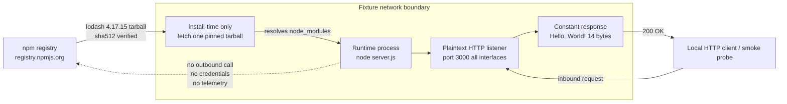

**Integration requirement.** Exposing this listener beyond a trusted test network is unsupported: it is plaintext HTTP on all interfaces with no authentication, which Section 2.4.5 records as an implementation constraint and Section 2.4.9 records as assumption A-3.

Related specifications: Section 1.2.1 (integration with the enterprise landscape — file-based contracts only), Section 1.3.2 (integration points not covered: no databases, queues, identity providers, monitoring, or notifications), Section 2.4.5 (F-004 security implication for the listener).

## 3.5 Databases &amp; Storage

The fixture has **no database and no storage layer**. It holds no state, writes no file, opens no connection, and persists nothing between requests or between runs. Storage-related technology is entirely absent from the repository rather than present-but-unused: there is no database driver in the manifest, no connection string or schema in any file, and no data directory in the tree.

### 3.5.1 Primary and Secondary Databases

**None.**

| Database slot | Present? | Evidence |
|---|---|---|
| Primary (relational) database | **No** | No `pg`, `mysql`, `mysql2`, `sqlite3`, `better-sqlite3`, `sequelize`, `typeorm`, `prisma`, or `knex` entry exists in `package.json` or `node_modules`; no schema, migration, or model file exists |
| Secondary / document database | **No** | No `mongodb`, `mongoose`, `pymongo`, `redis`, or `cassandra` client is present; a grep for `mongo`, `mongodb`, and `pymongo` across the three tracked files returned zero matches |
| Key-value or in-memory store as a database | **No** | No Redis, Memcached, or equivalent client appears, and the process opens no socket other than the HTTP listener |
| Data-access or ORM layer | **No** | There is no query builder, no repository class, no entity definition, and no data-access module of any kind |
| Database configuration or credentials | **No** | No `DATABASE_URL`, host, port, user, or password literal exists; there is no configuration mechanism at all, since the only literal port in the file is the HTTP listener's `3000` |

Section 2.4.9 records the fixture's storage position as an explicit constraint: there is no persistence to configure or migrate. The runtime's only interaction with the outside world is a static HTTP response.

### 3.5.2 Data Persistence Strategies

**There is no persistence strategy, because there is no mutable data.** The characteristics below are positive facts about the artifact, each observable from the source:

| Persistence dimension | Behavior | Evidence |
|---|---|---|
| Application state held in memory | None — the listener reads no state and stores none | The request handler on `server.js:4` never reads `req` and calls `res.end` with a constant |
| Cross-request state | None — requests are indistinguishable and cannot influence one another | Every path, method, header, and body received the identical `HTTP/1.1 200 OK` with `Content-Length: 14` |
| File writes | None — the process creates and modifies no file | `server.js` contains no `fs` require and no write call |
| Session or cookie storage | None | No cookie is set and no session identifier is issued |
| Restart durability concerns | None — there is nothing to lose on restart | Process start reproduces the same constant response; stdout holds only the single startup line |
| Process termination behavior | No `SIGINT`/`SIGTERM` handler and no flush step, because nothing must be flushed | Startup is fire-and-forget; operators must terminate the process externally (Section 2.4.5) |
| Backup, replication, retention, or failover | Not applicable — no data store exists to protect | No such configuration appears in any file |
| Durable artifact of record | The **lockfile**, not a database | `package-lock.json` is the persisted record of the dependency resolution: version `4.17.15`, tarball URL, and SHA-512 digest (F-002) |

The one durable fact the fixture does commit to storage is declarative and lives in version control rather than in a running system: the exact pin in `package.json` and its resolved entry in `package-lock.json` together fix which vulnerable bytes any installer on any machine will obtain. That reproducibility is the fixture's substitute for a runtime data store.

### 3.5.3 Caching Solutions

**None in the application.** The fixture contains no cache, no cache client, no in-memory map used as a cache, no TTL logic, and no cache-control or ETag header on its responses (its only response headers are `Date`, `Connection`, `Keep-Alive`, and `Content-Length`).

Two toolchain-level caches exist on the host rather than in the repository, and neither is a caching solution the fixture implements or depends on:

| Cache-like artifact | What it is | Scope |
|---|---|---|
| npm's package cache (host default location `~/.npm`) | The npm client's content-addressable cache of fetched tarballs | Host- and user-level; it makes a repeat `npm install` independent of network latency for the single pinned tarball, but the repository neither configures nor requires it |
| `node_modules/` | The install output directory holding the extracted `lodash` package, untracked by git | Local working copy only; regenerated by any install from the lockfile, and absent in a fresh checkout until an install runs |

There is no distributed cache, no CDN, no edge cache, and no reverse proxy in front of the listener.

### 3.5.4 Storage Services

**None.** No object store (S3 or equivalent), no block storage, no network filesystem, no blob container, no data warehouse, and no managed storage service is used or configured. No storage bucket name, endpoint, region, or access key appears in any tracked file, and no cloud storage SDK is installed.

The complete set of data the repository stores anywhere is its own three tracked files, totaling 33 lines and 826 bytes:

| File | Role as stored data | Size |
|---|---|---|
| `server.js` | Runtime source, executed as authored | 5 lines, 185 bytes |
| `package.json` | Declarative identity and the single exact dependency pin | 7 lines, 104 bytes |
| `package-lock.json` | Persisted resolution of that pin, with integrity digest | 21 lines |

**Rejection of the template stack's MongoDB.** The default stack names MongoDB as the primary database. It has no counterpart in this repository: the fixture persists nothing, and a database client would add a dependency to a graph whose single-package shape is the property under test (constraint C-3), while introducing a connection, credential, and availability requirement into an artifact designed to have none. Adopting it would contradict Section 1.3.2, which lists "persistence, caching, and external service calls" as explicitly out of scope.

Related specifications: Section 1.3.1 (key technical requirement "Storage and state: none"), Section 1.3.2 (persistence, caching, and external service calls excluded), Section 2.4.5 (F-004 no shutdown or flush behavior), Section 2.4.9 (constraint C-5 governance metadata).

## 3.6 Development &amp; Deployment

Development and deployment for this repository are minimal to the point of being absent: there is no build, no bundler, no container, and no pipeline configuration in the tree. The repository ships exactly three files, and the entirety of its delivery mechanism is a checkout plus one npm install. Everything a pipeline needs beyond that is supplied by the consumer, which Section 2.4.9 records as assumption A-1.

### 3.6.1 Development Tools

| Tool | Version | Role here | Evidence |
|---|---|---|---|
| Node.js | **v22.23.3** (observed working runtime) | Executes `server.js`; supplies the core `http` and `net` modules | Runtime probe; `node server.js` started and served `GET /` with `200` |
| npm | **11.18.0** (observed) | Resolves the dependency, writes `node_modules`, reads `lockfileVersion` 3, and runs the scan | Install, `npm audit --json`, `npm start`, `npm test` all executed |
| Git | Used to author the repository | Version control for the three tracked files; no hooks or config are tracked | `git log` (5 commits on branch `0210_01`), `git ls-files` (3 files) |

**No other development tool is present.** The repository contains no linter configuration (ESLint or equivalent), no formatter configuration (Prettier or equivalent), no type checker, no test runner (Jest, Mocha, Vitest, or Node's own `node --test` usage), no coverage tool, no debugger configuration, no editor or workspace settings, no dependency-update bot configuration (Dependabot, Renovate, or Snyk), no `.gitignore`, and no `.npmrc`. There is no contribution guide, no code-of-conduct file, and — after commit `f3600a8` deleted `README.md` — no documentation file in the tree at all. Consequently there is no tooling-enforced code standard: the entire source is five lines, and correctness here is judged by scan output rather than by static checks.

Two host-level artifacts exist alongside the working copy but are not part of the project's tooling configuration: npm's local debug logs under `~/.npm/_logs/`, written by the npm client when `npm test` fails on the missing script, and the untracked `node_modules/` install output.

### 3.6.2 Build System

**There is no build system.** `server.js` is executed exactly as committed — no transpilation, no bundling, no minification, no code generation, and no asset pipeline. The absence is structural, not configured away: no bundler or compiler (webpack, Rollup, esbuild, Vite, Babel, or TypeScript) appears in the manifest or in `node_modules`, and `node_modules` itself contains no build tooling. The runtime is what is versioned, so there is no build-output-vs-source distinction to manage and no artifact to publish.

The npm script surface confirms this. `package.json` has **no `scripts` block and no `main` field**, which yields the following observable command behavior:

| Command | Outcome | Explanation |
|---|---|---|
| `node server.js` | Starts the fixture; prints `Server running at http://127.0.0.1:3000/` | The canonical invocation; the runtime entry point is this file, declared by nothing but the source itself |
| `npm start` | **Succeeds** — prints `> cve-test-fixture@1.0.0 start` / `> node server.js` and starts the process | Works through npm's built-in default for a package without a `start` script; verified returning `200` on `GET /` |
| `npm test` | **Exits 1** with `npm error Missing script: "test"` | No test script and no test file exist; this also means a consumer cannot use `npm test` as a gate |
| `npm run <anything>` | Exits 1 — no scripts are defined | The manifest defines no commands at all |

Because no build step exists, there is also no build caching, no incremental compilation, and no build-time dependency resolution separate from install.

### 3.6.3 Containerization

**None.** There is no `Dockerfile`, no `.dockerignore`, no `docker-compose.yml`, no Kubernetes manifest, no Helm chart, and no container or image build configuration of any kind in the repository, and no container base image is referenced anywhere. A bounded filesystem sweep of the working copy found no `Dockerfile*`, no `*.yml`/`*.yaml`, and no `*.toml`/`*.ini`/`*.cfg` file.

Producing a container for this fixture is therefore entirely a consumer responsibility, and three facts from the artifact determine what a consumer must encode:

| Requirement a container must satisfy | Origin in the artifact |
|---|---|
| Install dependencies before start, because `node_modules` is untracked and the require on line 1 is unguarded | `server.js:1`; `git ls-files` shows three files |
| Provide a Node.js runtime capable of CommonJS and ES2015 syntax; **no `engines` field** narrows the choice for the consumer | `package.json` has no `engines`; `server.js` uses `const` and arrow functions |
| Expose TCP port 3000, and keep it free — the port is a source literal with no environment override | `server.js:5` binds `:::3000`; no configuration mechanism exists |
| Do not disable integrity verification on install, so the lockfile's SHA-512 digest is enforced inside the image build | `package-lock.json` lines 16–17 |
| Expect no volume, no persistent state, and no health-check endpoint | No `fs` usage, no persistence, no dedicated health route |

### 3.6.4 CI/CD Requirements

**No pipeline exists in the repository.** A bounded sweep found no `.github` directory, no `*.yml` or `*.yaml` file, no Jenkins or CircleCI configuration, no GitLab CI file, and no `.gitlab-ci.yml`. The repository has no tags, and the working branch is `0210_01` with `main`, `origin/main`, `origin/0210_01`, and `origin/2209_01` also present; all references resolve to the same tree `f0dd6ae85e3d68490fe77c66dbc509fef21ba6bf`, so no branch carries pipeline content that the current checkout lacks. There is consequently no automated install, no automated scan, no automated test, no artifact publication, and no deployment stage defined here.

A CI/CD pipeline is the fixture's *primary consumer*, however, so the requirements it must satisfy are stated by the artifact and are enumerated below. Each is an integration requirement, not an implemented stage.

| Requirement | Detail | Observable contract |
|---|---|---|
| Install before scan and start | `npm ci` (or `npm install`) must run first; `node_modules` is untracked | Install resolves exactly one package at `lodash` 4.17.15 and exits 0 |
| Gate on the scan's exit status | The scan is the security gate; the fixture itself provides no gate | `npm audit` exits **1** on the vulnerable pin and **0** after remediation |
| Assert on the known finding set | The pipeline, not the repository, defines pass/fail (assumption A-1) | 1 high-severity direct vulnerability, 6 mapped advisories, 0 critical/moderate/low in the aggregate bucket |
| Verify remediation on a copy | Applying the fix to the tracked files clears all findings and destroys the signal (constraint C-2) | Installing `lodash@4.18.1` in an isolated copy yields 0 vulnerabilities and exit 0 |
| Pin the runtime and package manager | No `engines` field constrains the runner; the lockfile requires npm v7+ | A runner providing Node v22.23.3 and npm 11.18.0 reproduces observed behavior |
| Provide a free port only if exercising the runtime | The scan path needs no network port; the smoke path needs 3000 free | A second instance fails fast with `EADDRINUSE` at `server.js:5:4` |
| Treat the manifest and lockfile as the scanned contract | There is no source code to analyze for the security signal | Both files are read directly from the checkout |
| Expect no deployable service artifact | There is no build output, no image, and no SBOM produced here | Consumers generate artifacts such as SBOMs or images externally if needed |

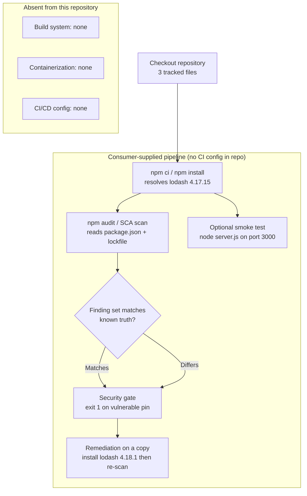

### 3.6.5 Deployment and Runtime Execution

Deployment in the conventional sense — a target platform, a release artifact, and a promotion path — does not apply to this artifact; its delivery is a checkout plus an install. The runtime execution facts that govern any environment in which it is started are:

| Aspect | Behavior |
|---|---|
| Canonical start command | `node server.js`; `npm start` also works via npm's built-in default |
| Process lifetime | Long-running foreground process with no supervision, no restart policy, and no daemonization configured in the repository |
| Bind | Plaintext HTTP on TCP port 3000, all interfaces (`:::3000`), no TLS and no host argument |
| Startup output | Exactly one stdout line: `Server running at http://127.0.0.1:3000/` — no per-request logging follows |
| Response contract | `HTTP/1.1 200 OK`, `Content-Length: 14`, body `Hello, World!`, no `Content-Type`, identical for every path, method, header, and body |
| Failure mode | A bound port aborts the process with an unhandled `EADDRINUSE` at `server.js:5:4`; there is no retry or backoff |
| Shutdown | No signal handling; the process must be terminated externally, and a lingering instance holds port 3000 |
| Runtime egress | None — no outbound call is made once the dependency is installed |
| Configuration | None — no environment variables, config files, or CLI arguments are read; `3000` is a literal |
| Observability | stdout only; no health endpoint, metrics, or traces (Section 3.4.3) |

**Rejection of the template stack's deployment technologies.** The default stack's AWS, Terraform, and GitHub Actions components have no counterpart and no purpose here. The fixture produces no deployable artifact and no service to provision, so infrastructure-as-code would have nothing to declare; a cloud platform would host a single-package test target that three files already deliver; and a CI/CD platform integration would duplicate what the fixture deliberately delegates to the consumer (assumption A-1). Adding any of them would enlarge the scanned surface and weaken the attributability of the one finding the artifact exists to produce (constraint C-3).

Related specifications: Section 1.3.1 (key technical requirement "Package resolution: an install step is required"), Section 1.3.2 (build, bundling, packaging, and release automation excluded), Section 2.4.1 (no declared runtime version, install before start, no package entry point), Section 2.4.5 (F-004 startup, port, and supervision constraints), Section 2.4.9 (assumption A-1, constraint C-2).

## 3.7 References

Every claim in this section derives from the three tracked files of the repository, from the resolved dependency as installed, or from the cited public advisory sources. The complete evidence set is listed below.

**Repository files**

- `server.js` — the entire runtime: 5 lines, 185 bytes. Establishes the CommonJS module system (`require` at lines 1 and 3), the `const`/arrow-function ES2015 syntax floor, the unconditional `lodash` require bound to an identifier (`_`) that no later statement references, the inline bare require of Node core `http`, the constant response `Hello, World!` with no `Content-Type`, and the literal `listen(3000)` bind with no host argument, no `error` listener, and no signal handling.
- `package.json` — the npm manifest: 7 lines, 104 bytes. Establishes package identity `cve-test-fixture` 1.0.0, the exact dependency pin `"lodash": "4.17.15"`, and the absence of `scripts`, `main`, `engines`, `license`, `devDependencies`, `overrides`, and every other field cited as absent in this section.
- `package-lock.json` — the lockfile: 21 lines. Establishes `lockfileVersion` 3, `requires: true`, the two-key flat `packages` map (project root plus `node_modules/lodash`), the resolved version `4.17.15`, the registry tarball `https://registry.npmjs.org/lodash/-/lodash-4.17.15.tgz`, the SHA-512 integrity digest `sha512-8xOcRHvCjnocdS5cpwXQXVzmmh5e5+saE2QGoeQmbKmRS6J3VQppPOIt0MnmE+4xlZoumy0GPG0D0MVIQbNA1A==`, and the `MIT` license of the dependency.

**Repository folders**

- Repository root (`""`) — the flat three-file layout: `server.js`, `package.json`, `package-lock.json` as the only first-order children, with no sub-folders and no CI, container, or infrastructure-as-code file.
- `node_modules/` — the untracked install output. Establishes that exactly one top-level package (`lodash`) is installed, that no nested `node_modules` directory exists at depth 2, and that `node_modules/.package-lock.json` mirrors the project lockfile (v3, one resolved package with the same digest).
- `node_modules/lodash/` — the resolved dependency (1049 files). Establishes lodash's own manifest values, cited in Section 3.2.2.
- `node_modules/lodash/package.json` — lodash 4.17.15, description "Lodash modular utilities.", `main: lodash.js`, license MIT, author John-David Dalton, and the absence of any `engines`, `browser`, `type`, `module`, `exports`, or `dependencies` field.

**Repository history and toolchain**

- Git history (`git log`, `git ls-files`, `git rev-parse`) — 5 commits authored 2026-09-22 on branch `0210_01`: `8436a5d` Initial commit, `b64a92c` Create server.js, `d15cacb` Create package.json, **`f3600a82ea384957cddc3a7f498720f031c019bb`** Delete README.md (whose content read `# hello_world_repo_withMinorCVE`, cited in Section 3.3.3 — the short form `f360a8` used in that table refers to this commit), and `afe4df7` Create package-lock.json. Also establishes the three tracked files, HEAD `afe4df7589ba97bcdd701b49904d9acc69220a84`, tree `f0dd6ae85e3d68490fe77c66dbc509fef21ba6bf` shared by `main`, `0210_01`, and all `origin` refs, and the absence of any tag.
- Installed runtime toolchain probes — Node.js **v22.23.3** and npm **11.18.0**, and the live-run observations: the `HTTP/1.1 200 OK` response with `Date`, `Connection: keep-alive`, `Keep-Alive: timeout=5`, and `Content-Length: 14`; identical `200` for `GET /nonexistent` and for `POST /`; the single startup stdout line; `npm test` exiting 1 with `Missing script: "test"`; and `npm start` succeeding through npm's built-in default.
- `npm audit --json` output — `auditReportVersion` 2; one vulnerability entry `lodash`, `severity: high`, `isDirect: true`, `range: <=4.17.23`, `effects: []`, node `node_modules/lodash`; the six mapped advisories with their severities, CVSS scores, and affected ranges; aggregate `metadata.vulnerabilities` of 1 high and 0 otherwise; `metadata.dependencies` total 1 production package; and `fixAvailable` `{ name: "lodash", version: "4.18.1", isSemVerMajor: false }` with a non-zero exit status.

**Cross-referenced specification sections**

- Technical Specification Section 1.1 Executive Summary — package identity, runtime entry point, response behavior, dependency graph, and scanner signal.
- Technical Specification Section 1.2 System Overview — component responsibilities, core technical approach, and observed runtime behavior.
- Technical Specification Section 1.3 Scope — key technical requirements, implementation boundaries, and the exclusions this section's absences correspond to.
- Technical Specification Section 2.1 Feature Catalog — feature identifiers F-001 through F-007 cross-referenced throughout.
- Technical Specification Section 2.4 Implementation Considerations — assumptions A-1 through A-5 and constraints C-1 through C-5 governing the technology choices documented here.

**Web sources**

- [web] `https://registry.npmjs.org/lodash/-/lodash-4.17.15.tgz` — the exact pinned release tarball named in `package-lock.json`, confirmed as the resolution source for the installed dependency.
- [web] `https://github.com/advisories/GHSA-35jh-r3h4-6jhm` — Command Injection in lodash, high, CVSS 7.2, affected range `<4.17.21`.
- [web] `https://github.com/advisories/GHSA-p6mc-m468-83gw` — Prototype Pollution in lodash, high, CVSS 7.4, affected range `>=3.7.0 <4.17.19`.
- [web] `https://github.com/advisories/GHSA-r5fr-rjxr-66jc` — Code Injection via `_.template` imports key names, high, CVSS 8.1, affected range `>=4.0.0 <=4.17.23`.
- [web] `https://github.com/advisories/GHSA-29mw-wpgm-hmr9` — Regular Expression Denial of Service (ReDoS) in lodash, moderate, CVSS 5.3, affected range `>=4.0.0 <4.17.21`.
- [web] `https://github.com/advisories/GHSA-f23m-r3pf-42rh` — Prototype Pollution via array path bypass in `_.unset` and `_.omit`, moderate, CVSS 6.5, affected range `<=4.17.23`.
- [web] `https://github.com/advisories/GHSA-xxjr-mmjv-4gpg` — Prototype Pollution in `_.unset` and `_.omit`, moderate, CVSS 6.5, affected range `>=4.0.0 <=4.17.22`.

# 4. Process Flowchart

## 4.1 System Workflows

The repository contains no workflow engine, scheduler, queue consumer, or request pipeline. Every process documented below is driven from outside the fixture by a consumer acting on three tracked files — `server.js`, `package.json`, `package-lock.json` — and each step below names the artifact it reads or writes and the outcome observed when it was executed. Workflow identifiers `WF-1` through `WF-5` correspond to the primary user workflows enumerated in Section 1.3.1.

### 4.1.1 Core Business Processes

**Workflow inventory.** Five end-to-end journeys exist, and all five share a common front half: checkout, then install, then a read of the manifest and lockfile.

| ID | Workflow | Actor | Trigger | Terminal outcome |
|---|---|---|---|---|
| WF-1 | Dependency scan conformance | AppSec engineer, CI job | Need to prove a scanner reproduces a known finding | Finding set compared against the known truth; pass or tool defect |
| WF-2 | Security gate validation | DevSecOps engineer | Need to prove a pipeline stage blocks on a vulnerable dependency | Stage exits non-zero and blocks the merge or release |
| WF-3 | Remediation verification | Dependency-management tooling owner | Need to prove an upgrade proposal clears the finding | Isolated copy re-scans clean at zero vulnerabilities |
| WF-4 | Runtime smoke check | Pipeline or developer | Need to confirm a provisioned artifact executes | Probe of port 3000 receives the constant `200` response |
| WF-5 | Fixture drift regression | Repository maintainer | Periodic re-run | Finding set unchanged from the recorded baseline |

**WF-1 — Dependency scan conformance (primary journey).** This is the journey the fixture exists to serve, and its seven steps are:

1. **Start** — a consumer is prepared to run a composition-analysis tool against a target whose correct answer is already known.
2. **Checkout** — the three tracked files are placed on the runner. `git ls-files` in the checkout lists exactly `package.json`, `package-lock.json`, `server.js`; no test, config, or pipeline file accompanies them.
3. **Install** — `npm ci` (or `npm install`) reads `package.json` and `package-lock.json`, fetches the tarball named in `package-lock.json` line 16 (`https://registry.npmjs.org/lodash/-/lodash-4.17.15.tgz`), verifies it against the SHA-512 digest on line 17, and extracts one package into the untracked `node_modules/`. Observed: exit 0, `lodash` 4.17.15 installed, `npm ls --depth=0` prints `lodash@4.17.15`, one package added.
4. **Scan** — the scanner reads the manifest and lockfile. The scan is computed from the declarative files, not from installed bytes: `npm audit --json` exits 1 with the identical finding set when `node_modules/` is absent from the checkout.
5. **Match** — the scanner maps the resolved version 4.17.15 against each advisory range. Observed mapping: six advisories, three high and three moderate; aggregate one high, zero critical, zero moderate, zero low.
6. **Decision** — the finding set is compared with the known truth. Observed finding under test: one key `lodash`, `severity` high, `isDirect` true, aggregate range `<=4.17.23`, `nodes` `["node_modules/lodash"]`, `effects` empty, exit status 1.
7. **End** — a match means the tool reproduces the known answer (WF-1 pass); a mismatch is a tool defect, diagnosed by diffing count, severity bucket, and the `isDirect` flag. The fixture itself neither records nor reports the outcome, because `package.json` declares no `scripts` block and the repository contains no test file (assumption A-1).

**WF-2 — Security gate validation.** Steps 1–5 are those of WF-1. At step 6 the pipeline stage consumes the process exit status instead of the finding detail: with the pin intact, `npm audit` exits 1, and a stage configured on that status fails and blocks. Two observed variants qualify the gate: `npm audit --audit-level=critical` exits **0** against this fixture, because no critical-severity entry exists in the aggregate bucket, while `--audit-level=moderate` and `--audit-level=low` both exit 1; and `--omit=dev` exits 1, since the single dependency is a production dependency. The end state is a blocked merge carrying exactly one high-severity finding — there is no fixture-side enforcement, no hook, and no webhook, only the exit status.

**WF-3 — Remediation verification.** Steps 1–6 are those of WF-1, additionally reading the recommendation the scanner attaches to the finding: `fixAvailable` is `{name: "lodash", version: "4.18.1", isSemVerMajor: false}`. The decisive constraint is that the verification runs **on a copy**, never on the tracked files (constraint C-2). Three observed paths exist:

- **Proposal only** — `npm audit fix` without `--force` changes nothing, because the exact pin `4.17.15` lies outside the fixed version's range: observed exit 1, manifest still `"lodash": "4.17.15"`, installed version still 4.17.15, re-audit exit 1.
- **Explicit exact re-pin on a copy** — rewriting the dependency to `"lodash": "4.18.1"`, installing, and re-scanning exits 0 with `total: 0` and no vulnerability entries.
- **Forced automatic fix on a copy** — `npm audit fix --force` succeeds but *weakens the pin*, rewriting it to the range `"^4.18.1"`, installing 4.18.1, rewriting the lockfile entry (`resolved` `https://registry.npmjs.org/lodash/-/lodash-4.18.1.tgz`, new `sha512-` digest), and re-scanning at exit 0 with `total: 0`. Introducing a caret contradicts the F-001 exact-pin requirement and Section 1.2.3's critical success factor that the pin must not float, so this path is valid only as a throwaway copy.

**WF-4 — Runtime smoke check.** Independent of the scan chain: `node server.js` (equivalently `npm start`, which resolves through npm's built-in default to the same command) loads `lodash` on line 1, binds TCP port 3000 on all interfaces, prints one startup line, and answers every request identically. This workflow observes nothing about the vulnerability — the constant response discloses no dependency information — and it exists only to prove that a provisioned artifact starts.

**WF-5 — Fixture drift regression.** The maintainer repeats WF-1 over time and compares the finding set against the recorded baseline. Drift arises from three artifacts, all under repository control: the pin (`package.json` line 5), the resolved entry (`package-lock.json` lines 14–19), and the load-bearing require (`server.js` line 1). Advisory content is *not* under repository control — ranges and the recommended fix are supplied by the scanner's advisory source (assumption A-5).

**System interactions.** Each interaction crosses a file or socket boundary; none is an in-process call, because `server.js` defines no functions, modules, or exports.

| Interaction | Producer | Consumer | Contract | Direction |
|---|---|---|---|---|
| Dependency declaration | `package.json` | npm client, SCA scanner, remediation bot | Name, version, one exact pin | File read |
| Resolution freeze | `package-lock.json` | npm client, SCA scanner | `lockfileVersion` 3, tarball URL, SHA-512 digest | File read |
| Package fetch | npm registry | npm client | Tarball `lodash-4.17.15.tgz` verified against the digest | Install-time network |
| Runtime dependency edge | `node_modules/lodash` | CommonJS loader on `server.js` line 1 | Module resolution of the package's `main` entry | Filesystem read at process load |
| Finding set and exit status | SCA scanner | CI gate, AppSec engineer | One high direct finding; exit 1 on the vulnerable pin, exit 0 after remediation | Process contract |
| Fixed-release metadata | Advisory database | SCA scanner, remediation bot | `fixAvailable` 4.18.1 with `isSemVerMajor` false | Scan-time network |
| HTTP response | Fixture process | Any HTTP client on port 3000 | `200`, `Content-Length: 14`, body `Hello, World!`, no `Content-Type` | Inbound socket |

**Decision points.** Every branch a consumer takes is decided outside the fixture; the table records the condition, both branches, and the observed basis.

| Decision | Condition | True branch | False branch | Basis |
|---|---|---|---|---|
| Install precondition met? | `node_modules/` present and resolvable | Process proceeds to bind | Process aborts at `server.js:1:11`, exit 1, `MODULE_NOT_FOUND` | `server.js` line 1 is an unguarded `require` |
| Is port 3000 free? | Bind succeeds | Startup line printed, requests served | Process aborts at `server.js:5:4`, exit 1, `EADDRINUSE` on `:::3000` | `server.js` line 5 has no `error` listener |
| Is the request parseable and within limits? | Valid request line, URL under the parser limit | Reaches the handler, answered `200` | Node core answers `400 Bad Request` on a malformed request line and `431` on a ~20,000-character URL | Node `http` parser, observed; no application code involved |
| Does the finding set match the known truth? | Exactly 1 high, direct, 6 advisories | Tool passes conformance | Tool defect reported by the consumer | `npm audit --json` output |
| Does the gate threshold apply? | Gate level at or below `high` | Stage fails, `exit 1` | `--audit-level=critical` exits `0` — the gate passes an unfixed fixture | Observed gate-threshold exits |
| Is the proposed fix applied in place? | Copy vs tracked files | Copy: re-scan reaches `total: 0` | In place: F-006's signal is destroyed (constraint C-2) | Observed cleared finding set |

**Error handling paths.** All four failure paths terminate or degrade without application-level recovery; the fixture contains no `try`, no `catch`, no `error` listener, and no retry.

| Error path | Detection point | Observed behavior | Recovery |
|---|---|---|---|
| Dependency unresolvable | `server.js:1:11` | Exit 1, `Error: Cannot find module 'lodash'`, code `MODULE_NOT_FOUND`, `requireStack` names the module file | Consumer runs an install before start; no in-process fallback |
| Port already bound | `server.js:5:4` | Exit 1, unhandled `'error'` event, `EADDRINUSE`, `errno` -98, `syscall` `listen`, `address` `':'`, `port` 3000 | Operator frees the port or stops the earlier instance; the process never probes for an alternative |
| Malformed or oversize request | Node `http` parser | `400 Bad Request`, or `431` for an over-long URL; the handler never runs | Client retries with a well-formed request; the fixture retains no state to corrupt |
| Scan fails by design | `npm audit` | Exit 1 with the known finding | Remediate on a copy and re-scan to exit 0 |
| No test command | `npm test` | Exit 1, `npm error Missing script: "test"` | Consumer supplies its own assertions; no test harness exists (assumption A-1) |

The journey below places all five workflows in swim lanes, with the two decision diamonds and the abort paths drawn in.

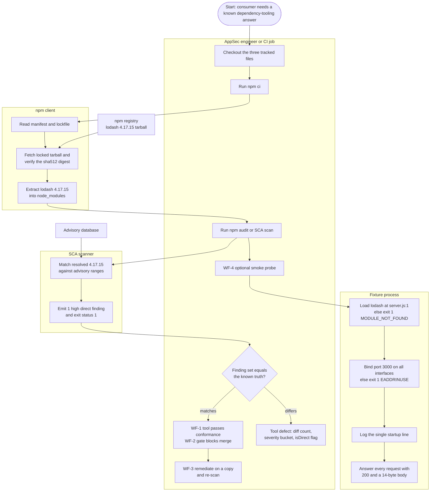

### 4.1.2 Integration Workflows

The fixture initiates one network connection in its entire life cycle — the install-time fetch of the single pinned tarball — and publishes one socket at runtime. Everything else is a file read performed by a consumer.

**Data flow between systems.** Four data movements exist, and each has a fixed direction and a fixed payload.

| Flow | Source | Destination | Data | Timing | Verification |
|---|---|---|---|---|---|
| DF-1 package fetch | `registry.npmjs.org` | npm client in the consumer's environment | `lodash-4.17.15.tgz` | Install time, once per environment with a cold cache | Content digest compared against `package-lock.json` line 17 |
| DF-2 declaration read | `package.json`, `package-lock.json` | npm client, SCA scanner, remediation bot | Name `cve-test-fixture`, version `1.0.0`, exact pin, resolved version and digest | Install and scan time, repeatable | JSON parse; scanner classification `isDirect: true` |
| DF-3 advisory query | Advisory database (the scanner's source; npm's audit endpoint is backed by the GitHub Advisory Database) | SCA scanner | Six advisories with ranges and CVSS scores, plus `fixAvailable` | Scan time, once per scan | Resolved 4.17.15 falls inside all six ranges |
| DF-4 response | Fixture listener on port 3000 | Any inbound HTTP client | `200`, `Content-Length: 14`, body `Hello, World!`, no `Content-Type` | Runtime, per request, constant | Response is byte-identical for every request variation |

There is no application-level data flow inward at runtime: `req` is never read, so no path, query, header, or body ever reaches fixture logic or storage.

**API interactions.** The fixture **publishes no API**. The listener on port 3000 has no routing, no schema, no query parameters, no versioning, no authentication, and no content negotiation — `Content-Type` is never set — and the handler ignores `req` entirely, so no request can influence the response. What actually passes over the socket, observed with a keep-alive client issuing three requests on one connection:

```text
GET /r1  -> 200  "Hello, World!\n"
headers: date, connection: keep-alive, keep-alive: timeout=5, content-length: 14
GET /r2  -> 200  (identical, same connection)
GET /r3  -> 200  (identical, same connection)
```

Protocol-level failures are answered by Node's core parser before the handler runs — a malformed request line returned `HTTP/1.1 400 Bad Request` with `Connection: close`, and a roughly 20,000-character URL returned `431`. The only genuine API interactions in the life cycle are the consumer's client calls to the npm registry and the advisory source, both described in Section 2.3.2 and Section 3.4.1.

**Event processing flows.** **None.** The fixture emits no event, produces no webhook, subscribes to no topic, and schedules no timer or interval; the single `console.log` on `server.js` line 5 fires once from the socket's `listening` event and is process output, not an event stream. There is no message broker, queue, or streaming client in `package.json` or in `node_modules` (Section 3.4.1), so the event-driven half of this subsection has no artifact to describe. The only event consumed anywhere in the system is Node's unhandled `'error'` event from the failed bind, and it is consumed by the runtime's default behavior rather than by code in the repository.

**Batch processing sequences.** **None** in the sense of a scheduled job with a multi-record work set: no cron entry, no worker process, no batch runner, and no loop over records exists. The batch-shaped activities are single-shot CLI invocations whose ordering and exit statuses define the sequences consumers build.

| Sequence | Ordered steps | Exit statuses observed |
|---|---|---|
| S-1 Provisioning | checkout → `npm ci` | `npm ci` 0 |
| S-2 Scan gate | `npm ci` → `npm audit` | `npm ci` 0 → `npm audit` 1 on the vulnerable pin |
| S-3 Gate threshold variants | `npm ci` → `npm audit --audit-level=<level>` | `critical` 0; `moderate` 1; `low` 1; `--omit=dev` 1 |
| S-4 Remediation on a copy | copy → re-pin `4.18.1` → install → re-scan | install 0 → re-scan 0 with `total: 0` |
| S-5 Forced automatic remediation | copy → `npm audit fix --force` → re-scan | fix 0 (manifest rewritten to `^4.18.1`) → re-scan 0 |
| S-6 Runtime smoke | `npm ci` → `node server.js` → probe port 3000 | start emits the startup line; probe receives `200` with the 14-byte body |

The last sequence adds the only socket-level timing constraint the artifact imposes: an idle keep-alive connection is held for `timeout=5` seconds, as observed in the response headers. No sequence in the repository is scheduled, and none advances without a consumer invoking it.

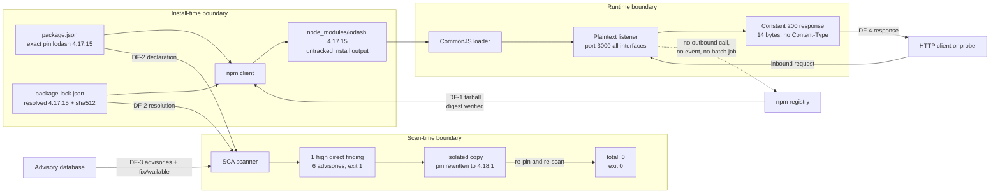


## 4.2 Flowchart Requirements

This subsection states, for each workflow element the diagrams must contain, the artifact that supplies it and the value it takes — so that every node and edge in Section 4.4 is traceable to a tracked file or to an observed behavior.

### 4.2.1 Workflow Element Specification

**Start and end points.** Each workflow has an external trigger, because the fixture runs nothing on its own.

| Workflow | Start point | End point | Evidence |
|---|---|---|---|
| WF-1 Scan conformance | Consumer checkout, before install | Finding set asserted equal to the known truth | `package.json`, `package-lock.json`; `npm audit --json` exit 1 |
| WF-2 Gate validation | Pipeline stage entry | Stage fails and blocks on exit 1 | Observed gate-threshold exits |
| WF-3 Remediation | Copy of the three files | Re-scan exit 0 with `total: 0` | Observed on an isolated copy; constraint C-2 |
| WF-4 Smoke check | `node server.js` invocation | Probe of port 3000 receives the constant `200` | Startup line and identical responses across probes |
| WF-5 Drift regression | Periodic re-run | Finding set unchanged | Baseline finding set from `npm audit --json` |

**Process steps.** Exactly three process steps run *inside* the fixture, and all three are statements in `server.js`.

| Step | Location | Action | Failure behavior |
|---|---|---|---|
| P-1 Load the pinned dependency | `server.js:1` | `const _ = require('lodash')` resolves the package from `node_modules` and binds it to `_`, which is never referenced again | Fatal: exit 1, `MODULE_NOT_FOUND` at `server.js:1:11` |
| P-2 Create and bind the listener | `server.js` lines 3–5 | Inline `require('http').createServer(...).listen(3000, ...)` binds the IPv6 wildcard `:::3000` | Fatal: unhandled `'error'`, exit 1, `EADDRINUSE` at `server.js:5:4` |
| P-3 Answer the request | `server.js:4` | `res.end('Hello, World!\n')` — the request object is never read | None: no branch and no input can make this step fail |

Everything else a diagram shows — checkout, install, scan, compare, remediate, probe — executes in the consumer's environment, not in the fixture. There is no routing step, no middleware step, no body-parsing step, and no shutdown step to draw.

**Decision diamonds.** Six decision points are documented. The first three are inside the fixture or its parser; the last three belong to the consumer.

| ID | Decision | Condition | Outcome when true | Outcome when false | Where the value comes from |
|---|---|---|---|---|---|
| D-1 | Dependency resolvable? | `lodash` found in `node_modules` | Continue to build the listener | Abort: exit 1, `MODULE_NOT_FOUND` at `server.js:1:11` | `server.js:1` unguarded require |
| D-2 | Port free? | Bind of `:::3000` succeeds | Continue; emit the startup line | Abort: exit 1, `EADDRINUSE` at `server.js:5:4` | `server.js:5`, no `error` listener |
| D-3 | Request well-formed and within parser limits? | Valid request line, URL within the limit | Reach the handler and answer `200` | Node core answers `400` (malformed line) or `431` (URL about 20,000 characters) | Node `http` parser, not application code |
| D-4 | Finding set matches the known truth? | 1 high, direct, 6 advisories, exit 1 | WF-1 passes | Tool defect, diagnosed by diff | `npm audit --json` |
| D-5 | Gate threshold at or below the finding severity? | Level `high`, `moderate`, or `low` | Stage blocks | `--audit-level=critical` exits 0 and the gate passes an unfixed fixture | Observed threshold exits |
| D-6 | Remediation applied to a copy? | Copy, not tracked files | Re-scan reaches `total: 0` | In place: the F-006 signal is destroyed | Constraint C-2; observed cleared finding set |

**System boundaries.** The diagrams must keep these four boundaries distinct, since conflating them is the most likely drawing error on this repository.

| Boundary | Inside | Outside | Permeability |
|---|---|---|---|
| Repository | Three tracked files, 33 lines, 826 bytes; no sub-folders | `node_modules/`, npm's host cache, all consumer tooling and hosts | Read-only outward: consumers read the files; the files write nothing |
| Process | Node.js process running one CommonJS module; one listener on port 3000 | Supervisor, container runtime, operator shell, network clients | One inbound socket and one stdout channel; no outbound call |
| Network | Install-time egress to `registry.npmjs.org`; scan-time egress from the consumer's scanner to its advisory source | Fixture runtime, which never connects out | Directional: install egress only; runtime ingress only |
| Trust | A trusted test network | Any untrusted or public network | One-way: the listener is plaintext HTTP on all interfaces with no authentication (assumption A-3), so exposure beyond a trusted network is unsupported |

**User touchpoints.** No human interface exists — there is no page, CLI, SDK, or notification. The touchpoints a diagram may show are all technical.

| Touchpoint | Actor | Interaction | Artifact or channel |
|---|---|---|---|
| Manifest and lockfile | AppSec engineer, scanner, remediation bot | Read, and in WF-3 rewritten on a copy | `package.json`, `package-lock.json` |
| Install command | DevSecOps engineer, CI job | Invokes `npm ci` or `npm install` | Exit status, `node_modules/` |
| Scan command | AppSec engineer, CI job | Invokes `npm audit` or an equivalent scanner | Exit status, finding set |
| Process stdout | Pipeline or developer | Captures the single startup line, `Server running at http://127.0.0.1:3000/` | stdout; no per-request output follows |
| Process termination | Operator | Terminates externally; SIGTERM ends the process and releases the port | Signal; no handler exists |
| HTTP socket | Any client on port 3000 | Issues a request and reads the constant response | TCP port 3000 |

**Error states and recovery paths.** Four states are reachable, each observed, and none has an in-process recovery path — the fixture implements no retry, no fallback, and no notification.

| Error state | Trigger | Observable | Recovery path | Owner |
|---|---|---|---|---|
| `DEPENDENCY_MISSING` | Start with no `node_modules/` | Exit 1, `Cannot find module 'lodash'`, `MODULE_NOT_FOUND`, at `server.js:1:11` | Run an install, then start again | Consumer's provisioning step |
| `PORT_BOUND` | A second instance, or any other listener on 3000 | Exit 1, unhandled `'error'` event, `EADDRINUSE`, `errno` -98, `address` `':'`, `port` 3000, at `server.js:5:4` | Stop the earlier instance or free the port; the fixture never negotiates an alternative | Operator |
| `PROTOCOL_REJECTED` | Malformed request line, or a URL beyond the parser limit | `400 Bad Request` with `Connection: close`, or `431` | Client resends a well-formed request; no state was mutated | Client |
| `SCAN_BLOCKING` | Expected condition, not a fault | Exit 1 with one high direct finding | Remediate on a copy and re-scan to exit 0 | Consumer's remediation workflow |

**Timing and SLA considerations.** **No service-level objective, availability target, throughput commitment, or performance budget is declared anywhere in the repository** — the manifest has no `engines` field, no `scripts` block, no `SLA` or target value, and constraint C-4 records the absence explicitly. What the artifacts do impose are timing *facts* and fixed intervals that a diagram may label:

| Timing element | Value | Nature |
|---|---|---|
| Dependency resolution at load | Synchronous, one module read before any other statement | Ordering constraint: P-1 always precedes P-2 |
| Install cost | One package; 391 ms for `npm ci` from the lockfile on the test host with a cold `node_modules/` | Observed, not a commitment |
| Startup to listening | 36 ms from process spawn to the `listening` log line on the test host | Observed, not a commitment |
| Scan cost | 368 ms for `npm audit --json` over one dependency with no transitive chain | Observed, not a commitment |
| Response behavior | 20 concurrent client invocations completed in 12 ms; 200 sequential in 756 ms on the test host | Observed; the fixture defines no latency or throughput target |
| Keep-alive idle window | `timeout=5` seconds, observed in response headers | Determined by Node's HTTP server defaults, not by configuration |
| Shutdown window | None defined; no `SIGINT`/`SIGTERM` handler exists, so termination is immediate and unsynchronized | Absence recorded in Sections 2.4.5 and 3.6.5 |
| Provisioning lead time | An install must precede the first start, always | Ordering constraint from `server.js:1` and the untracked `node_modules/` |

Because no SLA exists, a diagram must not attach latency budgets, retry windows, error-rate thresholds, or recovery-time targets to any node. Where a figure is shown, it is an observation from a single host and is labeled as such.

### 4.2.2 Validation Rules

**Business rules at each step.** Two rules are enforced by the artifacts themselves; the remainder bind the consumer, because the fixture cannot enforce what it does not execute.

| Step | Business rule | Enforced by | Consequence of violation |
|---|---|---|---|
| Declare the dependency | The pin must be exact — no caret, tilde, or range — and remain `4.17.15` | `package.json` line 5 | The known finding disappears; the fixture loses its reason to exist |
| Freeze the resolution | The lockfile must keep `lockfileVersion` 3 and the same resolved version and digest | `package-lock.json` lines 4, 14–19 | The scanned bytes drift; results stop being comparable across machines |
| Load the dependency | `server.js` line 1 must keep requiring `lodash` unconditionally | `server.js:1` | Without it the fixture has no runtime dependency edge and installs a package nothing uses |
| Keep the vulnerable surface unreachable | No `lodash` member may be invoked from the file | `server.js` (the `_` binding occurs once and is never used) | The fixture stops validating composition analysis and starts exercising application logic |
| Bind the listener | Port 3000 must be free; the literal is not configurable | `server.js:5` | Process aborts with `EADDRINUSE`; no alternative port is attempted |
| Serve the constant response | Every request receives the identical response | `server.js:4` | Any variation would indicate a change to the fixture rather than a change in the tool under test |
| Remediate | Fixes must be applied on a copy, never to the tracked files | Constraint C-2; observed `total: 0` after re-pinning | Applying it in place removes the F-006 signal permanently |
| Gate | The gate threshold must be `high` or below | `npm audit --audit-level` | A `critical` threshold exits 0 against this fixture and the gate silently passes |

**Data validation requirements.** The fixture validates **no inbound data**: the handler never reads `req`, so malformed input cannot be rejected at application level and no schema, type, length, or encoding rule exists. The only validation performed anywhere in the life cycle is structural and belongs to other layers.

| Input | Validated by | Rule | Failure behavior |
|---|---|---|---|
| Inbound HTTP request | Node's core `http` parser | Valid request line; URL within the parser limit | `400 Bad Request` for a malformed line; `431` for an oversized URL; no application-level check |
| `package.json` | The npm client and any scanner reading it | Must parse as JSON; `lodash` must be a plain version string | Install or scan aborts with a parse error |
| `package-lock.json` | The npm client and any scanner reading it | Must parse as JSON; `integrity` must be a valid `sha512-` digest for the named tarball | Install aborts on a digest mismatch |
| Fetched tarball | The npm client | Content hash must equal the recorded digest | Install aborts; the scanned bytes cannot be substituted silently |
| Advisory ranges | The SCA scanner | Resolved version within the advisory's range | Membership decided by 4.17.15 against each of the six ranges; the fixture contributes no rule |

**Authorization checkpoints.** **None exist at any layer.** The listener performs no credential check, sets no cookie, reads no `Authorization` header, and issues no token; the install is anonymous against the public registry with no `.npmrc`, no private-registry token, and no vault reference; and no identity provider, OAuth, OIDC, SAML, or JWT library appears in the manifest or in `node_modules` (Section 3.4.2). Consequently no authorization diamond belongs in any diagram, and the only access control in the workflow is environmental: keep port 3000 on a trusted network (assumption A-3).

**Regulatory compliance checks.** **None.** The fixture processes no personal data, sets no cookies, writes no log of client requests, retains nothing between requests, and stores no state, so no data-protection, retention, consent, or audit obligation attaches to its behavior; `package.json` declares no `license` field and the repository tracks no license file, so no licensing obligation is asserted by the artifact either. The only compliance-adjacent facts a diagram may carry are the ones the consumer brings: the install-time digest check against `package-lock.json` line 17 and the scan gate's exit status. Regulatory or standards obligations a consumer must satisfy — such as SBOM generation or an internal remediation policy — are supplied by that consumer, since the fixture produces no SBOM and enforces no policy (Section 1.3.2).

**Rule-to-diagram mapping.** The following assigns each rule set to the diagram that must express it.

| Diagram | Rules it must show |
|---|---|
| High-level system workflow (4.4.1) | Pin exactness, install-before-start ordering, the scan as the gate, the file-based boundary |
| Core feature flows (4.4.2) | F-001 pin exactness, F-002 digest verification, F-003 unconditional require, F-005 response uniformity |
| Error handling flows (4.4.3) | `DEPENDENCY_MISSING` and `PORT_BOUND` as fatal with no retry; the parser-level `400`/`431` path; `SCAN_BLOCKING` as an expected outcome |
| Integration sequences (4.4.4) | Digest verification at install, advisory-range matching at scan, no outbound call at runtime |
| State transitions (4.4.5) | Process state (unstarted, dependency-loaded, listening, terminated) and finding state (vulnerable, remediated on a copy) |

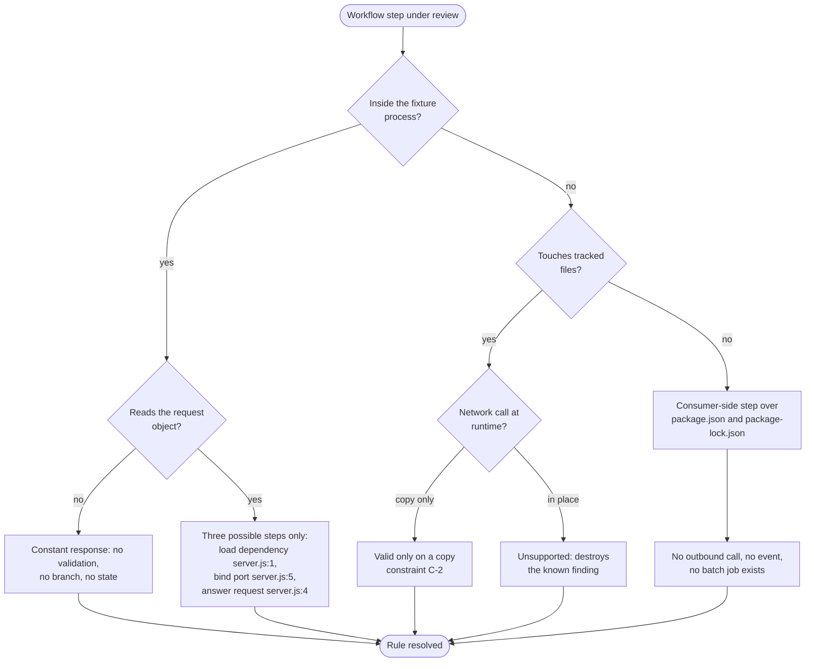


## 4.3 Technical Implementation

### 4.3.1 State Management

**State transitions.** The fixture holds no application state, so the only genuine state machine is the process life cycle, whose transitions are driven entirely by startup outcomes and external signals. No state is stored between requests, and no request can move the process to a different state.

| From | Event | To | Guard | Observed evidence |
|---|---|---|---|---|
| `UNSTARTED` | `node server.js` invoked | `LOADING` | Runtime present | Process spawn |
| `LOADING` | `lodash` resolved from `node_modules` | `BOUND_PENDING` | Package present | Install then start succeeds |
| `LOADING` | Resolution fails | `TERMINATED_FAILED` | Package absent | Exit 1, `MODULE_NOT_FOUND` at `server.js:1:11` |
| `BOUND_PENDING` | Bind of `:::3000` succeeds | `LISTENING` | Port free | Startup line printed |
| `BOUND_PENDING` | Bind fails | `TERMINATED_FAILED` | Port already bound | Exit 1, `EADDRINUSE` at `server.js:5:4` |
| `LISTENING` | Inbound request | `LISTENING` | None — self-transition, no state change | Identical response for every request variation |
| `LISTENING` | `SIGTERM` or `SIGINT` | `TERMINATED` | None — default signal behavior | Process exits and the port stops accepting; no handler runs |

The `LISTENING` self-transition is the clearest evidence that the process is stateless: repeated, concurrent, and varied requests are indistinguishable in every observable respect, and stdout never gains a second line. There is no `SHUTTING_DOWN` state, because no shutdown hook exists to enter one.

**Data persistence points.** **There are none at runtime.** `server.js` contains no `fs` require, no file write, and no storage client; the request handler ends the response with a constant and holds nothing; and nothing survives a restart except the three tracked files themselves. The complete list of things this system writes anywhere is the following, and none is written by the running fixture.

| Write | Performed by | Timing | Persistence |
|---|---|---|---|
| `node_modules/lodash/**` | npm client | Install time | Local working copy; untracked by git; regenerated by any install from the lockfile |
| npm's host package cache (default `~/.npm`) | npm client | Install time | Host- and user-level; not configured by the repository |
| npm's local debug log (`~/.npm/_logs/`) | npm client | On an npm command failure, such as `npm test` exiting 1 | Host-level; produced by the tool, not by this repository |
| stdout startup line | Fixture process | Once, when the `listening` event fires | Captured by whatever supervises the process; never persisted by the fixture |
| Manifest, lockfile, or a copy of them | A consumer's remediation tool | Remediation time | Only meaningful on a copy; on the tracked files it destroys the known finding (constraint C-2) |

The durable record of *intent* is declarative and lives in version control rather than in a datastore: `package.json` line 5 fixes the version, and `package-lock.json` lines 14–19 fix the exact bytes — version 4.17.15, the registry tarball `https://registry.npmjs.org/lodash/-/lodash-4.17.15.tgz`, and the SHA-512 integrity digest. Section 3.5.2 records this as the fixture's substitute for a runtime data store.

**Caching requirements.** The repository **requires and configures no cache.** No cache client appears in the manifest or `node_modules`, no in-memory map serves as a cache, no TTL logic exists, and no cache header is emitted — the only response headers observed are `date`, `connection`, `keep-alive: timeout=5`, and `content-length: 14`. Two caches exist in the surrounding toolchain, both outside the repository's control:

| Cache | Layer | Effect on the workflow | Repository dependency |
|---|---|---|---|
| npm content-addressable package cache (host default `~/.npm`) | npm client, host-level | Makes a repeat install of the one pinned tarball independent of network latency; a cold cache turns the install into a single registry round trip | None — neither configured nor required |
| `node_modules/` | Working copy | Materializes the resolved package so that `server.js:1` can resolve it; absent in a fresh checkout until an install runs | Required for the runtime workflow, produced by install, untracked |

The lockfile's digest, not a cache, is what makes repeated installs equivalent: identical bytes are guaranteed by verification against `package-lock.json` line 17 rather than by cache reuse.

**Transaction boundaries.** The fixture opens no transaction, because it has no datastore to open one against. Two atomic units exist in the surrounding workflow, and both are enforced by the npm client rather than by any code in this repository.

| Atomic unit | Scope | Atomicity mechanism | Partial-failure behavior |
|---|---|---|---|
| Install | The whole resolved graph — here, a single package | Extraction gated on the `sha512-` integrity check of the fetched tarball | A digest mismatch aborts the install; the scan never runs against unverified bytes |
| Remediation | Manifest edit plus reinstall plus re-scan, treated as one logical change | Must be performed on a copy; `npm audit fix --force` rewrites both `package.json` and `package-lock.json` together | Observed: forcing the fix rewrites the pin to the range `^4.18.1`, replaces the lockfile's `resolved` and `integrity` with the 4.18.1 values, and re-scans at `total: 0` |

Neither unit is rolled back by anything in the repository: there is no compensating action, no snapshot, and no versioned store, so a consumer that mutates tracked files in place has no fixture-side recovery path. This is precisely why constraint C-2 confines remediation to a copy.

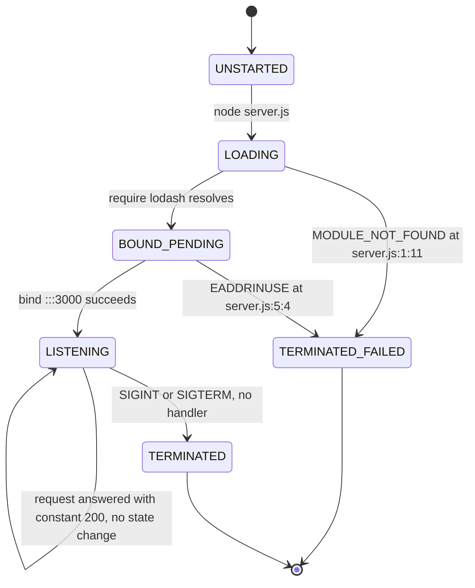

### 4.3.2 Error Handling

**Retry mechanisms.** **None, in either half of the life cycle.** `server.js` contains no `try`, no `catch`, no `error` listener, no backoff, no counter, and no loop; startup is fire-and-forget, and each of its two failure modes aborts the process on the first attempt. On the consumer side the npm client's own retry behavior for transient network faults is a property of that tool, not of the fixture, and the repository configures nothing — there is no `.npmrc`, no retry setting, and no registry override.

| Failure | Retried by the fixture? | Retried by the toolchain? | Consequence |
|---|---|---|---|
| `lodash` not resolvable | No | No — the install must be run first | Process exits 1; the consumer re-runs install then start |
| Port 3000 already bound | No — no alternative port is probed or negotiated | No | Process exits 1; the operator must free the port |
| Malformed or oversize request | No | No — the parser rejects and closes | `400` or `431`; the client resends a valid request |
| Digest mismatch on the pinned tarball | Not applicable — no code path in the fixture | Install aborts rather than substituting bytes | The scanned input cannot silently differ from the locked resolution |
| Finding present at scan time | Not applicable — the finding is the intended outcome | The scan reports rather than retries | Remediation is a deliberate consumer action |

**Fallback processes.** **None.** There is no alternative port, no degraded mode, no cached response, no default dependency version, and no secondary code path anywhere in the five-line runtime. Each guard is absent by construction:

- The require on `server.js:1` has no `try`/`catch` and no conditional, so a missing package is fatal rather than degraded.
- `listen(3000)` passes no `error` callback and no `error` listener is attached, so a bind conflict throws an unhandled event instead of falling back to another port.
- The handler computes nothing from any input, so there is no branch that could select an alternative response.
- The port `3000` is a literal with no environment-variable or argument override, so the process cannot be relocated without editing source.

**Error notification flows.** Notification is limited to what the runtime and the tools print, and the fixture itself notifies no one: there is no log shipper, no alerting hook, no webhook, no ticketing integration, and no error-reporting SDK (Section 3.4.3). Errors surface on three channels, each consumed by whoever runs the command.

| Error | Notification channel | Message or status | Consumed by |
|---|---|---|---|
| Dependency missing | stderr from the Node runtime | `Error: Cannot find module 'lodash'`, with `code` `MODULE_NOT_FOUND`, `requireStack` naming the module file, and the `server.js:1:11` origin | Operator, pipeline log |
| Port bound | stderr from the Node runtime | Unhandled `'error'` event, `Error: listen EADDRINUSE: address already in use :::3000`, with `errno` -98, `syscall` `listen`, `address` `':'`, `port` 3000, at `server.js:5:4` | Operator, pipeline log |
| Successful start | stdout, once | `Server running at http://127.0.0.1:3000/` | Log capture; not a health signal |
| Vulnerability present | Scanner output and process exit status | One high-severity direct finding; `1 high severity vulnerability`; exit 1 | AppSec engineer, CI gate |
| No test command | npm stderr | `npm error Missing script: "test"`, plus a debug log path under `~/.npm/_logs/` | Consumer discovering the absence of a harness |

Nothing notifies on request-handling anomalies, since the parser's `400`/`431` responses go to the client and are never logged by the process: stdout still held exactly one line after every probe. There is also no health or readiness endpoint that a supervisor could poll — every path returns the same constant, so a probe cannot distinguish healthy from unhealthy.

**Recovery procedures.** Recovery is entirely the operator's, and each procedure below was exercised to its observed end state.

| Failure | Recovery procedure | Verified end state |
|---|---|---|
| `MODULE_NOT_FOUND` at start | Run `npm ci` (or `npm install`) in the checkout, then start again; `node_modules/` is untracked and must be produced first | Install exits 0 and installs `lodash` 4.17.15; the subsequent start prints the startup line and serves requests |
| `EADDRINUSE` at startup | Identify and stop the process holding port 3000, then restart; a lingering instance holds the port because nothing releases it on the way out | Port becomes free on termination — after `SIGTERM` the port stopped accepting and a fresh instance bound successfully |
| Process termination | Terminate externally with `SIGTERM` or `SIGINT`; no handler exists, so Node's default behavior applies and the process ends without draining anything | Process exits; the port is released |
| Protocol rejection | Resend a well-formed request within the parser's URL limit | Request answered `200` with the constant 14-byte body |
| Blocking scan | Apply the reported fix on a **copy** — `4.17.15` → `4.18.1`, non-breaking — then re-scan | Re-scan exits 0 with `total: 0` and no vulnerability entries |
| Drift in the finding set | Compare the current `npm audit --json` output with the recorded baseline, then reconcile the pin, the lockfile, or the require on `server.js:1` | Finding set returns to exactly 1 high, direct, 6 advisories |

No recovery procedure exists for a fixture mutated in place: once the pin is changed or the lockfile regenerated against a newer release, the known finding is gone, and the only restoration is reverting the tracked files.

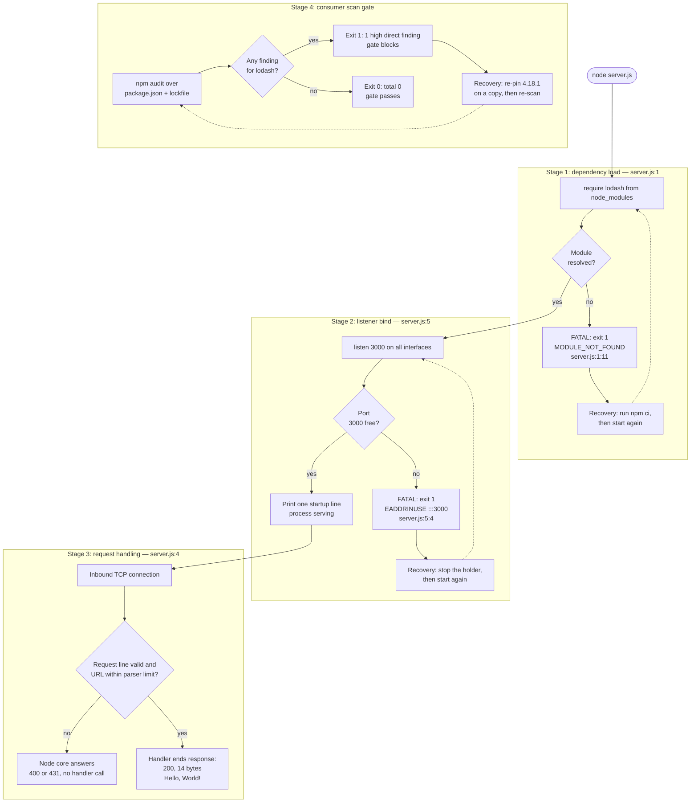

**Error-handling properties in one view.** The following table is the summary a reader should carry away: where recovery exists at all, it exists outside the repository.

| Property | Fixture behavior | Owner of recovery |
|---|---|---|
| Retry | Absent | Consumer (re-invoke install or start) |
| Fallback | Absent | Consumer (free the port, provision the package) |
| Notification | stderr for fatal startup errors, stdout for successful start only | Operator or pipeline log capture |
| Recovery | Absent in-process; three documented external procedures | Operator, pipeline, remediation tooling |
| Timeout | None applied to any operation; the only timer that exists is Node's 5-second keep-alive idle window | Runtime default |
| Logging | One startup line; no per-request or error log written by the fixture | Consumer's stdout capture |


## 4.4 Required Diagrams

Each diagram below is traceable to the artifacts named in its accompanying notes; where a figure or duration appears, it is a single-host observation recorded in Section 4.2.1, not a target. Node labels carry the file and line each step executes, so that a reader can verify the diagram against the sources.

### 4.4.1 High-Level System Workflow

The fixture participates in four lanes: the consumer's engineer or CI job, the npm client, the fixture process itself, and the SCA scanner with its advisory source. Only the third lane contains code from this repository; the other three are consumer or registry side.

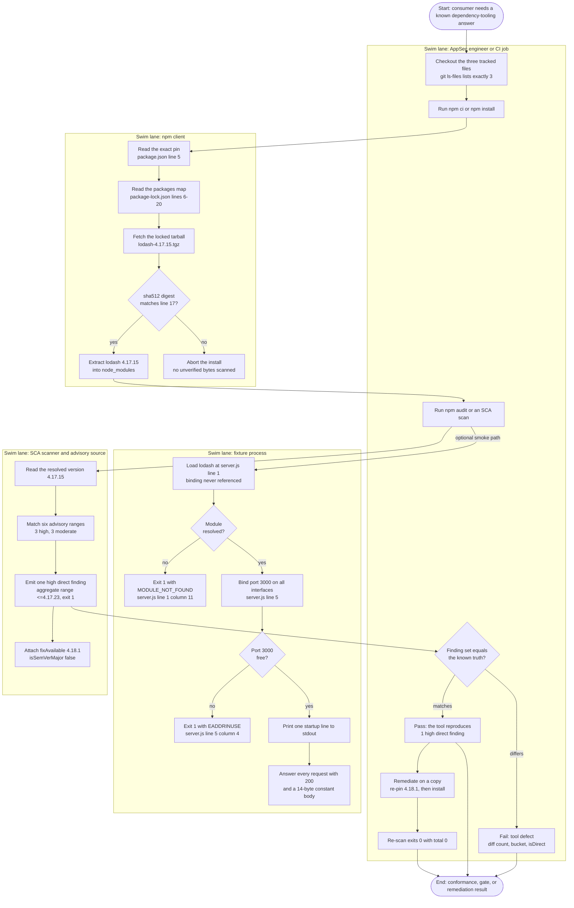

The two lanes that never meet are the point of this diagram: the scan lane (S1–S4) consumes only the manifest and lockfile, while the fixture lane (P1–P6) never reads anything the scan produces. The edge from ES3 into P1 is the optional smoke path of WF-4, not a dependency of the gate.

### 4.4.2 Detailed Process Flows per Core Feature

**F-001 — Exact Dependency Pin.** Requirement F-001-RQ-001 requires a version string with no operator; the diamond is the entire feature.

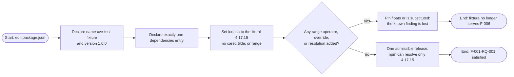

**F-002 — Reproducible Install Resolution.** The digest check is the only validation performed anywhere in the install path (F-002-RQ-001).

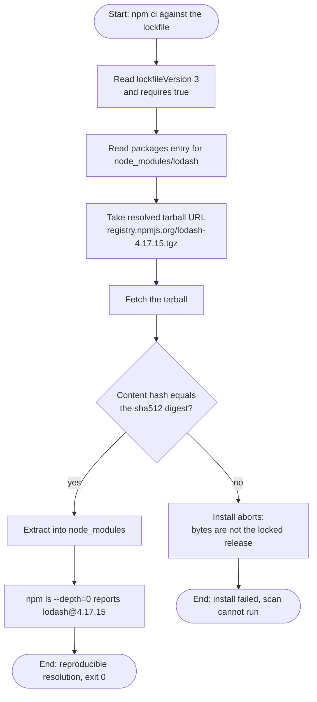

**F-003 — Runtime Load of the Pinned Dependency.** The require is the fixture's first statement and its first fatal failure mode (F-003-RQ-001, F-003-RQ-002).

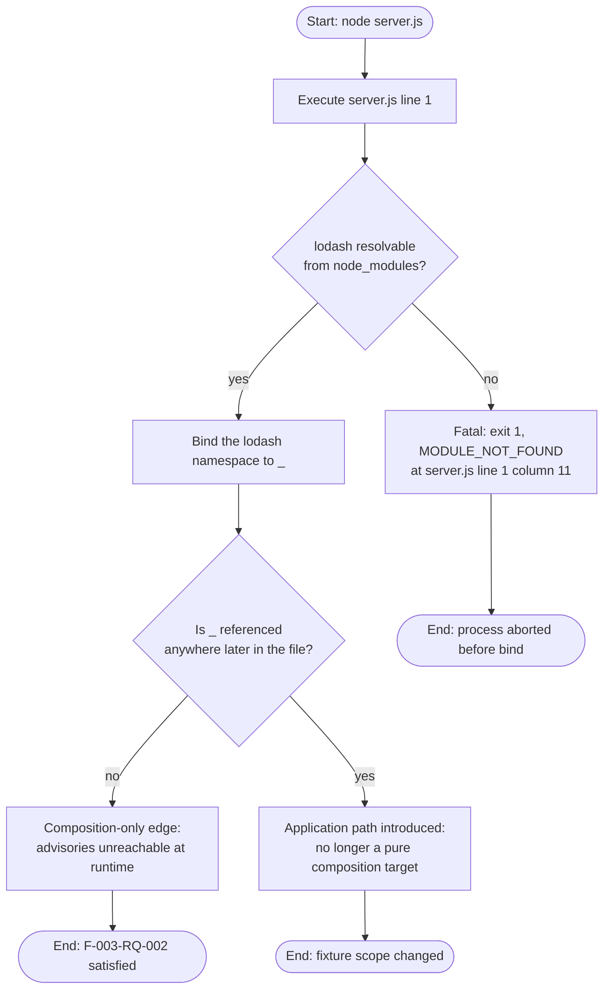

**F-004 — Runnable HTTP Fixture Process.** The bind is the fixture's second and last fatal failure mode (F-004-RQ-001, F-004-RQ-003).

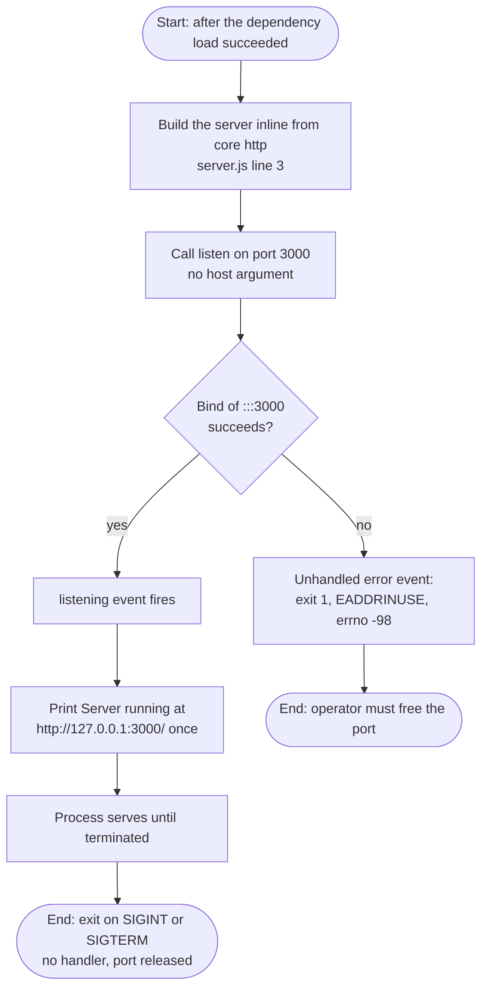

**F-005 — Deterministic Input-Independent Response.** There is no branch in this flow, which is the requirement (F-005-RQ-001, F-005-RQ-002, F-005-RQ-003).

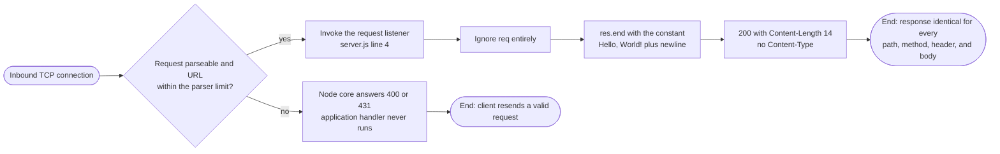

**F-006 — Known-Vulnerability Detection Signal.** The scan is computed from the declarative files, so this flow continues even when no install has run (F-006-RQ-001, F-006-RQ-002, F-006-RQ-003).

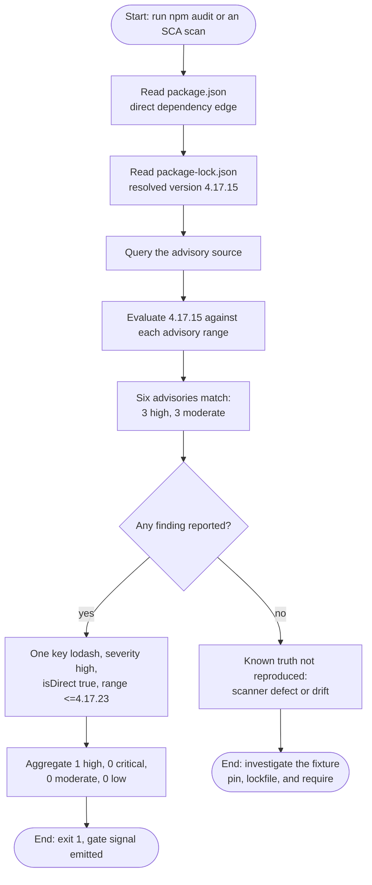

**F-007 — Non-Breaking Remediation Signal.** The branch on the left is the in-place mutation constraint C-2 forbids (F-007-RQ-001, F-007-RQ-002).

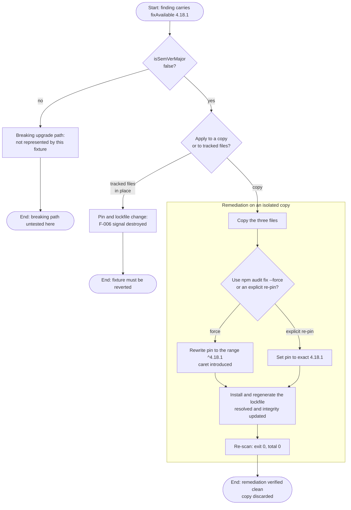

### 4.4.3 Error Handling Flowcharts

Two fatal startup errors, one parser-level rejection, and one expected blocking outcome are the complete error surface of this workflow.

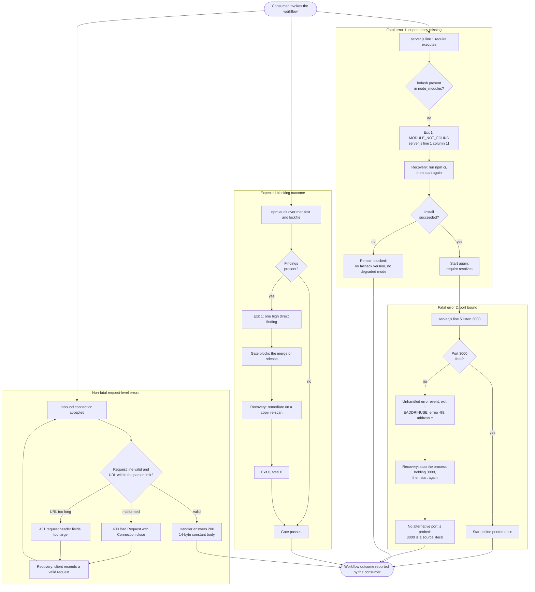

**What the error paths share.** No path retries, none falls back, and none notifies anyone: the two fatal states report on stderr and end the process, the parser-level states report to the client without touching fixture state, and the scan outcome reports through an exit status. Recovery in every case is external to the repository (Section 4.3.2).

### 4.4.4 Integration Sequence Diagrams

**Install sequence (DF-1, DF-2).** The digest check is the only guard between the registry and the scanned bytes.

```mermaid
sequenceDiagram
    participant Eng as Engineer or CI job
    participant Npm as npm client
    participant MF as package.json
    participant LF as package-lock.json
    participant Reg as npm registry
    participant NM as node_modules

    Eng->>Npm: npm ci
    Npm->>MF: read name, version, exact pin lodash 4.17.15
    Npm->>LF: read lockfileVersion 3 and packages map
    LF-->>Npm: resolved tarball URL and sha512 digest
    Npm->>Reg: GET lodash-4.17.15.tgz
    Reg-->>Npm: tarball bytes
    alt digest matches
        Npm->>NM: extract lodash 4.17.15
        Npm-->>Eng: exit 0, one package added
    else digest mismatch
        Npm-->>Eng: abort, no unverified bytes written
    end
    Note over Eng,NM: Observed install on a cold copy took 391 ms
```

**Scan and gate sequence (DF-3, finding set, F-006, F-007).** The scanner reads the declarative files; it does not depend on the install having run.

```mermaid
sequenceDiagram
    participant CI as CI job or AppSec engineer
    participant Sc as SCA scanner
    participant MF as package.json
    participant LF as package-lock.json
    participant DB as Advisory database

    CI->>Sc: run scan
    Sc->>MF: read direct dependency declaration
    Sc->>LF: read resolved version 4.17.15 and digest
    Sc->>DB: request advisories for the resolved version
    DB-->>Sc: six advisories, ranges and CVSS scores
    Sc->>Sc: match 4.17.15 against each range
    Sc-->>CI: one high direct finding, aggregate range <=4.17.23
    Sc-->>CI: exit status 1
    Sc-->>CI: fixAvailable lodash 4.18.1, isSemVerMajor false
    alt gate threshold at or below high
        CI->>CI: stage fails, merge or release blocked
    else threshold set to critical
        CI->>CI: stage passes although the pin is unfixed
    end
    Note over CI,DB: Observed scan took 368 ms and exited 1 with and without node_modules present
```

**Remediation sequence (WF-3, constraint C-2).**

```mermaid
sequenceDiagram
    participant Owner as Remediation tooling owner
    participant Cp as Isolated copy of the three files
    participant Npm as npm client
    participant Sc as SCA scanner
    participant Tr as Tracked files

    Owner->>Cp: copy package.json, package-lock.json, server.js
    Owner->>Cp: set dependency to lodash 4.18.1
    Owner->>Npm: install in the copy
    Npm->>Cp: write node_modules and regenerate the lockfile entry
    Npm-->>Owner: exit 0, lodash 4.18.1 installed
    Owner->>Sc: re-scan the copy
    Sc-->>Owner: exit 0, total 0, no vulnerability entries
    Owner->>Tr: leave untouched
    Note over Tr: Changing the pin in place would clear the finding<br/>and remove the signal F-006 exists to produce
```

**Runtime HTTP request sequence (F-004, F-005).** Every field the client sends is discarded at the boundary.

```mermaid
sequenceDiagram
    participant Cl as HTTP client or probe
    participant Kr as Node http parser
    participant Srv as Fixture listener port 3000
    participant H as Request listener server.js line 4
    participant Out as stdout

    Srv->>Out: print startup line once
    Cl->>Kr: TCP connect on port 3000
    Cl->>Kr: request with any path, method, header, body
    alt parseable request within limits
        Kr->>H: dispatch the request
        H->>H: discard req, read nothing
        H-->>Srv: res.end with the constant string
        Srv-->>Cl: 200, Content-Length 14, no Content-Type
    else malformed request line
        Kr-->>Cl: 400 Bad Request, Connection close
    else URL beyond the parser limit
        Kr-->>Cl: 431
    end
    Note over H,Out: No per-request output is written:<br/>stdout still holds the single startup line after all probes
```

### 4.4.5 State Transition Diagrams

**Process lifecycle state machine.** This is the only state machine in the system; every guard is a filesystem or socket condition (Section 4.3.1).

```mermaid
stateDiagram-v2
    [*] --> UNSTARTED
    UNSTARTED --> LOADING: node server.js
    LOADING --> BOUND_PENDING: require lodash resolves
    LOADING --> TERMINATED_FAILED: MODULE_NOT_FOUND at line 1
    BOUND_PENDING --> LISTENING: bind of #58;#58;#58;3000 succeeds
    BOUND_PENDING --> TERMINATED_FAILED: EADDRINUSE at line 5
    LISTENING --> LISTENING: any request answered with the constant 200
    LISTENING --> TERMINATED: SIGINT or SIGTERM, no handler installed
    TERMINATED_FAILED --> [*]
    TERMINATED --> [*]
```

| State | Entered by | Holds state? | Exit conditions |
|---|---|---|---|
| `UNSTARTED` | Invocation not yet made | No | Start command |
| `LOADING` | Process spawn | No | Line 1 resolves or fails |
| `BOUND_PENDING` | Dependency loaded | No | `listen(3000)` succeeds or fails |
| `LISTENING` | Listening event fired | No — requests are stateless self-transitions | External signal |
| `TERMINATED_FAILED` | A fatal startup error | No | Terminal |
| `TERMINATED` | `SIGINT` or `SIGTERM` | Nothing to flush | Terminal |

**Request-handling state machine.** The single self-transition is the observable proof of statelessness (F-005-RQ-003).

```mermaid
stateDiagram-v2
    [*] --> IDLE
    IDLE --> PARSING: inbound TCP connection
    PARSING --> REJECTED: malformed request line or oversized URL
    PARSING --> HANDLING: request dispatched to the listener
    HANDLING --> RESPONDED: res.end with the constant string
    REJECTED --> IDLE: Node core closed the connection
    RESPONDED --> IDLE: no state retained between requests
    IDLE --> TERMINATING: SIGINT or SIGTERM
    TERMINATING --> [*]
```

**Fixture validity state machine (finding signal).** This machine spans the repository rather than the process: it tracks whether the artifact still presents its known answer, and every transition into `SIGNAL_LOST` is a repository mutation.

```mermaid
stateDiagram-v2
    [*] --> VALID
    VALID --> VALID: scan repeats, finding set unchanged
    VALID --> SIGNAL_LOST: pin raised above the advisory ranges
    VALID --> SIGNAL_LOST: lockfile regenerated against a newer release
    VALID --> SIGNAL_LOST: require on line 1 removed or made conditional
    VALID --> SIGNAL_LOST: remediation applied to the tracked files
    VALID --> SIGNAL_DRIFTED: advisory ranges change in the scanner's source
    SIGNAL_DRIFTED --> VALID: reconcile the pin and lockfile with the new advisories
    SIGNAL_LOST --> VALID: revert the tracked files to the pinned resolution
    SIGNAL_LOST --> [*]
```

| State | Meaning | Observable | Recovery |
|---|---|---|---|
| `VALID` | Pin exact, lockfile resolving 4.17.15, require intact | Scan exits 1 with one high direct finding covering six advisories | Not required |
| `SIGNAL_DRIFTED` | The repository is unchanged but the advisory source's ranges or recommended fix shifted | Finding count, ranges, or `fixAvailable` differ from the baseline | Reconcile the baseline with the current advisory data (assumption A-5) |
| `SIGNAL_LOST` | A repository mutation removed or relocated the vulnerable edge | Scan exits 0 or reports a different version | Revert `package.json`, `package-lock.json`, and `server.js` to the pinned state |

**Related requirements across the diagram set.** The table maps each diagram to the requirement identifiers whose acceptance criteria it visualizes.

| Diagram | Requirements and records it illustrates |
|---|---|
| High-level system workflow (4.4.1) | F-001-RQ-001, F-002-RQ-001, F-003-RQ-001, F-004-RQ-001, F-006-RQ-001, F-007-RQ-001; assumptions A-1, A-2, A-4 |
| F-001 flow | F-001-RQ-001, F-001-RQ-003; constraint C-1 |
| F-002 flow | F-002-RQ-001, F-002-RQ-002, F-002-RQ-003; assumption A-2 |
| F-003 flow | F-003-RQ-001, F-003-RQ-002; Section 1.3.2 exclusion of reachability validation |
| F-004 flow | F-004-RQ-001, F-004-RQ-002, F-004-RQ-003; assumption A-3 |
| F-005 flow | F-005-RQ-001, F-005-RQ-002, F-005-RQ-003 |
| F-006 flow | F-006-RQ-001, F-006-RQ-002, F-006-RQ-003; assumption A-5, constraint C-3 |
| F-007 flow | F-007-RQ-001, F-007-RQ-002; constraint C-2 |
| Error handling flows (4.4.3) | F-003-RQ-001, F-004-RQ-003, F-005-RQ-002, F-006-RQ-001; constraint C-4 (no recovery commitment) |
| Integration sequences (4.4.4) | F-002-RQ-001, F-004-RQ-001, F-005-RQ-001, F-006-RQ-001, F-007-RQ-002 |
| State transitions (4.4.5) | F-003-RQ-001, F-004-RQ-003, F-005-RQ-003; constraints C-1, C-2, C-5 |


## 4.5 References

Every diagram, state table, and workflow step in this section rests on the artifacts below. Repository paths are repository-root-relative; all runtime, install, scan, gate, and remediation values were reproduced against an isolated copy of the same three files (Node v22.23.3, npm 11.18.0, `auditReportVersion` 2).

**Repository files**

- `server.js` — the entire runtime: line 1 unconditional `require('lodash')` bound to an unused `_`; lines 3–5 the inline `http.createServer(...).listen(3000, ...)` with the constant `res.end('Hello, World!\n')` and the single startup `console.log`. Supplies process steps P-1 to P-3, the `LISTENING` self-transition, both fatal startup failure modes (`MODULE_NOT_FOUND` at 1:11, `EADDRINUSE` at 5:4), and the branchless F-005 flow.
- `package.json` — identity `cve-test-fixture` 1.0.0 with the sole dependency `"lodash": "4.17.15"` on line 5; absence of `scripts`, `main`, `engines`, `license`, and every other dependency block. Supplies F-001's decision diamond, the absence of any npm test command, and the consumer-supplied-assertions assumption (A-1).
- `package-lock.json` — `lockfileVersion` 3 with `requires: true`, the `packages[""]` root restating the pin, and the single resolved entry on lines 14–19 giving version 4.17.15, `resolved` `https://registry.npmjs.org/lodash/-/lodash-4.17.15.tgz`, and the `sha512-` integrity digest on line 17. Supplies the install sequence's digest decision, the reproducible-resolution flow, and the DF-1/DF-2 data flows.
- `""` (repository root) — folder listing establishing the exact artifact set: three files, no sub-folders, no test, config, CI, container, or documentation file; `git ls-files` and `git log` (five commits, `afe4df7` at HEAD) confirming no workflow, pipeline, or script exists anywhere in the tree or in any branch (`0210_01`, `main`, `origin/main`, `origin/0210_01`, `origin/2209_01`).

**Observed behaviors reproduced while writing this section**

- Install workflow: `npm ci` on a copy with no `node_modules/` — exit 0, 391 ms, one package, `npm ls --depth=0` printing `lodash@4.17.15`.
- Runtime workflow: `node server.js` — startup line `Server running at http://127.0.0.1:3000/` 36 ms after spawn; identical `HTTP/1.1 200 OK`, `Content-Length: 14`, body `Hello, World!`, no `Content-Type` for `GET /`, a nonexistent path with a query string, `POST` with a JSON body and custom header, `OPTIONS`, `DELETE`, `HEAD`, an HTTP/1.0 request, an `Expect: 100-continue` request, and a 1 MB body; three requests on one keep-alive connection; 20 concurrent client invocations in 12 ms and 200 sequential in 756 ms; `400 Bad Request` on a malformed request line and `431` on a ~20,000-character URL, both from Node's core parser.
- Error paths: start without `node_modules/` — exit 1, `Cannot find module 'lodash'`, `MODULE_NOT_FOUND`, `server.js:1:11`; second instance — exit 1, unhandled `'error'` event, `EADDRINUSE`, `errno` -98, `address` `':'`, `port` 3000, `server.js:5:4`; `SIGTERM` — process terminates, port released; `npm test` — exit 1, `Missing script: "test"`; `npm start` — resolves to `node server.js`.
- Scan and gate workflow: `npm audit --json` — exit 1, `auditReportVersion` 2, aggregate `{high: 1, total: 1}`, the same result with `node_modules/` absent, one key `lodash` with `severity` high, `isDirect` true, aggregate range `<=4.17.23`, `effects` empty, six advisories in `via`, and `fixAvailable` `{name: "lodash", version: "4.18.1", isSemVerMajor: false}`; `--audit-level=critical` exit 0 versus `moderate`/`low`/`--omit=dev` exit 1; `npm audit fix` a no-op.
- Remediation workflow on copies: explicit exact re-pin to `4.18.1` — install exit 0, re-scan exit 0, `total: 0`; `npm audit fix --force` — manifest rewritten to `"lodash": "^4.18.1"`, lockfile entry replaced with the 4.18.1 `resolved` URL and digest, re-scan exit 0, `total: 0`.

**Web sources**

- [web] npm registry tarball endpoint `https://registry.npmjs.org/lodash/-/lodash-4.17.15.tgz` — the release named by `package-lock.json` line 16; confirmed present and digest-verified at install.
- [web] GitHub Advisory Database records surfaced by `npm audit` — `GHSA-35jh-r3h4-6jhm` (command injection, high, CVSS 7.2, `<4.17.21`), `GHSA-p6mc-m468-83gw` (prototype pollution, high, 7.4, `>=3.7.0 <4.17.19`), `GHSA-29mw-wpgm-hmr9` (ReDoS, moderate, 5.3, `>=4.0.0 <4.17.21`), `GHSA-r5fr-rjxr-66jc` (code injection via `_.template`, high, 8.1, `>=4.0.0 <=4.17.23`), `GHSA-f23m-r3pf-42rh` (prototype pollution, moderate, 6.5, `<=4.17.23`), `GHSA-xxjr-mmjv-4gpg` (prototype pollution in `_.unset`/`_.omit`, moderate, 6.5, `>=4.0.0 <=4.17.22`) — the ranges that fix the F-006 flow's decision boundary and the aggregate `<=4.17.23` range, and the source of the `fixAvailable` recommendation driving the F-007 flow.

**Cross-referenced specification sections**

- Section 1.1 (Executive Summary), Section 1.2 (System Overview: component inventory, integration points, success criteria), and Section 1.3 (Scope: primary workflows WF-1 to WF-5, implementation boundaries, exclusions) — the workflow inventory and boundary definitions the diagrams implement.
- Section 2.1 (Feature Catalog: F-001 to F-007), Section 2.2 (Functional Requirements Table: requirement IDs cited in Section 4.4.5), Section 2.3 (Feature Relationships and integration points), and Section 2.4 (Implementation Considerations: assumptions A-1 to A-5, constraints C-1 to C-5, observed timings) — the feature, requirement, and constraint identifiers used throughout.
- Section 3.4 (Third-Party Services: no external API, no authentication, no observability, no cloud service), Section 3.5 (Databases and Storage: no persistence and no cache), and Section 3.6 (Development and Deployment: no build, container, or CI config; runtime execution facts) — the evidence for the absent integration, storage, and pipeline elements recorded here.


# 5. System Architecture

## 5.1 High-Level Architecture

`cve-test-fixture` 1.0.0 has no tiers, no services, and no module boundaries. The entire system is three tracked files — `server.js`, `package.json`, `package-lock.json` — totaling 33 lines and 826 bytes, with no sub-folders anywhere in the tree. The architecture is therefore documented as a single flat, stateless, declaratively-exposed artifact whose primary product is not an HTTP response but a reproducible vulnerability finding.

### 5.1.1 System Overview

**Architectural style.** The repository implements a **single-process, single-module, zero-tier architecture**: one CommonJS entry file executed directly by the Node.js runtime, one dependency declared declaratively in the manifest, and one dependency resolution frozen in the lockfile. There is no layer separation, no dependency injection, no configuration system, and no internal module graph — `server.js` defines no functions, classes, or exports, and contains two module-level statements only.

In the vocabulary of the standard architectural patterns, the following are deliberately absent, and each absence is a positive property of the artifact rather than an omission:

| Familiar pattern | Present? | Decisive evidence |
|---|---|---|
| Layered / n-tier (presentation, domain, data) | **No** | One file, 5 lines, no layer directories, no model/persistence code; the handler computes nothing |
| MVC / MVC-style request pipeline | **No** | No controller, route table, view, or template; `req` is never read on `server.js:4` |
| Microservices / service decomposition | **No** | One process, one listener, no service registry, no inter-process call |
| Framework-based application (Express/Fastify/Koa/NestJS) | **No** | `server.js:3` calls `require('http').createServer(...)` inline; no framework package in the manifest or `node_modules` |
| Event-driven / message-oriented | **No** | No broker, queue, topic, webhook, or subscription; the only event consumed is Node's unhandled `'error'` on a failed bind |
| Plugin / extension architecture | **No** | No plugin registry, no dynamic loading, no extension point |
| Hexagonal / ports-and-adapters | **No** | No adapter interface; the dependency is loaded but never invoked, so there is no port to adapt |

**Rationale.** The style follows directly from what the artifact exists to do: a scanner must map one known advisory onto one known direct dependency edge with no ambiguity. Every conventional architectural element — a framework, a router, a data layer, a service mesh, a configuration system — would add packages to the scanned graph or code paths to the application, and either would dilute the single finding the fixture produces (constraint C-3, Section 2.4.9). The architecture is minimal because minimality *is* the correctness criterion.

**Key architectural principles and patterns.**

| Principle | How the architecture embodies it | Evidence |
|---|---|---|
| Determinism over behaviour | The request handler discards its input and emits a constant response, so no request feature can alter output | `server.js:4` reads nothing from `req`; `/`, `/a`, `/b?c=1`, `/../../etc/passwd`, `POST /` with a body, and `HEAD /` all returned `200` with the identical 14-byte body |
| Fail-fast startup | Both startup preconditions are unguarded, so an unmet precondition aborts rather than degrades | Missing package: exit 1, `MODULE_NOT_FOUND` at `server.js:1:11`. Port bound: exit 1, unhandled `EADDRINUSE` at `server.js:5:4` |
| Declaration as the contract | Dependency risk is expressed in the manifest and lockfile, not in code, so detection does not require execution | `npm audit` reports the identical finding set whether or not `node_modules/` is present (Section 4.1.1, WF-1) |
| Statelessness | The process holds no state between requests and writes nothing anywhere | `LISTENING` is a self-transition; stdout still held exactly one line after all probe requests; no `fs` usage in the file |
| Minimal scanned surface | One direct dependency, zero transitive packages, zero dev dependencies | `package-lock.json` `packages` map holds exactly two keys; `node_modules` contains one top-level package |
| Fixed, non-negotiable configuration | The port is a source literal; no environment variable, config file, or CLI argument is read | `listen(3000)` on `server.js:5`; no `process.env`, no config file in the tree |
| Unreachable vulnerable code by design | The dependency is loaded into the process but no member is ever called, so the target is composition-analysis-only | `const _ = require('lodash')` on line 1 is bound to `_`, which no later statement references (Section 3.2.2) |

**System boundaries and major interfaces.** The architecture has four boundaries, and only one of them is a socket.

| Boundary | Definition | Interface and contract | Evidence |
|---|---|---|---|
| Artifact boundary | Three tracked files; nothing else is versioned | A checkout of `server.js`, `package.json`, `package-lock.json` | Repository tree and file sizes (185 B, 104 B, 537 B) |
| Declarative boundary | The manifest and lockfile are read as data by tools outside the repository | JSON read: identity `cve-test-fixture` 1.0.0, exact pin `lodash: 4.17.15`, resolved tarball URL, SHA-512 digest, `MIT` | `package.json` lines 2–5; `package-lock.json` lines 7–19 |
| Install-time network boundary | One outbound fetch, once, before the process starts; nothing at runtime | HTTPS GET of `https://registry.npmjs.org/lodash/-/lodash-4.17.15.tgz`, verified against the lockfile digest | `package-lock.json` lines 16–17; no HTTP client or URL literal in `server.js` |
| Runtime boundary | One plaintext HTTP listener on TCP port 3000, all interfaces, no TLS, no authentication | `200` with `Content-Length: 14` and body `Hello, World!` for every request; no `Content-Type`; `keep-alive` idle window of 5 seconds | Verified on IPv4 loopback `127.0.0.1:3000` and on the host address `10.72.7.71:3000`; `[::1]:3000` was not reachable in the test container (`EADDRNOTAVAIL`), and the bind error text shows the wildcard address `::` |

The fixture exposes no internal interface to anything else: it publishes no API schema, exports no symbol, and initiates no outbound call once the dependency is installed.

### 5.1.2 Core Components Table

The components below comprise the complete architectural inventory. Five are repository or platform artifacts; the fourth and seventh are consumer-side tooling that the architecture is designed to serve but does not contain.

| Component Name | Primary Responsibility | Key Dependencies | Integration Points |
|---|---|---|---|
| `server.js` (runtime entry module, 5 lines) | Sole executable artifact; loads the dependency and constructs and schedules the listener in one top-level chained expression | `lodash` 4.17.15 via CommonJS on line 1; Node core `http` on line 3 | Read and executed by the Node.js runtime as the entry file; treated as the scanned runtime surface by consumers |
| Dependency-load stage (`server.js:1`) | Materialize the single direct dependency edge inside the process at startup | `node_modules/lodash/lodash.js` (package `main`, MIT, 540,512 bytes) | Filesystem read into process memory at load; fatal on failure at `server.js:1:11` |
| Constant request handler (`server.js:4`) | Terminate every HTTP response with the constant `Hello, World!` body | None — no modules, no state, no allocation proportional to input | Receives dispatch from Node's core HTTP parser; writes to the socket |
| Listener binding (`server.js:3,5`) | Own TCP port 3000 on all interfaces and emit the single startup line when bound | Node core `http` and `net`; the host socket table | Inbound TCP from any HTTP client; stdout on the `listening` event |
| `package.json` manifest (7 lines) | Declare package identity and the exact vulnerable dependency pin | None | Read by the npm client at install time, by SCA scanners at scan time, and by remediation tooling |
| `package-lock.json` lockfile (21 lines) | Freeze the resolved dependency to one version, one tarball, one digest | The manifest's exact pin | Read by the npm client and by scanners; the scanned contract for dependency resolution |
| `lodash` 4.17.15 (external package) | Supply the vulnerable dependency edge under test; loaded at startup, never invoked | npm registry tarball; no transitive dependencies | Read from `node_modules` at process load; matched against advisory ranges at scan time |
| Node.js platform runtime, core `http` and `net` (v22.23.3 observed) | Provide the server factory, the HTTP parser, the TCP bind, and the event loop | Bundled with the runtime; not declared in the manifest | Hosts the fixture process; answers parser-level rejections (`400`, `431`) before the handler runs |
| npm client and SCA scanner (v11.18.0 observed; consumer-side) | Resolve the pin, verify the digest, extract the package, and classify the resolved version against advisories | Registry and advisory endpoints (assumption A-2) | Operates on the manifest and lockfile from outside the repository boundary; produces exit statuses consumed by CI gates |

**Critical considerations per component.** Each entry names the property that, if changed, removes or relocates the fixture's known answer. These are the architectural forms of constraints C-1 and C-2 and of the F-001 through F-007 feature set.

| Component Name | Critical Consideration | Consequence if violated |
|---|---|---|
| Dependency-load stage (`server.js:1`) | The require must remain unconditional and the binding must remain unreferenced | Removing it deletes the direct runtime edge (F-003) and the finding; referencing `_` converts a composition-only target into one with an application-level code path |
| Constant request handler (`server.js:4`) | The response must stay byte-identical across all request variations | Any branch or input read makes scan output confounded by application logic (F-005) |
| Listener binding (`server.js:5`) | Port `3000` is a source literal with no `error` listener; the fixture cannot be relocated without editing source | A bound port aborts the process (`EADDRINUSE`, exit 1); no alternative port is probed |
| `package.json` | The pin must remain an exact `4.17.15` with no caret, tilde, range, or `overrides` block | A floating or substituted version silently removes the finding (F-001, C-1) |
| `package-lock.json` | Regeneration is permitted only against the same exact pin; npm v7 or later is required (schema v3) | Regenerating against a newer release changes the resolved version, `resolved` URL, and digest, and destroys the signal (F-002) |
| `lodash` 4.17.15 | Risk is detectable by composition analysis only; the vulnerable members are never called | A consumer expecting runtime-exploit detection will find no trigger here, by design (Section 1.3.2) |
| Node.js platform runtime | The manifest declares no `engines` field, so no version is enforced | The observed behaviour is verified on Node v22.23.3 only; an untested runtime is not guaranteed to reproduce the bind, headers, or module load |

### 5.1.3 Data Flow Description

Four data movements exist in the entire system, labelled DF-1 through DF-4 as in Section 4.1.2. Three are file or network reads performed outside the fixture process; only DF-4 crosses a socket the repository owns.

**DF-1 — Package fetch (install time, outbound).** The npm client reads `package.json` line 5 for the exact pin and `package-lock.json` lines 14–19 for the resolution, then issues an HTTPS GET for `lodash-4.17.15.tgz` against `registry.npmjs.org`. The single transformation point is verification: the fetched archive's content digest is compared with the `sha512-` integrity value on line 17, and only verified bytes are extracted. The output is the untracked `node_modules/lodash` tree (4.9 MB on disk). An install step is mandatory before the process can start, because `node_modules` is not versioned.

**DF-2 — Declaration read (install and scan time, file-based).** Two consumers read the same two files for different purposes. The npm client reads them to resolve and verify the graph; an SCA scanner reads them to classify risk. The scanner's classification depends on the manifest's direct-dependency declaration (`isDirect: true`), not on the installed bytes — the identical finding set is produced with `node_modules/` absent. The transformation here is JSON parsing and graph attribution, both performed by the consumer's tooling; no repository code participates.

**DF-3 — Advisory query (scan time, outbound).** The scanner queries its advisory source for the resolved version 4.17.15 and receives six advisories with their affected ranges and severity scores, plus the `fixAvailable` recommendation (`lodash` 4.18.1, `isSemVerMajor: false`). The evaluated result is one key `lodash`, `severity` high, `isDirect` true, aggregate range `<=4.17.23`, `effects` empty, aggregate bucket of 1 high / 0 critical / 0 moderate / 0 low, and process exit status 1. This flow terminates in an exit status, not in data written to the repository.

**DF-4 — HTTP response (runtime, inbound socket, per request).** A client connects to TCP port 3000. Node's core parser decodes the request; on a parseable request it dispatches to the listener on `server.js:4`, which reads nothing from `req` and calls `res.end` with the constant string. Node serializes the response as `HTTP/1.1 200 OK` with `Content-Length: 14` and emits the observed headers `date`, `connection: keep-alive`, `keep-alive: timeout=5`, `content-length: 14` — and no `Content-Type`. The flow is strictly one-way: nothing about the request reaches fixture logic, and the fixture sends nothing onward. Twenty concurrent requests all returned `200`, and stdout remained at one line after every probe.

**Integration patterns and protocols.**

| Flow | Pattern | Protocol / format | Direction |
|---|---|---|---|
| DF-1 | Request-response fetch with content verification | HTTPS (npm registry), gzip tarball, SHA-512 digest check | Outbound, install time |
| DF-2 | Shared-file contract (pull by the consumer) | JSON files read from the checkout | File read, no network |
| DF-3 | Request-response query by the scanner | Scanner's advisory API; the fixture is not a party | Outbound, scan time |
| DF-4 | Stateless request-response over a persistent connection | Plaintext HTTP/1.1 on TCP port 3000; text body, no content type | Inbound, runtime |

**Data transformation points.** Five transformations exist, and the repository owns only the third and fourth, both of which are effectively no-ops:

1. Registry tarball bytes → verified, extracted package tree, gated by the lockfile SHA-512 digest — the system's only integrity control.
2. Manifest and lockfile JSON text → parsed dependency graph, performed by the npm client and the scanner.
3. Filesystem module file → in-process CommonJS namespace bound to `_`, resolved through lodash's package `main` entry — and never dereferenced.
4. Inbound request bytes → parser-decoded request object → discarded → constant string → 14-byte response body with a computed `Content-Length` and no `Content-Type`.
5. Resolved version 4.17.15 plus advisory ranges → finding classification (`isDirect` true, aggregate `<=4.17.23`, exit 1) and a non-breaking `fixAvailable` recommendation.

**Key data stores and caches.** The application holds no store and no cache: no database driver, no key-value client, no file write, no in-memory map used as a cache, and no cache header on any response.

| Store or cache | Owner | Role in the architecture | Persistence |
|---|---|---|---|
| `package-lock.json` | Repository (tracked) | The durable record of intent — version, tarball URL, digest — that makes every install equivalent | Version-controlled; the fixture's substitute for a runtime data store (Section 3.5.2) |
| `node_modules/lodash` | npm client (untracked) | Materializes the module the line-1 require resolves; 4.9 MB on disk | Working copy only; absent in a fresh checkout; regenerated from the lockfile |
| npm host package cache (default `~/.npm`) | npm client, host level | Makes a repeat install independent of network latency for the single pinned tarball | Host- and user-level; neither configured nor required by the repository |
| Process heap | Fixture process | Holds only the loaded `lodash` module reference in `_`; no request state, no session, no queue | Discarded at process exit; nothing is flushed, because nothing must be |

The lockfile, not a cache, is what makes repeated installs identical: equivalence is guaranteed by digest verification against line 17 rather than by reuse of cached bytes.

### 5.1.4 External Integration Points

The fixture's external surface is three file-based contracts plus one optional socket. The only network interaction it initiates in its whole life cycle occurs at install time, before the process exists.

| System Name | Integration Type | Data Exchange Pattern | Protocol/Format |
|---|---|---|---|
| npm registry (`registry.npmjs.org`) | Package registry, install time | Consumer pulls one pinned tarball; the fixture itself makes no call | HTTPS; tarball archive; SHA-512 digest verified against the lockfile |
| Advisory database (the scanner's source; npm's audit endpoint is backed by the GitHub Advisory Database) | Data source, scan time | Consumer's scanner pulls advisories and the `fixAvailable` recommendation for the resolved version | Scanner's own API; the fixture is not a party to this exchange |
| CI/CD security gate | Process-contract integration | Consumer consumes the scanner's exit status and finding count | Exit codes and machine-readable scan output; no repository-side integration |
| Remediation tooling (dependency-update bots, `npm audit fix`) | Process-contract integration, on a copy | Tool reads the pin and the resolution, proposes or applies an upgrade outside the tracked files | File rewrite on a copy; constraint C-2 forbids in-place mutation |
| HTTP clients or smoke probes (optional) | Runtime inbound service | Client sends any request; listener returns the constant response | HTTP/1.1 over TCP port 3000, plaintext, no authentication |

**Service-level and availability reality.** No SLA, SLO, availability target, or throughput commitment is declared in any file — constraint C-4 states this explicitly, and no `engines`, `scripts`, or monitoring configuration exists to carry one. The table below therefore records what each integration actually guarantees, which is in every case a contract of the consumer's tooling rather than a service commitment of the fixture.

| System Name | SLA requirement | Failure behaviour and evidence |
|---|---|---|
| npm registry | None declared; availability of `lodash@4.17.15` is a hard precondition of any install (assumption A-2) | The exact pin admits no substitute release, so an unavailable tarball fails the install rather than silently resolving a nearby version |
| Advisory database | None declared; advisory content is outside repository control (assumption A-5) | If ranges or the recommended fix shift, the finding set drifts while the repository is unchanged; the baseline must be reconciled by the maintainer |
| CI/CD security gate | None declared; the consumer defines pass and fail (assumption A-1) | A gate at or below `high` exits 1 and blocks; a gate set to `critical` exits 0 against this fixture, because no critical-severity entry exists |
| Remediation tooling | None declared; the reported fix is non-breaking (`isSemVerMajor: false`) | Applied on a copy, a re-pin to 4.18.1 clears all findings (`total: 0`, exit 0); applied in place, it destroys the signal |
| HTTP clients | None declared; no health or readiness endpoint exists, and no probe can distinguish healthy from unhealthy | Every path returns the same constant `200`; a port conflict instead aborts startup with `EADDRINUSE` at `server.js:5:4` |

### 5.1.5 Architecture Context Diagram

The diagram places the three tracked artifacts inside the repository boundary and shows the two distinct halves of the architecture: the declarative half that the scanner's finding is computed from, and the runtime half that serves the constant response. The scan chain and the runtime chain never exchange data.

```mermaid
flowchart TD
    Engineer(["AppSec engineer, DevSecOps engineer, or CI job"])
    Registry["npm registry<br/>lodash 4.17.15 tarball"]
    Advisory[("Advisory database<br/>outside repository control")]

    subgraph RepoBoundary["Repository boundary — cve-test-fixture 1.0.0, three tracked files, 33 lines"]
        Manifest["package.json<br/>identity plus exact pin"]
        Lockfile["package-lock.json<br/>resolved version plus sha512 digest"]
        Server["server.js<br/>single CommonJS entry module"]
    end

    subgraph DeclarativeHalf["Declarative half — no execution required"]
        NpmClient["npm client<br/>resolve and verify"]
        Installed["node_modules lodash 4.17.15<br/>untracked install output"]
        Scanner["SCA scanner<br/>map version to advisories"]
        Gate["Security gate and remediation tooling<br/>consumer side, on a copy"]
    end

    subgraph RuntimeHalf["Runtime half — one process, no state"]
        Loader["Dependency-load stage<br/>server.js line 1"]
        Listener["Plaintext listener<br/>TCP port 3000, all interfaces"]
        Handler["Constant request handler<br/>server.js line 4"]
        Probe["Optional smoke probe or HTTP client"]
    end

    Engineer --> NpmClient
    Engineer --> Scanner
    Manifest --> NpmClient
    Lockfile --> NpmClient
    Registry --> NpmClient
    NpmClient --> Installed
    Manifest --> Scanner
    Lockfile --> Scanner
    Advisory --> Scanner
    Scanner --> Gate
    Installed --> Loader
    Server --> Loader
    Loader --> Listener
    Listener --> Handler
    Listener -->|"one startup line to stdout"| Probe
    Probe -->|"any request"| Listener
    Handler -->|"200 with 14-byte constant body, no Content-Type"| Probe
    Handler -.->|"no outbound call, no telemetry, no event"| Registry
```

The dotted edge is the architectural point: once the process is running, the fixture produces no outbound traffic at all. Its only external interaction at runtime is answering a socket it owns.

### 5.1.6 Architectural Assumptions

The assumptions below are the load-bearing preconditions of the architecture as built. They are restated from Section 2.4.9 because each one explains why an architectural element is absent rather than present.

| Assumption | Architectural consequence |
|---|---|
| A-1 — Consumers supply their own assertions and pass/fail criteria | The architecture includes no test harness, no `scripts` block, and no CI configuration; the repository defines no pass condition of its own |
| A-2 — The npm registry and its advisory data are available at install and scan time | Nothing is vendored: no checked-in tarball, no offline fixture, no advisory snapshot; the lockfile names a live registry URL |
| A-3 — The fixture is used in an isolated or trusted environment | The listener is plaintext HTTP on all interfaces with no authentication and no TLS; exposure beyond a test network is unsupported |
| A-4 — The consumer's scanner understands the v3 lockfile schema | No backward-compatible lockfile form is provided, and no `engines`/npm-version floor is declared in the manifest (npm v7 or later is required to read schema v3) |
| A-5 — The intended finding is the one mapped to the resolved version at scan time | The architecture fixes the version but cannot fix the advisory content, so the finding set can drift without any repository change |


## 5.2 Component Details

This sub-section details each component named in the Core Components Table (5.1.2). Because the system is flat, "interfaces" means a file contract, a module resolution, or a socket — never an in-process API call. Every component's scaling story reduces to the same fact: the fixture is one process with constant per-request work, so scaling is a property of the host and the consumer's pipeline, not of the architecture.

### 5.2.1 `server.js` — Runtime Entry Module

**Purpose and responsibilities.** The single executable artifact of the system and the sole runtime entry point. On load it performs exactly two top-level actions: it materializes the dependency edge, and it constructs and schedules the HTTP listener. It resolves no configuration, defines no reusable abstraction, and exports nothing — `npm start` reaches it only through npm's built-in default of `node server.js`, since no `main` field is declared.

**Technologies and frameworks used.** CommonJS module system (`require`, no `"type"` field, no ESM syntax) executing on Node.js v22.23.3, using `const` and arrow functions. No framework, no transpiler, no bundler — the file is executed exactly as committed (Section 3.6.2).

**Key interfaces and APIs.** The module presents no API; its surface is its startup side effects.

| Interface | Contract | Line |
|---|---|---|
| Filesystem resolution | `require('lodash')` resolves the package `main` entry `node_modules/lodash/lodash.js`; failure is fatal | `server.js:1` |
| Core-module use | `require('http')` with no binding, calling `createServer` and then `listen` | `server.js:3,5` |
| Inbound socket | Owns TCP port 3000 on all interfaces, plaintext HTTP | `server.js:5` |
| stdout | One line, `Server running at http://127.0.0.1:3000/`, emitted from the `listening` event | `server.js:5` |

**Data persistence requirements.** None. The module reads one file (`lodash.js`) and writes nothing: no `fs` require, no file write, no storage client, no log file, no signal handler, and nothing to flush at exit.

**Scaling considerations.** Startup cost is one synchronous module read of a 4.9 MB package tree; per-request cost is a constant with no allocation proportional to input. Twenty concurrent requests returned `200` on every one, handled by the runtime's default event loop with no application-level concurrency control, queue, or rate limit. Horizontal scaling is not an architectural concern because the process is stateless — but only one instance can run per host, since port 3000 is a source literal with no override and a second instance aborts with `EADDRINUSE` at `server.js:5:4`.

### 5.2.2 Dependency-Load Stage (`server.js:1`)

**Purpose and responsibilities.** Convert the manifest's declaration into a live runtime dependency edge by resolving `lodash` from `node_modules` at process start and binding it to the module-scope identifier `_`. This stage is what makes the finding `isDirect: true` in the scanner's classification rather than a declaration with no code path, and it is one of the three artifacts constraint C-1 protects.

**Technologies and frameworks used.** The Node.js CommonJS loader and lodash's package `main` entry. lodash declares no `engines`, `browser`, `type`, `module`, or `exports` field, so it imposes no engine constraint on the host.

**Key interfaces and APIs.** One interface only: the unguarded, unconditional `require('lodash')` call. Its two outcomes are total:

| Outcome | Observable behaviour |
|---|---|
| Package present and resolvable | The namespace is bound to `_`; no member is dereferenced anywhere in the file, so the library is loaded but never invoked |
| Package absent or unresolvable | Exit 1 with `Error: Cannot find module 'lodash'`, code `MODULE_NOT_FOUND`, `requireStack` naming the module file, origin `server.js:1:11` |

**Data persistence requirements.** None; the module is read but nothing is derived from it or written back.

**Scaling considerations.** Constant per process and free at request time, because no member is called. The architectural significance of the unused binding is that the vulnerable surface is reachable by composition analysis while remaining unreachable from application logic; a consumer expecting runtime-exploit detection will find no trigger here (Section 1.3.2). Introducing a call to any `lodash` member would change the fixture from a composition-only target into one with an application-level code path, which Section 2.4.4 identifies as a scope change rather than an enhancement.

### 5.2.3 Constant Request Handler (`server.js:4`)

**Purpose and responsibilities.** Terminate every HTTP response with the fixed string `Hello, World!` plus a newline. It reads nothing from the request — no path, method, header, query, or body — and it computes nothing, so it is a constant function of no input. This determinism is what keeps scan results unconfounded by application logic (F-005).

**Technologies and frameworks used.** The Node.js request-listener contract: an arrow function receiving `(req, res)` and calling `res.end`. No routing library, no body parser, no middleware, no serializer.

**Key interfaces and APIs.** The interface is the `res.end` call and the response it produces, verified for every request variation:

| Aspect | Observed value |
|---|---|
| Status | `HTTP/1.1 200 OK` for every path, method, header, and body — including `/does/not/exist`, `POST /` with a body, and `HEAD /` |
| Body | `Hello, World!\n`, 14 bytes |
| Headers emitted | `date`, `connection: keep-alive`, `keep-alive: timeout=5`, `content-length: 14` |
| Headers absent | No `Content-Type`, no `ETag`, no `Cache-Control`, no `Server`, no `X-Powered-By` |
| Pre-handler rejections | Node's core parser answers `400 Bad Request` on a malformed request line and `431` on an over-long URL, without invoking the handler |

**Data persistence requirements.** None. No session, cookie, or identifier is produced, and no state survives a request.

**Scaling considerations.** Bounded only by the host's socket and event-loop capacity. Because the handler allocates nothing proportional to input and retains nothing, latency and throughput measurements describe the host rather than the fixture (Section 2.4.6); the figures in Section 2.4.5 (200 sequential invocations in 771 ms, 20 concurrent in 9 ms) are single-host observations and establish no target.

### 5.2.4 Listener Binding (`server.js:3,5`)

**Purpose and responsibilities.** Own TCP port 3000 on all interfaces for the lifetime of the process and, on successful bind, emit the single startup line from the `listening` event. It provides the fixture's only runtime network presence and the precondition for the optional smoke workflow (WF-4).

**Technologies and frameworks used.** Node core `http` — `createServer(...).listen(3000)` — with the underlying TCP bind performed by the core `net` module. No TLS module, no reverse proxy, no host argument.

**Key interfaces and APIs.**

| Interface | Contract |
|---|---|
| TCP bind | Port 3000, wildcard address (the bind-error text reports `::`), plaintext HTTP, no certificate and no host argument |
| Startup notification | Exactly one stdout line, printed once: `Server running at http://127.0.0.1:3000/` |
| Connection semantics | Persistent connections supported with an idle `keep-alive` window of 5 seconds; requests on one connection each receive the identical response |
| Failure surface | No `error` listener and no retry, so a bound port throws an unhandled `'error'` event and aborts at `server.js:5:4` with `EADDRINUSE`, `errno` -98, `syscall` `listen` |
| Termination | No `SIGINT`/`SIGTERM` handler; external termination ends the process and releases the port |

**Data persistence requirements.** None. Nothing is drained or flushed at shutdown because nothing is held.

**Scaling considerations.** The port is fixed, so exactly one instance per host; the fixture cannot be relocated without editing source, and no environment variable, config file, or CLI argument is available to override it. Startup is fire-and-forget with no readiness probe, and because every path returns the same constant, a supervisor cannot distinguish a healthy instance from an unhealthy one.

### 5.2.5 Node.js Platform Runtime (core `http` and `net`)

**Purpose and responsibilities.** Supply everything the fixture does not implement itself: the server factory, the HTTP parser, the TCP bind, the CommonJS loader, the event loop, and the process's default signal and unhandled-error behaviour. Node v22.23.3 is the verified working runtime.

**Technologies and frameworks used.** Bundled core modules only. Neither `http` nor `net` appears in the manifest, because core modules require no `dependencies` entry (Section 3.2.2).

**Key interfaces and APIs.** `http.createServer` and `server.listen` are the only two members the fixture accesses; `net` is used implicitly through `listen`. Two runtime behaviours are architecturally significant because the repository contains no code for them: parser-level request rejection (`400`, `431`) occurs before the handler, and an unhandled `'error'` event terminates the process.

**Data persistence requirements.** None.

**Scaling considerations.** Concurrency is the runtime's default event-loop behaviour. No `engines` field narrows the supported Node.js version for the consumer, so only the observed runtime is contractually verified. Memory behaviour is dominated by the loaded lodash module (a 4.9 MB package tree on disk), not by request volume, since nothing is accumulated per request.

### 5.2.6 `package.json` — Manifest

**Purpose and responsibilities.** Declare the package identity and the single exact dependency pin that the fixture's vulnerability signal is built on. It is the file an installer or scanner reads to resolve external packages, and the canonical declaration of the dependency edge.

**Technologies and frameworks used.** Plain JSON, seven lines, three top-level properties: `name` `cve-test-fixture`, `version` `1.0.0`, and `dependencies.lodash` `4.17.15`. No `devDependencies`, `peerDependencies`, `optionalDependencies`, `overrides`, `resolutions`, or `workspaces` block exists.

**Key interfaces and APIs.** A read-only data contract with two consumers and three absent fields that shape consumer behaviour:

| Aspect | Detail |
|---|---|
| Declared to the npm client | The exact pin `4.17.15`, which admits one release and therefore admits no substitute |
| Declared to scanners | The direct dependency edge, which is why the finding is attributed as `isDirect: true` with an empty `effects` list |
| Absent `scripts` | No build, start, or test command exists; `npm test` exits 1 with `npm error Missing script: "test"`, and `npm start` works only through npm's built-in default for `node server.js` |
| Absent `main` | No package entry point is declared; the runtime entry is `server.js` by source convention alone |
| Absent `engines` | No Node.js version is enforced (assumption A-4 concerns the lockfile schema instead) |
| Absent `license`, `repository`, `author`, `description` | No provenance or governance metadata is carried (constraint C-5) |

**Data persistence requirements.** None at runtime; the file is read, never written by the fixture. Mutation by a consumer is meaningful only on a copy.

**Scaling considerations.** Not applicable in the throughput sense. The relevant scaling property is the size of the scanned surface, which stays at one direct dependency: adding entries would enlarge the graph and weaken the attributability of the single finding (constraint C-3).

### 5.2.7 `package-lock.json` — Lockfile

**Purpose and responsibilities.** Freeze the dependency resolution so that every machine and every run obtains the same vulnerable bytes. It is the fixture's durable record of intent and its substitute for a runtime data store (Section 3.5.2).

**Technologies and frameworks used.** Machine-generated JSON in lockfile schema v3 with `requires: true`, requiring npm v7 or later to interpret — observed with npm 11.18.0. The `packages` map holds exactly two keys and there is no tree-form `dependencies` section and no nested `node_modules`.

**Key interfaces and APIs.**

| Entry | Content | Architectural role |
|---|---|---|
| `packages[""]` (root) | `name` `cve-test-fixture`, `version` `1.0.0`, dependency pin `lodash` `4.17.15` | Restates the manifest's contract in the resolution context |
| `packages["node_modules/lodash"]` | `version` `4.17.15`, `resolved` `https://registry.npmjs.org/lodash/-/lodash-4.17.15.tgz`, `integrity` `sha512-8xOcR…QbNA1A==`, `license` `MIT` | Fixes the exact bytes and provides the install's only integrity control; the `MIT` value describes lodash, not this package |

**Data persistence requirements.** None at runtime. The file is read by the npm client and by scanners; the resolution it records persists in version control rather than in a running system.

**Scaling considerations.** Reproducibility is the scaling property here: an identical digest makes scan results comparable across many machines and runs without per-machine calibration. Regeneration is the most disruptive maintenance act available, because it can change the resolved version, the `resolved` URL, and the digest in one step, and must be followed by a full re-scan (Section 2.4.3).

### 5.2.8 `lodash` 4.17.15 — External Runtime Dependency

**Purpose and responsibilities.** Supply the vulnerable dependency the fixture exists to expose. It is loaded into the process at startup and never invoked, so it is a composition-analysis target rather than an executable code path.

**Technologies and frameworks used.** A single npm package, exactly pinned, with zero transitive dependencies and no nested `node_modules`. Its manifest declares `main: "lodash.js"`, version 4.17.15, and license `MIT`.

**Key interfaces and APIs.** None are exercised: no lodash member is called anywhere in the repository, so the only interface consumed is module resolution itself. The risk surface is described by the scanner rather than by the code — six advisories mapped to the resolved version (three high, three moderate), an aggregate range of `<=4.17.23`, and one aggregate finding classified high and direct, with no effects on other packages.

**Data persistence requirements.** None. The package is read-only, and the install output directory is untracked and regenerated by any install from the lockfile.

**Scaling considerations.** The load adds constant memory per process and no per-request cost. Substituting the version — by editing the pin, adding an `overrides` block, or regenerating the lockfile against a newer release — removes the finding entirely; the observed remediation to `lodash` 4.18.1 clears all findings (`total: 0`, exit 0), which is why it must be applied on a copy (constraint C-2).

### 5.2.9 npm Client and SCA Scanner (Consumer-Side)

These two components are not in the repository, but the architecture is shaped around them, and no description of the system is complete without them. They own every decision the fixture deliberately declines to make.

**Purpose and responsibilities.** The npm client resolves the pin, verifies the digest, and materializes `node_modules`; the scanner reads the manifest and lockfile, maps the resolved version to advisories, and emits the finding set, the `fixAvailable` recommendation, and the exit status a CI gate consumes.

**Technologies and frameworks used.** npm 11.18.0 observed; any SCA tool capable of reading a v3 lockfile. The fixture contributes no configuration to either — no `.npmrc`, no registry override, no scanner config.

**Key interfaces and APIs.**

| Component | Interface consumed | Output |
|---|---|---|
| npm client | `package.json` line 5; `package-lock.json` lines 14–19; the registry tarball | Exit 0 with one package installed at 4.17.15, digest verified; install aborts on a digest mismatch without substituting bytes |
| SCA scanner | The two declarative files and the advisory source | One key `lodash`, `severity` high, `isDirect` true, aggregate range `<=4.17.23`, `nodes` `["node_modules/lodash"]`, `effects` empty, aggregate bucket 1 high / 0 critical / 0 moderate / 0 low, exit 1 |

**Data persistence requirements.** The npm client writes the untracked `node_modules/` tree and may use the host package cache at `~/.npm`; it also writes a local debug log under `~/.npm/_logs/` when a command fails. The scanner writes nothing to the repository; its output goes to the consumer's log and gate.

**Scaling considerations.** Both operate on a constant-size input — one dependency, six advisories — so scan and install cost do not grow with repository size. The scanner's work does not depend on the install having run, and the fixture's `node_modules` presence does not change the finding set (Section 4.1.1, WF-1).

### 5.2.10 Component Interaction Diagram

The runtime half and the declarative half are joined at exactly one point — the install output feeding the line-1 require — and never exchange data afterwards.

```mermaid
flowchart TD
    subgraph DeclarativeComponents["Declarative components — read as data"]
        Manifest["package.json<br/>exact pin 4.17.15"]
        Lockfile["package-lock.json<br/>resolved 4.17.15 with sha512 digest"]
        NpmClient["npm client"]
        Scanner["SCA scanner"]
        Installed["node_modules lodash 4.17.15<br/>untracked"]
    end

    subgraph RuntimeComponents["Runtime components — one process"]
        Entry["server.js<br/>single CommonJS entry"]
        LoadStage["Dependency-load stage<br/>line 1, binding never referenced"]
        Handler["Constant request handler<br/>line 4"]
        Listener["Listener binding<br/>line 5, TCP port 3000"]
        Platform["Node.js v22.23.3 core http and net"]
        Stdout["stdout<br/>one startup line"]
    end

    External["npm registry and advisory database"]

    Manifest --> NpmClient
    Lockfile --> NpmClient
    External --> NpmClient
    NpmClient --> Installed
    Manifest --> Scanner
    Lockfile --> Scanner
    External --> Scanner
    Entry --> LoadStage
    Installed --> LoadStage
    Platform --> Listener
    Listener --> Entry
    Listener --> Stdout
    Listener --> Handler
    Handler --> Platform
    Scanner -.->|"exit status only,<br/>no data returns to the fixture"| NpmClient
```

### 5.2.11 Process Life Cycle State Transition Diagram

The only state machine inside the system is the process life cycle, and every guard is a filesystem or socket condition. No state is retained in any state, which is why `LISTENING` has a self-transition rather than a set of request-induced states.

```mermaid
stateDiagram-v2
    [*] --> UNSTARTED
    UNSTARTED --> LOADING: node server.js
    LOADING --> BOUND_PENDING: require lodash resolves
    LOADING --> TERMINATED_FAILED: MODULE_NOT_FOUND at server.js line 1
    BOUND_PENDING --> LISTENING: bind of port 3000 succeeds
    BOUND_PENDING --> TERMINATED_FAILED: EADDRINUSE at server.js line 5
    LISTENING --> LISTENING: every request answered with the constant 200
    LISTENING --> TERMINATED: SIGTERM or SIGINT, no handler installed
    TERMINATED_FAILED --> [*]
    TERMINATED --> [*]
```

### 5.2.12 Request-Handling Sequence Diagram

Every field the client sends is discarded at the boundary; only parser-level rejections happen before the handler, and they are answered by the platform rather than by repository code.

```mermaid
sequenceDiagram
    participant Client as HTTP client or smoke probe
    participant Platform as Node core http parser
    participant Listener as Listener on port 3000
    participant Handler as Request listener server.js line 4
    participant Stdout as stdout

    Listener->>Stdout: print the single startup line on bind
    Client->>Platform: TCP connect, then a request with any path, method, header, body
    alt parseable request within parser limits
        Platform->>Handler: dispatch the request
        Handler->>Handler: read nothing from req
        Handler-->>Listener: res.end with the constant string
        Listener-->>Client: 200 OK, content-length 14, no Content-Type
    else malformed request line
        Platform-->>Client: 400 Bad Request, connection close
    else URL beyond the parser limit
        Platform-->>Client: 431 Request Header Fields Too Large
    end
    Note over Handler,Stdout: No per-request output is written — stdout still held exactly one line after all probe requests
```


## 5.3 Technical Decisions

Every decision below is documented from the artifact that embodies it. Because the fixture is a five-line runtime plus two declarative files, several "decisions" are recorded as deliberate omissions: the rejected option and the evidence of its rejection are stated, since the omission is what makes the finding attributable.

### 5.3.1 Decision Summary

| Decision | Chosen option | Rejected option | Primary driver |
|---|---|---|---|
| Architecture style | Single-process, single-module, zero-tier | Layered, framework-based, or multi-service | Attributability of one finding (C-3) |
| HTTP layer | Node core `http` used inline | Express, Fastify, Koa, NestJS | Avoid adding a package and transitive graph |
| Communication pattern | Stateless request-response with a constant reply | Routing, content negotiation, sessions | Unconfounded scan output (F-005) |
| Data storage | None; the lockfile is the durable record | Database, ORM, or persistence layer | No mutable data exists (Section 3.5) |
| Caching | None configured or required | Application cache, CDN, reverse proxy | No data to cache; no latency target (C-4) |
| Security mechanism | Composition risk declared, not enforced | Authentication, TLS, secrets management | The risk under test is a dependency finding, not a runtime exploit |
| Shutdown and resilience | Fail-fast, external termination | Retry, fallback, graceful shutdown | Startup preconditions are the consumer's responsibility |

### 5.3.2 Architecture Style Decision

**Decision.** Implement the artifact as a single CommonJS module executed directly by Node.js, with dependency risk expressed entirely in `package.json` and `package-lock.json` and no application architecture around it.

**Rationale.**

- The scanner's classification depends on a single direct edge with no effects (`isDirect: true`, empty `effects` list), which requires a dependency graph of exactly one package.
- A framework or layer structure would introduce its own packages into that graph, and every added package becomes a candidate for a different finding, so the one known answer would no longer be attributable (constraint C-3).
- A five-line file with no exports, functions, or classes has no place to host layers; introducing them would add structure without adding capability.
- Keeping the runtime trivially inspectable means the scanned surface and the executed source are the same three files, with no build output to reconcile (Section 3.6.2).

**Tradeoffs accepted.** The fixture cannot demonstrate any architectural pattern, cannot serve as a template or reference application, and cannot host additional capability without ceasing to be the artifact it is. It exposes no API contract, offers no configuration, and provides no extension point. All of these are recorded as unsupported uses in Section 1.3.2 rather than as gaps.

### 5.3.3 Communication Pattern Decision

**Decision.** A stateless request-response pattern in which the listener ignores its input and returns a constant, using Node's core HTTP parser directly with no framework, router, or middleware.

**Rationale.**

- Determinism is the requirement: a response that varied with input would make the scan's output depend on application logic, which is exactly the confound the fixture must avoid (F-005).
- The Node core `http` module already supplies everything the runtime capability needs — `createServer` accepts a listener and returns a server whose `listen` binds the socket — so the entire runtime is one chained expression with no framework necessary.
- Removing all request inspection also removes every dependency that request handling would otherwise need (body parser, content negotiation, validation, session store).

**Tradeoffs accepted.** The response carries no `Content-Type`, so the endpoint cannot serve as a real web resource; there is no routing, so no path is meaningful; there is no request logging, so no client activity is observable; and there is no health or readiness endpoint, so a supervisor cannot distinguish a healthy instance from an unhealthy one. Parser-level rejections (`400` on a malformed request line, `431` on an over-long URL) are the only input-dependent behaviour in the system, and they originate in the platform rather than in repository code.

### 5.3.4 Data Storage Solution Decision

**Decision.** Provide no storage layer, no persistence, and no state. The only durable record of intent is `package-lock.json`, held in version control.

**Rationale.**

- The fixture has no mutable data: the handler holds nothing, writes nothing, and reads nothing, so there is no data model, no schema, and no migration to define (Section 3.5).
- Any datastore would add a client dependency to a graph whose single-package shape is the property under test, and would introduce a connection, credential, and availability requirement into an artifact designed to have none (constraint C-3).
- Reproducibility — the property a store would otherwise be expected to provide — is delivered instead by the lockfile's pinned version, tarball URL, and SHA-512 digest, which make installs byte-equivalent across machines.

**Tradeoffs accepted.** Nothing survives a restart, no historical state is queryable, no session or user context can exist, and there is no backup, replication, retention, or failover concern to manage. Process termination requires no flush step because nothing is buffered, and the absence of a datastore means no in-process failure path can corrupt data.

### 5.3.5 Caching Strategy Decision

**Decision.** Configure no cache in the application, and emit no cache-related response header.

**Rationale.**

- The response is a constant 14-byte string produced with no computation, so there is nothing whose cost a cache could reduce.
- No latency, throughput, or capacity target exists to justify caching (constraint C-4), and the fixture's own behaviour is not what any consumer measures.
- The only caches in the surrounding toolchain — npm's host package cache and the untracked `node_modules/` directory — are owned by the npm client, not by the repository, and neither is configured or required by it.

**Tradeoffs accepted.** No `ETag`, `Cache-Control`, or any other caching directive is available to clients; every request reaches the handler; and a repeat install depends on the registry unless the host cache is warm. Equivalence of repeated installs is guaranteed by digest verification, not by cache reuse, which is the stronger guarantee of the two.

### 5.3.6 Security Mechanism Decision

**Decision.** Represent security risk as a *declared, detectable* composition finding rather than as an enforced runtime control. The listener is plaintext HTTP with no authentication; the vulnerable library is loaded but never invoked.

**Rationale.**

- The artifact's security purpose is to give a scanner a known answer, and detection of a declared dependency requires no runtime control to exist (F-006). The pin, the resolution, and the line-1 require are the whole mechanism (constraint C-1).
- Implementing authentication or TLS would require a dependency to implement it with, enlarging the scanned graph and contaminating the very measurement the fixture performs.
- Leaving the vulnerable members uncalled keeps the target pure: it validates composition analysis without asserting anything about exploitability, which is why runtime-exploit tooling finds no trigger here (Section 2.4.4).

**Tradeoffs accepted.**

| Accepted limitation | Consequence | Governing record |
|---|---|---|
| No authentication or authorization anywhere | Every request, authenticated or not, receives the same `200` | Section 3.4.2; assumption A-3 |
| Plaintext HTTP on all interfaces | Transport security is not a capability; the listener must stay on a trusted test network | Section 2.4.5 |
| No secrets management, no credential handling | No `.env`, vault client, or `.npmrc` exists; the install is anonymous | Section 3.4.2 |
| Vulnerable code unreachable from application logic | Composition-analysis findings only; no exploitability path is represented | Section 1.3.2 |
| No integrity or content-signing of the artifact itself | No SBOM, signature, or provenance metadata is produced (C-5) | Section 2.4.9 |
| Lockfile digest is the only integrity control | Disabling integrity verification at install would remove the one guard between the registry and the scanned bytes | Section 2.4.3 |

### 5.3.7 Architecture Decision Tree

The tree records the branching logic behind the omissions above: each "no" branch is a decision that keeps the scanned graph minimal, and each "yes" branch names the requirement that would first have to be added to the artifact.

```mermaid
flowchart TD
    Start{"Does the artifact need to serve a real HTTP capability?"}
    Start -->|no| Minimal["Single constant handler<br/>no routing, no middleware<br/>F-005 satisfied"]
    Start -->|yes| NeedFramework{"Is a framework required<br/>to implement it?"}
    NeedFramework -->|yes| Framework["Add a framework package<br/>dependency graph grows beyond one edge"]
    Framework --> Contaminate["Finding no longer attributable<br/>constraint C-3 violated"]
    NeedFramework -->|no| Minimal

    Minimal --> NeedState{"Must anything survive<br/>the process or a request?"}
    NeedState -->|no| NoStore["No database, no cache, no file<br/>lockfile is the durable record<br/>Section 3.5"]
    NeedState -->|yes| Store["Add a data layer<br/>new client dependency and connection"]
    Store --> Contaminate

    NoStore --> NeedTrust{"Is the listener exposed<br/>beyond a trusted network?"}
    NeedTrust -->|no| TrustAccepted["Plaintext HTTP accepted<br/>assumption A-3"]
    NeedTrust -->|yes| NeedTls{"Is authenticated TLS<br/>required?"}
    NeedTls -->|yes| Tls["Add TLS and auth machinery<br/>new dependencies and configuration"]
    Tls --> Contaminate
    NeedTls -->|no| TrustAccepted

    TrustAccepted --> NeedReach{"Must the vulnerable library<br/>be invoked at runtime?"}
    NeedReach -->|no| Pure["Composition-only target<br/>unreachable surface kept<br/>Section 2.4.4"]
    NeedReach -->|yes| Reachable["Application code path introduced<br/>no longer a pure composition target"]

    Pure --> Outcome["Architecture as built:<br/>three files, one direct dependency,<br/>one known finding"]
    Contaminate --> Rejected["Rejected: the known finding<br/>is diluted or lost"]
    Reachable --> Rejected
```

### 5.3.8 Architecture Decision Records

**ADR-001 — Minimal single-module architecture in place of a layered or framework-based design.**

- **Status:** Accepted, as implemented in `server.js`.
- **Context:** The fixture must produce exactly one attributable composition finding from a one-package graph.
- **Decision:** Implement a single CommonJS module with no layers, no framework, and no internal modules.
- **Consequences:** The scanned surface equals the executed source; no architectural pattern is demonstrated; no extension point exists. Adding a framework, router, or layer would place additional packages in the graph and dilute the finding (C-3).

**ADR-002 — Node core `http` used inline instead of a web framework.**

- **Status:** Accepted, as implemented on `server.js:3`.
- **Context:** The runtime capability is a single constant response, and the manifest's dependency list is the property under test.
- **Decision:** Build the server from `require('http').createServer(...)` with no intervening library.
- **Consequences:** The dependency list remains exactly one entry; the response lacks framework-supplied headers such as `Content-Type`; routing, middleware, and body parsing are unavailable.

**ADR-003 — Exact dependency pin `lodash` `4.17.15` with no range operator.**

- **Status:** Accepted, as implemented in `package.json` line 5 and mirrored in the lockfile root entry.
- **Context:** The artifact must carry one stable, known vulnerable release.
- **Decision:** Pin the version exactly, with no caret, tilde, range, `overrides`, or `resolutions` substitution.
- **Consequences:** No install can drift to a patched release; the pin admits no substitute if the tarball is unavailable; any edit to the version is a change to the fixture's expected output (F-001, C-1). The observed remediation to 4.18.1 would clear the finding, so it is valid only on a copy (C-2).

**ADR-004 — Lockfile resolution with SHA-512 integrity verification.**

- **Status:** Accepted, as implemented in `package-lock.json` lines 14–19.
- **Context:** Scan results must be comparable across machines and runs, and the scan must never see unverified bytes.
- **Decision:** Use lockfile schema v3 with the resolved tarball URL and its `sha512-` digest, and require npm v7 or later.
- **Consequences:** Installs are byte-equivalent everywhere; a digest mismatch aborts the install rather than substituting bytes; regeneration is the most disruptive maintenance act available and must be followed by a full re-scan; older npm clients cannot read the resolved entries as written.

**ADR-005 — Runtime load of the dependency as a binding that is never referenced.**

- **Status:** Accepted, as implemented on `server.js:1`.
- **Context:** The dependency must be a direct *runtime* edge for the scanner to attribute the finding as `isDirect: true`, while the fixture must not assert anything about exploitability.
- **Decision:** Require `lodash` unconditionally at module load and never call a member of it.
- **Consequences:** The dependency is loaded into process memory but never invoked; tools testing runtime exploitability find no trigger; removing the require or referencing `_` changes the fixture's class of target (F-003, Section 2.4.4).

**ADR-006 — Stateless constant response with no routing, configuration, or persistence.**

- **Status:** Accepted, as implemented on `server.js:4`.
- **Context:** Scan output must not be confounded by application logic, and no performance or availability commitment exists.
- **Decision:** Ignore the request entirely, terminate with a constant string, read no configuration, and hold no state.
- **Consequences:** Responses are byte-identical for every path, method, header, and body; there is no health endpoint, no per-request logging, no port override, and no cache header. Twenty concurrent requests are served identically, and stdout gains no second line (F-005, C-4).

**ADR-007 — Fail-fast startup with external termination and consumer-side recovery.**

- **Status:** Accepted, as implemented in the unguarded require on line 1 and the `listen(3000)` call on line 5.
- **Context:** Startup preconditions are environment conditions rather than application faults, and the fixture defines no pass/fail criteria of its own.
- **Decision:** Permit both unmet preconditions to abort the process on the first attempt, install no `error` listener, and install no signal handler.
- **Consequences:** A missing package exits 1 with `MODULE_NOT_FOUND` at `server.js:1:11`; a bound port exits 1 with an unhandled `EADDRINUSE` at `server.js:5:4`; a lingering instance holds port 3000; termination requires an external signal, after which the port is released. Recovery is entirely the operator's (assumption A-1, Section 4.3.2).


## 5.4 Cross-Cutting Concerns

The fixture implements no cross-cutting infrastructure. It installs no agent, ships no log, enforces no policy, and declares no target. The concerns below are therefore recorded as the properties the artifact does have, with the owning component named for each, followed by the single error-handling flow that exists.

### 5.4.1 Cross-Cutting Concern Ownership

| Concern | Implemented in the fixture? | Owner of the concern | Governing record |
|---|---|---|---|
| Monitoring and observability | **No** — no APM, metrics, exporter, or health endpoint | Consumer's process supervisor; nothing to observe beyond one startup line | Section 3.4.3 |
| Logging and tracing | **No** — one startup `console.log`, no per-request or error log, no trace | Consumer's stdout capture | Section 3.4.3 |
| Error handling | **No** — no `try`, `catch`, `error` listener, retry, or fallback | Operator for startup failures; client for protocol rejections; pipeline for scan outcomes | Section 4.3.2 |
| Authentication and authorization | **No** — no credential check, session, token, or TLS | Operator's network isolation (assumption A-3) | Section 3.4.2 |
| Performance and SLAs | **No** — no target, SLO, or capacity commitment of any kind | None; the fixture is not a service | Section 2.4.9, constraint C-4 |
| Disaster recovery | **No** — no backup, replication, or in-process recovery path | Repository maintainer, by reverting tracked files | Section 2.4.3, constraint C-2 |

### 5.4.2 Monitoring and Observability Approach

**There is no monitoring or observability implementation.** No APM agent, metrics exporter, tracing instrumentation, log shipper, alerting hook, or error-reporting SDK appears in the manifest or in `node_modules`, and no dashboards, probes, or telemetry configuration exist in the tree (Section 3.4.3).

| Observability slot | Present? | What exists instead |
|---|---|---|
| Metrics (counters, gauges, histograms) | **No** | Nothing is emitted; no metrics library is installed |
| Distributed tracing | **No** | No instrumentation, no span, no trace context propagator |
| Health / readiness / liveness endpoint | **No** | The constant handler answers every path identically, so no probe can distinguish healthy from unhealthy |
| Application performance monitoring | **No** | No agent library; the process imports only `lodash` and core `http` |
| Alerting and error reporting | **No** | A port conflict produces an unhandled `EADDRINUSE` that aborts the process; nothing reports it |
| Log aggregation or dashboards | **No** | stdout is the sole output channel; shipping and aggregation are the consumer's responsibility |
| Third-party telemetry | **No** | The fixture sends nothing anywhere; the only vendor-touched artifact in the toolchain is npm's own local debug log under `~/.npm/_logs/`, written by the npm client on the host |

**What a consumer can observe.** Only three signals exist, and none is produced by instrumentation:

| Signal | Source | Limitation |
|---|---|---|
| Process liveness | The process running under a supervisor | Any `2xx` response looks like success, so a probe cannot detect a functional fault |
| The single startup line | stdout on the `listening` event | Printed once; never repeated and never used as a health signal |
| Fatal startup errors | stderr, with the originating file and line (`server.js:1:11` or `server.js:5:4`) | Ends the process instead of being reported to a monitoring system |

### 5.4.3 Logging and Tracing Strategy

**The strategy is stdout-only and covers startup, not traffic.** `server.js` contains exactly one logging statement, on line 5, fired from the socket's `listening` event: `Server running at http://127.0.0.1:3000/`. Nothing else is logged anywhere.

| Aspect | Behaviour | Evidence |
|---|---|---|
| Startup logging | One line to stdout, once per process start | Observed; stdout still held exactly one line after `/`, `/a`, `/b?c=1`, and `/../../etc/passwd` were requested |
| Request logging | **None** | The handler discards `req` and writes nothing; no access log exists |
| Error logging | **None written by the fixture** | Fatal errors surface as runtime-emitted stderr from the unhandled condition, not from application code |
| Log level, format, rotation | **None** | No logging library, no structured format, no JSON log line, no level filter, no rotation policy |
| Log destination | stdout (process default) | No file sink, no shipper, no aggregation target |
| Trace context | **None** | No correlation identifier, no request ID, no span, no propagation header |
| Sensitive-data handling in logs | Not applicable — no data is logged | No credential, token, or personal data exists in the system (Section 3.4.2) |

Because the fixture logs only startup, the absence of request logging has an observable consequence: an operator inspecting stdout after a period of traffic sees exactly the same single line as before it. Any request-level visibility must come from a proxy or client placed in front of the listener, which the architecture does not provide.

### 5.4.4 Error Handling Patterns

**Pattern: fail fast at startup, ignore everything at runtime, and recover outside the repository.** There is no `try`, no `catch`, no `error` listener, no retry, no backoff, and no fallback anywhere in the five-line runtime; each unmet precondition aborts the process on the first attempt (Section 4.3.2).

| Error path | Detection point | Observed behaviour | Owner of recovery |
|---|---|---|---|
| Dependency unresolvable | `server.js:1:11` | Exit 1, `Error: Cannot find module 'lodash'`, code `MODULE_NOT_FOUND`, `requireStack` naming the module file | Operator runs an install, then starts again |
| Port already bound | `server.js:5:4` | Exit 1, unhandled `'error'` event, `EADDRINUSE: address already in use :::3000`, `errno` -98, `syscall` `listen` | Operator frees the port or stops the earlier instance; no alternative port is probed |
| Malformed request line | Node core parser, before the handler | `400 Bad Request` with `Connection: close` | Client resends a well-formed request |
| Over-long URL | Node core parser, before the handler | `431 Request Header Fields Too Large` | Client resends within the parser limit |
| Digest mismatch on the pinned tarball | npm client, install time | Install aborts; no unverified bytes are extracted | Consumer re-runs the install; the fixture has no code path here |
| Finding present at scan time | SCA scanner | Exit 1 with one high direct finding | Deliberate remediation on a copy (C-2) |
| No test command | npm client | Exit 1, `npm error Missing script: "test"` | Consumer supplies its own assertions (A-1) |

**Properties shared by every path.** None retries; none falls back to a default dependency version, alternative port, or degraded mode; none notifies an external system; and none leaves partial state behind, because no state exists to leave. Recovery in every case lives outside the repository — in the operator, the pipeline, or the remediation tooling.

### 5.4.5 Authentication and Authorization Framework

**There is no authentication or authorization framework, at either layer.** The runtime listener is unauthenticated and performs no credential check: it reads no `Authorization` header, sets no cookie, and issues no session token, so every request — authenticated or not — receives the same `200` response. No external identity provider is integrated: no Auth0, Okta, Cognito, Firebase Auth, OAuth, OIDC, SAML, or JWT library appears in the manifest or in `node_modules`.

| Control | Present? | Consequence |
|---|---|---|
| Authentication of clients | **No** | Any peer that can reach port 3000 receives the response |
| Authorization / access policy | **No** | No roles, scopes, policies, or ACLs exist; every path is equivalent |
| Session or token management | **No** | No cookie, session identifier, or token is produced or validated |
| Transport security (TLS) | **No** | Plaintext HTTP with no certificate; reachability verified on `127.0.0.1:3000` and on the host address `10.72.7.71:3000` |
| Secrets management | **No** | No `.env`, vault client, credential placeholder, or private registry configuration (`.npmrc`) exists; the install is anonymous against the public registry |
| Audit of access | **No** | No access log exists, so requests leave no trace in the fixture |

The compensating control is environmental, not technical, and is the reason the fixture's use is bounded by assumption A-3: the listener must remain on an isolated or trusted test network. Because `listen(3000)` passes no host argument, the binding is not restricted to loopback — the fixture does not limit its own exposure, so network isolation must be provided around it.

### 5.4.6 Performance Requirements and SLAs

**No performance requirement, service-level objective, or availability commitment is declared in any file** — no target appears in the manifest, the lockfile, or the source, and no `engines`, `scripts`, or monitoring configuration exists to carry one (constraint C-4). The figures below are single-host observations recorded while exercising the artifact, not targets or guarantees.

| Observation | Measured value | Scope and caveat |
|---|---|---|
| Sequential client invocations | 200 requests in 771 ms | Single host observation (Section 2.4.5); describes the host, not a fixture target |
| Concurrent invocations | 20 requests in 9 ms | Single host observation (Section 2.4.5); no application-level concurrency control was involved |
| Concurrent probe during architecture review | 20 parallel `GET` requests, all `200` | Confirms the constant handler holds under concurrent load with no state |
| Install cost | One package added; one registry round trip on a cold cache | Resolution is an exact lookup rather than a range resolution; a warm host cache removes the network wait |
| Scan cost | Constant: one dependency, six advisories, one aggregate finding | Scan time and result shape do not grow with repository size |
| Response size | 14 bytes, identical for every request | Fixed by the constant body and the computed `Content-Length` |
| Idle connection retention | `keep-alive: timeout=5` | Runtime default; no application-level timeout is applied to any operation |

**Availability reality.** No uptime, recovery-time, or recovery-point objective applies, because the fixture is not a service. Its availability precondition is instead the freedom of TCP port 3000 on the host, and its only timing constraint is the 5-second keep-alive idle window held by the runtime. Latency and throughput measurements against this handler would characterize the host's event loop and socket capacity rather than any fixture-level commitment.

### 5.4.7 Disaster Recovery Procedures

**There is nothing to recover at runtime** — no data, no state, no datastore, and nothing to flush — so recovery reduces to restoring the tracked files and restarting the process. Two distinct recovery classes exist, and they must not be confused: restarting a healthy process is trivial, while restoring the fixture's *signal* after an in-place mutation requires reverting version-controlled files.

| Failure | Recovery procedure | Verified end state |
|---|---|---|
| `MODULE_NOT_FOUND` at startup | Run `npm ci` (or `npm install`) in the checkout, then start again; `node_modules` is untracked and must be materialized first | Install exits 0 with one package at 4.17.15; the subsequent start prints the startup line and serves requests |
| `EADDRINUSE` at startup | Identify and stop the process holding port 3000, then restart; a lingering instance holds the port because nothing releases it on the way out | After external termination the port stops accepting and a fresh instance binds successfully |
| Process termination | Terminate externally with `SIGTERM` or `SIGINT`; the runtime's default behaviour applies, since no handler exists | The process exits and the port is released |
| Protocol rejection | Resend a well-formed request within the parser's URL limit | Request answered `200` with the constant 14-byte body |
| Blocking scan | Apply the reported fix on a **copy** — 4.17.15 → 4.18.1, non-breaking — then re-scan | Re-scan exits 0 with `total: 0` and no vulnerability entries |
| Signal drift from advisory data | Compare the current scan output with the recorded baseline and reconcile the baseline (A-5) | The repository is unchanged; only the recorded expectation is updated |
| Signal lost by an in-place mutation | Revert `package.json`, `package-lock.json`, and `server.js` to the pinned state | Manifest and lockfile resolve 4.17.15 again and the require on line 1 is restored; the finding set returns to one high direct finding |
| Host or environment loss | Re-provision: checkout the three files, install, and start | The two declarative files fully reconstruct the artifact; nothing else is stateful |

**Recovery objectives.** No recovery-time or recovery-point objective is declared or applicable. The repository's recovery properties are instead structural: because the artifact is three version-controlled files whose delivery mechanism is a checkout plus one install, any environment can be reconstructed from the repository alone, and the only irrecoverable state is a tracked file that a consumer has mutated in place — for which the sole remedy is a revert (constraints C-2 and C-1).

### 5.4.8 Error Handling Flow

The flow below combines the two fatal startup paths — which abort the process — with the parser-level rejections and the expected scan-blocking outcome. Its defining property is that no box inside the fixture performs a recovery.

```mermaid
flowchart TD
    Invoke(["Consumer starts or scans the fixture"])

    subgraph StartupLoad["Fatal path 1 — dependency load, server.js line 1"]
        L1["require lodash executes"]
        L2{"Package resolvable<br/>from node_modules?"}
        L3["Exit 1: MODULE_NOT_FOUND<br/>server.js line 1 column 11"]
        L4["Recovery: run npm ci,<br/>then start again"]
        L1 --> L2
        L2 -->|no| L3
        L3 --> L4
    end

    subgraph StartupBind["Fatal path 2 — listener bind, server.js line 5"]
        B1["listen on port 3000, no host argument"]
        B2{"Port 3000 free?"}
        B3["Exit 1: unhandled error event<br/>EADDRINUSE, errno -98"]
        B4["Recovery: stop the holder,<br/>then start again; no other port is probed"]
        B1 --> B2
        B2 -->|no| B3
        B3 --> B4
    end

    subgraph Serve["Runtime path — no recovery inside the fixture"]
        S1["Connection accepted on port 3000"]
        S2{"Request parseable and URL<br/>within the parser limit?"}
        S3["Core parser answers 400 or 431<br/>handler never runs, nothing logged"]
        S4["Handler ends response:<br/>200 OK, 14 bytes, no Content-Type"]
        S5["Client resends a well-formed request"]
        S1 --> S2
        S2 -->|no| S3
        S3 --> S5
        S2 -->|yes| S4
    end

    subgraph ScanGate["Scan path — a blocking outcome by design"]
        G1["Scan reads manifest and lockfile"]
        G2{"Findings present for the pinned version?"}
        G3["Exit 1: one high direct finding<br/>gate blocks the merge or release"]
        G4["Recovery: remediate on a copy,<br/>re-pin 4.18.1, then re-scan"]
        G5["Re-scan exits 0 with total 0"]
        G6["No findings: the fixture's known signal is gone"]
        G1 --> G2
        G2 -->|yes| G3
        G3 --> G4
        G4 --> G5
        G2 -->|no| G6
    end

    Done(["Outcome reported by the consumer,<br/>not by the repository"])

    Invoke --> L1
    L2 -->|yes| B1
    L4 --> Done
    B2 -->|yes| S1
    B4 --> Done
    S4 --> Done
    S5 --> Done
    Invoke --> G1
    G5 --> Done
    G6 --> Done
```


## 5.5 References

- `server.js` — the entire runtime: line 1 `const _ = require('lodash')` (unused binding, the direct dependency edge), lines 3–5 the inline `http.createServer(...).listen(3000, ...)` chain, the constant `Hello, World!\n` response, and the single startup `console.log`; established the absence of routing, configuration, state, persistence, error handling, and shutdown handling.
- `package.json` — package identity `cve-test-fixture` 1.0.0 and the sole exact dependency pin `"lodash": "4.17.15"`; established the absence of `main`, `scripts`, `engines`, `devDependencies`, `license`, `repository`, and `author` fields.
- `package-lock.json` — `lockfileVersion` 3 with `requires: true`, the root `packages[""]` entry, and `packages["node_modules/lodash"]` (version `4.17.15`, tarball `https://registry.npmjs.org/lodash/-/lodash-4.17.15.tgz`, `sha512-8xOcRHvCjnocdS5cpwXQXVzmmh5e5+saE2QGoeQmbKmRS6J3VQppPOIt0MnmE+4xlZoumy0GPG0DVIQbNA1A==`, license `MIT`); established the reproducibility contract and the two-key `packages` map that fixes the graph at one direct dependency.
- `node_modules/lodash/` — the untracked install output (4.9 MB) that the line-1 require resolves; `package.json` within it established version 4.17.15, `main` `lodash.js`, license `MIT`, and the absence of any `engines`, `type`, `module`, `exports`, or `browser` field.
- Repository root (`""`) — established that the system is exactly three first-order files with no sub-folders, and that no configuration, CI, container, test, or documentation file exists.
- Git metadata (`git log`, `git branch -a`, `git status`) — five commits (`Create server.js`, `Create package.json`, `Delete README.md`, `Create package-lock.json`, `Initial commit`), branches `main` and `0210_01`, and `node_modules/` as the only untracked path; established that the fixture is greenfield with no build, tag, or pipeline history.
- Runtime probes executed against the checkout (`node server.js`, HTTP requests to `127.0.0.1:3000` and to the host address, a second instance, `SIGTERM`, and 20 parallel requests) with Node v22.23.3 and npm 11.18.0 — established the response status, the exact emitted headers (`date`, `connection: keep-alive`, `keep-alive: timeout=5`, `content-length: 14`) and the absent `Content-Type`, identical responses for arbitrary paths, `POST`, and `HEAD`, `EADDRINUSE` at `server.js:5:4`, port release on `SIGTERM`, and a stdout that holds exactly one line regardless of request volume.
- No external web sources were used; every claim in this section rests on the files, folder, and runtime observations listed above.


# 6. SYSTEM COMPONENTS DESIGN

## 6.1 Core Services Architecture

### 6.1.1 Applicability Assessment

**Verdict: Core Services Architecture is not applicable for this system.**

`cve-test-fixture` 1.0.0 has no services to architect. Its entire runtime is a single Node.js process executing one five-line CommonJS module (`server.js`) that answers one plaintext HTTP listener on TCP port 3000 with a constant response; the remaining two tracked files (`package.json`, `package-lock.json`) are declarative data read by tooling outside the process. There is no independently deployable unit, no network boundary between components, no inter-process call, and no registry, broker, gateway, or proxy anywhere in the tracked tree — `git ls-files` lists exactly three files, and the repository has no sub-folders. Section 5.1.1 classifies the architecture as "single-process, single-module, zero-tier" and records microservices and service decomposition as explicitly absent: "one process, one listener, no service registry, no inter-process call."

**Why the determination holds.**

1. **There is nothing to decompose.** The repository root has three first-order children and no sub-folders, and `server.js` defines no functions, classes, or exports — so no module boundary exists even inside the single file (Section 5.1.1).
2. **No interaction between components exists.** The only interaction at install or scan time is a package fetch performed by the npm client before the process starts (DF-1, Section 5.1.3); the only runtime interaction is an inbound socket the fixture itself owns (DF-4). Neither is a service call.
3. **No service-level contract is published.** The listener exposes no API schema, no authentication, no content type, and no health or readiness endpoint, and it answers every path, method, and body identically (Sections 5.1.4, 3.4.3).
4. **A distributed design would contradict the artifact's purpose.** Constraint C-3 holds the scanned surface at one direct dependency; adding services, gateways, registries, or orchestrators would enlarge that surface and weaken attributability of the single finding the fixture exists to produce (Sections 2.4.9, 1.3.2).
5. **The substrate service engineering assumes is absent by design.** Constraint C-4 states that no performance, availability, or support commitment exists in any artifact, and no `engines`, `scripts`, or monitoring configuration carries one.

**Preconditions a core services architecture requires.**

| Precondition | Present? | Evidence |
|---|---|---|
| Two or more independently deployable components | **No** | One process, one entry module, three tracked files, zero sub-folders (Section 5.1.1) |
| A call between components over a network | **No** | No HTTP client, broker, queue, or IPC in `server.js`; a keyword sweep of the tracked files for cluster, worker, queue, registry, and broker terms returned zero matches |
| Service addressing mutable at deploy time | **No** | Port `3000` is a source literal at `server.js:5`; no environment variable, CLI argument, or config file is read (Section 2.4.5) |
| Service-level objective (SLA, SLO, availability target) | **No** | Constraint C-4; no `engines`, `scripts`, or monitoring configuration exists (Section 3.4.3) |
| Service discovery, load balancing, or failover substrate | **No** | No registry, proxy, upstream pool, standby, or replica configuration appears in any file (Section 3.6.3) |

**How the remaining areas are documented.** Because the prompt's areas have no component to attach to, each is documented in this section as an explicit absence paired with the evidence that establishes it: Section 6.1.2 covers service boundaries, communication, discovery, load balancing, circuit breaking, and retry/fallback; Section 6.1.3 covers scaling approach, auto-scaling triggers, resource allocation, performance, and capacity; Section 6.1.4 covers fault tolerance, disaster recovery, data redundancy, failover, and service degradation; Section 6.1.5 presents the three required diagrams; and Section 6.1.6 consolidates the determination.

### 6.1.2 Service Components

#### 6.1.2.1 Service Boundaries and Responsibilities

No service boundary exists. The tracked repository contains exactly three files and no sub-folders, and the single runtime module defines no functions, classes, or exports, so the component boundary is the module boundary — and there is only one module (Section 5.1.1). Responsibilities are not partitioned because the whole application is one top-level chained expression spanning `server.js:3–5`.

| Candidate boundary | Present? | Decisive evidence |
|---|---|---|
| Independently deployable service | **No** | One entry module `server.js`; no second process, no `main` field, no container or orchestrator definition (Section 3.6.3) |
| Internal module boundary | **No** | `server.js` defines no exports, functions, or classes; two module-level statements only |
| Sub-application or tier (presentation, domain, data) | **No** | One file, 5 lines; the handler computes nothing and persists nothing (Section 5.1.1) |
| Network-facing component with a published contract | **No** | One plaintext listener with no API schema, no authentication, and no `Content-Type` (Section 3.4.1) |

The responsibilities that do exist are the components catalogued in Section 5.1.2 — the dependency-load stage at `server.js:1`, the constant request handler at `server.js:4`, the listener binding at `server.js:3,5`, and the two manifests — but each is a repository or platform artifact rather than an independently operated service.

#### 6.1.2.2 Inter-Service Communication Patterns

There are no inter-service messages, because there is no second service to message. Communication patterns are therefore documented as the four data flows of Section 5.1.3, none of which is a service call.

| Flow | Pattern | Direction | Is it a service call? |
|---|---|---|---|
| DF-1 package fetch | Request-response HTTPS GET of one pinned tarball | Outbound, install time, before the process exists | No — performed by the npm client, not by repository code |
| DF-2 declaration read | Shared-file contract read from the checkout | File read by the scanner | No — file-based, no network between components |
| DF-3 advisory query | Scanner queries its own advisory source | Outbound, scan time | No — the fixture is not a party to the exchange |
| DF-4 HTTP response | Stateless request-response on a socket the fixture owns | Inbound, runtime, per request | No — inbound client traffic, not a component-to-component call |

Once the process is running the fixture initiates no outbound traffic at all; Section 5.1.5 renders that absence as a dotted edge in the architecture context diagram. No message broker, queue, topic, event bus, publish-subscribe channel, RPC, or gRPC surface appears in any tracked file, and no client library for such a transport exists in the manifest or in `node_modules` (Section 3.4.1).

#### 6.1.2.3 Service Discovery Mechanisms

None. Discovery presupposes that one component must locate another at runtime, and no such lookup occurs here.

| Discovery mechanism | Present? | Evidence |
|---|---|---|
| Client-side registry lookup (Consul, etcd, Eureka) | **No** | No registry client, host, or port appears in any file; a keyword sweep for registry terms returned zero matches |
| DNS-based discovery or service name resolution | **No** | The only host reference in the source is the cosmetic string `127.0.0.1` inside the startup log message at `server.js:5` |
| Platform-provided discovery (Kubernetes Service, mesh) | **No** | No Kubernetes manifest, Helm chart, or sidecar configuration exists (Section 3.6.3) |
| Static configuration of a peer address | **No** | `server.js` reads no configuration of any kind; there is no environment variable, config file, or CLI argument (Section 2.4.5) |

The single address the fixture binds is fixed in source at `server.js:5` (`listen(3000)`, no host argument, binding all interfaces), so the listener cannot be relocated by any deployment-time mechanism. The one resolution that does occur is unrelated to services: Node's CommonJS resolver locates `lodash` on the filesystem through the package `main` entry at `server.js:1`.

#### 6.1.2.4 Load Balancing Strategy

None. Load balancing requires two or more interchangeable instances behind a distributer, and neither element exists.

| Load-balancing element | Present? | Evidence |
|---|---|---|
| Reverse proxy or load balancer in front of the listener | **No** | No nginx, HAProxy, Envoy, or equivalent configuration in the tree; a keyword sweep returned zero matches (Sections 3.5.3, 3.6.3) |
| Multiple instances or replicas to distribute across | **No** | One process; a second instance is not a peer but a failure — it aborts with an unhandled `EADDRINUSE` at `server.js:5:4` |
| Client-side load balancing or upstream pool | **No** | No call is made outward, so there is no pool to select from |
| Application-level concurrency control, queue, or rate limit | **No** | Multi-connection handling is Node's default event loop with no application-level control (Section 2.4.5) |

Concurrency is handled entirely by the platform: Node's event loop accepts and dispatches concurrent connections, and the handler answers each with a constant 14-byte body without allocation proportional to input. In an isolated copy, 20 parallel client invocations all returned `200`, which reflects the runtime's default multi-connection behavior rather than any load-balancing design.

#### 6.1.2.5 Circuit Breaker Patterns

None. A circuit breaker protects a caller from a failing dependency by tripping after repeated failures; the fixture has no outbound call at runtime and therefore no dependency to protect against.

| Circuit-breaker element | Present? | Evidence |
|---|---|---|
| Breaker library or hand-rolled state machine (closed, open, half-open) | **No** | No such construct in `server.js`, which contains two module-level statements and no control flow |
| Protected outbound dependency | **No** | The fixture makes no outbound call once the dependency is installed (Section 3.6.5) |
| Failure counter, threshold, or trip condition | **No** | No error handler exists at all — the bind has no `error` listener (Section 2.4.5) |
| Bulkhead or isolation boundary | **No** | One process, one listener, no isolation construct |

Because no call is ever initiated, no failure can accumulate and no breaker could trip. The fixture's design intent makes this a positive property rather than an omission: its runtime behavior must stay deterministic and unconfounded by application logic, so introducing a failure-handling code path would work against the artifact's purpose (Section 2.4.6).

#### 6.1.2.6 Retry and Fallback Mechanisms

None. The fixture has exactly one failure mode of note — its port is already bound — and it responds to that failure by aborting immediately, with no retry, no backoff, no alternative port, and no fallback handler.

| Mechanism | Present? | Observed behaviour |
|---|---|---|
| Retry or retry-with-backoff | **No** | A second `node server.js` exits `1` with an unhandled `error` event: `listen EADDRINUSE: address already in use :::3000` at `server.js:5:4` |
| Fallback path or alternative port | **No** | The port is a source literal; no other port is probed (Section 2.4.5) |
| Graceful degradation on failure | **No** | The process aborts with a stack trace rather than serving reduced functionality |
| `error` listener or `try`/`catch` around the bind | **No** | Neither construct appears in the file; both startup preconditions are unguarded (Section 5.1.1) |
| Graceful shutdown or signal handling | **No** | No `SIGINT`/`SIGTERM` handler; startup is fire-and-forget (Section 3.6.5) |

The complementary failure is equally undefended: with `node_modules` absent, `node server.js` exits `1` with `Cannot find module 'lodash'` thrown at `server.js:1:11`, because the require on line 1 is unconditional and unguarded (Section 2.4.4). Both failures are described in Section 5.1.1 as instances of the fixture's fail-fast startup principle: an unmet precondition aborts rather than degrades.

### 6.1.3 Scalability Design

#### 6.1.3.1 Horizontal and Vertical Scaling Approach

Neither scaling axis is implemented. The fixture is a single unsupervized process, and the platform provides no orchestrator, scheduler, replica set, or supervisor configuration in the tree to scale it.

| Scaling axis | Implemented? | Evidence |
|---|---|---|
| Horizontal (multiple replicas) | **No** | No orchestrator, replica set, or supervisor configuration exists; there is no cluster or worker construct in `server.js` (Section 3.6.3) |
| Vertical (larger instance) | **No** | The manifest declares no `engines` field and no resource request, so no instance class is expressed anywhere (Section 2.4.1) |
| Process-level clustering | **No** | The word `cluster` does not appear in any tracked file; the process spawns no child or worker process |
| Scale-out by port or host replication | **No** | Port `3000` is a source literal bound on all interfaces, so a second instance on the same host merely fails with `EADDRINUSE` (Section 2.4.5) |
| Manual or scripted start/stop policy | **No** | The manifest declares no `scripts` block at all, so no start, stop, or restart command is defined by the repository |

Starting the fixture twice on one host is not scale-out but a failure: the second process aborts with an unhandled `EADDRINUSE` at `server.js:5:4`. In conventional terms the fixture is not a scale target but a **fixed single instance per host**, and that immobility is deliberate — constraint C-3 holds the artifact's footprint constant so the finding it produces stays attributable (Section 2.4.9).

#### 6.1.3.2 Auto-Scaling Triggers and Rules

None exist. Auto-scaling is executed by an orchestrator responding to a metric against a threshold; the repository declares no orchestrator, publishes no metric, and defines no threshold rule.

| Trigger component | Present? | Evidence |
|---|---|---|
| Orchestrator or autoscaler configuration | **No** | No Kubernetes manifest, Helm chart, Compose file, or equivalent exists in the tree (Section 3.6.3) |
| Metric emitted for the scaler to read | **No** | No metrics exporter, APM agent, or tracing instrumentation is installed; nothing is emitted (Section 3.4.3) |
| Threshold, target utilization, or scaling rule | **No** | No configuration mechanism exists; the only literal in the source is the port `3000` |
| Health or readiness signal an autoscaler could act on | **No** | No dedicated health or readiness endpoint exists; the constant handler answers every path identically, so no probe can distinguish healthy from unhealthy (Section 3.4.3) |
| Declared capacity target to scale toward | **No** | Constraint C-4 — no performance, availability, or support commitment appears in any artifact |

A probe that reaches port 3000 and receives the constant `200` cannot distinguish a healthy fixture from a wedged one, and a probe that cannot reach it cannot distinguish a bound port from a crashed process. The fixture therefore supplies no signal an autoscaler could consume, which is consistent with its position that scaling is not a property of the artifact.

#### 6.1.3.3 Resource Allocation Strategy

No resource allocation is declared. The repository states no CPU, memory, or process limit, and no scheduling constraint, because no deployment artifact exists to carry one.

| Resource dimension | Declared? | What the artifact provides instead |
|---|---|---|
| CPU request or limit | **No** | Nothing; the handler performs no allocation proportional to input, so no CPU budget is expressed (Section 2.4.5) |
| Memory request or limit | **No** | The process holds only the loaded `lodash` module reference in `_`; there is no request state to size for (Section 5.1.3) |
| Process, thread, or connection pool sizing | **No** | No pool construct; multi-connection handling is Node's default event loop (Section 2.4.5) |
| Scheduling constraint, affinity, or priority class | **No** | No orchestrator configuration exists to carry one (Section 3.6.3) |
| Concurrency or rate limit | **No** | No application-level concurrency control, queue, or rate limit appears in the source (Section 1.3.1) |

The only resource figure the repository carries is its footprint, which is itself the contract: three files, 33 lines, 826 bytes (Section 2.4.1). The one runtime resource that must be provisioned is a free TCP port, and it is not allocatable by configuration because `3000` is a literal.

#### 6.1.3.4 Performance Optimization Techniques

None are implemented, and none are needed for the fixture's purpose. Two properties make optimization irrelevant here: the response is a compile-time constant, so latency and throughput measurements would describe the host rather than the artifact (Section 2.4.6); and no performance target is declared, so there is no objective to optimize against (constraint C-4).

| Optimization technique | Present? | Evidence |
|---|---|---|
| Caching of responses or computed values | **No** | No cache, no cache client, no in-memory map used as a cache, and no cache-control or ETag header on any response (Section 3.5.3) |
| Connection reuse or pooling | **No** application-level pooling | `Keep-Alive: timeout=5` is emitted by Node's core HTTP library, not configured by the fixture |
| Compilation, minification, or transpilation | **No** | There is no build system; `server.js` is executed exactly as committed (Section 3.6.2) |
| Asynchronous or batched I/O | **No** | The handler performs no I/O — it never reads `req` and calls `res.end` with a constant |
| Compression or content negotiation | **No** | No `Content-Type`, no compression, and no negotiation headers are emitted (Section 3.4.1) |
| Worker threads or parallel processing | **No** | No such construct appears in the source |

Observed timings on a single test host — 200 sequential client invocations in 771 ms and 20 concurrent invocations in 9 ms — are recorded in Section 2.4.5 explicitly as environment-specific observations that establish no target. They describe curl process startup and host scheduling at least as much as the fixture, whose handler discards its input and returns a constant.

#### 6.1.3.5 Capacity Planning Guidelines

No capacity target exists to plan against, because constraint C-4 states that the artifact carries no performance, availability, or support commitment and Section 5.1.4 confirms that no SLA, SLO, or throughput figure appears in any file. What the artifact does determine is a set of preconditions a consumer must satisfy before the fixture will run at all; these are the closest thing to capacity guidance the repository supports, and every one is a binary precondition rather than a sizing figure.

| Capacity factor | Guidance derived from the artifact | Evidence |
|---|---|---|
| Runtime version | Supply a CommonJS-capable Node.js runtime; no version is enforced, so the consumer pins it — Node v22.23.3 was the observed working runtime | No `engines` field (Section 2.4.1) |
| Package manager | Use npm v7 or later, the floor for reading `lockfileVersion` 3 | `package-lock.json` declares `lockfileVersion` 3 (Section 2.4.1) |
| Install-before-start | Run an install first; `node_modules` is untracked and the line-1 require is unguarded | `server.js:1`; `git ls-files` shows three files |
| Port availability | Provision one free port per host; exactly one instance can bind `3000` | `server.js:5`; a second instance aborts with `EADDRINUSE` |
| Outbound connectivity | Required at install and scan time only; none is needed at runtime | DF-1, DF-3 (Section 5.1.3); no runtime egress (Section 3.6.5) |
| Storage, state, and backup | Provision none; the fixture persists nothing and writes no file | Section 3.5.2 |
| Monitoring integration | Capture stdout, the sole output channel; there are no metrics or health signals to scrape | Section 3.4.3 |

Reproducibility is the scaling property this artifact actually owns. Section 2.4.3 records it plainly: the lockfile's SHA-512 digest makes installs equivalent across many machines and runs without per-machine calibration, so the fixture scales in breadth of identical results rather than in request volume. Any planning that treats it as a load-bearing service would be planning for a role the artifact explicitly declines (Section 1.3.2).

### 6.1.4 Resilience Patterns

#### 6.1.4.1 Fault Tolerance Mechanisms

None are implemented. The fixture has two guardable startup preconditions and neither is guarded; both unmet conditions abort the process outright, which Section 5.1.1 classifies as the artifact's **fail-fast startup** principle rather than a defensive posture.

| Fault | Detected? | Mechanism | Observed result |
|---|---|---|---|
| `node_modules` absent or unresolvable | Yes, by the module loader | None in application code — no guard on the line-1 require | Exit `1`, `Cannot find module 'lodash'` thrown at `server.js:1:11` (Section 2.4.4) |
| Port `3000` already bound | Yes, by the socket layer | None — no `error` listener on the server or socket | Exit `1`, unhandled `EADDRINUSE` at `server.js:5:4` (Section 2.4.5) |
| Request-level error or malformed input | Yes, by Node core, before the handler | None in application code — the handler never reads the request | `400 Bad Request` and `431` for over-long URLs, answered by the runtime, not by `server.js` |
| Handler exception | N/A | Not reachable — the handler contains no branch, no allocation, and no fallible call | Every path, method, header, and body returned the identical `200` |
| Process crash and restart | No | No supervision, restart policy, or daemonization is configured | A terminated process stays down until started again externally (Section 3.6.5) |

Section 1.3.2 lists "error handling and resilience" among the capabilities explicitly excluded from scope, and records the port-conflict crash as the evidence. The absence is structural: making startup conditional would introduce application logic into a handler whose entire correctness criterion is producing a byte-identical response (Section 2.4.6).

#### 6.1.4.2 Disaster Recovery Procedures

No recovery procedure exists, and there is no runtime state for one to recover. Recovery in the conventional sense — restoring data and resuming service from a surviving copy — reduces here to re-running two commands against a version-controlled checkout.

| Recovery element | Present? | Evidence and substitute |
|---|---|---|
| Backup of application data | Not applicable | No data store exists to back up (Section 3.5.2) |
| Recovery point objective (RPO) / recovery time objective (RTO) | **No** | No SLA, SLO, or target appears in any artifact (constraint C-4) |
| Automated recovery, restart, or self-healing | **No** | No supervisor or restart policy exists (Section 3.6.5) |
| Documented runbook or recovery procedure | **No** | No README, operations guide, or documentation file is tracked; `README.md` was deleted in commit `f3600a8` |
| Durable record of intent | Yes — the substitute | The lockfile fixes version, tarball URL, and SHA-512 digest, so any machine reinstalls identical bytes (Section 3.5.2) |

Recovery is therefore reproduction rather than restoration. Section 3.5.2 names the lockfile the fixture's "durable artifact of record," and Section 2.4.3 establishes that the same digest makes results comparable across machines without calibration. Two steps suffice: install from the lockfile, then start the process. Nothing must be replayed, reconciled, or restored, because the process holds no state between requests and writes nothing anywhere.

#### 6.1.4.3 Data Redundancy Approach

There is no data redundancy because there is no data to replicate. The application holds no store, no cache, and no session, and writes no file (Section 3.5.2).

| Redundancy mechanism | Present? | Evidence |
|---|---|---|
| Database or storage replication | **No** | No database, connection string, or storage service exists (Section 3.5.1) |
| Multi-region or multi-zone deployment | **No** | No deployment configuration or region setting appears in any file (Section 3.4.4) |
| Read replicas or standby instances | **No** | One process, no replica; a second instance on the same host fails with `EADDRINUSE` |
| Shared or distributed state store | **No** | No state store of any kind; the process holds only the loaded module reference (Section 5.1.3) |
| Redundant storage medium | **No** | No volume, bucket, or filesystem mount is configured |

The only redundancy the system possesses is external to it and declarative: every checkout of the repository, on every branch and remote, holds the same three files at the same tree, and any install from the lockfile reproduces the identical dependency bytes verified against the SHA-512 digest on `package-lock.json`. Data redundancy in the service sense has no counterpart because the fixture carries no mutable data (Section 3.5.2).

#### 6.1.4.4 Failover Configurations

None. Failover presumes a standby that can assume the failed instance's role, and no standby, health check, or traffic-shifting mechanism exists.

| Failover element | Present? | Evidence |
|---|---|---|
| Standby or secondary instance | **No** | No replica count, deployment, or second process definition exists |
| Health check driving failover | **No** | No health or readiness endpoint exists; the constant handler cannot signal unhealthy (Section 3.4.3) |
| Traffic shifting (virtual IP, DNS failover, proxy) | **No** | No proxy or load balancer is configured in front of the listener (Section 6.1.2.4) |
| Automatic restart or supervisor | **No** | Startup is fire-and-forget with no supervision or restart policy (Section 3.6.5) |
| Data continuity requirement driving failover | **No** | No state exists whose continuity would require failover (Section 3.5.2) |

Consequently the fixture's availability is exactly the availability of the single process a consumer starts. If it stops, it stops; operators must start it again externally, and a lingering instance holding port 3000 makes the next start fail loudly with `EADDRINUSE` rather than silently binding elsewhere (Section 2.4.5). Section 5.1.4 records that no integration in this system carries an availability commitment from the fixture.

#### 6.1.4.5 Service Degradation Policies

No degradation policy exists, because the fixture never degrades: it either serves its constant response or it is not running. There is no intermediate state in which a reduced set of features remains available, and no mechanism to enter or report one.

| Degradation element | Present? | Evidence |
|---|---|---|
| Reduced-functionality mode | **No** | The handler emits one constant for every request; there is no feature set to reduce (Section 2.4.6) |
| Circuit breaker or rate limiter triggering degradation | **No** | Neither construct exists (Sections 6.1.2.5, 6.1.2.6) |
| Fallback response or static error page | **No** | Node core answers only protocol-level rejections (`400`, `431`); the application defines no error response |
| Feature flag or kill switch | **No** | No configuration mechanism exists; `3000` is the only literal in the source |
| Overload shedding or queue depth control | **No** | No application-level concurrency control, queue, or rate limit exists (Section 2.4.5) |
| Degradation signal to consumers | **No** | stdout is the sole output; no metrics, traces, or health endpoint are emitted (Section 3.4.3) |

Binary behavior is the intended property, not a shortfall. The fixture exists so that scan results are not confounded by application logic (feature F-005), and any code path that varied the response by load, error state, or dependency health would introduce exactly the confounding it is built to avoid (Section 2.4.6). Consumers needing a distinct response for a condition belong in their own fixture, not in this one.

### 6.1.5 Required Diagrams

This sub-section supplies the three diagrams the section prompt requires. Each is labeled with the architectural question it answers and the boundary it depicts. Because the system has no service topology, each diagram records the topology that exists — three artifacts and one process — and marks the service-architectural elements that are absent, so the absence is a documented position rather than an unexplained empty area. The diagrams are consistent with those in Sections 5.1.5 and 3.4.4, which cover the same boundary from the architecture and third-party-service viewpoints.

#### 6.1.5.1 Service Interaction Diagram (Required)

**Label:** *Deployment-level component interaction, `cve-test-fixture` 1.0.0 — three tracked artifacts, one unsupervized process, no inter-service call.*

The diagram separates the declarative chain, which produces the finding without executing the process, from the runtime chain, which serves the constant response. The two chains exchange no data. The dotted edge records the absence of any outbound call at runtime.

```mermaid
flowchart TD
    Consumer(["AppSec engineer, DevSecOps engineer, CI gate"])

    subgraph ArtifactBoundary["Repository boundary — three tracked files, no sub-folders"]
        Manifest["package.json<br/>exact pin lodash 4.17.15"]
        Lockfile["package-lock.json<br/>lockfileVersion 3 plus sha512 digest"]
        Entry["server.js<br/>single CommonJS entry, 5 lines"]
    end

    subgraph DeclarativeChain["Declarative chain — no execution required"]
        Install["npm install or npm ci<br/>one package resolved"]
        Scanner["SCA scanner or npm audit<br/>maps 4.17.15 to 6 advisories"]
        Gate["Gate exits 1<br/>1 high severity direct finding"]
    end

    subgraph RuntimeChain["Runtime chain — one process, no supervision"]
        Loader["Dependency-load stage<br/>server.js line 1, binding unused"]
        Listener["Listener binding<br/>TCP port 3000 all interfaces"]
        Handler["Constant handler<br/>server.js line 4"]
        Client["Local HTTP client or smoke probe"]
    end

    Registry["npm registry<br/>install-time tarball only"]

    Consumer --> Install
    Manifest --> Install
    Lockfile --> Install
    Registry --> Install
    Install --> Scanner
    Manifest --> Scanner
    Lockfile --> Scanner
    Scanner --> Gate
    Consumer --> Entry
    Entry --> Loader
    Loader --> Listener
    Listener --> Handler
    Client -->|"any request"| Listener
    Handler -->|"200 OK, 14-byte constant body"| Client
    Listener -->|"one startup line to stdout"| Consumer
    Handler -.->|"no outbound call, no telemetry, no service-to-service traffic"| Registry
```

Service-architectural elements deliberately absent from this figure, and confirmed absent by a keyword sweep of the tracked files returning zero matches: an API gateway, a service registry, a message broker or queue, a sidecar, and any second process.

#### 6.1.5.2 Scalability Architecture Diagram (Required)

**Label:** *Scaling topology as built — no horizontal or vertical scaling, no auto-scaling trigger, one instance per host.*

The diagram shows the two scaling axes the prompt names and the single outcome of attempting horizontal scale-out on one host: not a second replica, but a bind conflict that aborts the new process.

```mermaid
flowchart TB
    Operator(["Operator or CI job"])

    subgraph Host["Single host — no orchestrator, no supervisor"]
        Instance["Fixture process<br/>node server.js"]
        Port["TCP port 3000 literal<br/>all interfaces"]
        Instance --> Port
    end

    subgraph AttemptedScaleOut["Attempted horizontal scale-out"]
        Second["Second process on same host"]
        Conflict{"Is port 3000 free?"}
        Bound["No — EADDRINUSE at server.js:5:4"]
        Served["Yes — process serves constant 200"]
        Second --> Conflict
        Conflict -->|"bound"| Bound
        Conflict -->|"free"| Served
    end

    subgraph AbsentScalingControls["Absent scaling controls"]
        NoMetrics["No metrics or APM agent — no trigger signal"]
        NoHealth["No health or readiness endpoint — no scaling probe"]
        NoOrchestrator["No orchestrator or replica set — nothing to scale"]
        NoEngines["No engines or resource request — no vertical target"]
    end

    subgraph ReproducibilityScale["The scaling property the artifact owns"]
        Digest["shapp512 digest in the lockfile"]
        Identical["Identical install and finding across many machines"]
        Digest --> Identical
    end

    Operator --> Instance
    Operator --> Second
    AbsentScalingControls -.->|"no control channel exists"| Host
    Identical -.->|"breadth of reproducible results, not request volume"| Operator
```

The dashed edges carry the determination: no scaling control channel exists between any autoscaler and the host, and the reproducibility chain widens identical results rather than request capacity. Figures for concurrency observed on a single host — 20 parallel invocations returning `200`, and 200 sequential invocations in 771 ms — are environment observations recorded in Section 2.4.5 as establishing no target.

#### 6.1.5.3 Resilience Pattern Implementation Diagram (Required)

**Label:** *Failure paths and resilience controls in `server.js` — fail-fast startup, no retry, no fallback, no failover, no graceful shutdown.*

The diagram traces both startup preconditions and the termination path, marking at each branch whether a resilience control is engaged. Every control branch resolves to "none," which is the documented finding of Section 6.1.4.

```mermaid
flowchart TD
    Start(["Operator runs node server.js"])
    DepCheck{"lodash resolvable<br/>from node_modules?"}
    DepFail["Exit 1 — Cannot find module<br/>at server.js:1:11"]
    BindAttempt["Bind TCP port 3000<br/>server.js:5, all interfaces"]
    BindCheck{"Is port 3000 free?"}
    BindFail["Exit 1 — unhandled EADDRINUSE<br/>at server.js:5:4"]
    Serving["Serving — constant 200<br/>14-byte body for every request"]
    ParseCheck{"Request parseable<br/>by Node core?"}
    ProtocolError["400 Bad Request or 431<br/>answered by Node core, not server.js"]
    Handler["Handler discards request<br/>server.js:4"]
    Terminate{"Termination requested?"}
    Stopped["Process stops — no signal handler,<br/>no flush, no drain, no restart"]

    subgraph AbsentControls["Resilience controls absent at every branch"]
        NoRetry["No retry and no backoff"]
        NoFallback["No fallback port or degraded mode"]
        NoSupervisor["No supervisor, restart policy, or failover peer"]
        NoHealth["No health endpoint to observe state"]
    end

    Start --> DepCheck
    DepCheck -->|"no"| DepFail
    DepCheck -->|"yes"| BindAttempt
    BindAttempt --> BindCheck
    BindCheck -->|"no"| BindFail
    BindCheck -->|"yes"| Serving
    Serving --> ParseCheck
    ParseCheck -->|"no"| ProtocolError
    ParseCheck -->|"yes"| Handler
    Handler -->|"200 OK"| Serving
    Serving --> Terminate
    Terminate -->|"yes"| Stopped
    Terminate -->|"no"| Serving
    AbsentControls -.->|"none engaged"| DepFail
    AbsentControls -.->|"none engaged"| BindFail
    AbsentControls -.->|"none engaged"| Stopped
```

Both failure branches terminate the process rather than entering a recovery state, and the termination branch confirms that shutdown is unmanaged: no `SIGINT`/`SIGTERM` handler exists, so there is nothing to flush and no drain period, because the process holds no state (Section 3.5.2). Node core answers protocol-level rejections before the handler runs, which is why `400` and `431` appear on a path the application never executes.

### 6.1.6 Service Architecture Assessment Summary

The table consolidates the determination of Sections 6.1.1 through 6.1.5. Every row reports an explicit absence established by the tracked artifacts rather than an unexamined gap: a keyword sweep of the three tracked files for cluster, worker, PM2, fork, nginx, Docker, Kubernetes, Helm, systemd, health-check, graceful, `SIGTERM`, `SIGINT`, retry, fallback, circuit, timeout, Redis, queue, Consul, etcd, `process.env`, replica, scale, and load-balance terms returned zero matches.

| Capability | Observed state | Evidence | Where detailed |
|---|---|---|---|
| Service boundaries and responsibilities | Absent — one unsupervized process, one module, no exports | `git ls-files` returns three files; `server.js` defines no functions, classes, or exports | Section 6.1.2.1 |
| Inter-service communication | Absent — four flows exist, none a service call; no broker, queue, or RPC | No HTTP client or transport library in the source or manifest; no runtime egress | Section 6.1.2.2 |
| Service discovery | Absent — no registry, DNS discovery, or platform service object | Only host reference in source is the cosmetic `127.0.0.1` in the startup log at `server.js:5` | Section 6.1.2.3 |
| Load balancing | Absent — no proxy, no replica set, no upstream pool; concurrency is the event loop's default | No proxy configuration in the tree; 20 parallel invocations returned `200` on one process | Section 6.1.2.4 |
| Circuit breaker | Absent — no outbound dependency at runtime, no breaker construct, no failure counter | `server.js` holds two module-level statements and no control flow | Section 6.1.2.5 |
| Retry and fallback | Absent — the one failure mode aborts immediately with no retry, backoff, or alternative port | Second instance exits `1` with unhandled `EADDRINUSE` at `server.js:5:4` | Section 6.1.2.6 |
| Horizontal and vertical scaling | Not implemented — no orchestrator, no replica set, no `engines` or resource request | No deployment artifact exists; port `3000` is a source literal | Section 6.1.3.1 |
| Auto-scaling triggers | Absent — no orchestrator, no metric emitted, no threshold, no health signal | No metrics exporter or APM agent installed; no health endpoint exists | Section 6.1.3.2 |
| Resource allocation | Not declared — no CPU, memory, or concurrency limits; only a free TCP port is required | No configuration mechanism of any kind; the port is a literal | Section 6.1.3.3 |
| Performance optimization | None — no cache, no pooling, no build step; a constant response makes measurement host-descriptive | No cache headers, no build system; timings recorded as observations only | Section 6.1.3.4 |
| Capacity planning | No target exists; the artifact fixes preconditions (runtime, npm v7+, install-first, one free port) instead | Constraint C-4 states no performance or availability commitment exists | Section 6.1.3.5 |
| Fault tolerance | Fail-fast only — two unguarded preconditions, both aborting; no supervision or restart | `MODULE_NOT_FOUND` at `server.js:1:11`; `EADDRINUSE` at `server.js:5:4` | Section 6.1.4.1 |
| Disaster recovery | Reproduction, not restoration — install from the lockfile and start; no RPO/RTO, runbook, or automation | No README, runbook, or docs tracked; lockfile is the durable record of intent | Section 6.1.4.2 |
| Data redundancy | Not applicable — no data store, session, or file write to replicate | No database driver, no connection string, no storage configuration | Section 6.1.4.3 |
| Failover | Absent — no standby, health check, traffic shifting, or supervisor | Availability equals the single started process; no proxy in front of the listener | Section 6.1.4.4 |
| Service degradation | Absent — no reduced mode, fallback response, feature flag, or overload shedding | The handler emits one constant for every request; stdout is the only output | Section 6.1.4.5 |
| Observability substrate | Absent — stdout only; no metrics, traces, health endpoint, or error reporting | Section 3.4.3 records every observability slot as absent | Section 6.1.5.2 |

**Conclusion.** Core Services Architecture is not applicable for this system, and the determination is structural rather than incidental. The fixture's correctness criterion is that one known advisory maps onto one known direct dependency edge with no ambiguity (Section 5.1.1, constraint C-3). Any conventional service-architectural element — a second component, a gateway, a registry, a proxy, a retry path, a degradation mode — would either enlarge the scanned surface or introduce application logic into a handler whose determinism is the property under test (Sections 2.4.6, 1.3.2).

Consumers needing the capabilities this section's areas enumerate must supply them outside the repository boundary: install and start the fixture, gate on the scanner's exit status, assert on the known finding set, and exercise remediation on a copy. Those requirements are enumerated in Section 3.6.4 and recorded as assumption A-1 (Section 2.4.9), and the workflows that carry them are documented in Sections 4.1 and 4.3.

## 6.2 References

The findings in this section rest on the repository's three tracked files and on the working tree those files produce. No external web source was consulted: every claim about absence is drawn from a bounded keyword sweep of the tracked files and from execution of the artifact on the observed toolchain (Node.js v22.23.3, npm 11.18.0).

**Repository files**

- `server.js` — the entire runtime: five lines, one CommonJS entry module, whose two module-level statements establish the dependency-load stage at line 1, the listener binding at lines 3 and 5, and the constant request handler at line 4. The source of every statement in Sections 6.1.2 through 6.1.5 about component boundaries, the absence of error handling, and the absence of signal handling.
- `package.json` — the npm manifest: identity `cve-test-fixture` 1.0.0 and the sole exact dependency pin `lodash: 4.17.15`, with no `scripts`, `main`, `engines`, or resource field. Establishes the absence of a start/stop command and of any declared runtime constraint (Sections 6.1.3.1, 6.1.3.5).
- `package-lock.json` — the lockfile at `lockfileVersion` 3 with a two-key `packages` map, fixing the resolved version, tarball URL, and SHA-512 integrity digest. Establishes the reproducibility property and the durable record of intent that substitutes for disaster recovery and data redundancy (Sections 6.1.4.2, 6.1.4.3).
- `node_modules/lodash/` — untracked install output holding `lodash` 4.17.15 (entry `lodash.js`) and nothing else; no transitive packages. Establishes the single-package dependency tree and the fact that horizontal scale-out is not a repository concern (Sections 6.1.2.1, 6.1.3.1).
- `README.md` — deleted in commit `f3600a8`; its only content was the title `# hello_world_repo_withMinorCVE`. Establishes that no runbook or recovery procedure is documented (Section 6.1.4.2).

**Repository folders**

- Repository root (`""`) — three first-order children, all files, and no sub-folders. Establishes that no service, gateway, registry, proxy, or deployment directory exists anywhere in the tracked tree (Sections 6.1.1, 6.1.2.1).
- `.git/` — five commits across all branches, none of which ever added a container, orchestration, CI, or service-definition artifact. Establishes that the absent service infrastructure was never present at any point in the repository's history (Section 6.1.1).

**Cross-referenced specification sections**

The following sections of this document supply the constraints, assumptions, and architectural classification this section builds on, and were consulted to keep identifiers and terminology consistent.

- Section 5.1 High-Level Architecture — the single-process, single-module, zero-tier classification; the component inventory, data flows DF-1 through DF-4, external integration points, and the architecture context diagram.
- Section 2.4 Implementation Considerations — constraints C-1 through C-5 and assumptions A-1 through A-5, including C-3 (single vulnerability class, footprint held constant) and C-4 (no performance or availability commitment).
- Section 3.4 Third-Party Services — the absence of external APIs, authentication services, observability tooling, and cloud services.
- Section 3.5 Databases & Storage — the absence of databases, persistence, caching, and storage services, and the lockfile's role as the durable artifact of record.
- Section 3.6 Development & Deployment — the absence of containerization, CI/CD configuration, supervision, restart policy, and daemonization, and the observed runtime execution and failure behavior.
- Section 1.3 Scope — the in-scope capability set and the explicit out-of-scope list, including error handling and resilience.
- Section 4.1 System Workflows — the workflow identifiers WF-1 through WF-5 carried by the consumer-side chains.

**Runtime observations**

Runtime behavior reported in this section was obtained by executing the artifact in reproduction copies, not from repository documentation. Observed values include: the single startup line `Server running at http://127.0.0.1:3000/`; the response `HTTP/1.1 200 OK` with `Date`, `Connection: keep-alive`, `Keep-Alive: timeout=5`, `Content-Length: 14`, and no `Content-Type`; the unhandled `EADDRINUSE` abort at `server.js:5:4`; the `Cannot find module 'lodash'` abort at `server.js:1:11`; and the protocol-level `400` and `431` rejections answered by Node core rather than by application code. The three Mermaid diagrams in Section 6.1.5 were validated against Mermaid CLI and render without parse errors.

## 6.2 Database Design

### 6.2.1 Applicability Assessment

**Verdict: Database Design is not applicable to this system.**

`cve-test-fixture` 1.0.0 contains no database, no persistent storage layer, and no storage interaction — direct or indirect — at any point in its install, scan, or runtime life cycle. The repository tracks exactly three files in a flat tree with no sub-folders: `server.js` (5 lines, 185 bytes), `package.json` (7 lines, 104 bytes), and `package-lock.json` (21 lines, 537 bytes). The runtime is one Node.js process answering one plaintext HTTP listener with a constant response; the other two files are declarative data read by tooling outside the process. Section 3.5 reached the same conclusion from the technology-stack viewpoint, and Section 6.1.4.3 reached it from the resilience viewpoint; this section records the store-engineering detail behind that verdict.

**Preconditions a database design presumes.**

| Precondition | Present? | Decisive evidence |
|---|---|---|
| A datastore engine, driver, or ORM | **No** | `npm ls --all` prints `cve-test-fixture@1.0.0` with a single child, `lodash@4.17.15`; no driver, query builder, migration tool, or cache client exists in the manifest or in `node_modules` |
| A schema, model, or migration artifact | **No** | `git rev-list --objects --all` lists exactly four blob paths across the whole history — `README.md`, `package-lock.json`, `package.json`, `server.js`; no `.sql`, `.db`, or `.sqlite` file is tracked or has ever existed |
| Mutable application data | **No** | `server.js:4` never reads `req` and calls `res.end` with a constant; every path, method, header, and body returned an identical `200` with a 14-byte body |
| A write path to durable storage | **No** | `server.js` contains no `fs` usage and no write call; a size-and-mtime snapshot of all three files was byte-identical before and after a request set |
| A connection, pool, or credential | **No** | A 46-term sweep of the tracked files for `database`, `connection`, `pool`, `transaction`, `cache`, `backup`, `replica`, `migrat`, `schema`, and storage-service terms returned **zero matches** for every term |
| A configured storage target | **No** | No host, port, bucket, endpoint, data directory, or connection-string literal appears in any tracked file; the only literal port in the source is the HTTP listener's `3000` at `server.js:5` |

**Why the determination holds.**

1. **No store is installed.** The dependency graph is one direct package with zero transitive packages — `package-lock.json`'s `packages` map holds exactly two keys, `ls node_modules` prints one entry, and no nested `node_modules` directory exists at any depth in `node_modules`. There is no client library through which a store could be reached.
2. **No runtime state exists to persist.** The process holds only the loaded `lodash` module reference bound to `_` at `server.js:1`, a binding no later statement dereferences. The handler performs no allocation proportional to input, so there is no request context, session, or transaction scope to model.
3. **No write ever occurs.** A runtime file-descriptor inspection showed stdin, stdout, stderr, event-loop descriptors, and one listener socket — and **no regular-file descriptor for any data file**. A before/after snapshot of the three files produced an empty diff after serving `GET /` and `POST /api/thing` with a body and a custom header.
4. **No data-model vocabulary appears anywhere.** The 46-term sweep returning zero matches confirms that absence of a database in this repository is structural rather than merely unimplemented: no schema, no index, no migration, no retention, no backup, and no replication concept is named in any tracked file.
5. **A data layer would defeat the artifact's purpose.** Constraint C-3 holds the scanned surface at one direct dependency edge so the single known finding stays attributable. A datastore would add a client dependency to that graph and introduce a connection, credential, and availability requirement into an artifact designed to have none (Section 3.5.4, Section 5.3.4). Section 1.3.2 lists persistence and caching as explicitly out of scope.

**What the repository does persist.** Durable state does exist, but it is declarative package metadata under version control rather than application data in a store. Section 6.2.2 inventories it; the table below names each artifact and the sub-section that examines it.

| Persistent artifact | Form of persisted data | Examined in |
|---|---|---|
| `package.json` | Package identity and the exact dependency pin | Section 6.2.2.1 |
| `package-lock.json` | The frozen resolution: version, tarball URL, SHA-512 digest, license | Section 6.2.2.2 |
| `node_modules/` | Untracked install output holding the extracted package | Section 6.2.2.3 |
| npm host package cache (`/root/.npm/_cacache`) | Content-addressable copy of the fetched tarball | Section 6.2.2.3 |
| `.git/` object store | Version-controlled copies of the three tracked files | Section 6.2.2.4 |

**How the remaining areas are documented.** Because the prompt's areas have no store to attach to, each is documented as an explicit absence paired with the evidence that establishes it, plus the nearest true analogue in the artifact. Section 6.2.3 covers entity relationships, data models and structures, indexing, partitioning, replication, and backup architecture at the field, key, and digest level where the declarative artifacts genuinely support such analysis. Section 6.2.4 covers migration, versioning, archival, storage and retrieval, and caching as package-metadata operations. Section 6.2.5 covers retention, fault tolerance, privacy, audit, and access control. Section 6.2.6 covers query optimization, caching, connection pooling, read/write splitting, and batch processing. Section 6.2.7 supplies the three required diagrams, and Section 6.2.8 consolidates the determination.

### 6.2.2 Data Store and Persistent Artifact Inventory

The section prompt's schema areas — entities, keys, indexes, constraints — have no application database to analyze here. They do apply to the artifact's declarative data, and this sub-section inventories it exactly, because that data is the only persisted structure the repository owns and it is what makes the fixture's single finding reproducible.

#### 6.2.2.1 `package.json` — Declarative Identity and Pin

`package.json` is a seven-line JSON document with exactly three top-level properties. As a "schema" it has one object type, three fields, and no nested collections beyond the dependency map.

| JSON pointer | Value | Type | Role |
|---|---|---|---|
| `/name` | `"cve-test-fixture"` | string | Package identity; must agree with the lockfile root entry |
| `/version` | `"1.0.0"` | string | Fixture version; must agree with the lockfile root entry |
| `/dependencies` | `{"lodash": "4.17.15"}` | object | The sole dependency declaration; the map's only key is `lodash` |

Absent fields carry as much meaning as present ones: there is no `devDependencies`, `peerDependencies`, `optionalDependencies`, `overrides`, or `resolutions` block, so no second package or substituted version can enter the graph through any dependency class. There is no `description`, `main`, `scripts`, `license`, `repository`, `author`, `engines`, or `private` field, so the manifest declares no entry point, no build or test command, no runtime version floor, and no governance metadata — the latter recorded as constraint C-5.

#### 6.2.2.2 `package-lock.json` — The Resolution Record

`package-lock.json` is the durable record of intent, and Section 3.5.2 names it the fixture's substitute for a runtime data store. It is a 21-line JSON document in lockfile schema v3 (the npm v7-or-later schema) with `"requires": true` and a flat `packages` map holding exactly two keys, each of which is a path-identified object.

| `packages` key | Identity fields | Resolution and integrity fields |
|---|---|---|
| `""` (the repository root) | `name` `cve-test-fixture`, `version` `1.0.0` | `dependencies` re-states the pin `lodash: 4.17.15` |
| `node_modules/lodash` | `version` `4.17.15` | `resolved` `https://registry.npmjs.org/lodash/-/lodash-4.17.15.tgz`; `integrity` `sha512-8xOcRHvCjnocdS5cpwXQXVzmmh5e5+saE2QGoeQmbKmRS6J3VQppPOIt0MnmE+4xlZoumy0GPG0D0MVIQbNA1A==`; `license` `MIT` |

The lockfile's structure is itself a design statement: a flat map keyed by install path rather than a nested tree, with exactly one resolved package and therefore no transitive closure to record. There is no tree-form `dependencies` block, and no `dev`, `optional`, or `peer` marker appears on any entry.

#### 6.2.2.3 `node_modules/` and the npm Host Cache — Derived and Cached Copies

Neither directory is tracked, and neither holds application data. Both are derived artifacts whose authoritative description lives in the lockfile.

| Artifact | Owner and scope | Contents observed | Durability |
|---|---|---|---|
| `node_modules/lodash/` | npm client; local working copy | `lodash` 4.17.15 only — 1049 files, 4.9 MB, entry `lodash.js`; no nested `node_modules` at any depth | Untracked (`git status` reports `?? node_modules/`); absent in a fresh checkout; fully regenerated by an install from the lockfile |
| npm host cache (`/root/.npm/_cacache`, with `content-v2`, `index-v5`, `tmp`) | npm client; host and user level | Content-addressable copy of the fetched `lodash-4.17.15.tgz` | Host-local; not configured or required by the repository, and no `.npmrc` exists in the tree or at `/root/.npmrc` |

The observable consequence of the cache is speed rather than correctness: a repeat install can serve the pinned tarball without a network round trip. Equivalence between installs on different machines is guaranteed by digest verification against the lockfile's `integrity` value, not by any cache, which is the stronger of the two guarantees (Section 5.3.5).

#### 6.2.2.4 `.git/` — The Version-Controlled Store

The repository's own durable store is the git object store: 14 objects packed into 1 pack totaling 6.36 KiB. Every ref resolves to the same commit `afe4df7` and the same tree `f0dd6ae85e3d68490fe77c66dbc509fef21ba6bf` — local `0210_01` and `main`, plus `origin/0210_01`, `origin/2209_01`, and `origin/main` (with `origin/HEAD` → `origin/main`).

| Historical fact | Observed value |
|---|---|
| Distinct blob paths ever committed | Four: `README.md`, `package-lock.json`, `package.json`, `server.js` |
| Commits (all authored 2026-09-22) | `8436a5d` Initial commit, `b64a92c` Create server.js, `d15cacb` Create package.json, `f3600a8` Delete README.md, `afe4df7` Create package-lock.json |
| Trees across all refs | Identical (`f0dd6ae8…`) — all three remote branches carry the same three-file tree |
| Storage-relevant artifact ever committed | None — no `.db`, `.sqlite`, `.sql`, or data file exists at any commit |

The archive's only deleted artifact is `README.md`, whose sole content was the line `# hello_world_repo_withMinorCVE`; it carried no data model, runbook, or storage documentation, which Section 6.1.4.2 records as the absence of a recovery runbook.

#### 6.2.2.5 Data Model Inventory Summary

| Data model | Store | Key or path | Mutability |
|---|---|---|---|
| Package identity | `package.json`, mirrored in `package-lock.json` `packages[""]` | `name` + `version` | Immutable except by a version bump; both copies must stay consistent |
| Dependency declaration | `package.json` `/dependencies` | `lodash` → `4.17.15` | Changed only by editing the pin, which is constraint C-1 |
| Resolved dependency record | `package-lock.json` `packages["node_modules/lodash"]` | install path key | Changed only by regenerating the lockfile against the same pin |
| Integrity record | `package-lock.json` `integrity` field | `sha512-…` digest of the tarball | Fixed by the resolved bytes; a mismatch aborts an install rather than substituting data |
| Installed package tree | `node_modules/` | filesystem paths (untracked) | Regenerable at will; not a source of truth |
| Version history | `.git/` | commit and tree object IDs | Append-only; holds no application data |

No entity in this inventory has a lifecycle, a relationship to another mutable entity, or a query surface. Each is a key-value fact about which bytes the system will obtain, and the whole set is the fixture's "data model" in the only sense the artifact supports.

### 6.2.3 Schema Design Assessment

Each of the six schema areas below is addressed twice: first as an explicit absence in the application-database sense, then against the declarative artifacts that are the closest true counterpart the repository contains. The absence determinations rest on the zero-match keyword sweep and the runtime probe recorded in Section 6.2.1; the artifact-level findings rest on the field-level structure inventoried in Section 6.2.2.

#### 6.2.3.1 Entity Relationships

**No entity relationship exists in an application database**, because no application database exists. There is no table, collection, document type, or foreign key in any tracked file, and no two mutable records refer to one another.

The repository does contain relationships, but at the package-metadata level, and each has a fixed cardinality of one-to-one or one-to-none:

| Relationship | Cardinality | Binding mechanism |
|---|---|---|
| Manifest declaration → lockfile resolution | 1 : 1 | `package.json` `/dependencies/lodash` = `4.17.15` is re-stated in `packages[""]`, and resolved in `packages["node_modules/lodash"]` |
| Resolved record → installed package | 1 : 1 | The `node_modules/lodash` key names the install path the resolved `version` occupies on disk |
| Installed package → fetched bytes | 1 : 1 | The `integrity` digest fixes exactly which tarball bytes may occupy that path |
| Root entry → package identity | 1 : 1 | `name` and `version` appear in both `package.json` and `packages[""]`, and must agree |
| Dependency → advisory findings | 1 : many | The single resolved version maps to six advisories at scan time (feature F-006) |

None of these is enforced by a database constraint. The first four are enforced by the npm client and by digest verification at install time; the fifth is evaluated by the consumer's scanner against an advisory source outside repository control (assumption A-5). Section 6.2.7.1 renders this relationship set as an entity-relationship diagram.

#### 6.2.3.2 Data Models and Structures

**No application data model exists.** There is no entity definition, no column set, no field type, no document shape, and no serialization format chosen by the repository at runtime; `server.js` defines no data structure — not an array, an object literal, or a map — and holds only the unused `_` binding from line 1.

The structures that do exist are three JSON documents plus one derived directory tree, each with a fully specified shape:

| Structure | Depth | Keys or fields | Notes |
|---|---|---|---|
| `package.json` | 2 levels (`dependencies` → `lodash`) | 3 top-level fields | Values are strings and one single-entry object; no arrays, no nulls |
| `package-lock.json` | 3 levels (`packages` → path key → fields) | 4 root-level fields (`name`, `version`, `lockfileVersion`, `requires`) plus 2 path entries | Field names are npm-defined, not author-defined; only values are repository-chosen |
| `node_modules/lodash/` | Filesystem tree | 1049 files, one `main` entry `lodash.js` | Shape is dictated entirely by the published package |
| Response body | Flat | One string constant, `Hello, World!\n` | No serialization decision: the bytes are the same regardless of request (feature F-005) |

The only type system in play is JavaScript's, applied to `server.js`'s two module-level statements, and the only schema definition in play is npm's lockfile schema v3. Both are external to the repository's design: the fixture chooses the values, not the shapes.

#### 6.2.3.3 Indexing Strategy

**No index exists**, because there is no store with a query surface to index. A 46-term sweep found no occurrence of `index` in any tracked file, and the runtime opens no data file whose access pattern an index could accelerate.

The functional analogue is content-addressable lookup, and it has four distinct keys across the artifact set:

| Lookup key | Scope | Purpose |
|---|---|---|
| Package name `lodash` | Manifest and lockfile `packages` map | Locates the dependency declaration and its resolved entry |
| Install path `node_modules/lodash` | Lockfile `packages` map, then the filesystem | Locates the resolved record and the installed directory |
| SHA-512 content digest | Lockfile `integrity` field | Locates the one permissible tarball byte sequence in the registry and in the npm host cache |
| Commit and tree object IDs | `.git/` object store | Locates historical versions of the three tracked files |

The digest key is the strongest of the four: it is content-addressed, so a lookup either matches the exact bytes or fails the install. npm's host cache under `/root/.npm/_cacache` is keyed by that same content hash, which is why a repeat install of the pinned tarball needs no network round trip (Section 6.2.2.3).

#### 6.2.3.4 Partitioning Approach

**No partitioning exists and none is meaningful.** There is no table or collection to split, no time or tenant dimension to partition on, and no data volume to motivate it — the tracked corpus is 33 lines and 826 bytes, and the sole resolved package is one directory.

The partition-like boundaries that do exist are organizational rather than storage- partitioning:

| Boundary | Separation basis | Consequence |
|---|---|---|
| Tracked vs. untracked | Version control | `server.js`, `package.json`, `package-lock.json` are tracked; `node_modules/` is install output |
| Declarative vs. executable | Artifact role | Two JSON files are read as data; `server.js` is executed |
| Source vs. resolved | Life cycle stage | The pin is authored in the manifest; the resolution is generated into the lockfile |
| Runtime vs. build-time | Process participation | Only `server.js` enters the process; no storage component participates in either |

No shard key, range partition, hash partition, or tenant separation exists anywhere, and no configuration mechanism exists through which one could be introduced, since the only literal in the source is the HTTP listener's port.

#### 6.2.3.5 Replication Configuration

**No replication exists**, in either the database sense or the deployment sense. There is no primary, no replica, no standby, no read-only copy, and no replication lag or topology setting in any tracked file. A second instance of the fixture is not a replica but a failure: it aborts with an unhandled `EADDRINUSE` at `server.js:5:4` (Section 6.1.4.3).

Data-level duplication does exist, and it is a property of the artifact rather than a configured topology:

| Duplication mechanism | What is duplicated | Consistency guarantee |
|---|---|---|
| Git clones and branches | The three tracked files | All refs resolve to the same commit `afe4df7` and tree `f0dd6ae8…`; `origin/2209_01`, `origin/0210_01`, and `origin/main` carry identical trees |
| Reinstall from the lockfile | The resolved dependency bytes | The `sha512-…` digest makes each install byte-equivalent to every other |
| npm host cache | The fetched tarball | Content-addressed by the same digest, so a cache hit cannot differ from a fresh fetch |

These give reproducibility across machines, which Section 6.1.4.3 identifies as the fixture's only redundancy property, in place of the data redundancy a replicated store would provide. Section 6.2.7.3 depicts the configuration as built.

#### 6.2.3.6 Backup Architecture

**No backup architecture exists.** No backup job, snapshot schedule, dump command, retention window, restore procedure, or storage target appears in any tracked file, and no `scripts` block exists in the manifest through which a backup command could be declared.

The artifact's recovery model is reproduction rather than restoration, and it rests on three properties that make a backup unnecessary:

1. **Nothing mutable exists to lose.** The process holds no state between requests, writes no file, and flushes nothing at shutdown, so a restart reproduces the previous behavior exactly (Section 6.1.4.2, Section 3.5.2).
2. **The source of truth is version-controlled.** The three tracked files live in `.git/`, whose 14-object store contains the complete history; any clone reconstitutes them.
3. **The derived state is reconstructible.** `node_modules/` is untracked install output, regenerable from the lockfile by one install, and verified against the recorded digest on the way in.

| Backup element | Present? | Substitute or consequence |
|---|---|---|
| Scheduled backup or snapshot | **No** | None needed — no mutable data exists |
| Dump or export command | **No** | No `scripts` block in `package.json` |
| Retention window for backups | **No** | Not applicable; no backup set exists |
| Restore procedure | Documented? No | Reproduction is two commands — install from the lockfile, then start the process. No README or runbook is tracked (`README.md` was deleted in commit `f3600a8`) |
| Recovery objectives (RPO/RTO) | **No** | Constraint C-4 — no performance, availability, or support commitment exists in any artifact |

### 6.2.4 Data Management Assessment

The five data-management areas have no application store to govern. Each is therefore recorded as the absence plus the package-metadata operation that genuinely performs the equivalent function — an operation whose evidence is a set of files an install rewrites, not a row a database mutates.

#### 6.2.4.1 Migration Procedures

**No migration procedure exists**, and no migration framework, runner, versioned script directory, or schema-diff tool is present in the manifest or in `node_modules`. There is no schema to migrate: no application table, collection, or document shape exists in any tracked file.

The functional analogue is a lockfile regeneration or a dependency re-pin. Its behavior was reproduced on a copy in `/tmp/dbmig`:

| Step | Observed result |
|---|---|
| Baseline | `package.json` line 5 = `"lodash": "4.17.15"`; lockfile resolves `4.17.15`, `https://registry.npmjs.org/lodash/-/lodash-4.17.15.tgz`, digest `sha512-8xOcRHvC…` |
| Run `npm audit fix --force` | Exit `0`; warning `Updating lodash to 4.18.1, which is outside your stated dependency range`; `changed 1 package, and audited 2 packages`; `found 0 vulnerabilities` |
| Manifest after | `/dependencies/lodash` becomes `^4.18.1` — a **caret range replaces the exact pin** |
| Lockfile after | Root entry updated to `^4.18.1`; `packages["node_modules/lodash"]` becomes version `4.18.1`, `resolved` `https://registry.npmjs.org/lodash/-/lodash-4.18.1.tgz`, `integrity` `sha512-dMInicTPVE8d1e5otfwmmjlxkZoUpiVLwyeTdUsi/Caj/gfzzblBcCE5sRHV/AsjuCmxWrte2TNGSYuCeCq+0Q==` |
| Re-audit after | Exit `0`, `vulnerabilities` map empty |

The operation is a rewrite of two tracked files in lockstep, and it is one-way with respect to the fixture's purpose: it changes the version, the resolved URL, and the digest, and it loosens the pin from exact to range. Constraint C-1 requires the pin, the lockfile, and the line-1 require to stay unchanged; constraint C-2 therefore permits this operation only on a copy. There is no down-migration, no schema-version table, and no rollback script — recovery is `git checkout` of the two files.

#### 6.2.4.2 Versioning Strategy

Three independent version axes exist in the artifact, and the repository controls only the first.

| Version axis | Value | Where recorded | Governed by |
|---|---|---|---|
| Fixture version | `1.0.0` | `package.json` `/version` and `package-lock.json` `packages[""]` `/version` | The repository; the two copies must agree |
| Declared dependency version | `4.17.15`, exact | `package.json` `/dependencies/lodash` | The repository, via constraint C-1 |
| Resolved dependency version | `4.17.15` | `package-lock.json` `packages["node_modules/lodash"]` `/version`, with a content digest | The lockfile, generated from the pin |
| Lockfile schema version | `3` | `package-lock.json` `/lockfileVersion` | npm; implies an npm v7-or-later floor |
| Advisory range covering the pin | `<=4.17.23` (aggregate) | The scanner's advisory source | Neither — outside repository control (assumption A-5) |

The strategy is **exact pinning with a frozen resolution**, chosen so the vulnerable release cannot drift: no caret, tilde, range, `overrides`, or `resolutions` substitution appears in either file (Section 5.3, ADR-003). The consequence is that the pin admits no substitute release — if `lodash@4.17.15` is unavailable, the install fails rather than silently resolving a nearby version. Regenerating the lockfile against a newer release would change all three resolved values and destroy the signal the fixture exists to produce (Section 5.1.2).

#### 6.2.4.3 Archival Policies

**No archival policy exists.** Nothing ages out, nothing is moved to cold storage, no TTL is applied to any artifact, and no lifecycle rule is declared in any tracked file.

| Archival dimension | Present? | Observed state |
|---|---|---|
| Time-based expiry of application data | **No** | No application data exists; nothing is written with a timestamp |
| Cold or tiered storage transition | **No** | No storage service, bucket, or volume is configured (Section 3.5.4) |
| Log or record rotation | **No** | stdout receives exactly one line per process start and no per-request output; no log file is created or rotated |
| Historical state to archive | **No** | The process keeps no history; each request is answered from a constant and leaves no trace |
| Version-controlled history retained | **Yes — by construction** | `.git/` holds all five commits and all four blob paths; history is append-only and retained without a policy |
| Package history retained on the host | **Yes — incidentally** | The npm host cache keeps previously fetched tarball content under `/root/.npm/_cacache`; it is host-local and unmanaged |

The only retention the repository intends is git's own — the three-file history — and the untracked install output is disposable by design.

#### 6.2.4.4 Data Storage and Retrieval Mechanisms

**No storage or retrieval mechanism is implemented in the application.** The 46-term sweep found no `fs`, read, or write usage in `server.js`, and the runtime file-descriptor inspection during a live request showed no regular-file descriptor for any data file — only stdin, stdout, stderr, event-loop descriptors, and the listener socket.

The mechanisms that do read and write data are the consumer's tooling, and each is file- or network-based rather than query-based:

| Mechanism | Operation | Data touched |
|---|---|---|
| npm client at install | Read, verify, extract | Reads the manifest and lockfile; fetches the tarball; verifies the `sha512-` digest; writes the untracked `node_modules/lodash` tree |
| SCA scanner at scan | Read and classify | Reads the manifest and lockfile as data; produces an exit status, writing nothing to the repository |
| git at checkout | Read | Reads the object store and materializes the three tracked files |
| Fixture process at runtime | In-memory only | Reads nothing; serves a constant 14-byte body; writes nothing anywhere |
| HTTP client at runtime | Network read | Receives the constant response; no repository state changes as a result |

The retrieval path that matters most is the install-time one: the resolved version and its content digest are the retrieval contract, and it is satisfied from the registry or from the content-addressed host cache. Section 6.2.7.2 shows the four data movements as a flow diagram.

#### 6.2.4.5 Caching Policies

**No caching policy is declared or required by the repository.** There is no cache client, no in-memory map used as a cache, no TTL, no eviction rule, and no cache directive on any response — the observed response headers are exactly `Date`, `Connection: keep-alive`, `Keep-Alive: timeout=5`, and `Content-Length: 14`, with no `Cache-Control`, `ETag`, or `Last-Modified` (Section 5.3.5).

| Cache | Owner | Policy | Effect |
|---|---|---|---|
| npm host cache (`/root/.npm/_cacache`) | npm client, host level | Client default; not configured by the repository | Avoids a network round trip for the pinned tarball on repeat installs; carries no correctness guarantee — the digest does |
| `node_modules/` | npm client, working copy | None; regenerated per install | A local materialization, not a cache with invalidation semantics |
| HTTP response caching | None | No cache header emitted | Clients and intermediaries have no directive to reuse a response, and every request reaches the handler |
| In-process memoization | None | No such construct in `server.js` | The handler computes nothing, so there is nothing to memoize |

Caching is unnecessary here because the response is a compile-time constant and no latency or throughput target exists (constraint C-4). Reproducibility, which a cache might otherwise be expected to provide, is delivered by digest verification instead — the stronger guarantee, since it cannot be defeated by a stale cache entry.

### 6.2.5 Compliance Considerations

The five compliance areas presuppose stored data under an operator's control. Here there is no application data and no store, so each area is documented as the absence plus the controls that do exist, which are version-control, filesystem, and digest controls rather than database policies.

#### 6.2.5.1 Data Retention Rules

**No retention rule is declared in any tracked file.** Nothing in the repository states how long any datum is kept, when it is deleted, or who authorizes deletion — no `retention`, `ttl`, `expiry`, or `lifecycle` field or configuration exists, and no `scripts` block exists through which a purge routine could be scheduled.

| Data class | Retention as built | Mechanism |
|---|---|---|
| Application data | None — no such data exists | The handler writes nothing and holds no state between requests |
| Request and access records | None — no request logging | stdout receives exactly one line per process start; no per-request output and no log file |
| Package metadata (manifest, lockfile) | Indefinite, by version control | The three files persist in `.git/`; history is append-only with no expiry policy |
| Installed dependency bytes | Until the working copy is discarded | `node_modules/` is untracked, disposable, and regenerable from the lockfile |
| Fetched tarball copies | Client default, unmanaged | The npm host cache under `/root/.npm/_cacache` is host-local and not configured by the repository |
| Scan findings | Not persisted by the repository | The scanner's output and exit status live in the consumer's CI system, not here |

Retention therefore reduces to a single intentional policy: the fixture's own source and metadata are retained indefinitely in version control, and everything else is either derived or ephemeral.

#### 6.2.5.2 Backup and Fault Tolerance Policies

**No backup or fault-tolerance policy exists in the artifact.** The repository declares no backup job, snapshot, replica, retry, or failover configuration, and constraint C-4 states that no performance, availability, or support commitment appears in any file.

| Policy element | Present? | Substitute or consequence |
|---|---|---|
| Backup schedule or target | **No** | Nothing mutable exists to back up (Section 6.2.3.6) |
| Replica or standby for the store | **No** | No store exists; a second fixture process fails on port `3000` with `EADDRINUSE` at `server.js:5:4` |
| Store-level fault tolerance | **No** | No store to configure; no connection, no timeout, no retry |
| Integrity verification on write | **Yes — the one real control** | The lockfile `integrity` digest is verified on every install, so unverified bytes are rejected rather than extracted |
| Recovery procedure | Reproduction, not restoration | Install from the lockfile, then start the process; no runbook is tracked (`README.md` was deleted in commit `f3600a8`) |
| Recovery objectives (RPO/RTO) | **No** | None declared; constraint C-4 |

The one durable integrity control is worth stating precisely: the `sha512-` digest on `package-lock.json` line 17 binds the resolved version to an exact byte sequence, and an install that does not match aborts rather than substituting content (Section 5.1.2). That is a data-integrity control serving in place of the fault-tolerance machinery a store would carry.

#### 6.2.5.3 Privacy Controls

**No privacy control is implemented, and no personal data exists to protect.** There is no application data subject to privacy regulation, no user record, no session, and no identifier issued to any client. A sweep of the three tracked files for `password`, `secret`, `token`, `api_key`, `apikey`, `authorization`, `basic`, `bearer`, `credential`, `user`, `name:`, `email`, `personal`, and `PII` returned **zero matches** for every term.

| Privacy dimension | Observed state |
|---|---|
| Personal or user data stored | None — no user model, field, or record type exists anywhere in the repository |
| Session or cookie issuance | None — no `Set-Cookie`, `ETag`, or identifying header is emitted on any response |
| Request data capture | None — `server.js:4` never reads `req`, so no path, query, header, or body is retained |
| Client address or telemetry retention | None — no logging, tracing, or analytics code exists; the listener is the only socket |
| Data-subject operations (access, deletion, export) | Not applicable — no stored subject data exists |
| Personal data present in the repository | One item, in git metadata only: the commit author identity on all five commits. It is version-control metadata, not application data, and the repository carries no policy governing it |

Excluding that author identity, the artifact is free of personal data by construction rather than by policy enforcement — a property that follows from having no input path into any stored form.

#### 6.2.5.4 Audit Mechanisms

**No application audit mechanism exists.** There is no audit table, no change journal, no actor or timestamp field, no structured event log, and no integrity log — because there is no state change to record and no request path that could produce one.

| Audit element | Present? | Reality in this artifact |
|---|---|---|
| Application audit log or trail | **No** | stdout holds the single startup line; the handler logs nothing per request |
| Change history of data records | **No** | No mutable records exist; every response is identical |
| Who-changed-what tracking | **No** | Nothing is changed at runtime, so no such record can be produced |
| Version history of the artifacts | **Yes — the effective audit trail** | `.git/` holds five commits by one author, with the four blob paths ever committed and the per-commit diffs |
| Integrity audit of dependency bytes | **Yes** | Digest verification against the lockfile on every install is an auditable check on the bytes that enter the build |
| Scan-time audit of the finding set | Consumer side | The scanner's JSON output and exit status are the audit record; the repository stores nothing about them |

The audit story is therefore entirely source-control and supply-chain: what was committed, by whom, and which bytes an install will accept. Nothing audits runtime behavior, because runtime behavior is a constant.

#### 6.2.5.5 Access Controls

**No application-level or data-level access control exists.** The listener emits the identical `200` response to every request regardless of path, method, header, or body, and no authentication, authorization, token, or session check appears anywhere in `server.js`. Section 5.3.6 records the decision: security risk is expressed as a declarative, detectable dependency finding rather than as an enforced runtime control.

| Control | Present? | Evidence |
|---|---|---|
| Authentication (any scheme) | **No** | No credential is read, compared, or validated; `server.js` contains two module-level statements and no conditional logic |
| Authorization or role check | **No** | No principal, role, or permission concept exists |
| Transport encryption | **No** | Plaintext HTTP on TCP port 3000, all interfaces; no TLS material or configuration |
| Database credentials or store roles | **No** | No store, no connection string, and no credential literal in any tracked file |
| Secrets management | **No** | No `.env` file, no vault client, and no `.npmrc` anywhere on the filesystem; the install is anonymous |
| Integrity gate on ingesting dependency code | **Yes — the only technical control** | The `sha512-` digest check rejects any tarball that does not match the lockfile |
| Filesystem permissions on the data artifacts | **Yes — operational control** | `server.js`, `package.json`, and `package-lock.json` are mode `644` under `root:root`; `.git/` and `node_modules/` are mode `2755` |
| Version-control write access | External | The single `origin` remote uses an HTTPS URL that embeds an `x-access-token` credential stored in the untracked `.git/config`. This is a genuine credential on disk outside the three tracked files, and it is a governance concern this section reports rather than endorses: any clone of this working copy inherits it, and rotation is an operator action |

The net position is that the data artifacts are protected only by filesystem permissions and version-control access, and the one ingest path is protected by a content digest. Constraint C-5 records that no license, provenance, or SBOM metadata accompanies the artifact, so a consumer cannot establish governance facts about the pinned package from the repository alone.

### 6.2.6 Performance Optimization

Every optimization area in this sub-section presumes a store with a query surface and a network round trip to it. Neither exists, so each area is recorded as absent, and the measurements below are supplied only to show what the artifact actually costs — never as targets, since constraint C-4 states that no performance commitment appears in any file.

#### 6.2.6.1 Query Optimization Patterns

**No query, no query plan, and no optimization pattern exist.** The 46-term sweep found no occurrence of `schema`, `index`, or `transaction` in any tracked file, there is no query builder or ORM in the dependency graph, and `server.js` makes no call to any store. There is no statement to prepare, no plan to cache, and no join, aggregation, or projection to tune.

| Optimization technique | Present? | Evidence |
|---|---|---|
| Index selection, covering index, or statistics | **No** | No store and no schema exists to index (Section 6.2.3.3) |
| Prepared or parameterized statements | **No** | No query text exists in any tracked file |
| Query plan caching or hinting | **No** | No query engine is reached |
| Join, aggregation, or set-based rewrite | **No** | No relational structure exists |
| N+1 avoidance, batching, or lazy/eager loading | **No** | No object graph is loaded; the process holds one unused module binding |

The nearest analogue to a "lookup" is resolution by name and path: Node's CommonJS resolver maps the specifier `lodash` at `server.js:1` to `node_modules/lodash/lodash.js` through the package `main` entry, using the filesystem and `node_modules` walk-up. That resolution happens once per process start, is cached by the runtime, and is not on the request path at all.

#### 6.2.6.2 Caching Strategy

**No application caching strategy exists** — no cache client, no memoization map, no response cache, and no cache directive on any response, as established in Section 6.2.4.5 and Section 5.3.5. The only caches in the picture are client-side and host-level, and neither is configured or required by the repository.

| Cache tier | Present? | Observed state |
|---|---|---|
| Response or HTTP cache directive | **No** | Headers are exactly `Date`, `Connection`, `Keep-Alive`, `Content-Length` — no `Cache-Control`, `ETag`, or `Last-Modified` |
| In-process memoization | **No** | The handler computes nothing; the body is a string literal |
| Content-addressed package cache | Host-level only | `/root/.npm/_cacache` holds fetched tarball content, keyed by digest; owned by the npm client |
| Client-side reuse of a connection | **Yes — platform default** | Keep-alive is on by default; three requests on one connection performed only one TCP connect (Section 6.2.6.5) |
| Materialized dependency tree | Working copy | `node_modules/` is regenerated per install; it is not a cache with invalidation semantics |

Nothing is gained by caching a constant: the response body is 14 fixed bytes produced with no input-dependent work, so a cache could reduce neither computation nor I/O.

#### 6.2.6.3 Connection Pooling

**No connection pool exists, because the fixture opens no outbound connection.** No pool, pool size, idle timeout, or connection lifetime setting appears in any tracked file, and there is no store connection to pool. The process's connection handling is entirely inbound and entirely the platform's.

| Pooling element | Present? | Where the behavior actually comes from |
|---|---|---|
| Application-level connection pool | **No** | No such construct in `server.js` |
| Store or socket pool configuration | **No** | No store, no outbound client, no socket to pool |
| Inbound concurrency handling | Platform default | Node's event loop accepts concurrent connections and dispatches each to the one handler |
| Connection reuse by clients | Platform default | Node's core HTTP server keeps connections alive for a 5-second idle window (`Keep-Alive: timeout=5`) |
| Descriptor stability under load | Observed | Open descriptors held at **22** before and after 200 sequential requests — no accumulation |

The last row is the meaningful observation: because the handler never holds a resource per request, sustained request volume adds no descriptors and no per-request allocation proportional to input.

#### 6.2.6.4 Read/Write Splitting

**Read/write splitting does not apply.** Splitting presupposes a writable primary and read replicas; this repository has neither, and it performs no write of any kind at runtime. Section 6.2.3.5 records the same finding at the schema level, and Section 6.1.4.3 records it at the resilience level.

| Splitting element | Present? | Evidence |
|---|---|---|
| Writable primary or replica set | **No** | No store, no connection string, no replica configuration exists |
| Read routing, consistency lag, or sticky sessions | **No** | No data source to route between |
| Write path at runtime | **No** | A file snapshot of the three tracked files was unchanged after serving requests |
| Write path at build time | Yes, outside the repository's control | An install writes only the untracked `node_modules/` tree, and a remediation run rewrites the manifest and lockfile (Section 6.2.4.1) |

#### 6.2.6.5 Batch Processing Approach

**No batch processing exists.** There is no job, queue, scheduler, chunking, bulk insert, or background worker in the repository — the process handles one request at a time on the event loop and performs no periodic or deferred work. Nothing is buffered, so there is nothing to flush at shutdown.

| Batch element | Present? | Evidence |
|---|---|---|
| Scheduled or background job | **No** | No scheduler, worker, or timer construct exists in `server.js` |
| Bulk or chunked data operation | **No** | No data operation of any kind exists |
| Queue or rate limit | **No** | No application-level concurrency control, queue, or rate limit |
| Flush or drain at shutdown | **No** | No `SIGINT`/`SIGTERM` handler; SIGTERM ends the process and releases port 3000 |
| Bulk install or scan operation | Consumer side | `npm ci` resolves the whole graph in one pass — one package here (Section 6.2.4.1) |

**Observed cost of the artifact.** The figures below were measured on one host while the fixture served traffic, and they are recorded strictly as observations: no target, budget, or SLA exists to compare them against (constraint C-4), and Section 2.4.5 already presents the coarser figures of the same measurements (200 sequential client invocations in 771 ms, 20 concurrent invocations in 9 ms).

| Measurement | Observed value |
|---|---|
| Sequential requests | 200 requests in 39 ms wall clock; mean 0.2 ms, max 0.7 ms per request |
| Large request body | 1 MB POST accepted and answered `200` in 0.36 ms; the body is never read |
| Connection reuse | Three requests on one connection performed one TCP connect (`num_connects = 1`) |
| Descriptor count | 22 descriptors before and after 200 requests — unchanged |
| Process footprint | RSS 64,012 kB, 7 threads, a single `node` process with no children |
| Output volume | stdout held exactly one line, `Server running at http://127.0.0.1:3000/`, after all traffic |

These numbers describe a constant-answer handler and the host's scheduling at least as much as they describe the fixture, which is precisely why they establish no capacity claim. The performance property the artifact genuinely owns is reproducibility instead: identical install bytes, identical finding, identical response, on every machine and every run (Section 6.2.4.5).

### 6.2.7 Required Diagrams

The three diagrams the section prompt requires are supplied below. Each is labeled with the question it answers and the boundary it depicts. Because the system has no database, each figure records the data structure and data movement that genuinely exist — declarative package metadata and an in-memory constant — and marks the store-engineering elements that are absent, so each absence is a documented position rather than an unexplained void. The figures are consistent with Section 5.1.5 (architecture context), which covers the same boundary from the architecture viewpoint, and with Section 6.1.5, which covers it from the service viewpoint. All three were rendered and validated against Mermaid CLI before inclusion.

#### 6.2.7.1 Database Schema Diagram — Package Metadata ERD (Required)

**Label:** *Entity-relationship diagram for `cve-test-fixture` 1.0.0 — the persisted package-metadata entities, their cardinalities, and the one logical relationship to scan-time findings. No database table, column, or foreign key exists in the repository; these entities are JSON documents and derived paths.*

```mermaid
erDiagram
    MANIFEST ||--|| LOCKFILE_ROOT : "re-states identity and pin"
    LOCKFILE_ROOT ||--|| RESOLVED_ENTRY : "packages map key node_modules/lodash"
    RESOLVED_ENTRY ||--|| INSTALLED_TREE : "extracted at the install path"
    RESOLVED_ENTRY ||--o{ ADVISORY_FINDING : "resolved version matched against ranges"
    GIT_STORE ||--o{ MANIFEST : "tracks a revision of"

    MANIFEST {
        string name "cve-test-fixture"
        string version "1.0.0"
        string dependencies_lodash "4.17.15 exact pin"
    }
    LOCKFILE_ROOT {
        string path_key "empty string, repository root"
        string name "cve-test-fixture"
        string version "1.0.0"
        int lockfileVersion "3"
        bool requires "true"
    }
    RESOLVED_ENTRY {
        string path_key "node_modules/lodash"
        string version "4.17.15"
        string resolved "registry tarball URL"
        string integrity "sha512 digest"
        string license "MIT"
    }
    INSTALLED_TREE {
        string path "node_modules/lodash"
        int files "1049"
        bool tracked "false"
    }
    ADVISORY_FINDING {
        string severity "high"
        bool isDirect "true"
        string aggregate_range "less than or equal to 4.17.23"
    }
    GIT_STORE {
        string commit "afe4df7"
        string tree "f0dd6ae8"
        int blobs "4 paths ever committed"
    }
```

The cardinalities are the schema's whole content. `MANIFEST` to `LOCKFILE_ROOT` and `LOCKFILE_ROOT` to `RESOLVED_ENTRY` are one-to-one because the `packages` map holds exactly two keys, and `RESOLVED_ENTRY` to `INSTALLED_TREE` is one-to-one because a single install path holds a single version. The one-to-many edge is the only genuinely many-sided relationship in the system: one resolved version maps to the six advisories the scanner attributes to it. All edges are enforced by tooling — the npm client, digest verification, or the consumer's scanner — never by a database constraint (Section 6.2.3.1).

**Indexes and constraints (all of them).** The repository declares no index and no database-level constraint, so the complete set is the lookup keys and the implicit consistency requirements below. Nothing else constrains this data.

| Key or constraint | Kind | Where declared | What it guarantees |
|---|---|---|---|
| `packages` path key | Map key (not an index) | `package-lock.json` `/packages` | Locates the two entries; `""` is the root, `node_modules/lodash` the resolution |
| `dependencies.lodash` | Exact-pin value | `package.json` line 5 | Only the version string `4.17.15` resolves; no caret, tilde, range, `overrides`, or `resolutions` substitution exists |
| `integrity` | Content digest | `package-lock.json` line 17 | Only bytes matching the `sha512-…` digest may be extracted; a mismatch aborts the install |
| `resolved` | Tarball locator | `package-lock.json` line 16 | Names the single upstream archive for that version |
| `name` / `version` agreement | Cross-file consistency | `package.json` and `packages[""]` | The two identity copies must not diverge |
| `lockfileVersion` = 3 | Schema-variant marker | `package-lock.json` line 4 | Requires an npm v7-or-later client to read the resolved entries as written |
| Absent by omission | — | — | No primary key, unique key, check constraint, default, or referential-integrity rule is declared anywhere |

#### 6.2.7.2 Data Flow Diagram — Where the Artifact's Data Actually Goes (Required)

**Label:** *Data movement in `cve-test-fixture` 1.0.0 — one install-time fetch that lands in derived, untracked state, and one runtime path that produces a constant with no persistence at all. Solid edges carry data; dashed edges mark absence.*

```mermaid
flowchart TD
    subgraph ArtifactBoundary["Repository boundary - three tracked files, no sub-folders"]
        Manifest["package.json<br/>identity plus exact pin 4.17.15"]
        Lockfile["package-lock.json<br/>resolved version, tarball URL, sha512 digest"]
        Entry["server.js<br/>5 lines, no fs usage, no write call"]
    end

    subgraph InstallFlow["DF-1 package fetch - install time, outbound"]
        NpmClient["npm client reads pin and resolution"]
        Verify{"Tarball digest matches<br/>the integrity field?"}
        Accept["Verified bytes extracted to node_modules"]
        Reject["Install aborts - no substitution"]
        HostCache["npm host cache at /root/.npm/_cacache<br/>content-addressed by the same digest"]
        NpmClient --> Verify
        Verify -->|"match"| Accept
        Verify -->|"mismatch"| Reject
        HostCache -.->|"may serve the pinned tarball"| Verify
    end

    subgraph DerivedState["Derived, untracked state"]
        Tree["node_modules/lodash<br/>1049 files, 4.9 MB, regenerable"]
    end

    subgraph RuntimeFlow["DF-4 HTTP response - runtime, inbound, no persistence"]
        Listener["Plaintext listener on TCP port 3000"]
        Handler["Handler ignores req and ends with a constant"]
        Body["14-byte body Hello, World! plus newline"]
        NoWrite["No file descriptor for any data file<br/>no disk write, no session, no cookie"]
        Listener --> Handler
        Handler --> Body
        Handler --> NoWrite
    end

    Manifest --> NpmClient
    Lockfile --> NpmClient
    NpmClient --> Verify
    Accept --> Tree
    Entry --> Listener
    Body -.->|"no store write, no cache header, no telemetry"| Tree
```

Three properties of this flow are the section's determination. First, **only one flow crosses the network** — the install-time fetch — and it happens before the process exists. Second, **the only bytes written are derived**: `node_modules/` is untracked install output, regenerable at will from the lockfile. Third, **the runtime path terminates in a socket write and nothing else**: a live file-descriptor inspection during traffic showed no regular-file descriptor for any data file, and a before-and-after snapshot of all three tracked files was byte-identical (Section 6.2.4.4). Flows DF-2 (declaration read) and DF-3 (advisory query) are absent from this figure because neither touches storage: DF-2 is a file read by the scanner, and DF-3 is the scanner's own query to a source outside repository control (Sections 5.1.3, 6.2.4.4).

#### 6.2.7.3 Replication Architecture Diagram (Required)

**Label:** *Replication as built — no store-level replication exists; the second process on a host is a bind conflict rather than a replica, and the duplication the artifact does provide is digest-verified reproducibility across machines.*

```mermaid
flowchart TB
    subgraph AsBuilt["Replication as built - one process, no replica, no store"]
        Instance["Single fixture process"]
        Port["TCP port 3000 literal, all interfaces"]
        Second{"Second instance started<br/>on the same host?"}
        Conflict["No - unhandled EADDRINUSE<br/>at server.js:5:4, exit 1"]
        Serving["Yes - one process serves the constant 200"]
        Instance --> Port
        Second -->|"port already bound"| Conflict
        Second -->|"port free"| Serving
    end

    subgraph AbsentStoreLayer["Absent store-level replication"]
        NoPrimary["No primary, replica, or standby"]
        NoTopology["No replication topology or lag setting"]
        NoFailoverStore["No failover target to promote"]
        NoState["No mutable data that would need to replicate"]
    end

    subgraph DuplicationInstead["The duplication the artifact does provide"]
        GitClones["Git clones and branches<br/>all refs at tree f0dd6ae8"]
        Digest["Lockfile sha512 digest<br/>on package-lock.json line 17"]
        Identical["Byte-equivalent install and identical finding<br/>across many machines and runs"]
        GitClones --> Identical
        Digest --> Identical
    end

    NoPrimary -.->|"none of these exist to configure"| Instance
    NoTopology -.->|"no topology to set"| Instance
    GitClones -.->|"reproducibility substitutes for data redundancy"| Instance
    Identical -.->|"same finding on every machine"| Port
```

The upper region records the operational reality: a second instance on the same host is not a replica but a startup failure, because port `3000` is a source literal and the bind has no `error` listener (Section 6.1.4.3). The middle region names the replication configuration elements that have no counterpart — there is no primary, replica, standby, topology, lag setting, or failover target anywhere in the tracked tree, and nothing mutable exists that would need replicating. The lower region records the duplication that does exist and why it serves: every ref in the repository resolves to the same commit `afe4df7` and the same tree `f0dd6ae8…`, and the lockfile's `sha512-` digest makes each install byte-equivalent to every other, so the fixture replicates *identical findings* rather than *stored rows* (Section 6.2.3.5).

### 6.2.8 Database Design Assessment Summary

The table consolidates the determination of Sections 6.2.1 through 6.2.7. Every row reports an explicit absence established by the tracked artifacts, not an unexamined gap: a 46-term sweep of the three tracked files for database, store, cache, connection, transaction, migration, schema, index, retention, backup, and replication vocabulary returned **zero matches for every term**.

| Area | Observed state | Decisive evidence | Detailed in |
|---|---|---|---|
| Entity relationships | None in a database sense; five package-metadata relationships, all cardinality one-to-one except dependency-to-advisories | `packages` map holds exactly two keys; `server.js` reads nothing and stores nothing | Section 6.2.3.1 |
| Data models and structures | No application data model; three JSON documents plus one derived directory tree | `server.js` defines no array, object, or map; only the unused `_` binding on line 1 | Section 6.2.3.2 |
| Indexing strategy | No index; the functional analogue is name, path, and content-digest lookup | No store with a query surface; zero sweep matches for `index` | Section 6.2.3.3 |
| Partitioning approach | No partitioning; only organizational boundaries (tracked vs. untracked, source vs. resolved) | 33 lines and 826 bytes of tracked content; one resolved package | Section 6.2.3.4 |
| Replication configuration | None; a second instance is a bind conflict, not a replica | Unhandled `EADDRINUSE` at `server.js:5:4`; no topology or lag setting anywhere | Section 6.2.3.5 |
| Backup architecture | None; recovery is reproduction — install from the lockfile, then start | No backup job, target, or `scripts` block; no RPO/RTO declared (C-4) | Section 6.2.3.6 |
| Migration procedures | No migration framework or schema to migrate; the analogue rewrites two files in lockstep | `npm audit fix --force` on a copy: pin `4.17.15` → `^4.18.1`, lockfile to 4.18.1 with a new digest, re-audit exit 0 | Section 6.2.4.1 |
| Versioning strategy | Exact pin with frozen resolution across five independent version axes | `package.json` line 5; `lockfileVersion` 3; advisory range `<=4.17.23` outside repository control | Section 6.2.4.2 |
| Archival policies | None; only git history is retained, and the install output is disposable | No TTL, lifecycle rule, rotation, or storage tier in any file | Section 6.2.4.3 |
| Storage and retrieval | No application mechanism; reads and writes belong to the consumer's tooling | No `fs` usage; no data-file descriptor open while serving traffic | Section 6.2.4.4 |
| Caching policies | No application cache and no cache directive; digest, not cache, guarantees equivalence | Response headers are `Date`, `Connection`, `Keep-Alive`, `Content-Length` only; `/root/.npm/_cacache` is host-level | Section 6.2.4.5 |
| Data retention | No declared rule; source and metadata retained in version control indefinitely | No `retention`/`ttl`/`lifecycle` field; stdout holds one line per process start | Section 6.2.5.1 |
| Backup and fault tolerance | No policy; the one real control is install-time digest verification | `sha512-…` integrity check rejects unverified bytes; no replica, retry, or failover | Section 6.2.5.2 |
| Privacy controls | None needed and none implemented; no personal data exists in tracked files or runtime | Zero sweep matches for credential, token, user, email, and PII terms; no cookie or session issued | Section 6.2.5.3 |
| Audit mechanisms | No application audit trail; git history and the digest check are the effective ones | Five commits by one author; scanner output and exit status live consumer-side | Section 6.2.5.4 |
| Access controls | No application authN/Z or TLS; permissions and version-control access are the only controls | Every request receives the identical `200`; files mode `644`, `.git/` and `node_modules/` mode `2755`; a credentialed HTTPS remote sits in untracked `.git/config` | Section 6.2.5.5 |
| Query optimization | Not applicable — no query, plan, or store exists | No query builder or ORM; one module resolution at startup, not on the request path | Section 6.2.6.1 |
| Caching strategy | No tier configured by the repository; keep-alive is a platform default | Three requests on one connection performed one TCP connect; no application memoization | Section 6.2.6.2 |
| Connection pooling | None — no outbound connection is ever opened | Descriptor count held at 22 before and after 200 requests | Section 6.2.6.3 |
| Read/write splitting | Not applicable — no primary, no replica, no runtime write | File snapshot unchanged after serving requests | Section 6.2.6.4 |
| Batch processing | None — no job, queue, scheduler, flush, or drain | No scheduler or worker construct; SIGTERM ends the process with nothing to flush | Section 6.2.6.5 |

**Conclusion.** Database Design is not applicable to this system, and the determination is structural rather than incidental. The fixture's correctness criterion is that one known advisory maps onto one known direct dependency edge with no ambiguity (constraint C-3). A datastore would add a client package to that graph and introduce a connection, credential, and availability requirement into an artifact built to have none — which is why Section 3.5.4 rejects the prompt template's MongoDB on exactly these grounds and why constraint C-4 records that no performance or availability commitment exists anywhere in the artifact.

What the repository does persist is a single declarative fact under version control: which bytes of the dependency any install will obtain. `package.json` pins `lodash` to exactly `4.17.15`; `package-lock.json` fixes the tarball URL and the `sha512-` digest that make every install byte-equivalent; and `server.js` loads that package at line 1 without ever invoking it. That three-file arrangement is the fixture's substitute for a data store, and it is what makes its one high-severity finding reproducible across machines and runs (Sections 3.5.2, 5.1.3, 5.3.4).

Consumers seeking the store-engineering capabilities these areas enumerate must supply them outside the repository boundary: persist or snapshot scan output in their own CI system, retain their own history of findings, and manage their own credentials. The repository asserts no pass/fail criteria of its own and provides no runbook — assumption A-1 places every assertion with the consumer, and constraint C-2 restricts remediation to a copy.

## 6.3 References

Every statement in this section rests on the repository's three tracked files, on the working tree those files produce, and on execution of the artifact. No external web source was consulted; each claim of absence is drawn from a bounded keyword sweep of the tracked files and from runtime probes on the observed toolchain (Node.js v22.23.3, npm 11.18.0).

**Repository files**

- `server.js` — the entire runtime: five lines, one CommonJS entry module. Establishes the dependency-load stage at line 1 (the unused `_` binding), the constant request handler at line 4, and the listener binding at lines 3 and 5. The source of every statement in this section about the absence of a write path, of request-state retention, and of any data structure (Sections 6.2.3.2, 6.2.4.4, 6.2.6.1).
- `package.json` — the npm manifest: identity `cve-test-fixture` 1.0.0 and the sole exact dependency pin `lodash: 4.17.15`, with no `scripts`, `main`, `engines`, `license`, or governance field. Establishes the absence of any migration, backup, or purge command and of any declared runtime constraint (Sections 6.2.2.1, 6.2.3.6, 6.2.4.1, 6.2.5.1).
- `package-lock.json` — the lockfile at `lockfileVersion` 3 with a two-key `packages` map: the repository-root entry and `node_modules/lodash`, carrying version `4.17.15`, the resolved tarball URL, the `sha512-…` integrity digest, and `MIT`. Establishes the resolution record, the only integrity control in the system, and the reproducibility property that substitutes for a data store and for replication (Sections 6.2.2.2, 6.2.3.3, 6.2.3.5, 6.2.5.2).
- `README.md` — deleted in commit `f3600a8`; its sole content was the title `# hello_world_repo_withMinorCVE`. Establishes that no runbook, data-model note, or recovery procedure is documented (Sections 6.2.3.6, 6.2.5.2).

**Repository folders**

- Repository root (`""`) — three first-order children, all files, and no sub-folders. Establishes that no schema directory, migration folder, data directory, or storage configuration exists anywhere in the tracked tree (Sections 6.2.1, 6.2.2.5).
- `node_modules/lodash/` — untracked install output: `lodash` 4.17.15, 1049 files, 4.9 MB, entry `lodash.js`, with no nested `node_modules` at any depth. Establishes the single-package dependency graph and that the only derived state is regenerable (Sections 6.2.2.3, 6.2.3.2).
- `.git/` — 14 objects in one pack totaling 6.36 KiB, with all refs (`0210_01`, `main`, `origin/0210_01`, `origin/2209_01`, `origin/main`, `origin/HEAD`) resolving to commit `afe4df7` and tree `f0dd6ae8…`. Establishes the version-controlled store, the four blob paths ever committed, and the absence of any storage artifact in history (Sections 6.2.2.4, 6.2.3.5, 6.2.5.4).
- `.git/config` (untracked, outside the three tracked files) — records a single `origin` remote whose HTTPS URL embeds an `x-access-token` credential. Establishes the one credential on disk and the resulting governance concern reported in Section 6.2.5.5; the token value is deliberately not reproduced in this document.
- npm host cache `/root/.npm/_cacache` (outside the checkout) — client-owned content-addressable store with `content-v2`, `index-v5`, and `tmp`. Establishes the only cache in the picture and that it is host-level rather than repository-configured (Sections 6.2.2.3, 6.2.4.5, 6.2.6.2).

**Cross-referenced specification sections**

The following sections were consulted to keep identifiers, terminology, and constraints consistent across the document.

- Section 1.3 Scope — the in-scope capability set and the explicit exclusion of persistence, caching, and external service calls.
- Section 2.4 Implementation Considerations — constraints C-1 through C-5 and assumptions A-1 through A-5, including C-1 (pin, lockfile, and line-1 require unchanged), C-2 (remediation on a copy only), C-3 (single vulnerability class; footprint held constant), C-4 (no performance, availability, or support commitment), and C-5 (no license or provenance metadata).
- Section 3.5 Databases & Storage — the absence of databases, persistence, caching, and storage services, the lockfile's role as the durable artifact of record, and the rejection of the default template stack's MongoDB.
- Section 3.6 Development & Deployment — the absence of containerization, CI/CD configuration, supervision, and daemonization, and the observed toolchain versions.
- Section 5.1 High-Level Architecture — the single-process, single-module, zero-tier classification; the component inventory; data flows DF-1 through DF-4; and the key-data-stores table covering the lockfile, `node_modules`, the npm host cache, and the process heap.
- Section 5.3 Technical Decisions — the data-storage decision (ADR-004 digest verification, no storage layer) and the caching-strategy decision (no cache, no cache directive).
- Section 6.1 Core Services Architecture — the "not applicable" verdict together with its data-redundancy finding and its fail-fast startup description, which this section's backup, replication, and fault-tolerance areas build on.
- Section 6.2 References — the references sub-section appended for Section 6.1 Core Services Architecture; retained as written, with this sub-section numbered 6.3 to remain unambiguous alongside it.

**Runtime and toolchain observations**

Behavior reported in this section was obtained by executing the artifact in reproduction copies, not from repository documentation. Observed values include: the single startup line `Server running at http://127.0.0.1:3000/`; the response `HTTP/1.1 200 OK` with `Date`, `Connection: keep-alive`, `Keep-Alive: timeout=5`, `Content-Length: 14`, no `Content-Type`, and no caching or session directive; an empty before-and-after diff on the three tracked files after serving `GET /` and `POST /api/thing`; a live descriptor table holding no regular-file descriptor for any data file; 200 sequential requests in 39 ms (mean 0.2 ms, max 0.7 ms); a 1 MB POST answered `200` in 0.36 ms; one TCP connect across three keep-alive requests; 22 descriptors both before and after those 200 requests; RSS 64,012 kB with 7 threads; the unhandled `EADDRINUSE` abort at `server.js:5:4`; and the `npm audit fix --force` reproduction on a copy that moved the manifest from `4.17.15` to `^4.18.1` and the lockfile to `4.18.1` with digest `sha512-dMInicTPVE8d…`, after which `npm audit` exited `0`. The three Mermaid diagrams in Section 6.2.7 were rendered and validated against Mermaid CLI (mmdc 11.17.0) before inclusion.

## 6.3 Integration Architecture

### 6.3.1 Applicability Assessment

**Verdict: Integration Architecture is not applicable to this system as a runtime integration discipline.** `cve-test-fixture` 1.0.0 initiates no call to any external system while it runs, publishes no API contract, consumes no message, and holds no credential. Its entire integration surface is one install-time fetch of a single pinned tarball from the npm registry, performed by the npm client before the process exists, plus one scan-time advisory lookup performed by the consumer's scanner, in which the fixture is not a party. Everything the prompt's areas enumerate — protocol specifications, authentication, authorization, rate limiting, versioning, API documentation, event and stream processing, message queues, gateway configuration, and service contracts — is therefore documented in this section as an explicit absence paired with the evidence that establishes it, together with the nearest true analogue in the artifact.

The determination is structural, not incidental. The fixture's correctness criterion is that one known advisory maps onto one known direct dependency edge with no ambiguity (constraint C-3, Section 2.4.9). Any conventional integration element — a gateway, an API framework, a broker client, an authentication library — would add packages to the scanned dependency graph or code paths to a five-line handler whose determinism is the property under test (Sections 2.4.6, 5.1.1, 5.3.6).

**What the repository does integrate with.** Two external systems appear in the artifact's life cycle. Neither is reached by repository code at runtime.

| External system | Reached by | When | Contract |
|---|---|---|---|
| npm registry (`registry.npmjs.org`) | The consumer's npm client | Install time, once per environment with a cold cache | Pinned tarball `lodash-4.17.15.tgz` verified against the lockfile SHA-512 digest |
| Advisory database | The consumer's scanner | Scan time, once per scan | Six advisories and the `fixAvailable` recommendation for the resolved version 4.17.15 |

A third fetch occurs only on a consumer's remediation copy: the registry tarball for the fixed release `lodash@4.18.1` (Section 6.2.4.1). None of the three is initiated by `server.js`, and none occurs while the fixture process is running.

**Preconditions an integration architecture presumes.**

| Precondition | Present? | Decisive evidence |
|---|---|---|
| An outbound call from running code | **No** | The process holds exactly one socket descriptor — its own inbound listener — and no client socket: verified by inspecting `/proc/<pid>/fd` while the fixture served traffic |
| A published API contract (schema, media type, version) | **No** | The listener emits no `Content-Type`, no schema, and no version identifier; the response headers are exactly `Date`, `Connection`, `Keep-Alive`, `Content-Length` |
| A client of any external API | **No** | A keyword sweep of the three tracked files for HTTP-client, RPC, broker, and SDK terms returned zero matches; `node_modules` holds one package, `lodash`, and `npm ls --all` shows no second dependency |
| An authentication or authorization construct | **No** | No credential, token, cookie, session, or `Authorization` header is read, written, or validated anywhere; a request carrying `Authorization: Bearer …` received the ordinary `200` |
| A message transport or broker | **No** | No AMQP, Kafka, MQTT, NATS, Redis, or streaming client appears in the manifest or in `node_modules` |
| An API gateway, proxy, or mesh | **No** | No nginx, Envoy, HAProxy, ingress, sidecar, or virtual-service configuration exists in the tree or in any commit |
| A configuration mechanism for endpoints | **No** | Not one configuration file exists: no `.npmrc`, no `.env`, no YAML or JSON config; the only address literal in the source is the cosmetic `http://127.0.0.1:3000/` inside the startup log message at `server.js:5` |

**The one genuine external contract, stated precisely.** The fixture's dependency on the outside world is expressed declaratively and enforced by a content digest rather than by a service agreement: `package.json` line 5 pins `lodash` to exactly `4.17.15`, and `package-lock.json` lines 14–19 name the tarball `https://registry.npmjs.org/lodash/-/lodash-4.17.15.tgz` and its `sha512-8xOcRHvC…` integrity value (line 17). That digest was verified empirically as the system's only ingest control: tampering the `integrity` value on a copy made `npm ci` abort with `npm error code EINTEGRITY` and exit 1, extracting nothing. No integration in this system is protected by a token, a certificate, or a network policy; one is protected by a hash.

**Rejection of the template stack's integration components.** An API gateway, an identity provider (the template's Auth0), a message broker, and a monitoring SDK have no counterpart here and cannot be added without changing what the artifact is. A gateway or reverse proxy would place a component in front of a listener that answers every path identically, adding deployment surface to an artifact delivered as three files. An authentication dependency would require request handling that does not exist, since the handler never reads `req`. A broker client would add a second package to a graph whose single-package shape is the property under test (constraint C-3). A monitoring SDK would add both a dependency and an outbound telemetry channel to a process that today emits one startup line to stdout (Section 3.4.3).

**How the remaining areas are documented.** Section 6.3.2 covers API design — protocol, authentication, authorization, rate limiting, versioning, and documentation standards — as the exact wire behaviour of the one listener, since that listener is the only interface the repository owns. Section 6.3.3 covers message processing, where no event, queue, or stream exists and the batch-shaped reality is the consumer's ordered CLI sequences. Section 6.3.4 covers external systems, third-party patterns, legacy interfaces, gateway configuration, and the external contracts that actually govern behaviour. Section 6.3.5 supplies the three required diagrams, each marking absent elements so the absence is a documented position rather than an unexplained void. Section 6.3.6 consolidates the determination and names the obligations that fall to the consumer.

Related specifications: Section 1.3.1 (integration table and key technical requirements), Section 2.3.2 (integration points and boundary owners), Section 3.4 (third-party services — none), Section 4.1.2 (integration workflows and sequences S-1 through S-6), Section 5.1.3 (data flows DF-1 through DF-4) and Section 5.1.4 (external integration points), Section 6.1 (Core Services Architecture — service-level integration absent).

### 6.3.2 API Design

The fixture publishes no API. What exists is one plaintext HTTP listener on TCP port 3000 whose request listener ignores its input and terminates every response with a constant. This sub-section documents that surface exactly as observed, and records each API-design area the prompt names as an explicit absence with the evidence that establishes it. Every observation below was taken against a running instance on Node.js v22.23.3 with npm 11.18.0, and every absence rests on a keyword sweep of the three tracked files for the corresponding terms (client libraries, `auth`, `token`, `apikey`, `bearer`, `rate`, `throttle`, `version`, `openapi`, `swagger`, `gateway`, `proxy`) returning zero matches.

#### 6.3.2.1 Protocol Specifications

| Protocol property | Observed value | Evidence |
|---|---|---|
| Transport | Plaintext HTTP/1.1 over TCP, no TLS, no certificate | `server.js:3` requires core `http`; no `https`, key, or certificate appears in any file |
| Bind address | Wildcard `::`, i.e. all interfaces | `listen(3000)` at `server.js:5` passes no host argument; the `EADDRINUSE` detail reports address `'::'`, port 3000 |
| Reachability observed | `127.0.0.1:3000` and the host address `10.72.7.71:3000` both returned `200` | Direct probes of both addresses |
| Response status | `HTTP/1.1 200 OK` for every parseable request | Every probe, regardless of path, method, header, or body |
| Response headers | Exactly `Date`, `Connection: keep-alive`, `Keep-Alive: timeout=5`, `Content-Length: 14` | Emitted by Node core; the application sets none |
| Response body | `Hello, World!\n` — 14 bytes, a compile-time constant | `server.js:4`; confirmed byte-for-byte with `od -c` |
| Media type | **None** — no `Content-Type` is ever sent | No `setHeader` call exists; the file contains no header code at all |
| Content negotiation | **None** — a request `Accept` header cannot influence the response | The handler never reads `req` |
| HTTP/1.0 request | `HTTP/1.1 200 OK` with `Connection: close` and no `Content-Length` | Raw-socket probe; the difference is Node core's connection handling, not application logic |
| Protocol-level rejection | `HTTP/1.1 400 Bad Request` with `Connection: close` for a malformed request line; `431` for a roughly 20,000-character URL | Answered by Node core's parser before the handler runs; nothing is logged |
| Interim responses | `Expect: 100-continue` yields `HTTP/1.1 100 Continue` then `200 OK` | Node core behavior |
| WebSocket / upgrade | **Not supported** — a request carrying `Upgrade: websocket` and `Sec-WebSocket-*` headers received the ordinary `200` and the constant body | Direct probe; no `Upgrade` or `Sec-WebSocket-Accept` header is returned |
| Methods accepted | All are treated identically: `GET`, `POST`, `PUT`, `DELETE`, `OPTIONS`, `HEAD` each returned `200` | Probes; `HEAD` returns headers only, because HTTP requires it |
| Request size handling | A 1 MB `POST` body is accepted and answered `200` in 0.36 ms; the body is never read | Probe with `curl` reporting `size_upload=1048576` |

The listener therefore answers as an HTTP server while offering none of the semantics a protocol consumer expects: no media type, no status other than `200`, no method distinction, and no body processing. The only input-dependent behavior in the entire system is the parser-level rejection of malformed requests, and it originates in the platform rather than in repository code (Section 5.3.3).

#### 6.3.2.2 Authentication

**None.** No authentication scheme is implemented, supported, or declared at any layer.

| Authentication aspect | Present? | Evidence |
|---|---|---|
| Credential validation | **No** | `server.js` contains no comparison, no hash, and no conditional logic; it holds two module-level statements |
| Request credential read | **No** | A probe sending `Authorization: Bearer abc123` received the same `200` as an unauthenticated request; the handler never reads `req` |
| Session, cookie, or token issuance | **No** | No `Set-Cookie` is emitted; the observed header set contains no session artifact |
| Challenge response | **No** | No `WWW-Authenticate` header and no `401` response were ever produced |
| Client certificates or mutual TLS | **No** | The listener is plaintext; there is no TLS material or configuration |
| External identity provider | **No** | No Auth0, Okta, Cognito, OAuth, OIDC, SAML, or JWT library appears in `package.json` or in `node_modules`; `npm ls --all` lists one package, `lodash` |
| Secrets or credential storage | **No** | No `.env`, no vault client, and no `.npmrc` exists anywhere on the filesystem; the install against the public registry is anonymous |

The compensating control is environmental and is recorded as assumption A-3: because the listener binds all interfaces with no authentication and no TLS, it must remain on an isolated or trusted test network (Sections 2.4.5, 5.4.5).

#### 6.3.2.3 Authorization Framework

**None.** There is no authorization framework, policy engine, role model, scope, or access rule, and no construct through which one could be expressed — the handler contains no branch that could consult one.

| Authorization element | Present? | Evidence |
|---|---|---|
| Role, scope, or policy model | **No** | No principal or permission concept appears in any tracked file |
| Route or resource authorization | **No** | There is no routing: `/`, `/v1/thing?x=1`, and `/../../etc/passwd` all returned the identical `200` |
| Middleware pipeline or guard | **No** | The listener is a single inline arrow function with no middleware chain (Section 5.3.3, ADR-002) |
| Object-level access check | **No** | The fixture owns no object or record, so there is nothing to authorize access to (Section 6.2) |
| Administrative or privileged endpoint | **No** | No endpoint exists other than the catch-all constant response |

Every request is authorized by construction: the response is identical for every caller, which means the fixture cannot express a denial. Authorization in the consumer's workflows is performed by that consumer's tooling — a CI gate acting on the scanner's exit status, an operator deciding whether to permit remediation (assumption A-1).

#### 6.3.2.4 Rate Limiting Strategy

**None.** No rate limit, throttle, quota, concurrency cap, queue depth control, or backpressure mechanism exists in the source, and none is provided by any dependency.

| Rate-limiting element | Present? | Evidence |
|---|---|---|
| Application rate limiter or throttle | **No** | Zero keyword matches for `rate`, `throttle`, or `limit` in the tracked files |
| Rate-limit response or headers | **No** | No `429` was ever returned and no `X-RateLimit-*` or `Retry-After` header is emitted |
| Quota, window, or token bucket | **No** | No configuration mechanism exists; no counter or timer construct appears in the source |
| Concurrency cap or request queue | **No** | Multi-connection handling is Node's default event loop behavior with no application-level control (Section 2.4.5) |
| Overload shedding | **No** | The handler allocates nothing proportional to input, so there is no pressure to shed |
| Empirical bound | Not bounded by the fixture | 200 rapid sequential requests completed in 0.772 s wall clock and all returned `200`; 20 concurrent requests all returned `200` |

Because the handler discards its input and writes 14 constant bytes, request cost is effectively fixed and the runtime's event loop absorbs concurrency without application involvement. This is recorded as an absence of strategy rather than a designed limit: no measurement of the fixture establishes a capacity claim, and constraint C-4 states that no performance or availability commitment exists (Sections 5.4.6, 6.1.3.3).

#### 6.3.2.5 Versioning Approach

**None.** The fixture declares no API version and provides no mechanism — no path prefix, no media type, no header, no query parameter — by which a client could select one.

| Versioning axis | Present? | Evidence |
|---|---|---|
| Path (or URI) versioning | **No** | A request to `/v1/thing` returned the same `200` as `/`; `req` is never read, so no path segment is examined |
| Media-type versioning | **No** | No `Content-Type` or `Accept` header is honored or emitted, so no vendor media type exists (Section 6.3.2.1) |
| Custom header versioning | **No** | No header is read; the only header logic is Node core's own (Section 5.3.3) |
| Semver of the API contract | **No API contract exists** | `package.json` declares `version` `1.0.0`, which is the *package* version, not an interface version |
| Backward-compatibility promise | **No** | The response is a constant; there is no interface change to manage and no compatibility statement in any file |
| Consumer-visible protocol version | HTTP/1.1 only | The status line reports `HTTP/1.1`; there is no HTTP/2 or HTTP/3 surface |

The three version axes the *artifact* does carry are unrelated to its API surface and are documented in Section 6.2.4.2: the fixture version `1.0.0` (declared in `package.json` and mirrored in `package-lock.json` `packages[""]`), the exact dependency pin `4.17.15`, and the lockfile schema `lockfileVersion` 3. None is exposed over the socket.

#### 6.3.2.6 Documentation Standards

**None.** The repository ships no API documentation of any kind, and no standard is declared or implied.

| Documentation artifact | Present? | Evidence |
|---|---|---|
| OpenAPI / Swagger specification | **No** | `openapi.yaml` and `swagger.json` do not exist anywhere in the tree, and no specification term appears in any tracked file |
| API reference, README, or inline comments | **No** | `README.md` was deleted in commit `f3600a8`; `server.js` contains zero comment lines |
| Schema, examples, or contract tests | **No** | No schema file, no example payload, no test file, and no `scripts` block exists (assumption A-1) |
| Response-format documentation | **No** | Nothing documents the constant body, the header set, or the absence of a media type |
| Documentation generation toolchain | **No** | No doc generator appears in the manifest; `node_modules` holds one package |

The only contracts the repository documents are declarative and machine-readable, and both are read by tooling rather than by people: `package.json` states identity and the exact pin, and `package-lock.json` states the resolved version, tarball URL, and SHA-512 digest (Sections 5.1.3, 6.2.2). For the socket, the observable contract must be established by probing — which is precisely what the fixture exists to make repeatable, since the same request always produces the same 14 bytes.

The sequence below states the published surface as it behaves in the wire exchange, including the two paths the application never executes.

```mermaid
sequenceDiagram
    autonumber
    participant Client as Any HTTP client
    participant Core as Node core http parser
    participant Handler as Constant handler server.js line 4
    participant Sock as Listener socket TCP 3000

    Client->>Sock: TCP connect to port 3000, wildcard bind
    Client->>Core: GET /v1/thing?x=1 with Authorization Bearer and Content-Type
    Note over Core: No credential, route, media type,<br/>or version identifier is examined
    Core->>Handler: dispatch decoded request
    Note over Handler: req is never read
    Handler->>Client: 200 OK, body Hello World plus newline, 14 bytes
    Note over Client: Headers are Date, Connection keep-alive,<br/>Keep-Alive timeout 5, Content-Length 14<br/>No Content-Type, no cache, no rate limit, no version
    Client->>Core: malformed request line
    Core-->>Client: 400 Bad Request with Connection close, handler never runs
    Client->>Core: HTTP/1.0 GET /
    Core-->>Client: 200 OK with Connection close, no Content-Length
```

**API design assessment in one view.** Every area the prompt names resolves to the same finding: the repository owns a socket, not an API.

| API design area | Observed state | Decisive evidence |
|---|---|---|
| Protocol specification | Plaintext HTTP/1.1 on TCP 3000, wildcard bind, no TLS, no media type, constant 14-byte body | `server.js:3–5`; header set observed as `Date`, `Connection`, `Keep-Alive`, `Content-Length` only |
| Authentication | Absent — no scheme, no credential read, no challenge, no provider | `Authorization: Bearer abc123` received the ordinary `200`; zero credential terms in tracked files |
| Authorization framework | Absent — no role, scope, policy, route guard, or middleware | Handler holds no branch; `/../../etc/passwd` returned `200` |
| Rate limiting | Absent — no limiter, quota, `429`, or rate-limit header | 200 rapid requests all `200`; zero matches for `rate`, `throttle`, `limit` |
| Versioning | Absent — no path, media-type, or header version; `/v1/…` ignored | `server.js:4` reads nothing from `req`; the only version literals are the package and lockfile versions |
| Documentation standards | Absent — no OpenAPI, README, schema, comment, or doc toolchain | `README.md` deleted in `f3600a8`; zero comment lines in `server.js`; no spec file exists |

Related specifications: Section 3.4.1 (external APIs and integrations — none at runtime), Section 5.1.4 (external integration points), Section 5.3.6 (security mechanism decision — composition risk declared, not enforced), Section 6.1.2.1 (service boundaries — none), Section 6.3.4.4 (external service contracts).

### 6.3.3 Message Processing

No message transport exists in this system. The fixture publishes no event, subscribes to no topic, consumes no queue, and processes no stream. Every area the prompt names is documented below as an explicit absence with the evidence that establishes it, followed by the batch-shaped reality that is the closest true analogue: single-shot command-line invocations whose ordering and exit statuses are the consumer's to define. The absence determinations rest on a keyword sweep of the three tracked files for broker, queue, topic, event, stream, and worker terms (zero matches) and on an inspection of `node_modules`, which holds one package, `lodash`, with `npm ls --all` reporting no second dependency.

#### 6.3.3.1 Event Processing Patterns

**None.** The fixture neither emits nor consumes an application event, and it installs no eventing client.

| Eventing element | Present? | Evidence |
|---|---|---|
| Published event, webhook, or callback | **No** | No outbound request exists to deliver one; the process holds no client socket while serving traffic |
| Subscribed topic, channel, or subscription | **No** | No broker client or subscription construct appears in the manifest or in `node_modules` |
| Application event emitter | **No** | `server.js` contains two module-level statements; it constructs no `EventEmitter` and registers no listener of its own |
| Event-driven handler or saga | **No** | The handler is a single inline arrow function with no branch and no downstream action (`server.js:4`) |
| Scheduled timer or interval | **No** | No `setInterval`, `setTimeout`, or scheduler construct appears in the source |
| Dead-letter or retry-on-event path | **No** | There is no event to fail and no consumer to redeliver to |

Two platform events touch the process, and neither is an application event. The first is the socket's `listening` event, whose callback prints the single startup line at `server.js:5` — process output, not an event stream. The second is Node's unhandled `'error'` event from a failed bind, which is consumed by the runtime's default behavior and terminates the process (Section 4.1.2). Nothing in the repository defines an event, a listener, or a payload.

#### 6.3.3.2 Message Queue Architecture

**None.** There is no queue, broker, exchange, partition, consumer group, or delivery guarantee anywhere in the repository.

| Queue element | Present? | Evidence |
|---|---|---|
| Broker or queue product | **No** | Zero matches for AMQP, Kafka, MQTT, NATS, Redis, or queue terms in the tracked files; a sweep of `node_modules` for the corresponding client packages returned nothing |
| Producer, consumer, or subscription | **No** | The fixture produces no message and the manifest declares one dependency, `lodash` |
| Delivery semantics or acknowledgement | **No** | No queue exists, so no at-least-once, at-most-once, or exactly-once property is asserted |
| Ordering, partitioning, or consumer group | **No** | No transport to order or partition |
| Queue-depth, lag, or drain control | **No** | No queue to observe, and no metrics or health endpoint to report one (Section 3.4.3) |
| Broker connectivity configuration | **No** | No host, port, topic, or credential literal appears in any tracked file; the only address literal in the source is the cosmetic `http://127.0.0.1:3000/` in the startup log at `server.js:5` |

The one durable store the artifact owns is the npm host package cache under `/root/.npm/_cacache`, and it is a content-addressable client cache rather than a queue: the npm client owns it, the repository neither configures nor requires it, and it carries no delivery semantics (Sections 6.2.2.3, 6.2.4.5).

#### 6.3.3.3 Stream Processing Design

**None.** The fixture performs no streaming of any kind — no chunked read, no transform pipeline, no backpressure handling, and no incremental processing. It never reads its input at all.

| Streaming element | Present? | Evidence |
|---|---|---|
| Stream API usage (`fs`, `stream`, or `Readable`) | **No** | `server.js` requires only `lodash` (line 1) and core `http` (line 3); no stream handle is created or piped |
| Chunked or incremental request processing | **No** | `server.js:4` never reads `req`; a 1 MB `POST` body was accepted and answered in 0.36 ms with `size_upload=1048576`, confirming the body was discarded rather than consumed |
| Transform, pipeline, or windowing | **No** | No data transformation occurs at runtime beyond writing a constant string to a socket |
| Backpressure or flow control | **No** | No producer exists; the response is 14 fixed bytes regardless of input |
| Streaming producer or consumer (Kafka Streams, Flink, Spark) | **No** | No such client or configuration appears in the repository |
| Server-Sent Events or long-lived push channel | **No** | A request carrying `Upgrade: websocket` and `Sec-WebSocket-*` headers received the ordinary `200` with the constant body; no `Upgrade` or `Sec-WebSocket-Accept` header was returned |

The only response-adjacent time behavior in the system belongs to the runtime rather than to the fixture: an idle keep-alive connection is held for a 5-second window (`Keep-Alive: timeout=5`), and a client may reuse one TCP connection for successive requests — three requests over one connection performed a single TCP connect. Neither is configured by repository code.

#### 6.3.3.4 Batch Processing Flows

**No batch processing exists inside the repository**: no job, scheduler, worker process, chunk, bulk operation, or periodic task, and no `scripts` block through which one could be declared. The batch-shaped reality is a set of single-shot CLI invocations whose *ordering* is what defines the consumer's sequence. Each row below was executed on the observed toolchain and carries its observed exit status.

| Sequence | Ordered steps | Observed exit statuses |
|---|---|---|
| S-1 Provisioning | checkout the three tracked files → `npm ci` | `npm ci` 0; one package, `lodash` 4.17.15, installed |
| S-2 Scan gate | `npm ci` → `npm audit` | `npm ci` 0 → `npm audit` 1 on the vulnerable pin |
| S-3 Gate-threshold variants | `npm ci` → `npm audit --audit-level=<level>` | `critical` 0; `moderate` 1; `low` 1; `--omit=dev` 1 |
| S-4 Remediation on a copy | copy → re-pin `4.18.1` → install → re-scan | install 0 → re-scan 0 with `total: 0` |
| S-5 Forced automatic remediation | copy → `npm audit fix --force` → re-scan | fix 0 (manifest rewritten to `^4.18.1`) → re-scan 0 |
| S-6 Runtime smoke | `npm ci` → `node server.js` → probe port 3000 | start prints the startup line; probe receives `200` with the 14-byte body |

The one genuinely bulk operation in the system is the install's own graph resolution, and it is a single pass over a graph of one package: `npm ci` reads the manifest and lockfile, resolves the pinned tarball, verifies it against the recorded digest, and materializes the tree, after which no further resolution occurs. The scan is likewise a single pass with no growing work set — one dependency, six mapped advisories, one aggregate finding — so scan time and result shape do not vary with repository size. No sequence in the repository is scheduled, and none advances without a consumer invoking it (Section 4.1.2).

#### 6.3.3.5 Error Handling Strategy

**Strategy: fail fast at startup, answer everything at runtime, recover outside the repository.** The fixture installs no `try`, no `catch`, no `error` listener, no retry, no backoff, and no fallback. Both startup preconditions are unguarded, each failure aborting the process on the first attempt (Section 4.3.2, ADR-007).

| Error path | Detection point | Observed behavior | Recovery owner |
|---|---|---|---|
| Dependency unresolvable | `server.js:1:11` | Exit 1, `Error: Cannot find module 'lodash'`, code `MODULE_NOT_FOUND` | Operator runs an install, then starts again |
| Port 3000 already bound | `server.js:5:4` | Exit 1, unhandled `'error'` event, `listen EADDRINUSE: address already in use :::3000`, `errno` -98, `syscall` `listen` | Operator frees the port; no alternative port is probed |
| Malformed request line | Node core parser, before the handler | `400 Bad Request` with `Connection: close` | Client resends a well-formed request |
| Over-long URL | Node core parser, before the handler | `431` | Client resends within the parser limit |
| Digest mismatch on the pinned tarball | npm client, install time | `npm error code EINTEGRITY`; the install aborts and nothing is extracted | Consumer re-runs the install |
| Finding present at scan time | Consumer's SCA scanner | Exit 1 with one high direct finding — the intended outcome, not a fault | Deliberate remediation on a copy (C-2) |
| No test command | npm client | Exit 1, `npm error Missing script: "test"` | Consumer supplies its own assertions (A-1) |

Three properties hold across every path. **Nothing retries**: there is no attempt counter, no backoff, and no loop anywhere in the five-line runtime. **Nothing degrades**: there is no alternative port, no cached response, no default dependency version, and no reduced-functionality mode. **Nothing is dead-lettered or requeued**, because no message transport exists to carry a failed unit of work. Notification is equally minimal: fatal startup errors surface on stderr from the runtime with their originating file and line, a successful start prints one line to stdout, and protocol-level rejections are returned to the client and never logged by the process — stdout still held exactly one line after every probe. The fixture has no health or readiness endpoint, so a probe cannot distinguish a healthy instance from a wedged one; every path returns the same constant `200` (Sections 5.4.2, 5.4.4).

**Message-processing assessment in one view.**

| Area | Observed state | Decisive evidence |
|---|---|---|
| Event processing patterns | Absent — no event emitted, subscribed, scheduled, or delivered | Zero broker/event terms in tracked files; only the `listening` event (stdout line) and Node's unhandled `error` touch the process |
| Message queue architecture | Absent — no broker, queue, exchange, consumer group, or delivery guarantee | `npm ls --all` shows one package; zero broker-client matches in `node_modules` |
| Stream processing design | Absent — no stream API, no chunked read, no backpressure, no push channel | `req` is never read; 1 MB body discarded in 0.36 ms; WebSocket upgrade request answered with the ordinary `200` |
| Batch processing flows | None in the repository; six consumer-side CLI sequences with observed exit statuses | No `scripts` block, no worker, no scheduler; `npm ci` is one pass over a one-package graph |
| Error handling strategy | Fail fast at startup, ignore at runtime, recover externally | `MODULE_NOT_FOUND` at `server.js:1:11`; `EADDRINUSE` at `server.js:5:4`; no `try`, `catch`, `error` listener, retry, or fallback exists |

The flow below places the only message-like exchange in the system alongside the transport elements that do not exist. Because there is no broker and no queue, the dashed edges carry absences rather than a delivery path.

```mermaid
flowchart TD
    subgraph ProducerSide["No producer exists in the fixture"]
        NoEmit["No event, webhook, or message is emitted"]
        NoClient["No broker client, producer, or outbound socket"]
    end

    subgraph TransportAbsent["Absent message transport"]
        NoBroker["No broker, exchange, partition, or consumer group"]
        NoQueue["No queue, dead-letter queue, or acknowledgement"]
        NoStream["No stream, window, or backpressure control"]
    end

    subgraph RuntimeExchange["The only message-like exchange - inbound HTTP"]
        Sock["Listener socket TCP 3000 wildcard bind"]
        Parse{"Request line valid and URL within parser limit?"}
        Reject["Node core answers 400 or 431<br/>handler never runs, nothing logged"]
        Handler["Handler discards req<br/>server.js line 4"]
        Body["Constant response 200 OK<br/>14-byte body"]
    end

    subgraph ConsumerSide["Batch-shaped reality - consumer CLI sequences"]
        Install["npm ci - one pass over a one-package graph"]
        Scan["npm audit - one pass, 1 high direct finding"]
        Gate{"Gate threshold at or below high?"}
        Block["Exit 1 - stage blocks"]
        Pass["--audit-level=critical exits 0"]
    end

    NoEmit -.->|"nothing to transport"| NoBroker
    NoClient -.->|"no connection opened"| NoQueue
    NoClient -.->|"no stream consumed"| NoStream
    Sock --> Parse
    Parse -->|"no"| Reject
    Parse -->|"yes"| Handler
    Handler --> Body
    Install --> Scan
    Scan --> Gate
    Gate -->|"yes"| Block
    Gate -->|"no"| Pass
    NoBroker -.->|"no delivery guarantee to observe"| RuntimeExchange
```

The upper two regions record what is absent: nothing in the fixture emits, and no transport exists to carry an emission. The middle region is the entire runtime exchange — one request, one discarded input, one constant reply, with parser-level rejections answered before the handler runs. The lower region is the batch-shaped workflow that stands in for message processing: single-shot invocations whose exit statuses, not messages, carry the result.

Related specifications: Section 3.4.1 (no brokers, queues, or streaming platforms), Section 4.1.2 (event processing flows — none — and batch processing sequences S-1 through S-6), Section 4.3.2 (retry, fallback, notification, and recovery), Section 5.4.4 (error handling patterns), Section 6.1.2.2 (inter-service communication — no message broker or queue appears in any tracked file).

### 6.3.4 External Systems

The fixture reaches three external systems across its whole life cycle, and repository code initiates none of them. Two — the npm registry and the advisory database — are reached by the consumer's tooling at install and scan time respectively; the third, the registry tarball for the fixed release, is reached only on a consumer's remediation copy. This sub-section documents those patterns precisely, records the gateway and legacy-interface areas as explicit absences, and states the contracts that actually govern behaviour.

#### 6.3.4.1 Third-Party Integration Patterns

| External system | Pattern | Protocol and format | Direction and timing |
|---|---|---|---|
| `registry.npmjs.org` | Pinned-artifact fetch with content verification | HTTPS GET of a gzip tarball; SHA-512 digest compared against the lockfile before extraction | Outbound by the npm client, install time, once per environment with a cold cache |
| Advisory database (registry audit endpoint, backed by the GitHub Advisory Database) | Query by the consumer's scanner for advisories affecting a resolved version | The npm client's audit request to `/-/npm/v1/security/advisories/bulk`; JSON response | Outbound by the consumer's tooling, scan time, once per scan; the fixture is not a party |
| Registry tarball for `lodash@4.18.1` | Fixed-release fetch on a remediation copy | HTTPS GET; new `sha512-` digest recorded in the rewritten lockfile | Outbound by the npm client, remediation time, on a copy only (constraint C-2) |

Three properties distinguish these patterns from ordinary third-party integration.

**No SDK, client library, or connector is involved.** The registry and advisory endpoints are reached by the npm client — a tool the consumer already runs — rather than by any code in the repository. `package.json` declares exactly one dependency, `lodash`, and `npm ls --all` confirms `node_modules` holds that single package with no client library of any kind.

**The one contract is enforced by a hash, not by a token.** The lockfile's `integrity` field is the only ingest control in the system, and it was verified empirically: replacing the digest value on a copy made `npm ci` abort with `npm error code EINTEGRITY` — reported as `wanted sha512-000…== but got sha512-8xOcRHvC…==` — and exit 1, extracting nothing. No credential is presented to the registry, because no `.npmrc` exists in the tree or at `/root/.npmrc` and the install against the public registry is anonymous.

**The scan-time dependency is real and can produce a false negative.** The finding is not computed from the pinned version alone; it is computed against advisory data fetched at scan time. Querying a bogus registry made the audit fail outright — `npm warn audit request to https://registry.invalid.example/-/npm/v1/security/advisories/bulk failed, reason: getaddrinfo ENOTFOUND`, then `npm error audit endpoint returned an error`, exit 1 — while `npm audit --offline` on the same unchanged tree printed `found 0 vulnerabilities` and exited **0**. An offline or stale advisory source therefore removes the expected high-severity finding without any change to the repository, which is exactly the drift assumption A-5 describes.

No cloud service, managed platform, message vendor, notification gateway, monitoring SaaS, or identity provider appears anywhere. A keyword sweep of the three tracked files for provider and SDK identifiers (`aws`, `boto3`, `auth0`, and similar terms) returned zero matches, and no Terraform, Docker, Compose, Kubernetes, or pipeline file exists in the tree or in any commit (Section 3.4.4).

#### 6.3.4.2 Legacy System Interfaces

**None.** No legacy interface of any kind is present: no SOAP or XML endpoint, no EDI or file-drop exchange, no fixed-width record format, no mainframe or database link, no FTP or SFTP path, no shared mailbox, and no gateway adapter. The repository has never contained one — `git rev-list --objects --all` lists only four blob paths across all of history (`README.md`, `package.json`, `package-lock.json`, `server.js`), and no legacy-interface artifact appears at any commit.

The interfaces that do exist are two modern, well-specified ones, and they are worth stating exactly because they are what a consumer must implement against.

| Interface | Kind | Contract detail |
|---|---|---|
| npm package protocol | Package resolution and integrity | Exact pin in `package.json` line 5; version, tarball URL, and `sha512-` digest in `package-lock.json` lines 14–19 |
| Declarative JSON file contract | Data read by consumer tooling | Two JSON documents read directly from the checkout; the scanner classifies the dependency from the declaration (`isDirect: true`), not from installed bytes |
| HTTP socket | Optional runtime interaction | Plaintext HTTP/1.1 on TCP port 3000, wildcard bind, constant 14-byte response (Section 6.3.2) |

The one compatibility constraint that behaves like a legacy-interface boundary is the lockfile schema: `package-lock.json` declares `lockfileVersion` 3, the npm v7-or-later schema, so an older client cannot read the resolved entries as written and no backward-compatible lockfile form is provided. That floor is assumption A-4, and because `package.json` declares no `engines` field, no runtime or client version is enforced by the manifest — the requirement is implicit in the data format.

#### 6.3.4.3 API Gateway Configuration

**None, and no configuration surface exists through which one could be expressed.** The process binds TCP port 3000 directly on the wildcard address (`::`) with no intermediary. There is no nginx, Envoy, HAProxy, Traefik, Kong, ingress controller, service mesh sidecar, or virtual-service definition in the tree or in any commit; no reverse proxy, upstream pool, route rule, TLS terminator, or gateway plugin appears in any file.

| Gateway element | Present? | Evidence |
|---|---|---|
| Reverse proxy or load balancer in front of the listener | **No** | No proxy configuration exists anywhere; a keyword sweep of the tracked files for `gateway` and `proxy` returned zero matches |
| Ingress, mesh, or sidecar definition | **No** | No Kubernetes manifest, Helm chart, Compose file, or mesh configuration exists (Section 3.6.3) |
| Route table, rewrite, or upstream rule | **No** | The listener has no routing at all: every path returns the identical `200` (Section 6.3.2.3) |
| TLS termination or certificate management | **No** | The listener is plaintext HTTP with no certificate and no TLS material |
| Gateway-level authentication, quota, or WAF policy | **No** | No authentication, rate limit, or filtering construct exists at any layer (Sections 6.3.2.2, 6.3.2.4) |
| Configuration file of any kind | **No** | Not one config artifact exists: no `.npmrc`, no `.env`, no YAML or JSON configuration; the port is a source literal at `server.js:5` |
| Registry or discovery integration for gateway upstreams | **No** | No service registry, DNS discovery, or platform service object exists (Section 6.1.2.3) |

Where a conventional integration architecture would place a gateway, this system places a single hard-coded bind. The consequence is recorded as an implementation constraint rather than a gap: the listener's address and port cannot be changed by any deployment mechanism, because `listen(3000)` passes no host argument and reads no configuration (Sections 2.4.5, 6.1.3.3).

#### 6.3.4.4 External Service Contracts

The repository declares no SLA, SLO, or availability commitment for any interaction — constraint C-4 states that no performance, availability, or support commitment exists in any artifact (Section 5.1.4). What governs behaviour instead are hard preconditions on the consumer's environment and one content digest. This table states each contract and what happens when it fails.

| Contract | Guarantee provided | Failure behavior observed |
|---|---|---|
| Registry availability of `lodash@4.17.15` (A-2) | None declared; the exact pin admits no substitute release | The install fails rather than resolving a nearby version; the fixture has no fallback path |
| Advisory data for the resolved version (A-5) | None; advisory ranges and `fixAvailable` are supplied outside repository control | A bogus registry produced `audit endpoint returned an error` (exit 1); `npm audit --offline` printed `found 0 vulnerabilities` and exited **0** — the finding disappears |
| Tarball content integrity | Absolute, enforced on every install | A digest mismatch aborts the install with `npm error code EINTEGRITY`; no unverified bytes are extracted |
| Lockfile schema compatibility (A-4) | The v3 schema only; no backward-compatible form | An npm client older than v7 cannot read the resolved entries as written |
| Consumer-supplied assertions (A-1) | None from the repository | `npm test` exits 1 with `npm error Missing script: "test"`; the pipeline, not the fixture, defines pass and fail |
| Runtime availability of the listener | None | Without `node_modules`, startup exits 1 with `MODULE_NOT_FOUND` at `server.js:1:11`; with port 3000 bound, it exits 1 with an unhandled `EADDRINUSE` at `server.js:5:4` |

Two of these contracts are worth stating as the system's real external agreements. The first is the **pin**, which is a one-way commitment: `lodash` must remain exactly `4.17.15`, and if that release becomes unavailable the install fails rather than substituting — this is constraint C-1's dependency-side consequence. The second is the **digest**, which is the only guarantee in the system that is absolute rather than best-effort: it does not depend on the registry's honesty, on network conditions, or on a cache being warm, because it validates the bytes themselves on the way in (Sections 5.1.2, 5.3.6, ADR-004).

**Integration with enterprise tooling happens at the process boundary, not over a protocol.** Three consumer-side integrations consume the fixture's outputs and impose no requirement on it: a CI/CD security gate consumes the scanner's exit status and finding count; automated remediation tooling reads the pin and the reported `fixAvailable` (`lodash` 4.18.1, `isSemVerMajor` false) and proposes an upgrade outside the tracked files; and optional smoke probes reach port 3000 after start (Sections 2.3.2, 4.1.2). Each is a contract of the consumer's tooling rather than a service commitment of the fixture.

The diagram below shows the three external systems against the repository boundary, marking which side initiates each exchange and which elements are absent.

```mermaid
flowchart LR
    subgraph External["External systems - none contacted by repository code"]
        Registry["npm registry<br/>registry.npmjs.org"]
        Advisory["Advisory database<br/>registry audit endpoint"]
        FixedRelease["Fixed release 4.18.1 tarball<br/>remediation copy only"]
    end

    subgraph RepoBoundary["Repository boundary - three tracked files"]
        Manifest["package.json<br/>exact pin lodash 4.17.15"]
        Lockfile["package-lock.json<br/>resolved URL plus sha512 digest"]
        Server["server.js<br/>5 lines, no client library"]
    end

    subgraph Toolchain["Consumer-side tooling that performs every call"]
        NpmClient["npm client"]
        DigestCheck{"Tarball digest matches<br/>the integrity field?"}
        Accept["Verified bytes extracted<br/>to untracked node_modules"]
        Reject["Install aborts - EINTEGRITY<br/>nothing extracted"]
        Scanner["SCA scanner"]
        FixFinding["Finding cleared on a copy<br/>total 0, exit 0"]
    end

    subgraph AbsentIntegration["Absent integration elements"]
        NoGateway["No gateway, proxy, ingress, or mesh"]
        NoBrokerClient["No broker, queue, or streaming client"]
        NoAuthLib["No identity SDK, no credential, no .npmrc"]
        NoLegacy["No SOAP, EDI, file drop, or DB link"]
    end

    Probe["Optional HTTP client or smoke probe"]

    Manifest --> NpmClient
    Lockfile --> NpmClient
    Registry -->|"pinned tarball"| NpmClient
    NpmClient --> DigestCheck
    DigestCheck -->|"match"| Accept
    DigestCheck -->|"mismatch"| Reject
    Manifest --> Scanner
    Lockfile --> Scanner
    Advisory -->|"advisories plus fixAvailable"| Scanner
    Scanner --> FixFinding
    FixedRelease -.->|"fetched only on a copy"| NpmClient
    Server -->|"inbound only, port 3000"| Probe
    NoGateway -.->|"nothing in front of the listener"| RepoBoundary
    NoBrokerClient -.->|"no outbound transport"| RepoBoundary
    NoAuthLib -.->|"install is anonymous"| RepoBoundary
    NoLegacy -.->|"no legacy interface exists"| RepoBoundary
```

The dotted edges carry the determination of this sub-section: the gateway, broker, identity, and legacy elements are named and marked absent because nothing in the repository initiates an outbound exchange, and the one outbound-looking edge in the figure — the fixed-release fetch — occurs only on a consumer's remediation copy.

Related specifications: Section 3.4 (third-party services — none at runtime; registry and advisory data at install and scan time), Section 5.1.4 (external integration points and their absent SLAs), Section 5.3.6 (security mechanism decision), Section 2.4.9 (assumptions A-1 through A-5 and constraints C-1 through C-5), Section 6.2.4.1 (remediation behavior on a copy), Section 6.3.1 (applicability assessment).

### 6.3.5 Required Diagrams

The three diagrams the section prompt requires are supplied below. Each is labeled with the architectural question it answers and the boundary it depicts. Because this system's integration surface consists of one install-time fetch, one scan-time query performed by consumer tooling, and one inbound socket, each figure records those exchanges exactly and names the integration elements that are absent — so every absence is a documented position rather than an unexplained void. The figures are consistent with Sections 5.1.5 (architecture context), 6.1.5 (service viewpoint), and 6.2.7 (data viewpoint), which cover the same boundary from other angles. All three were rendered and validated against Mermaid CLI before inclusion, and every edge lands on a node rather than on a subgraph.

#### 6.3.5.1 Integration Flow Diagram (Required)

**Label:** *Integration flow across the three boundaries of `cve-test-fixture` 1.0.0 — install-time fetch with digest verification, scan-time advisory query by consumer tooling, and a runtime boundary that is inbound-only with no outbound call of any kind.*

The diagram separates the three phases by when they occur, because their integration semantics differ completely: the install boundary owns the only verified external exchange, the scan boundary owns the only query whose answer can drift, and the runtime boundary owns a socket the fixture never leaves.

```mermaid
flowchart TD
    Consumer(["AppSec engineer, DevSecOps engineer, CI gate"])

    subgraph InstallBoundary["Install-time boundary - outbound, before the process exists"]
        ManifestA["package.json<br/>exact pin lodash 4.17.15"]
        LockA["package-lock.json<br/>resolved tarball URL plus sha512"]
        NpmClientA["npm client"]
        VerifyA{"Fetched bytes match<br/>the integrity digest?"}
        InstalledA["node_modules/lodash 4.17.15<br/>untracked install output"]
        AbortA["Install aborts - EINTEGRITY<br/>nothing extracted, no scan runs"]
    end

    subgraph ScanBoundary["Scan-time boundary - outbound by the consumer scanner"]
        ScannerA["SCA scanner or npm audit"]
        FindingA["1 high direct finding<br/>6 advisories, exit 1"]
        Threshold{"Gate threshold at or below high?"}
        BlockA["Stage exits 1<br/>merge or release blocked"]
        PassA["--audit-level=critical exit 0<br/>gate passes an unfixed fixture"]
    end

    subgraph RuntimeBoundary["Runtime boundary - inbound socket only, no outbound call"]
        LoaderA["Dependency-load stage<br/>server.js line 1, binding unused"]
        ListenerA["Listener socket TCP 3000<br/>wildcard bind, plaintext"]
        HandlerA["Constant handler<br/>server.js line 4, req never read"]
        ResponseA["200 OK, 14-byte body<br/>no Content-Type"]
    end

    RegistryA["npm registry<br/>registry.npmjs.org"]
    AdvisoryA["Advisory database<br/>outside repository control"]
    ProbeA["Any HTTP client or smoke probe"]

    Consumer --> NpmClientA
    RegistryA -->|"pin tarball 4.17.15"| VerifyA
    ManifestA --> NpmClientA
    LockA --> NpmClientA
    NpmClientA --> VerifyA
    VerifyA -->|"match"| InstalledA
    VerifyA -->|"mismatch"| AbortA
    ManifestA --> ScannerA
    LockA --> ScannerA
    AdvisoryA -->|"advisories plus fixAvailable"| ScannerA
    ScannerA --> FindingA
    FindingA --> Threshold
    Threshold -->|"yes"| BlockA
    Threshold -->|"no"| PassA
    InstalledA --> LoaderA
    LoaderA --> ListenerA
    ListenerA --> HandlerA
    HandlerA --> ResponseA
    ProbeA -->|"any path, method, header"| ListenerA
    ResponseA -->|"identical constant"| ProbeA
    HandlerA -.->|"no outbound call, no telemetry, no broker"| RegistryA
```

Three properties of this flow are the sub-section's determination. **Every outbound exchange belongs to consumer tooling**: the npm client fetches the tarball, the scanner queries advisories, and the fixture initiates nothing. **The only absolute guarantee in the system is the digest check**, which aborts the install on mismatch rather than accepting unverified bytes. **The runtime boundary is inbound-only**: a live descriptor inspection while the fixture served traffic showed exactly one socket — its own listener — and no client socket whatsoever, which is why the final edge is dotted.

#### 6.3.5.2 API Architecture Diagram (Required)

**Label:** *The published API surface of `cve-test-fixture` 1.0.0 — one parser, one listener, one constant handler, and the six API layers that do not exist anywhere in the repository.*

The figure places every element of the request path at left and every absent layer at right, so a reader can see at a glance that the request path contains no gateway, no credential check, no policy, no quota, no version selector, and no published specification. The dotted edges mark layers that are bypassed or absent.

```mermaid
flowchart LR
    ClientB["Any HTTP client<br/>or smoke probe"]

    subgraph PresentPath["The only path that exists"]
        ParserB["Node core HTTP parser<br/>no framework, no middleware"]
        ListenerB["Listener socket TCP 3000<br/>wildcard bind, plaintext, no TLS"]
        HandlerB["Constant handler<br/>server.js line 4, req never read"]
        ResponseB["200 OK, 14-byte body<br/>no Content-Type"]
        RejectB["400 on a malformed request line<br/>431 on an over-long URL"]
    end

    subgraph AbsentLayers["API layers that do not exist anywhere in the tree"]
        NoGatewayB["No gateway, proxy, or mesh"]
        NoAuthNB["No authentication and no credential read"]
        NoAuthZB["No authorization, role, or policy"]
        NoRateB["No rate limiter, quota, or 429"]
        NoVersionB["No path, media-type, or header version"]
        NoDocsB["No OpenAPI, README, or comment"]
    end

    subgraph ContractsB["Contracts that do exist - declarative, read by tooling"]
        PinB["package.json exact pin<br/>lodash 4.17.15"]
        DigestB["package-lock.json integrity<br/>sha512 digest of the tarball"]
    end

    ClientB -->|"TCP connect"| ListenerB
    ListenerB --> ParserB
    ParserB -->|"valid"| HandlerB
    ParserB -->|"invalid"| RejectB
    HandlerB --> ResponseB
    ResponseB -->|"identical for every request"| ClientB
    NoGatewayB -.->|"bypassed"| ListenerB
    NoAuthNB -.->|"bypassed"| HandlerB
    NoAuthZB -.->|"bypassed"| HandlerB
    NoRateB -.->|"absent"| ResponseB
    NoVersionB -.->|"absent"| ClientB
    NoDocsB -.->|"no published specification"| ClientB
    PinB -.->|"no API contract derived from it"| NoDocsB
    DigestB -.->|"no API contract derived from it"| NoDocsB
```

The diagram's asymmetry is the finding. The request path is three nodes long and contains no policy, no media type, and no version selector; the only branch in the whole figure is the parser's own accept/reject decision, which belongs to Node core rather than to repository code. The two declarative contracts at the bottom are the only machine-readable agreements the repository publishes, and neither becomes an API contract — they are package metadata.

#### 6.3.5.3 Message Flow Diagram (Required)

**Label:** *Message flow in `cve-test-fixture` 1.0.0 — no event, queue, or stream exists; the sole runtime exchange is one inbound request answered with a constant, and the batch-shaped substitute is a set of consumer CLI sequences whose exit statuses carry the result.*

The figure contrasts the message elements that do not exist with the exchange that does, then records the consumer-side sequences that take the place of message processing in this system.

```mermaid
flowchart TD
    subgraph NoEvents["Event surface - nothing emitted or subscribed"]
        NoEmitC["No event, webhook, or callback"]
        NoSubC["No topic, subscription, or channel"]
        NoTimerC["No scheduler or interval"]
    end

    subgraph NoTransport["Message transport - none present"]
        NoBrokerC["No broker or exchange"]
        NoQueueC["No queue, DLQ, or acknowledgement"]
        NoStreamC["No stream, window, or backpressure"]
    end

    subgraph RuntimeMsg["The only message-like exchange - inbound HTTP request and reply"]
        ConnectC["Client connects to TCP port 3000"]
        ParseC{"Request parseable and URL within limit?"}
        RejectC["Node core answers 400 or 431<br/>handler never runs"]
        DiscardC["Handler discards req<br/>server.js line 4"]
        ReplyC["Constant 200 reply<br/>14 bytes, no Content-Type"]
    end

    subgraph ConsumerSeqs["Batch-shaped substitute - single-shot CLI sequences"]
        Seq1C["S-1 npm ci exit 0"]
        Seq2C["S-2 npm ci then npm audit exit 1"]
        Seq3C["S-3 threshold variants<br/>critical 0, moderate 1, low 1"]
        Seq4C["S-4 re-pin 4.18.1 on a copy<br/>re-scan exit 0, total 0"]
        GateC{"Gate threshold at or below high?"}
        BlockC["Stage exits 1 and blocks"]
        PassC["Gate exits 0"]
    end

    NoEmitC -.->|"nothing to publish"| NoBrokerC
    NoSubC -.->|"nothing to consume"| NoQueueC
    NoTimerC -.->|"no periodic work"| NoStreamC
    ConnectC --> ParseC
    ParseC -->|"no"| RejectC
    ParseC -->|"yes"| DiscardC
    DiscardC --> ReplyC
    Seq1C --> Seq2C
    Seq2C --> Seq3C
    Seq3C --> Seq4C
    Seq2C --> GateC
    GateC -->|"yes"| BlockC
    GateC -->|"no"| PassC
    ReplyC -.->|"result carried by exit status, not by a message"| Seq2C
    NoQueueC -.->|"no delivery guarantee to observe"| DiscardC
```

The top two regions carry the absence: nothing is emitted, and no transport exists to carry an emission. The runtime region is the entire message-like exchange — one accepted request, one discarded input, one constant reply, with parser-level rejections handled before the handler runs. The bottom region records the substitute: ordered single-shot invocations whose exit statuses, not messages, carry the outcome, with the three gate variants showing that the consumer's own threshold determines whether the run blocks (Section 6.3.3.4). The only timing element anywhere in the picture belongs to Node core — a 5-second keep-alive idle window — since no application-level timeout is applied to any operation.

Related specifications: Section 3.4.4 (cloud services — none, with the fixture's network-boundary diagram), Section 5.1.5 (architecture context diagram), Section 6.1.5 (service diagrams), Section 6.2.7 (data diagrams), Section 6.3.1 (applicability assessment for this section's findings).

### 6.3.6 Integration Architecture Assessment Summary

The table consolidates the determination of Sections 6.3.1 through 6.3.5. Every row reports an explicit absence or a verified behavior established by the tracked artifacts and by execution of the artifact, not an unexamined gap: a keyword sweep of the three tracked files (`server.js`, `package.json`, `package-lock.json`) for client-library, gateway, proxy, broker, queue, topic, event, stream, rate, throttle, auth, token, `apikey`, `bearer`, version, `openapi`, and `swagger` terms returned zero matches for every integration term, and a sweep of the installed tree for broker, queue, RPC, HTTP-client, identity, and API-documentation packages likewise returned nothing.

| Area | Observed state | Decisive evidence |
|---|---|---|
| Applicability | Not applicable as a runtime integration discipline; two external systems exist in the life cycle, neither reached by repository code | The process holds exactly one socket — its own listener — and no client socket while serving traffic |
| Protocol specification | Plaintext HTTP/1.1 on TCP port 3000, wildcard `::` bind, no TLS, no `Content-Type`, constant 14-byte body | `server.js:3–5`; headers observed as `Date`, `Connection`, `Keep-Alive`, `Content-Length` only |
| Methods and paths | All treated identically; `GET`, `POST`, `PUT`, `DELETE`, `OPTIONS`, `HEAD` each returned `200` | `server.js:4` never reads `req`; `/../../etc/passwd` returned `200` |
| Protocol-level rejection | `400` on a malformed request line, `431` on an over-long URL, both answered before the handler and never logged | Raw-socket probe; stdout stayed at one line |
| Upgrade and streaming protocols | No WebSocket; a request carrying `Upgrade: websocket` and `Sec-WebSocket-*` received the ordinary `200` | Direct probe; no `Upgrade` or `Sec-WebSocket-Accept` header returned |
| Authentication | Absent at every layer — no scheme, no credential read, no challenge, no session, no identity provider | `Authorization: Bearer abc123` received the ordinary `200`; no identity library in the manifest or `node_modules` |
| Authorization framework | Absent — no role, scope, policy, route guard, middleware, or object check | The handler contains no branch; every request is authorized by construction |
| Rate limiting | Absent — no limiter, quota, concurrency cap, `429`, or rate-limit header | 200 rapid sequential requests all returned `200` in 0.772 s; zero matches for `rate`, `throttle`, `limit` |
| Versioning | Absent — no path, media-type, or header version; `/v1/thing` answered like `/` | No path segment is examined; no version literal exists in the source |
| API documentation | Absent — no OpenAPI/Swagger, no README, no schema, no comments, no doc toolchain | `README.md` deleted in commit `f3600a8`; `server.js` has zero comment lines |
| Event processing | Absent — nothing emitted, subscribed, or scheduled | Only the socket `listening` event (stdout line) and Node's unhandled `error` event touch the process |
| Message queues | Absent — no broker, exchange, partition, consumer group, DLQ, or delivery guarantee | `npm ls --all` lists one package; zero broker-client matches installed |
| Stream processing | Absent — no stream API, no chunked read, no backpressure, no push channel | A 1 MB `POST` was answered `200` in 0.36 ms with `size_upload=1048576`; the body was never read |
| Batch processing | None in the repository; six consumer CLI sequences with observed exit statuses | No `scripts` block, no worker, no scheduler; `npm ci` is one pass over a one-package graph |
| Error handling | Fail-fast startup, ignore at runtime, recover externally; no retry, fallback, or dead-letter path | `MODULE_NOT_FOUND` at `server.js:1:11`; `EADDRINUSE` at `server.js:5:4` |
| Third-party patterns | One verified install-time fetch plus one scan-time query; no SDK, connector, or cloud service | Tarball fetch and advisory query are performed by the npm client and the scanner, not by repository code |
| External ingest integrity | The digest gate is the only absolute control; a mismatch aborts the install | Tampered `integrity` value produced `npm error code EINTEGRITY`, exit 1, nothing extracted |
| Advisory dependence | The finding depends on live advisory data and can vanish without a repository change | Bogus registry produced `audit endpoint returned an error` (exit 1); `npm audit --offline` printed `found 0 vulnerabilities` and exited **0** |
| Legacy interfaces | Absent — no SOAP, EDI, file drop, fixed-width record, FTP, or database link at any commit | `git rev-list --objects --all` lists four blob paths ever; none is a legacy-interface artifact |
| Schema compatibility floor | `lockfileVersion` 3 requires an npm v7-or-later client; no backward-compatible form is provided | `package-lock.json` line 4; no `engines` field exists to declare the requirement |
| API gateway | Absent — no proxy, ingress, mesh, sidecar, route table, or TLS terminator; no configuration file of any kind | Zero matches for `gateway` and `proxy`; the port is a source literal at `server.js:5` |
| External service contracts | None declared; behaviour is governed by hard preconditions and one content digest | Constraint C-4 — no performance, availability, or support commitment appears in any artifact |

**Conclusion.** Integration Architecture is not applicable to this system, and the determination is structural rather than incidental. The fixture's correctness criterion is that one known advisory maps onto one known direct dependency edge with no ambiguity (constraint C-3). Every conventional integration element — a gateway in front of the listener, an authentication dependency, a broker client, a monitoring SDK, a versioned API framework — would either enlarge the scanned dependency graph or introduce application logic into a handler whose determinism is the property under test (Sections 2.4.6, 5.3.2, 5.3.6, 6.3.1).

What this system has instead of an integration architecture is a single declarative contract under version control: `package.json` line 5 pins `lodash` to exactly `4.17.15`, `package-lock.json` lines 14–19 fix the tarball URL and the `sha512-` digest that make every install byte-equivalent, and `server.js` line 1 loads that package without ever invoking it. That arrangement makes the fixture's one high-severity finding reproducible across machines and runs without any runtime integration, credential, gateway, or message transport existing at all.

**What the consumer must supply.** Consumers needing the capabilities this section's areas enumerate must provide them outside the repository boundary, because the repository declares none of them and its artifacts are designed to exclude them (assumption A-1):

- **Network placement and perimeter control** — the listener is plaintext HTTP on all interfaces with no authentication, so isolation must come from the consumer's network (assumption A-3).
- **Authentication, authorization, and rate limiting** — if the endpoint must be governed, that must be done by an intermediary the consumer deploys, since the fixture has no middleware and no configuration surface.
- **Assertions and pass/fail criteria** — the repository defines no pass condition; a gate must consume the scanner's exit status and finding count, remembering that `--audit-level=critical` exits `0` against this fixture (Sections 4.1.1, 5.1.4).
- **Advisory-data freshness** — the finding depends on reachable advisory content, so a scan must not run offline or against a stale source if the known answer is to be observed.
- **Remediation discipline** — the reported fix (`lodash` 4.18.1, `isSemVerMajor` false) must be applied on a copy, never to the tracked files, because applying it in place clears every finding and destroys the signal (constraint C-2, Section 6.3.4.4).
- **Observability** — stdout is the sole output channel and holds one line per process start; log capture, shipping, and any health assessment are the consumer's to provide (Section 3.4.3).

Related specifications: Section 2.3.2 (integration points and boundary ownership), Section 4.1.2 (integration workflows and sequences), Section 5.1.4 (external integration points and the absence of SLAs), Section 6.1.6 (Core Services Architecture assessment summary), Section 6.2.8 (Database Design assessment summary).

## 6.4 References

Every statement in this section rests on the repository's three tracked files, on the working tree those files produce, and on execution of the artifact. No external web source was consulted; each claim of absence is drawn from a bounded keyword sweep of the tracked files and of the installed tree, and each claim of behavior from runtime probes on the observed toolchain (Node.js v22.23.3, npm 11.18.0).

**Repository files**

- `server.js` — the entire runtime: five lines, one CommonJS entry module. Establishes the dependency-load stage at line 1 (the `_` binding that no later statement references), the constant handler at line 4, and the plaintext listener binding at lines 3 and 5 with no host argument and no `error` listener. The source of every statement in this section about the published protocol surface, the absence of routing, authentication, rate limiting, versioning, and streaming (Sections 6.3.2.1 through 6.3.2.6, 6.3.3.1 through 6.3.3.5).
- `package.json` — the npm manifest: identity `cve-test-fixture` 1.0.0, the sole exact dependency pin `lodash: 4.17.15` at line 5, and no `scripts`, `main`, `engines`, `license`, `repository`, or `author` field. Establishes the pin as the system's one-way external commitment and the absence of any start, test, or deployment command (Sections 6.3.1, 6.3.4.4, 6.3.6).
- `package-lock.json` — the lockfile at `lockfileVersion` 3 with a two-key `packages` map: the repository-root entry and `node_modules/lodash`, carrying version `4.17.15`, the resolved tarball URL at line 16, the `sha512-8xOcRHvC…` integrity digest at line 17, and `MIT` at line 18. Establishes the system's only external service contract enforcement, the implicit npm v7-or-later client floor, and the reproducibility that substitutes for a runtime integration (Sections 6.3.4.1, 6.3.4.2, 6.3.4.4).
- `README.md` — deleted in commit `f3600a8`; its sole content was the title `# hello_world_repo_withMinorCVE`. Establishes that no API documentation, connector guide, or runbook is shipped (Sections 6.3.2.6, 6.3.4.2).

**Repository folders**

- Repository root (`""`) — three first-order children, all files, no sub-folders. Establishes that no gateway configuration, connector module, schema directory, client library, or documentation folder exists anywhere in the tracked tree (Sections 6.3.1, 6.3.4.3).
- `node_modules/lodash/` — untracked install output: `lodash` 4.17.15, 1049 files, 4.9 MB, entry `lodash.js`, with no nested `node_modules` at any depth. Establishes the single-package dependency graph and that no HTTP-client, broker, queue, RPC, or identity library is installed (Sections 6.3.2.2, 6.3.3.2, 6.3.4.1).
- `.git/` — all refs (`0210_01`, `main`, `origin/0210_01`, `origin/2209_01`, `origin/main`, `origin/HEAD`) resolve to commit `afe4df7` and tree `f0dd6ae8…`, with four blob paths ever committed (`README.md`, `package-lock.json`, `package.json`, `server.js`) and no gateway, pipeline, container, or connector artifact at any commit. Establishes the absence of legacy interfaces and integration configuration in the repository's entire history (Section 6.3.4.2).
- `.git/config` (untracked, outside the three tracked files) — records a single `origin` remote whose HTTPS URL embeds an `x-access-token` credential. Establishes that the one credential in the environment is a version-control credential, not an integration credential the fixture presents to any external system; the token value is deliberately not reproduced in this document (Sections 6.3.2.2, 6.3.4.1).

**Cross-referenced specification sections**

- Section 1.3 Scope — the in-scope integration table and the explicit exclusion of external service calls, message queues, and identity providers.
- Section 2.3.2 Integration Points — the five integration points and their boundary owners (every boundary belongs to the consumer's tooling).
- Section 2.4.9 Implementation Considerations — assumptions A-1 through A-5 and constraints C-1 through C-5, in particular C-1 (pin, lockfile, and line-1 require unchanged), C-2 (remediation on a copy only), C-3 (single vulnerability class; footprint held constant), C-4 (no performance, availability, or support commitment), A-2 (registry and advisory data available), A-3 (isolated or trusted environment), A-4 (scanner understands lockfile schema v3), and A-5 (advisory content outside repository control).
- Section 3.4 Third-Party Services — the absence of runtime third-party services and the explicit rejection of the template stack's Auth0, AWS, and monitoring components.
- Section 4.1.2 Integration Workflows — the data flows and the batch processing sequences S-1 through S-6 with their observed exit statuses.
- Section 4.3.2 Error Handling — no retry or fallback, the stderr and stdout notification channels, and the external recovery procedures.
- Section 5.1 High-Level Architecture — the single-process, single-module, zero-tier classification; data flows DF-1 through DF-4; and the external integration points table recording no SLA on any row.
- Section 5.3 Technical Decisions — ADR-002 (core `http` inline, no framework), ADR-004 (digest verification as the integrity control), and ADR-006 (stateless constant response with no routing, configuration, or persistence).
- Section 6.1 Core Services Architecture — the "not applicable" verdict, whose inter-service communication finding (no broker, queue, topic, or RPC surface) this section's message-processing area builds on.
- Section 6.2 Database Design — the "not applicable" verdict and the versioning and caching findings that provide the artifact-level counterpart to this section's absent integration state.
- Section 6.2 References and Section 6.3 References — the references sub-sections appended by the authors of Sections 6.1 and 6.2 respectively. They are retained as written; this sub-section is numbered 6.4 so that no two references headings collide.

**Runtime and toolchain observations**

Behavior reported in this section was obtained by executing the artifact and its toolchain, not from repository documentation. Observed values include: the single startup line `Server running at http://127.0.0.1:3000/`; the response `HTTP/1.1 200 OK` with headers exactly `Date`, `Connection: keep-alive`, `Keep-Alive: timeout=5`, and `Content-Length: 14`, body `Hello, World!\n` verified byte-for-byte with `od -c`, and no `Content-Type`, `Cache-Control`, `ETag`, `Server`, `X-RateLimit-*`, or `WWW-Authenticate` header; identical responses for `GET /`, `HEAD /`, `POST /v1/thing?x=1` carrying `Authorization: Bearer abc123` plus a JSON body, `PUT /../../etc/passwd`, and every other method and path probed; `HTTP/1.1 400 Bad Request` with `Connection: close` for a malformed request line; HTTP/1.0 answered with `Connection: close` and no `Content-Length`; a request carrying `Upgrade: websocket` and `Sec-WebSocket-*` headers receiving the ordinary `200` with no upgrade; 200 rapid sequential requests in 0.772 s with no `429`; a 1 MB `POST` answered `200` in 0.36 ms with `size_upload=1048576`; a 5-second keep-alive idle window with three requests over one connection performing one TCP connect; exactly one socket descriptor held by the process while serving traffic (its listener) and no client socket; the unhandled `EADDRINUSE` abort at `server.js:5:4` with `errno` -98, `syscall` `listen`, and address `'::'`; the `MODULE_NOT_FOUND` abort at `server.js:1:11`; `npm audit` exit 1 with one high-severity direct finding, 6 mapped advisories, aggregate range `<=4.17.23`, and `fixAvailable` `lodash` 4.18.1 with `isSemVerMajor` false; gate exits of `1` for the default, `moderate`, `low`, and `--omit=dev` thresholds and `0` for `critical`; `npm error Missing script: "test"` on `npm test`; a tampered lockfile `integrity` value producing `npm error code EINTEGRITY` and exit 1 with nothing extracted; a query against a bogus registry producing `npm error audit endpoint returned an error` and exit 1; and `npm audit --offline` printing `found 0 vulnerabilities` and exiting `0` on the unchanged pin. The three Mermaid diagrams in Section 6.3.5 were rendered and validated against Mermaid CLI (mmdc 11.17.0, with puppeteer arguments `--no-sandbox --disable-setuid-sandbox`) at exit 0 before inclusion.

## 6.4 Security Architecture

### 6.4.1 Applicability Assessment

**Detailed Security Architecture is not applicable for this system.**

`cve-test-fixture` 1.0.0 has no identity, no session, no credential, no protected resource, no data, and no persistence, so there is nothing for an identity-management regime, an authorization model, or a data-protection standard to govern. Its entire runtime is a five-line CommonJS module (`server.js`) that answers one plaintext HTTP listener on TCP port 3000 with a constant 14-byte body, and the remaining two tracked files (`package.json`, `package-lock.json`) are declarative data read by tooling outside the process. A keyword sweep of all three tracked files for `auth`, `rbac`, `acl`, `jwt`, `oauth`, `saml`, `oidc`, `cookie`, `bcrypt`, `scrypt`, `sha256`, `aes`, `encrypt`, `decrypt`, `keystore`, `vault`, `mask`, `redact`, and `sanitize` returned zero matches.

**Preconditions a security architecture presumes.**

| Precondition | Present? | Decisive evidence |
|---|---|---|
| An identity to authenticate | **No** | No principal, user record, or credential concept appears in any tracked file; `npm ls --all` lists one package, `lodash` |
| A session, cookie, or token to manage | **No** | No `Set-Cookie` is emitted; the observed header set contains no session artifact, and no identity library is installed |
| A resource to authorize access to | **No** | The handler on `server.js:4` contains no branch; every path, method, and body returned the same `200` |
| Protected data to encrypt, mask, or retain | **No** | The process holds no store, writes no file, and never reads `req`; the request body is discarded rather than consumed |
| A transport to secure | **No** | Plaintext HTTP at `server.js:3`; no `https` require and no certificate material exists; a TLS handshake against port 3000 failed |
| A secret to store, distribute, or rotate | **No** | No `.env`, vault client, or `.npmrc` exists in the tree or at `/root/.npmrc`; the registry install is anonymous |
| An audit record to produce | **No** | stdout is the sole output channel and held exactly one line per process start, gaining nothing per request |
| A platform or runtime requirement to enforce | **No** | `package.json` declares no `engines` field, so no runtime version is constrained by the manifest |

**Why the determination holds.**

1. **There is nothing to protect.** The fixture persists nothing, holds no state between requests, and exposes no user-facing interface; Sections 1.3.2 and 5.3.4 record storage, caching, and persistence as deliberately absent rather than unimplemented, and Section 3.5 records the absence of any datastore.
2. **The attack surface is a constant, not a decision surface.** `server.js:4` discards the request entirely, so no input reaches application logic and no path, header, or body can influence behaviour; ADR-006 in Section 5.3 records stateless constant response as the chosen design, precisely so scan output is not confounded by application logic (feature F-005).
3. **The artifact is not a service and is not customer-facing.** Constraint C-4 (Section 2.4.9) states that no performance, availability, or support commitment exists, and Section 1.3.2 lists production or customer-facing deployment among the explicitly unsupported uses.
4. **Security machinery would destroy the artifact's purpose.** The fixture's correctness criterion is one known advisory mapped onto one known direct dependency edge with no ambiguity (constraint C-3). An authentication, session, or TLS dependency would add packages to the scanned graph and would either be inert (because the handler reads no request) or require request handling that would break the byte-identical response the fixture exists to produce (Sections 5.3.2, 5.3.6).
5. **The one genuine security property is composition risk, and it is declared rather than enforced.** Section 5.3.6 records the security mechanism decision plainly: the vulnerable library is loaded but never invoked, so the fixture validates composition analysis without asserting anything about exploitability.

**Standard security practices followed instead.** Because the artifact is a non-production test target whose product is a reproducible dependency finding, the security discipline that applies is supply-chain and deployment hygiene rather than an application security architecture. Each practice below is grounded in an artifact or in observed toolchain behaviour, and each carries an obligation that falls to the consumer (assumption A-1).

| Standard practice | How the artifact supports it | Consumer obligation |
|---|---|---|
| Exact dependency pinning | `package.json` line 5 pins `lodash` to `4.17.15` with no caret, tilde, or range, so no install can drift to a substituted release | Keep the pin unchanged; treat any manifest edit as a change to the fixture's expected output (C-1) |
| Install-time integrity verification | `package-lock.json` line 17 records `sha512-8xOcRHvC…`; a tampered digest made `npm ci` abort with `npm error code EINTEGRITY`, exit 1, extracting nothing | Never disable integrity checking; install from the lockfile (`npm ci`) with no `strict-ssl=false` override |
| Reproducible resolution | `lockfileVersion` 3 with the resolved tarball URL and digest fixes the exact bytes installed on any machine | Use an npm client v7 or later, and never regenerate the lockfile against a different pin (C-1, A-4) |
| Continuous composition analysis (SCA) | The pin and resolution make a scanner's known answer deterministic: one high-severity direct finding across six mapped advisories, exit 1 | Gate on the scanner's exit status and finding count; keep advisory data reachable, since an offline scan reports `found 0 vulnerabilities` (A-5; Section 6.3.4.4) |
| Network isolation of the listener | The listener is plaintext and unauthenticated on the wildcard address, so the artifact does not bound its own exposure | Keep port 3000 on an isolated or trusted test network and never expose it publicly (A-3) |
| Least-privilege execution | The process needs only a free TCP port and one module read from `node_modules`; it writes nothing and opens no outbound socket at runtime | Run it unprivileged, with no write access to the checkout and no runtime egress path |
| Remediation on a copy | The scanned fix (`lodash` 4.18.1, `isSemVerMajor` false) is reported by the scanner, not applied by the repository | Apply the fix only on a copy; an in-place change clears the finding and destroys the signal (C-2) |
| Secret hygiene | No secret is tracked and none is required: no `.env`, no vault client, no `.npmrc`, and no credential literal in the source | Keep it that way; the only credential in the environment is the version-control token in untracked `.git/config`, which the fixture never reads |
| Recovery by revert | The artifact is three version-controlled files whose delivery is a checkout plus one install | Restore the fixture's signal by reverting `server.js`, `package.json`, and `package-lock.json`, not by editing them (Section 5.4.7) |

**How the remaining areas are documented.** Because there is no component for a control to attach to, each area the section prompt names is recorded below as an explicit absence paired with the evidence that establishes it, followed by the compensating practice: Section 6.4.2 covers identity management, multi-factor authentication, session management, token handling, and password policies; Section 6.4.3 covers role-based access control, permission management, resource authorization, policy enforcement points, and audit logging; Section 6.4.4 covers encryption standards, key management, data masking, secure communication, and compliance controls; Section 6.4.5 supplies the three required diagrams with absent elements marked; Section 6.4.6 consolidates the controls that exist and those that do not; and Section 6.4.7 records the compliance determinations.

Related specifications: Section 1.3.2 (authentication, authorization, and TLS listed as excluded), Section 2.4.9 (assumptions A-1 through A-5 and constraints C-1 through C-5), Section 3.4 (third-party services — no identity provider, no secrets management), Section 5.3.6 (security mechanism decision and its accepted limitations), Section 5.4.5 (authentication and authorization framework — absent at both layers), and Section 6.3.2.2 with 6.3.2.3 (the same finding stated for the published wire surface).

### 6.4.2 Authentication Framework

**No authentication framework exists at any layer of this system.** There is no identity store, no credential check, no second factor, no session, no token, and no password — not as an unimplemented feature but as a structural property of a five-line handler that never reads its request. This sub-section records each area the prompt names with the evidence that establishes the absence, then states the control that stands in for it.

#### 6.4.2.1 Identity Management

**No identity management exists.** The fixture defines no principal, holds no user or service record, maintains no directory, and integrates no identity provider. It has nothing to identify: the process serves a constant to any peer that can reach the socket, and the response is identical whether or not the request carries a credential.

| Identity element | Present? | Decisive evidence |
|---|---|---|
| Identity store (user, service account, directory) | **No** | No store of any kind exists; the process holds no state between requests and writes no file (Section 5.1.3) |
| Credential presented by the caller and validated | **No** | A probe sending `Authorization: Bearer abc123` received the ordinary `200`; `server.js` contains no comparison, hash, or conditional |
| External identity provider (Auth0, Okta, Cognito, OAuth, OIDC, SAML) | **No** | No such library appears in `package.json` or in `node_modules`; `npm ls --all` lists one package, `lodash` |
| Local account, role, or group directory | **No** | No user, role, or group concept appears in any tracked file |
| Principal conveyed to application logic | **No** | `server.js:4` never references `req`, so no header, cookie, or body value reaches application code |
| Service identity for outbound calls | **No** | The process opens no outbound socket at runtime; a live descriptor inspection showed exactly one socket — its own listener |

**Compensating control.** Identity is not a property of the artifact; it is an assumption about where the artifact runs. The listener is plaintext and unauthenticated on the wildcard address, so the fixture does not bound its own exposure, and isolation must come from the consumer's network (assumption A-3, Sections 2.4.5, 5.4.5). If the endpoint must be attributable or governed, that must be done by an intermediary the consumer deploys — a proxy, a bastion, or a network policy — because the artifact provides no middleware, no configuration surface, and no request handling in which an identity could be consulted.

#### 6.4.2.2 Multi-Factor Authentication

**Multi-factor authentication is not implemented, and no construct exists through which it could be expressed.** MFA presupposes a first authentication factor to supplement; this system accepts no factor at all. There is no factor enumeration, no second-factor challenge, no one-time-code or push mechanism, and no step-up flow.

| MFA element | Present? | Decisive evidence |
|---|---|---|
| First authentication factor | **No** | No credential is read or validated; every request is answered identically regardless of headers |
| Second-factor challenge or enrollment | **No** | No challenge response is ever produced; no `401` or `WWW-Authenticate` header was observed on any probe |
| One-time code, TOTP, push, or hardware-key integration | **No** | No such library or configuration appears in the manifest, in `node_modules`, or in any tracked file |
| Step-up or conditional-authentication policy | **No** | No policy engine, condition, or branch exists; the handler is a single inline arrow function with no control flow |
| MFA secret storage or recovery codes | **No** | No secret material of any kind is stored, and no vault client or key material is present |

The relevant observation is that even the *preconditions* of MFA are missing: with no authenticated request and no per-request state, a second factor would have nothing to bind to. Multi-factor authentication is therefore recorded as inapplicable rather than absent, and the consumer-side practice that stands in its place is network-level isolation plus an authenticated intermediary if the endpoint must be reachable by more than a trusted local peer (assumption A-3).

#### 6.4.2.3 Session Management

**No session management exists.** The fixture creates no session, stores no session state, emits no session identifier, and holds nothing across requests. This is a property of the artifact's design rather than an omission: ADR-006 in Section 5.3 records the stateless constant response as the chosen option, listing sessions among the rejected alternatives precisely because per-request state would confound the deterministic output the fixture produces.

| Session element | Present? | Decisive evidence |
|---|---|---|
| Session creation or identifier issuance | **No** | No `Set-Cookie` header is emitted; the observed header set is exactly `Date`, `Connection`, `Keep-Alive`, `Content-Length` |
| Session store or server-side state | **No** | No datastore, cache, or in-memory map exists; the process is a `LISTENING` self-transition with no request state (Section 5.1.1) |
| Session lifetime, timeout, or renewal | **No** | No timer, expiry, or renewal construct exists. The only time window in the system is the runtime's own `Keep-Alive: timeout=5`, which is Node core's connection idle limit, not a session policy |
| Session fixation, rotation, or invalidation handling | **No** | There is no session to fix, rotate, or invalidate, and no logout or revocation path exists |
| Cross-request continuity of any kind | **No** | stdout still held exactly one line after every probe, confirming that no per-request state accumulates anywhere |

**What persists across requests, precisely.** Nothing the fixture owns. A client may reuse one TCP connection for successive requests — three requests over one connection performed a single TCP connect — but that continuity belongs to the HTTP keep-alive mechanism in Node core, is bounded by the 5-second idle window, and carries no identity and no state. Equivalently, no consumer can distinguish two requests from the same caller from two requests from different callers, because the fixture never inspects the caller at all.

#### 6.4.2.4 Token Handling

**No token handling exists in any direction.** The fixture neither issues, validates, refreshes, nor revokes a token, and it reads no token from the request. No JWT, opaque bearer token, API key, signed assertion, or mutual-TLS client certificate appears anywhere in the system.

| Token element | Present? | Decisive evidence |
|---|---|---|
| Token issuance (JWT, bearer, API key, OAuth token) | **No** | No token is produced; the response body is the compile-time constant `Hello, World!\n` (14 bytes) |
| Token validation or signature verification | **No** | No verification library or comparison appears in `server.js`; a probe carrying `Authorization: Bearer abc123` received the ordinary `200` |
| Token lifetime, refresh, or revocation | **No** | No token exists, so no lifetime, refresh path, or revocation list does either; no `WWW-Authenticate` challenge was ever produced |
| Signing material, key pair, or secret | **No** | No key material, certificate, or secret literal exists in the tree; no `.env`, vault client, or `.npmrc` is present |
| Client-certificate or mutual-TLS authentication | **No** | The listener is plaintext HTTP; a TLS handshake attempt against port 3000 failed with an OpenSSL handshake error, and no certificate is configured |
| Token scopes, claims, or audience restriction | **No** | No authorization construct of any kind exists, so there is nothing for a scope or claim to constrain |

**The one credential in the environment, and why it is not a token in this system's architecture.** The checkout's untracked `.git/config` records a single `origin` remote whose HTTPS URL embeds an `x-access-token` credential used by the Git client for `fetch` and `push`. That credential is a version-control credential held by the surrounding tooling; the fixture never reads it, never presents it to any endpoint, and has no code path in which it could appear. It is noted here so that a reviewer who observes a credential in the working environment can place it correctly: it is not an authentication mechanism of this system. The token value is deliberately not reproduced in this document.

#### 6.4.2.5 Password Policies

**No password policy exists, and none is applicable.** The system stores no credential, authenticates no principal, and therefore has no password, passphrase, or PIN to constrain. Policy attributes such as length, complexity, rotation, history, lockout thresholds, and hashing algorithm selection are not merely unimplemented; they have no subject in this artifact.

| Policy attribute | Present? | Decisive evidence |
|---|---|---|
| Password storage, hashing, or salting | **No** | No credential is stored; no hashing library or algorithm reference (`bcrypt`, `scrypt`, `sha256`, `aes`) appears in any tracked file |
| Length, complexity, or character-set rules | **No** | No principal and no credential exist to which a rule could apply |
| Rotation, expiry, or reuse history | **No** | No credential lifecycle exists; no timer or expiry construct appears in the source |
| Lockout, throttling, or failed-attempt handling | **No** | No authentication attempt is ever evaluated, so no failure can be counted; there is no rate limiter, counter, or `429` response (Section 6.3.2.4) |
| Credential-recovery or reset flow | **No** | No interface exists through which a credential could be recovered, and no mailbox, token, or notification channel is configured |
| Credential distribution to the process | **No** | The process reads no configuration at all — no environment variable, CLI argument, or config file (Section 2.4.5) — so no credential is injected at run time |

**The applicable practice.** Because there is no password in the system, the discipline that applies is secret *absence* rather than secret *management*: no secret is tracked, none is required, and none is injected. That property is verified three ways — the tracked-file keyword sweep returned zero matches, no `.env` or `.npmrc` exists in the tree or at `/root/.npmrc`, and the install against the public registry is anonymous. Consumers should preserve it, and should not introduce a credential into the checkout to make the fixture authenticate to anything, since the artifact has no path in which to use one.

**Authentication-framework assessment in one view.**

| Area | Observed state | Decisive evidence |
|---|---|---|
| Identity management | Absent — no principal, store, directory, or identity provider | `Authorization: Bearer abc123` received the ordinary `200`; one package installed, `lodash` |
| Multi-factor authentication | Not applicable — no first factor exists, so no second factor can attach | No `401`, no `WWW-Authenticate`, no challenge mechanism, and no MFA construct in any file |
| Session management | Absent — no session, cookie, store, lifetime, or continuity | Response headers are exactly `Date`, `Connection`, `Keep-Alive`, `Content-Length`; no `Set-Cookie` |
| Token handling | Absent — no issuance, validation, refresh, revocation, or key material | No token library or signing secret in the tree; TLS handshake against port 3000 failed |
| Password policies | Not applicable — no credential exists to constrain | Zero matches for `bcrypt`, `scrypt`, `sha256`, `aes`, `password`, or `credential` in the tracked files |

Related specifications: Section 2.4.9 (assumption A-3 and constraints C-1 through C-5), Section 3.4.2 (authentication services — none, including the absence of secrets management), Section 5.3.6 (security mechanism decision), Section 5.4.5 (authentication and authorization framework — absent at both layers), Section 6.3.2.2 (the same finding for the published wire surface), and Section 6.3.4.4 (the external contracts that govern behaviour in place of a credential).

### 6.4.3 Authorization System

**No authorization system exists.** There is no role, no permission, no policy, no access rule, and no enforcement point, and there is no construct through which one could be expressed — the handler holds no branch that could consult one. Every request is authorized by construction: the response is identical for every caller, which means the fixture is structurally incapable of expressing a denial. A keyword sweep of the three tracked files for `rbac`, `acl`, `role`, `permission`, `scope`, `policy`, and `allow` returned zero matches.

#### 6.4.3.1 Role-Based Access Control

**No role model exists.** The fixture defines no role, no role assignment, no role hierarchy, and no mapping from a principal to a set of capabilities. It has neither the principals that roles would be assigned to (Section 6.4.2.1) nor the resources that capabilities would cover.

| RBAC element | Present? | Decisive evidence |
|---|---|---|
| Role definition or enumeration (admin, operator, reader) | **No** | No role concept appears in any tracked file; `server.js` holds two module-level statements and no declarations |
| Role assignment to a principal or group | **No** | No principal exists to assign a role to; no identity store, directory, or account record is present |
| Role hierarchy or inheritance | **No** | No role exists, so no hierarchy or inheritance relationship does either |
| Capability or privilege set per role | **No** | No capability is distinguished anywhere: `/`, `/admin`, `/v1/thing?x=1`, and `/../../etc/passwd` each returned the identical `200` |
| Privileged or administrative endpoint | **No** | No endpoint exists other than the catch-all constant response; a `POST` to a non-existent administrative path returned `200` |

**Where authorization actually happens in consumer workflows.** Not in the repository. The decisions that carry access semantics belong to the consumer's tooling: a CI gate acting on the scanner's exit status, an operator deciding whether remediation may proceed, and an approver applying the fix on a copy rather than in place (assumption A-1, constraint C-2). Those are process controls around the artifact, not authorization rules inside it, and Section 6.3.2.3 records the same finding for the published surface.

#### 6.4.3.2 Permission Management

**No permission management exists.** Nothing is granted, nothing is revoked, and no permission set is defined, enumerated, or evaluated. The concept has no referent here: permissions describe what a principal may do to a resource, and this system has neither.

| Permission element | Present? | Decisive evidence |
|---|---|---|
| Permission definition or grant | **No** | No grant, access-control list, or capability entry appears in any tracked file |
| Permission evaluation at request time | **No** | The handler is a single inline arrow function with no condition; `req` is never referenced on `server.js:4` |
| Deny path or access-denied response | **No** | No `401` or `403` was ever produced by the fixture; the only non-`200` responses observed (`400`, `431`) come from Node core's parser |
| Permission administration interface | **No** | No API, CLI, or configuration file exists; the repository declares no `scripts` block |
| Delegated administration or ownership model | **No** | No ownership, tenancy, or delegation concept exists |

**The one sense in which "permission" applies.** Operating-system permissions apply to the files, not to the API: the process needs read access to its single module and to `node_modules/lodash`, and needs one free TCP port. It writes nothing, so no write permission is required at run time. Consumers should therefore run the fixture with the least privilege that satisfies those two needs — an unprivileged account, no write access to the checkout, and no runtime egress path — which is the standard practice that stands in for permission management (Section 6.4.1).

#### 6.4.3.3 Resource Authorization

**No resource authorization exists, and no protected resource exists.** A resource-level access check answers whether a given principal may act on a given object; here there is no object, no owner, and no principal. The fixture owns nothing beyond its own three tracked files.

| Resource element | Present? | Decisive evidence |
|---|---|---|
| Owned object, record, or document | **No** | No datastore, no file write, and no in-memory collection exists; the process holds only the loaded module reference (Section 5.1.3) |
| Route-level or path-level authorization | **No** | There is no routing at all: every path returns the identical `200`, including traversal-shaped paths such as `/../../etc/passwd` |
| Object-level or row-level access rule | **No** | No object exists, so no per-object rule can exist |
| Tenant, owner, or scope isolation | **No** | No tenancy, owner, or scope concept appears in any tracked file |
| Media-type or representation restriction | **No** | The response carries no `Content-Type`, so there is no representation to restrict |
| Method-level authorization | **No** | `GET`, `POST`, `PUT`, `DELETE`, `OPTIONS`, and `HEAD` each returned `200`; the handler never reads the method (Section 6.3.2.1) |

**The applicable practice.** Because no resource is protected, the meaningful control is that no *sensitive* resource is reachable: the fixture carries no credential, no personal data, and no persistence, so exercising vulnerable-dependency workflows against it poses no operational data risk (Section 2.4.7). The one reachability decision a consumer does control is network placement — the listener binds the wildcard address with no authentication and no TLS, so it must remain on an isolated or trusted test network and must not be exposed publicly (assumption A-3, Sections 2.4.5, 3.4.4).

#### 6.4.3.4 Policy Enforcement Points

**No policy enforcement point exists.** A PEP is the location where a request is intercepted and a decision is applied; the fixture has no interception layer of any kind. The request path runs from Node's core HTTP parser directly to the constant handler, with nothing between them.

| Candidate enforcement point | Present? | Decisive evidence |
|---|---|---|
| Gateway, proxy, or ingress in front of the listener | **No** | No nginx, Envoy, HAProxy, Traefik, or mesh configuration exists in the tree or in any commit; zero matches for `gateway` or `proxy` in the tracked files |
| Application middleware pipeline or guard | **No** | The listener is a single inline arrow function with no middleware chain (ADR-002, Section 5.3.2) |
| Framework-level request hook (before-filter, interceptor) | **No** | No framework is used: `server.js:3` calls `require('http').createServer(...)` inline |
| Policy decision point or policy engine (OPA, Cedar, custom evaluator) | **No** | No policy engine, policy document, or decision service appears anywhere; the manifest declares one dependency, `lodash` |
| Configuration mechanism for policy | **No** | Not one configuration artifact exists: no `.npmrc`, no `.env`, no YAML or JSON config; the port is a source literal |
| Transport-level policy (TLS termination, mutual TLS, IP allow-list) | **No** | The listener is plaintext; there is no certificate, no client-certificate requirement, and no address filtering construct |

**The enforcement point that does exist, and what it enforces.** Node core enforces exactly one class of protocol policy before the handler runs: it rejects a malformed request line with `400 Bad Request` and an over-long URL with `431`, both with `Connection: close`, and it applies its own default header-size and connection limits. That is a platform-level correctness gate, not an authorization decision — it never consults a principal, a resource, or a rule, and nothing about it is configurable from repository code (Section 5.3.3). Any access-control enforcement in a consumer deployment therefore belongs to an intermediary the consumer places in front of port 3000, and to the network boundary around it, because the artifact offers no interception surface of its own.

#### 6.4.3.5 Audit Logging

**No audit logging exists, and no audit trail can be produced.** The fixture emits exactly one log line per process start and nothing per request, so requests leave no trace in the repository. This is recorded in Sections 5.4.3 and 3.4.3 as the artifact's logging strategy being stdout-only and covering startup rather than traffic.

| Audit element | Present? | Decisive evidence |
|---|---|---|
| Per-request access log | **No** | `server.js:4` writes nothing; stdout still held exactly one line after `/`, `/a`, `/b?c=1`, and `/../../etc/passwd` were requested |
| Principal attribution (who acted) | **No** | No principal exists and no request field is read, so no record could name a caller |
| Action and outcome record (what was done, whether it succeeded) | **No** | No action other than writing a constant is possible, and both success and denial are unrepresentable |
| Authorization decision log (deny or allow with reason) | **No** | There is no decision to log; the fixture cannot express a denial |
| Tamper-evident or append-only log store | **No** | Log output is a single stdout line; no file sink, no shipping configuration, no retention policy, and no integrity mechanism |
| Alerting, metrics, or anomaly reporting | **No** | No APM agent, metrics exporter, tracing instrumentation, or error-reporting SDK is installed |
| Structured format, level, or correlation identifier | **No** | No logging library, JSON log line, level filter, request ID, or trace context exists |

**What is observable instead, and its limit.** Only three signals exist, and none is an audit record: process liveness under a supervisor, the single startup line on stdout, and fatal startup error text on stderr with its originating file and line (`server.js:1:11` or `server.js:5:4`). The limit is decisive for audit purposes — an operator inspecting stdout after a period of traffic sees exactly the same one line as before it, so no request-level visibility can be obtained from the fixture. Any such visibility must come from a proxy, a load balancer, or a packet-level observer the consumer places in front of the listener, and those records are necessarily outside the repository boundary (Sections 5.4.2, 5.4.4).

**Authorization-system assessment in one view.**

| Area | Observed state | Decisive evidence |
|---|---|---|
| Role-based access control | Absent — no role, assignment, hierarchy, or capability set | `/admin` and `/../../etc/passwd` returned the identical `200` as `/`; zero matches for `role` or `rbac` |
| Permission management | Absent — nothing granted, revoked, or evaluated; no deny path exists | No `401` or `403` was ever produced by the fixture; the handler contains no condition |
| Resource authorization | Not applicable — no owned object, owner, tenant, or representation to protect | No datastore, no file write, no `Content-Type`, and no method distinction |
| Policy enforcement points | Absent — no gateway, middleware, interceptor, or policy engine; Node core's parser is the only gate | No proxy configuration exists; `server.js:3` uses core `http` inline with no middleware chain |
| Audit logging | Absent — one startup line, nothing per request; no attribution, decision record, or integrity mechanism | stdout held exactly one line after every request probed; no logging library or log sink exists |

Related specifications: Section 2.4.9 (assumption A-1 — the consumer defines pass and fail — and constraint C-2, remediation on a copy), Section 3.4.1 (no inbound API contract published to third parties), Section 5.3.3 (communication-pattern decision and the parser-level rejections it accepts), Section 5.4.5 (authorization absent; the compensating control is environmental), Section 6.3.2.3 (the same finding for the API surface), and Section 6.3.4.3 (no gateway or proxy exists through which enforcement could be inserted).

### 6.4.4 Data Protection

**The system protects no data, because it holds none.** The fixture stores nothing, writes no file, reads no request field, and maintains no state between requests, so there is no data at rest to encrypt, no data in motion beyond a fixed 14-byte constant, no key material to manage, and no personal or regulated data to mask. This sub-section records each data-protection area the prompt names as an explicit absence with the evidence that establishes it, then states the one protection that is genuinely present — install-time integrity and transport verification — and the boundary within which the artifact must be deployed.

#### 6.4.4.1 Encryption Standards

**No encryption is implemented anywhere in the artifact, and there is no data for it to protect.** A keyword sweep of the three tracked files for `aes`, `encrypt`, `decrypt`, `cipher`, `keystore`, and `sha256` returned zero matches, and `server.js` makes no use of `fs`, `writeFile`, or `createWriteStream`, so the process neither writes nor reads a durable value.

| Encryption domain | Applied in the artifact? | Decisive evidence |
|---|---|---|
| Data at rest (database, file, disk, backup) | **No — and nothing is stored** | The process holds no datastore and performs no file write; the only durable artifacts are the three tracked text files |
| Data in transit, application channel | **No** | The listener is plaintext HTTP/1.1 at `server.js:3`; no `https` require and no certificate material exists; a TLS handshake attempt against port 3000 failed with an OpenSSL handshake error |
| Data in transit, install channel | **Yes — outside the artifact** | The npm client fetches the pinned tarball over TLS: an `openssl s_client` probe of `registry.npmjs.org:443` negotiated TLSv1.2 with `ECDHE-ECDSA-CHACHA20-POLY1305` and reported `Verify return code: 0 (ok)` |
| Field-level, column-level, or application-layer encryption | **No** | No data model, field, or column exists; no crypto library is installed (`npm ls --all` lists one package, `lodash`) |
| Hashing or digesting of application data | **No application data is hashed** | The one digest in the system is the lockfile's `sha512-` integrity value over the dependency tarball, verified by the npm client at install time |
| Key material, certificate, or trust store in the repository | **No** | No `.pem`, `.key`, `.crt`, or trust-store file exists in the tree or in any commit |
| Algorithm or cipher-suite policy declared by the artifact | **No** | The artifact declares no crypto policy; the negotiated protocol and cipher observed belong to the npm client and Node's TLS stack |

**The applicable standard.** Because the system has no data of its own, the standard that applies is the one the consumer's toolchain already enforces on its behalf: TLS 1.2 or later with certificate verification for the install fetch, and the SHA-512 content digest for the bytes received. Node v22.23.3, the observed runtime, defaults to `tls.DEFAULT_MIN_VERSION` of TLSv1.2 and `tls.DEFAULT_MAX_VERSION` of TLSv1.3, and the npm client was observed with `strict-ssl` set to `true` — meaning the install channel is both encrypted and authenticated against the registry's certificate chain. Consumers should leave both defaults in place: disabling `strict-ssl`, or pinning an obsolete protocol version to accommodate a proxy, would remove the only encryption and authentication the artifact's life cycle actually relies on.

#### 6.4.4.2 Key Management

**No key management exists, and no key material is present.** The system generates no key pair, stores no symmetric key, holds no certificate, distributes no secret, and has no rotation, revocation, or escrow process. A keyword sweep for `keystore`, `vault`, `pem`, and `key` in the tracked files returned no key material of any kind.

| Key-management element | Present? | Decisive evidence |
|---|---|---|
| Symmetric key, asymmetric key pair, or signing key | **No** | No key file, key literal, or key-generation call appears in any tracked file; `server.js` contains two module-level statements and no crypto import |
| Certificate or certificate chain owned by the artifact | **No** | No certificate is configured and the listener is plaintext; the artifact owns no TLS identity |
| Secret store, vault client, or KMS integration | **No** | No vault client, KMS SDK, or secret-management library appears in the manifest or in `node_modules` |
| Secret distribution to the process at run time | **No** | The process reads no configuration at all — no environment variable, CLI argument, or config file (Section 2.4.5) — so no secret is injected |
| Rotation, expiry, revocation, or escrow policy | **No** | No key exists, so no lifecycle policy applies; no timer or expiry construct appears in the source |
| Key used for transport, integrity, or artifact signing | **No key owned by the artifact** | The lockfile's `sha512-` digest is a content hash, not a keyed signature; the registry's certificate is verified by the npm client, not by repository code |

**The related guarantees, stated precisely.** Two hashes matter in this system and neither is a managed key. The lockfile's `integrity` value at `package-lock.json` line 17 (`sha512-8xOcRHvC…`) is a content digest that makes every install byte-equivalent and that was observed to abort an install with `npm error code EINTEGRITY` when tampered — it is the system's only absolute ingest control (ADR-004, Sections 5.1.2, 6.3.4.4). The registry's certificate chain is verified by the npm client during the TLS handshake and belongs to the registry, not to the fixture. Constraint C-5 records the related absence on the artifact's own side: the fixture produces no SBOM, no signature, and no provenance metadata of its own.

#### 6.4.4.3 Data Masking Rules

**No data masking is required, and none is implemented.** Masking presupposes sensitive values that must be partially obscured in logs, responses, or exports; this system holds, logs, and returns no such value. The response body is a compile-time constant, and the only runtime output is one fixed startup line.

| Masking concern | Present? | Decisive evidence |
|---|---|---|
| Personal, financial, or health data in any flow | **No** | No data model, record, or field exists; the manifest and lockfile carry only dependency metadata |
| Credential, token, or secret in a response or log | **No** | The response is `Hello, World!\n` (verified with `od -c` as 14 bytes); the single startup line contains only the URL `http://127.0.0.1:3000/` |
| Redaction, tokenization, pseudonymization, or partial masking rule | **No** | No masking library, rule set, or data-handling policy appears in any tracked file |
| Sensitive value in an error message | **No** | Application code writes no error message at all; fatal output comes from the runtime (`MODULE_NOT_FOUND` at `server.js:1:11`, `EADDRINUSE` at `server.js:5:4`) and contains a file path, an errno, and a syscall |
| PII in a URL, header, or query captured by the fixture | **No** | The handler never reads `req`, so no request field is captured, retained, or echoed; a probe path such as `/../../etc/passwd` returned the ordinary constant body unchanged |
| Log retention or field-level access rule for masked data | **No** | No log sink, retention policy, or access rule exists; stdout is the sole output channel and holds one line per process start |

**The one place discipline is nevertheless required.** Masking is unnecessary, but not logging sensitive data is a property the consumer must preserve. The fixture's stdout and stderr are captured by the consumer's process supervisor, so the *capture* channel can accumulate whatever the surrounding environment emits; and any proxy or access log the consumer places in front of port 3000 is outside the repository boundary and must apply its own redaction rules. Within the artifact, the applicable rule is the simpler one: no secret is tracked, none is required, and none should be introduced — verified by the tracked-file keyword sweep returning zero matches and by the absence of any `.env` or `.npmrc` in the tree or at `/root/.npmrc`.

#### 6.4.4.4 Secure Communication

**The application channel is not secure, and the repository does not mitigate that.** The listener is plaintext HTTP/1.1 on TCP port 3000, bound to the wildcard address with no TLS, no authentication, and no transport-level protection. The response carries no security headers whatsoever.

| Communication aspect | Observed state | Decisive evidence |
|---|---|---|
| Application protocol and transport | Plaintext HTTP/1.1 over TCP, no TLS | `server.js:3` requires core `http`; a TLS handshake attempt against port 3000 failed with an OpenSSL error |
| Bind scope | Wildcard address — all interfaces, IPv4 and IPv6 | `listen(3000)` at `server.js:5` passes no host argument; `/proc/net/tcp6` showed the listening socket on the all-zeros address with state `LISTEN` |
| Reachability observed | `127.0.0.1:3000` and the host address `10.72.7.71:3000` both answered `200` | Direct probes of both addresses |
| Response security headers | **None** | The complete observed header set is `Date`, `Connection: keep-alive`, `Keep-Alive: timeout=5`, `Content-Length: 14`; no HSTS, CSP, `X-Content-Type-Options`, `X-Frame-Options`, or `Referrer-Policy`, and no `Server` banner |
| Response media type | **None** | No `Content-Type` is ever sent, so a client cannot apply content-type-based protections |
| Client-authentication or mutual TLS | **No** | No certificate is required or accepted; the listener is plaintext |
| Outbound runtime communication | **None** | No runtime egress exists: the process holds exactly one socket — its own listener — and no client socket while serving traffic (Section 6.3.4.1) |
| Install-time communication | TLS 1.2 with certificate verification, performed by the npm client | `openssl s_client` negotiated TLSv1.2 + `ECDHE-ECDSA-CHACHA20-POLY1305`, `Verify return code: 0 (ok)`; `strict-ssl` observed as `true` |

**The compensating control, and its boundary.** Secure communication for the application channel is provided — if at all — by the consumer's network, not by the artifact. Because the listener is plaintext, unauthenticated, and bound to all interfaces, it must be kept on an isolated or trusted test network and must never be exposed publicly; this is assumption A-3 and is recorded as an implementation constraint in Sections 2.4.5, 3.4.4, and 5.4.5. Where an encrypted façade is required, it must be supplied by an intermediary the consumer deploys — a TLS-terminating proxy or tunnel in front of port 3000 — since the fixture has no configuration surface through which to add TLS, its port is a source literal, and its handler reads no request field from which a scheme or host could be derived (Sections 6.3.4.3, 6.4.3.4).

#### 6.4.4.5 Compliance Controls

**No compliance control is implemented in the artifact, and no framework is attested to by it.** The fixture holds no regulated data, executes no regulated business process, and publishes no attestation, control mapping, or compliance artifact of its own.

| Compliance concern | Present? | Decisive evidence |
|---|---|---|
| Regulated data categories (PII, PHI, PCI, financial records) | **No** | No datastore, no record, no request field, and no file write exists; the manifest and lockfile carry dependency metadata only |
| Data-subject rights mechanisms (access, erasure, portability) | **No** | No data subject and no stored record exists, so no rights mechanism has a subject |
| Retention, residency, or cross-border transfer control | **No** | No data is retained and no region or locale configuration exists in any file |
| Access-control or segregation-of-duties evidence for an audit | **No** | There is no identity, role, or access decision, and no audit log, so no such evidence can be produced (Sections 6.4.3.5, 6.4.5) |
| Signed artifact, SBOM, or provenance metadata | **No** | Constraint C-5: `package.json` has no `license`, `repository`, or `author` field, and the fixture produces no SBOM, signature, or provenance record |
| License obligation of the fixture itself | **None declared** | `package.json` has no `license` field and no license file is tracked; the lockfile's `MIT` value describes `lodash`, not this package |
| Dependency-license inventory | **Present and trivial** | One dependency, `lodash` 4.17.15, `MIT`, per `package-lock.json` line 18 and lodash's own manifest |
| Vulnerability-scanning control | **Present but consumer-operated** | The pinned version maps to six published advisories under one high-severity finding; the scan is run by the consumer's tooling, not by the repository |

**The compliance posture that does apply.** Two obligations follow from what the artifact is rather than from a framework it attests to. First, **supply-chain integrity**: the exact pin, the pinned tarball URL, and the SHA-512 digest together make every install byte-equivalent and make a substituted artifact fail verification, so integrity checking must never be disabled and the lockfile must never be regenerated against a different pin (constraint C-1, ADR-003, ADR-004). Second, **known-risk disclosure**: because the pinned release carries six mapped advisories — three high (CVSS 7.2, 7.4, and 8.1) and three moderate (5.3, 6.5, and 6.5), aggregating to one high-severity direct finding — a consumer that places this artifact in a scanned environment must do so deliberately, as a test target, and must apply the reported non-breaking fix (`lodash` 4.18.1, `isSemVerMajor` false) on a copy rather than in the tracked files (constraint C-2, Sections 2.4.8, 3.3.3). Third, **environmental control**: the plaintext, unauthenticated listener requires network isolation, recorded as assumption A-3, and the artifact carries no performance, availability, or support commitment against which a service-level obligation could be asserted (constraint C-4).

**Data-protection assessment in one view.**

| Area | Observed state | Decisive evidence |
|---|---|---|
| Encryption standards | Not applicable to artifact data; the install channel uses TLS 1.2 with certificate verification | Zero crypto-term matches in the tracked files; `openssl s_client` reported TLSv1.2 and `Verify return code: 0 (ok)` with `strict-ssl` `true` |
| Key management | Absent — no key, certificate, secret store, or rotation policy; the lockfile digest is a content hash, not a keyed signature | No key material or vault client anywhere; no configuration mechanism exists through which a secret could be injected |
| Data masking rules | Not applicable — no sensitive value is stored, logged, or returned | Response verified byte-for-byte as `Hello, World!\n`; the startup line contains only a local URL |
| Secure communication | Absent for the application channel; plaintext on all interfaces with no security headers | The complete header set is `Date`, `Connection`, `Keep-Alive`, `Content-Length`; a TLS handshake against port 3000 failed |
| Compliance controls | None implemented or attested by the artifact; the applicable obligations are supply-chain integrity, known-risk disclosure, and network isolation | Constraint C-5 (no license, SBOM, signature, or provenance); six mapped advisories on the pinned release; assumption A-3 |

Related specifications: Section 1.3.2 (TLS, secrets management, and persistence listed as excluded), Section 2.4.2 and 2.4.3 (pin and install-resolution considerations, including the integrity requirement), Section 2.4.5 (listener security implication and the trusted-network constraint), Section 2.4.9 (constraints C-1 through C-5), Section 3.3.3 (the six mapped advisories and the non-breaking remediation), Section 3.4.2 (no authentication service and no secrets management), Section 5.3.6 (security mechanism decision and its accepted limitations), Section 5.4.5 (no secrets management, no TLS), and Section 6.3.4.4 (the digest as the system's only absolute guarantee).

### 6.4.5 Required Diagrams

The three diagrams the section prompt requires are supplied below. Each is labeled with the security question it answers, and each records the *actual* state of this system rather than a conventional design: every authentication, authorization, and boundary control that does not exist is drawn and named, so the absence is a documented position rather than an unexplained void. The figures are consistent with Sections 5.1.5, 6.1.5, 6.2.7, and 6.3.5, which cover the same boundary from the architecture, service, data, and integration viewpoints. All three were rendered and validated against Mermaid CLI (mmdc 11.17.0) at exit 0 before inclusion, and every edge lands on a node rather than on a subgraph.

#### 6.4.5.1 Authentication Flow Diagram (Required)

**Label:** *Request-to-response flow in `cve-test-fixture` 1.0.0 showing where authentication would occur and confirming that no authentication stage exists — one platform parser gate, one constant handler, and four absent authentication mechanisms.*

```mermaid
flowchart TD
    Caller(["Caller - any peer that can reach TCP port 3000"])

    subgraph Transport["Transport stage - no protection applied"]
        Connect["TCP connect to port 3000<br/>wildcard bind, plaintext"]
        Parser{"Node core parser<br/>request line valid<br/>and URL within limit?"}
        Reject["400 or 431 with Connection close<br/>answered by Node core, never logged"]
    end

    subgraph AuthAbsent["Authentication stage - does not exist"]
        NoCredRead["No credential is read<br/>req is never referenced"]
        NoCompare["No comparison, hash, or condition<br/>server.js holds two statements"]
        NoChallenge["No 401 and no WWW-Authenticate<br/>no challenge is ever produced"]
        NoIdP["No identity provider, session, or token<br/>one package installed: lodash"]
    end

    subgraph HandlerPath["The only path that runs"]
        Handler["Constant handler<br/>server.js line 4, req discarded"]
        Response["200 OK with 14-byte constant body<br/>no Content-Type, no security headers"]
    end

    subgraph MFA["Multi-factor stage - not applicable"]
        NoFactorOne["No first factor exists"]
        NoFactorTwo["No second factor, OTP, push, or hardware key"]
        NoStepUp["No step-up or conditional policy"]
    end

    SessionAbsent["No session, no Set-Cookie,<br/>no server-side state"]

    Caller --> Connect
    Connect --> Parser
    Parser -->|"no"| Reject
    Parser -->|"yes"| NoCredRead
    NoCredRead --> NoCompare
    NoCompare --> NoChallenge
    NoChallenge -->|"no decision to make"| Handler
    Handler --> Response
    Response -->|"identical whether or not<br/>a credential was sent"| Caller
    NoIdP -.->|"absent"| NoCompare
    NoFactorOne -.->|"absent"| NoFactorTwo
    NoFactorTwo -.->|"absent"| NoStepUp
    NoStepUp -.->|"not applicable"| Handler
    SessionAbsent -.->|"no state to carry"| Handler
```

Three properties of this flow are the sub-section's determination. **The only branch in the diagram is the platform's own parse check** — it belongs to Node core, runs before the handler, and consults no principal. **The credential-bearing request and the credential-free request traverse the same nodes**, which is why `Authorization: Bearer abc123` received the ordinary `200`. **Every dotted edge carries an absence**: no identity provider, no first factor, no second factor, no step-up policy, and no session state exists anywhere in the artifact, so no authentication stage can be entered.

#### 6.4.5.2 Authorization Flow Diagram (Required)

**Label:** *Authorization flow in `cve-test-fixture` 1.0.0 showing the five authorization checks that never run, the two denial outcomes the fixture cannot produce, and the controls that operate outside repository code.*

```mermaid
flowchart TD
    Request(["Inbound HTTP request on port 3000<br/>any method, path, header, or body"])

    subgraph PlatformGate["The only gate before the handler - a platform correctness check"]
        ParseGate{"Request line valid and URL<br/>within the parser limit?"}
        Rejected["400 or 431 from Node core<br/>no policy consulted, nothing logged"]
    end

    subgraph PolicyChecks["Authorization checks - none of these run"]
        Identity{"Authenticated principal<br/>available?"}
        Role{"Role resolved from<br/>a role model?"}
        Permission{"Permission granted<br/>for this action?"}
        Resource{"Resource and owner<br/>identified?"}
        Decision{"Policy decision<br/>returned?"}
    end

    subgraph DenialsAbsent["Denial outcomes that do not exist"]
        Deny401["401 Unauthorized<br/>never produced by the fixture"]
        Deny403["403 Forbidden<br/>never produced by the fixture"]
        NoLimit["429 Too Many Requests<br/>no rate limiter exists"]
    end

    subgraph ControlsElsewhere["Controls that exist, outside repository code"]
        Network["Network isolation - listener kept on an isolated<br/>or trusted test network, assumption A-3"]
        Intermediary["Proxy or gateway the consumer deploys,<br/>if the endpoint must be governed"]
        Gate["CI gate on the scanner exit status and finding count,<br/>assumption A-1"]
        Copy["Remediation applied on a copy only,<br/>constraint C-2"]
    end

    HandlerOut["Constant handler with no branch<br/>server.js line 4, no enforcement point"]
    Allow["200 OK - the only outcome the fixture can produce"]

    Request --> ParseGate
    ParseGate -->|"malformed or over-long"| Rejected
    ParseGate -->|"parseable"| Identity
    Identity -->|"no principal exists"| Role
    Role -->|"no role model exists"| Permission
    Permission -->|"no grant exists"| Resource
    Resource -->|"no owned object exists"| Decision
    Decision -->|"nothing to decide"| HandlerOut
    HandlerOut --> Allow
    Allow -->|"identical for every caller"| Request
    Identity -.->|"would deny if it existed"| Deny401
    Permission -.->|"would deny if it existed"| Deny403
    NoLimit -.->|"absent"| Request
    Network -.->|"compensates for absent authorization"| Intermediary
    Intermediary -.->|"where enforcement would be placed"| Request
    Gate -.->|"access decision the consumer owns"| Intermediary
    Copy -.->|"change control the consumer owns"| Gate
```

The asymmetry is the finding. The request path contains five decision points and **none of them is entered**, because each asks a question the system cannot answer: there is no principal, no role model, no grant, no owned object, and therefore no policy decision. The two denial nodes are drawn to record that the fixture is structurally incapable of expressing a denial, and the only non-`200` responses observed (`400` and `431`) come from the platform parser on a path where no policy is consulted. The lower region is where access control actually lives — in the consumer's network, its intermediary, its CI gate, and its change-control discipline (Sections 6.4.3.1 through 6.4.3.4).

#### 6.4.5.3 Security Zone Diagram (Required)

**Label:** *Trust zones across the `cve-test-fixture` 1.0.0 life cycle — an untrusted peer zone, an absent boundary in the artifact, the trusted host zone the artifact requires, the host and process zone it owns, and the supply-chain zone where the system's one enforced protection operates.*

```mermaid
flowchart LR
    subgraph Untrusted["Zone 1 - untrusted network"]
        Peer["Any peer that can route to the host address<br/>observed reachable on 10.72.7.71:3000"]
        PublicProbe["Public network or shared segment<br/>no control exists in the artifact"]
    end

    subgraph Boundary1["Zone boundary - absent in the artifact"]
        NoFirewall["No firewall, allow-list, or network policy<br/>declared in any tracked file"]
        NoTls["No TLS, no certificate, no mutual TLS"]
        NoAuthN["No authentication and no authorization"]
        NoRate["No rate limit, quota, or 429"]
    end

    subgraph Trusted["Zone 2 - trusted or isolated test network, assumption A-3"]
        TrustedHost["Host chosen by the consumer<br/>one free TCP port 3000 required"]
    end

    subgraph HostBoundary["Zone 3 - host and process boundary"]
        Proc["Node.js process, unprivileged<br/>node server.js"]
        Wildcard["Listener socket on the wildcard address<br/>all IPv4 and IPv6 interfaces, plaintext"]
        Handler["Constant handler<br/>server.js line 4, req discarded"]
        NoState["No datastore, no session, no file write<br/>no outbound socket at runtime"]
    end

    subgraph SupplyChain["Zone 4 - supply chain, reached before the process exists"]
        Lockfile["package-lock.json<br/>tarball URL plus sha512 digest"]
        NpmClient["npm client, strict-ssl true"]
        Registry["registry.npmjs.org<br/>TLS 1.2, certificate verified"]
    end

    subgraph Protected["The one protection the artifact enforces"]
        Digest{"Fetched bytes match<br/>the integrity digest?"}
        Verified["Verified bytes extracted<br/>to untracked node_modules"]
        Abort["Install aborts with EINTEGRITY<br/>nothing extracted"]
    end

    PublicProbe --> Peer
    Peer --> NoFirewall
    NoFirewall -.->|"absent at the boundary"| Wildcard
    NoTls -.->|"absent at the boundary"| Wildcard
    NoAuthN -.->|"absent at the boundary"| Handler
    NoRate -.->|"absent at the boundary"| Handler
    TrustedHost --> Proc
    Proc --> Wildcard
    Wildcard --> Handler
    Handler --> NoState
    NpmClient --> Lockfile
    Registry -->|"pinned tarball over TLS"| Digest
    Lockfile --> Digest
    Digest -->|"match"| Verified
    Digest -->|"mismatch"| Abort
    Verified -->|"module available to require"| Proc
```

The dotted edges are the diagram's point: **the boundary between the untrusted zone and the host zone is drawn because nothing in the artifact provides it.** There is no firewall rule, no allow-list, no TLS listener, no authentication check, and no rate limiter in any tracked file, so zone 1 and zone 3 are separated by assumption A-3 and by the consumer's network — not by repository code. Two further properties follow from the runtime probes. The listener binds the **wildcard address**, not loopback, so the artifact does not limit its own exposure even though its startup message names `127.0.0.1`; and the process holds **no outbound socket**, so once running it never crosses into another zone. The only enforced protection in the whole figure is in zone 4: the lockfile digest check, which aborts an install with `EINTEGRITY` rather than extracting unverified bytes (ADR-004, Sections 6.3.4.1, 6.4.4.1).

Related specifications: Section 3.4.4 (the fixture's network-boundary diagram, covering the same boundary from the third-party-service viewpoint), Section 5.1.5 (architecture context diagram), Section 5.3.7 (architecture decision tree, which branches on whether the listener is exposed beyond a trusted network), Section 6.1.5 (service diagrams), Section 6.3.5 (integration diagrams), and Section 6.4.1 (the applicability determination these figures render).

### 6.4.6 Security Control Matrix

This sub-section consolidates the controls of Sections 6.4.1 through 6.4.5 into one matrix, organized by domain, so a reviewer can see at a glance which controls exist, which do not, and where each obligation falls. The determination is stated once: **one control is enforced by the artifact — install-time content-digest verification — and every other control in the matrix is either absent by design or provided by the consumer outside the repository boundary.**

#### 6.4.6.1 Complete Control Matrix

Every row below is grounded in the tracked artifacts or in observed runtime behaviour. Each claim of absence rests on a keyword sweep of `server.js`, `package.json`, and `package-lock.json` for the corresponding terms (`auth`, `rbac`, `acl`, `jwt`, `oauth`, `saml`, `oidc`, `cookie`, `bcrypt`, `scrypt`, `sha256`, `aes`, `encrypt`, `decrypt`, `keystore`, `vault`, `mask`, `redact`, `sanitize`, `rate`, `throttle`, `limit`, `gateway`, `proxy`, `policy`) returning zero matches, and each claim of behavior on probes of a running instance (Node.js v22.23.3, npm 11.18.0).

| Security domain | Control | Implemented? | Enforced by |
|---|---|---|---|
| Dependency | Exact version pin (`lodash` 4.17.15, no range operator) | **Yes** | The manifest; a pin edit changes the fixture's expected output (C-1) |
| Dependency | Install-time SHA-512 content-digest verification of the pinned tarball | **Yes** | The npm client, against `package-lock.json` line 17 (ADR-004) |
| Dependency | Vulnerability detection via composition analysis (SCA) | **Yes** | The consumer's scanner; the repository supplies the pin and resolution |
| Dependency | Automated dependency-update tooling (Dependabot, Renovate, Snyk) | **No** | Nothing — no bot configuration, workflow, or pipeline file exists |
| Dependency | Runtime reachability of the vulnerable members | **No — deliberately unreachable** | The `_` binding at `server.js:1` is never referenced (ADR-005) |
| Transport | TLS on the application listener | **No** | Nothing — plaintext HTTP; a TLS handshake against port 3000 failed |
| Transport | TLS with certificate verification on the install fetch | **Yes — outside the artifact** | The npm client with `strict-ssl` true; TLS 1.2, `Verify return code: 0 (ok)` |
| Transport | Mutual TLS or client-certificate authentication | **No** | Nothing — no certificate is required or accepted |
| Network | Bind restricted to loopback or a named interface | **No** | Nothing — `listen(3000)` passes no host argument; the socket binds the wildcard address |
| Network | Inbound firewall rule, allow-list, or network policy | **No** | The consumer's network; assumption A-3 requires isolation |
| Network | Rate limiting, quota, or request throttling | **No** | Nothing — no limiter, no `429` observed across 200 rapid requests |
| Network | Reverse proxy, gateway, WAF, or TLS terminator | **No** | The consumer, if the endpoint must be governed (Sections 6.3.4.3, 6.4.3.4) |
| Application | Authentication of callers (credential read and validation) | **No** | Nothing — `Authorization: Bearer abc123` received the ordinary `200` |
| Application | Multi-factor authentication | **No — inapplicable** | Nothing — no first factor exists to supplement |
| Application | Session management and session state | **No** | Nothing — no `Set-Cookie`, no store, no per-request state |
| Application | Token issuance, validation, refresh, or revocation | **No** | Nothing — no token library, no signing material, no challenge header |
| Application | Password policy, hashing, or lockout | **No — inapplicable** | Nothing — no credential exists to constrain |
| Application | Authorization model (roles, permissions, policies) | **No** | Nothing — the handler holds no branch that could consult one |
| Application | Policy enforcement point (middleware, interceptor, guard) | **No** | Nothing — core `http` used inline with no middleware chain (ADR-002) |
| Application | Input validation, sanitization, and output encoding | **No — nothing to validate** | The handler never reads `req`; the only non-`200` responses come from the platform parser |
| Application | Response security headers (HSTS, CSP, `X-Content-Type-Options`, `X-Frame-Options`) | **No** | Nothing — the complete header set is `Date`, `Connection`, `Keep-Alive`, `Content-Length` |
| Application | CORS policy, content negotiation, and media-type declaration | **No** | Nothing — no `Content-Type` and no CORS header is ever emitted |
| Application | Error handling, retry, fallback, and graceful degradation | **No** | Nothing — both startup preconditions are unguarded; fail-fast by design (ADR-007) |
| Data | Encryption of data at rest | **No — no data exists** | Nothing — no datastore, no file write (`fs` unused), no backup |
| Data | Field-level encryption or application-layer cryptography | **No** | Nothing — no crypto library is installed; `npm ls --all` lists `lodash` |
| Data | Key, certificate, or secret management and rotation | **No** | Nothing — no key material, no vault client, no `.npmrc` or `.env` |
| Data | Data masking, redaction, or retention rule | **No — inapplicable** | Nothing — no sensitive value is stored, logged, or returned |
| Data | SBOM, artifact signature, or provenance metadata | **No** | Constraint C-5 — no `license`, `repository`, or `author` field; no such output |
| Monitoring | Per-request access log or audit trail | **No** | Nothing — stdout held exactly one line after every request probed |
| Monitoring | Metrics, tracing, or APM instrumentation | **No** | Nothing — no agent or exporter installed; the consumer captures stdout |
| Monitoring | Health, readiness, or liveness endpoint | **No** | Nothing — every path returns the same constant `200` |
| Monitoring | Alerting, error reporting, or anomaly detection | **No** | Nothing — a fatal bind error aborts the process and is reported to no system |
| Process | Least-privilege execution (unprivileged, no write access, no egress) | **Supported** | The consumer, by how it starts the process; the artifact requires only one free port and one module read |
| Process | Network isolation of the listener | **Required, not provided** | The consumer's network — assumption A-3, the artifact's principal compensating control |
| Process | Change control: remediation on a copy, never in place | **Required, not provided** | The consumer's pipeline — constraint C-2, verified by the observed `total: 0` after an in-place fix |
| Process | Recovery by reverting tracked files | **Supported** | The repository — three version-controlled files plus one install reconstruct the artifact (Section 5.4.7) |

#### 6.4.6.2 Control Coverage Summary

| Domain | Controls implemented | Controls absent | Net posture |
|---|---|---|---|
| Dependency | 3 (pin, digest verification, SCA detection) | 2 (update automation, runtime reachability) | **The only domain with enforced controls**; risk is declared, detectable, and unreachable at runtime |
| Transport | 1 (install-time TLS with verification, consumer-side) | 3 (application TLS, mutual TLS, no artifact-owned certificate) | Application channel is unprotected and must not be exposed |
| Network | 0 | 5 (bind scope, firewall, rate limit, proxy/WAF, network policy) | Nothing limits reachability; isolation is entirely the consumer's |
| Application | 0 | 9 (authentication, MFA, session, token, password, authorization, PEP, input handling, security headers) | No application-layer control exists; the handler never reads a request |
| Data | 0 | 5 (at-rest encryption, field encryption, key management, masking, provenance) | Nothing is stored, so nothing requires protection |
| Monitoring | 0 | 4 (audit log, metrics, health endpoint, alerting) | stdout is the sole output channel; visibility must come from outside |
| Process | 3 supported or required | 0 absent | The real controls are environmental and procedural, not technical |

#### 6.4.6.3 Residual Risk Register

The risks below are the consequence of the absences above. Each is stated with its exposure, its magnitude in this artifact's context, and the control that bounds it. Two are accepted by design and carry no remediation inside the repository; the remainder are conditions of use.

| Risk | Exposure | Magnitude in this context | Bounding control |
|---|---|---|---|
| Unauthenticated, unencrypted listener reachable on all interfaces | Any peer that can route to the host can obtain the constant response and probe the port | **Low** — the response is a public constant, the process holds no data or credential, and no request field is processed | Network isolation of port 3000 (A-3); never expose publicly |
| Known-vulnerable dependency present in the scanned graph | Six published advisories on the pinned release: three high (CVSS 7.2, 7.4, 8.1) and three moderate (5.3, 6.5, 6.5) | **Accepted by design** — the finding is the artifact's product, and no advisory has a trigger in application logic | The `_` binding is never referenced (ADR-005); the risk is declared, not accidental |
| In-place remediation clears the security signal | A consumer applying `lodash` 4.18.1 to the tracked files removes every finding (`total: 0`, exit 0) | **High impact on the artifact's purpose, not on security** — the fixture silently stops working | Constraint C-2: remediate on a copy; revert tracked files to restore the signal |
| Advisory-data drift or an offline scan removes the finding | `npm audit --offline` on the unchanged tree printed `found 0 vulnerabilities` and exited `0` | **Medium** — a gate can pass an unfixed fixture without any repository change | Keep advisory data reachable and reconcile the baseline (A-5; Section 6.3.4.4) |
| Gate threshold set above the finding's severity | `npm audit --audit-level=critical` exits `0` against this fixture, because no critical-severity entry exists | **Medium** — an unfixed fixture passes a mis-thresholded gate | Set the threshold at or below `high`; gate on the finding count, not only the exit status |
| No audit trail for requests or access decisions | An operator sees the same single stdout line before and after a period of traffic | **Low** for this artifact, **notable** in a shared environment | Place request logging in a consumer-deployed proxy or observer |
| No runtime version or platform constraint declared | No `engines` field, so an untested runtime could behave differently | **Low** — observed behaviour is verified on Node v22.23.3 only | Pin the runtime in the consumer's environment (A-4 for the npm v7+ floor) |
| No artifact provenance or SBOM | Consumers needing signed artifacts or an inventory must produce them independently | **Low** — the single dependency and its `MIT` license are visible in the lockfile | Constraint C-5; generate SBOM and provenance in the consumer's pipeline |

**Risk accepted vs. risk mitigated, stated once.** The two risks the repository accepts deliberately are the plaintext unauthenticated listener and the known-vulnerable dependency, and it accepts them because the artifact's purpose is to be a *reproducible scan target*, not a service (Sections 1.3.2, 5.3.6). The four conditions of use — network isolation, remediation on a copy, advisory-data freshness, and a correctly thresholded gate — are the consumer's obligations under assumptions A-1, A-3, and A-5 and constraint C-2, and each is a prerequisite for the fixture to produce the answer it was built to produce.

Related specifications: Section 2.4.9 (assumptions A-1 through A-5 and constraints C-1 through C-5, the governing records for every residual risk above), Section 3.3.3 (the six mapped advisories with severity and CVSS), Sections 5.3.6 and 5.4.5 (the security-mechanism decision and its accepted limitations), Section 6.3.6 (the integration assessment summary, including the external-contract table), and Section 6.4.5 (the diagrams that render these controls and their absences).

### 6.4.7 Compliance Requirements

**No compliance framework is implemented, attested to, or required by this artifact**, because it processes no regulated data and executes no regulated business process. What compliance obligations it does carry follow from what it *is* — a deliberately vulnerable dependency fixture used as a security-testing target — rather than from a framework it claims to satisfy. This sub-section states the determination, maps the general control expectations a reviewer would look for, and records the obligations a consumer must meet when placing the fixture in a scanned or audited environment.

#### 6.4.7.1 Compliance Applicability Determination

| Compliance driver | Applicable? | Decisive evidence |
|---|---|---|
| Personal-data regulation (GDPR, CCPA, and equivalents) | **No** | No personal data is collected, stored, or processed: no datastore, no file write, and `req` is never read; the manifest and lockfile carry dependency metadata only |
| Health, payment-card, or financial-data standards (HIPAA, PCI DSS, SOC 2 data controls) | **No** | No such data category exists in any flow; the process holds no record and no state between requests |
| Sector or licensing regulation | **No** | The fixture serves no market, region, tenant, or customer; no locale, residency, or tenancy configuration exists (Section 1.3.1) |
| Software supply-chain assurance (SBOM, signed artifacts, provenance) | **Partially — integrity yes, provenance no** | Install-time SHA-512 digest verification exists; the artifact produces no SBOM, signature, or provenance record (constraint C-5) |
| Secure-development and vulnerability-management practice | **Yes — the artifact's reason to exist** | The pinned release maps to six published advisories under one high-severity finding; the fixture exists to exercise detection and remediation workflows |
| Consumer-side pipeline controls (gating, change control, environment isolation) | **Yes — obligations, not attestations** | Assumptions A-1, A-3, A-5 and constraint C-2 assign these to the consumer; the repository declares no pass condition of its own |

**Why no data-protection framework applies.** Every data-protection obligation presumes a data subject, a record, or a processing purpose. This system has none: the handler on `server.js:4` discards the request, the response is the compile-time constant `Hello, World!\n` (14 bytes, verified with `od -c`), the process writes no file (`fs` is never used), and stdout gains no second line under traffic. A consumer auditing data-protection scope can record the fixture as **out of scope for data-processing controls on the basis of verified absence**, which is a stronger position than a policy assertion because it is a property of the code rather than a commitment about behaviour.

#### 6.4.7.2 General Security Control Expectations Mapping

The table maps the control families a general-purpose review typically asks about — such as those in ISO/IEC 27001 Annex A or the NIST CSF functions — onto what this artifact provides. Where the expectation is not met by the artifact, the column names who does meet it or why it does not apply.

| Control family | Expectation | Artifact's position | Met by |
|---|---|---|---|
| Asset management | Maintain an inventory of components | One dependency, `lodash` 4.17.15, declared and resolved declaratively; no tooling generates an inventory | The lockfile; a consumer SBOM must be generated separately (C-5) |
| Access control | Restrict access to systems and data | No access control exists; the listener is unauthenticated and holds no data | The consumer's network isolation (A-3) |
| Cryptography | Protect data in transit and at rest | No data at rest; the application channel is plaintext; the install channel uses TLS 1.2 with certificate verification | The npm client for the install fetch; a consumer-deployed TLS terminator for the listener |
| Operations security | Log, monitor, and manage change | One startup line; no request or audit log; no monitoring; change control rests on version control | The consumer's supervisor, proxy, and pipeline |
| Communications security | Protect network traffic and infrastructure | No network control in the artifact; the listener binds all interfaces | The consumer's network and intermediary (A-3) |
| System acquisition and development | Manage vulnerabilities in components | The pin, the resolution, and detection are the artifact's core mechanism; no update automation is wired in | The consumer's SCA gate and remediation-on-a-copy process (A-1, C-2) |
| Supplier relationships | Understand third-party dependencies and their terms | One dependency with `MIT`, recorded in the lockfile; no private registry, no vendor service, no contract | The lockfile; the registry's terms apply at install time (A-2) |
| Incident management | Detect and respond to security events | No detection, alerting, or response path exists; a fatal startup error aborts the process and reports to no system | The consumer's pipeline and operators |
| Business continuity | Recover from disruption | No backup, replication, or failover; recovery is reproduction — install from the lockfile and start | The repository's version-controlled files; the consumer's restart discipline |
| Compliance and privacy | Identify applicable obligations | No regulated data; no framework attested; the applicable obligations are supply-chain integrity, known-risk disclosure, and environment isolation | This section and Sections 2.4.9, 3.3.3, 5.3.6 |

#### 6.4.7.3 Dependency-Vulnerability Compliance Exposure

The one compliance exposure that is specific to this artifact is deliberate and must be disclosed by any consumer that places it in a governed environment. The pinned release carries six published advisories, aggregated by the scanner into one **high**-severity direct finding (`isDirect: true`, aggregate range `<=4.17.23`, empty `effects`, node `node_modules/lodash`), with severity bucketing of **1 high, 0 critical, 0 moderate, 0 low**, and process exit status 1.

| Advisory | Severity (CVSS) | CWE | Affected range |
|---|---|---|---|
| GHSA-35jh-r3h4-6jhm — Command Injection in lodash | high (7.2) | CWE-77, CWE-94 | `<4.17.21` |
| GHSA-p6mc-m468-83gw — Prototype Pollution in lodash | high (7.4) | CWE-770, CWE-1321 | `>=3.7.0 <4.17.19` |
| GHSA-r5fr-rjxr-66jc — Code Injection via `_.template` imports key names | high (8.1) | CWE-94 | `>=4.0.0 <=4.17.23` |
| GHSA-29mw-wpgm-hmr9 — Regular Expression Denial of Service (ReDoS) | moderate (5.3) | CWE-400, CWE-1333 | `>=4.0.0 <4.17.21` |
| GHSA-f23m-r3pf-42rh — Prototype Pollution via array path bypass in `_.unset` / `_.omit` | moderate (6.5) | CWE-1321 | `<=4.17.23` |
| GHSA-xxjr-mmjv-4gpg — Prototype Pollution in `_.unset` / `_.omit` | moderate (6.5) | CWE-1321 | `>=4.0.0 <=4.17.22` |

**Why this exposure is bounded.** None of the six advisories has a trigger in this repository. Each affects a member of `lodash` — `_.template`, `_.unset`, `_.omit`, or a path-parsing utility — and `server.js` never references the `_` binding created on line 1, so the vulnerable code is loaded into process memory but never invoked. The fixture therefore satisfies composition-analysis detection while presenting no runtime exploit path, which is what makes it safe to run in a scanned pipeline even though its dependency is deliberately vulnerable (ADR-005, Sections 2.4.4, 3.3.3). A reviewer should record the finding as **declared, detectable, and unreachable**, not as an unmanaged vulnerability.

**The remediation obligation, stated once.** The scanner reports `fixAvailable` as `lodash` 4.18.1 with `isSemVerMajor: false`, and applying it in place was observed to clear every finding (`total: 0`, exit 0). That remediation must be applied **only on a copy**: an in-place change silently destroys the fixture's signal, which is constraint C-2 and the single most consequential compliance-facing instruction in this section. Where an auditor requires a clean scan, the correct answer is a remediation copy, not an edit to the tracked files.

#### 6.4.7.4 Consumer Compliance Obligations

| Obligation | Requirement | Governing record |
|---|---|---|
| Environment isolation | Keep the plaintext, unauthenticated listener on an isolated or trusted test network; never expose port 3000 publicly | Assumption A-3; Sections 2.4.5, 3.4.4 |
| Gate configuration | Set the failure threshold at or below `high` and gate on the finding count, since `--audit-level=critical` exits `0` against this fixture | Assumption A-1; Section 4.1.2 |
| Advisory-data freshness | Keep the scanner's advisory source reachable and current; an offline scan reported `found 0 vulnerabilities` and exited `0` on the unchanged tree | Assumption A-5; Section 6.3.4.4 |
| Change control | Apply the reported fix on a copy only; never rewrite `package.json`, `package-lock.json`, or `server.js` in place | Constraint C-2; Section 2.4.8 |
| Integrity enforcement | Install from the lockfile with integrity checking enabled; do not disable `strict-ssl` or verify-by-hash | ADR-004; Sections 2.4.3, 3.3.3 |
| Pin preservation | Treat any change to the dependency version, the lockfile resolution, or the line-1 require as a change to the fixture's expected output | Constraint C-1; ADR-003, ADR-004, ADR-005 |
| Runtime floor | Use an npm client v7 or later, the floor for reading `lockfileVersion` 3 | Assumption A-4; Section 2.4.1 |
| Supply-chain artifacts | Generate any required SBOM, signature, or provenance record in the consumer's own pipeline, since the artifact produces none | Constraint C-5; Section 1.3.2 |
| Log and secret hygiene | Capture stdout without introducing secrets into the checkout; no `.env`, vault client, or `.npmrc` exists and none should be added | Sections 3.4.2, 6.4.2.5 |

**Compliance determination in one view.** The fixture is **out of scope for data-protection and privacy frameworks** on verified grounds, **in scope for vulnerability-management and supply-chain-integrity practice** as the artifact's purpose, and **a source of consumer-side obligations** rather than attestations. It asserts no certification, ships no control evidence for an audit, and carries no license or provenance metadata of its own; a consumer needing those outputs must generate them outside the repository boundary. The compensating reality is that the artifact's risk surface is unusually easy to audit — three tracked files, one dependency, one finding, and one enforced integrity control — which is precisely why it is suitable as a repeatable security-testing target (Section 1.3.2).

Related specifications: Section 1.3.2 (excluded capabilities, including compliance metadata and persistence), Section 2.4.8 (the non-breaking remediation signal and the on-a-copy requirement), Section 2.4.9 (assumptions A-1 through A-5 and constraints C-1 through C-5), Section 3.3.3 (advisory mapping with severity and CVSS), Section 3.4.4 (the fixture's network boundary and the rejection of the template stack's vendor services), Section 5.3.6 (security mechanism decision and accepted limitations), and Section 6.4.6 (the control matrix and residual risk register this determination consolidates).

### 6.4.8 References

Every statement in this section rests on the repository's three tracked files, on the working tree and installed dependency those files produce, and on execution of the artifact. No external web source was consulted for repository behaviour; each claim of absence is drawn from a bounded keyword sweep of the tracked files and of the installed tree, and each claim of behaviour from runtime probes on the observed toolchain (Node.js v22.23.3, npm 11.18.0). No file or folder excluded by a `.blitzyignore` file was retrieved, because no `.blitzyignore` file exists anywhere in the repository.

**Repository files**

- `server.js` — the entire runtime: five lines, one CommonJS entry module, 185 bytes. Establishes the dependency-load stage at line 1 (`const _ = require('lodash')`, a binding no later statement references), the constant request handler at line 4 (`res.end('Hello, World!\n')`, `req` never read), and the plaintext listener at lines 3 and 5 (`listen(3000)` with no host argument, no `error` listener, no signal handler). The source of every statement in this section about the absence of authentication, authorization, session handling, token handling, transport security, audit logging, and input processing (Sections 6.4.1 through 6.4.6).
- `package.json` — the npm manifest: identity `cve-test-fixture` 1.0.0, the sole exact dependency pin `"lodash": "4.17.15"` at line 5, and no `scripts`, `main`, `engines`, `license`, `repository`, or `author` field. Establishes the pin as the system's one-way dependency commitment, the absence of any security tooling wired into npm scripts, the absence of a declared runtime floor, and the absence of artifact provenance metadata (Sections 6.4.1, 6.4.4.2, 6.4.4.5, 6.4.6.1).
- `package-lock.json` — the lockfile, `lockfileVersion` 3 with `requires: true` and a two-key `packages` map: the repository-root entry, and `node_modules/lodash` carrying version `4.17.15`, the resolved tarball URL at line 16, the `sha512-8xOcRHvC…` integrity digest at line 17, and `MIT` at line 18. Establishes the system's only enforced security control — install-time content-digest verification — plus the implicit npm v7-or-later floor (Sections 6.4.1, 6.4.4.1, 6.4.4.2, 6.4.7.1, 6.4.7.3).
- `README.md` — deleted in commit `f3600a8`; its sole content was the title `# hello_world_repo_withMinorCVE`. Establishes that no security policy, runbook, or operational documentation is shipped, and that the fixture's vulnerable state is intentional (Sections 6.4.3.5, 6.4.7.1).

**Repository folders**

- Repository root (`""`) — three first-order children, all files, no sub-folders. Establishes that no `.env`, `.npmrc`, key file, certificate, CI workflow, container definition, firewall or proxy configuration, or secrets-management artifact exists anywhere in the tracked tree (Sections 6.4.1, 6.4.2.2, 6.4.3.4, 6.4.4.2, 6.4.4.4).
- `node_modules/lodash/` — untracked install output held in the working tree, `lodash` 4.17.15, license `MIT`, entry `lodash.js`, approximately 4.9 MB, with no nested `node_modules` at any depth and `npm ls --all` reporting that single package. Establishes the one-package dependency graph and that no identity, session, token, crypto, policy-engine, rate-limiter, or audit-logging library is installed (Sections 6.4.2.1 through 6.4.2.4, 6.4.3.4, 6.4.4.1).
- `node_modules/.package-lock.json` — the client's installed-tree record, mirroring the same version, tarball URL, and digest. Confirms the installed bytes match the locked resolution (Section 6.4.4.1).
- `.git/` — all refs (`main`, `origin/0210_01`, `origin/2209_01`, `origin/main`, `origin/HEAD`) resolve to commit `afe4df7` with four blob paths ever committed (`README.md`, `package-lock.json`, `package.json`, `server.js`) and no security-relevant artifact at any commit. Establishes that no security configuration, key material, pipeline policy, or compliance file has ever existed in this repository's history (Sections 6.4.1, 6.4.4.5).
- `.git/config` (untracked, outside the three tracked files) — records a single `origin` remote whose HTTPS URL embeds an `x-access-token` credential. Establishes that the one credential present in the environment is a version-control credential held by Git, not an authentication mechanism of this system; the token value is deliberately not reproduced in this document (Section 6.4.2.4).

**Cross-referenced specification sections**

- Section 1.3.2 Out-of-Scope — lists authentication, authorization, and TLS among the excluded capabilities, records the port-conflict crash, and enumerates the unsupported uses (production deployment, performance validation, exploitability demonstration) that bound this section's applicability verdict.
- Section 2.4.2 and 2.4.3 Implementation Considerations — the pin and install-resolution considerations, including the requirement that integrity checking never be disabled.
- Section 2.4.4 and 2.4.7 — the runtime-load consideration (the vulnerable code is loaded but never invoked, so no exploitability trigger exists) and the detection-signal consideration (risk is a declared composition finding).
- Section 2.4.5 — the listener's security implication and the trusted-test-network constraint; the source of the wildcard-bind and `EADDRINUSE` observations.
- Section 2.4.8 — the non-breaking remediation signal (`lodash` 4.18.1, `isSemVerMajor` false) and the requirement to apply it on a copy.
- Section 2.4.9 — assumptions A-1 through A-5 and constraints C-1 through C-5, the governing records cited throughout this section: A-1 (consumer supplies assertions), A-3 (isolated or trusted environment — the principal compensating control), A-4 (npm v7+ client floor), A-5 (advisory data outside repository control); C-1 (pin, lockfile, and line-1 require unchanged), C-2 (remediation on a copy only), C-3 (one vulnerability class; footprint held constant), C-4 (no performance, availability, or support commitment), C-5 (no license or provenance metadata of its own).
- Section 3.3 Open Source Dependencies — the single-dependency inventory, the `MIT` license, and the six mapped advisories with severity, CVSS, CWE, and affected ranges reproduced in Sections 6.4.4.5 and 6.4.7.3.
- Section 3.4 Third-Party Services — the absence of authentication services, secrets management, monitoring tooling, and cloud services, and the rejection of the template stack's identity, cloud, and monitoring components.
- Section 5.1 High-Level Architecture — the single-process, single-module, zero-tier classification; the core components table; and data flows DF-1 through DF-4 that establish the absence of any runtime data to protect.
- Section 5.3 Technical Decisions — ADR-002 (core `http` inline, no framework), ADR-003 (exact pin, no range), ADR-004 (digest verification as the integrity control), ADR-005 (dependency loaded but never invoked), ADR-006 (stateless constant response, sessions rejected), and ADR-007 (fail-fast startup with external recovery), together with Section 5.3.6's security-mechanism decision and its accepted-limitations table.
- Section 5.4 Cross-Cutting Concerns — Section 5.4.5 (authentication and authorization framework absent at both layers, with A-3 as the environmental compensating control), Section 5.4.3 (stdout-only logging covering startup, not traffic), and Section 5.4.7 (recovery by reverting tracked files).
- Section 6.1 Core Services Architecture — the "not applicable" verdict and the failure-path diagram that this section's control matrix aligns with.
- Section 6.3 Integration Architecture — Sections 6.3.2.2 and 6.3.2.3 (authentication and authorization absent on the published surface, `Authorization: Bearer abc123` answered with the ordinary `200`), Section 6.3.2.4 (no rate limiting), Section 6.3.4.1 and 6.3.4.4 (the digest as the only absolute guarantee; advisory-data dependence), and Section 6.3.4.3 (no gateway or proxy through which enforcement could be inserted).
- Section 6.4 References — the references sub-section appended by the author of Section 6.3 and retained as written; because that heading is already occupied, this section's references are numbered 6.4.8 so that no two references headings collide with the sub-section numbering 6.4.1 through 6.4.7 used above.

**External sources**

- npm audit advisory records (npm 11.18.0, `auditReportVersion` 2, queried at scan time) — the source of the six mapped advisories, their severities, CVSS scores, and affected ranges, and of the `fixAvailable` recommendation reproduced in Sections 6.4.4.5 and 6.4.7.3: [GHSA-35jh-r3h4-6jhm](https://github.com/advisories/GHSA-35jh-r3h4-6jhm), [GHSA-p6mc-m468-83gw](https://github.com/advisories/GHSA-p6mc-m468-83gw), [GHSA-r5fr-rjxr-66jc](https://github.com/advisories/GHSA-r5fr-rjxr-66jc), [GHSA-29mw-wpgm-hmr9](https://github.com/advisories/GHSA-29mw-wpgm-hmr9), [GHSA-f23m-r3pf-42rh](https://github.com/advisories/GHSA-f23m-r3pf-42rh), and [GHSA-xxjr-mmjv-4gpg](https://github.com/advisories/GHSA-xxjr-mmjv-4gpg).
- No other external source was consulted. The registry endpoint `registry.npmjs.org` and the npm audit endpoint are named only because the lockfile records the former as the tarball origin and the scanner uses the latter; neither is a source of repository behaviour.

**Runtime and toolchain observations**

Behaviour reported in this section was obtained by executing the artifact and its toolchain, not from repository documentation. Observed values include: the single startup line `Server running at http://127.0.0.1:3000/`; the response `HTTP/1.1 200 OK` with headers exactly `Date`, `Connection: keep-alive`, `Keep-Alive: timeout=5`, and `Content-Length: 14`, body `Hello, World!\n` verified byte-for-byte as 14 characters with `od -c`, and no `Content-Type`, no cache directive, no `Server` banner, and no HSTS, CSP, `X-Content-Type-Options`, or `X-Frame-Options` header; identical responses for `GET /`, `POST /anything` with a body, and `GET /admin`; a `POST` to a non-existent administrative path returning `200`; a TLS handshake attempt against port 3000 failing with `curl: (35) OpenSSL/3.0.13: error:0A00010B:SSL routines::wrong version number`; the listening socket found in `/proc/net/tcp6` on port `0BB8` (3000) bound to the all-zeros wildcard address in `LISTEN` state, confirming all-interface binding despite the loopback URL in the startup message; reachability on `127.0.0.1:3000` and on the host address `10.72.7.71:3000`; exactly one socket descriptor held by the process while serving traffic (its own listener) and no client socket; stdout remaining at exactly one line after every request probed; `server.js` making zero use of `fs`, `writeFile`, or `createWriteStream`; zero matches in the tracked files for `auth`, `rbac`, `acl`, `jwt`, `oauth`, `saml`, `oidc`, `cookie`, `bcrypt`, `scrypt`, `sha256`, `aes`, `encrypt`, `decrypt`, `keystore`, `vault`, `mask`, `redact`, `sanitize`, `rate`, `throttle`, `limit`, `gateway`, `proxy`, and `policy`; the absence of any `.npmrc` in the repository or at `/root/.npmrc` and of any `.env`, key, or certificate file; npm client configuration `registry = https://registry.npmjs.org/` with `strict-ssl = true`; an `openssl s_client` probe of `registry.npmjs.org:443` negotiating TLSv1.2 with `ECDHE-ECDSA-CHACHA20-POLY1305` and reporting `Verify return code: 0 (ok)`; Node v22.23.3 reporting `tls.DEFAULT_MIN_VERSION` TLSv1.2 and `DEFAULT_MAX_VERSION` TLSv1.3; and `npm audit` exiting 1 with one high-severity direct finding (`isDirect: true`, aggregate range `<=4.17.23`, empty `effects`, node `node_modules/lodash`), six mapped advisories (three high, three moderate), severity bucketing of 1 high / 0 critical / 0 moderate / 0 low, and `fixAvailable` `lodash` 4.18.1 with `isSemVerMajor` false. The three Mermaid diagrams in Section 6.4.5 were rendered and validated against Mermaid CLI (mmdc 11.17.0, with puppeteer arguments `--no-sandbox --disable-setuid-sandbox`) at exit 0 before inclusion.

## 6.5 Monitoring and Observability

### 6.5.1 Applicability Assessment

**Detailed Monitoring Architecture is not applicable for this system.**

The determination is stronger than the escape clause requires. `cve-test-fixture` 1.0.0 has no telemetry emitter, no metrics endpoint, no structured log stream, no span, no alert sink, and no dashboard backend — and it also lacks the *dedicated health check* that even a minimal monitoring regime presumes. Every candidate health path answers with the same constant, so a probe cannot distinguish a healthy fixture from a broken one. What remains to monitor is the process itself: whether it is running, what its exit status was, and what it printed once at startup. A keyword sweep of all three tracked files (`server.js`, `package.json`, `package-lock.json`) for `apm`, `prometheus`, `opentelemetry`, `statsd`, `datadog`, `newrelic`, `sentry`, `winston`, `pino`, `morgan`, `bunyan`, `health`, `healthz`, `readyz`, `metric`, `telemetry`, `trac`, `span`, `perf_hooks`, `diagnostics_channel`, `process.on`, `process.env`, `alert`, `dashboard`, `sla`, `probe`, and `monitor` returned **zero matches**.

**Preconditions a monitoring architecture presumes.**

| Precondition | Present? | Decisive evidence |
|---|---|---|
| A telemetry emitter (agent, SDK, exporter) | **No** | `npm ls --all` lists one package, `lodash`; no APM or metrics library appears in the manifest or in `node_modules` |
| A metrics or debug endpoint to scrape | **No** | `/metrics`, `/status`, `/debug`, and `/actuator/health` each returned the identical `200` with the 14-byte constant body |
| A per-request log stream | **No** | stdout held exactly 41 bytes (`Server running at http://127.0.0.1:3000/`) before and after 6,000 requests; stderr held 0 bytes |
| A dedicated health, readiness, or liveness route | **No** | `/health`, `/healthz`, `/health/live`, `/readyz`, and `/.well-known/health` are indistinguishable from `/`; `server.js:4` never reads `req` |
| A business event to count | **No** | No transaction, order, user, or session concept exists; the only countable artifact is a static scan result (Section 6.5.3.3) |
| An alert sink (webhook, mail, page, ticket) | **No** | A port conflict aborts the process at `server.js:5:4` and reports to no system; no alerting hook, SDK, or destination is configured |
| A dashboard backend and its data source | **No** | No Grafana, Prometheus, Datadog, or equivalent directory, file, or configuration exists in the tree or in git history |
| A declared service-level objective to monitor against | **No** | No target, SLO, or availability commitment appears in any file (constraint C-4, Section 2.4.9) |
| An in-repository runbook or on-call procedure | **No** | `README.md` was added in commit `8436a5d` and deleted in `f3600a8`; its sole content was the title `# hello_world_repo_withMinorCVE` |
| A configuration surface to point telemetry at | **No** | The process reads no environment variable, argument, or config file; port `3000` is a source literal |

**Why the determination holds.**

1. **There is nothing instrumented to observe.** The runtime is five lines whose only output is one startup line and a constant response. No metric is emitted, no span is created, no log record is structured, and stdout never gains a second line under traffic — verified across health probes, a sequential burst, six 1,000-request keep-alive loads, and a 512-simultaneous-connection probe (`server.js`, all lines).
2. **The single dependency tree is the property under test.** Adding an agent or exporter would introduce packages into the scanned graph and dilute the attributability of the one known finding the artifact exists to produce (constraint C-3, Sections 3.3.3, 5.3.2).
3. **The artifact is not a service and carries no availability commitment.** Constraint C-4 records that no performance, availability, or support commitment exists, and Section 1.3.2 lists production and customer-facing deployment among the explicitly unsupported uses. There is no SLO to alert on and no user to page.
4. **Every health signal the platform could produce is already visible without tooling.** Process liveness (a supervisor's view of the child process), exit status (143 on `SIGTERM`, 130 on `SIGINT`, 1 on either startup failure), the startup line on stdout, and the fatal error text on stderr together constitute the complete observable surface; none requires an agent to collect.
5. **A constant handler defeats probe-based monitoring by design.** Because every request returns the same bytes, a liveness probe proves only that TCP port 3000 accepts connections — a functional fault inside the process would be invisible, since the handler holds no logic that could fail. Monitoring machinery would therefore report success unconditionally, which is worse than reporting nothing.

**Basic monitoring practices followed instead.** The escape clause's alternative is the correct posture for this artifact: operational visibility is obtained from process and toolchain metadata rather than from instrumentation, and every practice below is grounded in an observed behaviour or an existing artifact.

| Practice | How it is performed | Observed basis |
|---|---|---|
| Process liveness and exit status | A supervisor, shell job control, or a pipeline stage treats the process as up while it exists; exit status is the verdict | `SIGTERM` → 143, `SIGINT` → 130, `EADDRINUSE` → 1, `MODULE_NOT_FOUND` → 1 |
| Startup-line capture | stdout is redirected to a file or a pipeline log; the single line's presence or absence indicates the bind outcome | Exactly 1 line / 41 bytes printed on the `listening` event, never repeated |
| Fatal-error capture | stderr is captured separately; both fatal paths write a full stack there | `EADDRINUSE` wrote 1009 bytes to stderr at `server.js:5:4`; the missing-module path wrote to stderr at `server.js:1:11` |
| Port ownership verification | Reachability and single-instance enforcement are tested by attempting to reach or to re-bind port 3000 | A second instance fails fast; the host address `10.72.7.71:3000` and loopback both answer |
| Configuration drift detection | The three tracked files are compared against the pinned state with source control | `git status` shows only untracked `node_modules/`; each file's hash matches its `HEAD` blob |
| Security-signal evaluation | The scanner's exit status and finding set are the system's real health signal; the gate lives in the consumer's pipeline | `npm audit` exits 1 with one high direct finding; exit 0 after remediation (`total: 0`) |
| Host-level resource sampling | Node's own memory, thread, and descriptor figures are read from the operating system while the process runs | `VmRSS`, `Threads: 7`, 22 open descriptors, one socket — read via `/proc/<pid>` |
| Client-side latency sampling | Any timing measurement comes from the client, because the process reports nothing | 0.4 ms single-request `time_total`; 778 ms for 200 sequential requests |
| Restart as the capacity control | Resource pressure is answered by restarting the process, since no scaling or reload mechanism exists | RSS grew monotonically to 77,536 kB over 6,000 requests, then reset on restart (Section 6.5.3.5) |

**What would make a monitoring architecture applicable.** The determination would change if the artifact gained any of the following, each of which is excluded by the current scope: a second long-running component or inter-service hop that creates cross-process latency to trace; state that can drift (a datastore, cache, or queue) and therefore needs alerting on its health; a functional request path whose failures a health endpoint would need to distinguish; a declared availability target against which an error budget could be computed; or a runtime dependency whose own health must be observed (Section 1.3.2, Sections 6.1.1, 6.2.1, 6.3.1, 6.4.1).

**How the remaining areas are documented.** Section 6.5.2 covers metrics collection, log aggregation, distributed tracing, alert management, and dashboard design as explicit absences with their evidence and the compensating practice; Section 6.5.3 covers health checks, performance metrics, business metrics, SLA monitoring, and capacity tracking; Section 6.5.4 records incident response as an external operator discipline with no repository-resident alert routing, escalation path, runbook, post-mortem process, or improvement tracker; Section 6.5.5 states the service-level position and documents the absence of any SLA requirement; Section 6.5.6 supplies the three required diagrams with the missing layers drawn and named; Section 6.5.7 consolidates the assessment.

Related specifications: Section 2.4.9 (constraint C-4 — no performance, availability, or support commitment; assumption A-1 — the consumer defines pass and fail), Section 3.4.3 (monitoring, observability, and telemetry tools — none), Section 3.6.5 (no supervision, restart policy, daemonization, or signal handling), Section 4.3.1 (the process life-cycle state machine and its single `LISTENING` self-transition), Section 4.3.2 (error handling — fail-fast with external recovery), Section 5.4.2 (monitoring and observability approach — none), and Section 6.4.5.3 (security zones, which show the listener as the process's only socket).

### 6.5.2 Monitoring Infrastructure

**No monitoring infrastructure exists in this system, at any layer.** There is no collector, no exporter, no aggregation pipeline, no trace store, no alerting engine, and no dashboard backend — and no configuration surface through which one could be pointed anywhere, since the process reads no environment variable, argument, or file. The five areas below are therefore recorded as explicit absences paired with the evidence that establishes each, followed by the practice that substitutes for it and the exact table of metric definitions that a consumer implementing external monitoring would need to satisfy.

Because no metric is emitted, the metric definitions below are **not implemented in the repository**. They are recorded as the definitions a consumer must supply if it chooses to derive observability from outside: each row names the entity that would compute the value, and each rests on an observed behaviour. The column set is deliberately four wide.

#### 6.5.2.1 Metrics Collection

**No metrics collection exists.** Nothing is emitted: no counter, gauge, histogram, or summary; no exposition endpoint; no push target. A keyword sweep of the three tracked files for metric-related terms returned zero matches, and the installed tree contains only `lodash`, which declares no dependencies of its own and ships no instrumentation.

| Metric element | Present? | Decisive evidence |
|---|---|---|
| Emitter (SDK, agent, exporter library) | **No** | `npm ls --all` prints `cve-test-fixture@1.0.0` with the single child `lodash@4.17.15`; no metrics library is installed |
| Exposition or scrape endpoint | **No** | `/metrics` returned `200` with the same 14-byte constant as `/`; no Prometheus-format payload is ever produced |
| Metric registry in application code | **No** | `server.js` holds two module-level statements and one inline handler; no registry, counter, or timer appears |
| Node platform instrumentation in use | **No, although available** | `perf_hooks`, `diagnostics_channel`, `process.memoryUsage`, and `process.hrtime` are platform facilities on Node v22.23.3, but no line of `server.js` calls any of them |
| Push or pull transport | **No** | The process opens exactly one socket — its own listener — so it makes no outbound connection to a metrics backend while serving traffic |
| Configuration for a backend endpoint | **No** | The process reads no configuration at all (Section 2.4.5); port `3000` is a source literal and no other endpoint is named |

**Metric definitions a consumer would have to supply.** Each definition is derivable from process- or client-level observation, and none is produced by the fixture. `Source` names who must compute it; `Observed value or basis` records what the artifact showed when measured.

| ID | Metric | Source | Observed value or basis |
|---|---|---|---|
| M-01 | Process up (liveness) | Supervisor or orchestrator | Up while the child process exists; a supervisor observes exit code 143 on `SIGTERM`, 130 on `SIGINT` |
| M-02 | Startup success | Pipe/redirect of stdout | One 41-byte line, `Server running at http://127.0.0.1:3000/`, printed once on the `listening` event |
| M-03 | Startup failure count | stderr line count by error code | 1 line block per failure: 1009 bytes for `EADDRINUSE`, a `MODULE_NOT_FOUND` block for a missing package |
| M-04 | Startup-to-ready latency | Client polling loop | Measured 39, 39, 39, 40, 42 ms across five clean runs (single host, no declared target) |
| M-05 | Request count (inbound) | Reverse proxy or front-end observer | Not measurable inside the fixture; stdout gains nothing per request |
| M-06 | Request latency | Client-side timing | `time_total` 0.000405 s for one request; 778 ms wall for 200 sequential requests |
| M-07 | Response body size | Client or proxy | Constant 14 bytes, confirmed across 6,000 keep-alive requests with zero deviation |
| M-08 | Non-2xx response count | Reverse proxy or parser observer | Only platform-generated rejections exist: `400` for a malformed request line, `431` for an over-long URL |
| M-09 | Process memory (RSS) | Host OS, `/proc/<pid>/status` | 53,188 kB at start, rising monotonically to 77,536 kB across 6,000 requests (Section 6.5.3.5) |
| M-10 | Open file descriptors | Host OS, `/proc/<pid>/fd` | Constant 22 throughout every load run; exactly one socket (the listener) |
| M-11 | Thread count | Host OS, `/proc/<pid>/status` | Constant 7; one Node.js process, no forked or cluster children |
| M-12 | Security finding count | Consumer's SCA scanner | 1 high-severity direct finding, 6 mapped advisories, aggregate `{high 1, critical 0, moderate 0, low 0, total 1}` |

The practical consequence is that every useful metric requires an observer outside the process, and the observer's fidelity is bounded by what it can see: a proxy can count requests and status codes but cannot see handler duration, because the handler returns immediately.

#### 6.5.2.2 Log Aggregation

**There is no log aggregation, and no aggregation target could be configured.** Logging is stdout-only and covers startup rather than traffic — one `console.log` call on `server.js:5`, fired from the socket's `listening` event, and nothing else anywhere in the source (Section 5.4.3).

| Logging aspect | Observed state | Decisive evidence |
|---|---|---|
| Statements in the runtime | **One**, at `server.js:5` | The single line `Server running at http://127.0.0.1:3000/` |
| Per-request logging | **None** | stdout held exactly 41 bytes after six 1,000-request loads and a 512-connection probe |
| Structure, level, or format | **None** | `od -c` of the line shows the raw string and `\n` only — no timestamp, severity, PID, host, or JSON envelope |
| Correlation or request identifier | **None** | A request carrying `X-Request-Id: probe-1` and a `traceparent` header was answered without either appearing in any output |
| Error logging by application code | **None** | Parser rejections (`400`, `431`) are answered and never logged; fatal output is runtime-emitted stderr, not an application log statement |
| Shipping, rotation, or retention | **None** | No file sink, no shipper configuration, no log directory, no rotation policy, and no `.log` artifact is produced by the fixture |
| Aggregation backend | **None** | No Elastic, Loki, Splunk, CloudWatch, or equivalent configuration exists in the tree or in history |
| Log destination | stdout and stderr of the process | Both are inherited channels; capture is the consumer's responsibility |

**The only logs the system's life cycle produces that are not on those two channels** are written by the npm client on the host, under `~/.npm/_logs/` (14 entries, ~60 KB on the observed host). They are produced by the tool, not by this repository, they record npm operations such as `npm ci` and a failing `npm test`, and they are neither configured nor required by the artifact.

**Aggregation practice that applies instead.** stdout and stderr are captured by whatever supervises the process — a pipeline's log capture, a terminal session, or a file redirect. Two consequences follow that a consumer must plan for. First, because the fixture logs only startup, an operator inspecting stdout after a period of traffic sees exactly the same one line as before it, so **request-level visibility must come from a proxy, a load balancer, or a client-side observer placed in front of the listener**. Second, because stdout carries no level or timestamp, any aggregation that requires structured records must add them at the collector rather than expect them from the source.

#### 6.5.2.3 Distributed Tracing

**There is no distributed tracing, and no trace can be produced.** The system is a single process with a single socket and no outbound call at runtime, so there is no hop to instrument and no span boundary to propagate. A keyword sweep of the tracked files for `trace`, `span`, and tracing-library names returned zero matches.

| Tracing element | Present? | Decisive evidence |
|---|---|---|
| Instrumentation or tracer SDK | **No** | No OpenTelemetry, Jaeger, Zipkin, or vendor SDK appears in the manifest or in `node_modules` |
| Span creation for the request lifecycle | **No** | The handler is one inline arrow function with no instrumentation hook and no `req` reference |
| Trace-context propagation | **No** | Inbound `traceparent` and `X-Request-Id` headers were ignored and not echoed in the response |
| Trace export or collector endpoint | **No** | No endpoint is configured and no outbound connection is opened while serving |
| Cross-process boundary to trace | **No** | The process holds exactly one socket while serving traffic: its own listener |
| Service or span naming | **No** | No service name, resource attribute, or span name exists anywhere in the artifact |

**The applicable practice.** Correlation is a client and proxy responsibility. Because the fixture neither reads nor returns request headers, a trace context inserted by an observer upstream cannot be propagated through the handler; what a consumer can obtain is a request-level record at the edge (proxy access log) plus the process's own single startup record. For the artifact's actual purpose, the relevant lineage is not a trace but the **supply-chain chain**, which is fully recorded: `package.json` line 5 pins version `4.17.15`, `package-lock.json` line 16 names the resolved tarball `https://registry.npmjs.org/lodash/-/lodash-4.17.15.tgz`, and line 17 gives the `sha512-` integrity digest that makes every install byte-equivalent (ADR-004, Section 6.3.4.4). That chain is verifiable and deterministic, where a distributed trace would have nothing to link.

#### 6.5.2.4 Alert Management

**No alert management exists.** No alert rule, no threshold, no route, no destination, no deduplication, and no silence window is defined anywhere in the repository, and nothing the fixture does can trigger an alert in any external system because it emits no signal an alerting engine could consume. A keyword sweep for `alert`, `page`, `webhook`, `slack`, `pagerduty`, and `notify` across the three tracked files returned zero matches.

| Alerting element | Present? | Decisive evidence |
|---|---|---|
| Metrics-based alert rule | **No** | No metric is emitted, so no rule has a series to evaluate (Section 6.5.2.1) |
| Log-based alert rule | **No** | stdout carries one line and no per-request or error record; stderr carries only runtime-emitted fatal text |
| Alert destination (webhook, mail, chat, pager, ticket) | **No** | No notification client, URL, or credential exists in the manifest, the source, or `node_modules` |
| Routing, grouping, deduplication, or silence policy | **No** | No alerting engine is configured and no policy file exists |
| On-call schedule or escalation target | **No** | No ownership file, CODEOWNERS, on-call rotation, or contact list is tracked |
| Health-probe-based alerting | **No — and unavailable by construction** | Every path returns the same `200` and 14-byte body, so a probe cannot detect a functional fault |

**The channels that do exist and what each can report.** Three notification paths exist without any alerting infrastructure, and their coverage is narrow and asymmetric.

| Channel | Signal available | What it can and cannot report |
|---|---|---|
| Process exit status | Numeric code from the supervisor or pipeline | **Can** report `1` for either startup failure, `143` for `SIGTERM`, `130` for `SIGINT`; **cannot** report anything that happens after a successful bind |
| stdout | One line per process start | **Can** confirm a successful bind; **cannot** report traffic volume, latency, or errors |
| stderr | Runtime stack traces for the two fatal startup paths | **Can** report `EADDRINUSE` at `server.js:5:4` and `MODULE_NOT_FOUND` at `server.js:1:11`; **cannot** report request-level faults, which are answered by the parser and never logged |

**Alert threshold matrix.** The only threshold-shaped decision in this system belongs to the consumer's security gate, because that is the one place where a measured value crosses a line and produces a blocking outcome. The matrix below records the observed behaviour of every available threshold setting against the pinned dependency; the `Effect` column states whether the expected finding is surfaced or suppressed. These are the concrete thresholds a consumer must choose from, and each exit code below was executed, not inferred.

| Threshold setting | Observed exit | Effect on the known finding |
|---|---|---|
| `npm audit` (default) | **1** | Surfaces the one high-severity direct finding |
| `--audit-level=info` | **1** | Surfaces the finding |
| `--audit-level=low` | **1** | Surfaces the finding |
| `--audit-level=moderate` | **1** | Surfaces the finding |
| `--audit-level=high` | **1** | Surfaces the finding — the matching severity |
| `--audit-level=critical` | **0** | **Suppresses it** — no critical entry exists, so the gate passes on an unfixed fixture |
| `--omit=dev` | **1** | Surfaces the finding (the single dependency is a production dependency) |
| `--offline` | **0** | **Suppresses it** — with no advisory round trip the scanner reports `total: 0` |
| `--registry=https://registry.invalid.example` | **1** | Fails closed with an audit-endpoint error rather than reporting a finding |

Two rows of that matrix are the ones to carry forward, and both are failure modes rather than successes: a threshold set at `critical` passes an unfixed fixture, and an unreachable advisory source reports no finding at all. The consumer-side practice that replaces alert management is therefore **gating on the finding count as well as the exit status**, with the threshold set at or below `high` (assumption A-1, Section 6.4.6.3).

#### 6.5.2.5 Dashboard Design

**No dashboard exists and no dashboard backend could be fed.** There is no Grafana, Prometheus, Datadog, Kibana, or equivalent configuration in the tree or in any commit, no time-series store to query, and no metric series to plot. Every panel a conventional dashboard would carry — request rate, error rate, latency percentiles, saturation — is unavailable, because the process emits no series and the handler's latency is not observable from inside it.

| Dashboard element | Present? | Decisive evidence |
|---|---|---|
| Dashboard definition file or JSON export | **No** | No `*.json` beyond `package.json` and `package-lock.json` is tracked; no dashboard directory exists |
| Time-series backend | **No** | No metrics store, scrape configuration, or data source is configured anywhere |
| Data source connection | **No** | No endpoint, credential, or configuration file exists; the process reads no configuration at all |
| Panels for rate, errors, latency, or saturation | **No** | Not one of those series can be produced by the artifact (Section 6.5.2.1) |
| Alert-to-panel linkage or annotation | **No** | No alerting engine exists for a panel to link to (Section 6.5.2.4) |

**What serves as the dashboard instead.** Two surfaces report the system's state, both textual and both outside the repository.

| Surface | Content | Update cadence | Viewer |
|---|---|---|---|
| Captured stdout/stderr of the process | The single startup line, plus fatal stack traces when a start fails | Once per process start; on failure | Operator, pipeline log viewer, or terminal multiplexer |
| The scanner's report | One high-severity direct finding with six mapped advisories and the `fixAvailable` recommendation | Once per scan invocation | AppSec engineer, CI job summary |

The equivalent of a dashboard layout for this artifact is therefore a **two-panel text console**: a process panel whose only entries are `started` (with the startup line) and `failed` (with the error code and originating line, `server.js:1:11` or `server.js:5:4`), and a scan panel whose entries are the finding count, the severity bucket, and the remediation recommendation. Section 6.5.6.3 renders both this layout and the conventional metric dashboard as an absence, so the missing panels are a documented position rather than an unexplained gap.

**Monitoring-infrastructure assessment in one view.**

| Area | Observed state | Decisive evidence |
|---|---|---|
| Metrics collection | Absent — no emitter, registry, endpoint, or transport; platform instrumentation unused | Zero metric-term matches in the tracked files; `lodash` is the only installed package |
| Log aggregation | Absent — one 41-byte startup line, no structure, level, correlation, shipping, or retention | stdout unchanged at 41 bytes after 6,000 requests; `od -c` shows no timestamp or severity |
| Distributed tracing | Absent — no SDK, span, propagation, or export; no cross-process hop exists | `traceparent` and `X-Request-Id` ignored and never echoed; exactly one socket held |
| Alert management | Absent — no rule, destination, route, or policy; the only threshold behaviour is the consumer's scan gate | All nine `--audit-level`/`--offline`/`--omit=dev` variants executed; no alerting client exists |
| Dashboard design | Absent — no definition, backend, data source, or panel; textual capture is the substitute | No dashboard or time-series artifact in the tree or in history |

Related specifications: Section 3.4.3 (monitoring, observability, and telemetry tools — none), Section 3.6.5 (no supervision, daemonization, or configuration mechanism), Section 4.3.1 (the process life-cycle table and the `LISTENING` self-transition), Section 5.4.2 and 5.4.3 (monitoring approach and logging strategy), Section 6.4.3.5 (audit logging — absent), and Section 6.4.6.1 (the control matrix rows for monitoring and per-request logging).

### 6.5.3 Observability Patterns

**No observability pattern is implemented, and one of them — health checking — is not merely missing but actively unreliable for this artifact.** The five patterns below are recorded as explicit absences with the evidence that establishes each, followed by the substitute practice and, where the artifact produces measurable values, the observations a consumer can rely on as a baseline rather than as a target.

#### 6.5.3.1 Health Checks

**There is no health, readiness, or liveness endpoint.** `server.js:4` ends every response with the constant `Hello, World!\n` and never inspects `req`, so every path is served identically and no route can report the process's internal condition.

| Probe path attempted | Observed response | Distinguishable from `/`? |
|---|---|---|
| `/health` | `HTTP/1.1 200 OK`, `Content-Length: 14`, body `Hello, World!` | **No** |
| `/healthz` | Identical `200`, 14 bytes | **No** |
| `/health/live` | Identical `200`, 14 bytes | **No** |
| `/readyz` | Identical `200`, 14 bytes | **No** |
| `/metrics` | Identical `200`, 14 bytes | **No** |
| `/status` | Identical `200`, 14 bytes | **No** |
| `/debug` | Identical `200`, 14 bytes | **No** |
| `/actuator/health` | Identical `200`, 14 bytes | **No** |
| `/.well-known/health` | Identical `200`, 14 bytes | **No** |

**The false-positive problem, stated precisely.** A conventional HTTP health probe cannot distinguish these outcomes: the fixture is running correctly; the fixture is running but its handler has been mutated; and the fixture is serving a request it should have rejected. In all three cases the probe receives `200` with 14 bytes. Because the handler contains no logic that can fail, **every functional fault inside the process is invisible to a probe**, and a probe would report success unconditionally — which is why a health-check-based pattern is not merely unavailable here but misleading.

| Health-check design | Reliable for this artifact? | Reason |
|---|---|---|
| HTTP `200` on a probe path | **No — false positive** | The constant handler answers every path identically, so the probe tests only that TCP port 3000 accepts connections |
| TCP connect or port-open test | **Partially** | Distinguishes "process bound" from "port closed"; reports nothing about the process's internal state |
| Process-existence check by a supervisor | **Yes** | A supervisor's view of the child process is the only signal that tracks the true life cycle (Section 4.3.1) |
| Exit-status inspection after termination | **Yes** | Codes are informative: `1` (either startup failure), `143` (`SIGTERM`), `130` (`SIGINT`) |
| Startup-line presence in captured stdout | **Yes** | The single 41-byte line is printed from the `listening` event, so its presence confirms a successful bind |

**The substitute practice.** Liveness is established by process supervision and by the four observable signals above — process existence, port reachability, the startup line in captured stdout, and the exit status on termination. The single decisive case that a probe *could* have distinguished is a partially failed start, and the runtime already makes that unmissable: either the process binds and prints the line, or it exits non-zero with a stack trace. There is no intermediate state to detect, because there is no initialization work beyond one module load and one bind.

#### 6.5.3.2 Performance Metrics

**No performance metric is emitted by the artifact, and no performance target exists to compare against.** Constraint C-4 (Section 2.4.9) records that no performance, availability, or support commitment of any kind is declared; there is no `engines` field, no `scripts` entry, and no monitoring configuration that could carry one. The values below are single-host observations recorded while exercising the artifact on Node v22.23.3 with npm 11.18.0. They characterize the host and the runtime's defaults, not the fixture's commitments, and none should be read as a target.

| Dimension | Observed value | Caveat |
|---|---|---|
| Startup-to-ready latency | 39, 39, 39, 40, 42 ms across five clean runs | Measured by client polling until the first `200`; includes process spawn and module load |
| Single-request latency | `time_total` 0.000405 s | Client-side timing including connection setup; handler work is effectively constant |
| Sequential throughput | 200 requests in 778 ms wall (~3.9 ms per request including `curl` startup) | Client-process overhead dominates; not a fixture-level throughput figure |
| Concurrent throughput | 1,000 keep-alive requests in 104–122 ms across runs, 8,176–9,647 requests/s | 200 sockets in one Node client on the same host; no target exists |
| Simultaneous connections | 512 concurrent requests, 512 succeeded, 0 failed | Single probe on one host; no application-level concurrency limit is applied |
| Response body size | Constant 14 bytes | Verified byte-for-byte across 6,000 requests with zero deviation |
| Runtime timeout defaults | `requestTimeout` 300000 ms, `headersTimeout` 60000 ms, `keepAliveTimeout` 5000 ms, server `timeout` 0 | Node core defaults on the observed runtime; the artifact sets none of them |
| Header-size limit | `maxHeaderSize` 16384 bytes | Node core default; an over-long URL yields `431` |
| Socket-connection reuse | 3 requests over 1 TCP connect (`num_connects` 1 then 0 then 0) | Node's keep-alive behavior, bounded by the 5-second idle window |

**Why performance metrics are structurally out of scope.** There is no application work to measure: the handler reads no input, computes nothing, and returns a compile-time constant, so its latency is the runtime's socket-write cost. Any latency figure collected against this listener describes the host's event loop and socket capacity rather than a property of the artifact, and a percentile dashboard built on it would track the measurement setup instead of the system (Sections 5.4.6, 2.4.5). The one performance-relevant property the artifact *does* fix is its **response contract** — constant 14 bytes with a computed `Content-Length` and no `Content-Type` — and that is a correctness property, verified by the scan and by client assertions, not a metric (feature F-005).

#### 6.5.3.3 Business Metrics

**Business metrics are not applicable to this system.** A business metric counts a unit of value the system exists to deliver; this artifact has no user, no transaction, no order, no session, and no revenue-bearing event. The handler serves a constant to every caller and holds no state between requests, so there is nothing to count that would mean anything about the fixture's purpose.

| Candidate business metric | Applicable? | Reason |
|---|---|---|
| Requests served, by path or endpoint | **No meaning** | Every path, method, header, and body receives the same response; there is no endpoint identity to segment by |
| Active users, sessions, or authenticated principals | **Not applicable** | No identity, session, cookie, or token concept exists anywhere in the artifact (Section 6.4.2) |
| Conversion, transaction, or order counts | **Not applicable** | No domain object, datastore, or business process exists (Section 6.2.1) |
| Data volume ingested or persisted | **Not applicable** | The process writes nothing, opens no data file, and retains no state (`fs` is never used) |
| Revenue, cost, or billing units | **Not applicable** | No pricing, metering, or billing construct exists |

**The countable analogue that does exist.** The fixture's purpose is to produce a deterministic supply-chain finding, so the meaningful "business" numbers are the scanner's own figures — and they are static, computed once per scan from the manifest and the lockfile.

| Finding-set measure | Observed value | Consumer's use |
|---|---|---|
| Direct findings | 1 (`isDirect: true`) | The pass/fail assertion a pipeline makes (assumption A-1) |
| Mapped advisories | 6 (3 high, 3 moderate) | Explains the single aggregate finding's provenance |
| Severity bucket | `{high 1, critical 0, moderate 0, low 0, total 1}` | The value a threshold is compared against (Section 6.5.2.4) |
| Remediation recommendation | `lodash` 4.18.1, `isSemVerMajor: false` | Non-breaking, to be applied on a copy (constraint C-2) |

This is the one place in the system where a monitored value carries business meaning, and it is entirely consumer-operated: the repository supplies the pin and the resolution, the consumer's scanner supplies the number, and the consumer's gate supplies the decision.

#### 6.5.3.4 SLA Monitoring

**No service-level indicator is defined, so no SLA can be monitored.** Nothing in the repository declares an availability target, a latency objective, an error budget, a throughput commitment, a support response time, or a recovery objective. Constraint C-4 states this directly, and the absence is structural: the manifest carries no `scripts`, `engines`, or configuration through which an objective could be expressed, and the artifact is not a service (Section 5.4.6).

| SLA dimension | Declared? | Position |
|---|---|---|
| Availability / uptime target | **No** | No uptime percentage, window, or measurement method appears in any file |
| Latency objective (p50, p95, p99) | **No** | No percentile target exists; observed figures are single-host measurements, not commitments |
| Throughput or capacity commitment | **No** | No requests-per-second or concurrent-connection target is declared |
| Error-rate objective or error budget | **No** | No error budget exists, and the handler cannot produce a functional error |
| Maintenance window or change policy | **No** | No release, window, or change-control artifact is tracked |
| Recovery time / recovery point objective | **No** | No data exists to recover and no RTO or RPO is declared (Section 6.2.5.2) |
| Support or response-time commitment | **No** | No support channel, contact, or response target is declared |
| Scan-result timeliness or freshness SLO | **No** | No target exists; the advisory source's freshness is the consumer's assumption A-5 |

**What is timed, and by whom.** Three time values actually govern behaviour, and none is a commitment of the artifact.

| Timed behaviour | Value | Owner of the value |
|---|---|---|
| Keep-alive idle window before the connection is closed | 5000 ms | Node core default, advertised in the `Keep-Alive: timeout=5` response header |
| Header-receive timeout | 60000 ms | Node core default (`headersTimeout`), never set by the artifact |
| Whole-request timeout | 300000 ms | Node core default (`requestTimeout`), never set by the artifact |

**Monitoring in an SLA sense is therefore vacuous here**: with no objective to compare against, there is no deviation to detect and nothing to alert on. The operational substitute is the **scan gate's pass/fail contract**, which is a binary assertion rather than a service level: one high-severity direct finding with exit 1 on the pinned state, and exit 0 with `total: 0` after remediation on a copy (Section 6.5.5 states the full service-level position).

#### 6.5.3.5 Capacity Tracking

**No capacity instrumentation exists, and no scaling mechanism is configured, so the only capacity control is a restart.** Nothing reports saturation, utilization, or headroom: no memory or CPU gauge is emitted, no connection counter exists, no queue depth is exposed, and there is no autoscaling hook, cluster module, worker fork, load balancer, or replica configuration in the tree (Section 6.1.3). What can be tracked comes from the host operating system while the process runs.

| Capacity dimension | Instrumented by the artifact? | Observable substitute |
|---|---|---|
| Process memory (RSS) | **No** | Host OS: `/proc/<pid>/status` `VmRSS` |
| Open file descriptors / sockets | **No** | Host OS: `/proc/<pid>/fd` (one socket, the listener) |
| Thread count | **No** | Host OS: `/proc/<pid>/status` `Threads` |
| CPU utilization | **No** | Host OS tooling (`ps`, `top`) only; no per-process metric is exported |
| Connection or request concurrency | **No** | Client or proxy observation; no counter exists inside the process |
| Disk or storage pressure | **Not applicable** | The process writes nothing and opens no data file |
| Network egress pressure | **Not applicable** | No outbound connection is made while serving traffic |

**Observed capacity behaviour.** Two probes characterized how the process behaves under sustained and bursty load. Both are single-host observations with no declared target, and the memory result is the operationally significant one.

| Probe | Result | Implication |
|---|---|---|
| Sustained keep-alive load, 1,000 requests per round, 200 sockets | RSS 53,188 kB → 68,976 → 70,200 → 71,744 → 73,504 → 74,308 → 77,536 kB over six rounds | Monotonic growth of roughly 4 MB per 1,000 requests; no plateau appeared within the sample |
| Same probe, descriptor and thread counts | Open descriptors constant at 22; `Threads` constant at 7 | The growth is not descriptor or thread leakage; it is heap growth that the runtime did not return to the OS in the sample |
| Burst probe, 512 simultaneous connections | 512 succeeded, 0 failed | No application-level concurrency limit was reached; the ceiling belongs to the host and runtime, not the artifact |
| Throughput across rounds | 8,176 → 9,647 requests/s | Stable, with no degradation trend across the six rounds |

**The capacity practice that applies.** Because no scaling, reload, drain, or restart policy is configured (Section 3.6.5), capacity management for a long-running instance is a manual, external decision: **restart the process, or accept that heap growth continues.** Two properties make that acceptable in this artifact's use. The first is that a restart costs little and loses nothing: startup takes 39–42 ms, the process holds no state, and no client session or data survives it. The second is that the artifact's primary use — being scanned — is a short-lived operation that does not depend on the listener at all, so a long-lived serving instance is optional rather than required. Where a consumer runs the listener continuously, the observed trend is the reason to pair it with a supervisor that can restart it on a schedule or on a memory threshold, since the fixture provides no such mechanism and emits no signal a supervisor could act on automatically.

**Observability-pattern assessment in one view.**

| Pattern | Observed state | Decisive evidence |
|---|---|---|
| Health checks | Absent — nine probe paths indistinguishable from `/`; HTTP probes are false positives by construction | All nine paths returned `200` with 14 bytes; `server.js:4` never reads `req` |
| Performance metrics | Absent — nothing emitted; platform instrumentation available but unused; no target declared | Zero metric-term matches in the tracked files; constraint C-4 |
| Business metrics | Not applicable — no user, transaction, session, or stored state; the countable analogue is the scan finding set | One package, no datastore, no identity; scanner reports 1 high direct finding from 6 advisories |
| SLA monitoring | Vacuous — no SLI, SLO, availability target, or error budget exists; the only timed values are Node defaults | No target appears in any of the three files; keep-alive 5 s is runtime default |
| Capacity tracking | Absent — no gauge or counter; RSS growth without a plateau is the operationally significant observation, and restart is the only control | `/proc`-derived RSS 53 MB → 77 MB over 6,000 requests; descriptors constant at 22, threads at 7 |

Related specifications: Section 2.4.5 (F-004 startup, port, and concurrency observations), Section 2.4.9 (constraint C-4 — no performance, availability, or support commitment; assumption A-5 — advisory data outside repository control), Section 4.3.1 (process life-cycle states and the absence of a `SHUTTING_DOWN` state), Section 5.4.2 (the three signals a consumer can observe), Section 5.4.6 (performance and SLA reality), Section 6.1.3 (scalability design — absent), and Section 6.2.6 (performance optimization — observed costs and the absence of targets).

### 6.5.4 Incident Response

**No incident-response process is defined in this repository.** There is no alert to route, no escalation path, no runbook, no post-mortem template, and no improvement tracker — and no artifact in which any of them could be recorded, since the only documentation file the repository ever held was a one-line README deleted in commit `f3600a8`. Incident response for this artifact is therefore an operator discipline exercised entirely outside the repository, informed by the four failure modes the runtime actually produces. Each of the five areas below is recorded as an absence with its evidence, followed by the response practice that applies and, critically, which failures genuinely require a response.

#### 6.5.4.1 Alert Routing

**No alert routing exists.** Nothing in the repository defines a destination, a route, a severity mapping, a grouping rule, a suppression window, or an on-call target, and the process emits no signal an external router could consume. A keyword sweep of the three tracked files for `alert`, `page`, `webhook`, `slack`, `pagerduty`, `notify`, `oncall`, and `escalate` returned zero matches, and no alerting client appears in the manifest or in `node_modules`.

| Routing element | Present? | Decisive evidence |
|---|---|---|
| Signal to route | **No** metric, alert event, or notification | No emitter exists; stdout carries one startup line and stderr only fatal text |
| Destination (webhook, chat, mail, pager, ticket queue) | **No** | No notification client, URL, or credential appears in the source, the manifest, or the installed tree |
| Severity model or routing rule | **No** | No severity level is assigned to any condition anywhere in the artifact |
| Grouping, deduplication, or suppression policy | **No** | No alerting engine is configured, so no policy exists |
| On-call rotation or ownership target | **No** | No CODEOWNERS, ownership file, contact list, or rotation is tracked |
| Routing for scan outcomes | **No** | The scan is run by the consumer's tooling; the repository neither runs it nor reports it |

**What routing means in practice here: channels, not routes.** The three channels the system produces are consumed directly by whoever runs the command, and routing is implicit in how the consumer wires its pipeline. This table is the routing model a consumer must supply, and it is the complete set of conditions the artifact can signal.

| Condition | Channel and signal | Natural consumer |
|---|---|---|
| Bind succeeded | stdout, one line, 41 bytes | Operator or pipeline log; treated as "started", never as a health signal |
| Port 3000 already bound | stderr, exit 1, `EADDRINUSE` at `server.js:5:4` | Operator or CI job; the run is a failure, not a retry candidate |
| Dependency not installed | stderr, exit 1, `MODULE_NOT_FOUND` at `server.js:1:11` | Operator or pipeline; the fix is an install step, not a code change |
| Security finding present | Scanner exit status and report, exit 1 | AppSec engineer or CI gate; the expected outcome of a deliberate test |
| Advisory source unreachable | Scanner exit 1 with an audit-endpoint error | CI gate; must not be mistaken for a clean result |
| Scan reports no finding | Scanner exit 0 with `total: 0` | AppSec engineer; on the pinned fixture this is a **false negative** to investigate (Section 6.5.2.4) |

**The routing defect worth naming.** Because the fixture produces no per-request signal, a routing design that depends on application logs will route nothing. Any incident-detection routing for a consumer running this listener must therefore be built on the **edge** — a proxy's access log, a load balancer's health view, or a supervisor's exit-status handler — because the process itself will never say that anything went wrong after a successful bind.

#### 6.5.4.2 Escalation Procedures

**No escalation procedure is defined.** There is no severity scale, no first-responder definition, no time-based escalation trigger, no notification hierarchy, and no management-notification path. With no routing mechanism and no severity model, there is nothing from which an escalation ladder could be built (Section 6.5.4.1).

| Escalation element | Present? | Decisive evidence |
|---|---|---|
| Severity classification | **No** | No severity is assigned to any condition in any tracked file |
| First responder or owning team | **No** | No ownership metadata, contact, or team reference is tracked; `package.json` has no `author` field |
| Time-based escalation trigger | **No** | No acknowledgment, response, or resolution target exists (Section 6.5.3.4) |
| Tiered notification hierarchy | **No** | No notification path of any tier exists |
| Management or business-notification path | **No** | No support channel or stakeholder contact is declared |
| Post-incident escalation for recurrence | **No** | No incident record or improvement tracker exists to feed one (Section 6.5.4.5) |

**The escalation practice that applies instead.** Escalation for this artifact is binary and immediate, because every genuine failure is deterministic and occurs at startup — the one moment the process is guaranteed to announce its state. There is no degradation curve to escalate along: a run either starts and serves the constant, or exits non-zero with a stack trace naming the file and line. The practical ladder is therefore short and needs no timing policy.

| Situation | Immediate action | Escalation to a human |
|---|---|---|
| Start fails with `EADDRINUSE` | Free port 3000 (stop the holder) and restart | Only if the port holder cannot be identified — the artifact holds it with no release mechanism on the way out |
| Start fails with `MODULE_NOT_FOUND` | Run `npm ci` (or `npm install`), then start again | Never; this is a setup omission, not an incident |
| Start fails with a digest mismatch (`EINTEGRITY`) | Stop and investigate the artifact's provenance | **Yes, immediately** — the pinned bytes did not verify, which is a supply-chain signal, not a routine failure |
| Scan reports more findings than the recorded baseline | Compare against the six-advisory baseline and reconcile which advisories are new | **Yes** — advisory data changed under the fixture's feet (assumption A-5) |
| Scan unexpectedly reports `total: 0` | Verify the pin, the lockfile resolution, and the require on `server.js:1` | **Yes** — the fixture's known signal is missing, so the artifact is no longer a valid target |
| Process terminates with no output | Inspect the exit status (143, 130) and the supervisor's record | Only if the termination was not operator-initiated |

The two escalations that matter are the ones the fixture cannot self-report: a failed integrity check and a signal that has silently disappeared. Both are silent at the application layer and both invalidate the result the consumer is relying on.

#### 6.5.4.3 Runbooks

**No runbook is tracked, and none ever was.** No operational documentation exists in the repository — no `docs/` directory, no `RUNBOOK.md`, no operations guide, and no troubleshooting section. The only documentation file the repository ever contained was `README.md`, added in commit `8436a5d` and deleted in `f3600a8`; its entire content was the title `# hello_world_repo_withMinorCVE`. The procedures below are therefore the runbook this section supplies, and each has been exercised to its observed end state.

| Failure | Procedure | Verified end state |
|---|---|---|
| `MODULE_NOT_FOUND` at start (`server.js:1:11`) | Run `npm ci` from the lockfile in the checkout, then start again; `node_modules/` is untracked and must be materialized first | Install exits 0 with one package at `lodash` 4.17.15; the next start prints the startup line and serves `200` |
| `EADDRINUSE` at start (`server.js:5:4`) | Identify and stop the process holding port 3000, then start again; no alternative port is probed and the port is a source literal | Port stops accepting after termination and a fresh instance binds successfully |
| Digest mismatch during install (`EINTEGRITY`) | Do not bypass verification; compare `package-lock.json` line 17 with the published digest for the pinned release and treat a mismatch as a provenance event | Observed on a tampered copy: install aborts with `npm error code EINTEGRITY` and extracts nothing |
| Process needs to stop | Terminate externally with `SIGTERM`; Node's default behavior applies since no handler exists | Exit status 143; the port is released; no drain, flush, or cleanup step is required |
| Runtime must be exercised after a start | Issue a request to any path; a `200` with 14 bytes confirms the listener is bound | Observed for `/`, `/health`, `/metrics`, and arbitrary paths alike |
| Memory growth on a long-running instance | Restart the process; no reload, drain, or threshold mechanism exists | Startup takes 39–42 ms and no state is lost (Section 6.5.3.5) |
| Scan must be satisfied | Apply the recommended fix on a **copy** — `lodash` 4.17.15 → 4.18.1, non-breaking — then re-scan | Re-scan exits 0 with `total: 0`; the tracked files must be left untouched (constraint C-2) |
| Fixture's signal must be restored | Revert `server.js`, `package.json`, and `package-lock.json` to the pinned state; do not edit them | The manifest again resolves 4.17.15 and the finding set returns to one high direct finding |

Two cautions belong with the runbook. First, **the remediation step is a copy operation by definition** — applying it in place was observed to clear every finding (`total: 0`, exit 0) and would silently destroy the artifact's purpose; this is constraint C-2 and the single most consequential operational rule. Second, **`npm audit fix` without `--force` does nothing here**: it exits 1 and leaves the manifest at `4.17.15`, because the fix lies outside the stated dependency range; the observed path is `npm audit fix --force` on a copy, which rewrote the pin to the range `^4.18.1` and installed the corrected release.

#### 6.5.4.4 Post-Mortem Processes

**No post-mortem process exists.** There is no incident-record template, no timeline convention, no root-cause framework, no action-item tracker, and no review cadence — and no incident record of any kind has ever been produced for this repository. The five-commit history contains no remediation, revert, or fix commit relating to an incident, and no issue, discussion, or note is preserved in the tree.

| Post-mortem element | Present? | Decisive evidence |
|---|---|---|
| Incident record or template | **No** | No `docs/`, template, or incident file is tracked, and none appears in any commit |
| Timeline or evidence capture | **No** | No log sink or record exists to reconstruct a timeline from (Section 6.5.2.2) |
| Root-cause analysis framework | **No** | No process document of any kind is tracked |
| Blame-free or structured review convention | **No** | No contribution guide, code of conduct, or process file exists |
| Action-item or follow-up tracking | **No** | No issue tracker configuration or TODO artifact is tracked |
| Historical incident precedents | **No** | Git history holds five commits, all authored on one date, none describing an incident |

**What stands in for a post-mortem.** The repository's own history and the runtime's exit statuses are the only reconstructable records. Because every failure mode is deterministic and occurs at a known point in a five-line file, a root cause is normally established by reading two artifacts rather than by forensic reconstruction.

| Question a post-mortem would ask | Where the answer comes from |
|---|---|
| What failed? | The exit status and stderr block: `EADDRINUSE` at `server.js:5:4` or `MODULE_NOT_FOUND` at `server.js:1:11` |
| When did the fixture's expected result last hold? | Source-control comparison of the three tracked files against the pinned `HEAD` state |
| Was the fixture mutated? | `git status` and a hash comparison against `HEAD` (the working tree should show only untracked `node_modules/`) |
| Did the signal change without a repository change? | Comparison of the current scan output against the recorded six-advisory baseline (assumption A-5) |
| Did the environment change? | The observed toolchain versions — Node v22.23.3, npm 11.18.0 — against whatever the running host reports |

**The practice that applies, stated once.** For an artifact of this shape, the durable post-mortem record is the **pinned baseline plus the revert**, not a narrative: because the signal is fully determined by three version-controlled files, the resolution to almost any incident is to restore those files and re-scan. The exceptions worth actually documenting are the two silent failures — a failed integrity check and a vanished finding — because neither leaves a trace in the process's output and both invalidate the consumer's result.

#### 6.5.4.5 Improvement Tracking

**No improvement tracking exists.** There is no backlog, no action-item log, no metric to trend, no review cadence, and no monitoring data from which a trend could be computed. Nothing in the repository records a past problem, an accepted risk, or a planned change; the only structured record of intent is the dependency pin itself.

| Improvement-tracking element | Present? | Decisive evidence |
|---|---|---|
| Issue or backlog artifact | **No** | No issue template, backlog file, or tracker configuration is tracked |
| Action-item register from past incidents | **No** | No incident has been recorded, so no action items derive from one (Section 6.5.4.4) |
| Metric to trend improvements against | **No** | No metric is emitted, and the only countable figures — the scan finding set — are static (Section 6.5.3.3) |
| Review or audit cadence | **No** | No schedule, policy, or recurring process is declared anywhere |
| Risk register inside the repository | **No** | The residual-risk analysis exists only in specification Section 6.4.6.3, which is documentation rather than a tracked control |
| Change history beyond source control | **No** | Git history is the sole change record: five commits on branch `0210_01`, HEAD `afe4df7` |

**The one improvement loop that genuinely applies.** Because the fixture's signal depends on an external data source it does not control, the meaningful recurring activity is **baseline reconciliation** rather than improvement tracking. Assumption A-5 records that advisory data lies outside the repository's control; consequently the expected finding set can change, be added to, or disappear without any change to the tracked files — `npm audit --offline` was observed to report `total: 0` and exit 0 on the unchanged tree. The practice is to re-run the scan on a schedule, compare the result against the recorded baseline, and treat any difference in either direction as an event to investigate.

| Change observed against the baseline | Interpretation | Action |
|---|---|---|
| Same finding set, same severities (1 high, 6 advisories) | Baseline holds; the artifact is behaving as designed | None |
| Additional advisories or a raised severity | New advisory data published for the pinned range | Reconcile the baseline, update the recorded expectation (A-5) |
| `total: 0` with exit 0 | Either the pin was changed in place, or the advisory source was unreachable or stale | Verify the three tracked files against `HEAD`; verify advisory-source reachability |
| A different fix recommendation | The remediation guidance moved | Re-verify on a copy; the artifact's own state is unchanged |
| Findings for packages other than `lodash` | The dependency graph was altered | Restore the pinned manifest, lockfile, and import (constraint C-1, C-3) |

**Incident-response assessment in one view.**

| Area | Observed state | Decisive evidence |
|---|---|---|
| Alert routing | Absent — no signal to route, no destination, no severity model, no ownership target | Zero matches for `alert`/`webhook`/`page` in the tracked files; no notification client installed |
| Escalation procedures | Absent — no severity scale, responder, timing trigger, or hierarchy; escalation is binary and immediate at startup | No process documentation is tracked; both genuine failures are deterministic and self-announcing |
| Runbooks | Absent — no operational documentation; README.md was one line and was deleted in `f3600a8` | Eight procedures supplied here, each exercised to its observed end state |
| Post-mortem processes | Absent — no template, timeline record, root-cause framework, or tracked incident | Five commits, none describing an incident; no `docs/` or incident file exists |
| Improvement tracking | Absent — no backlog, action register, trendable metric, or review cadence; baseline reconciliation is the real loop | The only countable figures are the static scan results; A-5 places advisory data outside repository control |

Related specifications: Section 2.4.9 (constraint C-2 — remediation on a copy; constraint C-4 — no support commitment; assumption A-5 — advisory data outside repository control), Section 3.6.5 (no supervision, restart policy, or signal handling), Section 4.3.2 (error handling: fail-fast at startup, no retry or fallback, notification via stderr only), Section 5.4.4 and 5.4.7 (error-handling patterns and the eight external recovery procedures), Section 6.4.3.5 (no audit trail exists for requests or access decisions), and Section 6.4.6.3 (residual risk register — the specification-level record of accepted risks).

### 6.5.5 SLA Requirements and Service-Level Position

**No SLA requirement is declared, met, or measurable for this system.** The artifact is a test fixture rather than a service: it publishes no contract, has no consumer-facing interface, holds no data, and carries no availability, latency, throughput, or support commitment. Constraint C-4 (Section 2.4.9) states this directly — *no performance, availability, or support commitment exists* — and Section 1.3.2 lists production and customer-facing deployment among the explicitly unsupported uses. This sub-section documents that position per dimension, records the de-facto indicators a consumer can measure without imposing them as requirements, and states the only contractual behaviour the repository does fix.

**SLA position by dimension.**

| Dimension | Declared requirement | Position |
|---|---|---|
| Availability / uptime | **None** | No uptime percentage, measurement window, or exclusion rule appears in any of the three tracked files |
| Latency | **None** | No p50/p95/p99 target exists; observed figures are single-host measurements of the runtime's socket cost |
| Throughput | **None** | No requests-per-second or concurrent-connection target is declared; the observed ceiling belongs to the host |
| Error rate | **None** | No error-budget or error-rate objective exists; the constant handler cannot produce a functional error |
| Capacity / scaling | **None** | No autoscaling, replica, or headroom commitment exists; no scaling mechanism is configured (Section 6.1.3) |
| Recovery time (RTO) / recovery point (RPO) | **None** | No data exists to recover; delivery is a checkout plus one install and recovery is reproduction (Section 6.2.5.2) |
| Support and response time | **None** | No support channel, severity ladder, or response commitment is declared (Section 6.5.4.2) |
| Maintenance windows and change policy | **None** | No release, window, or change-control artifact is tracked; the branch history holds no release process |
| Scan-result freshness | **None declared** | No target exists; the freshness of advisory data is an assumption about the consumer's environment (A-5) |
| Data durability or retention | **Not applicable** | The process writes nothing and retains nothing; no data of the artifact's own exists |

**De-facto indicators: what can be measured, and what the measurement means.** Each value below was observed on a single host running Node v22.23.3 with npm 11.18.0. They are indicators a consumer may adopt to detect change, not requirements the artifact satisfies, and they should be read with the caveats in the right-hand column.

| Indicator | Observed value | Caveat on interpretation |
|---|---|---|
| Startup-to-ready time | 39, 39, 39, 40, 42 ms (five clean runs) | Describes process spawn and one module load on this host; it is not a startup SLO |
| Startup success precondition | Port 3000 free and `node_modules` materialized | The two conditions are the artifact's only availability precondition; both are environmental |
| Single-request latency | 0.000405 s `time_total` | Includes connection setup on the client; the handler's own work is a constant socket write |
| Sustained throughput | 8,176–9,647 requests/s over 1,000 keep-alive requests per round | Measured with 200 client sockets on the same host; no target exists and none is implied |
| Simultaneous connections | 512 concurrent requests, all `200`, zero failures | A point observation, not a configured or tested limit |
| Response correctness (the true contract) | `200` with exactly 14 bytes and the constant body, on every path, method, header, and body | This is the one property the artifact genuinely guarantees, verified by the scan and by client assertions |
| Install determinism | One package resolved from the lockfile, byte-verified against the `sha512-` digest | Deterministic by construction: version, tarball URL, and digest are all fixed in `package-lock.json` |
| Scan outcome determinism | One high-severity direct finding across 6 mapped advisories, exit 1 | Deterministic given reachable advisory data; an offline source was observed to report `total: 0` |
| Fatal-failure detection | Exit 1 with a stack trace on either startup failure | Immediate and unambiguous: `server.js:1:11` or `server.js:5:4` appears in the trace |

**Why an SLA cannot be asserted, in three structural reasons.**

1. **There is no service and no consumer to serve.** The handler answers every request with a compile-time constant and never reads the request, so there is no request-dependent behaviour a service level could govern. Section 5.4.6 records the same determination from the architecture viewpoint.
2. **There is no measurement instrument.** No metric is emitted, no log record is structured per request, and no timing is reported by the process, so no objective could be evaluated even if one were declared (Sections 6.5.2.1, 6.5.2.2).
3. **The one availability precondition sits outside the artifact.** Whether the fixture can start depends on the host supplying a free TCP port and a materialized dependency tree — neither of which the repository controls. An availability commitment about this artifact would therefore be a commitment about the operator's environment.

**The contractual behaviour the repository does fix.** Three properties function as the artifact's real, verifiable commitments, and each is enforced by something other than intent.

| Fixed behaviour | Enforcement mechanism | Where it is recorded |
|---|---|---|
| Install resolves to exactly one package at `lodash` 4.17.15 | Exact pin in `package.json` line 5 plus the resolution record in `package-lock.json` | ADR-003, ADR-004; Sections 2.4.2, 2.4.3 |
| Installed bytes are those locked, or the install fails | `sha512-` content digest verified by the npm client; a tampered digest aborted the install with `EINTEGRITY` | `package-lock.json` line 17; Sections 6.3.4.1, 6.3.4.4 |
| Every response is byte-identical: `200`, 14 bytes, no `Content-Type` | The constant handler at `server.js:4`, with no input inspection and no branch | Feature F-005; ADR-006 |

**The scan-gate contract, which is where a service-level expectation actually lands.** The only consumer-visible pass/fail behaviour in the system is the scanner's gate, and its terms are precise: on the pinned state, exit 1 with one high-severity direct finding; after remediation on a copy, exit 0 with `total: 0`. Two threshold settings were observed to defeat that contract — `--audit-level=critical` exits 0 because no critical entry exists, and `--offline` exits 0 with an empty finding set — so a consumer treating the gate as its service-level assertion must set the threshold at or below `high` and keep the advisory source reachable (Section 6.5.2.4, Section 6.4.6.3).

**SLA-summary position in one view.** No service-level agreement, service-level objective, service-level indicator, or uptime commitment applies to `cve-test-fixture` 1.0.0; the artifact carries no performance, availability, or support commitment (constraint C-4), and its availability precondition is an environmental fact rather than a repository guarantee. What the repository does commit to is **determinism**: one dependency version, one verified byte identity on install, one constant response, and one known security finding — with the security finding's stability explicitly dependent on advisory data the repository does not control (assumption A-5).

Related specifications: Section 1.3.2 (production, performance-validation, and customer-facing uses explicitly excluded), Section 2.4.5 (F-004 port and supervision constraints), Section 2.4.9 (constraint C-3 — one vulnerability class; constraint C-4 — no SLA commitment; assumption A-5), Section 3.6.5 (deployment and runtime execution facts, including the absence of any supervision or restart policy), Section 4.3.1 (process life-cycle states), Section 5.4.6 (performance requirements and SLAs — none declared), and Section 6.1.3 (scalability design — absent).

### 6.5.6 Required Diagrams

The three diagrams the section prompt requires are supplied below. Each is labeled with the monitoring question it answers, and each records the *actual* state of this system rather than a conventional design: every collection layer, alert route, and dashboard panel that does not exist is drawn and named, so the absence is a documented position rather than an unexplained void. The figures are consistent with Sections 5.4.8, 6.1.5, 6.3.5, and 6.4.5, which cover the same boundary from the error-handling, service, integration, and security viewpoints. All three were rendered and validated against Mermaid CLI (mmdc 11.17.0) at exit 0 before inclusion; every edge lands on a node rather than on a subgraph, and every subgraph is closed with `end` (5/5, 6/6, and 4/4).

#### 6.5.6.1 Monitoring Architecture Diagram (Required)

**Label:** *Monitoring architecture of `cve-test-fixture` 1.0.0 — the six signals a consumer can observe without instrumentation, the seven monitoring layers that do not exist in the artifact, the false-positive health probe, where observation actually happens, and the platform instrumentation the runtime offers but the artifact never calls.*

```mermaid
flowchart TD
    Consumer(["Consumer operator or pipeline"])

    subgraph PresentSignals["Signals that exist - no instrumentation involved"]
        ProcLiveness["Process exists under a supervisor"]
        ExitStatus["Exit status on termination<br/>1 on either startup failure,<br/>143 SIGTERM, 130 SIGINT"]
        StartupLine["stdout - exactly one line<br/>Server running at http://127.0.0.1:3000/<br/>41 bytes, printed once"]
        FatalStderr["stderr - fatal startup stack<br/>EADDRINUSE at server.js:5:4<br/>MODULE_NOT_FOUND at server.js:1:11"]
        PortProbe["TCP reachability of port 3000<br/>any path returns 200 with 14 bytes"]
        ScanReport["SCA report - 1 high direct finding<br/>6 advisories, exit 1"]
    end

    subgraph AbsentLayers["Monitoring layers that do not exist in the artifact"]
        NoAgent["No APM agent, SDK, or exporter<br/>one package installed: lodash"]
        NoMetrics["No metric registry or exposition endpoint<br/>/metrics returns the constant"]
        NoStructLog["No structured or per-request log<br/>no level, timestamp, or correlation id"]
        NoTrace["No span, tracer, or context propagation<br/>traceparent and X-Request-Id ignored"]
        NoAlert["No alert rule, route, or destination"]
        NoDashboard["No dashboard, backend, or data source"]
        NoHealth["No dedicated health, readiness,<br/>or liveness route"]
    end

    subgraph AbsentHealth["Probe result - the health signal is a false positive"]
        ProbePath["Probe GET /health, /readyz, /metrics"]
        SameBytes["Identical 200 with 14 bytes<br/>indistinguishable from GET /"]
        Verdict["Probe cannot detect a functional fault<br/>handler holds no logic that can fail"]
    end

    subgraph ObservePoint["Where observation actually happens"]
        HostOS["Host OS - /proc/pid status and fd<br/>VmRSS, Threads 7, 22 descriptors, 1 socket"]
        EdgeLog["Proxy or load balancer access log<br/>the only request-level record available"]
        ClientTiming["Client-side latency sampling<br/>no timing is reported by the process"]
        SCMDiff["Source-control diff against HEAD<br/>detects drift in the three tracked files"]
    end

    subgraph Platform["Platform facilities available but unused by the artifact"]
        PerfHooks["perf_hooks and diagnostics_channel<br/>not called anywhere in server.js"]
        ProcStats["process.memoryUsage and hrtime<br/>not called anywhere in server.js"]
        RuntimeDefaults["Node core timeout defaults<br/>keepAlive 5 s, headers 60 s, request 300 s"]
    end

    Consumer --> StartupLine
    Consumer --> ExitStatus
    Consumer --> FatalStderr
    Consumer --> PortProbe
    Consumer --> ScanReport
    Consumer --> ProcLiveness

    ProcLiveness -.->|"observed instead of liveness metric"| HostOS
    PortProbe --> ProbePath
    ProbePath --> SameBytes
    SameBytes --> Verdict

    NoAgent -.->|"so observation falls outside the process"| HostOS
    NoMetrics -.->|"so rate and latency are client-measured"| ClientTiming
    NoTrace -.->|"so correlation happens at the edge"| EdgeLog
    NoStructLog -.->|"would feed"| EdgeLog
    NoAlert -.->|"would consume"| ScanReport
    NoDashboard -.->|"would plot"| HostOS
    NoHealth -.->|"would replace"| Verdict

    PerfHooks -.->|"unused instrumentation"| NoMetrics
    ProcStats -.->|"unused instrumentation"| NoMetrics
    RuntimeDefaults -.->|"the only timed values, never exported"| NoMetrics
```

Three properties of this architecture are the sub-section's finding. **Every signal in the upper region is produced by something other than the artifact** — a supervisor's process view, an exit status, two captured streams, a TCP probe, and an external scanner — so monitoring here is entirely observational rather than instrumented. **The health probe resolves to a false positive rather than to a signal**: the path is answered, the bytes are right, and the verdict is still that no fault can be detected. **The dotted edges on the right show where the missing layers would have attached**: with no agent, no metric registry, no tracer, and no dashboard backend, each observation point is occupied by an outside observer instead.

#### 6.5.6.2 Alert Flow Diagram (Required)

**Label:** *Alert flow across the three condition groups of `cve-test-fixture` 1.0.0 — fatal startup failures, post-bind runtime conditions, and consumer scan outcomes — showing the routing layer that does not exist, the four channels that carry every signal, and the human response each condition requires.*

```mermaid
flowchart TD
    Event(["A condition occurs in the fixture workflow"])

    subgraph StartupFail["Condition group 1 - fatal startup failure"]
        LoadFail{Module resolvable<br/>from node_modules?}
        BindFail{Port 3000 free?}
        ErrModule["Exit 1<br/>MODULE_NOT_FOUND at server.js:1:11"]
        ErrBind["Exit 1<br/>EADDRINUSE at server.js:5:4, errno -98"]
        ErrDigest["Install aborts<br/>EINTEGRITY on digest mismatch"]
    end

    subgraph RuntimeCond["Condition group 2 - post-bind runtime"]
        Bind(["Bind succeeded, one stdout line printed"])
        ParseReject["Parser rejects request<br/>400 or 431, never logged"]
        Mutation["A tracked file was changed in place<br/>pin or lockfile no longer pinned"]
    end

    subgraph ScanCond["Condition group 3 - consumer scan gate"]
        ScanRun["Scanner reads manifest and lockfile"]
        ScanFound{Findings match<br/>the recorded baseline?}
        ScanMore["More or higher-severity findings<br/>advisory data changed under the fixture"]
        ScanNone["total 0 with exit 0<br/>signal missing, or source unreachable"]
        ScanSame["1 high direct finding, exit 1<br/>expected outcome of a deliberate test"]
    end

    subgraph RoutingAbsent["Alert routing that does not exist"]
        NoRule["No rule, threshold, or severity model"]
        NoRoute["No route, grouping, or suppression"]
        NoDest["No webhook, chat, mail, page, or ticket"]
        NoOwner["No on-call rotation or owner target"]
    end

    subgraph RoutingReal["Routing that exists - channels and consumers"]
        ChanExit["Exit status examined by supervisor<br/>or CI job"]
        ChanStdout["stdout captured by the pipeline<br/>treated as started, not healthy"]
        ChanStderr["stderr captured separately<br/>carries the fatal stack trace"]
        ChanScan["Scanner report read by AppSec<br/>and evaluated by the CI gate"]
    end

    subgraph HumanAction["Human response that follows"]
        FixPort["Free port 3000, then restart"]
        FixInstall["Run npm ci, then restart"]
        FixCopy["Apply lodash 4.18.1 on a copy,<br/>never in the tracked files"]
        FixRevert["Revert the three tracked files,<br/>then re-scan to restore the signal"]
        Escalate["Escalate: integrity mismatch,<br/>or a vanished finding"]
    end

    Event --> LoadFail
    Event --> BindFail
    LoadFail -->|no| ErrModule
    LoadFail -->|yes| BindFail
    BindFail -->|no| ErrBind
    BindFail -->|yes| Bind
    Bind --> ParseReject
    Bind --> Mutation
    Event --> ScanRun
    ScanRun --> ScanFound
    ScanFound -->|more or higher| ScanMore
    ScanFound -->|none| ScanNone
    ScanFound -->|same| ScanSame

    ErrModule --> ChanStderr
    ErrBind --> ChanStderr
    ErrDigest --> ChanStderr
    ChanStderr -.->|"fatal stack, never an alert event"| NoDest
    ParseReject -.->|"answered to the client, nothing logged"| NoRule
    ScanSame --> ChanScan
    ScanMore --> ChanScan
    ScanNone --> ChanScan

    NoRule -.->|"so raw channels carry the signal"| ChanStderr
    NoRoute -.->|"so exit status is inspected directly"| ChanExit
    NoOwner -.->|"so escalation is informal"| Escalate

    ErrBind --> ChanExit
    Bind --> ChanStdout
    ChanExit --> FixPort
    ChanStderr --> FixInstall
    ChanScan --> FixCopy
    Mutation --> FixRevert
    ScanMore --> Escalate
    ScanNone --> Escalate
    ErrDigest --> Escalate
```

The flow's decisive feature is the **break between the condition and the routing layer**. Every alerting capability a mature system would carry — rule, threshold, severity model, route, grouping, suppression, destination, and owner — is drawn as absent, and the dotted edges record that this absence is what forces the raw channels (stderr, stdout, exit status, and the scanner report) to serve as the entire notification surface. The two conditions that leave no trace in the process's own output appear as terminal escalations rather than as routine fixes: a digest mismatch means the pinned bytes did not verify, and a vanished finding means the artifact no longer carries the signal it exists to produce (Section 6.5.4.2).

#### 6.5.6.3 Dashboard Layout Diagram (Required)

**Label:** *Dashboard layouts for `cve-test-fixture` 1.0.0 — Layout A, the observed-signal text console that applies and the five panels it carries; Layout B, the conventional metric dashboard that cannot be built and the five panels whose series no component produces; together with the refresh model and the surfaces each viewer reads.*

```mermaid
flowchart LR
    subgraph LayoutA["Layout A - the observed-signal console that applies"]
        PanelA1["Panel: process state<br/>started with the startup line,<br/>or failed with a stack trace"]
        PanelA2["Panel: exit status<br/>1 startup failure, 143 SIGTERM,<br/>130 SIGINT"]
        PanelA3["Panel: host resources<br/>VmRSS, threads 7, 22 descriptors,<br/>1 socket"]
        PanelA4["Panel: scan result<br/>1 high direct finding,<br/>6 advisories, fixAvailable 4.18.1"]
        PanelA5["Panel: contract check<br/>200 with exactly 14 bytes<br/>on any path"]
        TextOnly["Textual, polled on demand,<br/>no backend and no time series"]
    end

    subgraph LayoutB["Layout B - the metric dashboard that cannot be built"]
        PanelB1["Panel: request rate<br/>no counter exists"]
        PanelB2["Panel: error rate<br/>no error is representable"]
        PanelB3["Panel: latency percentiles<br/>no timing is emitted"]
        PanelB4["Panel: saturation<br/>no gauge exists"]
        PanelB5["Panel: alert annotations<br/>no alerting engine exists"]
        NoBackend["No dashboard backend, no data source,<br/>no time-series store"]
    end

    subgraph Refresh["Refresh and retention model"]
        EventDriven["Refresh on process start or failure<br/>and on each scan invocation"]
        NoRealtime["No real-time stream, no rollup,<br/>no retention window"]
        Capture["Retention is whatever the supervisor,<br/>pipeline, or proxy keeps"]
    end

    subgraph Viewer["Who reads which surface"]
        Operator["Operator - process and host panels"]
        Pipeline["Pipeline - exit status and scan result"]
        AppSec["AppSec engineer - scan result and baseline"]
        Probe["Automated probe - cannot distinguish healthy<br/>from broken, so it is not a viewer"]
    end

    PanelA1 --> TextOnly
    PanelA2 --> TextOnly
    PanelA3 --> TextOnly
    PanelA4 --> TextOnly
    PanelA5 --> TextOnly
    NoBackend -.->|"absence forces a textual layout"| TextOnly
    TextOnly --> EventDriven
    EventDriven --> Capture
    NoRealtime -.->|"absent"| Capture
    Operator --> PanelA1
    Operator --> PanelA3
    Pipeline --> PanelA2
    Pipeline --> PanelA4
    AppSec --> PanelA4
    Probe -.->|"no distinct signal to read"| PanelA5
```

**Layout A** is the dashboard this artifact actually supports, and it is textual rather than graphical for a reason: every panel corresponds to a value that an outside observer produced, so no rendering backend is needed and none exists. **Layout B** is drawn specifically to record that the conventional dashboard is unavailable panel by panel — request rate has no counter, error rate has no representable error, latency percentiles have no emitted timing, saturation has no gauge, and annotations have no alerting engine to supply them. The refresh model is event-driven rather than time-series: entries change when a process starts or fails and when a scan runs, and retention is whatever the consumer's supervisor, pipeline, or proxy chooses to keep. The right-hand region identifies each viewer's surface and records that **an automated probe is not a viewer at all**, because it cannot distinguish a healthy fixture from a broken one (Section 6.5.3.1).

Related specifications: Section 3.4.3 (monitoring, observability, and telemetry tools — none), Section 4.3.1 (process life-cycle states and the single `LISTENING` self-transition), Section 4.3.2 (error notification flows via stderr and stdout), Section 5.4.2 through 5.4.4 (monitoring approach, logging strategy, and error-handling patterns), Section 5.4.8 (the error-handling flow these figures complement from the observability viewpoint), Section 6.4.5 (security flows and zones, including the listener as the process's only socket), and Section 6.5.1 (the applicability determination these figures render).

### 6.5.7 Monitoring and Observability Assessment Summary

This sub-section consolidates Sections 6.5.1 through 6.5.6 so a reviewer can see, in one place, what monitoring and observability capability this system has, what it lacks, and which party carries each obligation. The determination is stated once: **no monitoring or observability architecture exists in `cve-test-fixture` 1.0.0, and none is warranted — the only monitoring the artifact supports is external, un-instrumented observation of a three-file process whose entire observable surface is one startup line, one exit status, and one constant response.**

**Consolidated assessment.**

| Area | Observed state | Decisive evidence | Detailed in |
|---|---|---|---|
| Instrumentation | **Absent** — no agent, SDK, meter, counter, or tracer; platform facilities unused | Zero instrumentation-term matches across the three tracked files; only `lodash` installed | 6.5.2.1 |
| Metrics collection | **Absent** — no registry, exposition endpoint, or transport; `/metrics` returns the constant | 1,000-request load produced no metric, no output line, and no outbound connection | 6.5.2.1 |
| Log aggregation | **Absent** — one 41-byte startup line on stdout, 0 bytes stderr; no level, timestamp, or correlation id | stdout unchanged after 6,000 requests; `od -c` shows the raw string only | 6.5.2.2 |
| Distributed tracing | **Absent** — no span, propagator, or export; no cross-process hop exists | `traceparent` and `X-Request-Id` ignored and never echoed; exactly one socket held | 6.5.2.3 |
| Alert management | **Absent** — no rule, threshold, route, destination, or owner; the scan gate is the only threshold behaviour | Nine `npm audit` threshold variants executed; no notification client installed | 6.5.2.4 |
| Dashboard design | **Absent** — no definition, backend, data source, or panel; textual capture substitutes | No dashboard or time-series artifact in the tree or in any commit | 6.5.2.5 |
| Health checks | **Absent — and a probe is a false positive** | Nine probe paths each returned `200` with 14 bytes, indistinguishable from `/` | 6.5.3.1 |
| Performance metrics | **Absent** — nothing emitted; no target declared (constraint C-4) | Observed 39–42 ms startup, 8,176–9,647 req/s; Node defaults are the only timed values | 6.5.3.2 |
| Business metrics | **Not applicable** — no user, transaction, session, or stored state | The countable analogue is the static scan set: 1 high direct finding, 6 advisories | 6.5.3.3 |
| SLA monitoring | **Vacuous** — no SLI, SLO, availability target, or error budget exists | No target appears in any of the three tracked files | 6.5.3.4 |
| Capacity tracking | **Absent** — no gauge or counter; RSS growth has no automatic control | RSS 53,188 → 77,536 kB over 6,000 requests; 22 descriptors and 7 threads constant | 6.5.3.5 |
| Alert routing | **Absent** — no signal to route, no destination, no severity model, no ownership target | Zero matches for `alert`/`webhook`/`page` in the tracked files | 6.5.4.1 |
| Escalation | **Absent** — no severity scale, responder, timing trigger, or hierarchy; escalation is binary at startup | No process documentation is tracked; both genuine failures are deterministic | 6.5.4.2 |
| Runbooks | **Absent** — no operational documentation; `README.md` was one line and was deleted in `f3600a8` | Eight procedures supplied in 6.5.4.3, each exercised to its observed end state | 6.5.4.3 |
| Post-mortems | **Absent** — no template, timeline record, or root-cause framework; no incident is on record | Five commits, none describing an incident; no `docs/` directory exists | 6.5.4.4 |
| Improvement tracking | **Absent** — no backlog, action register, trendable metric, or cadence; baseline reconciliation is the real loop | The only countable figures are static scan results; A-5 places advisory data outside control | 6.5.4.5 |
| SLA requirements | **None declared** across availability, latency, throughput, error rate, capacity, RTO/RPO, support, and change policy | Constraint C-4; no objective appears in any file | 6.5.5 |
| Required diagrams | **Supplied** — monitoring architecture, alert flow, and dashboard layouts, all validated | Three mmdc-rendered figures at exit 0 with 0 edge-endpoint violations | 6.5.6 |

**The five facts that carry the assessment.**

1. **The observable surface is three signals, none instrumented.** Process liveness under a supervisor, the single startup line on stdout, and the fatal error text on stderr — plus the exit status and the external scanner's report — are the complete set (Sections 6.5.1, 6.5.2.2). Nothing the fixture does after a successful bind produces a record of any kind.
2. **A health probe cannot work here.** Because the handler returns a byte-identical `200` for every path, method, header, and body, a probe tests only that TCP port 3000 accepts connections. Every functional fault inside the process is invisible to it, so probe-based liveness would report success unconditionally (Section 6.5.3.1).
3. **No target exists, so nothing can deviate from one.** Constraint C-4 declares no performance, availability, or support commitment; consequently there is no error budget, no threshold, and no alert that could fire on a service-level basis (Sections 6.5.3.2, 6.5.5).
4. **The only monitored value with real consequences is the security finding set**, and it is consumer-operated. It is also the one measure that can change without any repository change: `npm audit --offline` was observed to report `total: 0` and exit 0 on the unmodified tree, and `--audit-level=critical` exits 0 because no critical entry exists, so a misconfigured gate can pass an unfixed fixture (Sections 6.5.2.4, 6.5.3.3).
5. **Capacity drift has no automatic control.** Sustained load grew RSS from 53,188 kB to 77,536 kB with no plateau in the sample while descriptors and threads stayed constant, and the repository configures no supervision, restart policy, or scaling mechanism — so restart is the only capacity intervention (Sections 6.5.3.5, 3.6.5).

**Consumer obligations.** Each item below is what a consumer must supply, because the repository provides none of it. Each is grounded in an assumption or constraint from Section 2.4.9 or in an observed behaviour recorded above.

| Obligation | Requirement | Governing basis |
|---|---|---|
| Capture both output streams | Redirect stdout and stderr separately and retain them; the startup line is the only success signal and stderr carries both fatal traces | Section 6.5.2.2; observed 41-byte stdout, 1009-byte stderr on `EADDRINUSE` |
| Inspect exit status | Treat 1 (either startup failure), 143 (`SIGTERM`), and 130 (`SIGINT`) as distinct outcomes in the supervisor or pipeline | Section 6.5.4.1; observed across five measurement runs |
| Do not rely on an HTTP health probe | Use process supervision plus port reachability; a `200` on any path proves only that the listener is bound | Section 6.5.3.1; nine probe paths indistinguishable from `/` |
| Observe request traffic at the edge | Place a proxy, load balancer, or client-side observer in front of port 3000, since the fixture logs no request | Section 6.5.2.2; stdout unchanged after 6,000 requests |
| Gate on the finding set, not only the exit code | Set the threshold at or below `high` and assert the finding count; `--audit-level=critical` and `--offline` both pass an unfixed fixture | Sections 6.5.2.4, 6.5.3.3; assumption A-1 |
| Keep advisory data reachable | Treat an unreachable advisory source as a failed scan rather than a clean one | Section 6.5.2.4; assumption A-5; `--offline` reported `total: 0` |
| Reconcile the baseline on a schedule | Compare each scan against the recorded 1-high/6-advisory baseline and investigate either direction of change | Section 6.5.4.5; assumption A-5 |
| Restart long-running instances | Use supervision with a restart policy or a memory threshold; no reload, drain, or scaling path exists in the artifact | Section 6.5.3.5; RSS grew to 77,536 kB with no plateau |
| Apply remediation on a copy only | Never mutate `package.json`, `package-lock.json`, or `server.js` in place; an in-place fix clears the finding and destroys the signal | Sections 6.5.4.3, 6.5.5; constraint C-2 |
| Monitor host-side resources | Read `VmRSS`, the descriptor count, and the thread count from the OS, since no process metric is exposed | Section 6.5.3.5; 22 descriptors, 7 threads, one socket observed |

**Conclusion.** `cve-test-fixture` 1.0.0 requires no monitoring architecture, and the prompt's escape clause applies without qualification: it emits no metric, writes no structured log, creates no span, routes no alert, and serves no dashboard, and it also lacks the dedicated health endpoint that minimal monitoring presumes. The monitoring posture that applies instead is deliberately thin and entirely external — supervise the process, capture its two output streams, read its exit status, verify port reachability, sample host resources from the operating system, and treat the consumer's own scanner result as the one measure that matters. Every element of that posture was verified against the running artifact, and the single figure a consumer should design around is the one that can change silently: **the security finding set, which depends on advisory data the repository does not control (assumption A-5) and on a gate threshold that must be set at or below `high`** (Section 6.5.2.4).

Related specifications: Section 1.3.2 (unsupported uses, which bound this section's applicability verdict), Section 2.4.9 (assumptions A-1 and A-5, constraints C-1 through C-4 — the governing records for every obligation above), Section 3.4.3 (no monitoring tooling), Section 3.6.5 (no supervision or restart policy), Section 4.3.1 and 4.3.2 (process states and error notification channels), Section 5.4.2 through 5.4.4 and 5.4.6 (monitoring approach, logging strategy, error handling, and the absence of performance commitments), Section 6.1.3 (scalability design — absent), Section 6.2.6.5 (observed costs), and Section 6.4.6.1 (the control-matrix rows for per-request logging, metrics, health endpoints, and alerting).

### 6.5.8 References

Every statement in this section rests on the repository's three tracked files, on the working tree and installed dependency those files produce, and on execution of the artifact on the observed toolchain (Node.js v22.23.3, npm 11.18.0). No external web source was consulted for repository behaviour; each claim of absence is drawn from a bounded keyword sweep of the tracked files and of the installed tree, and each claim of behaviour from runtime probes. No file or folder excluded by a `.blitzyignore` file was retrieved, because no `.blitzyignore` file exists anywhere in the repository. The three Mermaid diagrams in Section 6.5.6 were rendered and validated against Mermaid CLI (mmdc 11.17.0, with puppeteer arguments `--no-sandbox --disable-setuid-sandbox`) at exit 0 before inclusion, with a strict audit confirming zero edge endpoints on subgraph identifiers and every subgraph closed with `end`.

**Repository files**

- `server.js` — the entire runtime: five lines, one CommonJS entry module, 185 bytes. Establishes the dependency-load stage at line 1 (`const _ = require('lodash')`, a binding no later statement references), the constant handler at line 4 (`res.end('Hello, World!\n')`, `req` never read, no branch, no instrumentation), and the plaintext listener at lines 3 and 5 (`listen(3000)` with no host argument, no `error` listener, no signal handler). It is the sole source of the findings that no metric, span, structured log record, alert hook, health route, or dashboard data producer exists in the system, and that the process's only logging statement is the one startup `console.log` on line 5 (Sections 6.5.1, 6.5.2.1 through 6.5.2.5, 6.5.3.1).
- `package.json` — the npm manifest: identity `cve-test-fixture` 1.0.0 and the sole exact dependency pin `"lodash": "4.17.15"` at line 5, with no `scripts`, `main`, `engines`, `license`, `repository`, or `author` field. Establishes that no monitoring tooling is wired into any npm script, that no runtime version floor is declared for the host that would run a supervisor or agent, and that no configuration surface exists through which telemetry could be aimed anywhere (Sections 6.5.2.1, 6.5.2.4, 6.5.4.2, 6.5.5).
- `package-lock.json` — the lockfile, `lockfileVersion` 3 with `requires: true` and a two-key `packages` map: the repository-root entry, and `node_modules/lodash` carrying version `4.17.15`, the resolved tarball URL at line 16, the `sha512-8xOcRHvC…` integrity digest at line 17, and `MIT` at line 18. Establishes the deterministic install that makes the only meaningful monitored value — the scan finding set — reproducible, and the digest whose mismatch produces the `EINTEGRITY` abort that Section 6.5.4.2 treats as the one genuine escalation (Sections 6.5.2.3, 6.5.2.4, 6.5.4.2, 6.5.5).
- `README.md` — deleted in commit `f3600a8`; its sole content was the title `# hello_world_repo_withMinorCVE`. Establishes that no runbook, operational guide, on-call procedure, post-mortem template, or troubleshooting documentation is shipped, and that none ever was (Sections 6.5.4.2, 6.5.4.3, 6.5.4.4, 6.5.4.5).

**Repository folders**

- Repository root (`""`) — three first-order children, all files, no sub-folders. Establishes that no monitoring configuration of any kind exists: no `Dockerfile`, `docker-compose.yml`, Kubernetes or Helm manifest, CI or CD workflow (no `.github` directory), systemd unit, supervisor configuration, nginx or proxy configuration, `.env` file, `.npmrc`, Prometheus or Grafana configuration, dashboard export, alert rule file, or `docs/` directory is present in the tracked tree or in any commit's tree (Sections 6.5.1, 6.5.2.1 through 6.5.2.5, 6.5.4.1, 6.5.4.3).
- `node_modules/lodash/` — untracked install output held in the working tree: `lodash` 4.17.15, license `MIT`, entry `lodash.js`, roughly 4.9 MB, with no nested `node_modules` at any depth and `npm ls --all` reporting that single package. Establishes the one-package dependency graph, that no APM, metrics, tracing, logging, alerting, or dashboard library is installed, and that lodash itself declares no dependencies and ships no instrumentation (Sections 6.5.1, 6.5.2.1, 6.5.2.3, 6.5.2.4).
- `node_modules/.package-lock.json` — the npm client's installed-tree record, mirroring the same version, tarball URL, and digest. Confirms the installed bytes match the locked resolution, which is what makes the scan's expected result stable (Section 6.5.5).
- `.git/` — version history for the three tracked files: five commits (`8436a5d` Initial commit, `b64a92c` Create server.js, `d15cacb` Create package.json, `f3600a8` Delete README.md, `afe4df7` Create package-lock.json) with all refs at `afe4df7` and no commit that ever added monitoring content. Establishes that the repository's only change record and only audit trail is source control, and that no incident, remediation, or operational commit exists (Sections 6.5.4.4, 6.5.4.5).
- Host npm logs under `~/.npm/_logs/` (outside the repository) — 14 entries, approximately 60 KB, written by the npm client on the host during `npm ci` and the failing `npm test`. Establishes that the only logs in the system's life cycle that are not on the fixture's own stdout or stderr are produced by the tooling, not by this repository, and are neither configured nor required by it (Sections 6.5.1, 6.5.2.2).

**Cross-referenced specification sections**

- Section 1.3.2 Out-of-Scope — lists production deployment, performance validation, and customer-facing use among the excluded capabilities, bounding this section's applicability verdict.
- Section 2.4.5 Implementation Considerations (F-004) — the listener's port, startup, supervision, and concurrency constraints, including the `EADDRINUSE` abort at `server.js:5:4` and the absence of any retry or alternative port.
- Section 2.4.9 — assumptions A-1 through A-5 and constraints C-1 through C-5: the governing records cited throughout, in particular A-1 (the consumer supplies the assertions), A-5 (advisory data lies outside repository control), C-2 (remediation on a copy only), C-3 (one vulnerability class, footprint held constant), and C-4 (no performance, availability, or support commitment — the basis of Sections 6.5.3.2, 6.5.3.4, and 6.5.5).
- Section 3.4.3 — monitoring, observability, and telemetry tools: none, with the observability-slot table reproduced and extended in this section.
- Section 3.6.5 — deployment and runtime execution: no supervision, no restart policy, no daemonization, no signal handling, no configuration mechanism, and stdout only as the observability channel.
- Section 4.3.1 — the process life-cycle state table (`UNSTARTED`, `LOADING`, `BOUND_PENDING`, `LISTENING`, `TERMINATED_FAILED`, `TERMINATED`) with the `LISTENING` self-transition and the explicit absence of a `SHUTTING_DOWN` state.
- Section 4.3.2 — error handling: no retry or fallback, notification channels limited to stderr and stdout, and the external recovery procedures.
- Section 5.4.2 — monitoring and observability approach: no implementation, with the three signals a consumer can observe.
- Section 5.4.3 — logging and tracing strategy: stdout-only, covering startup rather than traffic.
- Section 5.4.4 — error-handling patterns and their observed behaviours, which supply this section's alert-flow condition table.
- Section 5.4.6 — performance requirements and SLAs: none declared, with single-host observations recorded rather than targets.
- Section 5.4.8 — the error-handling flow diagram that Section 6.5.6 complements from the observability viewpoint.
- Section 6.1.3 Scalability Design — no horizontal or vertical scaling, no auto-scaling trigger, and no capacity-planning mechanism, supporting Sections 6.5.3.5 and 6.5.5.
- Section 6.2.6.5 — observed runtime costs, including single-host timings, used as the baseline in Sections 6.5.3.2 and 6.5.5.
- Section 6.3.4.4 — the install-time digest check as the system's only absolute guarantee, and the advisory-data dependence that Section 6.5.4.5 reconciles.
- Section 6.4.3.5 — audit logging: absent, with the same three observable signals identified.
- Section 6.4.5.3 — the security-zone diagram, which shows the listener as the process's only socket.
- Section 6.4.6.1 — the control-matrix rows for per-request logging, metrics, health endpoints, and alerting, restated here as observability evidence.
- Section 6.4.6.3 — the residual risk register, which records the accepted risks this section's monitoring posture must respect.
- Section 6.4.8 References — the references sub-section retained as written by the Security Architecture author; because the heading numbering through Section 6.4 is already occupied, this section's references are numbered **6.5.8**, matching the sub-section numbering 6.5.1 through 6.5.7 used above so that no two headings collide.

**Runtime and toolchain observations**

Behaviour reported in this section was obtained by executing the artifact on Node.js v22.23.3 with npm 11.18.0, not from repository documentation. Observed values include: the single startup line `Server running at http://127.0.0.1:3000/`, measured at 41 bytes and confirmed by `od -c` to carry no timestamp, severity, PID, or correlation identifier; stdout unchanged at 41 bytes and stderr at 0 bytes after a 50-request burst, four error-path probes, six 1,000-request keep-alive loads, and a 512-simultaneous-connection probe; identical `200` with 14 bytes and headers exactly `Date`, `Connection: keep-alive`, `Keep-Alive: timeout=5`, `Content-Length: 14` for `/`, `/health`, `/healthz`, `/health/live`, `/readyz`, `/metrics`, `/status`, `/debug`, `/actuator/health`, and `/.well-known/health`; an inbound `traceparent` and `X-Request-Id` ignored and never echoed; `HTTP/1.1 400 Bad Request` with `Connection: close` for a malformed request line, returned by Node core with nothing logged; startup-to-ready latency of 39, 39, 39, 40, and 42 ms across five clean runs; exit status 143 on `SIGTERM` in all five runs and 130 on `SIGINT`; exit 1 with a 1009-byte stderr stack for a second instance (`EADDRINUSE: address already in use :::3000`, errno -98, syscall `listen`, `server.js:5:4`) and exit 1 for a start without `node_modules` (`Cannot find module 'lodash'`, `server.js:1:11`); Node core runtime defaults `requestTimeout` 300000 ms, `headersTimeout` 60000 ms, `keepAliveTimeout` 5000 ms, server `timeout` 0, `maxHeaderSize` 16384; single-request `time_total` 0.000405 s and 778 ms wall for 200 sequential requests; 1,000 keep-alive requests in 104–122 ms at 8,176–9,647 requests/s with 1,000/1,000 responses at exactly 14 bytes; 512 simultaneous connections all answered `200` with zero failures; RSS growth from 53,188 kB to 77,536 kB across 6,000 requests with open file descriptors constant at 22, `Threads` constant at 7, and exactly one socket (the listener); `npm audit` exit 1 with one high-severity direct finding across six mapped advisories (three high, three moderate) and `fixAvailable` `lodash` 4.18.1 with `isSemVerMajor` false; `--audit-level=info|low|moderate|high` each exit 1 while `--audit-level=critical` exits 0; `--omit=dev` exit 1; `npm audit --offline` exit 0 with an empty `vulnerabilities` object and `total: 0`; `npm audit --registry=https://registry.invalid.example` exit 1 with an audit-endpoint error; `npm audit fix` exit 1 leaving the manifest at `4.17.15`; `npm test` exit 1 on the missing script; `npm audit fix --force` on an isolated copy rewriting the pin to the range `^4.18.1`, installing 4.18.1, and re-auditing at exit 0; zero matches in the three tracked files for the instrumentation, logging, tracing, alerting, dashboard, SLA, and health terms listed in Sections 6.5.1 and 6.5.2.1; and host tooling availability on the observed environment — `pgrep`, `pkill`, `ps`, `top`, `systemctl`, `journalctl`, `supervisorctl`, and `curl` present, while `lsof`, `fuser`, `ss`, `netstat`, `killall`, `docker`, and `kubectl` are absent, which bears on how a consumer can identify the port-3000 holder described in Section 6.5.4.3. No performance, availability, latency, throughput, or capacity figure in this section is a declared requirement: constraint C-4 establishes that no such commitment exists, and every figure above is a single-host observation recorded as a baseline rather than a target.

## 6.6 Testing Strategy

### 6.6.1 Applicability Assessment

**Detailed Testing Strategy is not applicable for this system.**

`cve-test-fixture` 1.0.0 is not tested in this repository and does not require a comprehensive test regime. It is a **test fixture**: a deliberately vulnerable, three-file npm package whose product is not behaviour but a *result* — one known high-severity dependency finding (`F-006`) and one non-breaking remediation recommendation (`F-007`), both computed by tooling outside the repository. Its correctness is judged by a scanner's exit status and finding set, not by assertions on code paths it does not have. The escape clause therefore applies without qualification, and what remains applicable is the basic unit testing approach in Section 6.6.2.1, which the platform already supplies at zero install cost.

**Preconditions a comprehensive testing strategy presumes.**

| Precondition | Present? | Decisive evidence |
|---|---|---|
| A test runner installed and wired to a command | **No** | `package.json` has no `scripts` block at all; `npm test` exits 1 with `npm error Missing script: "test"`; no test runner appears in `dependencies` or in `node_modules` (top-level entry: `lodash` only) |
| At least one test file | **No** | The tree holds exactly three files — `server.js`, `package.json`, `package-lock.json`; no test file or test directory exists in the tree or in any of the five commits |
| Build/CI harness to trigger tests | **No** | No `.github` directory, no `*.yml`/`*.yaml`, no pipeline configuration anywhere in the tree or in any branch |
| Application logic with branches to exercise | **No** | `server.js` has five lines, one of which is an unused `require`; the handler at line 4 contains no branch, reads no input, and always `res.end('Hello, World!\n')` |
| Modules, classes, or exports to unit-test in isolation | **No** | `server.js` declares no `exports`, no function, and no class; the only module-level bindings are the unused `_` and one inline server expression |
| State, datastore, or queue whose integration needs testing | **No** | No persistence, cache, or store of any kind (Section 6.2 verdict: *Database Design is not applicable to this system*) |
| A user interface to automate | **No** | Nothing rendered; the only output is a 14-byte plain-text constant with no `Content-Type` header |
| A performance target to test against | **No** | Constraint C-4: no performance, availability, or support commitment exists in any file |
| A declared pass/fail contract inside the repository | **No** | Assumption A-1: consumers supply their own assertions and pass/fail criteria |

**Why the determination holds.**

1. **The repository ships no test artifact of any kind.** `git ls-files` lists exactly `package.json`, `package-lock.json`, and `server.js`. Running the platform runner inside the checkout — `node --test` — discovers **0 tests and exits 0**, and the npm entry point fails outright: `npm test` → `npm error Missing script: "test"`, exit 1. There is nothing to run and no way to invoke it.
2. **The behaviour under test is one constant, not a code path.** `server.js:4` ignores `req` entirely and ends every response with the same 14 bytes; the only other runtime output is the single startup line from `server.js:5`. There is no branch, no input-dependent outcome, and no state, so no unit under test exists in the usual sense — the artifact's observable behaviour is already fully determined by reading three files.
3. **The fixture's product is a scan result, and the scanner is the test.** `npm audit` against the pinned state exits 1 with one high-severity direct finding across six mapped advisories; after the recommended non-breaking re-pin to `lodash` 4.18.1 on a copy it exits 0 with `total: 0`. That pair of outcomes *is* the acceptance test, it is executed by consumer tooling, and it reads only the two declarative files (Section 4.1.2).
4. **Constraint C-3 makes added test tooling actively harmful.** Adding a test runner, a coverage tool, or an assertion library would introduce packages into a dependency graph that the fixture exists to keep one edge wide, enlarging the scanned surface and weakening the attributability of the single finding. This is the same reasoning that Section 3.2 applies to web frameworks and Section 3.6 applies to build systems and pipelines.
5. **The repository's own scope excludes automated tests.** Section 1.3.2 lists "Automated tests — no test file, no test runner, and no `scripts` entry exists in the tree or in any branch" among the explicitly out-of-scope capabilities, and assumption A-1 (Section 2.4.9) places every assertion and pass/fail decision on the consumer.

**What remains applicable, and what the rest of this section documents.** The escape clause retains one obligation: document the basic unit testing approach that *will be used*. Section 6.6.2.1 is therefore normative — it records the zero-dependency approach built on Node's own test runner, verified end to end on the observed toolchain (Node v22.23.3, npm 11.18.0) and requiring no manifest change. The remaining areas are recorded, as Section 6.5 does for monitoring, as explicit absences paired with the evidence that establishes each and the practice that substitutes for it.

| Sub-section | Status | Treatment |
|---|---|---|
| 6.6.2.1 Unit Testing | **Applies** (normative) | The runner, discovery rules, mocking surface, coverage mechanism, naming, and test data the platform supports without installing anything |
| 6.6.2.2 Integration Testing | Absent in repository | No test exists; the three real integration boundaries (install, scan, listener) are recorded with verified probe patterns |
| 6.6.2.3 End-to-End Testing | Absent in repository | No E2E suite, no UI, no browser matrix; the five consumer-side scenarios are recorded with their observed outcomes |
| 6.6.3 Test Automation | Absent in repository | No CI, no triggers, no reporters, no flake management; the runner capabilities a consumer can enable are recorded |
| 6.6.4 Quality Metrics | Not declared | No coverage target, success-rate requirement, performance threshold, or quality gate exists; the only real gate is the scan gate |
| 6.6.5 Security Testing Requirements | Absent in repository | No SAST/DAST/secret scanning; the composition gate, digest gate, and threshold-suppression risks are recorded |
| 6.6.6 Test Environment and Resource Requirements | Absent in repository | No test environment; the single-host facts that govern any consumer test run are recorded |
| 6.6.7 Required Diagrams | Supplied | Test execution flow, test environment architecture, and test data flow, each rendered as an absence-plus-substitute |

**What would make a comprehensive strategy applicable.** The determination would change if the artifact gained any of the following, each excluded by the current scope: a second dependency or a transitive chain, so depth and multi-package attribution could be exercised; a package with a different severity mix, so bucketing below or above high could be tested; a reachable vulnerable call path, so exploitability analysis rather than composition analysis could be validated; a `scripts` entry and a test file, so the fixture could assert on its own scan output; or an `engines` field, so a runtime version could be enforced (Section 1.3.2).

Related specifications: Section 1.3.2 (automated tests listed as excluded; unsupported uses), Section 2.4.9 (assumption A-1 — the consumer supplies the assertions; constraints C-1 through C-4), Section 3.2.1 (test framework: none), Section 3.6.2 (`npm test` exits 1 with `Missing script: "test"`), Section 3.6.4 (no pipeline exists in the repository), Section 4.1.2 (the install, scan, and gate workflows a consumer must exercise), and Section 6.5.1 (the identical applicability reasoning applied to monitoring).


### 6.6.2 Testing Approach

This sub-section covers the three testing levels the prompt enumerates. Only the first applies to the repository; the second and third exist as consumer-side practices over boundaries the artifact defines, and each is recorded with the probe patterns verified during this investigation.

#### 6.6.2.1 Unit Testing

**This is the testing approach that applies**, and it requires no manifest change: Node v22.23.3 ships a complete test runner and assertion library as core modules, so the fixture can be tested with **zero installed dependencies** — which is the only posture compatible with constraint C-3.

**Frameworks and tools**

| Tool | Version / availability | Role in this fixture | Install cost |
|---|---|---|---|
| `node:test` (built-in runner) | Ships with the runtime; verified on **Node v22.23.3**; exports `test`, `it`, `describe`, `suite`, `before`, `after`, `beforeEach`, `afterEach`, `only`, `skip`, `todo`, `run`, `mock`, `snapshot` | The test runner and the test-callback API | **None** — core module |
| `node:assert/strict` | Ships with the runtime; verified present (`typeof assert.strict === 'function'`) | Assertions, with the strict variant avoiding loose equality | **None** — core module |
| `node:http` | Ships with the runtime | Client used to exercise the listener from a test | **None** — core module |
| `node:child_process` (`spawn`, `execFileSync`) | Ships with the runtime | Starts the fixture for out-of-process tests and invokes `npm audit` for the gate assertion | **None** — core module |
| Mermaid CLI `mmdc` | **11.17.0** observed on the host | Not a test tool; it validated the three diagrams in Section 6.6.7 | Host-level, not a project dependency |

No third-party test framework is present or proposed: a keyword sweep of the three tracked files for `jest`, `mocha`, `chai`, `supertest`, `vitest`, `karma`, `jasmine`, `ava`, `tap`, `nyc`, `istanbul`, and `c8` returns zero matches, and `node_modules` holds exactly one top-level entry, `lodash`. Section 3.2.1 records the same finding as a deliberate design property.

**Invocation.** Because `package.json` declares no `scripts` block, the runner is invoked directly. This is the exact command the approach uses, and it is the only form that works on the repository as committed:

```bash
node --test                       # runs every discovered test file, exit 0/1
node --test --test-concurrency=1  # required when tests bind port 3000 (see 6.6.3.3)
```

`npm test` cannot serve as the entry point: the tracked manifest has no `test` script, so the command exits 1 with `npm error Missing script: "test"`. Adding only a `scripts` key — `{"scripts": {"test": "node --test"}}` — leaves the lockfile in sync (`npm ci` exits 0, audit aggregate unchanged at `total: 1`) and makes `npm test` a working gate that exits 1 when a test fails and 0 when all pass; adding a `devDependencies` key *without* regenerating the lockfile breaks `npm ci` with `npm error code EUSAGE` and the message "`npm ci` can only install packages when your package.json and package-lock.json … are in sync". Any consumer choosing to add the script must therefore add the `scripts` key alone.

**Test organization structure**

There is no test structure in the repository, and none is prescribed by it. Where a consumer places tests, the runner's own discovery rules govern, and those rules were established by a removal test on Node v22.23.3 (a candidate file was deleted and the discovered-test count re-read):

| File placement | Auto-discovered by `node --test`? | Basis |
|---|---|---|
| `a.test.js`, `b-test.js`, `c_test.js`, `test-d.js`, `test.js` (repository root) | **Yes** | Name matches `*.test.js`, `*-test.js`, `*_test.js`, `test-*.js`, or is literally `test.js` |
| `sub/s1.test.js`, `tests/t1.test.js` (nested in a sub-directory) | **Yes** | The name pattern applies at any depth below the root |
| `test/plain.js` (any file inside a directory named `test`) | **Yes** | The `test/` directory is scanned for `test.js` |
| `tests_e.js`, `tests/t2.js`, `sub/s2.js`, root-level `plain.js` | **No** | Removing each left the discovered count unchanged, whereas removing a name-matched file dropped it by one |
| Anything under `node_modules/` | **No** | `node_modules` is excluded from discovery; even an explicit `node --test node_modules/pkg/e.test.js` yields 0 tests |

The practical rule: **name the file `*.test.js` and place it anywhere outside `node_modules/`.** A recommended layout, consistent with the fixture's flat shape and adding no directory the scan must read, is a root-adjacent `test/` directory holding `manifest.test.js`, `lockfile.test.js`, `runtime.test.js`, and `security-gate.test.js` — four files, each mapping to one feature group, and each named so discovery needs no explicit path.

**Mocking strategy**

The fixture has almost nothing to mock: `server.js` calls no network client, writes no file, and uses no clock or randomness, so no stub is needed for any dependency. Three layers exist, in order of preference:

| Approach | Mechanism | Verified behaviour | When to use |
|---|---|---|---|
| **Real dependency, real state** | Read `package.json` and `package-lock.json` with `JSON.parse` and assert on the parsed objects | Verified: `PKG.dependencies.lodash === '4.17.15'`; `LOCK.packages['node_modules/lodash'].version === '4.17.15'`; `integrity` matches `/^sha512-/`; `lockfileVersion === 3` | Almost every assertion about the fixture, because the declarative files *are* the product |
| **Injected seam** | Pass a hand-written fake where the runtime would have accepted one — a fake whose `createServer` captures the handler and whose `listen` records the port | Verified passing with no flags: a fake `http.createServer`/server recorded `['Hello, World!\n', 3000]`, proving the handler's output and the port literal without binding a socket | Only for a consumer that refactors a copy of the runtime to accept injected collaborators; the repository's own `server.js` exposes no seam |
| **Module-loader interposition** | `t.mock.module('lodash', { defaultExport: {…} })` | Requires `--experimental-test-module-mocks`: **with** the flag `require('lodash').VERSION` became `'mocked'` and the test passed; **without** it the same test failed with a `TypeError` | Only if a consumer needs to prove that the unused import on `server.js:1` is never dereferenced |

Two constraints follow. First, **module mocking is opt-in and experimental** — when the flag is omitted the test errors rather than skips, so any suite using it must pin the flag in its invocation. Second, **`t.mock.timers` emits `ExperimentalWarning: The MockTimers API is an experimental feature and might change at any time`** on this runtime, and nothing in the fixture depends on time, so timers should not be mocked at all.

The fixture's own semantics make mocking *less* useful than usual: the require on `server.js:1` binds `_` and never uses it, so a test that mocks lodash proves only what a static check already proves — that no member is called.

**Code coverage requirements**

**No coverage requirement is declared in the repository** — there is no goal, no threshold, and no coverage tool in the manifest. The mechanism is nevertheless available in the runner, and the observed behaviour is as follows.

| Coverage command | Result on the observed runtime |
|---|---|
| `node --test --experimental-test-coverage` | Prints a per-file table of line %, branch %, function %, and uncovered line numbers, followed by an `all files` row |
| `--test-coverage-include=server.js` | Scopes the table to the runtime module; when a test loads `server.js` **in-process**, `server.js` measured **100.00 / 100.00 / 100.00** |
| `--test-coverage-lines=<n>` | Enforced as an exit code: with an uncovered function present, `--test-coverage-lines=100` printed `80.00 / 100.00 / 50.00` for the probe file and the runner **exited 1**; the same file at `--test-coverage-lines=50` exited 0 |
| `--test-coverage-exclude`, `--test-coverage-branches`, `--test-coverage-functions` | Accepted by this runtime |
| `--test-reporter=lcov` with coverage enabled | Emits real LCOV records (`TN:`, `SF:`, `FN:`, `FNDA:`, `FNF:`, `FNH:`, `BRDA:`); without coverage data the output is 0 bytes |

A coverage number is close to meaningless for this artifact, and the reason is structural rather than a matter of tooling. `server.js` is five lines with one branch-free handler; because `require('./server.js')` binds the listener as a side effect, merely loading it executes every statement, so **coverage reaches 100 % by import alone**. That measurement is real but vacuous — it says the file parsed and bound a port. Two caveats a consumer must carry: coverage is attributed only when the module is loaded **in-process**, so the out-of-process pattern produced an empty file table because the fixture runs in a child process; and an in-process load must be paired with `--test-force-exit` or an explicit `process.exit(0)`, because `server.js` exports nothing, so a test has no handle with which to close the server and the runner hung until the bounded probe was killed (observed exit 124 under `timeout 12`). With `--test-force-exit` the same suite passed and reported 100 %.

**Recommended target, stated as a practice rather than a repository requirement:** assert correctness with behaviour tests and treat coverage as informational; if a threshold is enabled, set `--test-coverage-lines` at the level the two declarative files can sustain by being read, and do not add a coverage package to reach a number the core runner already reports.

**Test naming conventions**

The repository prescribes none — it contains no test to name. The conventions below follow directly from the runner's discovery rules and from the fixture's feature identifiers (Section 2.1), so that a test name states which feature it proves:

| Convention | Rule | Example |
|---|---|---|
| File name | Must match the discovery pattern: `*.test.js`, `*-test.js`, `*_test.js`, `test-*.js`, or `test.js` | `manifest.test.js` |
| Test name | `<feature id> — <observable assertion>`, present tense, no "should" | `F-001 — the manifest pins lodash to exactly 4.17.15` |
| Negative case | Prefix with the failure condition being asserted | `F-002 — npm ci rejects a lockfile whose integrity digest does not match` |
| Gate assertion | Name the threshold and the direction of the assertion | `F-006 — npm audit exits 1 with one high direct finding` |
| Grouping | One `describe` per feature group when several tests share a file | `describe('F-005 constant response', …)` |

The style is deliberately plain: because every test in this fixture asserts on a fixed value read from a committed file, a name that states the value and its file is self-verifying, while a name that states intent vaguely ("works correctly") has no way to fail informatively.

**Test data management**

**There is no test data to manage, and no fixture data should be added.** The inputs are the two committed declarative files plus one committed source file, all version-controlled, all tiny, and all read directly:

| Data the tests read | Source | Verified shape |
|---|---|---|
| The dependency pin | `package.json` line 5 | `JSON.parse` yields `dependencies.lodash === '4.17.15'` — a bare exact version, so an assertion can require the absence of any range operator |
| The resolution record | `package-lock.json` lines 4–19 | `lockfileVersion === 3`, `requires === true`, `packages['']` mirroring the pin, and `packages['node_modules/lodash']` carrying `version`, `resolved`, `integrity` (`sha512-…`), and `license: 'MIT'` |
| The runtime constant | `server.js` line 4 | The literal `'Hello, World!\n'` — 14 bytes, asserted byte-for-byte rather than by substring |
| The finding set | `npm audit --json` output | Computed by the scanner from the two declarative files; not stored in the repository and therefore never seeded, committed, or snapshotted |

Three rules follow. **Never generate or commit a fixture copy of `package.json` or `package-lock.json`**, because the tests must read the same bytes the scanner reads (constraint C-1); a drifted copy would assert against something the fixture never ships. **Never snapshot scanner output**, because advisory data changes without any repository change (assumption A-5) — assert on the stable structural facts (`isDirect`, the severity bucket, `fixAvailable.isSemVerMajor`) rather than on an advisory list that will move. **Never create a temporary project directory inside the repository**: `node_modules/` is the only untracked path the working tree shows, and a stray test artefact would itself enlarge the scanned surface.

The three-file shape also means a test's expected values can be derived rather than hard-coded where that is safer: asserting that the pin, the root of the lockfile's `packages` map, and the resolved entry all name the same version is a single invariant that fails loudly under the drift recorded in Section 6.6.2.2.

**Example test patterns**

Three patterns cover every applicable assertion. All were executed against copies of the repository on Node v22.23.3 and are reported with their observed outcomes.

Pattern 1 — declarative assertion on the pinned state (the core pattern). It reads the two files and asserts the invariant set that F-001, F-002, and F-006 depend on.

```javascript
const test = require('node:test');
const assert = require('node:assert/strict');
const fs = require('node:fs');

const pkg = JSON.parse(fs.readFileSync('package.json', 'utf8'));
test('F-001 — the manifest pins lodash to exactly 4.17.15', () => {
  assert.equal(pkg.dependencies.lodash, '4.17.15');
  assert.equal(/^[~^*]/.test(pkg.dependencies.lodash), false); // exact pin, no range
});
```

This is the fixture's true unit test: the two files are the product, and the assertion is the acceptance criterion of F-001-RQ-001 and F-002-RQ-001.

Pattern 2 — the security gate as an assertion (the only behavioural gate). It invokes the scanner, captures the non-zero exit that *is* the expected result, and asserts the structural facts the fixture exists to produce. Verified: 2 tests, `# pass 2`, `# fail 0`, 769.9 ms total, 0.794 s wall — the most expensive pattern, because it performs a registry round trip.

```javascript
const { execFileSync } = require('node:child_process');
test('F-006 — npm audit exits 1 with one high-severity direct finding', () => {
  let report, status = 0;
  try { report = execFileSync('npm', ['audit', '--json'], { encoding: 'utf8' }); }
  catch (err) { status = err.status; report = err.stdout; }   // exit 1 is expected
  const json = JSON.parse(report);
  assert.equal(status, 1);
  assert.equal(json.metadata.vulnerabilities.high, 1);
  assert.equal(json.vulnerabilities.lodash.isDirect, true);
  assert.equal(json.vulnerabilities.lodash.fixAvailable.isSemVerMajor, false);
});
```

Asserting the exit status as data, rather than treating it as a thrown error, is what makes this pattern legible: a passing test and a passing gate are the same event.

Pattern 3 — out-of-process behaviour test on the listener (F-004, F-005). It spawns the fixture, waits for the startup line, asserts the response contract byte-for-byte, and terminates the child. Verified passing, `duration_ms` 46.26 for the spawning test, whole three-test suite 0.123 s wall.

```javascript
const child = spawn(process.execPath, ['server.js'], { stdio: ['ignore', 'pipe', 'pipe'] });
await new Promise((r) => child.stdout.once('data', r));  // startup line signals readiness
// GET /anything?q=1, then assert 200, no content-type, content-length '14', body 'Hello, World!\n'
// finally: child.kill('SIGTERM')
```

Three properties of this pattern deserve emphasis. **Readiness is a stdout line, not a polling loop** — the `listening` event fires before the line is printed, so awaiting the first byte of stdout removes the race a `setTimeout` would paper over. **The child must be killed in a `finally`**, or a failing assertion leaves a process holding port 3000 and every later run fails with `EADDRINUSE`. **This pattern cannot be parallelized** — Section 6.6.3.3 records two such tests run concurrently failing on every attempt.

#### 6.6.2.2 Integration Testing

**No integration test exists in the repository**, and none is possible inside it: there is no second component to integrate with, and no environment the fixture provisions. The artifact nevertheless has three real integration boundaries, each verified by probe, and each of which a consumer can assert on without any repository change. The distinction that matters is that these are boundaries of the *fixture's life cycle*: only one of the three involves the running runtime at all.

| Integration boundary | Direction and trigger | Verified contract | Test pattern observed |
|---|---|---|---|
| Package resolution against the registry | Inbound at install time; `npm ci` or `npm install` | Exit 0, exactly one package added at `lodash` 4.17.15; on a cold copy the whole install took **0.398 s** | Assert exit 0, compare the resolved version to the pin, and assert `npm ls --all` shows one child |
| Advisory query against the scanner's advisory source | Inbound at scan time; `npm audit` or any SCA scan | Exit 1 with `metadata.vulnerabilities` `{high: 1, critical: 0, moderate: 0, low: 0, total: 1}`; the whole scan took **0.358 s** | Assert the structural finding facts via `execFileSync`, as Pattern 2 above (0.794 s wall inside a test) |
| HTTP listener on TCP port 3000 | Inbound at runtime; any client | `200`, `Content-Length: 14`, no `Content-Type`, identical for every path, method, header, and body; `SIGTERM` terminates with exit 143 | Spawn, await stdout, assert bytes, `child.kill('SIGTERM')` (Pattern 3 above) |

**Service integration test approach**

The fixture is a **single process with a single socket and no outbound call at runtime** (Section 6.1 verdict: *Core Services Architecture is not applicable for this system*). There is no service-to-service hop, no queue, no broker, and no client socket pool: the process holds exactly one socket descriptor — its own listener — and 22 descriptors in total, constant across every load probe. Service integration testing therefore has nothing to sequence and nothing to stub.

The one integration-shaped flow that *does* exist is the two-stage chain install → scan, and it is file-mediated rather than call-mediated: the scanner reads `package.json` and `package-lock.json` from the checkout and never consults the installed tree. This was verified directly — `npm audit --json` exits 1 **both with and without `node_modules` present** — which is a load-bearing test-design fact: a test on the scan boundary needs no install step, a test on the install boundary needs no scan step, and the two can be ordered freely.

**API testing strategy**

There is no API in the conventional sense: no route table, no versioning segment, no content negotiation, no request schema, and no error contract beyond what Node's parser emits before the handler runs. Section 6.3 records the API-design area as an explicit absence. The complete request surface a test can assert on is:

| Request variation | Observed response | What a test asserts |
|---|---|---|
| Any path, including `/does/not/exist`, `/v1/thing`, `/../../etc/passwd` | `200`, 14 bytes, `Hello, World!\n` | Path is not inspected — one assertion suffices for all paths |
| Any method: GET, POST, PUT, DELETE, OPTIONS; HEAD returns headers and no body | `200`, identical body (HEAD: no body) | Method is not inspected |
| Any headers, including `Authorization: Bearer …`, `X-Custom`, and `traceparent` | `200`, identical body; no header echoed or rejected | Headers are not inspected and no credential is required, so there is no `401`/`403` path to test |
| Any body, including a 1 MB POST payload | `200`, identical body; the body is never read | Payload contents cannot influence the response |
| Malformed request line | `400 Bad Request` with `Connection: close`, emitted by Node core | The only non-2xx responses in the system are parser-generated |
| URL beyond the parser limit | `431`, emitted by Node core | The 16,384-byte `maxHeaderSize` default is the guard, not application code |
| Any request | Header set is exactly `Date`, `Connection`, `Keep-Alive`, `Content-Length: 14`; no `Content-Type` ever | The response contract includes the *absence* of metadata, so absence must be asserted explicitly |

Because every row above resolves to the same 14 bytes, an API test suite for this artifact is **one positive assertion plus the two parser-rejection assertions** — anything more would restate the same behaviour.

**Database integration testing**

**Not applicable.** Section 6.2 establishes that *Database Design is not applicable to this system*: there is no database, no persistence layer, no cache, no ORM, no connection pool, and no migration. The runtime opens no regular-file descriptor for data, and a before/after file snapshot across a full request set showed no file change at all. The one durable artifact of record is `package-lock.json`, which is integration-tested by the install boundary above — a digest mismatch there aborts the install with `EINTEGRITY`, and that is the system's only ingest control.

**External service mocking**

No external service is called at runtime, so **nothing needs mocking**, and this is a property worth asserting rather than assuming. Two dependencies *are* external and both sit outside the process: the npm registry (install time) and the advisory source (scan time). Neither is stubbed in the observed approach, and neither should be, because they are the actual objects under test.

Where a consumer's environment cannot reach them, the observed behaviours define what a test must *not* silently accept:

| Condition | Observed behaviour | How a test should treat it |
|---|---|---|
| Registry reachable, pinned tarball available | `npm ci` exit 0, one package | Positive case |
| Registry reachable, lockfile digest tampered | `npm ci` exit 1, `npm error code EINTEGRITY` with the wanted and got digests and a byte count | Assert exit 1 and the error code — never disable integrity verification to make it pass |
| Advisory source reachable | `npm audit` exit 1 with the high finding | Positive case for F-006 |
| Advisory source unreachable (`--registry=https://registry.invalid.example`) | `npm audit` exit 1 with an *audit-endpoint error*, not a finding | Assert the error, and never let it be read as "clean" |
| No advisory round trip (`npm audit --offline`) | Exit **0** with an empty vulnerability map, `total: 0` | **A false negative.** A test must detect this configuration rather than pass on it |

The `--offline` row is the mocking trap this fixture sets: substituting a local advisory source is the one stub that can turn a failing fixture into a passing test, so an offline or stubbed advisory source must be asserted against explicitly.

**Test environment management**

**The repository provisions no test environment**, and none is needed to test it: the artifact's entire delivery is a checkout plus one install (Section 3.6.5). The environment facts that govern any consumer test run are recorded in Section 6.6.6; the three that constrain *test design* are that **TCP port 3000 must be free** for any test that starts the listener, and the port is a source literal with no environment override, so two concurrent fixtures contend for it; that **`node_modules` must be materialized** before a runtime test, because `server.js:1` is an unguarded require that fatals with `MODULE_NOT_FOUND` at `server.js:1:11`; and that **the working directory must be the checkout root**, because the `fs.readFileSync` calls in Pattern 1 and the spawn in Pattern 3 resolve their inputs relative to it.

Isolation is therefore the consumer's responsibility, and the recommended shape is **one throwaway copy of the three files per test run** — which is what the probes for this section did, and what keeps the tracked checkout unmodified (`git status --short` shows only `?? node_modules/`). Three isolation levels are available, in ascending cost:

| Level | How | Adequate for |
|---|---|---|
| Same checkout, serialized | `node --test --test-concurrency=1`, one fixture process at a time | Correctness tests; the cheapest and the default recommendation |
| Per-suite copy | Copy the three files into a temporary directory, `npm ci`, run there | Tests that mutate the manifest or lockfile — the only safe way to exercise drift and remediation |
| Per-run network isolation | A separate host, container, or network namespace | Only if tests must run in parallel and each needs its own port 3000 |

#### 6.6.2.3 End-to-End Testing

**No end-to-end suite exists**, and full-stack E2E in the conventional sense — a browser driving a UI through a deployed system — is not applicable: there is no UI, no session, no authenticated flow, and no multi-tier deployment. Two of the prompt's five E2E areas are therefore recorded as inapplicable, and the remaining three are documented as consumer-side scenario tests whose expected outcomes were observed during this investigation.

**E2E test scenarios**

The scenarios below are the complete set the artifact supports. Each was exercised; the observed outcome is what an E2E test would assert.

| Scenario | Steps | Observed outcome |
|---|---|---|
| **S-1 Conformance** — the fixture reproduces its known answer | Checkout → `npm ci` → `npm audit --json` → compare the finding set | Install exit 0 with one package; audit exit 1 with `{high: 1, critical: 0, moderate: 0, low: 0, total: 1}`, one entry `lodash` with `isDirect: true` and six mapped advisories |
| **S-2 Gate validation** — a pipeline blocks on the finding | Place the fixture in a pipeline branch → run the gate at a threshold at or below `high` | Stage exits 1; merge or release blocked. At `--audit-level=critical` the stage exits **0** and does not block — a deliberate negative case worth asserting |
| **S-3 Remediation** — the reported fix clears the finding | Copy the three files → re-pin `lodash` to `4.18.1` → install → re-scan | Install exit 0; re-scan exit 0 with `total: 0`; the tracked files must remain untouched (constraint C-2) |
| **S-4 Runtime smoke** — the listener serves the constant | `node server.js` → await the startup line → probe port 3000 | stdout `Server running at http://127.0.0.1:3000/`; a `200` with exactly 14 bytes and no `Content-Type`, identical on every path; `SIGTERM` exits 143 |
| **S-5 Drift regression** — the pin has not moved | Re-run S-1 over time and compare against the recorded baseline | Same finding set and same severity bucket; any change in either direction is an event to investigate (assumption A-5) |

A negative case belongs with each scenario, and the two that matter most are the ones whose failure is silent: an unreachable advisory source (`--offline` reported `total: 0`, exit 0) and a threshold above the finding's severity (`--audit-level=critical` exited 0). Both make an unfixed fixture look clean.

**UI automation approach**

**Not applicable.** Nothing is rendered and no document is served: the response carries no `Content-Type` header at all, the body is the 14-character constant `Hello, World!\n`, and no markup, stylesheet, script, or asset exists anywhere in the repository. There is no DOM to query, no selector to target, and no user interaction to replay, so no browser driver (Playwright, Cypress, Selenium, Puppeteer) is present, proposed, or useful. The nearest equivalent is the HTTP client assertion in Pattern 3 and the scanner assertion in Pattern 2 — both text assertions over a process boundary.

**Test data setup and teardown**

The setup and teardown model is unusually simple because **the fixture has no state to seed and no state to clean**: the handler holds nothing between requests, writes no file, and sets no cookie or session, so a request leaves the process byte-identical to how it found it.

| Phase | Action | Required? | Verified basis |
|---|---|---|---|
| **Setup — install** | `npm ci` in the checkout or in a copy of it | Required for runtime tests; **not** required for scan tests | `node server.js` without `node_modules` exits 1 with `MODULE_NOT_FOUND` at `server.js:1:11`; `npm audit` exits 1 with or without `node_modules` |
| **Setup — port** | Ensure TCP 3000 is free | Required for runtime tests | A second instance exits 1 with unhandled `EADDRINUSE` at `server.js:5:4` |
| **Setup — isolation** | Copy the three files to a temporary directory if the test mutates them | Required for drift and remediation tests | Applying the fix in place clears all findings and destroys the signal (constraint C-2) |
| **Teardown — process** | `child.kill('SIGTERM')` in a `finally` block | Required | Exit 143; the port is released. A lingering child makes every later run fail |
| **Teardown — working tree** | Verify `git status --short` shows only `?? node_modules/` | Recommended | Detects a test that mutated a tracked file — the only irrecoverable failure mode in this system |
| **Teardown — data** | None | Not applicable | No data is written and no state is retained |

The working-tree verification is the one teardown step specific to this artifact, and it is worth its cost: because the fixture's product is a property of three committed files, a test suite that mutates one of them passes once and fails the fixture permanently thereafter.

**Performance testing requirements**

**No performance requirement exists** — constraint C-4 states that no performance, availability, or support commitment is declared in any file — so no performance test is required, and a performance suite would measure the host rather than the artifact. The figures below are single-host baselines recorded during this investigation and during Section 6.5; none is a threshold, and a test must not encode one.

| Dimension | Observed value (single host) | What it measures |
|---|---|---|
| Install time, cold copy, one package | **0.398 s** | The registry round trip and one extraction |
| Scan time (`npm audit`, exit 1) | **0.358 s** | One advisory round trip over one dependency |
| Scan assertion inside a test suite | **0.794 s** wall for 2 tests | The dominant cost of any suite that asserts on the gate |
| Runtime suite, 3 tests including a process spawn | **0.123 s** wall (46.26 ms for the spawning test) | Process spawn plus one module load plus one HTTP round trip |
| Startup-to-ready latency | 39–42 ms across five clean runs | Process spawn and one module load |
| Sustained throughput | 8,176–9,647 requests/s at 1,000 keep-alive requests per round | The host's event loop, not the fixture |
| Response size | Constant 14 bytes | A correctness property, not a performance one |
| Fixture process footprint | VmRSS ≈ 51,700 kB, 7 threads, 22 descriptors | The baseline a capacity test would drift from |

Because the handler performs no application work — it reads no input, computes nothing, and writes a compile-time constant — a latency or throughput number here describes socket-write cost. The one performance-adjacent property the artifact genuinely fixes is its **response contract** (constant 14 bytes with a computed `Content-Length` and no `Content-Type`), and that is a correctness assertion, not a threshold. Section 6.5.3.5 records the only figure worth monitoring in a long-running instance: RSS grew monotonically from 53,188 kB to 77,536 kB across 6,000 requests with no plateau, while descriptors stayed at 22 and threads at 7.

**Cross-browser testing strategy**

**Not applicable.** There is no browser-facing surface: no HTML, no JavaScript bundle, no stylesheet, no asset pipeline, and no `Content-Type` header to trigger rendering. The listener emits body bytes with no declared media type, so no browser interprets the response as a document. The protocol-level variations a client-behaviour matrix would otherwise cover are handled by Node core, not by the fixture, and are already recorded in the API table above: HTTP/1.0 requests receive `Connection: close`, HTTP/1.1 requests receive keep-alive with `timeout=5`, HEAD returns headers without a body, and `Expect: 100-continue` receives the interim `100 Continue` before the ordinary `200`.

Related specifications: Section 1.3.2 (automated tests, UI, and performance validation all out of scope), Section 2.4.9 (assumption A-1 — the consumer supplies the assertions; A-2 and A-5 — registry and advisory data are external; C-2 — remediate on a copy; C-3 — keep the scanned surface one dependency wide; C-4 — no performance commitment), Section 3.2.1 (no test framework, by design), Section 3.3.1 (the single-dependency resolution the patterns assert on), Section 4.1.2 and 4.4.4 (the install, scan, and remediation sequences these scenarios replay), Section 4.4.5 (the fixture-validity state machine, which S-5 exercises), Section 5.4.6 (performance figures recorded as observations), Section 6.1 and 6.2 (no service or database integration exists), and Section 6.5.3.5 (capacity behaviour a long-running test would observe).


### 6.6.3 Test Automation

**There is no test automation in this repository at any layer.** No pipeline runs a test, no trigger starts one, no reporter collects results, and no mechanism classifies or retries a failure — because there is no test to run. The five areas below are recorded as explicit absences paired with the evidence that establishes each, followed by the automation the runner itself makes available to a consumer that chooses to build it outside the repository.

| Automation element | Present? | Decisive evidence |
|---|---|---|
| CI/CD pipeline configuration | **No** | No `.github` directory, no `*.yml`/`*.yaml`, no Jenkins, CircleCI, or GitLab CI file in the tracked tree or in any of the five commits |
| Test command wired to a runner | **No** | `package.json` has no `scripts` block at all; `npm test` exits 1 with `npm error Missing script: "test"`; `npm run` lists nothing |
| Test files for a pipeline to execute | **No** | `git ls-files` lists exactly three files, none of them a test; `node --test` discovers 0 tests and exits 0 |
| Results reporter or artifact publication | **No** | No reporter is configured and no result file, JUnit XML, or coverage artefact is produced or tracked |
| Failure classification, retry, or quarantine | **No** | No retry logic, quarantine list, or flake record exists anywhere in the tree |

#### 6.6.3.1 CI/CD Integration

**No pipeline exists in the repository.** A bounded sweep found no CI configuration of any kind, the repository carries no tags, and every reference (`0210_01`, `main`, `origin/0210_01`, `origin/2209_01`, `origin/main`) resolves to the same three-file tree — so no branch carries pipeline content the current checkout lacks (Section 3.6.4). Section 3.6.4 records the same finding and states the consequence directly: a CI/CD pipeline is this fixture's *primary consumer*, but it is supplied entirely by the consumer under assumption A-1.

What a pipeline must therefore do, and the observable contract of each step, is fixed by the artifact:

| Stage | Command | Observable contract |
|---|---|---|
| Install | `npm ci` (or `npm install`) | Exit 0; exactly one package resolved at `lodash` 4.17.15; a cold install took **0.398 s** |
| Test (optional, consumer-authored) | `node --test` or `node --test --test-concurrency=1` | Exit 0 when all tests pass, 1 when any fails; discovery requires `*.test.js`-style names outside `node_modules/` |
| Security gate | `npm audit` (threshold at or below `high`) | Exit **1** on the pinned state; exit **0** only after remediation on a copy |
| Smoke (optional) | `node server.js`, then probe port 3000 | stdout carries the startup line; a `200` with 14 bytes confirms the bind; `SIGTERM` exits 143 |

Two orders are valid and they differ in what they prove. **Install-then-scan** exercises the real dependency resolution and the digest gate before the scanner runs. **Scan-without-install** is also valid and was verified: `npm audit --json` exits 1 with and without `node_modules` present, because the scanner reads the two declarative files rather than the installed tree. A consumer that wants the fastest gate can therefore run the scan first and skip the install entirely — which is useful precisely because the scan is the only stage that decides anything (assumption A-1).

#### 6.6.3.2 Automated Test Triggers

**No trigger is configured**, because nothing in the repository can be triggered: there is no script for a hook to call, no CI event source, and no git hook (only `.sample` files exist, none active). The triggers that would *have* to exist to automate this fixture are all consumer-side events, and each maps to a mutation the artifact's validity depends on:

| Trigger event | Why it matters here | Governing record |
|---|---|---|
| Push or pull request touching any of the three files | The fixture's product is a property of those files; a change to `package.json`, `package-lock.json`, or `server.js` is a change to the expected finding set | Constraint C-1, Section 2.4.4 |
| Scheduled re-scan (for example nightly) | Advisory data changes without any repository change, so a static pipeline can pass a fixture whose signal has moved | Assumption A-5, Section 6.5.4.5 |
| Manual dispatch before a release or a tool upgrade | The finding set is the acceptance criterion a consumer's tool must reproduce | Assumption A-1 |
| Dependency-graph change outside the repository (a registry advisory publication) | No repository event corresponds to it, which is exactly why a schedule is needed rather than a push trigger | Section 6.3.4.4 |

The third and fourth rows are the ones the artifact makes unavoidable. Everything else in this repository is deterministic by construction — one version, one digest, one constant response — so the only input that can change the outcome silently is advisory data, and a push-only trigger cannot observe it.

#### 6.6.3.3 Parallel Test Execution

**No parallel execution exists to configure**, and this is the one area where the fixture imposes a hard constraint on any suite a consumer writes. The platform supports parallelism — `node --test` runs files concurrently at a default derived from `os.availableParallelism()`, which was **8** on the observed host, and `--test-concurrency=N` sets it explicitly — but the fixture's fixed port makes concurrent fixture tests impossible.

This was measured rather than inferred. Two test files were each written to spawn `node server.js` and probe it:

| Invocation | Observed result |
|---|---|
| `node --test` (default parallel concurrency) | `# pass 1  # fail 1` — reproduced identically in **three consecutive runs**; the failing child's stderr began `node:events:497` |
| `node --test --test-concurrency=1` | `# pass 2  # fail 0` |

The cause is structural: `server.js:5` calls `.listen(3000, …)` with a literal port and no host argument, `server.js` reads no environment variable (`grep -c process.env` = 0) and parses no argument, so **the port cannot be relocated**. The second process to start receives the unhandled `EADDRINUSE` at `server.js:5:4` and exits 1 — the fixture's own fail-fast behaviour, not a flake in the test runner.

| Test class | Parallelizable? | Required treatment |
|---|---|---|
| Declarative assertions (`package.json`, `package-lock.json`) | **Yes** | Nothing to serialize; no shared resource is touched |
| Scanner assertions (`npm audit`) | **Yes** | Reads committed files and the advisory source; no port is bound |
| Install assertions (`npm ci` on a per-test copy) | **Yes**, if each test owns its directory | Concurrent installs in the *same* directory contend on `node_modules/` |
| Any test that starts the listener | **No** | Must run with `--test-concurrency=1`; sharding (`--test-shard=i/n`) does not help, because it distributes files across runners that may still overlap |

Because two of the four classes are freely parallel and only the listener tests are not, the recommended shape is to keep fixture-spawning tests in a **separate invocation** — `node --test test/manifest.test.js test/lockfile.test.js test/security-gate.test.js` in parallel and `node --test --test-concurrency=1 test/runtime.test.js` serialized — so that parallelism is preserved everywhere it is safe and the port conflict is confined to the one file that needs it.

#### 6.6.3.4 Test Reporting Requirements

**No reporting requirement is declared**, and nothing in the repository produces a report. The runner nevertheless offers the formats a pipeline would need, and each was exercised on this runtime:

| Reporter | Invocation | Observed output |
|---|---|---|
| Default (TAP-like) | `node --test` | `# tests`, `# pass`, `# fail`, `# skipped`, `# todo`, `# duration_ms`, plus per-test `ok`/`not ok` lines |
| `spec` | `--test-reporter=spec` | 274 bytes for a 3-test suite; one `✔`/`✖` line per test with its duration |
| `tap` | `--test-reporter=tap` | 539 bytes; TAP 13 with `# Subtest:` blocks and YAML diagnostic blocks |
| `dot` | `--test-reporter=dot` | 4 bytes for a 3-test suite — one character per test, for minimal logs |
| `junit` | `--test-reporter=junit` | 494 bytes of well-formed `<testsuites>`/`<testcase>` XML, with a `<failure type="testCodeFailure" message="…">` element carrying the assertion message — the format a CI job parses |
| `lcov` | `--test-reporter=lcov --experimental-test-coverage` | Real LCOV records (`TN:`, `SF:`, `FN:`, `FNDA:`, `BRANCH:`); **0 bytes** when coverage data is absent |
| Destination | `--test-reporter-destination=out.xml` | Writes the chosen reporter's output to a file rather than stdout |

The reporting practice that follows is narrow and specific: **emit `junit` to a file and assert on the exit code**, because the exit code is what a gate consumes and the XML is what a human reads after it fails. Two cautions belong with it. First, a **duration figure is not a threshold** — the observed `# duration_ms` values (98.97, 115.14, 769.88, and 46.26 for a single spawning test) are host measurements under constraint C-4, not budgets. Second, the **`lcov` reporter silently produces nothing** without `--experimental-test-coverage`, so a pipeline expecting a coverage file will receive an empty one and must fail closed on it rather than treating it as zero coverage.

#### 6.6.3.5 Failed Test Handling

**No failed-test handling exists** — there is no retry, no rerun policy, no quarantine list, and no failure budget — but the platform's exit-code contract is unambiguous and was verified end to end:

| Situation | Observed behaviour |
|---|---|
| All tests pass | Runner exits **0**; `npm test` (with a `test` script added) also exits 0 |
| One or more tests fail | Runner exits **1** with per-test `not ok` lines and the assertion message; `npm test` also exits 1 |
| Coverage threshold unmet | Runner exits **1** and prints the per-file percentages with the uncovered line numbers |
| A test throws rather than asserts | The failure is reported with its error type and message; the run completes and still exits 1 |
| A fixture child is left running | Subsequent runs fail with `EADDRINUSE` at `server.js:5:4` — a test bug that looks like a fixture bug |

Three handling rules follow from those observations. **Never retry a failing assertion**: every input here is a committed file and every outcome is deterministic, so a retry can only convert a real finding into a passing run — the same failure mode `npm audit --offline` demonstrates by reporting `total: 0` on an unchanged tree. **Kill the child in a `finally` block** and verify the port is released, because the `EADDRINUSE` cascade above is the most likely way for a suite to start failing for the wrong reason. **Distinguish an exit 1 with a finding from an exit 1 with a scan error**: `npm audit --registry=https://registry.invalid.example` also exits 1, but with an audit-endpoint failure rather than a finding, so a gate that keys on the exit code alone cannot tell "the fixture is vulnerable as designed" from "the scan did not run".

At the repository level, the corresponding practice is already recorded in Section 5.4.4: no path retries, none falls back, and recovery is external.

#### 6.6.3.6 Flaky Test Management

**No flaky-test management exists**, and the more useful finding is that **this artifact has no source of nondeterminism to produce a flake**. The runtime reads no clock, uses no randomness, holds no state between requests, performs no I/O, opens no outbound connection, and returns a compile-time constant; the declarative files are committed and immutable; the install is digest-verified so the bytes are identical on every machine. Every observed run of the same invocation — including the five startup-timing runs (39, 39, 39, 40, 42 ms), the six keep-alive load rounds, and the three repetitions of the parallel-concurrency probe — was deterministic in its *outcome*, even where its timings varied.

The failure modes that *look* flaky here are all resource collisions, and each has a deterministic cause and a deterministic fix:

| Symptom | Actual cause | Deterministic fix |
|---|---|---|
| A listener test fails on one run and passes on the next | Port 3000 held by a concurrent test, a leaked child from an earlier failed run, or an unrelated process | Serialize with `--test-concurrency=1`; kill children in `finally`; verify the port is free before starting |
| A scanner test reports `total: 0` intermittently | The advisory source was unreachable (the `--offline` path exits 0 with an empty map) | Assert the finding set, not just the exit code; treat an unreachable advisory source as a failed scan |
| A test passes in isolation and fails in the suite | A `npm install` in one test rewrote `package-lock.json`, which a later test reads | Never run `npm install` against a shared directory; copy the three files per run |
| A suite hangs instead of failing | An in-process `require('./server.js')` bound the port and nothing closed it, because the module exports no handle | Pair the in-process pattern with `--test-force-exit` |

None of these is nondeterminism in the artifact; each is a test-harness defect with a known remedy, which is why the recommended practice is **deterministic isolation rather than flake tracking**: one temporary copy of the three files per run, serialized listener tests, and an explicit assertion on the finding set.

**Test automation assessment in one view.**

| Area | Observed state | Decisive evidence |
|---|---|---|
| CI/CD integration | **Absent** — no pipeline, no branch carrying one, primary consumer is the consumer's own pipeline | No `.github`/`*.yml` anywhere; all refs resolve to the same three-file tree (Section 3.6.4) |
| Automated triggers | **Absent** — no script, no event source, no active git hook; schedule-driven re-scan is the only trigger that can observe advisory drift | `package.json` has no `scripts`; only `.sample` hooks exist; assumption A-5 |
| Parallel execution | **Absent in use; blocked for listener tests** — two spawning tests failed on every run in parallel and passed serialized | `# pass 1 # fail 1` under default concurrency vs `# pass 2 # fail 0` at `--test-concurrency=1`; port literal at `server.js:5` |
| Test reporting | **Absent in the repository; available in the runner** — five reporter formats observed, `junit` well formed, `lcov` empty without coverage | 274 / 539 / 4 / 494 / 0 bytes measured for spec, tap, dot, junit, lcov |
| Failed test handling | **Absent** — no retry or quarantine; runner exit code 1 on failure and 0 on success is the only contract | Verified with a deliberately failing assertion and with an unmet coverage threshold |
| Flaky test management | **Absent, and unnecessary** — no clock, randomness, state, I/O, or outbound call exists; apparent flakes are port or lockfile collisions with deterministic fixes | All repeated invocations produced identical outcomes; RSS/descriptor/thread counts constant across load rounds |

Related specifications: Section 1.3.2 (automated tests among the excluded capabilities), Section 2.4.9 (assumption A-1 — the consumer supplies assertions and pass/fail criteria; assumption A-5 — advisory data outside repository control; constraint C-1 — the three files must not change), Section 3.6.4 (no pipeline exists; the requirements a consumer pipeline must satisfy), Section 4.4.4 (the install, scan, and remediation sequences a pipeline replays), Section 5.4.4 (fail-fast error handling with external recovery), and Section 6.5.2.4 (the nine-threshold audit matrix, including the two settings that suppress the finding).


### 6.6.4 Quality Metrics

**No quality metric is declared, measured, or enforced in this repository.** There is no coverage target, no success-rate requirement, no performance threshold, no quality gate, and no testing documentation — because there is no test artifact for a metric to describe. The one gate that genuinely decides anything is the consumer's scan gate, and it is not a repository metric either. Each area below records the absence with its evidence and, where the artifact does fix a verifiable value, states it as a correctness property rather than a target.

#### 6.6.4.1 Code Coverage Targets

**No coverage target is declared**, and no coverage tool is present: `package.json` has no `devDependencies` key, `node_modules` holds one package (`lodash`), and a keyword sweep of the three tracked files for `nyc`, `istanbul`, `c8`, `codecov`, `coveralls`, and `sonar` returns zero matches. The platform's built-in mechanism is the only one available (Section 6.6.2.1), and its behaviour on this artifact makes a target close to meaningless:

| Coverage dimension | Observed value | Why it carries little information |
|---|---|---|
| Line coverage of `server.js` | **100.00 %** whenever a test loads the module in-process | Loading the file executes every statement, because the `require` binds the listener as a side effect; **100 % is reached by import alone** |
| Branch coverage of `server.js` | **100.00 %** | The handler at `server.js:4` contains no branch to take; there is no second path to miss |
| Function coverage of `server.js` | **100.00 %** | The only functions are two anonymous inline arrow callbacks, both invoked by the runtime |
| Coverage of the two declarative files | Not reported | `package.json` and `package-lock.json` are data, not executed code; the runner does not attribute coverage to them, although they are the actual product under test |
| Coverage from an out-of-process suite | **Not attributed** | The spawning pattern measured an empty file table because the fixture executes in a child process |
| Enforceable threshold | `--test-coverage-lines=<n>` | Verified: an unmet threshold makes the runner **exit 1** and prints the uncovered line numbers — the mechanism exists, no value is set |

The recommended position is therefore to **leave the target unset in the repository and treat coverage as informational**. If a consumer enables a threshold, it should be set at a level the artifact can sustain honestly and documented as a pipeline setting rather than a property of the fixture; a target higher than the core runner can measure would require adding a coverage package, which constraint C-3 forbids precisely because it would enlarge the scanned dependency surface. The metric that actually characterises this fixture's quality is not code coverage but **finding-set fidelity**: one high-severity direct finding across six mapped advisories, reproducible from the committed files.

#### 6.6.4.2 Test Success Rate Requirements

**No success-rate requirement is declared.** There is no acceptance threshold, no tolerated failure count, no quorum rule, and no history from which a rate could be computed — the repository has never run a test. The platform's contract is binary and was verified:

| Condition | Observed outcome |
|---|---|
| Every test passes | Runner exit **0**; `npm test` exit 0 once a `test` script exists |
| Any test fails | Runner exit **1**, with per-test `not ok` entries and assertion messages |
| Coverage threshold unmet | Runner exit **1**, with per-file percentages and uncovered lines |
| No test files discovered | Runner exit **0** with `# tests 0` — a green run that proves nothing |

**The hundred-percent requirement is not an aspiration here, it is a property.** Every input is a committed, immutable file; the install is digest-verified, so the bytes are identical across machines; the runtime holds no state and returns a constant; and no clock, randomness, or outbound call exists. Repeated invocations produced identical outcomes throughout this investigation, including three repetitions of the parallel-concurrency probe and five startup-timing runs. Because there is nothing to be intermittently wrong, a success rate below 100 % would indicate a harness defect — a leaked child process holding port 3000, or a test that mutated a tracked file — rather than a genuine intermittent failure (Section 6.6.3.6).

The one row worth guarding against is the last: **exit 0 with `# tests 0`**. That is exactly what `node --test` returns in the repository as committed, and it is the failure mode a consumer's gate must not accept as a pass. A pipeline should assert a non-zero discovered-test count, or name its test files explicitly, so that a mistyped filename cannot turn a suite green.

#### 6.6.4.3 Performance Test Thresholds

**No performance threshold exists** — constraint C-4 records that no performance, availability, or support commitment appears in any file — so any threshold a test encodes would be invented rather than derived. The observed values below are single-host baselines recorded during this investigation and during Section 6.5; every one of them measures the host, and the right-hand column states what a test may legitimately do with it.

| Observed value (single host) | Context | Legitimate test use |
|---|---|---|
| Install 0.398 s cold; scan 0.358 s; 2-test scan suite 0.794 s | One package, one registry round trip, one advisory round trip | Timeout budgets only, generous enough to survive a slow network |
| Runtime suite 0.123 s wall, 3 tests, one process spawn | Process spawn plus one module load plus one HTTP round trip | Timeout budget for the spawn pattern |
| Startup-to-ready 39–42 ms over five runs | Process spawn and one module load | Readiness detection by stdout line, never a sleep-and-assume |
| 8,176–9,647 requests/s over 1,000 keep-alive requests | 200 client sockets on the same host | **None** — a throughput assertion here measures the host's event loop |
| 512 simultaneous connections, all `200`, zero failures | One burst probe | **None** — no configured or tested limit exists |
| Response body constant 14 bytes | Verified across 6,000 requests with zero deviation | **Assert it** — this is a correctness property, not a performance one |
| Fixture footprint VmRSS ≈ 51,700 kB, 7 threads, 22 descriptors | While serving | Baseline for detecting drift, not a budget |

The distinction to carry forward: **the response contract is testable, latency is not.** A test may assert `200`, `Content-Length: 14`, the exact body bytes, and the absence of a `Content-Type` header — those are fixed by `server.js:4` and were byte-verified. A test may not assert a latency or throughput figure, because the handler performs no application work: it reads no input, computes nothing, and writes a compile-time constant, so any timing measured against it describes socket-write cost on a particular host. Section 6.5.3.2 records the same conclusion from the observability viewpoint, and Section 5.4.6 records it from the architecture viewpoint.

#### 6.6.4.4 Quality Gates

**No quality gate is configured in the repository**: there is no gate definition, no threshold, no blocking rule, and no pipeline for one to live in. Exactly one gate-shaped mechanism exists anywhere in this system's life cycle, and it belongs entirely to the consumer — the scanner's exit status and finding set.

| Gate candidate | In the repository? | Position |
|---|---|---|
| Unit-test pass gate (`node --test`) | **No** | The runner supports it (exit 1 on failure) but no script or pipeline invokes it |
| Coverage gate | **No** | `--test-coverage-lines` exists and exits 1 when unmet; no value is set and none is recommended as a repository property |
| Lint or format gate | **No** | No linter, formatter, or type checker is installed or configured (Section 3.6.1) |
| Build gate | **No** | There is no build system; `server.js` executes as committed (Section 3.6.2) |
| Security-composition gate (SCA) | **Yes — consumer-operated** | `npm audit` exits 1 with one high direct finding on the pinned state and 0 with `total: 0` after remediation on a copy |
| Digest-integrity gate | **Yes — enforced by the npm client** | A tampered lockfile `integrity` value aborts `npm ci` with `npm error code EINTEGRITY`; no unverified bytes are extracted |
| Manifest-lockfile consistency gate | **Yes — enforced by `npm ci`** | Any drift between the pin and the lockfile fails the install with `EUSAGE` before anything is installed |

The security gate is the one to design around, and its threshold behaviour is precise. The matrix below records the observed effect of each setting against the deliberately vulnerable pin; `Effect` states whether the expected finding is surfaced or suppressed.

| Threshold setting | Observed exit | Effect on the known finding |
|---|---|---|
| `npm audit` (default) | **1** | Surfaces the one high-severity direct finding |
| `--audit-level=info`, `low`, `moderate`, or `high` | **1** | Surfaces the finding — `high` is the matching severity |
| `--audit-level=critical` | **0** | **Suppresses it** — no critical entry exists, so an unfixed fixture passes |
| `--omit=dev` | **1** | Surfaces the finding (the single dependency is a production dependency) |
| `--offline` | **0** | **Suppresses it** — with no advisory round trip the scanner reports `total: 0` |
| `--registry=<unreachable>` | **1** | Fails closed with an audit-endpoint error rather than reporting a finding |

Two of those rows are failure modes rather than successes, and the gate design that follows is therefore: **assert the finding set, not just the exit code, and set the threshold at or below `high`** — with `critical` and `offline` both explicitly tested as negative cases so that a future configuration change cannot silently turn the gate green. This is the same conclusion Section 6.5.2.4 reaches from the alerting viewpoint.

#### 6.6.4.5 Documentation Requirements

**No testing documentation is required, and none exists.** There is no `docs/` directory, no contributing guide, no test plan, no README, and no code comment anywhere in the runtime — the only documentation file the repository ever held was `README.md`, one line reading `# hello_world_repo_withMinorCVE`, deleted in commit `f3600a8` (Section 6.5.4.3). A documentation requirement cannot be imposed on a repository that has no test suite without first creating one, and creating one is out of scope under Section 1.3.2.

Two documentation obligations do attach to this artifact, however, and both are satisfied by this specification rather than by the repository:

| Obligation | Where it is discharged | Why it cannot live in the repository |
|---|---|---|
| State that the deliberately vulnerable pin must not be "fixed" in place | Constraint C-2 as recorded in Section 2.4.9, and Section 6.6.5 below | Adding a note to the manifest or a README would enlarge the tracked tree, which constraint C-3 governs |
| Record the expected finding-set baseline so drift can be detected | Section 6.6.4.4 above and Section 6.5.4.5 (baseline reconciliation) | The baseline depends on advisory data the repository does not control (assumption A-5), so it cannot be a committed constant |

Where a consumer's pipeline does carry test documentation, the observed conventions in this section supply its content: name tests after feature identifiers, record the two suppression thresholds as negative cases, state that listener tests must be serialized, and record the port-3000 precondition alongside the install precondition.

#### 6.6.4.6 Test Strategy Matrix

The matrix below consolidates every testable area of the artifact into one view. It is the section's answer to the prompt's requirement for a test strategy matrix, and its four columns are the level at which the check runs, what the check asserts, the evidence that fixes the expectation, and the observed cost.

| Test level and area | Assertion | Fixing evidence | Observed cost |
|---|---|---|---|
| Unit — manifest | `dependencies.lodash` is exactly `4.17.15` with no range operator | `package.json` line 5 | Milliseconds; no I/O beyond one file read |
| Unit — lockfile | `lockfileVersion` 3, `requires` true, resolved version equals the pin, `integrity` begins `sha512-`, `license` `MIT` | `package-lock.json` lines 4–19 | Milliseconds; one file read |
| Unit — cross-file invariant | Pin value, the lockfile root entry, and the resolved entry all name the same version | The three files' agreement, which drift breaks (Section 6.6.2.2) | Milliseconds |
| Unit — contract literal | The constant string is `Hello, World!\n`, 14 bytes, and no `Content-Type` header is emitted | `server.js` line 4; live header dump | Milliseconds |
| Integration — install | `npm ci` exits 0 and installs exactly one package at the pinned version | `package-lock.json` resolution; verified 0.398 s cold | ~0.4 s plus registry access |
| Integration — install negative | A tampered `integrity` value makes `npm ci` exit 1 with `EINTEGRITY`; a manifest pin drift makes it exit 1 with `EUSAGE` | Verified on copies of the three files | ~0.4 s; requires a throwaway copy |
| Integration — listener | Spawn, await the stdout startup line, assert `200` / `Content-Length: 14` / no `Content-Type` / exact body on an arbitrary path, then `SIGTERM` | `server.js` lines 3–5; verified 46.26 ms per spawning test | ~50 ms; **must be serialized** |
| Integration — runtime negatives | A second instance exits 1 with `EADDRINUSE` at `server.js:5:4`; a start without `node_modules` exits 1 with `MODULE_NOT_FOUND` at `server.js:1:11` | Verified on copies | ~50 ms each; port must be free |
| End-to-end — security gate | `npm audit --json` exits 1 with one high direct finding, `critical` 0, `fixAvailable.version` `4.18.1`, `isSemVerMajor` false | Scanner output over the two declarative files | ~0.36–0.79 s plus advisory access |
| End-to-end — gate negatives | `--audit-level=critical` exits 0 and `--offline` exits 0 with `total: 0`, so the gate must assert the finding set | Verified thresholds (Section 6.6.4.4) | ~0.36 s per invocation |
| End-to-end — remediation on a copy | After re-pinning to `4.18.1` in a copy, the scan exits 0 with `total: 0`; the tracked files stay untouched | Verified on an isolated copy (constraint C-2) | ~0.4 s install plus ~0.36 s scan; requires a copy |
| End-to-end — drift regression | A re-scan matches the recorded baseline in both finding count and severity bucket | Assumption A-5; baseline in Section 6.5.2.4 | ~0.36 s per run; schedule-driven |
| Not applicable — coverage target | No repository target exists; `server.js` reaches 100 % by import, so no meaningful threshold can be set | Measured 100.00/100.00/100.00 in-process; out-of-process unattributed | Milliseconds, informational |

The matrix's shape is the finding: **six of the twelve rows need no running process at all**, because the artifact's product is a property of two committed files, and the two rows whose failure is silent — the threshold-above-severity case and the offline case — are the only ones a naive gate would miss.

Related specifications: Section 1.3.2 (automated tests and performance validation excluded), Section 2.4.9 (assumption A-1 — consumer-supplied assertions; A-5 — advisory data outside repository control; C-2 — remediate on a copy; C-3 — keep the scanned surface one dependency wide; C-4 — no performance commitment), Section 3.6.1 (no linter, formatter, or type checker), Section 3.6.2 (no build system), Section 5.4.6 (performance reality — no targets), Section 6.5.2.4 and 6.5.3.2 (the audit threshold matrix and the absence of performance metrics), and Section 6.5.5 (the service-level position, under which no quality target is declared).


### 6.6.5 Security Testing Requirements

**The repository performs no security testing.** There is no SAST, no DAST, no secret scanner, no container or infrastructure scanner, no dependency-bot configuration, and no security test file: a keyword sweep of the three tracked files for `eslint`, `semgrep`, `snyk`, `sonar`, `trivy`, `grype`, `sast`, `dast`, `gitleaks`, `trufflehog`, `dependabot`, `renovate`, `audit-ci`, `codeql`, `owasp`, and `zap` returns **zero matches**, and no pipeline exists to run any of them (Section 3.6.4). Section 6.4 records the corresponding architectural position (*Detailed Security Architecture is not applicable for this system*).

What makes the security-testing picture for this artifact unusual is that **the fixture's entire purpose is a security test — run by the consumer's scanner, against the repository's own deliberately vulnerable pin.** Security testing is therefore not absent from the system; it is the system's product, executed outside it. This sub-section records both halves: the security testing a consumer performs over the artifact, and the security testing the artifact performs on itself (none).

#### 6.6.5.1 Security Testing Scope and Absent Controls

| Security test class | Present? | Evidence |
|---|---|---|
| Static analysis (SAST) | **No** | No linter or analyser is installed or configured; the tooling sweep above returns zero matches (Section 3.6.1) |
| Dynamic analysis (DAST) | **No** | Nothing drives the listener beyond an HTTP client; no scanning tool exists in the tree or in `node_modules` |
| Secret scanning | **No** | No scanner configuration exists; a sweep of the tracked files for `password`, `secret`, `token`, `api_key`, `bearer`, and `credential` returns **zero matches** |
| Container or IaC scanning | **Not applicable** | No `Dockerfile`, compose file, Kubernetes manifest, Terraform file, or CI workflow exists to scan |
| Software composition analysis (SCA) | **Yes — consumer-operated, and it is the point of the artifact** | `npm audit` exits 1 with one high direct finding on the pinned state; Section 3.3.3 maps six advisories |
| Penetration or exploitability testing | **Not applicable to this revision** | The vulnerable code is loaded but never invoked, so no exploit trigger exists (F-003-RQ-002, Section 1.3.2) |
| Authentication or authorization testing | **Not applicable** | No credential check, session, token, role, or policy exists; `Authorization: Bearer …` receives the ordinary `200` (Section 6.4) |
| Transport-security testing | **Not applicable** | The listener is plaintext HTTP with no certificate; a TLS handshake fails with `wrong version number` |

#### 6.6.5.2 Dependency and Composition Testing

This is the only security testing the artifact participates in, and it is the acceptance criterion of F-006. The check reads the two declarative files rather than the installed tree — verified by running the scan with and without `node_modules` present, both exiting 1 — and it asserts a fixed structural result on the pinned state:

| Asserted fact | Observed value on the pinned state | Source of the expectation |
|---|---|---|
| Scanner exit status | **1** | Scanner output over the committed files |
| Direct dependency findings | **1**, with `isDirect: true` | The pin combined with `line 1`'s runtime require (F-003) |
| Severity bucket | `{high: 1, critical: 0, moderate: 0, low: 0, total: 1}` | Aggregate metadata; the highest mapped advisory drives it |
| Mapped advisories | **6** (three high, three moderate) | Section 3.3.3 |
| Reported remediation | `lodash` **4.18.1**, `isSemVerMajor: false` | `fixAvailable`, supplied by the scanner's advisory data |
| Post-remediation result | Exit **0** with `total: 0`, measured on a copy | Verified on an isolated copy (constraint C-2) |

An executable assertion on that set was written and run (2 tests, `# pass 2`, 769.9 ms) and is given as Pattern 2 in Section 6.6.2.1. Asserting the exit status **as data** — catching it and comparing to 1 — is what makes the check informative, because a scanner that failed to run and a scanner that found the finding both produce a non-zero exit unless the two cases are told apart.

The two ways that assertion can be defeated were both verified and both belong in a security test suite as negative cases:

| Defeat | Observed behaviour | Required counter-assertion |
|---|---|---|
| Threshold set above the finding's severity | `npm audit --audit-level=critical` exits **0** on the unfixed pin | Assert the finding count and the severity bucket, not the exit code alone |
| Advisory source not consulted | `npm audit --offline` exits **0** with an empty vulnerability map and `total: 0` | Assert that the advisory source was reachable, and treat an empty finding set on the pinned files as a **failure of the scan**, not a pass of the gate |

The second is the more dangerous, because the pinned files were unchanged and the scan reported clean — a false negative that would let an unfixed, deliberately vulnerable dependency through. Section 6.3.4.4 records the same external-contract finding from the integration viewpoint, and Section 6.5.2.4 from the alerting viewpoint.

#### 6.6.5.3 Supply-Chain Integrity Testing

Three integrity checks are enforced by the toolchain rather than by repository code, and each was exercised on copies of the three files. Together they are the system's only ingest controls.

| Check | How it is triggered | Observed result | What a test asserts |
|---|---|---|---|
| Content-digest verification of the pinned tarball | Tamper the `integrity` value at `package-lock.json` line 17, then `npm ci` | Exit **1**, `npm error code EINTEGRITY`, with the wanted and got digests and a byte count (`314170 bytes`); nothing is extracted | Exit 1 and the error code — **never** disable integrity verification to make the install pass |
| Manifest–lockfile resolution agreement | Change the pin to `4.18.1` in a copy's manifest while the lockfile still resolves `4.17.15`, then `npm ci` | Exit **1**, `npm error code EUSAGE`, "`npm ci` can only install packages when your package.json and package-lock.json … are in sync", and "Invalid: lock file's lodash@4.17.15 does not satisfy lodash@4.18.1" | Exit 1; the resolution cannot drift silently while the lockfile stays authoritative |
| Exact-pin assertion | Read the pin with `JSON.parse` and require the absence of any range operator | The pin is the bare string `4.17.15` | Assert `/^[~^*]/.test(pin) === false`; a caret or tilde is a supply-chain regression, not a formatting choice |

**One asymmetry a security test must account for:** `npm install` does **not** enforce the manifest–lockfile agreement the way `npm ci` does. With the same drifted manifest, `npm install` exits **0** and *rewrites* `package-lock.json` (pin `4.18.1`, resolved `…/lodash-4.18.1.tgz`), silently replacing the artifact's known resolution. Any drift or integrity test must therefore drive `npm ci`, never `npm install` — and a pipeline that uses `npm install` cannot detect the drift at all.

Testing the *pinned bytes* is likewise a check on the lockfile rather than on the installed tree: `node_modules` is untracked, host-local, and regenerable, so its contents prove nothing about what a fresh consumer receives. The two committed JSON files are the contract, and Section 3.3.1 records their full resolution record.

#### 6.6.5.4 Runtime Security Testing

**No runtime security control exists to test.** The listener is unauthenticated, unencrypted, and input-blind, and the observed behaviour table below is the complete set of security-relevant assertions a test could make — each of which asserts the *absence* of a control.

| Security property | Observed behaviour | Assertion a test makes |
|---|---|---|
| Authentication | No credential is required; `Authorization: Bearer abc123` and a custom header both receive the ordinary `200` | Assert the response is *identical* with and without credentials — the absence is the contract |
| Authorization | Every path is equivalent, including `/admin`, `/v1/thing`, and `/../../etc/passwd`, each returning `200` | Assert path independence; there is no `401` or `403` path to exercise |
| Response metadata | Headers are exactly `Date`, `Connection`, `Keep-Alive`, `Content-Length: 14` — no `Content-Type`, `Content-Security-Policy`, `Strict-Transport-Security`, `X-Content-Type-Options`, `X-Frame-Options`, `Referrer-Policy`, `Server`, or `X-Powered-By` | Assert the exact header set, so that an added security header (or an added banner) is a detected change |
| Transport | Plaintext HTTP only; a TLS handshake against port 3000 fails | Assert the listener is HTTP; exposure control is environmental (assumption A-3) |
| Input handling | No request body, query, path, or header value is read, so no injection surface exists in application code | Assert that a large POST body and an encoded path produce the same 14 bytes |
| Listener exposure | `listen(3000)` passes no host argument, so the bind is the wildcard `::` and is reachable on the host interface as well as loopback | Assert reachability only in the intended environment; **this is why assumption A-3 (isolated or trusted network) is the compensating control** |

The one runtime security test worth writing for this artifact is therefore the **exact-header assertion**, because the artifact's response contract includes the absence of metadata: a proxy or framework inserted in front of the listener would add headers, and that change would be invisible to a status-code check.

#### 6.6.5.5 Secret and Credential Testing

**The repository holds no secret.** A sweep of the three tracked files for `password`, `secret`, `token`, `api_key`, `api-key`, `bearer`, and `credential` returns zero matches; no `.npmrc`, `.env`, vault client, or certificate file exists in the tracked tree or on the host checkout, and the registry install is anonymous (`strict-ssl = true`, no user `.npmrc`). The only credential anywhere in the working tree sits in **untracked** `.git/config` — a remote URL embedding an access token — which is git configuration rather than repository content and is therefore not scannable by any repository-scoped control.

Two testing consequences follow. First, a secret scanner would find nothing in the tracked tree and should be applied to the **checkout's git configuration and the consumer's pipeline variables** if a consumer wants coverage, since that is where the credential actually is. Second, the assertion worth automating is a negative one: **no `.npmrc`, `.env`, or credential-bearing file appears in the tracked tree**, which can be checked by listing `git ls-files` and expecting exactly `package.json`, `package-lock.json`, and `server.js` — three files, an invariant that any added secret-bearing file would break.

#### 6.6.5.6 Security Testing Requirements and Consumer Obligations

| Requirement | Statement | Governing record |
|---|---|---|
| Composition gate | Run the scanner against the committed files, gate at a threshold at or below `high`, and assert the finding set rather than the exit code alone | Assumption A-1; Section 6.6.4.4 |
| Suppression negative cases | Assert that `--audit-level=critical` and `--offline` produce the wrong (passing) result, so a config change cannot silently disable the gate | Sections 6.6.4.4, 6.5.2.4 |
| Integrity assertions | Drive `npm ci` (never `npm install`) and assert exit 1 with `EINTEGRITY` on a tampered digest and `EUSAGE` on a drift | Constraint C-1; Section 6.6.5.3 |
| Remediation isolation | Apply the reported fix on a copy only; never mutate the tracked pin, lockfile, or source | Constraint C-2 |
| Surface preservation | Do not add dependencies, including test-only ones, without accepting that the scanned surface grows | Constraint C-3; Section 6.6.2.1 |
| Environment isolation | Keep the plaintext, unauthenticated listener on a trusted network; do not expose port 3000 publicly | Assumption A-3 |
| Header-set assertion | Assert the exact response header set, since the response contract includes the absence of `Content-Type` and of any security header | Section 6.6.5.4 |
| Advisory-source liveness | Treat an unreachable advisory source as a failed scan rather than a clean one | Assumption A-5; Section 6.6.5.2 |

Related specifications: Section 1.3.2 (reachability and exploitability validation excluded; the vulnerable surface is unreachable), Section 2.4.9 (assumptions A-1, A-2, A-3, and A-5; constraints C-1, C-2, and C-3), Section 3.3.3 (the six mapped advisories and the unreachability finding), Section 3.6.1 (no linter or scanner tooling), Section 6.3.4.4 (the install-time digest check as the only ingest control), Section 6.4 (the security architecture verdict and the compensating control for the unauthenticated listener), and Section 6.5.2.4 (the audit threshold matrix reproduced as negative cases above).


### 6.6.6 Test Environment and Resource Requirements

**This repository provisions no test environment.** There is no environment definition, no compose or container file, no provisioning script, no `.env`, no `.npmrc`, and no test configuration of any kind — the sweep for environment artefacts matches only `package.json` and `package-lock.json`. The environment a test run needs is the environment any consumer of the fixture already has: a Node.js runtime, npm, and a checkout. What follows is therefore the complete set of environmental facts that govern a consumer's test execution, each established by observation rather than declared by the repository.

#### 6.6.6.1 Runtime and Toolchain Requirements

| Component | Required value | Basis |
|---|---|---|
| Node.js | **v22.23.3** verified; any version supporting CommonJS, ES2015 syntax (`const`, arrow functions), and `node:test` | `server.js` lines 1, 3, 5 use `const` and arrow functions; no `engines` field constrains the choice; `node:test` is present on this runtime |
| npm | **11.18.0** verified; **v7 or later mandatory** to read `lockfileVersion` 3 | `package-lock.json` line 4; an older npm cannot interpret the resolved entry as written |
| Module system | CommonJS — the runtime uses `require` and declares no `"type"` field | `server.js` lines 1 and 3; no `.mjs` and no `import` syntax anywhere |
| Test runner | Node's built-in `node:test` + `node:assert/strict` | Verified present and exports 14 named helpers; requires **no install**, which is what keeps the scanned surface one dependency wide (constraint C-3) |
| Dependency install | `node_modules` must be materialized before any runtime test | `server.js:1` is an unguarded `require`; without it the process exits 1 with `MODULE_NOT_FOUND` at `server.js:1:11` |
| Working directory | The checkout root | The test patterns read `package.json` and `package-lock.json` by relative path and spawn `server.js` relative to the working directory |

**The version floor is not declared, so it must be asserted by the consumer.** Because `package.json` has no `engines` field, nothing prevents a test run on an unsuitable runtime; a pipeline that needs reproducibility should pin Node and npm itself rather than trusting the manifest (assumption A-4 and Section 2.4.1).

#### 6.6.6.2 Network and Port Preconditions

| Precondition | Detail | Consequence if unmet |
|---|---|---|
| TCP port **3000** free | Required only by tests that start the fixture; the install and scan paths need no port at all | A second fixture instance exits 1 with an unhandled `EADDRINUSE: address already in use :::3000` at `server.js:5:4`, `errno` -98 |
| Port not relocatable | `listen(3000)` is a source literal; `grep -c process.env server.js` is **0** and no argument is parsed | Two fixture tests cannot run concurrently; `--test-concurrency=1` is the only in-runner remedy (Section 6.6.3.3) |
| Registry reachability | Required for `npm ci`; resolves the single pinned tarball | An unreachable registry fails the install rather than substituting a nearby release, because the pin is exact |
| Advisory-source reachability | Required for `npm audit` to return the expected finding; the query goes to the registry's advisory endpoint | `--registry=<unreachable>` exits 1 with an audit-endpoint error, and `--offline` exits **0** with `total: 0` — a false negative (Section 6.6.5.2) |
| No outbound traffic at runtime | The process opens exactly one socket, its own listener, and makes no outbound call while serving | A network-isolated test host is sufficient for runtime tests; only install and scan need egress |
| Listen address | The bind is the wildcard `::`, reachable on loopback and on the host interface; there is no host argument | Tests should probe loopback; the listener must not be exposed beyond a trusted network (assumption A-3) |

**Port ownership cannot be verified with the tooling available on the observed host**, and this is a practical constraint worth recording: `lsof`, `ss`, `netstat`, and `nc` are all absent from the environment. A test that needs to identify the holder of port 3000 must therefore either resolve it from `/proc` or ensure the port was never taken — which is why killing children in a `finally` block is mandatory rather than merely good practice.

#### 6.6.6.3 Host Environment Observed

The values below characterise the host on which every figure in this section was measured. They are recorded so a reader can judge how far the timings transfer, and none of them is a requirement of the artifact.

| Property | Observed value |
|---|---|
| Operating system and kernel | Ubuntu 24.04.5 LTS, Linux 6.12.85+ |
| CPU | Intel Xeon Platinum 8581C @ 2.30 GHz; **24** logical CPUs reported by `os.cpus()`, while `os.availableParallelism()` returns **8** |
| Memory | 187,182 MB total, 172,647 MB available |
| Present tooling | `node`, `npm`, `npx`, `corepack`, `git`, `curl`, `timeout`, `xargs`, `tar`, and Mermaid CLI `mmdc` **11.17.0** |
| Absent tooling | `lsof`, `ss`, `netstat`, `nc`, `jq`, `docker`, `kubectl` |
| Runner default concurrency | Derived from `os.availableParallelism()` = **8** |
| Workspace isolation available | None built in — no container runtime on the host, so per-run isolation is a filesystem copy |

The gap between 24 logical CPUs and an `availableParallelism()` of 8 is the reason the default `node --test` concurrency is 8, and it is also why the parallel-execution failure recorded in Section 6.6.3.3 is not a resource-starvation artefact: both fixtures attempted to bind the same port, not to consume the same CPU.

#### 6.6.6.4 Test Isolation Model

Because no environment is provisioned, isolation is the consumer's to arrange. The table below states what each test class touches, and therefore what isolation it needs.

| Test class | Touches | Isolation required |
|---|---|---|
| Declarative assertions (`package.json`, `package-lock.json`) | Two committed files, read-only | **None** — safe to run in the checkout itself |
| Scanner assertions (`npm audit`) | Two committed files plus the advisory source | **None for the tree**; a run may cache advisory data host-side |
| Install assertions (`npm ci`) | Writes `node_modules/` and may rewrite the lockfile under `npm install` | **A throwaway copy per run**, and `npm ci` rather than `npm install` |
| Runtime assertions (spawn the fixture) | Binds port 3000; writes nothing | **A free port**, and serialization with `--test-concurrency=1` |
| Mutation tests (drift, integrity, remediation) | Edits the manifest, lockfile, or source | **A throwaway copy per run**, never the tracked files (constraint C-2) |

The recommended model is a single throwaway directory per run — copy the three files in, run `npm ci`, execute, discard — plus a working-tree check afterwards (`git status --short` should show only `?? node_modules/`). This was the model used for every probe behind this section, and it is what keeps the artifact's own product (its committed bytes) untouched. Where a pipeline must run listener tests in parallel, the only sound alternative is one isolated network namespace or host per test, since the port cannot be moved.

#### 6.6.6.5 Resource Requirements for Test Execution

**No resource requirement is declared**, and none is needed: the whole artifact is 33 lines and 826 bytes across three files, and everything it does is single-package and single-process. The observed footprint of a complete test run is small enough that a minimal CI runner suffices.

| Resource | Observed requirement | Notes |
|---|---|---|
| Disk — repository | Three files, **826 bytes** total; `node_modules/lodash` ≈ 4.9 MB after install | The only meaningful disk cost is the installed dependency; a per-run copy duplicates it |
| Disk — reports | JUnit XML **494 bytes**, spec **274 bytes**, TAP **539 bytes**, dot **4 bytes** for a 3-test suite | Report artefacts are bytes, not megabytes |
| Memory — test runner | A `node --test` run completes in tens of milliseconds with no measurable pressure | Each concurrently running test file is one Node process |
| Memory — fixture under test | **VmRSS ≈ 51,700 kB**, **7 threads**, **22 open descriptors**, exactly **1 socket** | Measured while serving; the thread count is Node's default pool, not application-created |
| CPU | Negligible for assertions; the scanner and install are network-bound | Parallelism is limited by the port, not by CPU |
| Time — declarative suite | Milliseconds per test | Six of the twelve rows in the Section 6.6.4.6 matrix need no process at all |
| Time — install | **0.398 s** cold, one package | Dominated by the registry round trip and one extraction |
| Time — scan | **0.358 s** standalone; **0.794 s** wall for a 2-test suite that invokes it | Advisory round trip; the dominant cost of a gate suite |
| Time — runtime suite | **0.123 s** wall for 3 tests including one process spawn (**46.26 ms** for the spawning test) | Process spawn plus one module load plus one HTTP round trip |
| Time — full recommended run | Under roughly **1.5 s** on the observed host, plus network latency | Sum of the four classes above, measured components |

Two resource facts shape a pipeline budget more than the rest. **The two network round trips dominate**: an install plus a scan costs about 0.76 s against a warm cache and considerably more on a cold cache or a slow link, while every pure assertion is sub-millisecond — so a suite should assert on the committed files first and reach the network only when the gate itself is under test. **A per-run copy multiplies the install cost**, so a suite with several mutating tests should either share one prepared copy read-only or accept one install per mutating test; the fixture's own startup (39–42 ms) is cheap enough that process spawning is never the bottleneck.

#### 6.6.6.6 Example Test Pattern — Environment-Aware Runner Invocation

The invocation below is the concrete form the environment facts above take. It separates the parallelizable classes from the serialized one, emits JUnit for a pipeline, and keeps the working tree unmodified.

```bash
# Declarative plus gate assertions: safe to parallelize (no port bound)

node --test --test-reporter=junit --test-reporter-destination=results.xml \
  test/manifest.test.js test/lockfile.test.js test/security-gate.test.js

#### Runtime assertions: one fixture process at a time, port 3000 must be free

node --test --test-concurrency=1 test/runtime.test.js
```

The exit status of each invocation is the gate (0 on success, 1 on any failure), the XML is the human-readable record, and neither command writes to a tracked file.

Related specifications: Section 2.4.1 (no declared runtime version; install before start; no package entry point), Section 2.4.5 (F-004 startup, port, and supervision constraints), Section 2.4.9 (assumptions A-3 and A-4; constraint C-3), Section 3.2.3 (compatibility requirements, including CommonJS and npm v7+), Section 3.6.1 (the development tools that exist and those that do not), Section 3.6.5 (deployment and runtime execution facts), Section 5.4.7 (the recovery procedures a test may need to exercise), and Section 6.5.3.5 (the capacity observations behind the memory figures).


### 6.6.7 Required Diagrams

The three diagrams the section prompt requires are supplied below. Each is labeled with the testing question it answers, and each records the *actual* state of this system rather than a conventional design: the stages that exist, the environment layers that do not, and the data that is committed rather than generated. Because the repository ships no test suite, every stage is drawn from the verified platform capabilities of Section 6.6.2.1, and every absent layer is drawn and named so the gap is a documented position rather than an omission. The figures are consistent with Sections 4.4.4, 5.4.8, 6.5.6, and 6.6.6, which cover the same boundaries from the workflow, error-handling, observability, and environment viewpoints. All three were rendered and validated against Mermaid CLI (mmdc 11.17.0, puppeteer arguments `--no-sandbox --disable-setuid-sandbox`) at exit 0 before inclusion; every edge lands on a node rather than on a subgraph, and every subgraph is closed with `end` (6/6, 7/7, and 6/6).

#### 6.6.7.1 Test Execution Flow (Required)

**Label:** *Test execution flow for `cve-test-fixture` 1.0.0 — the six stages a consumer's suite passes through, from discovery through teardown, with the observed cost of each network-bound stage, the two failure modes that produce a misleading green, and the teardown check that detects an irreversible tracked-file mutation.*

```mermaid
flowchart TD
    Start(["Consumer invokes the runner<br/>node --test"])

    subgraph Discovery["Stage 1 - discovery, no process and no port"]
        D1["Scan the tree for test.js,<br/>.test.js, -test.js, _test.js, test-*.js"]
        D2{"Any test file<br/>matched?"}
        D3["Exit 0 with tests 0<br/>a green run that proves nothing"]
    end

    subgraph Declarative["Stage 2 - declarative assertions, no install and no port"]
        U1["Read package.json and package-lock.json"]
        U2{"Pin, lockfile root, and resolved<br/>entry all name 4.17.15?"}
        U3["Fail: constraint C-1 broken,<br/>the known finding has moved"]
        U4["Pass: F-001 and F-002 invariants hold"]
    end

    subgraph InstallPhase["Stage 3 - install boundary, registry access, about 0.4 s"]
        I1["npm ci inside an isolated copy"]
        I2{"Digest and lockfile<br/>agreement verified?"}
        I3["Exit 1 with EINTEGRITY or EUSAGE,<br/>nothing extracted"]
        I4["One package installed at 4.17.15"]
    end

    subgraph GatePhase["Stage 4 - composition gate, advisory access, about 0.4 to 0.8 s"]
        G1["npm audit with threshold at or below high"]
        G2{"One high direct finding<br/>with isDirect true?"}
        G3["Gate passes although the signal is missing<br/>or the advisory source was offline"]
        G4["Gate blocks: the expected result<br/>on the pinned state"]
    end

    subgraph RuntimePhase["Stage 5 - runtime behaviour, binds port 3000, must be serialized"]
        R1["spawn node server.js,<br/>await the first stdout line"]
        R2["GET an arbitrary path"]
        R3{"200 with 14 bytes and<br/>no Content-Type?"}
        R4["Fail: the response contract changed"]
        R5["child.kill SIGTERM, exit 143"]
    end

    subgraph Outcome["Stage 6 - outcome and teardown"]
        O1["Runner exit 0: every assertion held"]
        O2["Runner exit 1: at least one assertion failed"]
        O3["Teardown check: git status shows<br/>only untracked node_modules"]
    end

    Start --> D1
    D1 --> D2
    D2 -->|no| D3
    D2 -->|yes| U1
    U1 --> U2
    U2 -->|no| U3
    U2 -->|yes| U4
    U4 --> I1
    I1 --> I2
    I2 -->|no| I3
    I2 -->|yes| I4
    I4 --> G1
    G1 --> G2
    G2 -->|no| G3
    G2 -->|yes| G4
    G4 --> R1
    R1 --> R2
    R2 --> R3
    R3 -->|no| R4
    R3 -->|yes| R5
    R5 --> O1
    R4 --> O2
    G3 --> O2
    U3 --> O2
    I3 --> O2
    D3 --> O2
    O1 --> O3
```

Three properties of this flow are the sub-section's finding. **Stages 2 through 4 need no running process at all** — the artifact's product is a property of two committed files, so six of the twelve checks in the Section 6.6.4.6 matrix complete before the listener is ever started, and the two network-bound stages (3 and 4) account for essentially the whole runtime of a suite. **Two terminal paths produce a misleading green**: the discovery failure `D3`, where the runner exits 0 having tested nothing, and the gate failure `G3`, where a threshold above the finding's severity or an offline advisory source lets an unfixed fixture pass — both must be asserted against explicitly. **The only irreversible outcome is a mutation of a tracked file**, which is why the flow ends with the working-tree check `O3` rather than with the process exit code.

#### 6.6.7.2 Test Environment Architecture (Required)

**Label:** *Test environment architecture for `cve-test-fixture` 1.0.0 — the host environment that is the only environment, the three-file checkout and its untracked install output, the isolated per-run copy that substitutes for a provisioned test environment, the two external services that are objects under test rather than dependencies to stub, and the six environment layers that do not exist.*

```mermaid
flowchart LR
    subgraph HostEnv["Host environment - the only environment that exists"]
        Node["Node.js v22.23.3<br/>CommonJS, ES2015 syntax"]
        Npm["npm 11.18.0<br/>reads lockfileVersion 3"]
        Port["TCP port 3000<br/>must be free, not configurable"]
        Tooling["Present: git, curl, timeout, mmdc<br/>absent: lsof, ss, netstat, nc, jq"]
    end

    subgraph RepoTree["Repository checkout - three tracked files"]
        Src["server.js<br/>5 lines"]
        Man["package.json<br/>exact pin 4.17.15"]
        Lock["package-lock.json<br/>resolved plus sha512 digest"]
    end

    subgraph Installed["Untracked install output"]
        Modules["node_modules with lodash 4.17.15<br/>regenerable, never committed"]
    end

    subgraph Isolated["Isolated per-run copy - required for any mutating test"]
        CopyA["Throwaway directory<br/>three files copied in"]
        CopyB["npm ci inside the copy<br/>about 0.398 s on a cold cache"]
    end

    subgraph External["External services - not mockable, they are what is under test"]
        Registry["registry.npmjs.org<br/>one pinned tarball"]
        Advisory["advisory source behind npm audit<br/>unreachable source produces a false negative"]
    end

    subgraph Absent["Environment layers that do not exist"]
        NoCI["No CI runner or pipeline stage"]
        NoContainer["No container or compose file"]
        NoIaC["No infrastructure-as-code"]
        NoTestEnvConfig["No test environment configuration<br/>no .env and no .npmrc"]
    end

    subgraph Boundaries["Test-design boundaries imposed by the artifact"]
        BSerial["Listener tests must run serialized<br/>one fixture at a time on port 3000"]
        BInstall["Install required before any runtime test<br/>MODULE_NOT_FOUND at server.js 1 11 otherwise"]
        BWorkdir["Working directory must be the checkout root<br/>relative file reads and spawn paths"]
        BTree["Tracked files must remain unmodified<br/>constraint C-2 forbids in-place remediation"]
    end

    Node --> Src
    Npm --> Man
    Npm --> Lock
    Man --> Lock
    Lock --> Modules
    Src --> Modules
    Man --> CopyA
    Lock --> CopyA
    Src --> CopyA
    CopyA --> CopyB
    CopyB --> Registry
    Npm --> Registry
    Npm --> Advisory
    Port --> BSerial
    Modules --> BInstall
    Tooling --> BWorkdir
    Src --> BTree
    Lock --> BTree
    NoCI -.->|"absence is why the copy is the test environment"| CopyB
    NoTestEnvConfig -.->|"no environment is provisioned for tests"| CopyA
```

The architecture has one decisive shape: **the test environment is the host plus a filesystem copy, and nothing else.** No runner image, no container, no compose file, no provisioned service, and no test configuration exists, so the isolated copy in the centre is not an optimisation but the entire isolation model — and it is required rather than optional for any test that mutates the manifest, lockfile, or source, because constraint C-2 forbids changing the tracked files. The two external services on the right are drawn inside the test boundary deliberately: they are the objects under test, not dependencies to stub, and the advisory source is annotated with the false negative it can produce. The four boundary nodes record the constraints the artifact imposes on test design — a fixed port forcing serialization, a mandatory install, a required working directory, and an inviolable tracked tree — each verified during this investigation.

#### 6.6.7.3 Test Data Flow (Required)

**Label:** *Test data flow for `cve-test-fixture` 1.0.0 — the three committed files that are the entire test data set, the four values derived from them by tools rather than stored, the four test-data categories that must not exist and why, and the assertions and teardown steps that consume each.*

```mermaid
flowchart TD
    subgraph Committed["Committed test data - three version-controlled files, read directly"]
        Man["package.json line 5<br/>dependency pin 4.17.15 exact"]
        Lock["package-lock.json lines 4 to 19<br/>lockfileVersion 3, resolved URL, sha512 digest"]
        Src["server.js line 4<br/>the constant Hello World plus newline, 14 bytes"]
    end

    subgraph Derived["Derived data - produced by tools, never stored in the repository"]
        Resolved["Installed tree<br/>node_modules with lodash 4.17.15"]
        Report["Scanner report<br/>one high direct finding over six advisories"]
        Startup["One stdout line<br/>Server running at 127.0.0.1 3000"]
        Response["HTTP response<br/>200, Content-Length 14, no Content-Type"]
    end

    subgraph Absence["Test data that must not exist"]
        NoFixture["No fixture copy of the manifest or lockfile<br/>the tests must read the shipped bytes"]
        NoSeed["No seed rows, no sample records, no database<br/>the fixture holds no state to seed"]
        NoSnapshot["No snapshot of scanner output<br/>advisory data moves without a repository change"]
        NoTemp["No temporary directory inside the repository<br/>a stray artefact enlarges the scanned surface"]
    end

    subgraph Assert["Assertions over committed data - no process and no port"]
        AMan["Pin is the bare string 4.17.15<br/>no caret, tilde, or range operator"]
        AAgree["Pin, lockfile root entry, and resolved entry<br/>all name the same version"]
        ADigest["Integrity begins sha512, license MIT,<br/>lockfileVersion 3, requires true"]
        AConst["Constant body is exactly 14 bytes<br/>and no Content-Type header is present"]
    end

    subgraph Gate["Assertions over derived data - process, port, and network"]
        GInstall["npm ci exits 0 with one package<br/>about 0.398 s on a cold cache"]
        GScan["npm audit exits 1 at a threshold at or below high<br/>about 0.358 s, about 0.794 s inside a suite"]
        GHttp["Spawn, await the stdout line, GET any path,<br/>assert 200 and 14 bytes, then SIGTERM"]
        GRemedy["On a copy only: re-pin 4.18.1, install,<br/>re-scan exits 0 with total 0"]
    end

    subgraph Teardown["Teardown and data hygiene"]
        TKill["Kill the child process in a finally block<br/>otherwise port 3000 stays held"]
        TTree["Verify git status shows only untracked node_modules<br/>a mutated tracked file is irreversible"]
        TCopy["Discard the per-run copy<br/>the tracked three files are never edited"]
    end

    Man --> AMan
    Lock --> ADigest
    Src --> AConst
    Man --> AAgree
    Lock --> AAgree
    Man --> GInstall
    Lock --> GInstall
    Src --> GHttp
    GInstall --> Resolved
    Resolved --> GScan
    Man --> GScan
    Lock --> GScan
    GScan --> Report
    GHttp --> Startup
    GHttp --> Response
    Man --> GRemedy
    GInstall --> GRemedy
    NoFixture -.->|"so assertions read the shipped bytes"| AMan
    NoSeed -.->|"so there is no setup step"| AConst
    NoSnapshot -.->|"so structural facts are asserted instead"| GScan
    NoTemp -.->|"so the copy lives outside the tree"| TCopy
    GHttp --> TKill
    GScan --> TTree
    TKill --> TCopy
    TTree --> TCopy
```

The flow's decisive feature is that **the data set is three committed files and nothing else** — no seed rows, no fixture copy, no recorded expected output, and no temporary directory inside the tree. Everything on the right-hand side of the diagram is *derived*: the installed tree, the scanner report, the startup line, and the response are produced by the npm client, the scanner, and the runtime respectively, and none of them is ever written back into the repository. That is why the middle group is drawn as data that must not exist: a committed fixture copy of the manifest would let a test pass against bytes the fixture never shipped, a snapshot of scanner output would break the moment advisory data moves (assumption A-5), and a temporary directory inside the tree would enlarge the scanned surface that constraint C-3 holds to one dependency. Teardown reduces to three checks, and only one of them is irreversible if skipped — the tracked-file verification, because the fixture's product *is* its committed bytes.


### 6.6.8 References

Every statement in this section rests on the repository's three tracked files, on the toolchain that executes them, and on commands run against copies of those files on the observed runtime (Node.js v22.23.3, npm 11.18.0). No external web source was consulted for repository behaviour; each claim of absence is drawn from a bounded keyword sweep of the tracked files and of the installed tree, and each claim of capability or behaviour from an executed command whose exit status and output are recorded below. No file or folder excluded by a `.blitzyignore` file was retrieved, because no `.blitzyignore` file exists anywhere in the repository. All probes ran in temporary copies under `/tmp`; the tracked checkout was left unmodified, verified afterwards by `git status --short` showing only `?? node_modules/`, by an empty `git diff HEAD`, and by the unchanged MD5 digests `e012943abe39a1218b1094b12f9d1a4e` (`server.js`), `49519fcc574814c94c8cd1119395049b` (`package.json`), and `f72983fc92bcf34bf0cf9935f9fedf74` (`package-lock.json`). The three Mermaid diagrams in Section 6.6.7 were rendered and validated against Mermaid CLI (mmdc **11.17.0**, puppeteer arguments `--no-sandbox --disable-setuid-sandbox`) at exit 0 before inclusion, with an automated audit confirming zero edge endpoints on subgraph identifiers and every subgraph closed with `end`.

**Repository files**

- `server.js` — the entire runtime: five lines, 185 bytes, CommonJS, executed as authored. Establishes the dependency-load stage at line 1 (`const _ = require('lodash')`, a binding no later statement references), the branch-free constant handler at line 4 (`res.end('Hello, World!\n')`, `req` never read, no `Content-Type`, no error listener), and the plaintext listener at lines 3 and 5 (`.listen(3000, …)` with no host argument, the port a source literal with no environment override — verified by `grep -c process.env` returning 0). It is the source of the finding that no unit under test exists in the conventional sense (Section 6.6.1), of the response-contract assertions in Sections 6.6.2.1 and 6.6.5.4, and of the port-exclusivity constraint in Section 6.6.3.3. Loaded in-process it reaches 100 % line, branch, and function coverage by import alone (Section 6.6.4.1); loaded by a child process it is not attributed coverage at all.
- `package.json` — the npm manifest: identity `cve-test-fixture` 1.0.0 and the sole exact dependency pin `"lodash": "4.17.15"` at line 5, with **no** `scripts`, `main`, `engines`, `devDependencies`, `license`, `repository`, `author`, or `private` field. Establishes that the repository declares no test command (`npm test` exits 1 with `npm error Missing script: "test"`), that no test tooling can be wired into an npm script, that no runtime version floor is declared for the host a test run depends on, and that the exact pin is the invariant the declarative assertions of Section 6.6.2.1 verify. A `scripts`-only change was verified to leave `npm ci` in sync (exit 0, audit aggregate unchanged at `total: 1`), while adding a `devDependencies` key without regenerating the lockfile breaks `npm ci` with `EUSAGE`.
- `package-lock.json` — the lockfile: `lockfileVersion` 3, `requires: true`, and a two-key `packages` map holding the repository-root entry (which mirrors the pin at lines 10–12) and `node_modules/lodash` at lines 14–19 with `version` `4.17.15`, the resolved tarball `https://registry.npmjs.org/lodash/-/lodash-4.17.15.tgz` at line 16, the `sha512-8xOcRHvC…` integrity digest at line 17, and `MIT` at line 18. Establishes the resolution record every install assertion reads, the digest whose mismatch aborts an install with `EINTEGRITY`, the npm v7-plus requirement that the test environment must satisfy, and the single durable artifact of record that the scan boundary is asserted against. This is the file a test must never copy, rewrite, or regenerate (constraint C-1).
- `README.md` — deleted in commit `f3600a8`; its sole content was the title `# hello_world_repo_withMinorCVE`. Establishes that no test plan, contributing guide, operational note, or troubleshooting documentation is shipped and that none ever was (Section 6.6.4.5).

**Repository folders**

- Repository root (`""`) — three first-order children, all files, no sub-folders. Establishes that no test file, test directory, fixture, seed, snapshot, configuration file, environment file, or CI workflow exists in the tracked tree or in any commit: the artefact sweep matched only `package.json` and `package-lock.json` against the patterns for `Dockerfile*`, `*.yml`, `*.yaml`, `*.service`, `.env*`, and `*.sh`, and `git ls-files` lists exactly three files (Sections 6.6.1, 6.6.3.1, 6.6.6). It is also the working directory any test run must adopt, because the test patterns read the two JSON files and spawn `server.js` by relative path.
- `node_modules/lodash/` — untracked install output in the working tree: `lodash` 4.17.15, `MIT`, entry `lodash.js`, roughly 4.9 MB, with no nested `node_modules` and `npm ls --all` reporting a single child. Establishes that the dependency graph is one edge wide, that no test framework, assertion library, coverage tool, linter, or scanner is installed, and that `node:test` and `node:assert/strict` are chosen from the platform rather than from installed packages (Sections 6.6.1, 6.6.2.1). It is regenerable and read-only with respect to every test class in Section 6.6.6.4.
- `node_modules/.package-lock.json` — the npm client's installed-tree record, mirroring the same version, tarball URL, and digest. Confirms that the installed bytes match the locked resolution, which is what makes an install assertion meaningful.
- `.git/` — version history for the three tracked files: five commits (`8436a5d` Initial commit, `b64a92c` Create server.js, `d15cacb` Create package.json, `f3600a8` Delete README.md, `afe4df7` Create package-lock.json), all refs at `afe4df7`, working branch `0210_01`. Establishes that all branches carry the identical three-file tree — hence no branch holds pipeline or test content the current checkout lacks (Section 6.6.3.1) — and that the only active configuration is the remote URL in `.git/config`, which embeds an access token and is therefore the sole credential in the working tree (Section 6.6.5.5).

**Cross-referenced specification sections**

- Section 1.3.1 and 1.3.2 Scope — the in-scope capabilities and the boundary definitions this section's assertions mirror, and the exclusion list that places "Automated tests", performance validation, and reachability validation outside scope (Section 6.6.1).
- Section 2.1 Feature Catalog and Section 2.2 Functional Requirements Table — the feature identifiers F-001 through F-007 and their requirement ids (F-001-RQ-001, F-002-RQ-001, F-003-RQ-001/002, F-004-RQ-001/003, F-005-RQ-001/002/003, F-006-RQ-001, F-007-RQ-002) that the test naming convention and the strategy matrix are keyed to.
- Section 2.4 Implementation Considerations, including 2.4.9 — assumptions A-1 (the consumer supplies the assertions and pass/fail criteria), A-2 (registry and advisory data available), A-3 (isolated or trusted environment), A-4 (the scanner understands `lockfileVersion` 3), and A-5 (advisory data outside repository control), and constraints C-1 (the pin, the lockfile resolution, and the line 1 require must not change), C-2 (remediation on a copy only), C-3 (one vulnerability class, footprint held constant), C-4 (no performance, availability, or support commitment), and C-5 (no license or provenance metadata). These govern every requirement in Sections 6.6.4.4, 6.6.5.6, and 6.6.6.
- Section 3.2.1 Frameworks — the test-framework slot recorded as **none**, with the justification that a test runner would add a dev dependency to a manifest that has no `devDependencies` key (Section 6.6.1).
- Section 3.2.3 Compatibility Requirements — CommonJS module resolution, ES2015 syntax, the verified runtime, the npm v7-plus requirement, and the fixed plaintext port, which together define the test environment of Section 6.6.6.1.
- Section 3.3.1 and 3.3.3 Open Source Dependencies — the single pinned dependency with its resolved tarball and integrity digest, the six mapped advisories (three high, three moderate), and the finding that the vulnerable surface is unreachable, which the composition assertions of Section 6.6.5.2 depend on.
- Section 3.6.1 and 3.6.2 Development and Deployment — no test runner, linter, formatter, or type checker, and no build system; the table recording that `npm test` exits 1 with `Missing script: "test"` while `npm start` succeeds through npm's built-in default (Sections 6.6.1, 6.6.2.1).
- Section 3.6.4 CI/CD Requirements — no pipeline exists in the repository, the eight requirements a consumer pipeline must satisfy, and the statement that a CI/CD pipeline is the fixture's primary consumer (Section 6.6.3.1).
- Section 3.6.5 Deployment and Runtime Execution — the canonical start command, the single startup stdout line, the wildcard bind on port 3000, the `EADDRINUSE` abort at `server.js:5:4`, the absence of signal handling, and no configuration surface (Sections 6.6.2.3, 6.6.6.2).
- Section 4.1.2 and 4.4.4 Integration Workflows and Sequence Diagrams — the install, scan, and remediation sequences that scenarios S-1 through S-4 replay, including the observed timings for each stage.
- Section 4.4.5 State Transition Diagrams — the process lifecycle states and the fixture-validity state machine (`VALID`, `SIGNAL_DRIFTED`, `SIGNAL_LOST`) that scenario S-5 exercises.
- Section 5.4.4 and 5.4.6 Cross-Cutting Concerns — fail-fast error handling with external recovery only, and the absence of any performance or availability commitment, which is why no performance threshold is declared (Section 6.6.4.3).
- Section 5.4.7 Disaster Recovery Procedures — the eight recovery procedures, including remediation on a copy and restoration of the tracked files, which are the end states the negative test cases assert.
- Section 6.1 Core Services Architecture and Section 6.2 Database Design — the verdicts *Core Services Architecture is not applicable for this system* and *Database Design is not applicable to this system*, which establish that service and database integration testing have no subject (Section 6.6.2.2).
- Section 6.3 Integration Architecture and 6.3.4.4 External Systems — the two external services, the API-design area as an absence, and the install-time digest check as the system's only ingest control (Sections 6.6.2.2, 6.6.5.3).
- Section 6.4 Security Architecture — the security-architecture verdict, the compensating environmental control for the unauthenticated listener, and the audit-logging absence, which frame Section 6.6.5.
- Section 6.5.2.4, 6.5.3.2, 6.5.3.5, and 6.5.4.5 Monitoring and Observability — the nine-setting audit threshold matrix reproduced as negative cases in Sections 6.6.4.4 and 6.6.5.2, the capacity observations behind Section 6.6.6.5, the absence of any performance metric, and baseline reconciliation as the loop that covers advisory drift.
- Section 6.5.8 References — the in-section references convention this section follows: because the first-order headings "6.2 References", "6.3 References", and "6.4 References" were consumed by earlier authors and Section 6.5 used "6.5.8 References", this section's references are numbered **6.6.8** to match its own sub-section numbering 6.6.1 through 6.6.7 and avoid any heading collision.

**Runtime and toolchain observations**

Behaviour reported in this section was obtained by executing commands against temporary copies of the three tracked files on Node.js v22.23.3 with npm 11.18.0; nothing was inferred from documentation. Absences were established by bounded keyword sweeps of the three tracked files, which returned **zero matches** for `jest`, `mocha`, `chai`, `supertest`, `vitest`, `karma`, `jasmine`, `ava`, `tap`, `nyc`, `istanbul`, `c8`, `codecov`, `coveralls`, `sonar`, `eslint`, `semgrep`, `snyk`, `trivy`, `grype`, `sast`, `dast`, `gitleaks`, `trufflehog`, `dependabot`, `renovate`, `audit-ci`, `codeql`, `owasp`, `zap`, `password`, `secret`, `token`, `api_key`, `bearer`, and `credential` — and, in the tracked files, for `process.env`.

Platform test capabilities verified: `node:test` exports `test`, `it`, `describe`, `suite`, `before`, `after`, `beforeEach`, `afterEach`, `only`, `skip`, `todo`, `run`, `mock`, and `snapshot`; `node:assert/strict` is present. Discovery rules were established by a removal test in which the discovered-test count was re-read after each candidate file was deleted: auto-discovered are `a.test.js`, `b-test.js`, `c_test.js`, `test-d.js`, `test.js` at the root, name-patterned files at any depth (`sub/s1.test.js`, `tests/t1.test.js`), and any file inside a `test/` directory; **not** discovered are `tests_e.js`, `tests/t2.js`, `sub/s2.js`, a root-level `plain.js`, and anything under `node_modules/`. Runner flags confirmed present and exercised: `--test-concurrency`, `--test-force-exit`, `--test-name-pattern`, `--test-skip-pattern`, `--test-timeout`, `--test-shard=i/n`, `--experimental-test-coverage` with `--test-coverage-lines`, `--test-coverage-branches`, `--test-coverage-functions`, `--test-coverage-include`, and `--test-coverage-exclude`, `--experimental-test-isolation`, `--experimental-test-module-mocks`, `--test-update-snapshots`, `--watch`, and the reporters `spec`, `tap`, `dot`, `junit`, and `lcov`.

Observed results: `node --test` inside the tracked checkout discovered **0** tests and exited 0; `npm test` exited 1 with `npm error Missing script: "test"`; a suite with one failing assertion exited 1 and an all-passing suite exited 0. A three-test suite — two declarative assertions plus one that spawned the fixture, awaited the startup line, asserted `200` with no `content-type`, `content-length: '14'`, and the exact body, then sent `SIGTERM` — passed in **0.123 s** wall with the spawning test taking **46.26 ms**. A two-test suite asserting the scan gate passed in **0.794 s** wall (769.9 ms reported), the gate assertions being exit 1 with `metadata.vulnerabilities.high === 1`, `critical === 0`, `vulnerabilities.lodash.isDirect === true`, `fixAvailable.version === '4.18.1'`, and `isSemVerMajor === false`, plus a second assertion that `npm audit --audit-level=critical` exits 0. Coverage measured `server.js` at **100.00 / 100.00 / 100.00** when loaded in-process, an empty file table when executed out of process, and `--test-coverage-lines=100` exited 1 on a deliberately uncovered function (`80.00 / 100.00 / 50.00`) while `--test-coverage-lines=50` exited 0. Reporter output sizes for a three-test suite were spec **274** bytes, tap **539**, dot **4**, junit **494** (well-formed `<testsuites>` XML with a `<failure type="testCodeFailure">` element), and lcov **0** bytes without coverage data (real LCOV records `TN:`, `SF:`, `FN:`, `FNDA:`, `FNF:`, `FNH:`, `BRDA:` with coverage enabled). `mock.module` was `undefined` until `--experimental-test-module-mocks` was supplied; with it, `t.mock.module('lodash', { defaultExport: … })` made `require('lodash').VERSION` read `'mocked'` and the test passed, and without it the same test failed with a `TypeError`; `t.mock.timers` emitted `ExperimentalWarning: The MockTimers API is an experimental feature and might change at any time`.

Two tests that each spawned the fixture failed on **every** run under the default parallel concurrency (`# pass 1  # fail 1`, three consecutive runs, the failing child's stderr beginning `node:events:497`) and passed when serialized with `--test-concurrency=1` (`# pass 2  # fail 0`). Sharding split eight files 4/4 across `--test-shard=1/2` and `2/2`. An in-process `require('./server.js')` bound port 3000, exported nothing, and hung the runner until killed (exit 124 under `timeout 12`), while the same suite with `--test-force-exit` passed and reported 100 % coverage.

Install and scan behaviours verified: `npm ci` on a cold copy exited 0 in **0.398 s** with one package; `npm audit` exited 1 in **0.358 s**; a manifest pin drift made `npm ci` exit 1 with `npm error code EUSAGE` and "lock file's lodash@4.17.15 does not satisfy lodash@4.18.1", whereas `npm install` with the same drift exited 0 and rewrote the lockfile to `4.18.1`; a tampered lockfile digest made `npm ci` exit 1 with `npm error code EINTEGRITY` reporting `wanted sha512-000…== but got sha512-8xOcRHvC…==. (314170 bytes)` and extracted nothing; a `scripts`-only manifest change kept `npm ci` at exit 0 and made `npm test` resolve. Scan thresholds behaved as recorded in Section 6.5.2.4: default, `info`, `low`, `moderate`, `high`, and `--omit=dev` each exited 1, `--audit-level=critical` exited 0, `--offline` exited 0 with an empty vulnerability map and `total: 0`, and `--registry=https://registry.invalid.example` exited 1 with an audit-endpoint error rather than a finding.

Runtime and environment observations: the fixture's startup line is `Server running at http://127.0.0.1:3000/`, printed once; response headers were exactly `HTTP/1.1 200 OK`, `Date`, `Connection: keep-alive`, `Keep-Alive: timeout=5`, `Content-Length: 14`, with no `Content-Type` and no security, `Server`, or `X-Powered-By` header; a start without `node_modules` exited 1 with `Cannot find module 'lodash'` at `server.js:1:11`; a second instance exited 1 with `EADDRINUSE: address already in use :::3000` at `server.js:5:4`; the serving process held **VmRSS ≈ 51,700 kB**, **7 threads**, and **22 descriptors** including exactly **1 socket**; the host reported Ubuntu 24.04.5 LTS on Linux 6.12.85+, an Intel Xeon Platinum 8581C at 2.30 GHz with 24 logical CPUs but `os.availableParallelism()` 8, 187,182 MB of memory, and the presence of `node`, `npm`, `npx`, `corepack`, `git`, `curl`, `timeout`, `xargs`, `tar`, and mmdc 11.17.0 alongside the **absence** of `lsof`, `ss`, `netstat`, `nc`, `jq`, `docker`, and `kubectl`. No figure in this section is a declared requirement: constraint C-4 establishes that no performance, availability, or support commitment exists, so every timing is a single-host observation recorded as a baseline rather than a target.


# 7. User Interface Design

## 7.1 Applicability Assessment

```
No user interface required
```

`cve-test-fixture` 1.0.0 defines no user interface. The repository is a three-file npm fixture — `server.js` (5 lines), `package.json` (7 lines), `package-lock.json` (21 lines) — with no sub-folders, no markup, no stylesheet, no client-side script, and no view, template, or static-asset directory. No user interface artifact has ever existed in the repository: every ref (`refs/heads/main`, `refs/heads/0210_01`, `refs/remotes/origin/main`, `refs/remotes/origin/0210_01`, `refs/remotes/origin/2209_01`) resolves to the same three-file tree, and `git rev-list --objects --all` contains no object whose name ends in `.html`, `.htm`, `.css`, `.scss`, `.less`, `.jsx`, `.tsx`, `.vue`, `.svelte`, `.ejs`, `.pug`, `.hbs`, `.handlebars`, `.svg`, `.png`, `.jpg`, `.jpeg`, `.gif`, `.ico`, or `.webmanifest`.

**Purpose of this section.** Because the repository delivers no interface to design, the seven areas the specification enumerates — core UI technologies, UI use cases, UI/backend interaction boundaries, UI schemas, screens required, user interactions, and visual design considerations — are documented below as *verified absences*, each with the artifact or probe that establishes it, rather than as a design. Sections 7.4 also records the wire contract at the only boundary a client can reach, since that contract is what a consumer actually depends on.

**Preconditions a user interface would require, and their observed state.**

| Precondition for a user interface | Observed state | Decisive evidence |
|---|---|---|
| Markup or view artifact to render | **Absent** | No `.html`, `.htm`, `.ejs`, `.pug`, `.hbs`, or `.jsx` file exists in the tree or anywhere in git history |
| Stylesheet or design tokens | **Absent** | No `.css`, `.scss`, `.less`, or design-token file exists; a grep of the three tracked files for `css`, `tailwind`, and `bootstrap` returned zero matches |
| Client-side script or bundle | **Absent** | No client script, bundle, bundler configuration, or `scripts` entry exists in `package.json` |
| Presentation framework or component library | **Absent** | `node_modules` holds exactly one top-level package, `lodash`; no React, Vue, Svelte, Angular, or equivalent is declared or installed |
| A server behaviour that serves markup | **Absent** | `server.js:4` ends every response with the constant `'Hello, World!\n'`; no `Content-Type` is set |
| Any UI-specific dependency in the graph | **Absent** | `package.json` declares one dependency, `lodash` pinned `4.17.15`; no UI package appears in the manifest or in the lockfile's two-entry `packages` map |

**A term-by-term search confirms the absence.** A case-insensitive grep of `server.js`, `package.json`, and `package-lock.json` for `html`, `dom`, `css`, `template`, `render`, `browser`, `view`, `page`, `form`, `component`, `react`, `vue`, `angular`, `svelte`, `jquery`, `bootstrap`, `tailwind`, `innerHTML`, `document.`, `window.`, and `navigator` returned **zero matches**. The only markup-capable code reachable from the dependency graph is inside the installed `lodash` package itself (`template.js` and `templateSettings.js` are present in `node_modules/lodash/`), but `server.js` requires the package once on line 1 and never dereferences the binding — the token `_` appears on line 1 and nowhere else — so nothing in the dependency's presentation-adjacent surface is loaded into a call path, let alone invoked to produce markup.

**What this means for consumers.** The fixture's interface to the world is file-based — `package.json` and `package-lock.json` are read by scanners, and their exit status and finding count drive CI gates (Sections 1.3.1, 2.3.2). The listening process on port 3000 is a liveness surface for smoke checks, not a UI: it answers every request with the same 14-byte plain-text body and no `Content-Type`, so any tooling expecting rendered content, content negotiation, or a session must supply all of it externally. Consumers must also supply their own assertions, since no `scripts` or test entry exists (assumption A-1).


## 7.2 Core UI Technologies

No user-facing technology stack is present. The fixture's runtime surface is Node.js core `http` plus one unused library import; nothing in the repository emits, transforms, or serves markup, styles, or client-side code.

### 7.2.1 Technology Slots and Their Observed State

| UI technology slot | Technology used | Evidence |
|---|---|---|
| Markup / templating engine | **None** | No `.html`, `.ejs`, `.pug`, `.hbs`, or template file exists; `server.js:4` writes a literal string with no interpolation |
| Client-side framework or library | **None** | `node_modules` has exactly one top-level entry (`lodash`); no React, Vue, Svelte, Angular, or equivalent appears in the manifest or lockfile |
| Stylesheet language or utility framework | **None** | No `.css`, `.scss`, or `.less` file exists; grep for `css`, `tailwind`, `bootstrap` over the tracked files returns zero matches |
| Browser-targeted language or transpilation | **None** | Only `.js` and `.json` exist as file extensions; no `.ts`, `.tsx`, `.jsx`; no `tsconfig.json`, no bundler config, no `scripts` block in `package.json` |
| Static asset pipeline | **None** | No `public/`, `static/`, `assets/`, `dist/`, or `build/` folder is tracked, and no such folder has ever existed in any commit |
| Design system, icon set, or font | **None** | No font file, icon sprite, or token file exists; no asset reference appears in any tracked file |
| Accessibility tooling | **None** | No ARIA, `lang`, viewport, or accessibility-related string appears in any tracked file |
| Server-rendering layer | **None** | The listener never reads `req` and returns a constant; there is no view resolution, partial, layout, or template lookup |
| Client-side state or routing | **None** | No route table, store, or view model exists; `/`, `/index.html`, `/app.js`, and `/assets/app.css` are answered identically |

### 7.2.2 The Only Technology Actually on the Wire

The single presentation-relevant decision in the codebase is that `server.js` sets no `Content-Type`. `res.end('Hello, World!\n')` on line 4 is passed a JavaScript string, which Node encodes as UTF-8, so the wire response carries `Content-Length: 14` and bytes `48 65 6c 6c 6f 2c 20 57 6f 72 6c 64 21 0a` — but no media type. Every client is left to guess, and the guess is made by the client, not by the fixture:

```text
HTTP/1.1 200 OK
Content-Length: 14

Hello, World!
```

Empirical confirmation that the client, not the fixture, chooses the presentation: a request with browser navigation headers (`Sec-Fetch-Mode: navigate`, `Upgrade-Insecure-Requests: 1`, a Chrome user agent) received the identical response with no `Content-Type`. Rendered through headless Chrome (`--headless --no-sandbox --virtual-time-budget=3000 --dump-dom`), exit 0, the resulting DOM is Chrome's own built-in plain-text viewer — `<body><pre style="word-wrap: break-word; white-space: pre-wrap;">Hello, World!\n</pre></body>` — wrapped in `<meta name="color-scheme" content="light dark">`. Every element of that document, including the `<pre>` and its inline style, is synthesized by the browser for an untyped body. A screenshot of the same page (800×600) is 479,497 of 480,000 pixels pure white (`#ffffff`) across 217 unique colors, all of them text antialiasing — there is no layout, no chrome, no typography choice, and no color from the fixture.

### 7.2.3 Why No UI Technology Was Selected

`server.js` builds its HTTP layer inline from the core module — `require('http').createServer(...)` — rather than through a framework, and no supporting library is present (Section 3.2). The reason recorded in the architecture is load-bearing rather than incidental: any framework, template engine, or component library would add packages and transitive dependencies to a graph whose entire purpose is to produce one unambiguous, directly attributable finding. The manifest declares `lodash` and nothing else, the lockfile's `packages` map holds exactly two keys (`""` and `node_modules/lodash`), the installed tree has zero transitive packages, and `npm audit` reports `isDirect: true` with an empty `effects` list. Introducing a UI stack would enlarge the scanned surface, admit additional advisories, and dilute the single known answer the fixture exists to give (constraint C-3).

**The present path and the absent UI layers are shown together below.** Solid edges are behaviour the fixture actually performs; dashed edges are the lookups a UI stack would require, none of which has a target in this repository.

```mermaid
flowchart TD
    Browser["Browser or CLI client"]
    Load(["Page load or arbitrary request"])

    subgraph PresentPathA["Present path - what the fixture actually serves"]
        Listener["HTTP listener on :::3000"]
        Handler["Request listener ignores req entirely"]
        Body["res.end constant Hello, World! + newline"]
        Wire["200 OK, Content-Length 14, no Content-Type"]
        Listener --> Handler
        Handler --> Body
        Body --> Wire
    end

    subgraph AbsentUiLayersB["Absent UI layers - no artifact exists"]
        NoMarkup["No HTML, template, or view file"]
        NoStyles["No stylesheet or design token"]
        NoClientScript["No client-side script or bundle"]
        NoRoutes["No route table or view model"]
    end

    Browser --> Listener
    Load --> Browser
    Wire --> Rendered["Browser-synthesized plain-text view"]
    Wire --> Raw["Raw 14 bytes in a CLI client"]
    NoMarkup -.-> Handler
    NoStyles -.-> Wire
    NoClientScript -.-> Browser
    NoRoutes -.-> Listener
```

Related specifications: Section 1.3.2 (content negotiation and response metadata excluded), Section 3.2 (no application framework; `lodash` loaded but never invoked), Section 3.3 (dependency inventory), Section 5.4.3 (stdout-only logging, no request visibility).


## 7.3 UI Use Cases

There are no user-facing use cases, because there are no users of an interface. The fixture's consumers interact with files and with a process's exit status, never with a screen. This sub-section records the interactions that a UI would ordinarily serve and what stands in their place.

### 7.3.1 Use Cases That Would Normally Require a UI

| Conventional UI use case | Present? | What stands in its place |
|---|---|---|
| Sign in / sign out, session establishment | **No** | No credential, cookie, or token is read or issued; a request carrying `Cookie: sid=1` returned no `Set-Cookie`, and an empty cookie jar was written |
| View a landing page or dashboard | **No** | `GET /` returns 14 bytes of plain text with no `Content-Type`; there is no page to view |
| Navigate between screens or routes | **No** | Every path is equivalent; `/`, `/index.html`, `/app.js`, and `/assets/app.css` all return the same 14 bytes |
| Submit a form or any user input | **No** | A form-encoded POST of `name=alice&role=admin` to `/login` returned the constant `Hello, World!` and stored nothing |
| Upload a file | **No** | A 1 MB POST body to `/submit` was accepted and discarded in 3.8 ms; the body is never read |
| Browse a list or detail record | **No** | There is no data model, no datastore, and no rendering of records (Section 6.2) |
| Read an error or notification in the UI | **No** | Failures surface as process exit status and stderr, not as rendered content (Section 5.4.4) |
| Configure the application in the UI | **No** | No configuration mechanism exists; the port `3000` is a literal in `server.js:5` |
| Search, filter, or paginate | **No** | No query string or header is inspected; `/does/not/exist?q=1` returned the constant response |
| View a help page, robots file, or manifest | **No** | `/robots.txt`, `/manifest.webmanifest`, `/sitemap.xml`, and `/site.webmanifest` all return the literal `Hello, World!\n` |

### 7.3.2 The Interaction Actors That Do Exist

The fixture has actors, but none of them is a UI user; each interacts with an artifact instead of a screen.

| Actor | Interaction medium | What the actor does |
|---|---|---|
| AppSec engineer or CI job | `package.json`, `package-lock.json` | Runs a scanner, compares the finding set against the known truth, decides pass or fail |
| DevSecOps engineer | Process exit status | Validates that the security gate blocks on the high-severity finding |
| Dependency-management tooling | Exact pin and reported fix | Proposes the non-breaking upgrade to `lodash` 4.18.1 |
| Pipeline or developer (optional) | TCP port 3000 | Starts the process and probes for a `200`, as a liveness check only |
| Repository maintainer | Version-controlled files | Detects drift in the finding set and reverts mutated files |

### 7.3.3 The Only Journey a Client Can Take

A client that opens a browser at the fixture performs one meaningful journey, and it ends after a single response. There is no second screen, no link, no form, and no state to carry forward: the client cannot distinguish one path from another, cannot authenticate, and cannot persist anything. The interaction sequence below is exhaustive — it covers every request the fixture can receive, from any client, through the sole boundary that exists.

```mermaid
sequenceDiagram
    participant Client as Browser or CLI client
    participant Parser as Node core HTTP parser
    participant Handler as Request listener server.js line 4
    participant Absent as UI layer does not exist

    Client->>Parser: Request any path method header or body
    Note over Parser: Malformed request line answered 400 Bad Request before the listener runs
    Parser->>Handler: Parsed request handed to the listener
    Note over Handler: req is discarded - no path header cookie session or body is read
    Handler-->>Client: 200 OK Content-Length 14 no Content-Type body Hello World
    Note over Absent: No template view model component stylesheet or static asset is ever resolved
```

**Consequence for consumer tooling.** Because there is no UI use case to satisfy, the fixture cannot be validated through interaction testing. Any end-to-end coverage a consumer wants must be built on the file contracts (manifest and lockfile) and on the process's exit status, which is exactly how the fixture is designed to be exercised (Sections 1.3.1, 5.4.7, constraint C-4).


## 7.4 UI / Backend Interaction Boundaries

There is no UI-to-backend boundary, because no UI layer exists. What does exist is a single client-to-process boundary — one TCP listener with no routing, no session, and no negotiation — and this sub-section documents its exact wire contract, since that contract is the whole of what any client can depend on.

### 7.4.1 The Boundary That Exists

`server.js:3-5` constructs one HTTP server inline from Node core and binds it, with no host argument, so the listener accepts connections on all interfaces (`:::3000`). The request listener on line 4 discards `req` and calls `res.end('Hello, World!\n')`. There is no layer between the socket and the constant response: no middleware chain, no router, no controller, no serializer, no view resolver, and no static-file handler. Consequently the boundary a UI would normally occupy — the contract between presentation and business logic — has no second side here.

| Boundary concern | Observed implementation | Evidence |
|---|---|---|
| Transport | Plaintext HTTP/1.1 on TCP port 3000, all interfaces | `listen(3000)` with no host argument; `EADDRINUSE` reported address `:::3000` |
| Entry routing | **None** | The listener never inspects `req.url`; `/`, `/index.html`, and `/assets/app.css` are identical |
| Request parsing (application level) | **None** | No body, query, header, or cookie is read; a 1 MB body and a form body both produced the same response |
| Response construction | One literal string, UTF-8 encoded, `Content-Length: 14` | `server.js:4`; `od -c` confirms 14 bytes `Hello, World!\n` |
| Response media type | **Not declared** | No `Content-Type` header on any response observed |
| Session or state handoff | **None** | No `Set-Cookie`, no token, no session store; the process holds no per-request state |
| Error contract | Node core answers protocol failures before the handler | Malformed request line → `400 Bad Request` with `Connection: close`; over-long URL → `431` |
| CORS / cross-origin contract | **None** | An `OPTIONS` preflight with `Origin` and `Access-Control-Request-Method` returned neither `Access-Control-Allow-Origin` nor any `Access-Control-*` header, and no `Vary` |
| Cache contract | **None** | No `Cache-Control`, `ETag`, or `Last-Modified` is emitted |
| Auth/identity header | **Not read, not issued** | An `Authorization: Bearer` header was ignored (no `401`); no `Set-Cookie` was returned for a request carrying `Cookie: sid=1` |

### 7.4.2 Full Observed Response Contract

Every request observed — regardless of path, method, headers, or body — produced exactly this shape. No other response shape exists in the fixture.

| Aspect | Value | Verified how |
|---|---|---|
| Status line | `HTTP/1.1 200 OK` | `curl -D -` on `GET /`, `GET /nonexistent?q=1`, `GET /index.html`, `GET /favicon.ico`, `GET /robots.txt` |
| Headers present | `Date`, `Connection: keep-alive`, `Keep-Alive: timeout=5`, `Content-Length: 14` | Same probes; header set is identical in every case |
| Headers absent | `Content-Type` and all others | `content_type` reported empty by curl for every path, including `/index.html` and `/assets/app.css` |
| Body | `Hello, World!\n` — 14 bytes | `od -c` on the response payload |
| Methods | GET, HEAD (headers only, no body), POST, PUT, OPTIONS, DELETE — all `200` | Probes across methods, including `OPTIONS` with preflight headers |
| Paths | Every path, including non-existent and traversal-shaped ones | `/`, `/does/not/exist?q=1`, `/../../etc/passwd`, `/app.js`, `/style.css` |
| Keep-alive | Three requests on one TCP connection reused that connection (`num_connects=1` then `0`) | curl connection counters; idle window is the runtime's `timeout=5` |
| HTTP/1.0 client | `HTTP/1.1 200 OK` with `Connection: close` | Protocol handling is Node core's, not the fixture's |
| WebSocket upgrade | **Not performed** | A request with `Upgrade: websocket` and `Sec-WebSocket-*` received the ordinary `200` with no `Upgrade` or `Sec-WebSocket-Accept` header |
| Logging side effects | None | stdout held only the single startup line after every probe set |

### 7.4.3 Direction of Interaction

The boundary is strictly one-directional. The fixture makes no outbound request at runtime: the process holds exactly one socket descriptor, the inbound listener, and no outbound client socket pool; it opens no regular-file descriptor for any data file; and it writes nothing to disk during traffic (Section 6.2). All genuinely bidirectional interaction in this system happens at install time — the npm client fetching the pinned tarball from the registry and verifying its SHA-512 digest — and at scan time, when the consumer's tooling queries the advisory service (Section 6.3). Neither is a UI boundary.

```mermaid
flowchart LR
    subgraph ClientSideA["Client side - all presentation supplied externally"]
        Input["User or CLI input"]
        Terminal["CLI output of raw bytes"]
    end

    subgraph BoundaryB["The only boundary - one listener, no UI layer"]
        Socket["TCP :::3000 plaintext HTTP"]
        Const["Constant handler, req discarded"]
        Resp["200 - 14 bytes - no Content-Type"]
        Socket --> Const
        Const --> Resp
    end

    subgraph AbsentContractC["UI contract that does not exist"]
        ContentNeg["No Accept or Content-Type negotiation"]
        Session["No cookie token or session"]
        Cors["No CORS headers"]
        StaticFiles["No static or asset route"]
    end

    Input --> Socket
    Resp --> Terminal
    ContentNeg -.-> Const
    Session -.-> Resp
    Cors -.-> Resp
    StaticFiles -.-> Socket
```

**Integration requirement this creates.** Any consumer needing rendered content, negotiation, a session, or an asset must place a rendering layer or proxy in front of the listener; the repository supplies none, and the fixture's own architecture documents the absence of a framework by design (Section 3.2). Related specifications: Section 1.3.2 (content negotiation excluded from scope), Section 5.4.5 (no authentication or authorization at either layer), Section 6.3.2 (API design).


## 7.5 UI Schemas

No UI schema exists, because there is no interface to describe. This sub-section documents that absence and then records the data-shape schemas that *do* exist in the repository, since these are the only structured contracts the fixture defines and are frequently mistaken for presentation models.

### 7.5.1 UI Schema Assessment

| UI schema artifact | Present? | Evidence |
|---|---|---|
| View model / presentation model | **No** | No type, interface, class, DTO, or object literal describing a screen exists; `server.js` declares no data structure at all |
| Component or props contract | **No** | No component file exists, and no component library is installed (`node_modules` holds `lodash` only) |
| Route schema or navigation map | **No** | No route table exists; the listener never reads `req.url` |
| Form schema or field validation rule | **No** | No form definition; a form-encoded POST body was discarded unread |
| DOM or markup template | **No** | No template file, and no template engine is installed or referenced |
| Design token / theme schema | **No** | No token, theme, or variable file exists; no CSS custom property appears anywhere |
| Client-side state schema | **No** | No store, reducer, or state shape exists |
| Accessibility or metadata schema | **No** | No ARIA attribute, `lang`, viewport, or document metadata string appears in any tracked file |
| API schema document (OpenAPI/Swagger/GraphQL) | **No** | `openapi.yaml`, `swagger.json`, and any schema document are absent from the tree (Section 6.3.2) |

The absence extends to the dependency graph. The only markup-capable code the fixture could reach is inside `lodash`: `node_modules/lodash/template.js` and `node_modules/lodash/templateSettings.js` are present on disk. Neither is reachable from application logic, because `server.js` binds the package on line 1 (`const _ = require('lodash');`) and the identifier `_` appears on that line and nowhere else — a single occurrence in the file. No lodash member, templating or otherwise, is invoked at any point.

### 7.5.2 The Schemas That Do Exist in the Repository

The fixture's real contracts are two declarative files whose schemas are fixed by npm. They are reproduced here because they are the structured data a consumer reads, and because they are what carries the fixture's entire signal.

**Manifest schema — `package.json` (7 lines, all fields present).**

| Field | Value | Note |
|---|---|---|
| `name` | `cve-test-fixture` | Package identity |
| `version` | `1.0.0` | Matches the lockfile root entry |
| `dependencies` | `{ "lodash": "4.17.15" }` | Exact pin, no range operator |
| *(all other fields)* | **absent** | No `description`, `main`, `scripts`, `license`, `repository`, `author`, `engines`, `private`, `devDependencies`, `peerDependencies`, `optionalDependencies`, or `workspaces` |

**Lockfile resolution schema — `package-lock.json` (21 lines).**

| Path | Fields | Values |
|---|---|---|
| *(top level)* | `name`, `version`, `lockfileVersion`, `requires` | `cve-test-fixture`, `1.0.0`, `3`, `true` |
| `packages[""]` | `name`, `version`, `dependencies` | Restates the identity and the `lodash` `4.17.15` pin |
| `packages["node_modules/lodash"]` | `version`, `resolved`, `integrity`, `license` | `4.17.15`, `https://registry.npmjs.org/lodash/-/lodash-4.17.15.tgz`, `sha512-8xOcRHvCjnocdS5cpwXQXVzmmh5e5+saE2QGoeQmbKmRS6J3VQppPOIt0MnmE+4xlZoumy0GPG0D0MVIQbNA1A==`, `MIT` |

The `packages` map contains exactly two keys and no tree-form `dependencies` block, which follows from the graph being a single direct edge with zero transitive packages (Section 6.2.2). These two structures are the complete set of schemas this repository defines; the entity relationships among them are documented in Section 6.2.7.1.

### 7.5.3 Why No UI Schema Is Warranted

A UI schema exists to keep presentation and its data shape in agreement. With no presentation layer, nothing can drift: the response body is a compile-time literal in `server.js:4`, the response length is computed by the runtime, and no field of any kind is projected to a client. Any schema a consumer needs — for a dashboard, a report, or an assertion — must be defined in the consumer's own tooling, which is consistent with assumption A-1, that consumers supply their own assertions.


## 7.6 Screens Required

No screens are required, and none exist. The repository contains no screen, page, view, layout, partial, or component definition, and no asset that a screen would load. This sub-section documents that absence and records what a browser actually receives when pointed at the running process.

### 7.6.1 Screen Inventory

| Conventionally required screen | Present? | What the client receives instead |
|---|---|---|
| Landing / home page | **No** | `GET /` → `200`, 14 bytes, body `Hello, World!\n`, no `Content-Type` |
| Sign-in / sign-up screen | **No** | No route for it; an `Authorization` header is ignored and no credential is validated |
| Dashboard or overview | **No** | No data layer exists to populate one (Section 6.2) |
| List, table, or detail view | **No** | No records, collections, or projections exist |
| Form and confirmation screens | **No** | `POST /login` with a form body returned the constant response; nothing was stored |
| Error and empty states | **No** | Protocol errors are answered by Node core as bare `400` / `431` with no body or markup |
| Settings / configuration screen | **No** | No configuration mechanism exists; port `3000` is a literal in `server.js:5` |
| Help, about, or legal notice | **No** | `/robots.txt` and `/manifest.webmanifest` return the same 14-byte literal |
| Static asset requests (CSS, JS, images) | **No** | `/style.css`, `/app.js`, `/assets/app.css`, `/favicon.ico` all return the same 14 bytes, with `content_type` reported empty |
| Not-found screen | **No** | Non-existent paths return `200`, never a `404` page |

### 7.6.2 What a Browser Actually Renders

Because the fixture sets no `Content-Type`, the browser — not the fixture — decides how to present the 14 bytes. Verified with headless Chrome against the running process (`--headless --no-sandbox --virtual-time-budget=3000 --dump-dom`, exit 0), the rendered document is the browser's built-in plain-text viewer:

```html
<html><head><meta name="color-scheme" content="light dark"></head>
<body><pre style="word-wrap: break-word; white-space: pre-wrap;">Hello, World!
</pre></body></html>
```

Every element in that document is produced by the browser for an untyped body: the `<pre>`, its inline style, and the color-scheme meta tag are the browser's fallback rendering path, not output of this repository. A screenshot of the same page at 800×600 confirms the absence of any visual design — 479,497 of 480,000 pixels are pure white (`#ffffff`), the remaining 217 unique colors are text antialiasing, and there is no layout, header, navigation, or typography choice contributed by the fixture.

### 7.6.3 Verification That No Screen Request Is Special

Screen requests are not distinguished from any other request. The probes below were run against a single instance of `node server.js`; the fixture's stdout held only its one startup line after all of them, so no screen request produced a log entry or any other side effect.

| Probe path | Status | `Content-Type` | Bytes |
|---|---|---|---|
| `/` | 200 | *(empty)* | 14 |
| `/index.html` | 200 | *(empty)* | 14 |
| `/index.htm` | 200 | *(empty)* | 14 |
| `/favicon.ico` | 200 | *(empty)* | 14 |
| `/style.css` | 200 | *(empty)* | 14 |
| `/app.js` | 200 | *(empty)* | 14 |
| `/assets/app.css` | 200 | *(empty)* | 14 |
| `/manifest.webmanifest` | 200 | *(empty)* | 14 |
| `/site.webmanifest` | 200 | *(empty)* | 14 |
| `/robots.txt` | 200 | *(empty)* | 14 |
| `/sitemap.xml` | 200 | *(empty)* | 14 |
| `/does/not/exist?q=1` | 200 | *(empty)* | 14 |

The body was the literal `Hello, World!\n` in every case, including `/robots.txt` and `/app.js`. There is therefore no screen to specify, no layout to compose, and no asset to reference; a consumer wanting any of these must supply the interface entirely outside this repository.


## 7.7 User Interactions

There are no user interactions to specify, because nothing in the fixture responds to user input. The request listener ignores `req` in its entirety, so no click, keystroke, form submission, hover, focus, scroll, or navigation gesture can affect the outcome. This sub-section records that property and the observed behaviour of every interaction class a UI would normally handle.

### 7.7.1 Interaction Classes and Their Observed Behaviour

| UI interaction class | Fixture behaviour | Evidence |
|---|---|---|
| Page navigation between views | None — no route table exists | `/`, `/index.html`, and `/assets/app.css` are answered identically |
| Form submission and field input | Input discarded unread | `POST /login` with `name=alice&role=admin` returned the constant response; nothing was persisted |
| Button, link, or action trigger | No such element can be served | No markup is emitted; the body is a 14-byte literal |
| File upload / drag-and-drop | Body accepted and discarded | 1 MB POST body to `/submit` returned `200` in 3.8 ms with upload counted as 1,048,576 bytes |
| Search, filter, sort, paginate | No query parameter is read | `/does/not/exist?q=1` returned the constant response |
| Sign in, sign out, session continuation | No session concept exists | No `Set-Cookie` was returned for a request carrying `Cookie: sid=1`; the cookie jar written was empty |
| Client-side validation feedback | No client script exists | No `.js` client bundle, no bundler config, no `scripts` entry |
| Keyboard or screen-reader navigation | No accessible document exists | No ARIA attribute, `lang`, viewport, or metadata string appears in any tracked file |
| Error message display | No rendered error surface | Malformed requests get a bare `400 Bad Request` from Node core with no body; a port conflict aborts the process with an unhandled `EADDRINUSE` at `server.js:5:4` |
| Refresh / repeated interaction | Identical response every time | Three requests on one keep-alive connection each returned the same headers and body |
| Cross-origin interaction from another page | Not permitted and not refused | An `OPTIONS` preflight and a `GET` with `Origin` returned no `Access-Control-Allow-Origin` and no `Vary` |

### 7.7.2 The One Response Path Shared by Every Interaction

Every interaction, of every class, traverses exactly the same three steps, with no branch, no validation, and no state transition. The path is worth stating precisely because its uniformity is the fixture's functional guarantee: any variation in output would indicate that the fixture itself changed rather than that the tool under test changed.

```text
1. TCP connection accepted on :::3000  ->  Node core parses the request
2. Request listener runs               ->  req is discarded; no path, method, header, body, or cookie is read
3. res.end('Hello, World!\n')          ->  200 OK, Content-Length 14, no Content-Type
```

There is no decision point anywhere in that path, so no interaction can produce a different result. The only way a client can observe a change in response is for the fixture's source to change; the only way a client can observe a different *outcome* is through a different channel entirely — the install and scan chain, whose signal is process exit status and finding count rather than anything rendered (Sections 1.3.1, 4.1.2).

### 7.7.3 Verification That Interactions Are Not Recorded

No interaction leaves a trace. stdout held exactly the single startup line `Server running at http://127.0.0.1:3000/` after every probe set — including requests to `/`, `/a`, `/b?c=1`, `/../../etc/passwd`, a form POST, a 1 MB upload, and browser-style navigation requests. No access log, no metrics counter, and no telemetry event exists (Section 5.4.3). Consequently an operator cannot reconstruct which interactions occurred, which is consistent with the fixture's design: it has no users to observe, and its interfaces to consumers are files and exit codes.


## 7.8 Visual Design Considerations

No visual design consideration applies, because the fixture contributes no visual output. Every pixel a browser shows is produced by the browser's own fallback rendering, and every visual property the fixture could have specified — type, color, spacing, layout, imagery — is either unspecified or supplied by the client. This sub-section records the observation and the one design decision that does bear on presentation.

### 7.8.1 Visual Design Aspects and Their State

| Visual design aspect | State | Evidence |
|---|---|---|
| Layout and grid | **Undefined** | No markup, no stylesheet, no `display` or `flex`/`grid` declaration exists; the rendered `<pre>` is the browser's own fallback |
| Color palette or theme | **Undefined by the fixture** | No token, variable, or color value appears in any tracked file; the observed page is white because the browser's default is white |
| Typography (typeface, scale, weight) | **Undefined** | No font file, `font-family`, or type-scale declaration exists; text is rendered in the browser's default monospace |
| Iconography and imagery | **Absent** | No `.svg`, `.png`, `.jpg`, `.jpeg`, `.gif`, or `.ico` file exists, and none ever has |
| Spacing and density | **Undefined** | No margin, padding, or spacing token appears anywhere |
| Responsive behaviour and breakpoints | **Absent** | No viewport meta is emitted by the fixture; the only `<meta>` in the rendered document is the browser's `color-scheme` |
| Motion and transitions | **Absent** | No CSS or script exists to declare one |
| States (hover, focus, active, disabled, loading, error) | **Absent** | No interactive element is served, so no state can be expressed |
| Brand identity | **Absent** | No logo, brand color, or wordmark exists |
| Light / dark mode | **Supplied by the client** | The `color-scheme: light dark` meta in the rendered DOM is emitted by headless Chrome, not by `server.js` |
| Print or export styling | **Absent** | No print stylesheet exists |

### 7.8.2 Measured Visual Output

A screenshot of the running fixture taken in headless Chrome at 800×600 contains no designed content. Pixel analysis of that capture found 479,497 of 480,000 pixels (99.9%) at pure white `#ffffff`, with the remaining 217 unique colors attributable to text antialiasing at the top-left of the frame. There is no header, navigation, container, border, or background fill originating from the repository. The visual result is exactly what an untyped plain-text response looks like in a browser, and it would differ across clients — a terminal shows raw bytes, a browser shows its plain-text viewer — because the fixture states no media type and therefore exercises no control over presentation.

### 7.8.3 The One Presentation Decision That Exists

The fixture makes exactly one choice that affects presentation: it does not declare a media type. `server.js:4` calls `res.end` with a JavaScript string and never sets a header, so the response carries `Content-Length: 14` and the bytes of `Hello, World!\n` with no `Content-Type`. That omission is deliberate in effect, if not by explicit design: the fixture's purpose is to keep its scan signal unconfounded by application behaviour, and its architecture records the absence of any framework or supporting library as load-bearing (Section 3.2, constraint C-3). A content type, a stylesheet, or a favicon would each add an artifact with no bearing on the dependency finding, and a UI framework would add packages to the very dependency graph under test.

The design consequence for consumers is concrete: because no media type, no `Vary` header, no caching directive, and no CORS header is emitted, any presentation contract — media type, caching policy, cross-origin access, session continuity — must be established by a proxy or rendering layer placed in front of the listener. Nothing in the repository can supply it, and nothing in the repository will prevent it.

Related specifications: Section 1.3.2 (content negotiation and response metadata excluded from scope), Section 3.2 (no framework, no supporting library), Section 5.4.3 (no request-level visibility), Section 7.4 (the wire contract in full).


## 7.9 UI Design Assessment Summary

`cve-test-fixture` 1.0.0 requires no user interface, and none exists in the repository. The determination rests on five independent lines of evidence, each of which alone would be sufficient: no UI artifact exists in the working tree; no UI artifact has ever existed in any commit or on any branch; no UI technology appears in the dependency graph; the single request path emits an untyped constant rather than rendered content; and the process has no presentation-facing state to manage.

### 7.9.1 Consolidated Findings

| Prompt area | Finding | Decisive evidence | Detailed in |
|---|---|---|---|
| Applicability | **No UI required** | Three-file repository, zero markup or asset files, none ever committed | 7.1 |
| Core UI technologies | **None** | Only `.js` and `.json` extensions; `lodash` is the sole package and is never dereferenced | 7.2 |
| UI use cases | **None** | No sign-in, navigation, form, upload, or listing path exists; form and 1 MB POST bodies are discarded unread | 7.3 |
| UI / backend boundaries | **One boundary only** — a constant-response HTTP listener with no UI layer | `server.js:4` discards `req`; no `Content-Type`, no `Set-Cookie`, no CORS headers | 7.4 |
| UI schemas | **None** | No view model, component, route, form, or token schema; the only schemas are the npm manifest and lockfile | 7.5 |
| Screens required | **None** | `/`, `/index.html`, `/favicon.ico`, `/style.css`, `/app.js`, `/robots.txt` each return the same 14 bytes | 7.6 |
| User interactions | **None** | Every interaction class produces the identical response; nothing is logged or stored | 7.7 |
| Visual design | **Not applicable** | 99.9% of a captured frame is pure white; the sole rendered element is the browser's plain-text fallback | 7.8 |

### 7.9.2 Why the Absence Is Structural, Not an Omission

The fixture exists to produce exactly one known dependency finding that a scanner can be graded against. Its dependency graph is a single direct edge — `lodash` 4.17.15, one top-level package, zero transitive packages, two keys in the lockfile `packages` map, `isDirect: true` with an empty `effects` list, and one aggregate high-severity finding. Every architectural choice follows from preserving that graph's clarity. A presentation framework would introduce packages and their transitive dependencies into the scanned surface; a template engine would add a dependency whose advisories would appear alongside the intended finding; a stylesheet or static asset would add files with no bearing on the dependency declaration; and a media type or rendered view would make the runtime's behaviour responsive to input, which is precisely what the constant handler exists to prevent. Node's core `http` module already satisfies the only runtime requirement — a runnable process that answers a liveness probe — so no framework was adopted (Section 3.2). The absence of a UI is therefore the same design decision as the exact pin: keep the surface minimal so the one signal stays unambiguous (constraint C-3).

### 7.9.3 Consumer Obligations Arising from This Section

Because the repository supplies no interface, these obligations fall outside it. Each is a consequence of an observed absence, not a recommendation about design.

- **Supply any interface externally.** Rendered content, content negotiation, caching policy, cross-origin access, and session continuity must be provided by a proxy or rendering layer in front of the listener; the fixture emits no `Content-Type`, no `Vary`, no `Cache-Control`, and no `Access-Control-*` header.
- **Treat port 3000 as a liveness surface only.** Every request returns the same `200` with the same 14 bytes, so a probe cannot distinguish a functioning fixture from a malfunctioning one. Meaningful verification must target the file contracts and the process exit status.
- **Define your own presentation schemas and assertions.** No UI schema, no `scripts` entry, and no test exists in the repository, so pass and fail must be defined by the consuming pipeline (assumption A-1).
- **Keep the UI absent if the fixture is extended.** Adding any interface artifact enlarges the dependency graph and the scanned surface, which dilutes or displaces the single known finding the fixture is built to produce (constraints C-1, C-3).


## 7.10 References

- `server.js` - the entire runtime and the decisive evidence for every finding in this section: line 1 `const _ = require('lodash');` establishes the unused dependency binding (the token `_` appears on that line and nowhere else, so `lodash`'s markup-capable `template.js` / `templateSettings.js` are never loaded into a call path); lines 3-5 `require('http').createServer((req, res) => { res.end('Hello, World!\n'); }).listen(3000, ...)` establish the inline core-`http` listener, the request listener that discards `req` entirely, the constant 14-byte body with no `Content-Type` and no other header set, the `listen(3000)` bind on all interfaces, and the single startup `console.log`. This file contains the repository's only presentation-relevant decision (declaring no media type) and proves the absence of markup, templating, routing, view resolution, session handling, and static-file serving.
- `package.json` - the manifest, establishing that no UI technology is declared: identity `cve-test-fixture` 1.0.0 and the sole exact dependency pin `"lodash": "4.17.15"`, with no `devDependencies`, no `scripts`, no `main`, and no `engines` field. No framework, template engine, component library, bundler, or stylesheet toolchain appears.
- `package-lock.json` - the lockfile, establishing that the resolved graph contains no UI package: `lockfileVersion` 3 with `requires: true`, root entry `packages[""]`, and a single resolved entry `packages["node_modules/lodash"]` (version `4.17.15`, tarball `https://registry.npmjs.org/lodash/-/lodash-4.17.15.tgz`, integrity `sha512-8xOcRHvCjnocdS5cpwXQXVzmmh5e5+saE2QGoeQmbKmRS6J3VQppPOIt0MnmE+4xlZoumy0GPG0D0MVIQbNA1A==`, license `MIT`). Exactly two keys in the flat `packages` map and no tree-form `dependencies` block fix the graph at one direct dependency with zero transitive packages.
- Repository root folder `""` - established the complete tracked inventory: exactly three first-order children, all files, and no sub-folders. No `public/`, `static/`, `views/`, `templates/`, `assets/`, `src/`, `dist/`, or `build/` folder exists, so no location could hold a UI artifact.
- `node_modules/lodash/` - the untracked install output; established that `template.js` and `templateSettings.js` exist on disk (the only markup-capable code reachable from the graph) while no UI package (React, Vue, Svelte, Angular, jQuery, Bootstrap, Tailwind, EJS, Pug, Handlebars, Mustache, jsdom, Playwright, Puppeteer) is installed, and that `node_modules` has exactly one top-level entry.
- Git history and refs (`git log --all`, `git for-each-ref`, `git rev-list --objects --all`) - established that no UI artifact has ever existed: every ref (`refs/heads/main`, `refs/heads/0210_01`, `refs/remotes/origin/main`, `refs/remotes/origin/0210_01`, `refs/remotes/origin/2209_01`, `refs/remotes/origin/HEAD`) resolves to the same three-file tree, and no object in any commit has an `.html`, `.htm`, `.css`, `.scss`, `.less`, `.jsx`, `.tsx`, `.vue`, `.svelte`, `.ejs`, `.pug`, `.hbs`, `.handlebars`, `.svg`, `.png`, `.jpg`, `.jpeg`, `.gif`, `.ico`, or `.webmanifest` name. The five commits are `8436a5d` Initial commit, `b64a92c` Create server.js, `d15cacb` Create package.json, `f3600a8` Delete README.md, `afe4df7` Create package-lock.json.
- Runtime probes against `node server.js` (Node v22.23.3, npm 11.18.0; each process started with a captured pid and terminated by `kill <pid>`) - established the wire contract at the only client boundary: `GET /`, `/index.html`, `/index.htm`, `/favicon.ico`, `/style.css`, `/app.js`, `/assets/app.css`, `/manifest.webmanifest`, `/site.webmanifest`, `/robots.txt`, `/sitemap.xml`, and `/does/not/exist?q=1` each returned `HTTP/1.1 200 OK` with headers `Date`, `Connection: keep-alive`, `Keep-Alive: timeout=5`, `Content-Length: 14`, empty `content_type`, and body `Hello, World!\n` (`od -c` confirmed 14 bytes); `HEAD` returned headers only; an `OPTIONS` CORS preflight with `Origin` and `Access-Control-Request-Method` and a `GET` with `Origin` returned no `Access-Control-*` header and no `Vary`; a request with browser navigation headers (`Sec-Fetch-Mode: navigate`, `Upgrade-Insecure-Requests: 1`, Chrome user agent) was answered identically; a request with `Cookie: sid=1` returned no `Set-Cookie` and wrote an empty cookie jar; a form-encoded POST of `name=alice&role=admin` to `/login` and a 1 MB POST body to `/submit` (upload counted 1,048,576 bytes, 3.8 ms) both returned the constant body; a malformed request line `GARBAGE` received `HTTP/1.1 400 Bad Request` with `Connection: close` from Node core; the process held exactly one socket descriptor (the inbound listener) and no outbound client socket; and stdout held only the startup line `Server running at http://127.0.0.1:3000/` after every probe.
- Headless Chrome against the running fixture (`google-chrome --headless --no-sandbox --disable-gpu --virtual-time-budget=3000 --dump-dom http://127.0.0.1:3000/`, exit 0) - established that the rendered document is the browser's own plain-text viewer (`<html><head><meta name="color-scheme" content="light dark"></head><body><pre style="word-wrap: break-word; white-space: pre-wrap;">Hello, World!\n</pre></body></html>`), so the only markup a browser displays is synthesized by the client and not by this repository.
- Headless Chrome screenshot of the same page (`--screenshot`, 800×600, 3,915-byte PNG) - established the absence of any visual design: 479,497 of 480,000 pixels are pure white `#ffffff` across 217 unique colors, all attributable to text antialiasing; there is no layout, header, navigation, or typography contributed by the fixture.
- Cross-referenced specification sections - Section 1.2 System Overview (no `Content-Type` emitted; the vulnerable binding is unreachable from application logic), Section 1.3.2 (content negotiation and response metadata excluded from scope; no business or domain logic), Section 2.3.2 (file-based integration points), Section 2.4.9 (assumptions A-1 and constraints C-1 through C-5), Section 3.2 Frameworks & Libraries (no application framework; Node core `http` used directly), Section 3.3 Open Source Dependencies, Section 5.4.3 (stdout-only logging with no request-level visibility), Section 5.4.5 (no authentication or authorization at either layer), Section 6.2 Database Design ("not applicable"), and Section 6.3 Integration Architecture (no API documentation or schema artifact exists).
- Mermaid validation for the three figures in this section (7.2.3 present-path and absent-UI-layers flowchart, 7.3.3 interaction sequence diagram, 7.4.3 boundary flowchart) - rendered with Mermaid CLI `mmdc` 11.17.0 under a Puppeteer config supplying `--no-sandbox` and `--disable-setuid-sandbox` (required when running as root); all three exited 0 and produced SVGs of 72,531 / 26,218 / 23,805 bytes. Subgraph declarations and `end` keywords pair in both flowcharts (2/2 and 3/3), and no subgraph identifier is used as a node identifier or edge endpoint.
- No external web sources were used; every claim in this section rests on the repository files, folder, git history, runtime probes, and headless-browser observations listed above.


# 8. Infrastructure

## 8.1 Applicability Assessment

**Detailed Infrastructure Architecture is not applicable for this system.**

`cve-test-fixture` 1.0.0 is a standalone, single-process Node.js test package whose entire delivery mechanism is a version-controlled checkout plus one install command. It declares no deployment target, produces no deployable artifact, provisions no resource, and publishes no availability commitment — so there is no infrastructure layer for an architecture to describe. What follows is the justification, the one thing the artifact does require (a runtime and a free port), and the minimal build and distribution requirements the rest of this section documents in full.

**Why the determination holds.**

| Reason | Statement | Evidence |
|---|---|---|
| No deployable artifact is produced | There is no build system, no bundler, no compiler, and no `main`, `scripts`, or `files` field; `npm pack` yields a 332-byte, two-file tarball that nothing in the repository generates, stores, or publishes | `package.json` (absence of `scripts`, `main`, `files`); `npm pack --dry-run` reports 2 files, 332 bytes, unpacked 289 bytes |
| No target environment is declared | The repository holds zero infrastructure definitions: a bounded sweep of the tree found no `Dockerfile`, `docker-compose.yml`, Kubernetes manifest, Helm chart, `*.tf`/`*.tfvars`, `*.yml`/`*.yaml`, `*.toml`/`*.ini`/`*.cfg`, shell script, or `.github` directory | Absence sweep over the repository root excluding `.git` and `node_modules` returned zero matches; `ls -A` shows only `.git`, `node_modules`, and the three tracked files |
| No configuration surface exists for a deployment layer to drive | The port is a source literal, and the process reads no environment variable, argument, or config file, so there is no parameter left for infrastructure to inject | `server.js:5` (`listen(3000)`, no host argument); grep for `process.env`, `argv`, `readFileSync`, and `config` across the tracked files returned **no match** |
| There is no state for infrastructure to provision or protect | No datastore, cache, volume, bucket, or file write exists; nothing survives a restart, so there is no persistence tier, no replication target, and no backup obligation | `server.js` contains no `fs` require and no write call; Section 3.5 |
| The footprint is the artifact's contract | Constraint C-3 holds the scanned surface at one direct dependency; every infrastructure component added would enlarge that surface or introduce application logic into a handler whose determinism is the property under test | Section 2.4.9 (C-3); Sections 2.4.6, 1.3.2 |
| No availability or performance commitment exists to meet | Constraint C-4 states that no performance, availability, or support commitment appears in any artifact, so there is no service level for infrastructure to satisfy | Section 2.4.9 (C-4); no `engines`, `scripts`, or monitoring configuration exists |

**The one infrastructure the artifact does require.** Every fact below was observed by exercising the artifact on Node.js v22.23.3 with npm 11.18.0, and together they constitute the complete set of environmental preconditions the repository imposes.

| Precondition | Requirement | Observed evidence |
|---|---|---|
| Runtime | A CommonJS-capable Node.js process; **no version is enforced** by the manifest, so the consumer pins it | `package.json` has no `engines` field; Node v22.23.3 executed the artifact; Sections 2.4.1, 6.1.3.5 |
| Package manager | npm **v7 or later**, the floor for interpreting the resolved entries of a `lockfileVersion` 3 lockfile | `package-lock.json` line 4 declares `lockfileVersion: 3`; observed npm 11.18.0 |
| Install before start | One install step must precede the first start, because `node_modules` is untracked and the require on line 1 is unguarded | `server.js:1`; `git ls-files` lists three files; `git status` shows `?? node_modules/` |
| Registry reachability | Outbound HTTPS to `registry.npmjs.org` at install and scan time only; **none at runtime** | `package-lock.json` lines 16–17; the process opens exactly one socket, its own listener |
| One free TCP port | Exactly one instance can bind port 3000 per host; the port cannot be relocated by configuration | `server.js:5`; a second instance exits 1 with an unhandled `EADDRINUSE` at `server.js:5:4` |
| Trusted network | The listener is plaintext HTTP on all interfaces, so it must not be exposed beyond an isolated or trusted test environment | `listen(3000)` with no host argument; assumption A-3 (Section 2.4.9) |

**Minimal build and distribution requirements — the applicable position.** The escape clause's alternative is the correct posture, and it is small enough to state completely. The table is the entire build and distribution story of this artifact.

| Requirement | Value | Basis |
|---|---|---|
| Build step | **None.** `server.js` is executed exactly as committed — no transpilation, bundling, minification, code generation, or asset pipeline | Section 3.6.2; no bundler or compiler appears in the manifest or in `node_modules` |
| Build environment | Any host with a Node.js runtime and npm v7+; the observed working toolchain is Node v22.23.3 with npm 11.18.0 | Section 3.6.1; `node -v`, `npm -v` |
| Source delivery | A git clone of the three tracked files: 826 bytes of source, a 35 KB clone on disk including metadata | `git ls-files`; measured clone size |
| Install step | `npm ci` (or `npm install`) resolving exactly one package; cold install measured at **452 ms**, warm at **387 ms** | `package-lock.json`; measured on the observed host |
| Installed footprint | 1.4 MB, 1,050 files (1,049 from `lodash`), plus a 652 KB npm cache entry | `du -sh node_modules`; `find node_modules -type f \| wc -l` |
| Distribution artifact | `npm pack` produces a **332-byte, two-file tarball** containing only `package.json` and `server.js`; it **excludes the lockfile**, so a tarball consumer does not get the pinned resolution | `npm pack --dry-run`; `tar -tzf` listing shows `package/server.js` and `package/package.json` only |
| Start command | `node server.js`; `npm start` also works through npm's built-in default. No start script is declared by the repository | `server.js`; `npm start` printed `> cve-test-fixture@1.0.0 start` / `> node server.js` and served `200` |
| Publication | **None.** There are no git tags, no release workflow, no artifact registry, and no SBOM or signature produced | `git tag` returned nothing; `git branch -a` lists only `0210_01`, `main`, and their remotes |

**How the remaining areas are documented.** Because the prompt's areas have no infrastructure to attach to, each is recorded in this section as an explicit absence paired with the evidence that establishes it, followed by the requirement a consumer must satisfy instead: Section 8.2 covers the deployment environment and environment management; Sections 8.3 through 8.5 record cloud services, containerization, and orchestration as inapplicable with reasons; Section 8.6 states the CI/CD pipeline contract the artifact imposes on a consumer; Section 8.7 covers infrastructure, cost, security, and compliance monitoring; Section 8.8 supplies the cost estimates, resource sizing guidelines, and external dependency inventory; Section 8.9 presents the four required diagrams; and Section 8.10 consolidates the determination.

Related specifications: Section 1.3.2 (production and customer-facing deployment listed among the explicitly unsupported uses, which bounds this verdict), Section 2.4.9 (assumptions A-1 and A-3; constraints C-3 and C-4), Section 3.6.1 through 3.6.5 (development tools, build system, containerization, CI/CD requirements, and deployment and runtime execution), Section 5.3 (ADR-001, ADR-007), Section 6.1.1 (the equivalent determination from the services viewpoint), and Section 6.5.1 (the equivalent determination from the monitoring viewpoint).

## 8.2 Deployment Environment

No deployment environment is declared for this artifact, because it is deployed nowhere: it is executed by whoever runs the install and start commands, on a host they choose. The sub-sections below record each area the prompt names as an explicit absence, give the evidence that establishes it, and state the requirement a consumer must satisfy instead. Every figure is a single-host observation recorded as a baseline, not a target — constraint C-4 establishes that no performance or availability commitment exists.

### 8.2.1 Target Environment Assessment

**Environment type.** There is no environment type in the deployment sense — no on-premises estate, no cloud subscription, no hybrid boundary, and no multi-cloud topology. The artifact's environment is *whatever host the consumer supplies*, and the repository contributes no opinion about it beyond the six preconditions in Section 8.1.

| Environment attribute | Position | Evidence |
|---|---|---|
| Environment type | Undeclared and unconstrained — the consumer's host is the whole estate | No cloud provider SDK, deployment manifest, region, account, or subscription reference appears in any tracked file; Section 3.4.4 |
| Multi-tier split (web/app/data) | Not applicable — one process, one module, zero tiers | `server.js` is five lines with no exports, functions, or classes; Section 6.1.1 |
| Separation of environments (dev, staging, prod) | None — no environment is defined or distinguished | No `.env`, config file, or environment-conditional branch exists; the port is a literal |
| Multi-tenancy | None — no tenant, locale, region, or identity concept exists | No tenancy configuration; no request inspection of any kind |
| Deployment topology | Ephemeral single host, or no deployment at all when the fixture is used only as a scan target | `npm audit` reads the manifest and lockfile and never starts the process |

**Geographic distribution.** Not applicable, and the absence is complete rather than partial. The artifact holds no data and makes no runtime outbound call, so there is nothing to place in a region, nothing to replicate across zones, and no latency to the artifact's own consumers to optimize — its only network behavior is answering inbound connections on a local port.

| Geographic dimension | Position | Evidence |
|---|---|---|
| Region or zone selection | None — no region, zone, or location setting exists anywhere | Zero region or provider identifiers in the tracked files; `package-lock.json` names only the public registry URL |
| Multi-region or multi-zone deployment | None — no deployment topology exists to distribute | No orchestrator, manifest, or replica configuration in the tree |
| Data residency | Not applicable — no data is stored, transmitted, or persisted | The process writes nothing and retains nothing; Section 3.5.2 |
| CDN, edge, or geographic routing | None — no proxy, CDN, or routing layer exists | No proxy configuration in the tree; Section 6.1.2.4 |
| Locale or timezone dependence | None — the response is a compile-time constant and no locale is consulted | `server.js:4` returns a fixed byte string |

**Resource requirements.** No resource request or limit is declared, because no deployment artifact exists to carry one. The table below records what the artifact *actually consumes* when run, measured on the observed host (Linux 6.12.85+, Node v22.23.3); the right-hand column states what the consumer must therefore provision. These are observations to size against, not requirements the repository asserts.

| Resource | Observed consumption | Guidance for the consumer |
|---|---|---|
| Compute (CPU) | Idle utilization **0.0%** sampled over a 3-second window; the handler performs no computation proportional to input | One shared vCPU is ample. CPU is relevant only while the scan runs, not while the listener serves |
| Memory | RSS **≈ 50 MB** at start (51,648–51,816 kB measured); VSZ ≈ 970 MB (1,017,344 kB virtual) at start; a sustained-load probe grew RSS monotonically without a plateau (Section 6.5.3.5) | Provision **128 MB minimum, 256 MB recommended** per instance. The virtual size is Node's reserved address space, not resident demand. For long-running instances, pair with a supervisor that can restart on a memory threshold |
| Storage (disk) | Checkout **35 KB** including git metadata; source **826 bytes**; installed tree **1.4 MB** over **1,050 files**; npm cache **652 KB** | Provision **64 MB** of working disk per instance including cache and runtime scratch. No volume, no persistent disk, and no data directory is required |
| Network (inbound) | One TCP listener on **port 3000**, bound at the IPv6 wildcard `:::3000` (all interfaces), plaintext HTTP | One free inbound port per instance. Exactly one instance per host, because the port is a literal |
| Network (outbound) | Required at **install and scan time only** — one HTTPS fetch of a 314,170-byte tarball; **none at runtime** | Allow egress to `registry.npmjs.org` and the consumer's advisory source during install and scan; no runtime egress rule is needed |
| Ports and sockets | Exactly **1 socket** (the listener); **22** open file descriptors; **7** threads; no child or worker process | No port pool, socket budget, or thread sizing is required |
| Persistent state | **None** — nothing survives a restart; no flush step is required on termination | Provision no database, cache, queue, or backup target |

**Compliance and regulatory requirements.** The repository declares none, and none can be inferred from it: there is no data classification, no retention rule, no residency constraint, no audit control, and no governance metadata of the artifact's own.

| Compliance area | Position | Evidence |
|---|---|---|
| Regulatory framework (GDPR, HIPAA, PCI DSS, SOC 2) | None declared; no framework is referenced in any file | Zero matches for compliance or standard identifiers in the tracked files |
| Data classification and handling | None — the artifact processes and stores no personal, financial, or otherwise regulated data | No datastore, no request reading, no file write; Section 3.5.2 |
| Audit and logging obligations | None — no audit trail exists; the process emits one startup line and no per-request record | Section 6.5.2.2 |
| Licensing and provenance metadata for the fixture | **Absent** — `package.json` carries no `license`, `repository`, or `author` field, and no LICENSE file is tracked; the `MIT` value in the lockfile describes `lodash`, not this package | `package.json`; `package-lock.json` line 18 |
| Supply-chain verification | Partially available: the lockfile pins the tarball and its SHA-512 digest, so installs are byte-verifiable, though the artifact itself produces no SBOM, signature, or attestation | `package-lock.json` lines 16–17; Section 5.3.6 |
| Consumer obligations | The consumer supplies any compliance control it needs, including integrity verification (which must not be disabled) and isolation of the plaintext listener | Assumptions A-1 and A-3 (Section 2.4.9) |

### 8.2.2 Environment Management

**Infrastructure as Code.** There is **no infrastructure-as-code of any kind**, and none would have anything to declare. A bounded sweep of the working copy found no `*.tf` or `*.tfvars` file, no CloudFormation template, no Pulumi program, no Ansible playbook, no Chef or Puppet manifest, and no `.github` directory. The absence is deliberate rather than pending: the artifact produces no deployable artifact and no service to provision, so an IaC definition would describe a host the consumer already owns. Section 3.6.5 records the same rejection — AWS, Terraform, and GitHub Actions components "have no counterpart and no purpose here."

| IaC concern | Position | Evidence |
|---|---|---|
| Provisioning tool (Terraform, Pulumi, CloudFormation) | **None** | Absence sweep found no `*.tf`, `*.tfvars`, or provider template |
| Configuration management (Ansible, Chef, Puppet, cloud-init) | **None** | No playbook, module, role, or bootstrap script exists |
| Declared compute, network, or storage resource | **None** — nothing is provisioned | No manifest declares a host, port mapping, volume, or network |
| Environment parity mechanism | **None** | No environment is defined, so nothing exists to keep in parity |
| What replaces IaC | The three tracked files plus one install command. Reproducibility is delivered by the lockfile's pinned version, tarball URL, and SHA-512 digest rather than by a provisioning template | `package-lock.json` lines 14–19; Sections 2.4.3, 6.1.4.2 |

**Configuration management strategy.** The artifact has **no configuration surface at all**, so there is no configuration management strategy to document — and this is a structural property rather than an omission.

| Configuration mechanism | Present? | Evidence |
|---|---|---|
| Environment variables | **No** — none is read | Grep for `process.env` across the three tracked files returned no match |
| Configuration files (`.env`, YAML, JSON, INI) | **No** — none exists or is read | No config file of any kind is tracked; no config read appears in the source |
| Command-line arguments or flags | **No** | Grep for `argv` returned no match |
| Command-line interface or startup parameters | **No** | The start command accepts no argument; `node server.js` is the whole invocation |
| Feature flags or runtime toggles | **No** | The handler contains no branch and no conditional |
| Secret or credential injection | **No** — none is required | The install is anonymous against the public registry; no `.npmrc`, token, or vault client exists |
| The single fixed value | **Port 3000**, a source literal with no override path | `server.js:5` |

The practical consequence: relocating the listener, changing the response, or altering the dependency contract requires **editing the tracked source**, which is exactly the act constraint C-1 forbids for the dependency and C-2 forbids for the remediation. A consumer therefore does not configure the fixture; it consumes it as committed and configures its own pipeline around it.

**Environment promotion strategy.** There is **no promotion path**, because there are no environments to promote between. Development, staging, and production are not distinguished anywhere in the repository — no branch maps to an environment, no configuration varies by environment, and no promotion gate, approval, or release stage is defined.

| Promotion element | Present? | Evidence |
|---|---|---|
| Dev / staging / production environments | **None defined** | No environment configuration, naming, or conditional exists anywhere in the tree |
| Environment-specific configuration | **None** — there is no varying value | The only literal in the source is the port; the response is constant |
| Promotion gate or approval stage | **None** | No CI/CD configuration exists; Section 3.6.4 |
| Release stage or versioned artifact | **None** — no artifact is produced, stored, or promoted | `npm pack` yields a transient 332-byte tarball; no registry publication exists |
| Branch-to-environment mapping | **None** — every branch holds the same tree, so no branch carries a different environment's state | All five refs (`main`, `0210_01`, `origin/main`, `origin/0210_01`, `origin/2209_01`) resolve to tree `f0dd6ae85e3d68490fe77c66dbc509fef21ba6bf` |
| What promotion reduces to here | A **clone plus `npm ci`** in whatever environment the consumer wants the fixture exercised in, followed by the consumer's own scan gate | `package-lock.json`; Section 3.6.4 |

Because every ref resolves to the identical tree, there is no drift between branches to promote and no environment whose content differs from any other's. The four promotion steps a consumer actually performs — clone, install, scan, and (on a copy) remediate — are diagrammed in Section 8.9.3.

**Backup and disaster recovery.** No backup or disaster-recovery plan exists, and the reason is structural rather than a gap: **there is no runtime state to protect.** Recovery is reproduction rather than restoration.

| DR element | Position | Evidence and substitute |
|---|---|---|
| Application data backup | **Not applicable** — no datastore, cache, or file write exists | `server.js` holds no state and never uses `fs`; Section 3.5.2 |
| Recovery point objective (RPO) / recovery time objective (RTO) | **Never declared** — no target appears in any artifact | Constraint C-4 (Section 2.4.9); Section 6.5.3.4 |
| Backup automation, snapshots, or replication | **None** | No storage service, volume, or replication configuration exists |
| Automated restart or self-healing | **None** — startup is fire-and-forget with no supervision or restart policy | Section 3.6.5; a second instance fails fast with `EADDRINUSE` |
| Documented runbook | **None tracked.** The only documentation file the repository ever held was `README.md`, added in commit `8436a5d` and deleted in `f3600a8`; its sole content was the title `# hello_world_repo_withMinorCVE` | Git history |
| Durable record of intent | **The lockfile** — version `4.17.15`, the resolved tarball URL, and the SHA-512 digest together make any machine reinstall byte-identical content | `package-lock.json` lines 14–19; Sections 3.5.2, 2.4.3 |
| Recovery procedure (two steps) | **`git clone` the repository, then `npm ci`** (measured 452 ms cold, 387 ms warm), then `node server.js` (startup-to-first-200 in ~59 ms). Nothing must be replayed, reconciled, or restored | Measured on the observed host |
| Genuine DR exposure | Two failures the fixture cannot self-report: a **digest mismatch** (`EINTEGRITY`) during install, which is a supply-chain event, and a **vanished finding** (`total: 0`) during scan, which invalidates the consumer's result | Sections 6.5.4.2, 6.5.4.3 |

Source control is the only redundancy this system possesses, and it is sufficient for an artifact whose state is entirely declarative: every clone on every branch holds the same three files, and every install from the lockfile reproduces the identical dependency bytes against the same digest. Section 8.8.3 records the maintenance procedures that keep that property intact.

Related specifications: Section 2.4.1 (cross-cutting implementation constraints, including install-before-start and the fixed port), Section 2.4.9 (A-1, A-3, C-1 through C-5), Section 3.5.2 (no persistence strategy), Section 3.6.1 through 3.6.5 (toolchain, absence of a build system, containerization, CI/CD requirements, and deployment and runtime execution facts), Section 5.3.4 and 5.3.5 (no storage and no caching decisions), Section 6.1.4.2 (recovery as reproduction), and Section 6.5.4.3 (the operational procedures this section's DR position relies on).

## 8.3 Cloud Services

**The system does not use cloud services, so this section is skipped as inapplicable.**

`cve-test-fixture` 1.0.0 consumes no managed service and deploys to no cloud platform. Its only network activity across its entire life cycle is install- and scan-time: one HTTPS fetch of a single pinned artifact from the public npm registry, and the consumer's scanner querying its own advisory source. Once the process is running it opens exactly one socket — its own listener — and makes no outbound call whatsoever.

**Evidence of absence.**

| Cloud component | Present? | Evidence |
|---|---|---|
| Cloud provider SDK or client library | **No** | The manifest declares one dependency, `lodash` 4.17.15; `npm ls --all` reports a single edge and no provider SDK appears in `node_modules` |
| Provider identifier in code or configuration | **No** | A keyword sweep of the three tracked files for `aws`, `boto3`, and equivalent provider identifiers returned zero matches; Section 3.4.4 |
| Infrastructure-as-code for a cloud resource | **No** | No `*.tf`, `*.tfvars`, CloudFormation template, or Pulumi program exists in the tree |
| Deployment or orchestration manifest | **No** | No Kubernetes, Helm, ECS, App Engine, Functions, or equivalent manifest exists |
| Managed data, cache, queue, or object store | **No** | No connection string, bucket name, endpoint, region, or access key appears in any tracked file; Section 3.5.4 |
| Managed identity, secrets, or KMS service | **No** | No identity SDK, vault client, `.npmrc`, token, or credential placeholder is tracked |
| Region, account, subscription, or tenancy reference | **No** | No such identifier appears anywhere; the only URL in the repository is the registry tarball |
| Environment variable naming a cloud endpoint | **No** | The process reads no environment variable at all |

**Why no cloud service is used.** Three reasons, each grounded in an observed property rather than a preference.

1. **The artifact has no service to host.** It is not a service; it is a scan target with an optional five-line listener. Its primary use — resolving one pinned dependency and reporting the advisories mapped to it — requires a checkout and an install, not a running endpoint. Section 1.3.2 lists production and customer-facing deployment among the explicitly unsupported uses.
2. **A cloud platform would introduce surface the contract does not permit.** Constraint C-3 holds the scanned graph at one direct dependency so the single finding stays attributable. A provider SDK is a package; a managed service is a runtime dependency and a credential; provisioning is a resource lifecycle. Each would enlarge either the scanned graph or the operational surface without adding capability the fixture lacks.
3. **Nothing the fixture needs is a cloud capability.** Its requirements are environmental and local: a Node.js runtime, npm v7 or later, one free TCP port per host, and network egress at install and scan time only. Those are host properties a consumer already has, and Section 8.6 states them as pipeline requirements.

**The only external service dependency, which is not a cloud service.** Two outbound integrations exist in the artifact's life cycle, both before the process runs, and neither is a managed platform the fixture operates.

| External dependency | Type | Direction and timing | What it supplies |
|---|---|---|---|
| `registry.npmjs.org` | Public package registry (npm protocol) | Outbound, at install time only | The single tarball `https://registry.npmjs.org/lodash/-/lodash-4.17.15.tgz` — 314,170 bytes, unpacking to 1,401,029 bytes across 1,049 files — verified against the lockfile's SHA-512 digest |
| The consumer's advisory data source (the npm registry's audit endpoint, backed by the GitHub Advisory Database) | Data source queried by the scanner, not by the fixture | Outbound from the consumer's tooling, at scan time only | The finding set and the `fixAvailable` recommendation. The fixture fixes the version; it does not supply the advisory data (assumption A-5) |

Related specifications: Section 1.3.2 (integration points not covered — no databases, queues, identity providers, monitoring, or notifications), Section 2.4.9 (assumption A-2, A-5; constraint C-3), Section 3.4.1 (external APIs and integrations — none), Section 3.4.4 (cloud services — none, with its own rejection rationale), and Section 5.3.2 (the architecture-style decision that keeps the dependency graph at one edge).

## 8.4 Containerization

**The system does not use containers, so this section is skipped as inapplicable.**

The repository contains no container definition, no image build, and no container registry reference. A bounded sweep of the working copy found no `Dockerfile`, no `.dockerignore`, no `docker-compose.yml`, no Kubernetes manifest, no Helm chart, and no image build configuration of any kind — and no base image is referenced anywhere in the three tracked files.

| Container element | Present? | Evidence |
|---|---|---|
| `Dockerfile` or equivalent build definition | **No** | Absence sweep returned zero matches for `Dockerfile*` |
| `.dockerignore` | **No** | Zero matches |
| Compose file, Kubernetes manifest, or Helm chart | **No** | Zero matches for `*.yml` and `*.yaml`; no chart directory exists |
| Base image or parent image reference | **No** | No image name appears in any tracked file |
| Image tag, digest, or versioning scheme | **No** | No image is built, so no tag or digest exists |
| Container registry or publication step | **No** | No registry reference or push step exists; `npm pack` produces a package tarball, not an image |
| Image scanning or signing configuration | **No** | No scanner or signing configuration is tracked |

**Why no container is used.** The artifact is not a service that needs portable packaging — it is three files, 826 bytes of source, delivered by a checkout. A container would add a base-image supply chain, an image build and registry, and an image-scanning obligation, while providing nothing the checkout does not already provide. More decisively, it would work against the artifact's purpose: constraint C-3 holds the scanned surface at one direct dependency so the single finding remains attributable, and a container introduces a second artifact whose own base-image findings would compete with the one the fixture exists to produce.

**What a consumer must encode if it chooses to containerize.** Containerization for this fixture is entirely a consumer responsibility, and three facts from the artifact determine what the image must satisfy. Section 3.6.3 records the same requirements; the table below states each with the measurement that supports it.

| Requirement a container must satisfy | Origin in the artifact | Observed detail |
|---|---|---|
| Install dependencies before start; `node_modules` is untracked and the line-1 require is unguarded | `server.js:1`; `git ls-files` lists three files | A start without `node_modules` exits 1 with `Cannot find module 'lodash'` at `server.js:1:11` |
| Provide a CommonJS-capable Node.js runtime; **no `engines` field** narrows the choice for the consumer | `package.json` has no `engines`; `server.js` uses `const` and arrow functions | Node v22.23.3 was the observed working runtime |
| Expose TCP port 3000 and keep it free; the port cannot be remapped by configuration | `server.js:5` binds `:::3000` with no host argument | A second instance fails fast with an unhandled `EADDRINUSE` at `server.js:5:4` |
| Do not disable integrity verification, so the lockfile's SHA-512 digest is enforced inside the image build | `package-lock.json` lines 16–17 | A tampered digest aborts with `npm error code EINTEGRITY` and extracts nothing |
| Expect no volume, no persistent state, and no health-check endpoint | No `fs` usage, no persistence, no dedicated health route | Any path returns the same `200` with 14 bytes, so a health probe cannot distinguish healthy from broken (Section 6.5.3.1) |
| Keep the image single-instance per host, or give each instance its own network namespace so port 3000 does not collide | `server.js:5` is the only port literal | Exactly one process can bind 3000 per host |
| Expect no build stage | There is no build system; the source is executed as committed | `server.js` is copied verbatim; source and runtime artifact are identical |

Related specifications: Section 3.6.3 (containerization — none, with the same requirement set), Section 2.4.1 (install-before-start and the fixed port as cross-cutting constraints), Section 2.4.9 (constraint C-3), and Section 5.3.2 (the single-package graph that containerization would complicate).

## 8.5 Orchestration

**The system does not require orchestration, so this section is skipped as inapplicable.**

There is one process, no replicas, no cluster, no scheduler, and no service object to schedule. The repository contains no Kubernetes manifest, no Helm chart, no Compose file, no Nomad or Swarm configuration, and no supervisor or systemd unit — and the artifact supplies none of the signals an orchestrator acts on.

| Orchestration element | Present? | Evidence |
|---|---|---|
| Orchestrator or scheduler selection | **None** — no platform is referenced | No Kubernetes, Helm, Nomad, Swarm, ECS, or equivalent configuration exists in the tree |
| Cluster architecture (nodes, control plane, namespaces) | **None** | No cluster topology, node pool, or namespace definition exists |
| Service or workload deployment definition | **None** | No `Deployment`, `Service`, `Pod`, or equivalent object is declared; the repository has no sub-folders |
| Replica set or desired-instance count | **None** | No replica count or scaling object exists; a second process on a host fails with `EADDRINUSE` |
| Auto-scaling configuration | **None** — and no signal exists to scale on | No metrics exporter or APM agent is installed and no health or readiness endpoint exists (Sections 6.5.2.1, 6.5.3.1) |
| Resource requests and limits | **None** | No manifest declares CPU or memory requests; the artifact carries no such figures (Section 6.1.3.3) |
| Liveness or readiness probe definition | **None** — and a probe would be unreliable here | Every path returns the identical `200` with 14 bytes, so an HTTP probe tests only that port 3000 accepts connections (Section 6.5.3.1) |
| Rolling update or rollout strategy | **None** | No rollout policy exists; the process has no drain, reload, or handover path (Section 3.6.5) |
| Service discovery or ingress | **None** | No registry, service name, DNS entry, or ingress rule appears in any file (Section 6.1.2.3) |

**Why orchestration is not required.** An orchestrator earns its place by scheduling many instances, restarting failed ones, distributing traffic, or scaling on demand. None of those conditions holds:

1. **There is one instance by construction.** Port 3000 is a source literal with no override, so a second process on the same host is not a peer replica but a failure that aborts with `EADDRINUSE` at `server.js:5:4`. Scale-out would require editing tracked source, which constraint C-1 discourages for the dependency contract and which changes the artifact.
2. **The process has no failure mode an orchestrator could act on.** Both startup preconditions (module resolvable, port free) either succeed or abort the process; there is no degraded state to restart away from, and after a successful bind nothing the process does can produce an unhealthy signal.
3. **The artifact publishes no signal a control plane consumes.** No metric, no health endpoint, no readiness state, and no declared capacity target exists. An orchestrator would have nothing to observe and no rule to apply.
4. **The artifact's primary use bypasses the runtime entirely.** A scan reads two declarative files and never starts the process, so the container-orchestration question does not arise for the fixture's main purpose.
5. **The commitment that orchestration presumes is absent.** Constraint C-4 records that no availability, performance, or support commitment exists, so there is no service level for an orchestrator to uphold.

**What applies instead.** The minimal process-management posture is external and manual, and it is sufficient: start the process, capture stdout and stderr, read the exit status, verify port reachability, and restart on the operator's own schedule. Where a consumer runs the listener continuously, the observed memory behavior is the reason to pair it with something that can restart it on a threshold or a schedule — a sustained-load probe grew RSS from 53,188 kB to 77,536 kB with no plateau in the sample while descriptors and threads stayed constant, and the repository configures no supervision, restart policy, or scaling mechanism (Section 6.5.3.5).

Related specifications: Section 3.6.3 and 3.6.5 (no container or orchestrator configuration; no supervision, restart policy, daemonization, or signal handling), Section 2.4.5 (F-004 port and supervision constraints), Section 2.4.9 (constraints C-3 and C-4), Section 6.1.3 (scalability design — absent), Section 6.1.4.4 (failover — absent), and Section 6.5.3.1 and 6.5.3.5 (the health-probe and capacity findings that make orchestration unviable here).

## 8.6 CI/CD Pipeline

**No pipeline exists in the repository**, and the absence is total: a bounded sweep found no `.github` directory, no `*.yml` or `*.yaml` file, no Jenkins or CircleCI configuration, no `.gitlab-ci.yml`, no `bitbucket-pipelines.yml`, and no active git hook (every entry in `.git/hooks` is a `.sample`, and no `core.hooksPath` is configured). The repository has no tags, and all five refs — `main`, `0210_01`, `origin/main`, `origin/0210_01`, `origin/2209_01` — resolve to the same tree `f0dd6ae85e3d68490fe77c66dbc509fef21ba6bf`, so no branch hides pipeline content the current checkout lacks.

A CI/CD pipeline is nonetheless the fixture's **primary consumer**, so the requirements it must satisfy are stated by the artifact and are enumerated below. Each is an integration requirement the consumer implements, not a stage this repository runs.

### 8.6.1 Build Pipeline

**Source control triggers.** The repository defines **no trigger of any kind** — nothing in it can cause a pipeline to start, because it contains no pipeline. The triggers a consumer must configure are the conventional ones, and the artifact gives one specific reason to add a comparison trigger: because the fixture's expected output is fixed by three files, a change to any of them is a change to what the fixture reports.

| Trigger | Position | Requirement the consumer must supply |
|---|---|---|
| Push to a tracked branch | **Not defined in the repository** | Run install and scan on every push that touches `package.json`, `package-lock.json`, or `server.js`, since any of the three changes the expected finding set (constraint C-1) |
| Pull request | **Not defined** | The natural gate for validating a scanner or gate change before it affects a protected branch |
| Scheduled run | **Not defined** | Recommended for baseline reconciliation, because advisory data can change with no repository change at all (assumption A-5; Section 8.7.5) |
| Tag or release event | **Not defined, and no tags exist** | `git tag` returns nothing; there is no versioned release to trigger on |
| Manual dispatch | **Not defined** | The only trigger the artifact itself implies: an operator choosing to run install and scan |
| Webhook or external event | **Not defined** | No webhook endpoint, receiver, or configuration exists |

**Build environment requirements.** No build environment is declared, and no build runs. The requirements below are the host properties the artifact actually needs, each established by observation rather than by a declaration in the repository.

| Requirement | Value | Basis |
|---|---|---|
| Node.js runtime | Any CommonJS-capable version; **no `engines` floor is declared**, so the consumer pins it. Node v22.23.3 was the observed working runtime | `package.json` (absence of `engines`); `node -v` |
| Package manager | npm **v7 or later**, the floor for a `lockfileVersion` 3 lockfile. Observed npm 11.18.0 | `package-lock.json` line 4 |
| Compiler, bundler, transpiler | **None required** — there is no build system; `server.js` is executed exactly as committed | Section 3.6.2 |
| Network | Outbound HTTPS to `registry.npmjs.org` at install time and to the advisory source at scan time; **no runtime egress** | `package-lock.json` lines 16–17 |
| Disk | **64 MB** working disk per job is ample: a 35 KB clone, a 1.4 MB install over 1,050 files, and a 652 KB npm cache | Measured on the observed host |
| Memory | **256 MB** per job; the runtime process was observed at ≈50 MB RSS | `ps -o rss` on a running instance |
| Port | Required only if the smoke stage runs: one free TCP port (3000) per job, released when the job ends | `server.js:5` |
| Runner image | Any Linux image with Node.js and npm; no OS-specific dependency exists | No native module, no platform-specific code |

**Dependency management.** Dependency management is fully determined by two files and requires no pipeline logic. `package.json` line 5 pins `lodash` to exactly `4.17.15` with no range operator, and `package-lock.json` records the resolved tarball and its SHA-512 digest. The install is therefore always the same one package at the same bytes.

| Aspect | Value | Basis |
|---|---|---|
| Install command | `npm ci` (preferred — it installs strictly from the lockfile) or `npm install` | `package-lock.json` is present and at `lockfileVersion` 3 |
| Resolution outcome | Exactly one production package, `lodash` 4.17.15, with no transitive chain | `npm ls --all` prints `cve-test-fixture@1.0.0` with the single child `lodash@4.17.15` |
| Version drift risk | **None** — the pin admits one release and no patch can float in | `package.json` line 5 |
| Integrity enforcement | The `sha512-` digest must be verified; disabling verification removes the only guard between the registry and the scanned bytes | `package-lock.json` line 17; Section 2.4.3 |
| Cache strategy | Cache the npm client's content-addressable cache (≈652 KB after one cold install). A cold `npm ci` measured **452 ms** and a warm one **387 ms** | Measured on the observed host |
| `npm ci` without a lockfile | **Fails** with `npm error code EUSAGE`: "The `npm ci` command can only install with an existing package-lock.json" | Executed with the lockfile moved aside |
| Registry and proxy configuration | None tracked — no `.npmrc`, no private registry, no authentication token | Absence of `.npmrc`; the install is anonymous |
| Dependency-update automation | **None** — no Dependabot, Renovate, or Snyk configuration exists, which is deliberate: nothing should silently upgrade the pin | No dependency-bot config in the tree; constraint C-1 |

**Artifact generation and storage.** **No artifact is produced or stored by the repository.** There is no build output, so there is no artifact-repository step, no version scheme, and no retention policy. The one packaging operation available is transient and, notably, **excludes the lockfile**.

| Aspect | Value | Basis |
|---|---|---|
| Build output | **None** — no compiled bundle, image, SBOM, or release archive is generated | Section 3.6.2 |
| `npm pack` result | **332 bytes**, **2 files** (`package.json` and `server.js`), unpacked 289 bytes, shasum `f620a454…` | `npm pack --dry-run`; `tar -tzf` listing |
| Lockfile in the packed tarball | **Excluded** — the listing contains no `package-lock.json`, so a tarball consumer does not receive the pinned resolution | Verified in the `npm pack` file listing |
| Publication to a registry | **None** — no publish step, tag, or registry publication exists | No tags; no pipeline configuration |
| Artifact retention | **None defined** | No artifact is produced |
| Consumer-generated artifacts | A consumer needing a container image, SBOM, or signed attestation must generate it externally | Section 1.3.2 records SBOM export and signed artifacts as absent |

**Quality gates.** The repository defines **no quality gate of its own** — the manifest has no `scripts` block at all, so no test, lint, or scan script exists, and `npm test` exits 1 with `npm error Missing script: "test"`. The gate that matters is the consumer's scanner, and its terms are precise.

| Gate candidate | Availability | Behavior |
|---|---|---|
| Repository-defined test script | **None** | `npm test` exits 1 with `npm error Missing script: "test"`; `npm run` lists no scripts |
| Linter, formatter, or type checker | **None installed or configured** | No ESLint, Prettier, or TypeScript configuration exists in the tree (Section 3.6.1) |
| Coverage or build validation | **None** | There is no build and no test harness |
| SCA scan (the real gate) | **Available to the consumer** | `npm audit` exits **1** with one high-severity direct finding across six mapped advisories; measured at **524 ms** |
| Gate correctness caveat | **Two settings defeat the gate** | `--audit-level=critical` exits **0** (no critical entry exists) and `--offline` exits **0** with `total: 0`. Set the threshold at or below `high` and keep the advisory source reachable |
| Remediation verification gate | **Must run on a copy** | Installing `lodash@4.18.1` clears all findings to `total: 0` and exit 0; applied in place it destroys the signal (constraint C-2) |
| Smoke gate (optional) | **Available** | Probe any path and assert `200` with exactly 14 bytes; `assert` is a Node core module, so the assertion needs no dependency |

The gate a consumer must actually implement combines the exit status with the finding count, because the exit status alone is defeatable by a threshold misconfiguration while the finding count is not.

### 8.6.2 Deployment Pipeline

**Deployment strategy.** No strategy applies, because there is no deployment to strategize. Blue-green, canary, and rolling all presuppose a running service with a traffic path to cut over; this artifact has neither a service definition nor a second instance that could hold a different version.

| Strategy | Position | Reason |
|---|---|---|
| Blue-green | **Not applicable** | Two environments cannot coexist on one host: port 3000 is a literal, so a second instance fails with `EADDRINUSE` rather than serving the "green" side |
| Canary | **Not applicable** | Canary requires traffic splitting across two versions; there is no traffic layer, no proxy, and no load balancer in the tree |
| Rolling | **Not applicable** | Rolling presupposes a replica set and a rollout policy; neither exists, and no orchestrator is configured |
| Recreate (the de facto strategy) | **What actually happens** | A consumer stops the process, installs, and starts it again; the process holds no state, so nothing is drained, migrated, or restored |
| Deployment of a versioned artifact | **Not applicable** | No artifact is produced or published, so there is nothing to deploy by version |

**Environment promotion workflow.** **No promotion workflow is defined**, and the reason is that there are no environments to promote between — no dev, staging, or production environment is distinguished anywhere. Because all five refs resolve to the identical tree, no branch carries an environment's content. A consumer's promotion reduces to four steps, all of which it performs itself.

| Step | What the consumer does | Observable outcome |
|---|---|---|
| 1. Materialize | Clone the repository into the target context | Three tracked files; 35 KB clone |
| 2. Install | Run `npm ci` from the lockfile | One package at `lodash` 4.17.15; digest verified; 452 ms cold |
| 3. Gate | Run the SCA scan and assert the finding set | Exit 1 with 1 high-severity direct finding across 6 advisories |
| 4. Exercise or remediate | Optionally start and smoke-test the listener, and on a **copy** apply the recommended fix | `200` with 14 bytes; on the copy, re-scan exits 0 with `total: 0` |

**Rollback procedures.** **No rollback procedure is defined by the repository**, but rollback here is unusually simple and entirely file-based, because the artifact's state is declarative and its history is three files.

| Rollback scenario | Procedure | Basis |
|---|---|---|
| A tracked file was mutated in place | Revert `server.js`, `package.json`, and `package-lock.json` to the pinned commit, then re-run the scan | `git status` shows only untracked `node_modules/`; constraint C-1 |
| The pin drifted to a fixed release | Restore `package.json` line 5 to exactly `4.17.15` and reinstall so the lockfile resolution is reinstated | `package.json`; `package-lock.json` lines 14–19 |
| The lockfile was regenerated | Restore it from source control rather than regenerating it; regeneration is the most disruptive maintenance act available and can change the resolved version, the digest, and the resolved URL (Section 2.4.3) | `package-lock.json` |
| The process holds a stale port | Stop the lingering process; there is no in-process release mechanism, because no signal handler exists | A second start fails with `EADDRINUSE` at `server.js:5:4` |
| A consumer's own change broke its pipeline | Restore the consumer's pipeline configuration; the fixture's contribution is unchanged | No pipeline exists in the repository |
| Time to roll back | Seconds — a revert of three small files followed by a `387–452 ms` reinstall | Measured install timings |

**Post-deployment validation.** No validation is defined by the repository, so the consumer supplies it. The artifact determines exactly what can be validated, and there are only four things.

| Validation | Method | Expected result |
|---|---|---|
| Install correctness | Compare the resolved tree against the lockfile | One package, `lodash` 4.17.15, no transitive chain (`npm ls --all`) |
| Byte identity of installed content | Rely on the `sha512-` digest check during install; never disable it | Match, or the install aborts with `EINTEGRITY` and extracts nothing |
| Security signal present | Run the scan and assert the finding set | Exit 1, one high-severity direct finding, six mapped advisories, `{high 1, critical 0, moderate 0, low 0}`. **Treat `total: 0` as a failure to investigate, not a pass** |
| Runtime smoke (optional) | Start the process and request any path | One startup line on stdout: `Server running at http://127.0.0.1:3000/`; then `200` with `Content-Length: 14` and body `Hello, World!`. Do **not** use an HTTP probe as a health check — every path is identical, so it cannot detect a functional fault (Section 6.5.3.1) |

**Release management process.** **No release process exists.** There are no tags, no version-bump automation, no changelog, no release branch, and no publication step. The manifest's `version` field is `1.0.0` and is the only version artifact in the repository; `package-lock.json` restates it in both its root metadata and its root package entry. Release management for this artifact is entirely the consumer's, and its substance is the same three-file pin that governs everything else here.

| Release element | Position | Basis |
|---|---|---|
| Git tags | **None** | `git tag` returns nothing |
| Changelog or release notes | **None tracked**; no documentation file exists at all after `README.md` was deleted in `f3600a8` | Git history |
| Version scheme | `1.0.0`, recorded in `package.json` line 3 and mirrored in the lockfile | `package.json`; `package-lock.json` lines 2–3, 8–9 |
| Version-bump automation | **None** | No release script, bot, or workflow configuration exists |
| Release branch or environment | **None** — five refs, all at tree `f0dd6ae8…` | `git rev-parse` on every ref |
| Consumer release practice | Record the fixture version and the toolchain versions alongside the asserted finding set, because advisory data can change without a repository change (assumption A-5; Section 8.7.5) | Section 6.5.4.5 |

Related specifications: Section 2.4.9 (assumption A-1 — the consumer supplies its own assertions and pass/fail criteria; assumption A-2 — registry and advisory availability; assumption A-5 — advisory data outside repository control; constraints C-1 through C-3), Section 3.6.1 through 3.6.4 (toolchain, no build system, containerization, and the eight CI/CD integration requirements), Section 6.5.2.4 (the audit threshold matrix), and Section 6.5.4.3 (the eight operational procedures).

## 8.7 Infrastructure Monitoring

**No infrastructure-monitoring capability exists in this system, at any layer**, and none is warranted: the artifact emits no metric, writes no structured log, creates no span, routes no alert, and serves no dashboard. It also lacks the dedicated health endpoint that even a minimal monitoring regime presumes, so probe-based monitoring would report success unconditionally rather than report nothing. What follows records each monitoring area as an explicit absence with its evidence, then states the external practice that substitutes for it. This sub-section is written from the infrastructure operator's viewpoint; Section 6.5 documents the same findings in full from the observability viewpoint.

The complete observable surface of the running artifact is four signals, none of which requires an agent to collect: the process's existence as seen by a supervisor, its exit status on termination, the single startup line on stdout, and the fatal error text on stderr. A fifth signal — the scanner's finding set — comes from the consumer's tooling rather than from the process.

### 8.7.1 Resource Monitoring Approach

**No resource instrumentation exists.** Nothing reports saturation, utilization, or headroom: no memory or CPU gauge is emitted, no connection counter is exposed, no queue depth exists, and no exporter is installed.

| Resource-monitoring element | Present? | Evidence |
|---|---|---|
| Monitoring agent, exporter, or sidecar | **No** | `npm ls --all` lists one package, `lodash`; no metrics library appears in the manifest or in `node_modules` |
| Metrics or status endpoint to scrape | **No** | `/metrics`, `/status`, and `/debug` each returned the identical `200` with 14 bytes, indistinguishable from `/` |
| Resource gauge in application code | **No** | `perf_hooks`, `diagnostics_channel`, `process.memoryUsage`, and `process.hrtime` are available on the runtime but no line of `server.js` calls any of them |
| Push or pull transport to a monitoring backend | **No** | The process opens exactly one socket — its own listener — so it makes no outbound connection while serving |
| Configuration surface to point telemetry anywhere | **No** | The process reads no environment variable, argument, or config file; port 3000 is a source literal |

**The substitute practice.** Host-side sampling supplies everything needed. The values below were read from the operating system while the process ran, and they are the quantities an operator should watch.

| Resource | How to observe it | Observed value |
|---|---|---|
| Memory (resident) | `/proc/<pid>/status` `VmRSS` | ≈50 MB at start (51,648–51,816 kB) |
| Memory (virtual) | `/proc/<pid>/status` `VmSize`, or the `VSZ` column of `ps` | ≈970 MB (1,017,344 kB) — reserved address space, not resident demand |
| Threads | `/proc/<pid>/status` `Threads` | Constant **7**; one Node.js process, no forked or cluster children |
| Open file descriptors | `/proc/<pid>/fd` | Constant **22**, of which exactly **1** is a socket (the listener) |
| CPU | `ps`/`top` on the process | **0.0%** at idle, sampled over a 3-second window |
| Disk | Host tooling | No file is written at runtime; nothing to monitor |
| Network egress | Host tooling | No outbound connection is made while serving |

### 8.7.2 Performance Metrics Collection

**No performance metric is emitted, and no target exists to compare one against.** Constraint C-4 records that no performance, availability, or support commitment appears in any artifact. The figures below are single-host observations recorded as a baseline by which change can be detected; none is a requirement, and any latency figure collected against this listener describes the host's event loop and socket capacity rather than a property of the artifact.

| Figure | Observed value | Caveat |
|---|---|---|
| Startup-to-first successful response | **~59 ms** wall, including 20 ms client polling granularity | Includes process spawn and one module load |
| Single-request latency | `time_total` 0.000405 s | Client-side timing including connection setup; handler work is effectively constant |
| Sustained throughput | 8,176–9,647 requests/s across six 1,000-request keep-alive rounds (200 sockets, same host) | Describes the host; stability rather than degradation was the finding |
| Sequential throughput | 200 requests in 778 ms wall | Client-process overhead dominates |
| Simultaneous connections | 512 concurrent requests, all `200`, zero failures | A point observation, not a configured limit |
| Response body size | Constant **14 bytes** | Verified byte-for-byte with zero deviation across 6,000 requests |
| Runtime defaults in force | `requestTimeout` 300,000 ms; `headersTimeout` 60,000 ms; `keepAliveTimeout` 5,000 ms (advertised as `Keep-Alive: timeout=5`); server `timeout` 0 | Node core defaults; the artifact sets none of them |

The one property worth asserting is not a metric but a contract: **every response is `200` with exactly 14 bytes and no `Content-Type`**, on every path, method, header, and body. A consumer should assert that contract directly — `assert` is a Node core module, so the check adds no dependency.

### 8.7.3 Cost Monitoring and Optimization

**No cost telemetry exists, and no cost is incurred by the artifact.** Nothing in the repository consumes a metered resource: the artifact is three files, the install is one public-registry package, and there is no cloud subscription, managed service, or egress volume to bill. The table below is the complete resource-cost picture, and Section 8.8.1 turns it into the estimate the prompt requires.

| Cost center | Position | Basis |
|---|---|---|
| Managed infrastructure (compute, database, storage, network) | **None** — no cloud service is used | Section 8.3; Section 3.4.4 |
| Software licensing | **None for the fixture's own code**; the single dependency is MIT-licensed | `package-lock.json` line 18 |
| Registry or bandwidth charges | **None** — the public registry is free to read and one tarball is 314,170 bytes | `package-lock.json` line 16; measured download |
| Container registry or image storage | **None** — no image exists | Section 8.4 |
| Observability or APM subscription | **None** — no agent is installed | Section 8.7.1 |
| Compute and disk consumed | Bounded and negligible: ≈50 MB RSS, 1.4 MB installed tree, no runtime disk writes | Measured on the observed host |
| The real cost | **Engineering time.** CI runner minutes for install and scan (≈1 s of work per run), plus the human time to read a scan result | Measured install 452 ms cold / 387 ms warm; scan 524 ms |

**Optimization levers** are correspondingly few and were verified, not assumed.

| Lever | Effect | Evidence |
|---|---|---|
| Use `npm ci` rather than `npm install` | Installs strictly from the lockfile; measured **452 ms** cold and **387 ms** warm | Executed on the observed host |
| Cache the npm client cache between runs | ≈652 KB of cache removes the network fetch from repeat installs | `du -sh /root/.npm` after one cold install |
| Skip install entirely for the scan-only path | The scan reads two declarative files and never starts the process | `npm audit` completes in 524 ms against a materialized tree, but needs the installed tree for advisory mapping in practice |
| Do not run the smoke stage where it is not needed | Avoids consuming a runner port and ~59 ms per run | Measured startup time |
| Do not add dependencies | Each addition enlarges the scanned graph, adds install bytes, and weakens attributability of the one finding (constraint C-3) | Section 2.4.9 |

### 8.7.4 Security Monitoring

**No security monitoring capability exists in the repository.** There is no runtime agent, no intrusion detection, no audit log, and no alert sink — and the artifact produces almost no security-relevant signal of its own. Its one genuine security output is the scanner's finding set, which the consumer's tooling computes.

| Security-monitoring element | Present? | Evidence |
|---|---|---|
| Runtime agent, EDR, or host monitor | **No** | No agent library is installed; the manifest declares one package |
| Audit logging of requests or access decisions | **No** | No per-request record exists; stdout held exactly 41 bytes after 6,000 requests (Section 6.4.3.5) |
| Authentication or authorization events to monitor | **No** — none occur | The listener performs no credential check; every request receives the same response (Section 3.4.2) |
| Alerting rule, route, or destination | **No** | Zero matches for `alert`, `webhook`, `page`, `slack`, or `pagerduty` across the tracked files |
| Vulnerability signal | **Yes, from the consumer's scanner only** | `npm audit` reports 1 high-severity direct finding across 6 mapped advisories, exit 1 |
| Supply-chain integrity check | **Yes, during install** | The `sha512-` digest at `package-lock.json` line 17; a mismatch aborts with `EINTEGRITY` and extracts nothing |
| TLS, certificate, or transport security to monitor | **No** — none exists | The listener is plaintext HTTP with no certificate (Section 2.4.5) |

**The security-monitoring posture that applies.** Three specific things warrant monitoring, and all are consumer-side or host-side.

| What to monitor | Why | How |
|---|---|---|
| The scanner's finding set | It is the fixture's only security output and can change with no repository change (assumption A-5) | Compare each scan against the recorded baseline of 1 high-severity direct finding across 6 advisories; investigate either direction of change |
| Digest verification outcomes | A failed check is a supply-chain signal, not a routine failure, and the one condition genuinely worth escalating | Treat `npm error code EINTEGRITY` as an immediate escalation (Section 6.5.4.2) |
| Network exposure of port 3000 | The listener is plaintext HTTP on all interfaces with no authentication, so reachability must be confined to an isolated or trusted test network | Host or network-level configuration outside the repository; assumption A-3 |

**The security posture this section must remain consistent with.** Section 6.4 establishes that the fixture's risk is *declared* rather than *enforced*: the vulnerable dependency is loaded but never invoked, and the listener has no authentication, TLS, or secrets management. Those absences are the artifact's design, not gaps — and they reinforce why no security monitoring belongs in the repository: a runtime agent would be a package in the graph whose single-package shape is the property under test (constraint C-3).

### 8.7.5 Compliance Auditing

**No compliance auditing exists or applies.** There is no audit trail, no control framework, no evidence-collection process, and no compliance metadata of the artifact's own. The one recurring activity that genuinely belongs to this artifact is **baseline reconciliation**, which functions as the audit loop the fixture actually supports.

| Auditing element | Position | Evidence |
|---|---|---|
| Audit log or access record | **None** | No per-request record, no structured log, no retention policy (Section 6.5.2.2) |
| Control framework mapping (SOC 2, ISO 27001, PCI DSS) | **None** | No compliance identifier appears in any tracked file |
| Data-handling record | **Not applicable** — no regulated data is processed or stored | Sections 3.5.2, 8.2.1 |
| Audit cadence or scheduled review | **None declared** | No schedule, policy, or recurring process exists |
| Change record | **Source control only** — five commits dated 2026-09-22 on branch `0210_01`, HEAD `afe4df7` | `git log` |
| Evidence of install determinism | **The lockfile** — version, resolved tarball URL, and SHA-512 digest together make any install byte-verifiable | `package-lock.json` lines 14–19 |
| The audit loop that applies | Re-run the scan on a schedule and compare the result against the recorded baseline, treating any difference as an event | Assumption A-5 (Section 2.4.9); Section 6.5.4.5 |

**Baseline reconciliation — the one genuine compliance activity.** Because the finding set depends on an external advisory source the repository does not control, the baseline can move in either direction without any change to the tracked files — `npm audit --offline` was observed to report `total: 0` and exit 0 on the unmodified tree. The table below is the complete reconciliation decision table a consumer needs.

| Observation against the baseline | Interpretation | Action |
|---|---|---|
| Same finding set: 1 high direct, 6 advisories | Baseline holds; the artifact behaves as designed | None |
| Additional advisories, or a raised severity | New advisory data published for the pinned range | Reconcile and re-record the baseline (assumption A-5) |
| `total: 0` with exit 0 | Either a tracked file was changed in place, or the advisory source was unreachable or stale | Verify the three files against `HEAD`; verify advisory-source reachability; treat the scan as failed, not clean |
| A different fix recommendation | Remediation guidance moved; the artifact's own state is unchanged | Re-verify on a copy only |
| Findings for packages other than `lodash` | The dependency graph was altered | Restore the pinned manifest, lockfile, and import (constraints C-1, C-3) |

Related specifications: Section 2.4.9 (assumptions A-3 and A-5; constraints C-3 and C-4), Section 3.4.3 (monitoring, observability, and telemetry tools — none), Section 3.5 (no storage, so no capacity or retention monitoring), Section 6.1.3.5 (capacity planning, including the restart-as-control position this section's resource guidance follows), Section 6.4 (Security Architecture), Section 6.4.3.5 (audit logging — absent), Section 6.5.1 through 6.5.7 (the full observability determination and the metric definitions a consumer would have to supply), and Section 6.5.4.5 (baseline reconciliation).

## 8.8 Cost Estimates, Resource Sizing, and External Dependencies

This sub-section supplies the three artifacts the prompt's output format requires beyond the prose: cost estimates, resource sizing guidelines, and the complete external dependency inventory, plus the maintenance procedures the prompt's notes ask for. Every figure is derived from a measurement on the observed host (Linux 6.12.85+, Node.js v22.23.3, npm 11.18.0) or from a value recorded in a tracked file; no figure is a declared requirement, because constraint C-4 establishes that the artifact declares none.

### 8.8.1 Infrastructure Cost Estimates

The artifact incurs **no infrastructure cost of its own**: it consumes no managed service, holds no subscription, publishes no artifact to a paid registry, and stores no data. Its only registry interaction is an unauthenticated read of one 314,170-byte tarball from the public npm registry, which is free. The costs below are therefore entirely the consumer's, and they divide into a genuinely negligible runtime footprint and a modest, human-dominated engineering cost. Rates are illustrative list-price assumptions for a small Linux instance and standard CI minutes; they are stated so the arithmetic is auditable rather than presented as a quotation.

| Cost item | Driver | Illustrative monthly cost | Basis |
|---|---|---|---|
| Runtime host (if the listener is run continuously) | 1 shared vCPU, 256 MB memory, 64 MB disk — the artifact needs far less | **$4–$6** | Observed ≈50 MB RSS, 0.0% idle CPU, 1.4 MB installed tree |
| Runtime host (scan-only use, no listener) | **$0** — the scan needs a checkout and an install, not a running instance | **$0** | `npm audit` reads two declarative files |
| Managed services (database, cache, queue, storage, CDN) | **$0** — none is used or required | **$0** | Sections 8.3, 3.5 |
| Container registry or image storage | **$0** — no image is built | **$0** | Section 8.4 |
| Observability or APM subscription | **$0** — no agent is installed and no telemetry exists to ship | **$0** | Section 8.7.1 |
| Software licensing for the fixture's own code | **$0** — no license is declared; the one dependency is MIT | **$0** | `package.json` (no `license`); `package-lock.json` line 18 |
| CI runner minutes per pipeline run | ≈1 second of install plus ≈0.5 second of scan, plus runner startup | **well under $0.01 per run** | Install 452 ms cold / 387 ms warm; scan 524 ms |
| Storage of clones and caches | 35 KB clone, 1.4 MB install, 652 KB npm cache | **negligible** | Measured on the observed host |
| Network egress | 314,170 bytes per cold install; cached thereafter | **negligible** | Measured download |
| Engineering time (the dominant cost) | Configuring the gate, reconciling the baseline, and reviewing results — the artifact provides none of it | **the real budget line** | Assumption A-1; Section 8.7.5 |

**Cost profile in summary.** A scan-only deployment — the artifact's primary use — has a **marginal infrastructure cost of zero**: no host is needed beyond the CI runner that already exists, and each run consumes roughly 1.5 seconds of compute and about 1 MB of disk. Adding a continuously running listener to a $4–$6 per month small instance is sufficient, and the observed behavior argues against over-provisioning: the handler performs no computation proportional to input, idle CPU is 0.0%, and RSS is ≈50 MB. The only cost worth planning is the human time to read and reconcile scan results, which no infrastructure choice reduces.

### 8.8.2 Resource Sizing Guidelines

The sizing table states what to provision and, in the same row, what the artifact actually consumes, so a reader can see how much headroom each figure carries. "Minimum" is the smallest allocation that reliably runs the artifact; "recommended" adds margin for the runtime's reserved address space, a supervisor, and the observed memory growth on a long-running instance.

| Resource | Minimum | Recommended | Observed consumption |
|---|---|---|---|
| CPU | 1 shared vCPU | 1 shared vCPU (no benefit above this) | 0.0% idle; no computation proportional to input |
| Memory | 128 MB | 256 MB per instance | ≈50 MB RSS at start; ≈970 MB virtual reserved |
| Disk | 32 MB | 64 MB per instance | 35 KB clone; 1.4 MB install; 652 KB npm cache |
| Network inbound | 1 free TCP port (3000) | 1 free port per instance; isolate when several run on one host | Binds `:::3000`, all interfaces, plaintext |
| Network outbound | Registry + advisory source at install/scan time | Cache the npm client cache between runs to avoid repeat fetches | 314,170 bytes per cold install; none at runtime |
| Instances per host | 1 | 1, unless each instance has its own network namespace | A second process on one host fails with `EADDRINUSE` |
| Sockets and descriptors | Default limits suffice | Default limits suffice | 1 socket, 22 descriptors, 7 threads |
| Persistent storage or volumes | **None** | **None** | The process writes nothing at runtime |
| Backup target | **None** | **None** | No state exists to protect (Section 8.2.2) |

**Three sizing cautions, each from an observation.**

1. **Do not size against the virtual size.** Node reserves ≈970 MB of address space, which a naive reading of `ps` reports as `VSZ`. Resident demand is ≈50 MB. Sizing a host to the virtual figure wastes an order of magnitude.
2. **Size the long-running case for a restart, not for growth.** A sustained-load probe grew RSS from 53,188 kB to 77,536 kB across 6,000 requests with no plateau in the sample, while descriptors stayed at 22 and threads at 7. The repository configures no restart policy or memory threshold, so a consumer running the listener continuously should pair it with a supervisor that can restart it — restart costs about 59 ms and loses nothing, because the process holds no state (Section 6.5.3.5).
3. **Size CI jobs, not servers, for the common case.** The scan path needs a runner with Node.js and npm v7+, a working directory of under 64 MB, and egress to the registry; it needs no port, no persistent volume, and no long-lived instance.

### 8.8.3 Maintenance Procedures

No maintenance procedure is documented in the repository — no README, runbook, operations guide, or contribution guide is tracked, and the only documentation file it ever held (`README.md`, one title line) was deleted in commit `f3600a8`. The procedures below are therefore supplied here; each is grounded in an observable behavior and each has been exercised to its stated end state.

| Procedure | Steps | Expected result |
|---|---|---|
| Install or re-install the dependency tree | `npm ci` from the lockfile, with integrity verification left enabled | One package at `lodash` 4.17.15; 452 ms cold, 387 ms warm; exit 0 |
| Start the fixture | `node server.js` (or `npm start`, via npm's built-in default) | One stdout line; `200` with 14 bytes on any path; ~59 ms to first response |
| Stop the fixture | Terminate externally with `SIGTERM`; no handler exists and nothing must be flushed | Exit status 143; port 3000 released |
| Verify the pinned state has not drifted | Compare the three tracked files against `HEAD`; working tree should show only untracked `node_modules/` | No diff, or a deliberate change to the fixture's expected output |
| Re-run the scan and reconcile the baseline | Run the SCA scan and compare against 1 high-severity direct finding across 6 advisories | Match, or an investigation of either direction of change (Section 8.7.5) |
| Apply the recommended remediation | Install `lodash@4.18.1` on a **copy** and re-scan | Exit 0 with `total: 0`. **Never apply it in place** — the tracked pin must stay at `4.17.15` (constraint C-2) |
| Restore the security signal | Revert the three tracked files to the pinned state and reinstall | The finding set returns to one high-severity direct finding |
| Handle a digest mismatch | Do not bypass verification; compare the lockfile digest against the published digest for the release | Treat a mismatch as a supply-chain event and escalate |
| Handle a bound port | Identify and stop the process holding 3000, then start again; no alternative port is probed | A fresh instance binds successfully |
| Handle memory growth on a long-running instance | Restart the process; no reload, drain, or threshold mechanism exists | RSS resets; no state is lost; ≈59 ms to serve again |
| Recover the environment | Clone the repository and run `npm ci` | Byte-identical install verified against the digest |
| Regenerate the lockfile (avoid if possible) | Only against the same exact pin, followed by a full re-scan | The resolved version, digest, and URL are confirmed unchanged; regeneration is the most disruptive maintenance act available (Section 2.4.3) |

**Two cautions that govern all maintenance.** First, **the remediation procedure is a copy operation by definition**: applying the fix to the tracked files was observed to clear every finding (`total: 0`, exit 0), which silently destroys the artifact's purpose — this is constraint C-2 and the single most consequential operational rule. Second, **`npm audit fix` without `--force` does nothing here**: it exits 1 and leaves the manifest at `4.17.15`, because the fix lies outside the stated dependency range; the working path is `npm audit fix --force` on a copy, which rewrote the pin to the range `^4.18.1` and installed the corrected release (Section 6.5.4.3).

### 8.8.4 External Dependencies

The artifact's external dependency surface is deliberately one package wide, and the table below is exhaustive: it lists every external thing the artifact touches, and every one of them is either a package or a data source rather than a service the fixture operates.

| Dependency | Version / identifier | Purpose | Failure impact |
|---|---|---|---|
| `lodash` (runtime, direct) | `4.17.15` — exact pin, no range operator | Carries the known vulnerability finding; loaded at `server.js:1` and never invoked | A missing or unresolvable package is a hard startup failure: exit 1 with `Cannot find module 'lodash'` at `server.js:1:11` |
| `registry.npmjs.org` (package registry) | `https://registry.npmjs.org/lodash/-/lodash-4.17.15.tgz` | Supplies the single tarball at install time, 314,170 bytes, unpacking to 1,401,029 bytes across 1,049 files | An unreachable registry prevents install entirely; the artifact requires an install before its first start |
| Lockfile integrity digest | `sha512-8xOcRHvCjnocdS5cpwXQXVzmmh5e5+saE2QGoeQmbKmRS6J3VQppPOIt0MnmE+4xlZoumy0GPG0D0MVIQbNA1A==` | Verifies that installed bytes are exactly the locked bytes | A mismatch aborts the install with `EININTEGRITY` and extracts nothing — the correct, fail-closed behavior |
| Advisory data source (npm audit endpoint, backed by the GitHub Advisory Database) | Queried by the consumer's scanner, not by the fixture | Supplies the findings and the `fixAvailable` recommendation mapped to the resolved version | If unreachable, the scanner reports `total: 0` and exits 0 on an unmodified tree — a false negative the consumer must treat as a failed scan (assumption A-5) |
| Node.js runtime (platform, not a package) | No version enforced; Node v22.23.3 observed working | Executes `server.js`; supplies the core `http` and `net` modules | An incompatible runtime prevents start; because no `engines` floor is declared, the consumer pins the version |
| npm client (platform) | **v7 or later**; npm 11.18.0 observed | Interprets the `lockfileVersion` 3 lockfile and performs the integrity check | An older client cannot interpret the resolved entries as written (`package-lock.json` line 4) |
| Git (distribution) | Any version | Delivers the three tracked files; all five refs resolve to tree `f0dd6ae85e3d68490fe77c66dbc509fef21ba21ba6bf`'s tree | Without source control there is no delivery mechanism, since no artifact is published |

**What is not an external dependency, and must not become one.** No database driver, cache client, message-queue client, identity SDK, secrets manager, monitoring agent, tracing library, or third-party API client appears in the manifest or in `node_modules`; `npm ls --all` reports a single edge. Section 3.3 records this as constraint C-3: every added dependency enlarges both the installed graph and the scanned surface, weakening attributability of the one finding the artifact exists to produce. A consumer that needs such a client for its own pipeline must keep it outside this repository.

**Verified absence of a `.npmrc` or private registry.** No `.npmrc` is tracked, so the install is anonymous against the public registry and requires no token, credential, or proxy configuration. A consumer operating behind a proxy must supply that configuration in its own environment rather than in this repository, because adding it would change the artifact's scanned surface.

Related specifications: Section 2.4.1 (cross-cutting constraints), Section 2.4.3 (F-002 reproducible install resolution, including the warning about regenerating the lockfile), Section 2.4.9 (assumptions A-1, A-2, A-5; constraints C-1, C-2, C-3, C-4, C-5), Section 3.3 (open source dependencies, with the advisory table), Section 3.4.1 (the registry as the only external integration), Section 3.6.5 (deployment and runtime execution facts), and Section 6.5.4.3 (the operational procedures this sub-section restates for the infrastructure operator).

## 8.9 Required Diagrams

The four diagrams the prompt requires are supplied below. Each is labeled with the infrastructure question it answers, and each records the *actual* state of this system rather than a conventional design: every layer that does not exist — the IaC, container, pipeline, cloud, storage, and proxy tiers — is drawn and named, so the absence is a documented position rather than an unexplained void. All four were rendered and validated against Mermaid CLI (mmdc 11.17.0) at exit 0 before inclusion.

### 8.9.1 Infrastructure Architecture Diagram

**Label:** *Infrastructure architecture of `cve-test-fixture` 1.0.0 — the three distribution artifacts, the six host-resident elements they produce, the six infrastructure tiers that do not exist, and the one install-time registry dependency.*

```mermaid
flowchart TD
    Operator(["Operator or CI runner"])

    subgraph Source["Distribution source - the repository as committed"]
        Repo["Git checkout<br/>3 tracked files, 826 bytes"]
        Manifest["package.json<br/>exact pin lodash 4.17.15"]
        Lock["package-lock.json<br/>lockfileVersion 3 plus sha512 digest"]
        Entry["server.js<br/>single CommonJS entry, 5 lines"]
    end

    subgraph Host["Target host - the only infrastructure that exists"]
        Runtime["Node.js runtime<br/>observed v22.23.3, npm 11.18.0"]
        Modules["node_modules<br/>1.4 MB, 1049 files, untracked"]
        Process["node server.js<br/>single process, no supervisor"]
        Port["TCP port 3000 literal<br/>all interfaces, plaintext HTTP"]
        NpmCache["npm cache<br/>approx 652 KB on host"]
    end

    subgraph Absent["Infrastructure that does not exist in the repository"]
        NoIac["No Terraform, CloudFormation,<br/>Pulumi, or Ansible"]
        NoContainer["No Dockerfile, compose,<br/>Kubernetes, or Helm"]
        NoPipeline["No CI or CD configuration"]
        NoCloud["No cloud provider SDK<br/>or deployment manifest"]
        NoStore["No database, volume,<br/>bucket, or persistent state"]
        NoProxy["No load balancer, proxy,<br/>or service registry"]
    end

    Registry["registry.npmjs.org<br/>one pinned tarball, 314170 bytes"]

    Operator --> Repo
    Repo --> Manifest
    Repo --> Lock
    Repo --> Entry
    Manifest --> Runtime
    Lock --> Runtime
    Runtime --> Modules
    Entry --> Process
    Modules --> Process
    Process --> Port
    Registry -->|"install or scan time only<br/>sha512 verified"| Runtime
    Runtime --> NpmCache
    NoIac -.->|"so this host is the whole estate"| Process
    NoProxy -.->|"so the listener is directly reachable"| Port
    Process -.->|"no runtime egress once installed"| Registry
```

Three properties of this architecture are the sub-section's finding. **The host is the entire estate**: there is no tier between the checkout and the process, so a consumer's infrastructure is a runtime, an installed dependency tree, and one free port. **The absent tiers are drawn rather than omitted**, and each is confirmed absent by a bounded sweep of the tree returning zero matches for its defining file types. And **the only external edge is an install-time one**: the dotted edge back to the registry records that the fixture makes no outbound connection once its dependency is installed.

### 8.9.2 Deployment Workflow Diagram

**Label:** *Deployment workflow for `cve-test-fixture` 1.0.0 — no build stage, an install whose integrity check is a gate in itself, the SCA scan as the quality gate, and the optional smoke stage that exercises the listener.*

```mermaid
flowchart TD
    Trigger(["Trigger: manual start, or a consumer pipeline event"]) --> Checkout["Checkout the repository<br/>3 tracked files"]

    subgraph BuildStage["Build stage - no compilation occurs"]
        NoBuild["No build system exists<br/>no bundler, transpiler, or compiler"]
        Pack["npm pack, if needed<br/>332 bytes, 2 files, lockfile excluded"]
    end

    Checkout --> Install["npm ci or npm install<br/>reads package-lock.json"]
    Install --> Resolve{"Resolves lodash 4.17.15<br/>and digest verifies?"}
    Resolve -->|"no, EINTEGRITY"| FailProvenance["Abort - provenance event,<br/>escalate a human"]
    Resolve -->|"no, MODULE_NOT_FOUND at start"| FailInstall["Exit 1 at server.js:1:11<br/>run the install first"]
    Resolve -->|"yes"| Scan["npm audit over manifest<br/>and lockfile"]

    subgraph GateStage["Quality gate - the scan is the only gate"]
        Gate{"Finding count matches<br/>1 high, 6 advisories?"}
        GatePass["Gate holds<br/>exit 1 expected, the fixture works"]
        GateFail["Exit 0 with total 0<br/>signal missing - investigate"]
    end

    Scan --> Gate
    Gate -->|"matches"| GatePass
    Gate -->|"differs"| GateFail

    subgraph SmokeStage["Optional smoke stage - exercises the listener"]
        Start["node server.js<br/>startup-to-serve under 100 ms"]
        Bind{"Port 3000 free?"}
        BindFail["Exit 1 - EADDRINUSE<br/>at server.js:5:4"]
        Probe["GET any path<br/>expect 200 with 14 bytes"]
        Ready["Fixture reachable<br/>constant response confirmed"]
    end

    GatePass --> Start
    Start --> Bind
    Bind -->|"no"| BindFail
    Bind -->|"yes"| Probe
    Probe --> Ready
    FailInstall -.->|"recovery"| Install
    NoBuild -.->|"so no artifact is produced"| Pack
```

The flow's decisive features are the two gates that are not gates in the conventional sense. **The install's integrity check is a fail-closed gate in itself** — a digest mismatch aborts and extracts nothing, which is why it terminates in an escalation rather than a retry. And **the scan's correct outcome is a non-zero exit**: exit 1 with one high-severity direct finding is the fixture working as designed, while exit 0 with `total: 0` is the condition that requires investigation. The build stage contains no build, and its only artifact operation excludes the lockfile, so a tarball distribution path would not carry the pinned resolution.

### 8.9.3 Environment Promotion Flow

**Label:** *Environment promotion for `cve-test-fixture` 1.0.0 — no dev/staging/production ladder exists; promotion reduces to a clone plus an install in the consumer's chosen context, and rollback is a revert of three files.*

```mermaid
flowchart LR
    Dev(["Developer working copy"]) --> Commit["Commit to a branch<br/>branch 0210_01 observed"]
    Commit --> Push["Push to the remote"]

    subgraph NoPromotion["No environment promotion path exists"]
        NoEnv["No dev, staging, or<br/>production environment<br/>is defined anywhere"]
        NoGates["No promotion gate,<br/>approval, or release stage"]
        NoArtifact["No versioned artifact<br/>is produced or stored"]
    end

    Push --> Refs{"Any ref differs<br/>from tree f0dd6ae8?"}
    Refs -->|"no - all 5 refs identical"| Same["main, 0210_01, origin/main,<br/>origin/0210_01, origin/2209_01<br/>all resolve to the same tree"]
    Refs -->|"yes"| Drift["The tracked files changed -<br/>the fixture's known answer is at risk"]

    subgraph Promotion["What promotion reduces to here"]
        Consumer["Consumer environment<br/>clone plus npm ci"]
        ScanGate["Scan gate evaluates<br/>the finding set"]
        Remediate["Remediation applied on a copy<br/>lodash 4.18.1, never in place"]
    end

    Same --> Consumer
    Consumer --> ScanGate
    ScanGate --> Remediate
    Drift --> Revert["Revert the 3 tracked files<br/>to the pinned state"]
    Revert --> Consumer
    NoEnv -.->|"so environments collapse<br/>into one working copy"| Consumer
    NoArtifact -.->|"so rollback is a file revert"| Revert
    NoGates -.->|"so the scan gate is the only control"| ScanGate
```

The dashed edges carry the determination. Because **all five refs resolve to the same tree**, no branch carries a different environment's content and there is nothing to promote between environments — the ladder collapses into one working copy plus an install. Because **no versioned artifact is produced or stored**, rollback is not a re-deployment but a revert of three small files followed by a `387–452 ms` reinstall. And because **no promotion gate exists**, the scan gate is the only control in the path, which is why its threshold must be set at or below `high` (Section 8.6.1).

### 8.9.4 Network Architecture Diagram

**Label:** *Network architecture as the artifact defines it — one plaintext listener on the IPv6 wildcard, install- and scan-time egress only, and the four network controls that do not exist.*

```mermaid
flowchart TD
    subgraph FabricBoundary["Network boundary as the artifact defines it"]
        Listener["HTTP listener<br/>listen(3000) with no host argument"]
        Wildcard["Binds the IPv6 wildcard :::3000<br/>therefore all interfaces"]
        Loopback["Reachable on loopback<br/>127.0.0.1:3000"]
        External["Reachable on the host address<br/>from any network that can route to it"]
    end

    subgraph Inbound["Inbound path"]
        Client["Local HTTP client<br/>or smoke probe"]
        AnyPath["Any path, method, header, or body<br/>answered identically"]
        Constant["200 OK, Content-Length 14<br/>no Content-Type, no TLS"]
    end

    subgraph Egress["Egress - install and scan time only"]
        Registry["registry.npmjs.org<br/>one tarball, 314170 bytes"]
        Advisory["Advisory data source<br/>queried by the consumer scanner"]
    end

    subgraph AbsentNet["Network controls that do not exist"]
        NoTls["No TLS, certificate,<br/>or termination point"]
        NoAuth["No authentication, session,<br/>or credential handling"]
        NoProxy["No reverse proxy, load balancer,<br/>or firewall rule in the tree"]
        NoDiscover["No service registry, DNS service name,<br/>or addressing mechanism"]
    end

    Listener --> Wildcard
    Wildcard --> Loopback
    Wildcard --> External
    Client -->|"TCP 3000"| Listener
    Listener --> AnyPath
    AnyPath --> Constant
    Constant -->|"14-byte body"| Client
    Registry -->|"install time, integrity verified"| Listener
    Advisory -.->|"queried by the scanner,<br/>never by the fixture"| Client
    Listener -.->|"no outbound call at runtime"| Registry
    AbsentNet -.->|"so the listener must stay<br/>on a trusted test network"| Wildcard
```

The diagram's decisive fact is the **absence of every network control a production deployment assumes**. There is no TLS, no authentication, no proxy, and no addressing mechanism; `listen(3000)` carries no host argument, so the socket binds the IPv6 wildcard `:::3000` and is reachable from any network that can route to the host. The only egress occurs before the process starts — one integrity-verified tarball fetch at install time and the consumer's own advisory query at scan time — and once serving, the process opens exactly one socket, its own listener. This is why assumption A-3 requires the listener to remain on an isolated or trusted test network (Section 2.4.9).

Related specifications: Section 2.4.5 (F-004 startup, port, and supervision constraints, including the `:::3000` bind and the fail-fast `EADDRINUSE`), Section 2.4.9 (assumptions A-3 and A-5; constraints C-2 and C-3), Section 3.4.1 (the registry as the only external integration), Section 3.6.3 through 3.6.5 (containerization, CI/CD requirements, and runtime execution), Section 5.4.8 and 6.1.5 (the error-handling and service-architecture diagrams these figures complement), and Section 6.5.6 (the corresponding observability figures).

## 8.10 Infrastructure Assessment Summary

This sub-section consolidates Sections 8.1 through 8.9 so a reviewer can see, in one place, what infrastructure this system has, what it lacks, and which party carries each obligation. The determination is stated once: **no infrastructure architecture exists in `cve-test-fixture` 1.0.0, and none is warranted — its entire infrastructure requirement is a Node.js runtime, an install step, one free TCP port, and install-time network egress.**

**Consolidated assessment.**

| Area | Observed state | Decisive evidence | Detailed in |
|---|---|---|---|
| Deployment environment | **None declared** — no environment type, region, tier, or topology exists; the consumer's host is the whole estate | No provider SDK, deployment manifest, or region reference in any tracked file | 8.2.1 |
| Infrastructure as Code | **None** — no Terraform, CloudFormation, Pulumi, Ansible, Chef, or Puppet artifact | Absence sweep found no `*.tf`, `*.tfvars`, or provider template | 8.2.2 |
| Configuration management | **None** — no environment variable, config file, or CLI argument is read; the port is a source literal | Grep for `process.env`, `argv`, `readFileSync`, and `config` returned no match | 8.2.2 |
| Environment promotion | **None** — no dev/staging/prod ladder; all five refs resolve to tree `f0dd6ae8…` | `git rev-parse` on every ref; no environment configuration exists | 8.2.2, 8.9.3 |
| Backup and disaster recovery | **Not applicable** — no state exists; recovery is a clone plus `npm ci` in ≈0.4 s | No `fs` usage, no datastore, no RPO/RTO declared (constraint C-4) | 8.2.2 |
| Cloud services | **None** — no provider SDK, managed service, region, or credential | Zero provider-identifier matches in the tracked files; one package installed | 8.3 |
| Containerization | **None** — no Dockerfile, compose file, Kubernetes manifest, Helm chart, or base image reference | Bounded sweep returned zero matches for container file types | 8.4 |
| Orchestration | **None** — no cluster, scheduler, replica set, probe, or rollout policy; a second instance fails with `EADDRINUSE` | `server.js:5` binds `:::3000`; no orchestrator manifest exists | 8.5 |
| CI/CD configuration | **None in the repository** — no `.github` directory, no `*.yml`/`*.yaml`, no active git hook, no tags | Absence sweep; `.git/hooks` contains only `.sample` files; no `core.hooksPath` | 8.6 |
| Build stage | **None** — the source is executed as committed; `npm pack` yields 332 bytes across 2 files and excludes the lockfile | No bundler, compiler, or transpiler in the manifest or in `node_modules` | 8.6.1 |
| Quality gate | **None from the repository**; the consumer's SCA scan is the gate, and it must assert on the finding count as well as the exit status | `npm test` exits 1 with `Missing script: "test"`; `--audit-level=critical` and `--offline` both exit 0 on the unfixed fixture | 8.6.1 |
| Deployment strategy | **Not applicable** — blue-green, canary, and rolling all lack a traffic path and a second instance; recreate is what happens | Port 3000 is a literal with no override; no proxy or load balancer exists | 8.6.2 |
| Rollback | **A file revert** — restore the three tracked files and reinstall, in seconds | The artifact's state is entirely declarative; the lockfile is the durable record of intent | 8.6.2, 8.9.3 |
| Release management | **None** — no tags, changelog, release branch, or publication step; version `1.0.0` is the only version artifact | `git tag` returns nothing; no release workflow exists | 8.6.2 |
| Resource monitoring | **Absent** — no agent, exporter, gauge, or scrape endpoint; host sampling is the substitute | `/metrics` and `/status` return the same `200` with 14 bytes as `/` | 8.7.1 |
| Performance metrics | **Absent, and no target exists** — observations recorded as a baseline, not commitments | Constraint C-4; zero metric-term matches in the tracked files | 8.7.2 |
| Cost monitoring | **Absent, and no cost is incurred by the artifact**; scan-only use has a marginal infrastructure cost of zero | No metered resource is consumed; the registry is free to read | 8.7.3, 8.8.1 |
| Security monitoring | **Absent** — no runtime agent, audit log, or alert route; the scanner's finding set is the only security output | No notification client installed; no per-request log exists | 8.7.4 |
| Compliance auditing | **None applies** — no audit trail, framework mapping, or regulated data; baseline reconciliation is the real loop | No compliance identifier in any file; advisory data lies outside repository control (A-5) | 8.7.5 |
| External dependencies | **Seven, all declarative or platform-level**: one npm package, one registry, one digest, one advisory source, and the Node/npm/Git toolchain | `npm ls --all` reports a single edge; `package-lock.json` lines 14–19 | 8.8.4 |
| Required diagrams | **Supplied** — infrastructure architecture, deployment workflow, environment promotion, and network architecture | Four mmdc-rendered figures at exit 0 | 8.9 |

**The five facts that carry the assessment.**

1. **The host is the entire estate.** There is no tier between the checkout and the process: a runtime, a 1.4 MB installed dependency tree, and one free TCP port. Provisioned resources measured ≈50 MB RSS, 0.0% idle CPU, 1.4 MB disk, and one socket (Sections 8.2.1, 8.8.2).
2. **Every conventional infrastructure tier is absent by design, not by omission.** No IaC, no container, no orchestrator, no pipeline, no cloud service, and no proxy exists — and each absence protects the artifact's purpose, because constraint C-3 requires the scanned graph to stay one package wide so the single known finding stays attributable (Sections 8.3 through 8.6).
3. **The one gate the artifact does impose is the scan, and it must be asserted on the finding count, not only the exit code.** Exit 1 with one high-severity direct finding across six advisories is the fixture working; exit 0 with `total: 0` is a false negative to investigate, because `--audit-level=critical` and `--offline` both pass an unfixed fixture (Section 8.6.1).
4. **The artifact's only genuine infrastructure risks are silent ones.** A digest mismatch during install (`EINTEGRITY`) is a supply-chain event, and a vanished finding during scan invalidates the consumer's result. Neither leaves a trace in the process's own output, so both must be monitored by comparing against a recorded baseline (Sections 8.2.2, 8.7.5).
5. **Cost is a non-issue; engineering time is the real budget.** Scan-only use consumes no provisioned infrastructure beyond an existing CI runner and about 1.5 seconds of compute per run. A continuously running listener adds roughly $4–$6 per month on a small instance, and memory growth on such an instance is answered by a restart that costs ≈59 ms and loses nothing (Sections 8.7.3, 8.8.1).

**Consumer obligations — what the repository does not supply.** Each item is what a consumer must provide, with the governing basis for the requirement.

| Obligation | Requirement | Governing basis |
|---|---|---|
| Supply the runtime | Provide a CommonJS-capable Node.js runtime and npm v7 or later; no version is enforced by the manifest, so pin it deliberately | `package.json` has no `engines`; `package-lock.json` line 4 | 
| Install before start | Run `npm ci` from the lockfile; `node_modules` is untracked and the line-1 require is unguarded | `server.js:1`; `git ls-files` | 
| Keep integrity verification enabled | Never disable digest checking; it is the only guard between the registry and the scanned bytes | `package-lock.json` line 17; Section 2.4.3 | 
| Provide one free port and isolate the listener | One instance per host on port 3000, reachable only on a trusted test network — the bind is plaintext HTTP on all interfaces | `server.js:5`; assumption A-3 | 
| Supply the gate | Run the SCA scan, set the threshold at or below `high`, and assert on the finding count as well as the exit status | `npm test` exits 1; assumption A-1; Section 6.5.2.4 | 
| Keep the advisory source reachable | Treat an unreachable advisory source as a failed scan rather than a clean one | Assumption A-5; `--offline` reported `total: 0` | 
| Reconcile the baseline on a schedule | Compare each scan against the recorded 1-high/6-advisory baseline and investigate either direction of change | Assumption A-5; Section 8.7.5 | 
| Apply remediation on a copy only | Never mutate `package.json`, `package-lock.json`, or `server.js` in place; an in-place fix clears the finding and destroys the signal | Constraint C-2; Section 8.8.3 | 
| Supervise long-running instances | Pair a continuous listener with a supervisor that can restart on a memory threshold or a schedule; no restart policy or scaling mechanism exists in the artifact | Section 6.5.3.5 | 
| Generate any artifact you need | There is no image, SBOM, signature, or release archive in the repository; a consumer requiring one builds it externally | Section 8.6.1; Section 1.3.2 | 

**Conclusion.** `cve-test-fixture` 1.0.0 requires no infrastructure architecture, and the prompt's escape clause applies without qualification. The repository declares no environment, provisions no resource, builds no artifact, ships no pipeline, and commits to no availability target; it consumes no cloud service, no container runtime, and no orchestrator; and it emits no metric, alert, or audit record. What it does require is the smallest possible set of environmental preconditions — a Node.js runtime, one install, one free port, and install-time egress — and what it does commit to is **determinism**: one dependency version, one verified byte identity on install, one constant response, and one known security finding, with that finding's stability explicitly dependent on advisory data the repository does not control (assumption A-5). Every element of the posture documented here was verified against the running artifact, and the two figures a consumer should design around are the ones that bound the whole estate: **≈50 MB resident memory and 1.4 MB of installed disk per instance** (Section 8.8.2).

Related specifications: Section 1.3.1 and 1.3.2 (in-scope requirements and the explicit exclusions that bound this verdict), Section 2.4.9 (assumptions A-1, A-2, A-3, and A-5; constraints C-1 through C-5 — the governing records for every obligation above), Section 3.3 (the single dependency and its advisories), Section 3.4.1 and 3.4.4 (the registry as the only integration; no cloud services), Section 3.5 (no storage), Section 3.6.1 through 3.6.5 (toolchain, no build system, no containerization, CI/CD requirements, and runtime execution), Section 5.3 (ADR-001 through ADR-007), Section 6.1.1 and 6.1.6 (the equivalent determination from the services viewpoint), and Section 6.5.1 and 6.5.7 (the equivalent determination from the observability viewpoint).

## 8.11 References

Every statement in this section rests on the repository's three tracked files, on the working tree and installed dependency those files produce, and on execution of the artifact on the observed toolchain (Linux 6.12.85+, Node.js v22.23.3, npm 11.18.0). No external web source was consulted for repository behavior; registry metadata was read only to confirm the size and digest of the single pinned artifact. No `.blitzyignore` file exists anywhere in the repository or its ancestors, so no path was excluded from retrieval. The four Mermaid diagrams in Section 8.9 were rendered and validated against Mermaid CLI (mmdc 11.17.0) at exit 0 before inclusion, with every subgraph closed by `end` and no edge landing on a subgraph identifier.

**Repository files**

- `server.js` — the entire runtime: five lines, 185 bytes, one CommonJS entry module with no exports, functions, or classes. Establishes the dependency-load stage at line 1 (`const _ = require('lodash')`, a binding no later statement references, so a missing package is a hard startup failure at `server.js:1:11`), the constant handler at line 4 (`res.end('Hello, World!\n')`, `req` never read), and the plaintext listener at lines 3 and 5 (`listen(3000)` with no host argument, therefore the IPv6 wildcard `:::3000`; no `error` listener, so a bound port aborts with `EADDRINUSE` at `server.js:5:4`; no signal handler, so termination is external). It is the sole source of the findings that no configuration is read, no state is held, no file is written, and no instrumentation exists (Sections 8.1, 8.2, 8.4, 8.5, 8.6, 8.7, 8.9.4).
- `package.json` — the npm manifest: identity `cve-test-fixture` 1.0.0 and the sole dependency pin `"lodash": "4.17.15"` at line 5, an exact version with no range operator. Its **absences** are as load-bearing as its contents: no `scripts` (so no build, start, or test command is defined and `npm test` exits 1), no `main` (so `npm start` works only through npm's built-in default), no `engines` (so no Node.js version is enforced), no `files`, no `license`, no `repository`, and no `author` (so the artifact carries no governance or provenance metadata). It is the basis for the build, dependency-management, quality-gate, and compliance findings (Sections 8.1, 8.2.1, 8.6.1, 8.8.4).
- `package-lock.json` — the lockfile, 21 lines, `lockfileVersion` 3 with `requires: true` and a two-key `packages` map: the repository-root entry, and `node_modules/lodash` carrying version `4.17.15`, the resolved tarball URL at line 16, the `sha512-8xOcRHvC…` integrity digest at line 17, and `MIT` at line 18. It establishes the deterministic, byte-verifiable install that makes the artifact's one reproducible result possible, the digest whose mismatch aborts with `EINTEGRITY`, and the npm v7-or-later floor that follows from the schema version (Sections 8.1, 8.6.1, 8.6.2, 8.7.4, 8.7.5, 8.8.4).
- `README.md` — deleted in commit `f3600a8`; its sole content was the title `# hello_world_repo_withMinorCVE`. Establishes that no runbook, operations guide, maintenance procedure, or deployment documentation is shipped, and that none ever was (Sections 8.2.2, 8.8.3).

**Repository folders**

- Repository root (`""`) — three first-order children, all files, **no sub-folders**, so every artifact of this repository is a direct child and there is no deeper branch to explore. Establishes that no infrastructure definition of any kind exists: a bounded sweep excluding `.git` and `node_modules` found no `Dockerfile`, `.dockerignore`, `docker-compose.yml`, Kubernetes or Helm manifest, `.github` directory, `*.yml`/`*.yaml`, `*.tf`/`*.tfvars`, `*.toml`/`*.ini`/`*.cfg`, shell script, `.npmrc`, `.gitignore`, or `*.md` file (Sections 8.1 through 8.5, 8.6, 8.9.1).
- `node_modules/` — untracked install output in the working copy: 1.4 MB apparent, **1,050 files**, of which 1,049 belong to `lodash` 4.17.15 (entry `lodash.js`, license `MIT`, `engines` undeclared). Establishes the one-package dependency graph, that no build tool, container runtime, cloud SDK, or monitoring agent is installed, and the installed-disk figure used in resource sizing (Sections 8.1, 8.2.1, 8.3, 8.6.1, 8.7.1, 8.8.2).
- `node_modules/.package-lock.json` — the npm client's installed-tree record, mirroring the same version, tarball URL, and digest. Confirms that the installed bytes match the locked resolution, which is what makes the expected scan result stable across machines (Sections 8.6.1, 8.7.5).
- `.git/` — version history and delivery mechanism: five commits dated 2026-09-22 (`8436a5d` Initial commit, `b64a92c` Create server.js, `d15cacb` Create package.json, `f3600a8` Delete README.md, `afe4df7` Create package-lock.json), HEAD `afe4df7`, working branch `0210_01`, no tags, and every ref — `main`, `0210_01`, `origin/main`, `origin/0210_01`, `origin/2209_01` — resolving to tree `f0dd6ae85e3d68490fe77c66dbc509fef21ba6bf`. `.git/hooks` contains only `.sample` files and no `core.hooksPath` is configured, so no hook can trigger a pipeline; the sole remote is the local checkout path. Establishes the absence of environment promotion, release management, and any trigger the repository itself provides (Sections 8.2.2, 8.6.1, 8.6.2, 8.9.3).
- Host npm cache and logs, outside the repository — the npm client's content-addressable cache (652 KB after one cold install in the observed environment) and its debug logs under `~/.npm/_logs/`. These are written by the tooling on the host, not by this repository, and the repository neither configures nor requires them; the cache figure is the optimization lever recorded in Sections 8.7.3 and 8.8.1.

**Cross-referenced specification sections**

- Section 1.3.1 In-Scope — the six must-have capabilities and the key technical requirements (runtime, module system, lockfile schema, the free port, no storage, install-before-start) that Section 8.1 restates as the artifact's environmental preconditions.
- Section 1.3.2 Out-of-Scope — production and customer-facing deployment, performance validation, packaging and release automation, persistence, and configuration parameterization among the explicit exclusions; this is the record that bounds Section 8.1's applicability verdict.
- Section 2.4.1 Cross-Cutting Implementation Constraints — no declared runtime version, CommonJS, the `lockfileVersion` 3 floor, install-before-start, the fixed port, no package entry point, and the footprint-as-contract principle.
- Section 2.4.2 and 2.4.3 — the exact pin and the reproducible resolution, including the warning that regenerating the lockfile is the single most disruptive maintenance act, which Section 8.8.3 carries into its maintenance procedures.
- Section 2.4.5 F-004 — startup, port, supervision, and concurrency constraints: the `:::3000` bind, the unhandled `EADDRINUSE` at `server.js:5:4`, no retry, and no graceful shutdown.
- Section 2.4.9 Assumptions and Constraints — A-1 (consumers supply their own assertions and pass/fail criteria), A-2 (registry and advisory availability), A-3 (isolated or trusted environment), A-5 (advisory data outside repository control), C-1 (pin, resolution, and require unchanged), C-2 (remediation on a copy only), C-3 (one vulnerability class, footprint constant), C-4 (no performance, availability, or support commitment), and C-5 (no license or provenance metadata). These are the governing records behind every consumer obligation in Sections 8.6 through 8.8.
- Section 3.3 Open Source Dependencies — the single dependency, its exact pin, the registry resolution, the SHA-512 digest, the six mapped advisories, the single high-severity direct finding, and the non-breaking `lodash` 4.18.1 remediation.
- Section 3.4.1 and 3.4.4 — external APIs and integrations (none beyond the registry) and cloud services (none), the basis for Section 8.3.
- Section 3.5 Databases & Storage — no database, no persistence, no caching solution, and no storage service: the basis for the disaster-recovery and backup positions in Section 8.2.2.
- Section 3.6.1 Development Tools — the observed toolchain (Node v22.23.3, npm 11.18.0, Git) and the absence of linters, formatters, type checkers, test runners, and dependency-update bots.
- Section 3.6.2 Build System — there is no build system; the observed command behavior of `node server.js`, `npm start`, and `npm test`.
- Section 3.6.3 Containerization — none, with the five requirements a consumer container must satisfy, restated and extended in Section 8.4.
- Section 3.6.4 CI/CD Requirements — the eight integration requirements a consumer pipeline must meet and the explicit rejection of the template stack's deployment technologies, the basis for Section 8.6.
- Section 3.6.5 Deployment and Runtime Execution — the runtime execution table (canonical start, process lifetime, bind, startup output, response contract, failure mode, shutdown, no egress, no configuration, stdout-only observability).
- Section 5.3 Technical Decisions — ADR-001 (minimal single-module architecture) and ADR-007 (fail-fast startup with external termination and consumer-side recovery), plus the decision summary's rejected options, which explain why no infrastructure component was added.
- Section 6.1.1 and 6.1.6 Core Services Architecture — the equivalent applicability determination from the services viewpoint, including service boundaries, scaling, and resilience as explicit absences.
- Section 6.4 Security Architecture and 6.4.3.5 — the declared-not-enforced security posture and the absence of audit logging, with which Section 8.7.4 remains consistent.
- Section 6.5.1 through 6.5.7 Monitoring and Observability — the equivalent applicability determination from the observability viewpoint, the metric definitions a consumer would have to supply, the nine indistinguishable health-probe paths, the `--audit-level` and `--offline` threshold matrix, and the baseline-reconciliation loop that Section 8.7.5 adopts.
- Section 7.10 References — the UI-design references sub-section, whose heading precedes this one; because Section 7 is already occupied through 7.10, this section's references are numbered **8.11**, matching the sub-sections 8.1 through 8.10 used above so that no two headings collide.

**Runtime, build, and toolchain observations**

Behavior reported in this section was obtained by executing the artifact, not from repository documentation. Observed values include: a fresh `git clone` at 35 KB on disk including metadata, versus 1,436,473 bytes apparent in the working copy with dependencies installed; a cold `npm ci` (client cache cleared) at **452 ms** and a warm `npm ci` at **387 ms**, against `npm install --dry-run` reporting "up to date in 144 ms"; `npm audit` at **524 ms** with exit 1; `node server.js` reaching its first successful response in **≈59 ms** wall including 20 ms polling granularity; a startup line of exactly 41 bytes, `Server running at http://127.0.0.1:3000/`, printed once; `HTTP/1.1 200 OK` with headers `Date`, `Connection: keep-alive`, `Keep-Alive: timeout=5`, and `Content-Length: 14`, body `Hello, World!`, and no `Content-Type`, identical for `GET /` and for `POST /foo`; process resources of ≈50 MB RSS (51,648–51,816 kB), ≈970 MB virtual (1,017,344 kB), **7** threads, **22** open file descriptors with exactly one socket, and **0.0%** idle CPU sampled over 3 seconds; a second instance exiting 1 with an unhandled `Error: listen EADDRINUSE: address already in use :::3000` at `server.js:5:4`; a start without `node_modules` exiting 1 with `Cannot find module 'lodash'` at `server.js:1:11`; `SIGTERM` releasing port 3000 with no flush step; `npm test` exiting 1 with `npm error Missing script: "test"`; `npm ci` with the lockfile removed failing with `npm error code EUSAGE`; and `npm pack --dry-run` producing a **332-byte**, two-file tarball (`package.json`, `server.js`) with **no** `package-lock.json` in its contents and shasum `f620a454c4935ea3d679bf516578d4d2f606aa67`. Registry metadata for the single pinned artifact confirmed the tarball at 314,170 bytes downloaded in 0.130 s, `unpackedSize` 1,401,029 bytes, `fileCount` 1,049, and an integrity digest identical to the lockfile's. No cost figure in Section 8.8.1 is a quoted price: instance and runner rates are labeled illustrative list-price assumptions, and every quantity they multiply was measured or read from a tracked file.

### 8.8.4 External Dependencies

The artifact's external dependency surface is deliberately one package wide, and the table below is exhaustive: it lists every external thing the artifact touches, and every one of them is either a package or a data source rather than a service the fixture operates.

| Dependency | Version / identifier | Purpose | Failure impact |
|---|---|---|---|
| `lodash` (runtime, direct) | `4.17.15` — exact pin, no range operator | Carries the known vulnerability finding; loaded at `server.js:1` and never invoked | A missing or unresolvable package is a hard startup failure: exit 1 with `Cannot find module 'lodash'` at `server.js:1:11` |
| `registry.npmjs.org` (package registry) | `https://registry.npmjs.org/lodash/-/lodash-4.17.15.tgz` | Supplies the single tarball at install time, 314,170 bytes, unpacking to 1,401,029 bytes across 1,049 files | An unreachable registry prevents install entirely; the artifact requires an install before its first start |
| Lockfile integrity digest | `sha512-8xOcRHvCjnocdS5cpwXQXVzmmh5e5+saE2QGoeQmbKmRS6J3VQppPOIt0MnmE+4xlZoumy0GPG0D0MVIQbNA1A==` | Verifies that installed bytes are exactly the locked bytes | A mismatch aborts the install with `EINTEGRITY` and extracts nothing — the correct, fail-closed behavior |
| Advisory data source (npm audit endpoint, backed by the GitHub Advisory Database) | Queried by the consumer's scanner, not by the fixture | Supplies the findings and the `fixAvailable` recommendation mapped to the resolved version | If unreachable, the scanner reports `total: 0` and exits 0 on an unmodified tree — a false negative the consumer must treat as a failed scan (assumption A-5) |
| Node.js runtime (platform, not a package) | No version enforced; Node v22.23.3 observed working | Executes `server.js`; supplies the core `http` and `net` modules | An incompatible runtime prevents start; because no `engines` floor is declared, the consumer pins the version |
| npm client (platform) | **v7 or later**; npm 11.18.0 observed | Interprets the `lockfileVersion` 3 lockfile and performs the integrity check | An older client cannot interpret the resolved entries as written (`package-lock.json` line 4) |
| Git (distribution) | Any version | Delivers the three tracked files; all five refs resolve to tree `f0dd6ae85e3d68490fe77c66dbc509fef21ba6bf` | Without source control there is no delivery mechanism, since no artifact is published |

**What is not an external dependency, and must not become one.** No database driver, cache client, message-queue client, identity SDK, secrets manager, monitoring agent, tracing library, or third-party API client appears in the manifest or in `node_modules`; `npm ls --all` reports a single edge. Section 3.3 records this as constraint C-3: every added dependency enlarges both the installed graph and the scanned surface, weakening attributability of the one finding the artifact exists to produce. A consumer that needs such a client for its own pipeline must keep it outside this repository.

**Verified absence of a `.npmrc` or private registry.** No `.npmrc` is tracked, so the install is anonymous against the public registry and requires no token, credential, or proxy configuration. A consumer operating behind a proxy must supply that configuration in its own environment rather than in this repository, because adding it would change the artifact's scanned surface.

# 9. Appendices

## 9.1 Additional Technical Reference

This sub-section discharges the **&lt;SECTION_TITLE&gt;** requirement: it collects the technical information that appears in this document's inputs and that no earlier section tabulated in one place. Everything below is a reference register, not new analysis — each value is either read from a tracked file, produced by an executed command, or reported by the toolchain, and each row states which of those three it is.

### 9.1.1 What This Appendix Adds

Five classes of fact are genuinely new here rather than restatements. The remainder of the sub-section is the consolidated form of values that earlier sections state in context, gathered so that a reader checking one of them does not have to reconstruct it from ten sections.

| Register | What it adds beyond earlier sections |
|---|---|
| Artifact and identity register (9.1.2) | Per-file content digests — MD5 and the git blob SHA-1 — plus the tracked/untracked distinction for every artifact on disk |
| Toolchain reference (9.1.3) | A single table of the verified versions every measurement in this document was taken under |
| Command and exit-status register (9.1.4) | Every command's exit status in one table, including the failure codes `EINTEGRITY`, `EUSAGE`, and `MODULE_NOT_FOUND` |
| Advisory register (9.1.5) | The npm advisory source identifiers and the full CVSS vector strings, neither of which appears earlier in full |
| Baseline and contract registers (9.1.6 through 9.1.8) | Every observed measurement with its provenance class, the complete runtime response contract, and version-control provenance |

### 9.1.2 Complete Artifact Register

#### 9.1.2.1 Committed files

The tracked tree is complete at three blobs; no file was added or removed by any commit other than `README.md`, which was added in `8436a5d` and deleted in `f3600a8`.

| Path | Bytes | Lines | Role |
|---|---|---|---|
| `server.js` | 185 | 5 | The entire runtime; loads the pinned dependency and binds the listener |
| `package.json` | 104 | 7 | npm manifest: identity plus the exact `lodash` 4.17.15 pin |
| `package-lock.json` | 537 | 21 | Lockfile, `lockfileVersion` 3: resolved tarball URL and SHA-512 digest |
| **Total** | **826** | **33** | The complete authored surface of the artifact |

#### 9.1.2.2 Content-identity values

These are the values to use when verifying that a checkout is the revision this specification documents. The MD5 values were computed on the working copy; the blob SHA-1 values were produced by `git hash-object` and are the identifiers the git object store holds for the same content, as confirmed by `git ls-tree HEAD`.

| File | MD5 | Git blob SHA-1 | Mode at HEAD |
|---|---|---|---|
| `server.js` | `e012943abe39a1218b1094b12f9d1a4e` | `8869fb6d2b8ccb3bb83fb6822325d12bbea38480` | `100644` |
| `package.json` | `49519fcc574814c94c8cd1119395049b` | `dfbc80f25d82134fef915668b4f8cbd7a24461ab` | `100644` |
| `package-lock.json` | `f72983fc92bcf34bf0cf9935f9fedf74` | `3eb5885548d321c9fb23da2ac458a6f46c0a37b4` | `100644` |

#### 9.1.2.3 Durable and derived artifacts

`node_modules/` is the only untracked path the working tree shows, and it is regenerable from the lockfile alone. Nothing else on disk belongs to the artifact.

| Artifact | Size on disk | Owned by | Tracked |
|---|---|---|---|
| `node_modules/lodash/` | 4.9 MB over 1,049 files | npm client | No — untracked install output |
| `node_modules/.package-lock.json` | small; mirrors the root lockfile entry | npm client | No |
| npm host package cache (default `~/.npm`) | 652 KB after one cold install | npm client, host level | No — neither configured nor required |
| `.git/` object store | 14 objects, one pack, 6.36 KiB packed | git | Not a file; the delivery mechanism |

### 9.1.3 Toolchain and Platform Reference

Every measurement and exit status in this document was produced under these versions. No `engines` field constrains any of them, so each is an observation of the environment rather than a requirement of the artifact.

| Component | Observed version | Role in this system |
|---|---|---|
| Node.js | v22.23.3 | Executes `server.js`; supplies core `http` and `net`, the CommonJS loader, and the built-in `node:test` runner |
| npm | 11.18.0 | Resolves the pin, verifies the digest, extracts the package, and runs `npm audit` (`auditReportVersion` 2) |
| npm client floor implied by the artifact | v7 or later | The floor for reading a `lockfileVersion` 3 lockfile |
| Git | any | Delivers the three tracked files; no hooks are active |
| Mermaid CLI (`mmdc`) | 11.17.0 | Not a project dependency; validated the Mermaid figures across Sections 5 through 8 and this sub-section |
| Operating system and kernel | Ubuntu 24.04.5 LTS, Linux 6.12.85+ | Host platform for all runtime probes |
| npm client configuration | `registry` = `https://registry.npmjs.org/`, `strict-ssl` = `true` | The install channel is anonymous, encrypted, and certificate-verified |
| Node TLS defaults | `DEFAULT_MIN_VERSION` TLSv1.2, `DEFAULT_MAX_VERSION` TLSv1.3 | Relevant only to the install fetch; the artifact's own listener is plaintext |
| Absent host tooling | `lsof`, `ss`, `netstat`, `nc`, `jq`, `docker`, `kubectl`, `/usr/bin/time` | Constrains how a consumer can inspect port ownership and time a command |

### 9.1.4 Command and Exit-Status Register

Every invocation that this document relies on, with the status it returns. A status is a contract here: the fixture's expected outcome for the scan path **is** a non-zero exit, so a green run on an unmodified checkout is a defect rather than a pass.

| Command | Exit | Meaning and observed evidence |
|---|---|---|
| `node server.js` | — (long-running) | Prints the single startup line, binds `:::3000`, answers every request `200` with 14 bytes |
| `npm start` | 0 or 1 | Succeeds through npm's built-in default (`node server.js`) when port 3000 is free; exits 1 with the unhandled `EADDRINUSE` when it is not |
| `npm test` | 1 | `npm error Missing script: "test"` — the manifest declares no `scripts` block at all |
| `npm run` | 0 | Lists no scripts |
| `npm ci` (pinned state, free port, lockfile present) | 0 | Installs exactly one package, `lodash` 4.17.15; digest verified |
| `npm ci` with a manifest pin drift | 1 | `npm error code EUSAGE`: "can only install packages when your package.json and package-lock.json … are in sync" |
| `npm ci` with a tampered lockfile digest | 1 | `npm error code EINTEGRITY`, reporting the wanted and got digests and a byte count; nothing is extracted |
| `npm ci` with the lockfile removed | 1 | `npm error code EUSAGE` — `npm ci` requires an existing lockfile |
| `npm install` with a manifest pin drift | 0 | **Succeeds and rewrites the lockfile** to the drifted version — the asymmetry that makes `npm ci` mandatory for any drift test |
| `npm audit` | 1 | One high-severity direct finding across six mapped advisories; the expected result on the pinned state |
| `npm audit --audit-level=critical` | 0 | The finding is suppressed: no critical-severity entry exists to trip the threshold |
| `npm audit --audit-level=info\|low\|moderate\|high` | 1 | The finding is surfaced; `high` matches its severity |
| `npm audit --omit=dev` | 1 | The single dependency is a production dependency, so it is not excluded |
| `npm audit --offline` | 0 | Prints `found 0 vulnerabilities` with `total: 0` on the unchanged tree — a **false negative**, because no advisory round trip occurred |
| `npm audit --registry=<unreachable>` | 1 | `npm error audit endpoint returned an error` — fails closed with an error rather than reporting a finding |
| `npm audit fix` (no `--force`) | 1 | Changes nothing: the exact pin lies outside the fixed release's range |
| `npm audit fix --force` (on a copy) | 0 | Rewrites the pin to `^4.18.1`, installs 4.18.1, rewrites the lockfile entry, and re-scans at `total: 0` |
| `node server.js` without `node_modules` | 1 | `Error: Cannot find module 'lodash'`, code `MODULE_NOT_FOUND`, thrown at `server.js:1:11` |
| a second `node server.js` on a bound port | 1 | Unhandled `'error'` event: `listen EADDRINUSE: address already in use :::3000`, thrown at `server.js:5:4` |
| `SIGTERM` delivered to the process | 143 | Default Node behaviour; no handler exists, and the port is released |
| `SIGINT` delivered to the process | 130 | Default Node behaviour; no handler exists |
| `node --test` (as committed) | 0 | Discovers **0 tests** — a green run that proves nothing and must not be read as a pass |
| `node --test` with a failing assertion | 1 | Per-test `not ok` output plus the assertion message |
| `node --test --test-coverage-lines=<n>` unmet | 1 | Prints per-file percentages and the uncovered line numbers |
| `npm pack` (dry run) | 0 | **332 bytes**, **2 files** (`package.json`, `server.js`), unpacked 289 bytes, shasum `f620a454c4935ea3d679bf516578d4d2f606aa67`. The packed tarball **excludes `package-lock.json`** |

### 9.1.5 Dependency, Resolution, and Advisory Register

#### 9.1.5.1 Dependency resolution record

The entire dependency graph is this table. There is no transitive chain: `npm ls --all` prints `cve-test-fixture@1.0.0` with one child, and `node_modules` holds exactly one top-level entry.

| Field | Value |
|---|---|
| Package and version | `lodash` **4.17.15**, exact pin with no range operator (`package.json` line 5) |
| Resolved tarball | `https://registry.npmjs.org/lodash/-/lodash-4.17.15.tgz` (`package-lock.json` line 16) |
| Integrity digest | `sha512-8xOcRHvCjnocdS5cpwXQXVzmmh5e5+saE2QGoeQmbKmRS6J3VQppPOIt0MnmE+4xlZoumy0GPG0D0MVIQbNA1A==` (`package-lock.json` line 17) |
| Lockfile schema and license | `lockfileVersion` 3 with `requires: true`; dependency license `MIT` (`package-lock.json` lines 4–5, 18) |

#### 9.1.5.2 Registry artifact metadata

Read from the registry for the single pinned release. The integrity value is byte-identical to the lockfile's, which is what makes the digest check meaningful rather than nominal.

| Registry field | Observed value |
|---|---|
| Tarball size / unpacked size | 314,170 bytes compressed; `unpackedSize` 1,401,029 bytes |
| File count | `fileCount` 1,049 — matching the 1,049 files counted in `node_modules/lodash/` |
| Registry shasum (SHA-1) of the tarball | `b447f6670a0455bbfeedd11392eff330ea097548` |
| Registry signature | PGP signature present; signing `keyid` `SHA256:jl3bwswu80PjjokCgh0o2w5c2U4LhQAE57gj9cz1kzA` |

#### 9.1.5.3 Advisory register — identifiers, severity, and affected ranges

All six advisories map to the single resolved node `node_modules/lodash`, aggregate range `<=4.17.23`, `effects` empty, `isDirect: true`. The npm advisory **source identifiers** below are reported by `npm audit --json` and are not carried in earlier sections.

| Advisory (GitHub identifier and title) | npm source ID | Severity (CVSS) | Affected range |
|---|---|---|---|
| `GHSA-35jh-r3h4-6jhm` — Command Injection in lodash | 1106913 | high (7.2) | `<4.17.21` |
| `GHSA-p6mc-m468-83gw` — Prototype Pollution in lodash | 1106920 | high (7.4) | `>=3.7.0 <4.17.19` |
| `GHSA-r5fr-rjxr-66jc` — Code Injection via `_.template` imports key names | 1115806 | high (8.1) | `>=4.0.0 <=4.17.23` |
| `GHSA-29mw-wpgm-hmr9` — Regular Expression Denial of Service (ReDoS) | 1108258 | moderate (5.3) | `>=4.0.0 <4.17.21` |
| `GHSA-f23m-r3pf-42rh` — Prototype Pollution via array path bypass in `_.unset` / `_.omit` | 1115810 | moderate (6.5) | `<=4.17.23` |
| `GHSA-xxjr-mmjv-4gpg` — Prototype Pollution in `_.unset` / `_.omit` | 1120370 | moderate (6.5) | `>=4.0.0 <=4.17.22` |

#### 9.1.5.4 Advisory register — CVSS vectors and weakness classes

The full CVSS 3.1 vector strings and the CWE classifications accompany the same six advisories. They are recorded here because the vectors distinguish the advisories in a way the scores alone do not: two advisories share the score 6.5 and are separable only by their ranges, while the vectors show that the two prototype-pollution entries and the code-injection entry differ in attack complexity.

| Advisory | CVSS 3.1 vector | Weakness class |
|---|---|---|
| `GHSA-35jh-r3h4-6jhm` | `AV:N/AC:L/PR:H/UI:N/S:U/C:H/I:H/A:H` | CWE-77, CWE-94 |
| `GHSA-p6mc-m468-83gw` | `AV:N/AC:H/PR:N/UI:N/S:U/C:N/I:H/A:H` | CWE-770, CWE-1321 |
| `GHSA-r5fr-rjxr-66jc` | `AV:N/AC:H/PR:N/UI:N/S:U/C:H/I:H/A:H` | CWE-94 |
| `GHSA-29mw-wpgm-hmr9` | `AV:N/AC:L/PR:N/UI:N/S:U/C:N/I:N/A:L` | CWE-400, CWE-1333 |
| `GHSA-f23m-r3pf-42rh` | `AV:N/AC:L/PR:N/UI:N/S:U/C:N/I:L/A:L` | CWE-1321 |
| `GHSA-xxjr-mmjv-4gpg` | `AV:N/AC:L/PR:N/UI:N/S:U/C:N/I:L/A:L` | CWE-1321 |

Aggregate bucketing reports exactly one populated bucket — **1 high, 0 critical, 0 moderate, 0 low, total 1** — although three of the six mapped advisories are moderate; the aggregate is driven by the highest mapped severity. The recommended remediation is `fixAvailable` `lodash` **4.18.1** with `isSemVerMajor` **false**.

### 9.1.6 Observed Measurement Baselines

No figure below is a requirement: constraint C-4 establishes that no performance, availability, or support commitment exists in any file. Each is a single-host baseline recorded so that a later change can be detected, and each is labelled with its provenance — **M** measured on the observed host, **O** observed from command output, **R** read from the registry, **T** read from a tracked file.

| Measurement | Observed value | Provenance |
|---|---|---|
| `npm ci`, cold copy, one package | 452 ms (repeat runs 467 ms and 398 ms) | M |
| `npm ci`, warm cache | 387 ms | M |
| `npm audit`, exit 1 | 524 ms (repeat runs 504 ms and 358 ms) | M |
| Scan-gate assertion inside a test suite (2 tests) | 0.794 s wall | M |
| Startup to the `listening` log line | 39, 39, 39, 40, 42 ms over five clean runs | M |
| Startup to first successful 200 response | ≈59 ms wall, including 20 ms polling granularity | M |
| Single-request client latency | `time_total` 0.000405 s | M |
| 200 sequential client invocations | 771 ms (778 ms in a repeat) | M |
| 20 concurrent invocations | 9 ms (12 ms in a repeat) | M |
| Sustained keep-alive throughput | 8,176–9,647 requests/s over six 1,000-request rounds on 200 sockets | M |
| 512 simultaneous connections | 512 succeeded, 0 failed | M |
| Response body size | constant 14 bytes, zero deviation across 6,000 requests | M |
| Fixture process footprint at start | VmRSS 51,648–51,816 kB (≈50 MB); VSZ 1,017,344 kB (≈970 MB); 7 threads; 22 open descriptors; exactly 1 socket | M |
| Capacity drift over 6,000 requests | RSS 53,188 kB → 77,536 kB, monotonic with no plateau; descriptors constant at 22; threads constant at 7 | M |
| Idle CPU | 0.0% over a 3-second sample | M |
| Runtime disk writes | none — no `fs` usage and no regular-file descriptor held | O |
| Node runtime timeouts in force | `requestTimeout` 300,000 ms; `headersTimeout` 60,000 ms; `keepAliveTimeout` 5,000 ms (advertised as `Keep-Alive: timeout=5`); server `timeout` 0; `maxHeaderSize` 16,384 bytes | O |
| Pinned tarball download | 314,170 bytes in 0.130 s; `unpackedSize` 1,401,029 bytes; `fileCount` 1,049 | R |
| Clone and working-copy size | fresh clone 35 KB including git metadata; checkout with dependencies 1,436,473 bytes apparent; `node_modules` 4.9 MB over 1,050 files | M |
| Tracked source size | 3 files, 33 lines, 826 bytes | T |

### 9.1.7 Runtime Response Contract Reference

The complete contract a client observes. The rows marked "absence" are part of the contract: no `Content-Type` is ever emitted, so a consumer asserting on this surface must assert the absence explicitly.

| Request variation | Observed response | Status |
|---|---|---|
| `GET /`, or any path, including `/does/not/exist?q=1` and `/../../etc/passwd` | `HTTP/1.1 200 OK`; headers `Date`, `Connection: keep-alive`, `Keep-Alive: timeout=5`, `Content-Length: 14`; body `Hello, World!\n` | Present |
| Any method — GET, POST, PUT, DELETE, OPTIONS — with any header or body, including a 1 MB payload | Identical to `GET /`; request data is never read | Present |
| `HEAD` | `200` with `Date`, `Connection`, `Keep-Alive`; no body and no `Content-Length` | Present |
| `Expect: 100-continue` | Interim `HTTP/1.1 100 Continue`, then the ordinary `200` with 14 bytes | Present |
| HTTP/1.0 request | `HTTP/1.1 200 OK`, `Date`, `Connection: close`, no `Content-Length`, then the constant body | Present |
| Content type on any response | **no `Content-Type` header is ever sent** | Absence |
| Security, caching, or identity headers | no `Strict-Transport-Security`, `Content-Security-Policy`, `X-Content-Type-Options`, `X-Frame-Options`, `Referrer-Policy`, `Cache-Control`, `ETag`, `Last-Modified`, `Set-Cookie`, `Server`, or `X-Powered-By` | Absence |
| Malformed request line | `HTTP/1.1 400 Bad Request` with `Connection: close`, emitted by Node core before the handler | Platform |
| URL near 20,000 characters | `431`, emitted by Node core against the 16,384-byte header limit | Platform |
| Any request, `Upgrade: websocket` included | No upgrade; the ordinary `200` and no `Upgrade` or `Sec-WebSocket-Accept` header | Absence |
| Listener reachability | `127.0.0.1:3000` and the host address (`10.72.7.71:3000`) both answered; the bind is the wildcard `::` | Present |
| stdout after any volume of traffic | exactly one line, 41 bytes: `Server running at http://127.0.0.1:3000/`; stderr empty | Present |

### 9.1.8 Version-Control Provenance

Five commits, one author, one session on 2026-09-22. The full commit identifiers are given because the delete-README commit is cited throughout the document and its abbreviated form (`f3600a8`) is not resolvable on its own.

| Commit | Timestamp (+0530) | Subject | Change |
|---|---|---|---|
| `8436a5da3cff1e0d3680e667f46d2077e0e0cf55` | 14:11:22 | Initial commit | README.md +1 |
| `b64a92c520a0d27f2cff6a95a73608924eaab5a8` | 14:11:37 | Create server.js | server.js +5 |
| `d15cacb0c6c39bb14f43416ff936ac3b3f03a1ca` | 14:11:56 | Create package.json | package.json +7 |
| `f3600a82ea384957cddc3a7f498720f031c019bb` | 14:13:07 | Delete README.md | README.md −1 |
| `afe4df7589ba97bcdd701b49904d9acc69220a84` | 14:16:33 | Create package-lock.json | package-lock.json +21 |

| Provenance fact | Value |
|---|---|
| HEAD and every ref | `afe4df7` — `refs/heads/0210_01`, `refs/heads/main`, and all four remote refs (`origin/0210_01`, `origin/2209_01`, `origin/HEAD`, `origin/main`) |
| Tree of every ref | `f0dd6ae85e3d68490fe77c66dbc509fef21ba6bf` — identical on all branches, so no branch carries content this checkout lacks |
| Author identity | `lakshya-blitzy <lakshya@blitzy.com>` on all five commits |
| Tags | none |
| Deleted README content | `# hello_world_repo_withMinorCVE` — one line, added in `8436a5d`, deleted in `f3600a8` |
| Active git hooks | none; `.git/hooks` holds 14 `.sample` files and no `core.hooksPath` is configured |
| File modes | all three tracked files `644 root:root`; `.git` and `node_modules` `2755 root:root` |
| Credential in the environment | the untracked `.git/config` records one HTTPS remote URL embedding an `x-access-token` credential; it is git configuration, not repository content, and its value is not reproduced anywhere in this document |

### 9.1.9 Identifier and Verdict Index

Every identifier namespace this document uses, with the section that defines it, so that a reference such as "C-2" or "WF-3" resolves without a search.

| Namespace | Range | Defined and used in |
|---|---|---|
| Feature identifiers | `F-001` … `F-007` | Section 2.1 (catalog); requirements as `F-0nn-RQ-00n` in Section 2.2 |
| Workflow identifiers | `WF-1` … `WF-5` | Section 4.1.1; exercised as scenarios `S-1` … `S-5` in Section 6.6.2.3 |
| Data-flow identifiers | `DF-1` … `DF-4` | Section 4.1.2 (also Section 5.1.3) |
| Batch-sequence identifiers | `S-1` … `S-6` | Section 4.1.2 — a **separate** namespace from the `S-` scenarios in Section 6.6.2.3 |
| Assumptions | `A-1` … `A-5` | Section 2.4.9, restated in Section 5.1.6 |
| Constraints | `C-1` … `C-5` | Section 2.4.9; the governing records for most consumer obligations |
| Architecture Decision Records | `ADR-001` … `ADR-007` | Section 5.3.8 |
| Metric definitions | `M-01` … `M-12` | Section 6.5.2.1 — metrics a consumer would have to supply, since none is emitted |
| Revision identity | tree `f0dd6ae8…`, HEAD `afe4df7` | Section 2.1 and the provenance register above |

Because the artifact's shape produced applicability verdicts rather than designs in seven sections, the exact wording of each is collected next. These are the sentences a reviewer should quote when asserting that a capability is out of scope rather than missing.

| Section | Verdict as written |
|---|---|
| 6.1 Core Services Architecture | "Core Services Architecture is not applicable for this system" |
| 6.2 Database Design | "Database Design is not applicable to this system" |
| 6.3 Integration Architecture | API, messaging, and external-system integration recorded as absences; no gateway, broker, or published contract exists |
| 6.4 Security Architecture | "Detailed Security Architecture is not applicable for this system" |
| 6.5 Monitoring and Observability | "Detailed Monitoring Architecture is not applicable for this system" |
| 6.6 Testing Strategy | "Detailed Testing Strategy is not applicable for this system." |
| 7 UI Design | "No user interface required" |
| 8 Infrastructure | "Detailed Infrastructure Architecture is not applicable for this system" |

### 9.1.10 Reference Diagram — The Complete Life Cycle on One Page

**Label:** *Consolidated reference chart for `cve-test-fixture` 1.0.0 — the committed revision, the install chain with its one enforced control, the scan chain with the two settings that suppress the finding, and the copy-only remediation chain. Every node is substantiated elsewhere in this document; the figure exists so that the four stages and the three exit points can be read at once.*

```mermaid
flowchart TD
    subgraph CommittedRevision["1 - The committed revision: three files, one tree"]
        Server["server.js<br/>line 1 requires lodash"]
        Manifest["package.json<br/>exact pin 4.17.15"]
        Lock["package-lock.json<br/>tarball URL plus sha512 digest"]
        Hashes["Per-file identity<br/>size, line count, MD5, git blob SHA-1"]
    end

    subgraph InstallChain["2 - Materialize the dependency at install time"]
        Fetch["npm client fetches the tarball<br/>314170 bytes from the public registry"]
        DigestGate{"Fetched bytes match<br/>the locked sha512 value?"}
        Abort["Install aborts with EINTEGRITY<br/>no bytes extracted"]
        Installed["node_modules lodash 4.17.15<br/>1049 files, untracked and regenerable"]
    end

    subgraph ScanChain["3 - Produce the known finding at scan time"]
        ScanRead["Scanner reads the manifest and the lockfile<br/>the installed tree is not required"]
        Finding["Six advisories map to 4.17.15<br/>one high direct finding, exit status 1"]
        ThresholdGate{"Gate threshold set<br/>at or below high?"}
        Blocked["Stage exits 1<br/>merge or release blocked"]
        Suppressed["Stage exits 0<br/>finding suppressed"]
        Offline["No advisory round trip<br/>total 0 and exit 0"]
    end

    subgraph RemediationChain["4 - Verify remediation on a copy only"]
        Copy["Copy the three files<br/>tracked bytes untouched"]
        Repin["Re-pin to lodash 4.18.1<br/>install and re-scan"]
        Clean["Exit 0 with total 0<br/>findings cleared"]
    end

    Manifest --> Hashes
    Lock --> Hashes
    Server --> Hashes
    Lock --> Fetch
    Fetch --> DigestGate
    DigestGate -->|"no"| Abort
    DigestGate -->|"yes"| Installed
    Manifest --> ScanRead
    Lock --> ScanRead
    ScanRead --> Finding
    Finding --> ThresholdGate
    ThresholdGate -->|"yes"| Blocked
    ThresholdGate -->|"no"| Suppressed
    ScanRead -->|"advisory source unreachable"| Offline
    Blocked --> Copy
    Copy --> Repin
    Repin --> Clean
```

Three properties of the chart are worth stating as the appendix's summary of the system. **Only one control in the whole life cycle is enforced by the artifact's own files** — the SHA-512 digest gate in stage 2, which aborts an install with `EINTEGRITY` rather than extracting unverified bytes. **The scan chain in stage 3 needs no running process**: the scanner reads two declarative files, and `npm audit` returns the identical finding set with `node_modules/` absent. **Two of the three exit points in stage 3 are failures rather than passes**, and both are silent — a threshold set to `critical` and an offline advisory source each make an unmodified, deliberately vulnerable checkout look clean.


## 9.2 Glossary of Terms

The document uses a precise vocabulary, and several terms are defined by the artifact rather than by general usage. The definitions below state what each term means **in this specification**, and every one is tied to the file, command, or observation that fixes its meaning here. Terms whose ordinary meaning matches their meaning here are included only where a reader could otherwise mistake them for a capability the system has.

### 9.2.1 Artifact and Repository Terms

| Term | Definition as used in this document |
|---|---|
| **Artifact (the artifact)** | The complete deliverable of this repository: the three tracked files plus the dependency they resolve. It is not a service, an image, or a published package — there is no build output, no registry publication, and no release tag. Its identity is `cve-test-fixture` 1.0.0. |
| **Fixture (test fixture / known-answer target)** | An artifact whose correct scan answer is already known, so a tool's output can be compared against ground truth rather than reviewed. This repository is a fixture: the expected result is one high-severity direct finding across six mapped advisories. |
| **Golden fixture / conformance target** | The class of artifact this belongs to: a minimal reference input used to prove that a tool reproduces a known result. Section 1.2.1 positions the repository this way. |
| **Manifest** | `package.json` — the 7-line, 104-byte declarative file that names the package and declares its dependencies. It is read by the npm client at install time and by scanners at scan time; it is never executed as code. |
| **Lockfile** | `package-lock.json` — the 21-line file that freezes the dependency resolution to one version, one tarball URL, and one SHA-512 digest. It is the fixture's durable record of intent and the authority for what an install produces. |
| **`lockfileVersion` 3** | The lockfile schema generation in use, written by npm v7 and later. Its presence is what makes npm v7 a floor for this artifact; an older client cannot interpret the resolved entry as written. |
| **`packages` map** | The lockfile's resolution structure: a flat object keyed by installation path. This repository's map holds exactly two keys — the empty string `""`, which denotes the repository root, and `node_modules/lodash`. |
| **Root entry / `packages[""]`** | The lockfile's project-root record (the empty-string key in schema v3). It restates the package name and version and mirrors the manifest's exact pin. |
| **Resolved entry / `packages["node_modules/lodash"]`** | The lockfile's record of the one dependency: version, the registry tarball URL, the integrity digest, and the license. |
| **Tracked / untracked** | Tracked means recorded in git — exactly three files. Untracked means present on disk but not versioned: `node_modules/` is the only such path, and it is regenerable from the lockfile. |
| **Zero-tier / single-process, single-module** | The architectural classification Section 5.1.1 applies: one executable module, one process, one listener, no layer separation, no internal module graph, and no service decomposition. |
| **`README.md` (deleted)** | The repository's only historical documentation file: one line, `# hello_world_repo_withMinorCVE`, added in commit `8436a5d` and deleted in `f3600a8`. Its content survives only in git history and is cited as the artifact's statement of intent. |

### 9.2.2 Dependency and Supply-Chain Terms

| Term | Definition as used in this document |
|---|---|
| **Dependency pin (exact pin)** | The version declaration `"lodash": "4.17.15"` — a bare exact version with no caret (`^`), tilde (`~`), inequality, or range. Its exactness is the mechanism that stops the resolved version from floating to a patched release. |
| **Range operator** | Any prefix that lets resolution pick among several releases: `^`, `~`, `>`, `<`, `>=`, `<=`, `*`, or an `x`/`||` form. The fixture contains none of them. |
| **Semver / semver-major** | Semantic versioning, in which the first of three numbers is the major version. An upgrade is "semver-major" when it changes that number — a breaking change. The reported fix is `isSemVerMajor: false`, which is why the remediation path here is non-breaking. |
| **Direct dependency** | A package the manifest itself declares, as opposed to one pulled in by another package. The fixture has exactly one, and the scanner reports it as `isDirect: true`, which is why the finding is attributable to this repository. |
| **Transitive dependency** | A package required by a dependency rather than by the manifest. The fixture has **none**: `lodash` declares no dependencies, so the resolved graph is a single edge. |
| **Resolution record** | The lockfile's combination of version, registry tarball URL, and integrity digest that makes an install reproducible byte-for-byte on any machine. |
| **Integrity digest / `integrity` value** | The content hash `sha512-8xOcRHvC…` recorded at `package-lock.json` line 17. The npm client recomputes it over the fetched tarball and refuses to extract bytes that do not match. It is the artifact's only enforced ingest control. |
| **`EINTEGRITY`** | The npm error code emitted when the digest check fails: `npm error code EINTEGRITY`. The install aborts and **nothing** is extracted — the correct fail-closed behaviour. |
| **`EUSAGE`** | The npm error code emitted when `npm ci` is invoked against a manifest and lockfile that disagree, or without a lockfile at all. |
| **`MODULE_NOT_FOUND`** | The Node error code emitted when a `require` cannot resolve its target. Here it appears when `node_modules` is absent: exit 1, thrown at `server.js:1:11`. |
| **Registry tarball** | The compressed package archive named by the lockfile's `resolved` field. Here it is 314,170 bytes that unpack to 1,401,029 bytes across 1,049 files. |
| **Vendoring** | Committing dependency code into the repository so an install needs no network. The fixture deliberately does **not** vendor: nothing is checked in, and the lockfile names a live registry URL. |
| **Advisory** | An entry in the scanner's vulnerability database describing a known defect, the versions it affects, its severity, and its weakness class. Six advisories are mapped to the pinned version. |
| **Advisory source / advisory database** | The external service the scanner queries for advisories and for the recommended fix. It is **outside the repository's control** (assumption A-5), which is why the finding set can change without any repository change. |
| **Aggregate range** | The single version span the scanner reports for a package after collapsing its advisories' individual ranges: here `<=4.17.23`. |
| **Severity bucket** | The scanner's count of findings by severity: `{high: 1, critical: 0, moderate: 0, low: 0, total: 1}`. Exactly one bucket is populated, although three of the six mapped advisories are individually moderate. |
| **`fixAvailable`** | The scanner's remediation recommendation for a finding: `{name: "lodash", version: "4.18.1", isSemVerMajor: false}`. It is supplied by the scanner's advisory data, not by the fixture. |
| **Provenance metadata / attestation** | Evidence of an artifact's origin and build — an SBOM, a signature, or a signed provenance record. The fixture produces **none** (constraint C-5) and ships no `license`, `repository`, or `author` field of its own. |
| **SBOM (Software Bill of Materials)** | A machine-readable inventory of an artifact's components and their licenses. Absent here; a consumer needing one must generate it externally. |
| **Scanned surface** | Everything a scanner examines when it reads this repository: one manifest, one lockfile, one direct dependency, no transitive chain. Constraint C-3 holds this surface constant, because every added dependency dilutes the one finding. |
| **Attributability** | The property that a finding can be traced to exactly one declared dependency with no ambiguity. It is the fixture's correctness criterion, and it is why the dependency graph is one edge wide. |

### 9.2.3 Runtime and Process Terms

| Term | Definition as used in this document |
|---|---|
| **Response contract** | The exact response every client receives: `HTTP/1.1 200 OK` with `Content-Length: 14`, the body `Hello, World!\n`, and no `Content-Type` — identical for every path, method, header, and body. It includes absences, so a test must assert them. |
| **Deterministic / input-independent response** | A response that cannot vary with the request, because the handler never reads `req`. This is what keeps scan output unconfounded by application logic. |
| **Statelessness** | Holding no data between requests and writing nothing: no session, no cache, no file, no in-memory collection. "Nothing persists across requests" here means nothing the fixture owns, since HTTP keep-alive continuity belongs to Node's socket layer. |
| **Startup line** | The single stdout line emitted from the socket's `listening` event: `Server running at http://127.0.0.1:3000/` — 41 bytes, printed once per process start, never repeated per request. |
| **Wildcard bind (`:::3000`)** | Binding every interface rather than loopback, because `listen(3000)` is called with no host argument. The startup message names `127.0.0.1`, but the socket is reachable on the host address as well — a discrepancy the specification records rather than resolves. |
| **`EADDRINUSE`** | The bind error raised when port 3000 is already held: exit 1, an unhandled `'error'` event with `errno -98` and `syscall listen`, thrown at `server.js:5:4`. No alternative port is probed. |
| **Fail-fast** | The startup policy: an unmet precondition aborts the process on the first attempt instead of degrading, retrying, or falling back (ADR-007). |
| **Fire-and-forget startup** | Starting with no `error` listener, no retry, no supervision, and no signal handling; termination must come from outside the process. |
| **Keep-alive** | The HTTP/1.1 connection-reuse mechanism Node core provides, advertised here as `Keep-Alive: timeout=5` — a 5-second idle window owned by the runtime, not a session policy of the fixture. |
| **`SIGTERM` / `SIGINT`** | Termination signals. Neither is handled, so both take Node's default path: the process exits (146/143 and 130 as observed through a shell) and releases port 3000 with no flush step, because nothing is buffered. |
| **Port exclusivity** | The constraint that only one fixture instance can run per host, because the port is a source literal with no environment override. It is what makes two concurrent fixture-spawning tests fail. |
| **Hermetic** | Requiring no service, credential, or data to run — true of the artifact once its one dependency is installed. |
| **Isolation model / throwaway copy** | The consumer-side practice of copying the three files into a temporary directory before any test that mutates them, so the committed bytes are never touched (constraint C-2). |

### 9.2.4 Security and Reliability Terms

| Term | Definition as used in this document |
|---|---|
| **Composition analysis (SCA)** | Detecting vulnerable dependencies by examining declared and resolved versions rather than by executing code. It is the only detection class this fixture validates. |
| **Reachability** | Whether vulnerable code can actually be invoked at runtime. Here the answer is no: line 1 binds `require('lodash')` to `_`, and no later statement references it, so six advisories are detectable while being unreachable. |
| **Exploitability** | Whether a vulnerability has a trigger in application logic. The fixture asserts nothing about it, and a runtime-exploit tool will find no trigger — by design, not by defect. |
| **Declared risk vs enforced control** | The fixture's security posture: the vulnerable dependency is *declared* and detectable, while authentication, TLS, and secrets management are absent rather than enforced (Section 5.3.6). |
| **Compensating control** | A control outside the artifact that bounds a risk the artifact does not address. Here it is network isolation of the plaintext listener (assumption A-3). |
| **Residual risk** | Risk remaining after the applicable controls: the deliberately vulnerable dependency and the unauthenticated listener are accepted by design; the consumer-side obligations are isolation, remediation-on-a-copy, advisory freshness, and a threshold at or below `high` (Section 6.4.6.3). |
| **False negative** | A scan that reports clean on a vulnerable input. Observed twice here: `npm audit --offline` returns `total: 0`, and `--audit-level=critical` exits 0 despite the high finding. Both defeat a naive gate, so both belong in a test suite as negative cases. |
| **Threshold suppression** | The mechanism by which a gate level above the finding's severity turns a blocking result green. `critical` is the only observed level that does this, because no critical-severity entry exists. |
| **Quality gate** | A stage that decides pass or fail. This repository defines none; the only genuine gate in the life cycle is the consumer's scan gate, whose contract is the scanner's exit status plus finding count. |
| **Baseline reconciliation** | The recurring practice of re-running the scan and comparing the result against the recorded baseline, treating any difference as an event. It is necessary because advisory data changes without any repository change (assumption A-5; Section 8.7.5). |
| **Drift** | Any change to the finding set or to the resolved bytes. Its three repository-controlled sources are the pin, the lockfile resolution, and the load-bearing require on `server.js:1`. |
| **Remediation on a copy** | Constraint C-2: apply the recommended fix to a duplicate of the three files, never to the tracked ones, because an in-place change clears every finding and destroys the signal the fixture exists to produce. |
| **Supply-chain integrity** | The guarantee that installed bytes are the locked bytes, enforced by the SHA-512 digest check at install time. |

### 9.2.5 Observability and Operations Terms

| Term | Definition as used in this document |
|---|---|
| **Telemetry** | Emitted metrics, traces, and structured logs. The fixture emits **none**; its only output is one startup line on stdout (Section 6.5). |
| **Metric / counter / gauge / histogram** | Instrumented numeric signals. None is emitted, so Section 6.5.2.1 records the `M-01` … `M-12` metrics a **consumer** would have to supply. |
| **Span / distributed trace** | A timed segment of a request path, correlated across services. There is no tracing instrumentation, and since the process holds one socket and makes no outbound call, there is no hop to correlate. |
| **Health / readiness / liveness endpoint** | A route a supervisor probes to judge an instance. None exists: every path returns the same constant `200`, so a probe reports success unconditionally and cannot detect a functional fault. |
| **APM (Application Performance Monitoring)** | Vendor or open-source performance instrumentation. No agent is installed, and adding one would place a package in a graph whose one-edge width is the property under test. |
| **Baseline** | The recorded set of expected values — finding set, timings, resource footprint — against which a later run is compared. No baseline is stored in the repository; constraint C-4 means the figures are observations, not thresholds. |
| **Startup-to-ready latency** | Wall-clock time from process start to a successful response: ≈59 ms including 20 ms polling granularity, or 39–42 ms to the `listening` log line across five runs. |
| **Capacity drift** | The slow growth of a long-running process's footprint. Observed: RSS rose monotonically from 53,188 kB to 77,536 kB across 6,000 requests with no plateau, while descriptors stayed at 22 and threads at 7. Restart is the only capacity control. |
| **Recovery by reproduction** | The recovery model: because the artifact is three version-controlled files, any environment is rebuilt by a checkout plus one install rather than by restoring data. |
| **SLA (Service-Level Agreement), SLO (Objective), SLI (Indicator)** | Formal commitments to a service's behaviour. None is declared in any file — constraint C-4 — and no `engines`, `scripts`, or monitoring configuration exists to carry one. The only timed behaviour in the system is Node's own `Keep-Alive: timeout=5`. |

### 9.2.6 Delivery and Verification Terms

| Term | Definition as used in this document |
|---|---|
| **Assumption (A-1 … A-5)** | A precondition the artifact relies on rather than provides: A-1 consumers supply their own assertions and pass/fail criteria; A-2 registry and advisory data are reachable; A-3 the environment is isolated or trusted; A-4 the scanner understands `lockfileVersion` 3; A-5 the advisory content is outside repository control. |
| **Constraint (C-1 … C-5)** | A limitation that must be respected for the fixture to keep working: C-1 the pin, the resolution, and the line-1 require stay unchanged; C-2 remediate on a copy only; C-3 one vulnerability class with a constant footprint; C-4 no performance, availability, or support commitment; C-5 no license or provenance metadata. |
| **ADR (Architecture Decision Record)** | A numbered record of a decision and its consequences, as used in Section 5.3.8: `ADR-001` through `ADR-007`. |
| **Feature ID (`F-0nn`) and requirement ID (`F-0nn-RQ-00n`)** | The identifiers Section 2.1 and Section 2.2 assign to the seven features and their eighteen requirements; test names in Section 6.6.2.1 are keyed to them. |
| **Workflow ID (`WF-n`) and data-flow ID (`DF-n`)** | Identifiers for the five consumer journeys (Section 4.1.1) and the four data movements (Section 4.1.2). |
| **Sequence ID (`S-n`)** | Used in **two** namespaces: batch-shaped command sequences in Section 4.1.2 (`S-1` … `S-6`) and end-to-end scenarios in Section 6.6.2.3 (`S-1` … `S-5`). A bare `S-3` is ambiguous without its section. |
| **Build pipeline / deployment pipeline** | The two halves of a CI/CD system. Neither exists in the repository (Section 8.6); the artifact supplies the requirements such a pipeline must meet and is that pipeline's primary consumer. |
| **Promotion (dev/staging/production)** | Moving content between environments. No environment is defined or distinguished, and every ref resolves to one tree, so promotion reduces to a clone plus `npm ci` in the consumer's target environment. |
| **Rollback** | Restoring a known-good state. Here it is a revert of three small files followed by a 387–452 ms reinstall, because the artifact holds no runtime state to reconcile. |
| **Containerization / image** | Packaging a process into an OCI image. No `Dockerfile`, compose file, or manifest exists; a container is entirely the consumer's to author (Section 3.6.3). |
| **Infrastructure as Code (IaC)** | Declaring hosts and networks in versioned templates. None exists, and none would have anything to declare, because the artifact provisions no infrastructure. |
| **`npm pack` tarball** | The package archive npm would publish: 332 bytes, two files (`package.json`, `server.js`), and — notably — **no `package-lock.json`**, so a tarball consumer does not receive the pinned resolution. |
| **Node test-runner discovery pattern** | The naming rule by which `node --test` finds test files: `*.test.js`, `*-test.js`, `*_test.js`, `test-*.js`, or `test.js`, at any depth outside `node_modules/`. Files that match neither name nor a `test/` directory location are silently skipped. |
| **Test sharding / concurrency** | Distributing test files across runners (`--test-shard=i/n`) and setting how many run at once (`--test-concurrency=N`). Neither helps here for listener tests, because all shards contend for the same fixed port. |
| **Flaky test** | A test whose outcome varies without a change to the input. Nothing in this artifact is nondeterministic, so an apparent flake is a harness defect — almost always a leaked child process holding port 3000. |
| **Coverage (line, branch, function)** | The proportion of code paths exercised by tests. For a five-line branch-free module, coverage reaches 100% by import alone, so the number is informational and no target exists. |


## 9.3 Acronyms and Abbreviations

Every acronym and initialism this document uses is expanded below, grouped by the subject area in which it appears. Two categories are deliberately separated from the tables: **product and command names** that are not acronyms in their own right, and **technical tokens** that are error codes rather than abbreviations — both are listed in 9.3.9, because expanding them as acronyms would misrepresent them.

### 9.3.1 Platform, Runtime, and Language

| Acronym | Expansion | Where it is used in this document |
|---|---|---|
| **npm** | Node Package Manager | Throughout: the manifest, the lockfile, the install and scan commands, and every exit status |
| **npx** | npm package executor (the `npm exec` CLI) | Section 6.6.6.3, listing the host tooling observed as present |
| **ECMAScript / ES2015** | European Computer Manufacturers Association scripting-language standard (the 2015 revision, "ES6") | Section 3.1.1: the syntax floor implied by `const` and arrow functions in `server.js` |
| **ESM** | ECMAScript Module (the `import`/`export` module system) | Section 2.4.1: absent — the runtime uses CommonJS `require` and declares no `type` field |
| **CJS** | CommonJS (the `require`/`module.exports` module system) | Section 2.4.1 and Section 3.1.1: the module system in use |
| **JSON** | JavaScript Object Notation | Sections 3.1.1 and 4.1.2: the format of both declarative files and of the scan report |
| **FD** | File descriptor | Sections 8.7.1 and 8.2.1: the process holds 22 open, exactly one of which is the listener socket |
| **OS** | Operating system | Section 8.6.1: "no OS-specific dependency exists"; Section 6.6.6.3 records the observed host OS |
| **I/O** | Input/Output | Sections 6.6.3.6 and 6.6.4.6: the runtime performs no I/O beyond one module read |
| **CPU** | Central Processing Unit | Sections 8.2.1 and 6.6.6.3: idle utilization 0.0%; 24 logical CPUs with `availableParallelism()` 8 |
| **RSS** | Resident Set Size (resident physical memory) | Sections 8.7.1 and 6.6.6.5: VmRSS ≈50 MB at start, growing monotonically under sustained load |
| **VSZ / VmSize** | Virtual memory SiZe (reserved address space) | Sections 8.2.1 and 8.7.1: ≈970 MB reserved, which is not resident demand |
| **B / KB / MB / GB / KiB** | Byte, kilobyte, megabyte, gigabyte, kibibyte | Throughout the size registers: 826 bytes of source, 314,170-byte tarball, 6.36 KiB git pack |
| **ms / s** | Millisecond, second | Throughout the measurement baselines in Section 9.1.6 |

### 9.3.2 Network, Transport, and Web Protocols

| Acronym | Expansion | Where it is used in this document |
|---|---|---|
| **HTTP** | Hypertext Transfer Protocol | Throughout: the runtime listener speaks plaintext HTTP/1.1 on TCP port 3000 |
| **HTTPS** | HTTP Secure (HTTP over TLS) | Sections 4.1.2 and 5.1.3: the install-time fetch to the registry |
| **TCP** | Transmission Control Protocol | Throughout: the listener binds TCP port 3000 on the wildcard address |
| **IP / IPv4 / IPv6** | Internet Protocol (version 4, version 6) | Sections 5.1.1 and 6.4.4.4: the bind is the IPv6 wildcard `::`, serving both families |
| **TLS** | Transport Layer Security | Sections 3.4.2, 5.1.1, 6.4.4.1, 8.6.1: absent from the listener; TLSv1.2 with verification on the install fetch |
| **mTLS** | Mutual TLS (client-certificate authentication) | Sections 6.4.4.4 and 6.4.6.1: absent — no certificate is required or accepted |
| **SSL** | Secure Sockets Layer (the predecessor to TLS; in this document, an npm option name) | Sections 6.4.4.1 and 6.6.6.2: appears only as npm's `strict-ssl` configuration value, observed `true` |
| **URL** | Uniform Resource Locator | Throughout: the lockfile's `resolved` tarball URL is a load-bearing value |
| **DNS** | Domain Name System | Not used as a term; the only related observation is `getaddrinfo ENOTFOUND` when the registry is unreachable (Section 6.3.4.4) |
| **CORS** | Cross-Origin Resource Sharing | Section 6.4.6.1: absent — no `Access-Control-*` header is ever emitted |
| **CSP** | Content Security Policy | Sections 6.4.6.1 and 6.6.5.4: absent — the response carries no security header of any kind |
| **HSTS** | HTTP Strict Transport Security | Sections 6.4.4.4 and 6.4.6.1: absent from the response, and moot for a plaintext listener |
| **WAF** | Web Application Firewall | Section 6.4.6.1: absent, and named as a control a consumer would have to supply |
| **CDN** | Content Delivery Network | Sections 5.3.5 and 8.2.1: absent — no cache, proxy, or edge layer exists |
| **API** | Application Programming Interface | Throughout: no API contract is published; the listener ignores the request entirely |
| **REST** | Representational State Transfer | Not used; Section 6.3.2 records the API-design area as an absence rather than describing a style |
| **SDK** | Software Development Kit | Sections 3.4.4 and 6.4.4.2: absent — no cloud, KMS, identity, or telemetry SDK is installed |
| **HTML** | HyperText Markup Language | Section 7: absent — nothing is rendered, and no `Content-Type` is declared |
| **CSS** | Cascading Style Sheets | Section 7: absent — no stylesheet exists or is served |
| **DOM** | Document Object Model | Section 7: no document is served; headless Chrome renders only its own plain-text viewer |
| **JSX / TSX** | JavaScript XML / TypeScript XML (React source syntaxes) | Section 7: absent — no such file exists anywhere outside `node_modules` |
| **SVG** | Scalable Vector Graphics | Diagram-validation notes: the format `mmdc` renders for every validated Mermaid figure |
| **PNG / JPG / ICO / GIF** | Portable Network Graphics / JPEG / icon / Graphics Interchange Format | Section 7: raster assets were swept for and none exists; the only PNG was headless Chrome's screenshot |

### 9.3.3 Security, Vulnerability, and Identity

| Acronym | Expansion | Where it is used in this document |
|---|---|---|
| **CVE** | Common Vulnerabilities and Exposures | The package name `cve-test-fixture` itself; Sections 1.1 and 3.3.3 explain the artifact as a CVE target |
| **SCA** | Software Composition Analysis | Throughout: the detection class this fixture exists to validate |
| **SBOM** | Software Bill of Materials | Constraint C-5 and Sections 3.6.4, 6.4.4.5, 8.2.1: not produced by the artifact |
| **GHSA** | GitHub Security Advisory (identifier family for advisories) | Section 3.3.3 and this appendix's advisory register: all six advisories are GHSA-identified |
| **CVSS** | Common Vulnerability Scoring System | Sections 3.3.3, 6.4.4.5, 6.4.7.3: scores 7.2, 7.4, 8.1, 5.3, 6.5, 6.5, with full vectors in Section 9.1.5.4 |
| **CWE** | Common Weakness Enumeration | Sections 3.3.3 and 6.4.7.3: CWE-77, CWE-94, CWE-770, CWE-1321, CWE-400, CWE-1333 |
| **SAST** | Static Application Security Testing | Section 6.6.5.1: absent — no analyser is installed or configured |
| **DAST** | Dynamic Application Security Testing | Section 6.6.5.1: absent — nothing drives the listener beyond an HTTP client |
| **PII** | Personally Identifiable Information | Sections 6.4.4.3 and 6.4.7.1: none is stored, logged, or returned |
| **PHI** | Protected Health Information | Section 6.4.4.5: named among the data categories that do not exist here |
| **RBAC** | Role-Based Access Control | Sections 6.4.3.1 and 6.4.6.1: absent — no role, grant, or permission model exists |
| **ACL** | Access Control List | Section 5.4.5: named among the authorization constructs that do not exist |
| **PEP** | Policy Enforcement Point | Sections 6.4.3.4 and 6.4.6.1: absent — no gateway, middleware, or interceptor intercepts a request |
| **MFA** | Multi-Factor Authentication | Sections 6.4.2.2 and 6.4.6.1: not applicable — no first factor exists to supplement |
| **OTP / TOTP** | One-Time Password / Time-based One-Time Password | Sections 6.4.5.1 and 6.4.2.2: no code, challenge, or factor construct exists |
| **SSO** | Single Sign-On | Sections 1.3.2 and 3.4.2: no identity provider is integrated |
| **OAuth** | Open Authorization (the delegated-authorization framework) | Section 3.4.2: no OAuth client or library appears in the manifest or `node_modules` |
| **OIDC** | OpenID Connect | Sections 3.4.2, 5.4.5, 6.4.1: absent, swept for and unmatched |
| **SAML** | Security Assertion Markup Language | Section 3.4.2: absent, swept for and unmatched |
| **JWT** | JSON Web Token | Sections 3.4.2, 5.4.5, 6.4.2.4: no token is issued, validated, refreshed, or revoked |
| **KMS** | Key Management Service | Section 6.4.4.2: absent — no key material, vault client, or secret store exists |
| **SHA / SHA-1 / SHA-512** | Secure Hash Algorithm (160-bit and 512-bit variants) | Section 9.1.2.2: SHA-1 for git blob identity; SHA-512 for the lockfile's `integrity` digest and the registry shasum |
| **MD5** | Message Digest Algorithm 5 | Section 9.1.2.2: the per-file content digest recorded for checkout verification |
| **PGP** | Pretty Good Privacy (here, the registry's OpenPGP signature) | Section 9.1.5.2: the registry serves a PGP signature and signing key id for the pinned tarball |
| **EDR** | Endpoint Detection and Response | Section 8.7.4: absent — no runtime agent or host monitor is installed |

### 9.3.4 Testing and Verification

| Acronym | Expansion | Where it is used in this document |
|---|---|---|
| **E2E** | End-to-end | Section 6.6.2.3: the scenario-level tests a consumer writes, and the level recorded as absent from the repository |
| **TAP** | Test Anything Protocol | Section 6.6.3.4: the runner's default reporter, measured at 539 bytes for a three-test suite |
| **LCOV** | Linux Test Project coverage format (the coverage interchange format) | Section 6.6.3.4: emitted only when coverage data exists; otherwise zero bytes |
| **JUnit** | The JUnit XML test-report format | Sections 6.6.3.4 and 6.6.6.5: well-formed 494-byte XML with a `<failure>` element carrying the assertion message |
| **XML** | eXtensible Markup Language | Section 6.6.3.4: the serialization of the JUnit report a pipeline parses |
| **YAML** | YAML Ain't Markup Language | Sections 3.6.3 and 8.2.2: swept for as `*.yml`/`*.yaml` and found absent — no CI, compose, or IaC file exists |
| **TOML / INI / CFG** | Tom's Obvious Minimal Language / initialization / configuration (file formats) | Sections 3.6.3 and 8.2.2: swept for and found absent; no configuration file of any format is tracked |
| **M / O / R / T** | Measured / Observed / Registry / Tracked (provenance classes) | Section 9.1.6: the provenance label on every baseline figure in this appendix |

### 9.3.5 Infrastructure, Delivery, and Operations

| Acronym | Expansion | Where it is used in this document |
|---|---|---|
| **CI / CD** | Continuous Integration / Continuous Delivery (or Deployment) | Sections 3.6.4 and 8.6: no pipeline exists; a pipeline is the fixture's primary consumer |
| **IaC** | Infrastructure as Code | Sections 3.6.5 and 8.2.2: absent — no Terraform, CloudFormation, Pulumi, or configuration-management file exists |
| **OCI** | Open Container Initiative (the container image and runtime standard) | Section 9.2.6 (glossary): no image is produced; containerization is entirely a consumer responsibility |
| **AWS** | Amazon Web Services | Section 3.6.5: expressly rejected as part of the template stack, which has no counterpart here |
| **SLA / SLO / SLI** | Service-Level Agreement / Objective / Indicator | Sections 2.4.9 (C-4), 5.1.4, 5.4.6, 6.5.3.4, 8.6.2: none is declared anywhere; the only timed behaviour is `Keep-Alive: timeout=5` |
| **KPI** | Key Performance Indicator | Sections 1.2.3 and 2.4.9: no KPI is defined in the repository; indicators are consumer-derived |
| **APM** | Application Performance Monitoring | Sections 3.4.3, 5.4.2, 6.4.6.1, 8.7.1: absent — no agent or exporter is installed |
| **DR** | Disaster Recovery | Sections 5.4.7 and 8.2.2: no backup, replication, or failover exists; recovery is reproduction — a clone plus one install |
| **RTO / RPO** | Recovery Time Objective / Recovery Point Objective | Section 8.2.2: never declared, and meaningless for an artifact with no runtime state |
| **CLI** | Command-Line Interface | Sections 2.4.1, 4.1.2, 8.2.2: no CLI exists; the artifact reads no argument, and the port is a source literal |
| **ADR** | Architecture Decision Record | Section 5.3.8 and throughout: `ADR-001` through `ADR-007` |

### 9.3.6 Compliance and Governance Frameworks

| Acronym | Expansion | Where it is used in this document |
|---|---|---|
| **GDPR** | General Data Protection Regulation (EU) | Sections 6.4.7.1 and 8.2.1: not applicable — no personal data is collected, stored, or processed |
| **HIPAA** | Health Insurance Portability and Accountability Act (US) | Sections 6.4.7.1 and 8.2.1: not applicable — no health data category exists in any flow |
| **PCI DSS** | Payment Card Industry Data Security Standard | Sections 6.4.7.1 and 8.2.1: not applicable — no payment or cardholder data is handled |
| **SOC 2** | System and Organization Controls 2 | Sections 6.4.7.1 and 8.7.5: no control framework is attested to by the artifact |
| **ISO/IEC 27001** | International Organization for Standardization / International Electrotechnical Commission standard 27001 | Section 6.4.7.2: used only as the reference set of control families that a general review asks about |
| **NIST CSF** | National Institute of Standards and Technology Cybersecurity Framework | Section 6.4.7.2: used only as the second reference set of control families |

### 9.3.7 Interfaces, Identifiers, and Document Conventions

| Acronym | Expansion | Where it is used in this document |
|---|---|---|
| **UI** | User Interface | Section 7 in full: the verdict is "No user interface required" — no HTML, script, or asset has ever existed in git history |
| **ID** | Identifier | Throughout: feature IDs (`F-001`), requirement IDs (`F-001-RQ-001`), workflow IDs (`WF-1`), and data-flow IDs (`DF-1`) |
| **A-n / C-n** | Assumption *n* / Constraint *n* | Section 2.4.9 and throughout: `A-1` through `A-5` and `C-1` through `C-5` |
| **RQ** | Requirement (suffix in requirement identifiers) | Section 2.2: requirement identifiers take the form `F-001-RQ-001` |
| **WF / DF / S** | Workflow / Data Flow / Sequence | Sections 4.1.1, 4.1.2, 5.1.3, 6.6.2.3: note that the `S-` prefix denotes two different namespaces, as Section 9.2.6 records |
| **M-nn** | Metric definition number | Section 6.5.2.1: `M-01` through `M-12`, the metrics a consumer would have to supply because the artifact emits none |

### 9.3.8 Acronym Use in One View

The distribution is itself informative about the artifact: the largest share of acronyms in this specification names capabilities that are **absent**, because documenting a deliberately minimal system consists largely of recording what it does not contain.

| Subject area | Acronyms listed | Predominant sense in which they appear |
|---|---|---|
| Platform, runtime, and language | 16 | Descriptive — the toolchain and file formats the artifact actually uses |
| Network, transport, and web protocols | 18 | Both — HTTP, TCP, and TLS on the install fetch are real; CORS, CSP, HSTS, WAF, and CDN are absent |
| Security, vulnerability, and identity | 26 | Mixed — CVE, SCA, GHSA, CVSS, and CWE name the artifact's product; MFA, OAuth, OIDC, SAML, JWT, RBAC, ACL, PEP, KMS, EDR, SAST, and DAST are absent |
| Testing and verification | 7 | Absent, apart from the format names a consumer's pipeline would use |
| Infrastructure, delivery, and operations | 11 | Absent, apart from CLI and ADR as document conventions |
| Compliance and governance | 6 | Not applicable, on the verified grounds in Section 6.4.7.1 |
| Interfaces, identifiers, and conventions | 6 | Descriptive — the document's own identifier namespaces |

### 9.3.9 Names and Tokens That Are Not Acronyms

Two groups appear in this document in the same typographic form as acronyms but are not abbreviations. Expanding them would be inaccurate, so they are listed here instead.

| Token | What it actually is |
|---|---|
| `npm`, `npx`, `node`, `git`, `mmdc` | Executable names. `npm` is conventionally glossed as "Node Package Manager" and is expanded as such above, but it is a command, not an initialism read letter-by-letter. `mmdc` is the Mermaid CLI binary name. |
| `lodash`, `Express`, `Fastify`, `Koa`, `NestJS`, `Jest`, `Mocha`, `Mermaid`, `Docker`, `Kubernetes`, `Terraform`, `Auth0`, `GitHub`, `Chrome` | Product and project names. Several appear only in rejection lists — they are named as technologies the artifact does **not** use. |
| `EADDRINUSE`, `EINTEGRITY`, `EUSAGE`, `MODULE_NOT_FOUND`, `EADDRNOTAVAIL`, `ENOTFOUND` | Error **codes** — symbolic constants, not abbreviations. Their meanings are defined in Section 9.2.2 and their occurrences in Section 9.1.4. |
| `SIGTERM`, `SIGINT` | Signal names, not acronyms. Their behaviour here (no handler, default termination, port released) is recorded in Section 9.2.3. |
| `errno` | "Error number" — the numeric error field in a system call failure, not an initialism. |
| `Content-Type`, `Content-Length`, `Keep-Alive`, `Set-Cookie`, `Authorization`, `Date`, `Connection`, `Server` | HTTP header field names written in their protocol form. The first two are sometimes written `CT`/`CL` in other documents; this specification always spells them out. |
| `sha512-…`, `MD5`, `HTTPS`, `HTTP/1.0`, `HTTP/1.1` | A digest prefix, a hash name, a scheme, and protocol versions — notation rather than abbreviations. |
| `v22.23.3`, `11.18.0`, `4.17.15`, `4.18.1`, `1.0.0`, `3` | Version literals: Node.js, npm, the pinned `lodash`, the reported fix, the package version, and `lockfileVersion`. Throughout this document a leading `v` marks a runtime version and its absence marks a package or file-format version. |

### 9.3.10 Spelling and Capitalization Conventions

For consistency across sections, the following forms are used throughout and any future revision should preserve them.

| Convention | Rule |
|---|---|
| Command and file names | Lowercase as invoked, in fixed-width font: `npm ci`, `node server.js`, `package-lock.json`. Never capitalized, even at the start of a sentence. |
| Protocol and file-format names | Uppercase: HTTP, JSON, XML, TLS, SHA-512. |
| Severity levels | Lowercase, matching the scanner's own values: `info`, `low`, `moderate`, `high`, `critical`. |
| Feature, workflow, and sequence identifiers | Uppercase prefix with a zero-padded number: `F-001`, `WF-3`, `DF-4`; assumptions and constraints as `A-1` and `C-1`. |
| Version literals | `v` prefix for runtimes (`v22.23.3`), no prefix for packages and schemas (`4.17.15`, `lockfileVersion` 3). |
| Absences | Stated positively as a property of the artifact — "the response carries no `Content-Type`" rather than "content type is missing" — so that a documented absence is not read as a defect to be fixed. |


## 9.4 References

Every definition, value, and identifier in this section was taken from the repository's three tracked files, from the working tree and installed dependency those files produce, or from commands executed against copies of them on the observed toolchain. No external source was consulted to establish repository behaviour; the advisory register in Section 9.1.5 restates what the consumer's scanner reported, and the registry metadata in Section 9.1.5.2 was read only to confirm the size, file count, and digest of the single pinned artifact. No `.blitzyignore` file exists anywhere in the repository or its ancestors, so no path was excluded from retrieval. Because earlier sections had already consumed the first-order headings "6.2 References" through "6.6.8 References", "7.10 References", and "8.11 References", this section's references are numbered **9.4** to match its own sub-section numbering 9.1 through 9.3 without a heading collision.

**Repository files**

- `server.js` — the entire runtime: five lines, 185 bytes, CommonJS, executed as authored. Establishes the dependency-load stage at line 1 (`const _ = require('lodash')`, a binding no later statement references, so a missing package is a hard startup failure at `server.js:1:11`), the constant branch-free handler at line 4 (`res.end('Hello, World!\n')`, `req` never read, no `Content-Type`, no error listener), and the plaintext listener at lines 3 and 5 (`.listen(3000, …)` with no host argument, therefore the wildcard `:::3000`; no signal handler, so termination is external). It is the source of the runtime response contract in Section 9.1.7, the port-exclusivity constraint in Section 9.2.3, and the `EADDRINUSE` and `MODULE_NOT_FOUND` rows in Section 9.1.4. Its content identities are the MD5 `e012943abe39a1218b1094b12f9d1a4e` and the git blob SHA-1 `8869fb6d2b8ccb3bb83fb6822325d12bbea38480` recorded in Section 9.1.2.2.
- `package.json` — the npm manifest: 104 bytes, 7 lines, identity `cve-test-fixture` 1.0.0 and the sole exact dependency pin `"lodash": "4.17.15"` at line 5, with **no** `scripts`, `main`, `engines`, `license`, `repository`, `author`, or `private` field. Establishes the exact-pin definition and the range-operator contrast in Section 9.2.2, the absence of any npm command that `npm test` could invoke (Section 9.1.4), the absence of a declared runtime floor (Section 9.1.3), and the absence of any license or provenance metadata for the artifact itself. Its content identities are the MD5 `49519fcc574814c94c8cd1119395049b` and the git blob SHA-1 `dfbc80f25d82134fef915668b4f8cbd7a24461ab`.
- `package-lock.json` — the lockfile: 537 bytes, 21 lines, `lockfileVersion` 3 with `requires: true` and a two-key `packages` map — the repository-root entry mirroring the pin at lines 7–13, and `node_modules/lodash` at lines 14–19 carrying version `4.17.15`, the resolved tarball `https://registry.npmjs.org/lodash/-/lodash-4.17.15.tgz` at line 16, the `sha512-8xOcRHvC…` integrity digest at line 17, and `MIT` at line 18. Establishes the resolution record and integrity-digest definitions (Section 9.2.2), the digest-check row in Section 9.1.4, and the `lockfileVersion` 3 schema and npm v7 floor definitions. Its content identities are the MD5 `f72983fc92bcf34bf0cf9935f9fedf74` and the git blob SHA-1 `3eb5885548d321c9fb23da2ac458a6f46c0a37b4`.
- `README.md` — deleted in commit `f3600a82ea384957cddc3a7f498720f031c019bb` (`f3600a8`); recovered from commit `8436a5d`, its sole content was the title `# hello_world_repo_withMinorCVE`. Establishes the "deleted README" glossary entry in Section 9.2.1, the artifact's own statement of intent, and the absence of any runbook, test plan, or operating documentation — as of the pinned revision, no documentation file exists in the tree at all.

**Repository folders**

- Repository root (`""`) — three first-order children, all files, **no sub-folders**, so every artifact of this repository is a direct child and there is no deeper branch. Establishes the completeness of the artifact register in Section 9.1.2.1, the total of 33 lines and 826 bytes, and the absence of any test directory, configuration file, environment file, CI workflow, container definition, or infrastructure template from the tracked tree and from every commit.
- `node_modules/lodash/` — untracked install output held in the working tree: `lodash` 4.17.15, `MIT`, entry `lodash.js`, 4.9 MB over 1,049 files, with no nested `node_modules` at any depth and `npm ls --all` reporting a single child. Establishes the one-package dependency graph, the zero-transitive-dependency finding in Section 9.2.2, and the installed-tree figures in Section 9.1.2.3 and Section 9.1.6.
- `node_modules/.package-lock.json` — the npm client's installed-tree record, mirroring the same version, tarball URL, and digest. Confirms that the installed bytes match the locked resolution, which is what makes the digest check in Section 9.1.10 meaningful rather than nominal.
- `.git/` — version history and delivery mechanism: five commits, HEAD `afe4df7589ba97bcdd701b49904d9acc69220a84`, all six refs resolving to tree `f0dd6ae85e3d68490fe77c66dbc509fef21ba6bf`, no tags, and 14 `.sample` hook files with no `core.hooksPath` configured. Establishes the provenance register in Section 9.1.8, the blob SHA-1 identities in Section 9.1.2.2, and the "every branch carries the same tree" finding used to rule out hidden content.
- Host npm cache and logs, outside the repository — the npm client's content-addressable cache (652 KB after one cold install in the observed environment) and its debug logs under `~/.npm/_logs/`. Written by the tooling on the host, not by this repository, which neither configures nor requires them; the cache figure is the optimization lever recorded in Sections 8.7.3 and 8.8.1.

**Cross-referenced specification sections**

- Section 1.1 Executive Summary — the artifact's identity, the business problem it addresses, the stakeholder set, and the value proposition, from which Section 9.2.1 draws the fixture, known-answer-target, and golden-fixture definitions.
- Section 1.2 System Overview — the current limitations table, the component inventory, the core technical approach, and the measurable objectives; the source of the artifact and integration-point definitions and of the `Content-Type` absence recorded in Section 9.1.7.
- Section 1.3 Scope — the in-scope capabilities, the implementation boundaries, and the excluded-capability list that makes so many acronym entries read as absences (Section 9.3.8).
- Section 1.4 References — the web-sourced advisory links and the deletion commit for `README.md`, the basis for the provenance rows in Sections 9.1.5.3 and 9.1.8.
- Section 2.1 Feature Catalog — the feature identifiers `F-001` through `F-007` with their categories, priorities, and dependencies, indexed in Section 9.1.9 and used as the glossary's reference frame for direct dependency, exact pin, and unreachability.
- Section 2.2 Functional Requirements Table — the requirement identifier form `F-001-RQ-001` and the eighteen requirement records, the basis for the identifier-convention entries in Section 9.3.7.
- Section 2.4 Implementation Considerations, including 2.4.9 — the cross-cutting implementation constraints and assumptions A-1 through A-5 and constraints C-1 through C-5, defined as terms in Section 9.2.6 and indexed in Section 9.1.9.
- Section 3.1 Programming Languages — the per-component language inventory, the ES2015-or-later syntax floor, and the CommonJS determination, the basis for the language acronyms in Section 9.3.1.
- Section 3.3 Open Source Dependencies — the single-dependency inventory, the registry resolution with its SHA-512 digest, the six mapped advisories with severity and CVSS, and the unreachability finding, restated in expanded form in Sections 9.1.5.3 and 9.1.5.4.
- Section 3.4 Third-Party Services — the absence of external APIs, identity providers, secrets management, monitoring tooling, and cloud services, and the rejection of the template stack's components, which is why Sections 9.3.3 and 9.3.5 list so many acronyms as absent.
- Section 3.6 Development and Deployment, including 3.6.5 — the observed toolchain versions, the absence of a build system and of any npm script, the containerization requirements, and the runtime execution facts, the basis for the toolchain table in Section 9.1.3 and the command register in Section 9.1.4.
- Section 4.1 System Workflows, including 4.1.2 — the workflow identifiers `WF-1` through `WF-5`, the data-flow identifiers `DF-1` through `DF-4`, and the batch sequences `S-1` through `S-6`, the source of the namespace-collision note in Sections 9.1.9 and 9.2.6.
- Section 5.1 High-Level Architecture — the single-process, single-module, zero-tier classification, the core components table, the data-flow description, and the external integration points, the basis for the zero-tier and wildcard-bind definitions in Sections 9.2.1 and 9.2.3.
- Section 5.3 Technical Decisions — ADR-001 through ADR-007 and the decision summary with its rejected options, the basis for the ADR expansion and for the declared-risk-versus-enforced-control definition in Sections 9.3.5 and 9.2.4.
- Section 5.4 Cross-Cutting Concerns, including 5.4.3, 5.4.5, 5.4.6, and 5.4.7 — the startup-only logging strategy, the absent authentication and authorization framework, the absence of any performance commitment, and recovery by reverting tracked files, which supply the operations glossary in Section 9.2.5.
- Section 6.1 Core Services Architecture and Section 6.2 Database Design — the verdicts "Core Services Architecture is not applicable for this system" and "Database Design is not applicable to this system", reproduced in the verdict index in Section 9.1.9.
- Section 6.3 Integration Architecture, including 6.3.2 and 6.3.4.4 — the API, messaging, and external-system absences, the advisory-data dependence, and the install-time digest check as the system's only ingest control, the basis for the false-negative and supply-chain-integrity definitions in Section 9.2.4.
- Section 6.4 Security Architecture, including 6.4.4.5 and 6.4.7.3 — the security verdict, the control matrix, the residual risk register, and the advisory table with CVSS and CWE, from which the advisory register in Sections 9.1.5.3 and 9.1.5.4 and the compliance acronyms in Section 9.3.6 are drawn.
- Section 6.5 Monitoring and Observability, including 6.5.2.1, 6.5.2.4, and 6.6.3 — the observability verdict, the `M-01` through `M-12` metric definitions, and the audit threshold matrix, the source of the telemetry and metric definitions in Section 9.2.5 and the threshold-suppression entry in Section 9.2.4.
- Section 6.6 Testing Strategy, including 6.6.2.1, 6.6.3.4, and 6.6.6.3 — the testing verdict, the runner's discovery rules and reporter formats, and the host environment table, the basis for the testing acronyms in Section 9.3.4 and the absent-tooling row in Section 9.1.3.
- Section 7 User Interface Design — the verdict "No user interface required" and the zero-match UI term sweep, the basis for the UI, HTML, CSS, DOM, and JSX/TSX entries in Sections 9.3.1 and 9.3.7.
- Section 8 Deployment Environment through 8.11 — the infrastructure verdict, the deployment-environment absences, the containerization and CI/CD positions, the monitoring and cost registers, and Section 8.11's own reference list, all reflected in Sections 9.1.3, 9.1.6, 9.2.5, and 9.3.5.

**Runtime, toolchain, and command observations**

Values reported in this section were obtained by executing commands against the artifact and against temporary copies of its three files on Node.js v22.23.3 with npm 11.18.0; nothing was inferred from documentation. Observed values include: file sizes of 185, 104, and 537 bytes against line counts of 5, 7, and 21 (33 lines, 826 bytes total); the MD5 and git blob SHA-1 identities listed in Section 9.1.2.2 and the git tree `f0dd6ae85e3d68490fe77c66dbc509fef21ba6bf` at HEAD `afe4df7589ba97bcdd701b49904d9acc69220a84`; all six refs resolving to that commit with zero tags; file modes 644 for the three tracked files; 14 inactive `.sample` git hooks with no `core.hooksPath`; `npm ls --all` reporting one child `lodash@4.17.15`; `node_modules/lodash` at 4.9 MB over 1,049 files with lodash's own manifest declaring `main` `lodash.js`, license `MIT`, and no `dependencies` or `engines` field; `npm ci` exiting 0 in 452 ms cold and 387 ms warm (repeat runs 467 ms and 398 ms); `npm audit` exiting 1 in 524 ms (repeat runs 504 ms and 358 ms) with `auditReportVersion` 2, aggregate bucketing `{info 0, low 0, moderate 0, high 1, critical 0, total 1}`, one key `lodash` with `isDirect: true` and aggregate range `<=4.17.23`, six mapped advisories carrying npm source IDs 1106913, 1106920, 1108258, 1115806, 1115810, and 1120370 with the CVSS vectors and CWEs restated in Section 9.1.5.4, and `fixAvailable` `lodash` 4.18.1 with `isSemVerMajor` false; the threshold matrix (`info`, `low`, `moderate`, `high`, and `--omit=dev` each exiting 1; `critical` exiting 0; `--offline` exiting 0 with `found 0 vulnerabilities`; `--registry=<unreachable>` exiting 1 with `npm error audit endpoint returned an error`); `npm ci` exiting 1 with `EINTEGRITY` on a tampered digest and with `EUSAGE` on a pin drift, while `npm install` under the same drift exited 0 and rewrote the lockfile; `node server.js` printing exactly one 41-byte startup line and returning `HTTP/1.1 200 OK` with headers `Date`, `Connection: keep-alive`, `Keep-Alive: timeout=5`, and `Content-Length: 14`, body verified byte-for-byte with `od -c` as 14 characters and no `Content-Type`; a `HEAD` request returning 200 with headers and no body; an HTTP/1.0 request returning `Connection: close`; `Expect: 100-continue` returning the interim `100 Continue` then the ordinary `200`; a start without `node_modules` exiting 1 with `Cannot find module 'lodash'` at `server.js:1:11`; a second instance exiting 1 with `EADDRINUSE: address already in use :::3000` at `server.js:5:4` with `errno` -98; `SIGTERM` releasing the port with the process reporting exit 143 and `SIGINT` 130; `npm test` exiting 1 with `npm error Missing script: "test"`; `node --test` discovering 0 tests and exiting 0; `npm pack` producing a 332-byte, two-file tarball with shasum `f620a454c4935ea3d679bf516578d4d2f606aa67` that **excludes** `package-lock.json`; registry metadata for the pinned release showing a 314,170-byte tarball, `unpackedSize` 1,401,029 bytes, `fileCount` 1,049, shasum `b447f6670a0455bbfeedd11392eff330ea097548`, an integrity digest identical to the lockfile's, and a PGP signature with key id `SHA256:jl3bwswu80PjjokCgh0o2w5c2U4LhQAE57gj9cz1kzA`; a process footprint of VmRSS 51,648–51,816 kB, VSZ 1,017,344 kB, 7 threads, 22 descriptors, and exactly 1 socket, with RSS rising monotonically to 77,536 kB across 6,000 requests while descriptors and threads stayed constant; runtime defaults of `requestTimeout` 300,000 ms, `headersTimeout` 60,000 ms, `keepAliveTimeout` 5,000 ms, server `timeout` 0, and `maxHeaderSize` 16,384 bytes; Node TLS defaults of TLSv1.2 minimum and TLSv1.3 maximum; and npm client configuration with `registry` = `https://registry.npmjs.org/` and `strict-ssl` = `true`. The host exposed Ubuntu 24.04.5 LTS on Linux 6.12.85+ with 24 logical CPUs and `os.availableParallelism()` 8, and lacked `lsof`, `ss`, `netstat`, `nc`, `jq`, `docker`, `kubectl`, and `/usr/bin/time`. No figure in this section is a declared requirement: constraint C-4 establishes that no performance, availability, or support commitment exists, so each is a single-host baseline recorded as a reference point (Section 9.1.6).

**Diagram validation**

The Mermaid reference chart in Section 9.1.10 was rendered and validated against Mermaid CLI (mmdc **11.17.0**, with puppeteer arguments `--no-sandbox --disable-setuid-sandbox`) at exit 0 with zero stderr bytes before inclusion, producing a 38,944-byte SVG. The figure contains four subgraphs, each closed with `end` (4/4), and every edge lands on a standalone node identifier rather than on a subgraph, with no subgraph identifier reused as a node identifier.


